# DOMAIN 4
## Communication and Network Security

**作为一名 CISSP，YOU** 应彻底了解网络基础和安全网络设计原则。在本章中，我们将研究与信息安全相关的计算网络、互连、网络设备和通信过程的各个方面。我们详细介绍了常见的网络协议、服务和模型，并介绍了与安全网络架构和安全通信通道相关的各种设计原则。

### ASSESS AND IMPLEMENT SECURE DESIGN PRINCIPLES IN NETWORK ARCHITECTURES

对网络原则和概念的扎实理解对于创建和管理安全网络架构至关重要。本节介绍了构成设计安全网络架构基础的关键模型、协议和网络拓扑。

请记住，有许多不同类型的网络：

*   **Local area network (LAN):** *local area network* 是一个在单一本地化网络上通信的设备组，通常（但不总是）在同一建筑物内。办公室网络是 LAN 的常见示例。
*   **Metropolitan area network (MAN):** *metropolitan area network* 是在整个城市范围内连接多个 LAN。示例是城市范围的 Wi-Fi 网络。
*   **Wide area network (WAN):** *wide area network* 是一个覆盖范围比 LAN 更广的更大网络，通常比大多数 MAN 更大。互联网是最常用、最大的 WAN。
*   **Personal area network (PAN):** *personal area network* 连接彼此之间距离很近的设备（通常在 10 码以内）。蓝牙网络是 PAN 的常见示例。
*   **Internet:** *internet* 是一个全球互联的 WAN，使人们、系统和实体能够在广阔的地理区域内共享信息和通信。
*   **Intranet:** *intranet* 是一个本地或受限网络，使用户能够在其组织内部存储和共享信息。
*   **Extranet:** *extranet* 是一个面向外部的网络门户，允许组织与供应商、客户和其他外部方共享选定信息。

直接影响网络架构的两个安全原则是分层和域分离。`Layering` 涉及以越来越抽象的术语设计事物，每一层都提供某种安全或保证方面的功能。在主机通过网络通信的上下文中，开放系统互连（OSI）模型是普遍的示例。OSI 模型是不断增加抽象的模型，每一层都为确保安全提供了不同的方法。

域分离作为一种架构原则，适用于安全网络设计。在冲突域中分离网络流量有助于避免网络拥塞。将网络流量分离到广播域中，进一步阻止对手嗅探网络拓扑的有价值线索。更进一步，将网络划分为段可将本地网络流量与跨路由传输隔离。这再次降低了潜在对手了解网络设计的风险。

作为一名 CISSP，你必须理解一系列相关主题，以在网络架构中充分实施安全设计原则。

你必须详细了解 OSI 模型，并且还必须了解传输控制协议（TCP）和互联网协议（IP）各自如何工作。另一个重要主题是多层协议，其中多个协议组成一个组，分布在多个 OSI 层中。相比之下，融合协议涉及一种专用协议，该协议与常用协议一起分组。

除了协议之外，网络概念也很重要，从虚拟化网络的好处开始，称为 `software-defined networking`（SDN）。无线网络也很重要，包括其安全影响。除无线网络之外，还有根据控制区域定义的网络的公认划分，包括内联网、外部网和互联网。如果内联网的一部分面向公众且在互联网和完全受保护的内联网之间部分受控，则该部分是 `demilitarized zone`（DMZ）。最后，虚拟局域网（VLAN）的概念至关重要，因为 VLAN 形成隔离的广播区域以分割网络。本节及其子节将检查所有这些主题。

### 开放系统互连和传输控制协议/互联网协议模型

OSI 和 TCP/IP 模型通过使用分层方法（参见 `layering` 的先前定义）定义并设定网络通信和互操作性的标准。使用这些分层模型使网络架构师和安全专业人员能够将复杂网络划分为更简单的功能组件，从而更容易进行架构和保护。

我们使用网络模型来降低复杂性、标准化接口、帮助理解、促进快速产品开发、支持互操作性并促进模块化工程。这样，一系列复杂且地理分散的网络可以安全且相对无缝地互连。主要的网络模型 TCP/IP 和 OSI 支持互操作性，并在存在竞争的供应商或供应商产品线的情况下减少专有不兼容。请记住，这些模型是指南，而不是要求。供应商之间仍可能存在一些差异。

### OSI 参考模型

OSI 参考模型是一个概念模型，由七层组成，描述信息如何在网络上从一个计算资产流向另一个计算资产。OSI 模型的每一层都执行或促进特定的网络功能。这里按数字顺序列出各层，但你也可能看到它们从上到下排列（层 1 在底部）：
* Layer 1: Physical
* Layer 2: Data Link
* Layer 3: Network
* Layer 4: Transport
* Layer 5: Session
* Layer 6: Presentation
* Layer 7: Application

各层的具体描述在以下子节中更详细地介绍。OSI 模型定义于 ISO/IEC 7498-1，是国际标准化组织（ISO）研究和合作的产物。由于该标准已被证明可靠，因此共识是 OSI 是网络和通信中的主要架构模型。因此，许多网络概念和技术直接参考 OSI 及其各个层。

Figure 4.1 详细说明了 OSI 参考模型的七层，采用“自下而上”视图（层 1 在底部）。

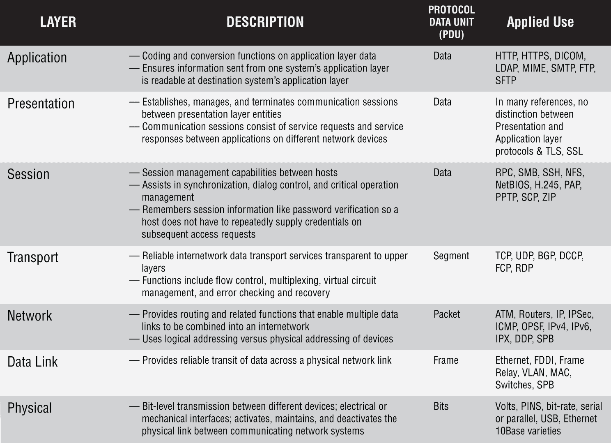

**FIGURE 4.1 The OSI reference model**

#### Layer 1: Physical Layer

物理层负责通过传输介质（例如网络电缆或无线链路）从一个设备到另一个设备传输和接收原始数据。该层将数字位转换为可在给定传输介质上传输的电信号（或其他形式的能量）。

如前所述，物理层负责通过连接网络中设备的物理链路传输原始位，而不是逻辑数据包。物理层规范涉及电信号、光信号（光纤、激光）、电磁波（无线网络）或声音。一些常见的物理层实现是 Ethernet、Bluetooth 和 USB。有关物理层组件的更多介绍，请参阅本章后面的“传输介质”部分。

物理网络拓扑也在本层定义。计算机网络的 `physical topology` 是各种节点及其连接的结构和排列，表现为节点之间的链路。物理拓扑并不总是与 `logical topology` 相同，后者描述数据如何在网络中流动。有四种基本的物理网络拓扑：环形、总线、星形和网状。它们将在本章后面的“网络拓扑”部分中讨论。

##### Layer 1 Attack Vectors

物理层攻击是试图渗透设备和连接介质或干扰其操作的尝试。这可能包括被动嗅探，无论是通过电缆还是无线，造成过度的电气干扰，或简单地切断电缆。有关嗅探和干扰等攻击的技术细节将在本章后面讨论。然而，在物理层，可能导致破坏或拒绝服务的攻击比比皆是。

#### Layer 2: Data Link Layer

数据链路层是 OSI 模型的第二层，它在物理链路上在网络节点之间传输数据。该层在传输前将位编码为数据包，然后将数据包解码回位。数据链路层是网络规范协议建立的地方。具体来说，设备如何连接，例如总线或环形拓扑，是在本层设置的。数据链路提供可靠性，因为它建立了同步、错误控制、警报和流量控制的能力。这些服务很重要，因为如果传输或数据包排序失败，错误和警报有助于快速纠正问题。数据链路层的流量控制至关重要，以便设备以可管理的速率发送和接收数据流。

根据电气和电子工程师学会（IEEE）根据 IEEE 802 系列规范的规定，数据链路层有两个子层。这些是逻辑链路控制（LLC）和媒体访问控制（MAC）。

LLC 控制数据包同步、流量控制和错误检查。该上层子层在下方的 MAC 子层和上方的网络层（第 3 层）之间提供接口。LLC 促进节点到节点的流量控制和错误管理，例如自动重传请求（ARQ）。

MAC 子层是上层 LLC 与下层物理层（第 1 层）之间的接口。MAC 子层负责控制网络上的设备如何获得传输数据的权限。MAC 提供寻址机制和信道访问，以便网络上的节点相互通信。MAC 寻址工作在数据链路层（第 2 层）。它与 IP 寻址类似，只是 IP 寻址适用于网络层（第 3 层）执行的网络和路由。MAC 寻址通常被称为 `physical addressing`，而 IP 寻址（在网络层执行）被称为 `logical addressing`。网络层寻址将在下一节中讨论。

MAC 地址是唯一且特定于每个计算设备的。它是一个 12 位十六进制数字，长 48 位。常见的 MAC 地址格式有两种，MM:MM:MM:SS:SS:SS 和 MM-MM-MM-SS-SS-SS。MAC 地址的第一半部分，称为 `prefix`，包含适配器制造商的 ID 号。这些 ID 由 IEEE 监管。例如，前缀 00:13:10、00:25:9C 和 68:7F:74（以及许多其他）都属于 Linksys（Cisco Systems）。MAC 地址的第二半部分代表制造商分配给适配器的序列号。来自不同制造商的设备可能具有相同的设备部分，即最右边的 24 位数字。前缀会不同以实现唯一性。

## Layer 2 Attack Vectors

数据链路层特有的攻击向量示例包括伪造 MAC 地址，也称为 `Address Resolution Protocol (ARP) spoofing`。通过伪造 ARP 请求或回复，攻击者可以欺骗数据链路层交换，将 intended for 合法主机的网络流量重定向到攻击者的机器。ARP 欺骗也是中间人（MITM）攻击和会话劫持攻击的常见前奏。

## Layer 3: Network Layer

网络层提供路由和其他功能，使数据包能够从一个节点发送到另一个节点，无论是在同一网络内还是在互连网络之间。网络层从传输层接收服务请求，并向数据链路层发出服务请求。网络层功能包括逻辑连接建立、数据转发、路由、数据包分片和交付错误报告。

在此层，需要对设备的逻辑寻址来构建跨网络和网络之间的流量流；逻辑寻址，也许更熟悉为 IP 地址，是网络层概念。IP 地址将在即将到来的题为“Internet Protocol Networking”的部分中详细讨论。

网络层协议有面向连接和无连接两种。在面向连接协议中，在数据传输开始之前，先在两个设备之间建立逻辑连接。面向连接协议也存在于 OSI 模型的更高层。在无连接协议中，只要设备有数据要发送给另一个设备，它就直接发送。

网络层的主要职责是在网络中路由流量。路由协议指定路由器如何在网络上相互通信，而路由协议用于将数据从一个网络发送到另一个网络。简而言之，路由协议在网络间传输路由协议消息。路由协议学习路由协议的路由（或路径），并用于在这些路由（路径）上传输数据包。

在网络层定义了几种路由协议：Border Gateway Protocol（BGP），一种互联网域间路由协议；Open Shortest Path First（OSPF），一种为 TCP/IP 网络开发的链路状态、内部网关协议；以及 Routing Information Protocol（RIP），一种使用跳数作为度量的互联网路由协议。逻辑寻址通过 Internet Protocol（IP）和 Internetwork Packet Exchange（IPX）等路由协议在此层实现。

在网络层发生了一些值得注意的功能：

*   **Internet Protocol (IP):** IP 是一组用于在网络上寻址和路由数据的要求，包括互联网。
*   **Addressing:** IP 促进数据从主机到目标 IP 地址的传输，遍历网络直到找到并到达目标地址。
*   **Host addressing:** 每个主机都有一个唯一地址以提供其在互联网上的逻辑位置。该地址是 IP 地址。
*   **Message forwarding:** 网关或路由器是网络上的专用设备或主机，用于在跨 WAN 分段、分区或互连的网络之间转发数据。
*   **Fragmentation:** 数据包大小可能很大且复杂。网络层促进将数据包细分为可管理或允许的大小，而不会丢失数据完整性。
*   **Internet Protocol Security (IPSec):** 当实施时，使用虚拟专用网络（VPN）和加密的安全通信可通过这组为 IP 提供安全性的协议实现。IPSec 将在下一节“Internet Protocol Networking”中进一步讨论。

一系列协议在网络层运行。BGP 为互联网的路由提供了大部分骨干。RIP（前面也提到过）是一种早期协议，偶尔仍在使用。OSPF 是一种快速、可扩展的协议，用于大型企业网络。Internet Control Message Protocol（ICMP）用于故障排除和错误控制目的。Internet Group Management Protocol（IGMP）用于同时向多个接收者传输消息。以下各节更详细地研究这些协议如何在网络层工作。

### Border Gateway Protocol

`autonomous system`（AS）是由单个实体或组织管理或控制的大型网络或网络组。BGP 是一种在不同 AS 之间使用的路径向量路由协议。它是所有路由协议中最普遍和可扩展的，因为它是全球互联网和服务提供商的私有网络的路由协议。当 BGP 在自治系统之间运行（例如在互联网服务提供商或 ISP 之间）时，称为外部 BGP（eBGP）。当它在单个自治系统内运行（例如在大型私有网络内）时，称为内部 BGP（iBGP）。

BGP 通过在互联网上导航最少的 AS 数量来选择最短路径。路径存储在路由信息库（RIB）中。每个目的地的路由表中只存储一条路由，但 RIB 知道通往目的地的多条路径。每个路由器确定从 RIB 存储哪些路由，RIB 跟踪可能的路由。当路由被删除时，RIB 会静默地删除它们，而不会通知对等体。RIB 条目永远不会超时。

BGP 最初设计为仅携带互联网可达性信息，但其功能已扩展到携带多播、IPv6、VPN 和各种其他数据的路由。

确定最佳路径的任务中存在固有的漏洞。漏洞在于一个地区的网络可能会对远在该地区之外的流量的路径产生负面影响。对控制其边界内网络流量的国家来说，这种漏洞被利用了。2018 年中国和俄罗斯发生的一个例子中，两国都滥用了 BGP 的运行方式，将流量重定向远离其边界并通过其边界。西方国家经历了几分钟的可用性中断，而核心互联网路由器在冲突消息和收敛路径更新中苦苦挣扎。

### Routing Information Protocol Versions 1 and 2

分配逻辑地址（即 IP 地址）给网络需要一种机制来告知路由器哪些网络是直接或间接可访问的。过去，路由表中的手动条目创建了静态路由，迫使两地之间的流量沿指定路径传输。随着更多网络的加入，高效维护这些表需要采用基于标准的协议来自动共享此信息。路由协议的演进反映了互联网的增长，以应对范围和日益复杂的互联基础设施。

## 路由信息协议（RIP）

`Routing Information Protocol (RIP)` 是最早的路由协议之一，也是第一个使用距离向量路由方法的协议。`RIP` 使用信号沿网络路径经过的跳数。`RIP` 允许最多 15 跳，在第 16 跳时，距离被视为无限且目标不可达。此限制限制了 `RIP` 可支持的网络规模，但也是 `RIP` 防止路由环路的原因（路由环路发生在数据包不断通过同一路由器反复路由）。除了跳数外，`RIP` 还实现了水平分割、路由中毒和保持计时器以防止路由环路。

* **水平分割：** 此路由配置可防止路由被通告回其来源的方向。
* **路由中毒：** 当路由器检测到其连接的某条路由失败时，路由器将失败路由的跳数设置为 16，从而将该路由设为不可达。
* **保持计时器：** 当路由器收到某条路由不好的信息时，它会建立一个保持期，在此期间路由器既不会通告该路由也不会接受关于该路由的通告。

`RIP` 路由器每 30 秒传输一次完整更新。当该技术诞生时，这并不被认为是个问题。随着时间的推移，网络上路由设备的数量增加，造成了流量突发高峰的潜在风险。理论是随机部署新设备有助于随时间推移使流量流向正常化。

由于收敛时间和可扩展性问题普遍存在，`RIP` 在大多数网络环境中并非首选。然而，由于 `RIP` 得到广泛支持、配置简单且不需要任何参数，不像其他协议，`RIP` 在较小的网络中仍是一个潜在选择。

`RIP` 使用 `User Datagram Protocol (UDP)` 作为其传输协议，并被分配保留端口号 520。

### 开放最短路径优先版本 1 和 2

`OSPF` 协议在大型企业网络中很常见，因为它提供快速收敛和可扩展性。收敛是指路由表如何更新。`OSPF` 是一种链路状态协议，具体来说是互联网工程任务组（IETF）标准化的内部网关协议（IGPs）之一。链路状态协议从附近的路由设备收集信息并创建网络拓扑，使协议非常高效。`OSPF` 监控拓扑，并在检测到变化时自动重新路由拓扑。几秒钟内，`OSPF` 能够从链路故障中重新路由并创建无环路由。

`OSPF` 支持 Internet 协议版本 4 (`IPv4`) 和 `IPv6` 网络。`IPv6` 的更新被指定为 `OSPF` 版本 3。`OSPF` 计算流量负载并寻求在路由之间平衡负载。为此，包含多个变量，例如路由器的往返距离（以时间为单位）、链路的数据吞吐量，或链路可用性和可靠性。`OSPF` 将数据直接封装在协议号为 89 的 IP 数据包中。它不使用 `UDP` 或 `TCP` 等传输协议。

### 互联网控制报文协议

`ICMP` 消息有三个字段区分 `ICMP` 数据包的类型和代码，且这些值在传输过程中头部中永不改变。随后是 `ICMP` 特定信息，然后是原始 IP 头部信息。`ICMP` 流量的最常见用途是手动故障排除（`ping` 实用程序）和网络诊断（`traceroute` 实用程序）以及 IP 传输期间系统生成的错误消息。

`ICMP` 信息用于在 IP 传输出现错误时进行故障排除和控制目的。在 `ICMP` 实用程序中，每个设备转发一个 IP 数据包，随后可以向源地址发送 `ICMP` 消息。例如，使用 `ping` 和 `traceroute`，源 IP 地址可以确定几个有用的网络映射消息，例如目标不可达、回显请求和应答（`Ping`）、重定向、时间超过，以及路由器通告和路由器请求。所有这些在安全人员的日常操作中都很重要。

`Ping` 和 `traceroute` 也可被攻击者用来识别主机位置（`ping`），以及出于恶意目的映射网络以进行各种未来攻击（`traceroute`）。

### 互联网组管理协议

`IGMP` 在网络层运行，但特定于组内的主机或路由器。`IGMP` 是执行 IP 组播传输所必需的关键协议。当应用程序需要执行一对多传输时，组播变得有用，例如 CEO 向其员工进行视频组播。很可能，对 `IGMP` 的攻击始于对使用 `IGMP` 的组播路由软件或硬件设备本身的攻击。

#### 第三层攻击向量

网络层攻击通常特定于网络流量如何被路由。`MITM` 攻击，即流量被重定向到恶意行为者，是网络层攻击的一个例子。网络地址的伪造或伪造是另一种常见的网络层攻击形式。假设攻击者可以访问资源，执行最简单的攻击可能是拒绝服务（`DoS`）攻击，即简单地使目标资源不堪重负。

## 第四层：传输层

传输层负责提供可靠的数据传输和端到端传输控制。该层协议提供主机到主机的通信服务，并管理数据包从一个主机到另一个主机的传输，跨越网络。传输层为上层（第 5 层至第 7 层）提供标准化访问，使其无需关心下层（第 1 层至第 3 层）的细节。

在传输层发生的某些功能是流量控制、多路复用、虚电路管理，以及错误检查和恢复。

* 流量控制管理数据传输，防止发送设备使接收设备的处理能力不堪重负。
* 多路复用允许多个应用程序沿单一物理链路传输数据。
* 虚电路由传输层建立、维护和终止。
* 错误检查涉及创建各种检测传输错误的机制。
* 错误恢复解决诸如请求重传数据之类的错误。

每个安全专业人员必须熟悉的两个主要传输层协议是：`TCP` 和 `UDP`。

### 传输控制协议

`TCP` 是一种面向连接的协议，这意味着通信设备必须在传输任何数据（并且可能丢失）之前建立可靠的连接；数据传输完成后还必须关闭该连接。`TCP` 通过三次握手建立连接。 Figure 4.2 说明了典型的三次握手过程。

除了面向连接之外，`TCP` 还通过流量控制和数据确认提供广泛的错误检查机制。该协议强制执行数据排序，使得数据包以发送设备发送的顺序到达接收主机，并且支持在数据包丢失时进行数据包重传。

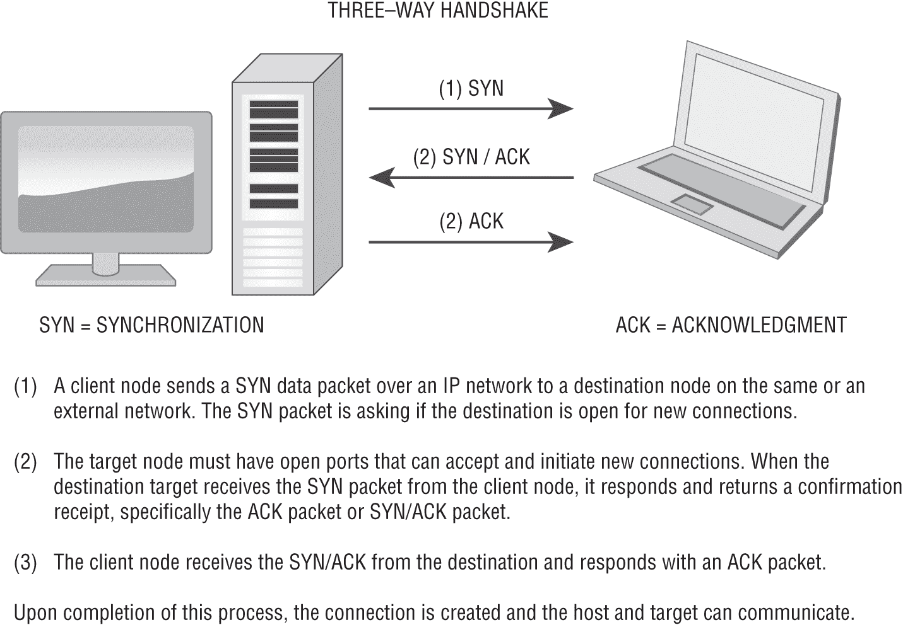

**FIGURE 4.2 TCP three-way handshake**

TCP 的面向连接特性使其成为一种可靠的协议，因为它通过确认数据包、检查丢失或损坏的数据包，并在必要时请求重传来保证交付。由于与三次握手、确认数据包以及错误检查和纠正相关的额外开销，TCP 通常比无连接协议如 UDP 更慢。TCP 被超文本传输协议（HTTP）、超文本传输协议安全（HTTPS）和文件传输协议（FTP）以及其他需要可靠数据传输和广泛错误检查的协议所使用。

### User Datagram Protocol

与 TCP 相比，UDP 是一种无连接协议。建立连接、维护连接或终止连接时没有开销，这使得 UDP 比 TCP 更简单、更快、更高效。

UDP 通常被称为“尽力而为”通信协议。它不提供 TCP 的任何功能——没有错误检测或纠正，没有排序，没有流量控制机制——也不使用预先建立的会话。简而言之，UDP 被认为是一种不可靠的协议，这对于某些应用来说是可以接受的。该协议的低开销允许快速数据传输，这对于实时音频和视频流来说是理想的，在这种情况下，速度比确保每个数据包完美到达更重要。UDP 也常被域名系统（DNS）、动态主机控制协议（DHCP）、简单网络管理协议（SNMP）和语音 over IP（VoIP）等应用所使用。物联网（IoT）技术的持续兴起也导致 UDP 使用量的增加，因为传感器数据通常非常适合通过 UDP 而非 TCP 发送。

### Layer 4 Attack Vectors

特有的传输层攻击向量包括利用 TCP 和 UDP 的攻击。一个具体例子是 SYN 洪水攻击，它通过持续发起基于 TCP 的连接但不允许其完成来耗尽目标的网络内存资源；这会造成 DoS，从而阻止合法连接目标。特洛伊木马和其他恶意软件也倾向于针对特定的 TCP 和 UDP 端口。会话劫持是另一种常见的攻击，可以在第 4 层（以及其他层）运行。

## Layer 5: Session Layer

会话层促进网络上系统之间的逻辑、持久连接。该层控制本地应用程序与远程应用程序之间的对话（连接）。会话层负责在终端用户应用程序进程之间高效、有效地建立、协调和终止会话。

会话层通常在应用远程过程调用（RPC）来处理应用程序之间发生的请求和响应的应用中实现。RPC 是应用程序环境在各种网络设备上的应用程序之间进行服务请求和服务响应的机制。换句话说，RPC 允许在客户端上创建过程（任务或指令序列）并在服务器设备上执行——会话层管理此过程。

建立会话时可选择三种主要操作模式：

* **Full-duplex mode:** 这是在两个设备之间的连接上同时双向发送数据的情况。全双工通道可以构建为一对单工链路，也可以利用一个设计用于允许双向同时传输的通道。如果多个设备需要使用全双工模式连接，则需要许多单独的链路，因为一个全双工链路只能连接两个设备。
* **Half-duplex mode:** 半双工具有双向发送数据的能力，但一次只能在一个方向上发送。虽然这看起来像是相对于全双工能力的下降，但它在同轴电缆、射频和以太网等单一网络介质上被广泛使用并取得成功。例如，通信在设备轮流发送和接收时效果良好。
* **Simplex mode:** 这种模式涉及使用作为单向街道运行的通信通道。单工构造的示例是光纤运行或网络电缆作为单股发送数据，而另一个单独的通道接收数据。

### Layer 5 Attack Vectors

什么类型的攻击针对会话层？该层和表示层并不是常见攻击的热门目标。路由或基于数据包的攻击（OSI 模型中较低层）和应用层攻击（OSI 模型中较高层）为攻击者提供了“低垂的果实”，使会话层和表示层处于识别漏洞的尴尬抽象层级。尽管如此，鉴于该层的功能，你可以假设一种攻击，即在网络上建立会话的身份验证被破坏。还有特定的会话层协议，例如 NetBIOS 和网络文件系统（NFS），可能容易受到 DoS 和 root 权限攻击，例如。已弃用的安全套接层（SSL）协议和不太安全的传输层安全（TLS）版本中的弱点也是会话层的首要目标。

## Layer 6: Presentation Layer

表示层的作用是在较低层和应用层之间转换数据。在较低层，数据作为数据报和数据包发送。表示层是 OSI 模型中数据结构和表示首次显现的第一层，因为该层负责对要呈现给应用层的数据应用编码和转换功能。

以下是该层编码和转换的一些示例：

* 常见的数据表示格式，例如使用标准图像、声音和视频格式
* 常见的数据压缩方案，例如 JPEG 和 MPEG
* 常见的数据加密和解密方案

这些功能使不同类型的计算机系统之间能够交换应用数据。简而言之，表示层确保格式按需转换并呈现给应用层。

### Layer 6 Attack Vectors

该层最常见的攻击涉及对加密方案本身的攻击。密码学和密码分析攻击在 Chapter 3，“Security Architecture and Engineering” 中有所介绍。

## Layer 7: Application Layer

应用层是 OSI 模型的最高层，也是离最终用户最近的层。该层为软件应用程序提供网络访问并为用户提供接口。软件应用程序并不驻留在应用层。相反，该层通过较低层促进通信，以与网络连接另一端的应用程序建立连接。Web 浏览器（例如 Chrome、Safari、Firefox）、HTTP、FTP 和 Telnet 都依赖应用层正常运行。

### Layer 7 Attack Vectors

特定于应用层的攻击向量差异很大，大多数安全漏洞都发生在这一层。为列出开始，考虑应用层协议的弱点，例如 HTTP、FTP、简单邮件传输协议（SMTP）和 SNMP。用户界面上的每一次攻击都属于此类，以及基于 Web 的攻击，例如 HTTP 泛洪或输入验证攻击。SQL 注入和跨站脚本（XSS）是运行在应用层最常见的攻击之一。

在应用层，服务支持用户应用程序，用户身份验证在此进行。除了这些攻击向量之外，身份验证弱点（例如弱密码或管理不善的密码）也在该 OSI 层提供了关键的攻击向量。

### TCP/IP 参考模型

TCP/IP 参考模型是一个四层概念模型，最初由美国国防高级研究计划局（DARPA）在 1960 年代开发。TCP/IP 模型的四个层是应用层、传输层、互联网层和链路层（或网络访问层），如图 Figure 4.3 所示。

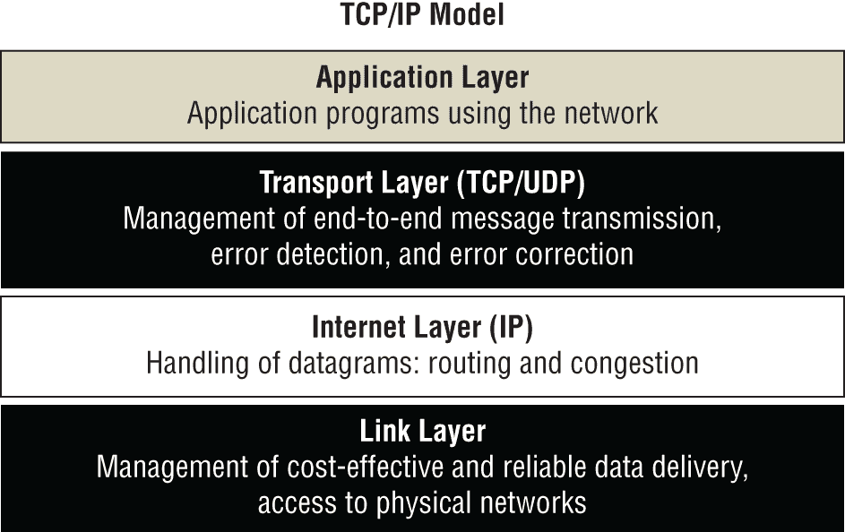

**FIGURE 4.3 The TCP/IP reference model**

TCP/IP 模型中的每一层都对应于七层 OSI 模型中的一个或多个层。有关比较，请参阅 Figure 4.4。

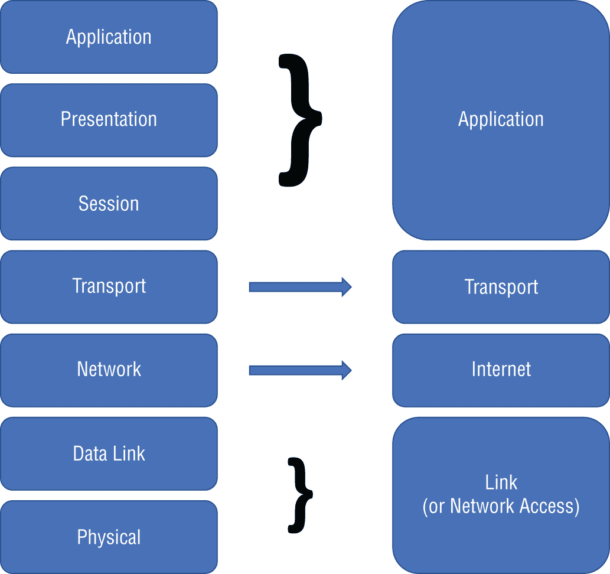

**FIGURE 4.4 Comparison of the OSI and TCP/IP models**

#### Link (or Network Access) Layer

链路层被称为其他几个名称，包括网络访问层或数据链路层（事实上，TCP/IP 模型的链路层包含与 OSI 模型的数据链路层相同的一些功能）。将其视为主机系统与网络硬件之间的物理接口。该层的作用是以可靠的方式在网络传输通道上促进 TCP/IP 数据包。该层可以检测传输错误。该层确定常见的链路标准（如 IEEE 802.2 和 X.25）如何格式化数据包以进行传输和路由。TCP/IP 的设计方式允许数据格式独立于网络访问方法、帧格式和建立 TCP/IP 以跨不同或不同网络互连的介质。这种对任何特定网络技术的独立性使得 TCP/IP 和 OSI 7 层模型都能够扩展到像异步传输模式（ATM）这样更新的网络技术。

链路层提供的有几个重要服务：

* **Data frame:** 这是从发送方发送的比特或符号的定义序列，接收方用它来在接收到的其他比特或符号的整体流中找到有效载荷数据的开始和结束。
* **Checksums:** 数据在数据帧内使用，以管理数据的完整性并使接收方知道数据帧已无错误接收。
* **Acknowledgment:** 这使得数据传输具有可靠性，因为在数据接收时发出积极确认。当预期数据但未接收到时，会收到超时通知或否定确认。
* **Flow control:** 为了保持流量并避免因拥塞而产生的错误，链路层支持缓冲数据传输以调节快速发送方与慢速发送方。

#### Internet Layer

使用 `IP`、`ARP`、`ICMP` 和 `IGMP` 等核心协议，互联网层负责数据包的寻址、打包和路由功能。与链路层不同，互联网层不利用数据排序和确认服务。

互联网层执行几个宝贵的功能。为了将数据包从主机传输到主机，`IP` 选择下一个跳或网关，将传出数据包跨链路层发送。如果数据满足传输参数，则将传入数据包的数据传输到传输层。为此，互联网层有助于错误检测和诊断功能，以便数据不会出错传输。

这些是驻留在该层的主要协议：

* `IP` 是负责寻址、路由以及数据包的分段和重组的首要可路由通信协议。
* `ARP` 从给定的 IP 地址解析主机的硬件地址。
* `ICMP` 提供诊断功能和错误报告，当数据包交付不成功时。

#### Transport Layer

在传输层，为应用层提供会话和数据报通信服务。你也可能听到该层被称为 *主机到主机传输层*。在 TCP/IP 模型中，传输层不使用链路层的特性。它假设链路层是不可靠的连接。因此，在传输层，会话建立、数据包确认和数据排序得以实现，以实现可靠通信。传输层核心协议是 `TCP` 和 `UDP`，两者都在 OSI 7 模型的“第 4 层：传输层”部分中讨论过。

#### Application Layer

为了使应用程序能够访问 TCP/IP 模型其他层提供的服务，应用层定义了应用程序使用的[content]

在应用层，服务支持用户应用程序，用户身份验证在此进行。除了这些攻击向量之外，身份验证弱点（例如弱密码或管理不善的密码）也在该 OSI 层提供了关键的攻击向量。

### TCP/IP 参考模型

TCP/IP 参考模型是一个四层概念模型，最初由美国国防高级研究计划局（DARPA）在 1960 年代开发。TCP/IP 模型的四个层是应用层、传输层、互联网层和链路层（或网络访问层），如图 Figure 4.3 所示。

**FIGURE 4.3 The TCP/IP reference model**

TCP/IP 模型中的每一层都对应于七层 OSI 模型中的一个或多个层。有关比较，请参阅 Figure 4.4。

**FIGURE 4.4 Comparison of the OSI and TCP/IP models**

#### Link (or Network Access) Layer

链路层被称为其他几个名称，包括网络访问层或数据链路层（事实上，TCP/IP 模型的链路层包含与 OSI 模型的数据链路层相同的一些功能）。将其视为主机系统与网络硬件之间的物理接口。该层的作用是以可靠的方式在网络传输通道上促进 TCP/IP 数据包。该层可以检测传输错误。该层确定常见的链路标准（如 IEEE 802.2 和 X.25）如何格式化数据包以进行传输和路由。TCP/IP 的设计方式允许数据格式独立于网络访问方法、帧格式和建立 TCP/IP 以跨不同或不同网络互连的介质。这种对任何特定网络技术的独立性使得 TCP/IP 和 OSI 7 层模型都能够扩展到像异步传输模式（ATM）这样更新的网络技术。

链路层提供的有几个重要服务：

* **Data frame:** 这是从发送方发送的比特或符号的定义序列，接收方用它来在接收到的其他比特或符号的整体流中找到有效载荷数据的开始和结束。
* **Checksums:** 数据在数据帧内使用，以管理数据的完整性并使接收方知道数据帧已无错误接收。
* **Acknowledgment:** 这使得数据传输具有可靠性，因为在数据接收时发出积极确认。当预期数据但未接收到时，会收到超时通知或否定确认。
* **Flow control:** 为了保持流量并避免因拥塞而产生的错误，链路层支持缓冲数据传输以调节快速发送方与慢速发送方。

#### Internet Layer

使用 `IP`、`ARP`、`ICMP` 和 `IGMP` 等核心协议，互联网层负责数据包的寻址、打包和路由功能。与链路层不同，互联网层不利用数据排序和确认服务。

互联网层执行几个宝贵的功能。为了将数据包从主机传输到主机，`IP` 选择下一个跳或网关，将传出数据包跨链路层发送。如果数据满足传输参数，则将传入数据包的数据传输到传输层。为此，互联网层有助于错误检测和诊断功能，以便数据不会出错传输。

这些是驻留在该层的主要协议：

* `IP` 是负责寻址、路由以及数据包的分段和重组的首要可路由通信协议。
* `ARP` 从给定的 IP 地址解析主机的硬件地址。
* `ICMP` 提供诊断功能和错误报告，当数据包交付不成功时。

#### Transport Layer

在传输层，为应用层提供会话和数据报通信服务。你也可能听到该层被称为 *主机到主机传输层*。在 TCP/IP 模型中，传输层不使用链路层的特性。它假设链路层是不可靠的连接。因此，在传输层，会话建立、数据包确认和数据排序得以实现，以实现可靠通信。传输层核心协议是 `TCP` 和 `UDP`，两者都在 OSI 7 模型的“第 4 层：传输层”部分中讨论过。

#### Application Layer

为了使应用程序能够访问 TCP/IP 模型其他层提供的服务，应用层定义了应用程序使用的

NAT 可以在多种不同的设备上实现，例如防火墙、路由器、网关和代理。它只能在 IP 网络上使用，并在网络层（第 3 层）运行。最初，NAT 的设计目的是延长 IPv4 的使用，因为可用地址池很快被耗尽。就这一点而言，NAT 是一种遗留技术，具有优点和缺点。

首先，考虑其优点。NAT 用于实现网络和安全目标，以隐藏内部客户端的身份，掩盖私有网络的可路由设计，并通过尽可能使用最少的公共 IP 地址来将网络寻址成本降至最低。图 4.5 显示了 NAT 可能在边界防火墙上实现的示例。通过 NAT 流程，组织分配内部 IP 地址，也许甚至是私有寻址方案。NAT 设备会编目这些地址，并将其转换为用于在互联网上传输的公共 IP 地址。在内部网络中，NAT 允许使用任何地址，并且不会与具有相同 IP 地址的公共互联网主机发生冲突或冲突。实际上，NAT 将内部客户端的 IP 地址转换为环境外部的租用地址。NAT 提供了众多好处，包括以下内容：

*   NAT 使用仅一个或少数几个租用的公共 IP 地址将整个私有网络连接到互联网。
*   NAT 在私有网络中使用私有 IP 地址（`10.0.0.0` 到 `10.255.255.255`）并保留与互联网通信的能力，因为 NAT 会将其转换为公共、可路由地址。
*   NAT 将内部私有网络的 IP 寻址方案和网络拓扑结构隐藏在互联网之外。
*   NAT 确保从内部受保护网络发起的连接可以从互联网返回到网络。

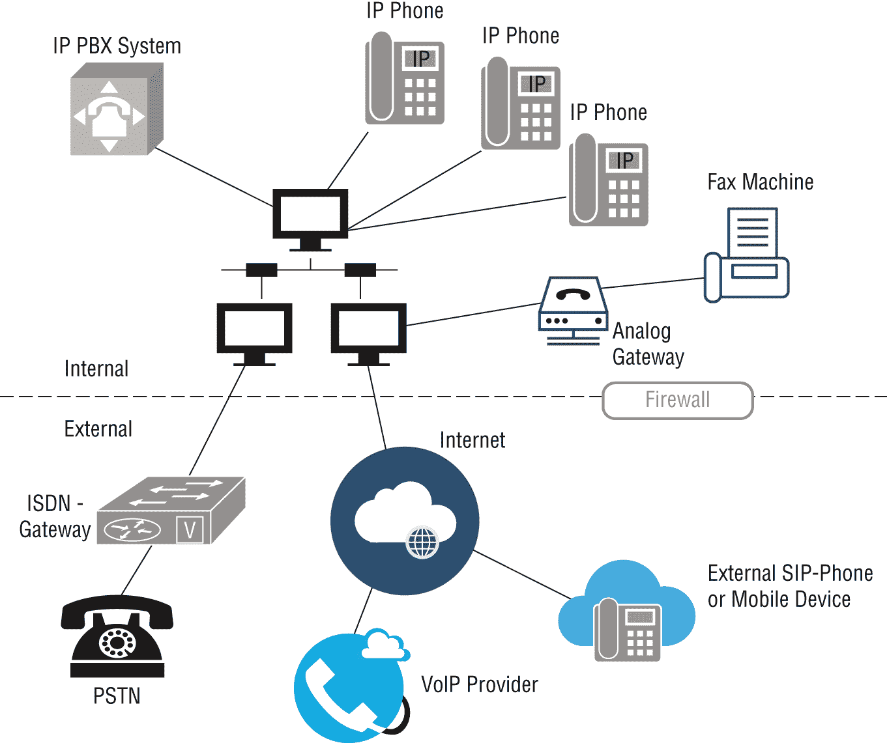

**FIGURE 4.5 NAT implemented on a perimeter firewall**

公共 IP 地址在剩余的 A 类（参见 Table 4.1）地址多年前耗尽后基本上已全部分配完毕。这解释了 NAT 流行度上升的趋势。安全问题也支持使用 NAT，它可以减轻许多入侵类型的攻击。随着 IPv4 中大约只有 40 亿个地址可用，世界已经部署了使用 IP 的设备数量超过了可用的唯一 IP 地址数量。互联网和 TCP/IP 的早期设计者为私有、非限制性使用保留了几个地址块的事实正变得越来越明智。这些预留的 IP 地址被称为私有 IP 地址，在标准 RFC 1918 中定义。

现在，考虑 NAT 的一些缺点。同样请记住，NAT 是为应对 IPv4 地址耗尽而开发的。为此，NAT 被认为是一种临时解决方案。因为它被认为只是临时的，负责定义协议标准的 IETF 并未追求为 NAT 创建深入的官方标准。事实上，虽然 IETF 认识到 NAT 的好处并发布了一般规范，但它避免开发技术规范以阻止 NAT 的广泛采用。仅此一点，NAT 最大的缺点就是其在设备中的实现不一致。

NAT 的一些技术缺点已被认识到，但对这些问题的解决方案是在无需重新发明 NAT 的情况下发现或开发的。例如，考虑点对点通信如何处理。没有 NAT 时，发起者与目标通信。只要发起者和目标都有可路由地址，这就不是问题。实施 NAT 后，互联网上的发起者寻求与 NAT 后面的目标连接时无法连接到不可路由地址。解决此问题的一种方法是让点对点会话“向后”开始，目标首先与发起者连接以发现 NAT 的存在。然后，一旦 NAT 的外部公共地址已知，原点就可以开始新的点对点会话。Skype 等依赖点对点或 VoIP 协议的服务需要创造创新的方法来绕过 NAT 否则会破坏其服务的方式。例如，Skype 采用公共地址上的“超级节点”以允许点对点连接，即使目标和发起者都位于 NAT 后面。

另一个缺点是 IPSec 如何检查完整性。IPSec 计算哈希值以确保每个数据包的完整性。该哈希值使用数据包的各个部分计算，由于 NAT 更改了数据包的值，因此该哈希值不再有效。为了解决这个问题，开发了 NAT-Traversal（`NAT-T`）技术。`NAT-T` 确保当 IPSec 隧道的一端或两端跨越 NAT 设备时，IPSec 不会被破坏。

虽然 NAT 是 IPv4 网络的关键技术，但在 IPv6 中该技术不再需要。这是最新版本的互联网协议提供的多项改进之一，将在下一节中讨论。

## Internet Protocol Version 6

与 IPv4 的 32 位 IP 地址相反，IPv6 使用 128 位 IP 地址来支持比其旧版本多得多的地址数量。每个 IPv6 地址分为四个十六进制数字，以冒号分隔寻址，并分为两部分：64 位网络前缀和 64 位接口标识符。IPv6 地址的示例看起来像 `2607:F0F0:1002:00B1:0000:0000:0000:0004`。增加的复杂性使 IPv6 能够支持 1,028 倍于 IPv4 地址的总数，从而使互联网连接的设备能够在可预见的未来扩展。IPv6 方案还旨在改进网络寻址和路由。

IPv6 相对于 IPv4 的一些主要好处包括以下内容：

*   **作用域地址：** 这为管理员增加了安全性和访问控制层，管理员可以对网络服务（如文件服务器或打印）进行分组，然后拒绝或允许访问。
*   **自动配置：** 这消除了对 DHCP 和 NAT 的需求，得益于更大的公共地址空间。
*   **服务质量（QoS）优先级值：** 基于内容优先级，流量管理根据预设的 QoS 优先级值进行。

IPv6 由 IETF 开发以管理 IPv4 地址耗尽的预期问题，但 IPv6 的采用缓慢。自 2000 年左右以来，操作系统已具备使用 IPv6 的能力，无论是原生还是通过插件。采用障碍包括某些 IPv6 兼容设备的额外成本以及 IPv4 运行良好的事实。决策者不愿为了改变而改变，或进行提供最小财务投资回报率（ROI）的流程改进。IPv6 的早期采用者可在大型企业、私有内部网络、研究实验室和大学中找到。

## Network Attacks

网络协议是在安全必要性尚未完全被认识到的很久以前设计的。因此，即使在今天，网络主机仍然容易受到攻击，网络系统也未能实施缓解控制。即使针对利用错误配置和不必要服务发起的攻击进行了加固的系统，仍然可能受到利用网络服务的攻击。网络协议已采用了多次更新和修订，但由于安全被设计为事后考虑，弱点仍然存在，尽管进展仍在继续。

本章前面“开放系统互连与传输控制协议/互联网协议模型”部分探讨了 OSI 模型及其层级如何从物理层抽象到应用层。它研究了既定协议在这些层级中的位置。该部分还涉及了每个 OSI 层存在哪些攻击向量，以揭示其中的一些漏洞。

通过了解网络主机如何相互通信，安全专业人员可以更好地理解网络攻击如何发生并取得成功。掌握这些信息后，以下部分将深入探讨各种网络攻击。

## 分布式拒绝服务攻击

当攻击者不具备实施复杂攻击的技能或工具时，他们可能会使用暴力攻击，这同样可能有效。只需从受感染的机器向目标系统泛滥 UDP 数据包就已证明是成功的，尤其是随着物联网设备被无意中用于发起这些分布式拒绝服务（DDoS）攻击。典型的 DDoS 攻击由大量被劫持的单台机器组成，它们在短时间内向目标倾泻压倒性的流量。任何一台被攻陷机器的个体贡献——无论是 PC、物联网设备、网络硬件还是服务器——都不会造成损害，但集体总和会产生压垮目标的巨大流量。

### SYN 泛洪

为了使系统过载，此类攻击会向接收方轰炸大量 SYN 数据包，而发送方或发送方不承认任何回复。SYN 泛洪是一种 DoS 攻击，利用传输层（第 4 层）TCP 的特性。TCP 通过发送 SYN 数据包来发起连接，该数据包在被接收并接受后会回复 SYN-ACK 数据包。SYN 泛洪 DoS 攻击是通过发送大量 SYN 数据包执行的。SYN 数据包在接收系统处累积，软件因无法处理溢出而崩溃。攻击者试图消耗足够的服务器资源，使系统对合法流量无响应。有些人将此攻击称为半开攻击，因为其底层是部分的三次握手 TCP 握手。最终，在足够多的连接尝试后，网卡维护开放连接的能力会被耗尽。

尽管此类攻击历史悠久，且缓解措施也几乎同样久远，但 SYN 泛洪仍然是一种常见攻击。缓解 SYN 泛洪漏洞有几种方法。其中最常见的方法如下：

* **增加 backlog 队列：** 这涉及提高系统将维持的半开连接数量的允许值。它需要额外的内存资源来增加最大 backlog。根据内存资源的可用性，缓解 SYN 泛洪威胁可能会降低系统性能。需要对不需要的 DoS 影响和更慢的性能进行风险收益分析。
* **回收最旧的半开 TCP 连接：** 这是一种先进先出队列策略，一旦 backlog 队列限制达到，最旧的半开请求将被覆盖。好处是更快地建立合法连接，比恶意 SYN 数据包填满 backlog 更快。然而，如果 backlog 队列太小或攻击过于庞大，此缓解措施可能不足。
* **SYN cookies：** 服务器对每个连接请求（SYN）回复 SYN-ACK 数据包。SYN 请求从 backlog 中丢弃。端口对新的、理想情况下合法的新连接保持开放。如果初始连接是合法的，原始发送方将发送其 ACK 数据包。创建 SYN cookie 的初始接收方将重建 SYN backlog 队列条目。当然，会有一些限制，因为有关 TCP 连接的一些信息可能会丢失。这比完全的 DoS 中断更有优势。

### DDoS 与物联网

作为一种新兴技术，物联网设备在本章中值得更多关注。从安全角度来看，这些设备为潜在攻击者提供了软目标。它们交付时带有易于猜测的默认设置，或者事实上是公开众所周知的。管理凭据和管理访问对面向互联网的接口完全开放。攻击者可以用相对简单的远程访问代码利用这些设备。加剧漏洞的是，用户与这些设备的交互方式与办公自动化或其他终端计算资产不同。默认设置很少更改，即使最终用户有能力进行更改。供应商通常很慢地提供升级和补丁，如果他们提供售后制造支持的话。正因如此，这些设备很容易成为猎物，用户往往在为时已晚之前都不知道设备已被入侵。

物联网设备的数量给安全专业人员带来了很多担忧。据估计，目前已经有数千万台易受攻击的物联网设备安装或在使用中。这一数字正在增长。互连通常始终在线， ingress 和 egress 未受保护，不像典型的 LAN 或 WAN，但它们享有高速连接。这些变量解释了为什么由大量被劫持的物联网设备组成的僵尸网络会构成严重问题。常见的攻击序列包括破坏设备以发送垃圾邮件或广播消息。如果垃圾邮件过滤器阻止了该攻击，可能会尝试插入定制的恶意软件，例如 fast flux，这是一种用于隐藏垃圾邮件攻击的 DNS 技术。如果这没有造成破坏，可能会发起暴力类型的 DDoS。越来越多的资源充足的网站具有足够的带宽，并且可以在基线或正常使用水平之上扩展容量以抵御大多数攻击。然而，仅是发起攻击的威胁就足以说服网站所有者向勒索者支付赎金，以避免测试目标网站保持响应的能力的极限。

## 中间人攻击

在通信中，发送方和接收方认为他们已连接的情况下，MITM 攻击可能难以检测，并对未受保护的通信构成重大威胁。在 MITM 攻击中，攻击者拦截信号并秘密中继（并可能篡改）通信，然后停止传输或允许消息到达预期接收方。

窃听是一种特定的 MITM 攻击。在这种情况下，攻击者中继消息以完成电路。整个对话被攻击者窃听，在某些情况下被控制，而发送方和接收方认为消息是私密的。Figure 4.6 描述了 MITM 攻击的一般概念。

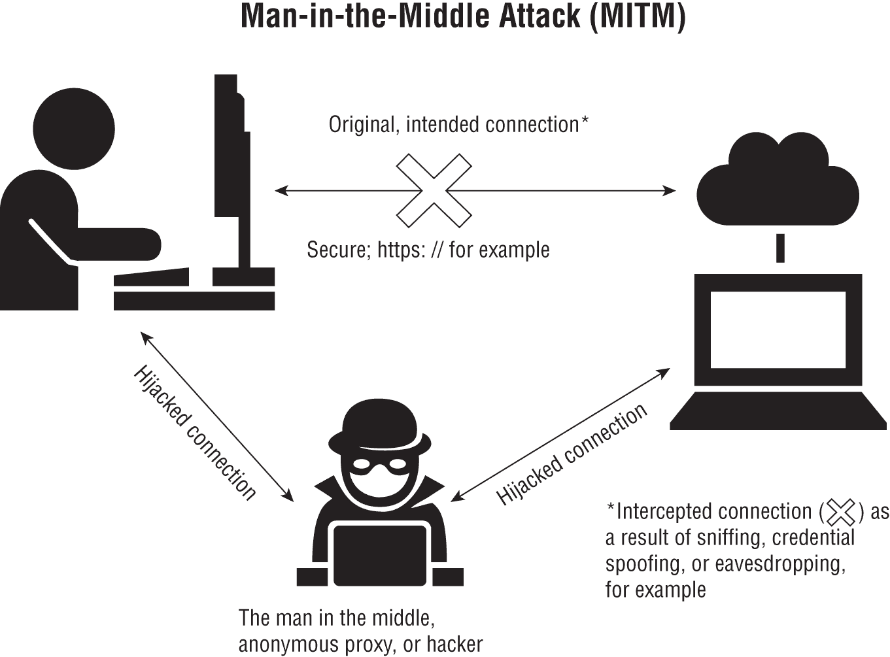

**FIGURE 4.6 Man-in-the-middle attack**

另一种 MITM 攻击类型是冒充。这发生在攻击者规避身份验证过程并破坏一个账户的凭据时。与攻击者通信的端点并不知道通信已被拦截。

防止或检测 MITM 攻击主要有两种方法：身份验证和篡改检测。身份验证提供了一定程度的确定性，即给定消息来自合法来源。篡改检测仅显示消息可能已被更改的证据。

### 身份验证
为防止中间人攻击，密码学协议被用于对端点或传输介质进行身份验证。其中一种技术是使用与 X.509 证书配对的 TLS 服务器。X.509 证书由相互信任的证书颁发机构（CA）用于对一个或多个实体进行身份验证。消息和公钥交换被用于使通道安全。

### 篡改检测
检测中间人攻击的一种方法是检查交易中超出基线预期的任何延迟。响应时间会被检查，并且像哈希函数的长时间计算等正常因素也会被考虑在内。如果延迟无法解释，则可能存在通信中不受欢迎的、恶意的第三方干扰。

### 数据包嗅探
管理员经常出于合法目的使用数据包嗅探工具，例如故障排除。但攻击者进行中间人数据包嗅探以获取对抗性目的的信息。任何未加密的协议都可能受到被动攻击的影响，在这种攻击中，攻击者能够在网络上放置数据包嗅探工具来监控流量。监控可能用于确定流量类型和模式或映射网络信息。在任何情况下，数据包嗅探在为其他类型的攻击做准备时都极大地有利于攻击者。举例来说，如果一个使用数据包嗅探的攻击者发现一家公司仍在使用已弃用的 SSL 密码套件，或发现了 Active Directory（AD）控制器的 IP 地址。攻击者现在就可以利用该过时协议或服务器进行攻击。数据包嗅探还可以包括抓取传输中的数据包并尝试从内容中提取有用信息。某些数据包中包含用户名、密码、IP 地址、信用卡号码和其他有价值的有效载荷。对敏感流量进行加密是防止网络嗅探的最佳方式。

### 劫持攻击
劫持攻击描述了许多不同类型的中间人攻击。劫持攻击是任何涉及会话利用的攻击，会话是设备之间建立的对话。通常，会话由控制机制管理，例如 cookie 或令牌。攻击者可能会尝试拦截或窃听会话令牌或 cookie。在攻击者嗅探到 cookie 或令牌的情况下，攻击者可能会使用合法令牌与服务器连接，与受害者并行。或者攻击者可能会拦截会话令牌以供使用，同时向受害者发送一个特别构造的数据包以终止其初始会话。

许多网站需要身份验证并使用 cookie 来记住会话跟踪信息。当用户注销时会话终止时，cookie 和凭据通常会被清除。在会话处于活动状态时劫持会话并窃取令牌或 cookie，可以为攻击者提供有价值的敏感信息，例如访问了哪些网站的独特详细信息。更糟糕的是，劫持会话 cookie 可能会让攻击者有机会继续会话，冒充受害者。

### MITRE ATT&CK 框架
本章无意列出网络攻击的详尽清单，但 MITRE 组织（通常仅称为 MITRE）维护了一个相当广泛的对手战术和技术知识库，称为 MITRE ATT&CK。该知识库是一个全球可访问的参考资料，其中包含数百种现实世界的攻击战术和技术，旨在为安全专业人员提供在组织中开发威胁模型和方法的基础。你可以在 `attack.mitre.org` 了解有关 MITRE ATT&CK 的所有信息。

## 安全协议
安全协议为通信通道提供安全服务，以及安全的身份验证服务。

一些常见的安全通信协议包括 SSH、TLS、Kerberos、IPSec 和 Internet Key Exchange（IKE）。

### 安全外壳
SSH 是 Telnet 的替代品，支持通过 TCP 进行交互式、文本导向的通信。SSH 是一种加密网络协议，它创建了一个安全隧道，保护通信的完整性，防止会话劫持和其他中间人攻击。

SSH 也是一个客户端-服务器架构，常用于实现远程命令行登录和远程命令执行。任何网络服务都可以用 SSH 来保护。协议规范区分了两个主要版本，称为 SSH-1 和 SSH-2。SSH-1 被认为不安全，而 SSH-2 提供了更安全、更高效的保护，防止窃听、DNS 和 IP 欺骗以及中间人攻击。

### 传输层安全
TLS 是一种安全协议，取代 SSL 成为安全网络流量的主要协议。SSL 是一种面向会话的旧协议，曾被广泛用于保护网络、电子邮件、FTP 甚至 Telnet 流量。SSL 尽管存在已知的安全弱点，但仍被广泛使用，但它不安全，应尽可能被 TLS 取代。TLS 在总体上与 SSL 相同的方式运行，但它使用更强的身份验证和加密协议。SSL 或 TLS 用于创建按需隧道，而不是使用 IPSec 在网络层建立 VPN 并要求每个远程用户安装客户端。远程用户无需安装客户端，并且可以通过网络浏览器访问私有网络。

SSL 和 TLS 都具有以下功能：
* 在不安全的网络上支持安全的客户端-服务器通信，同时防止篡改、欺骗和窃听
* 支持使用数字证书进行单向身份验证
* 支持使用数字证书进行双向身份验证
* 通常作为 TCP 包的初始有效载荷实现，允许其封装所有更高层协议的有效载荷
* 可以在更低层实现，例如网络层（第 3 层）以作为 VPN 运行。这种实现称为 OpenVPN。

此外，TLS 可用于加密 UDP 和会话发起协议（SIP）连接。TLS 加密会话是安全电子商务的首选机制。

### Kerberos
Kerberos 是一种通信协议，提供对登录凭据的保护。它使用票据的概念，允许在不安全网络上通信的系统安全地相互证明身份。Kerberos 在 第 5 章，“身份和访问管理”中进一步讨论。

### Internet 协议安全
IPSec 是一套协议，用于提供通过 IP 网络发送的数据的保密性、完整性和身份验证（注意：此 *a* 是身份验证，而非可用性）。IPSec 使用多种安全服务来实现身份验证和加密：
* **身份验证头（AH）：** 这会验证发送者，并发现传输过程中数据的任何更改。
* **封装安全有效载荷（ESP）：** 这不仅对发送者进行身份验证，还会加密发送的数据。
* **安全关联（SAs）：** 这些提供了共享安全属性或密钥和数据的捆绑包，为 AH 和/或 ESP 操作提供必要的参数。

IPSec 有两种模式：
* **传输模式：** 这仅加密和验证 IP 有效载荷，即数据包中传输的数据，以确保安全的通信通道。
* **隧道模式：** 这将加密和验证整个 IP 数据包，其中包括数据以及路由信息，以形成具有新的 IP 头的新 IP 数据包，从而在两个地点之间提供安全通信（即建立 VPN）。

### Internet 密钥交换

IKE 是一种安全协议，属于 IPSec 套件的一部分，用于在两个实体之间建立安全、经过身份验证的通信通道。IKE 协议通常使用 X.509 PKI 证书进行身份验证，并使用 Diffie–Hellman–Merkle 密钥交换协议来建立共享会话密钥。

IKE 有两个版本：IKEv1 和 IKEv2，其中 IKEv2 的设计目的是解决第一版中存在的一些配置和安全问题。即便如此，IKE 的两个版本都容易受到离线字典攻击，这需要使用高熵密码来防范。此外，同时支持 IKEv1 和 IKEv2 的 IPSec VPN 配置可能容易受到降级攻击，从而强制使用安全性较低的版本 1。可以通过将需要 IKEv1 的系统与适合更严格 IKEv2 配置的系统进行隔离来缓解此问题。

### 多层协议的影响

TCP/IP 是多层协议的一个例子，其中多个独立协议位于各个协议栈层中。封装是多层协议架构的重要功能和优势。在两个主机之间网络通信的上下文中，*封装*意味着将一种协议的内容作为后续协议的有效载荷进行封装。为了说明封装过程，请考虑 Web 服务器到 Web 浏览器的数据传输，该传输是 HTTP 封装在 TCP 中。TCP 封装在 IP 中，而该数据包封装在以太网中。TCP/IP 还可以添加额外的封装层。可以在通信中添加 SSL/TLS 加密以提供额外的保密性。

TCP/IP 封装也有用于对抗性目的的实例。一些攻击工具可以隐藏或隔离未经授权的协议，使其位于已授权的协议内。使用 HTTP 隧道等技术，FTP 可以隐藏在 HTTP 数据包中以绕过出口限制。

#### 虚拟局域网

攻击者还可以使用多层协议封装来欺骗内部交换设备，从而获得访问 VLAN 的能力。VLAN 用于将网络流量隔离到其自己的独立广播域中。（参见 Figure 4.7。）交换机根据标识 VLAN ID 的标签知道将该流量放置在哪个 VLAN 上。根据 IEEE 802.1Q，这些标签封装每个数据包。当 VLAN 通过逻辑寻址建立时，VLAN 跳转是一种使用双重封装的 IEEE 802.1Q VLAN 标签的攻击。需要明确的是，这是一个 VLAN 标签封装了一个已经用不同 VLAN ID 封装的数据包。第一个 VLAN 标签会被它遇到的第一个交换机移除。下一个交换机将根据第二层 VLAN 封装标签无意中移动流量。

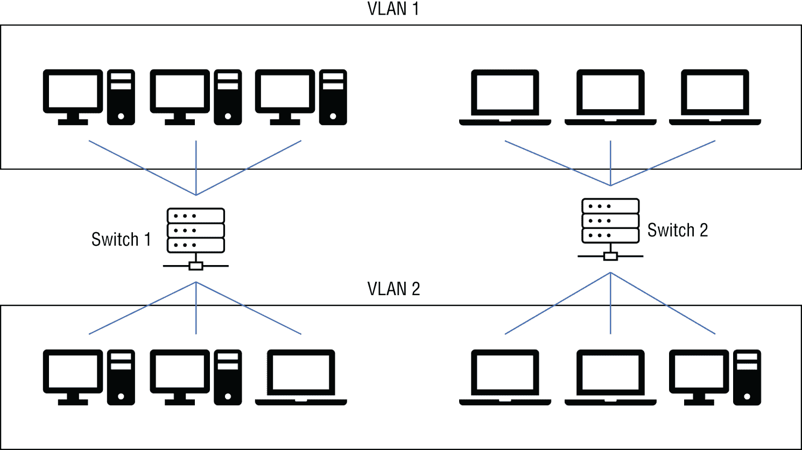

**FIGURE 4.7 Virtual local area network**

#### 监控控制与数据采集系统

多层协议的一个影响是能够通过更普遍的传输协议，主要是 TCP/IP 来启用特定通信协议。最突出的例子可能是能源和公用事业行业中使用的工业控制，即监控控制与数据采集（SCADA）系统。SCADA 是一种控制系统架构，使用计算机收集流程数据并向构成系统的连接设备发送控制命令。

SCADA 系统使用一种名为分布式网络协议（DNP3）的旧协议。DNP3 主要存在于电力和水务公用事业及管理行业中。数据在工业控制系统的各个组件之间传输，例如变电站计算机、远程终端单元（RTU）和 SCADA 主站（控制中心）。DNP3 是一个开放的公共标准。DNP3 与 TCP/IP 套件之间有很多相似之处，因为它们都是多层协议，在各自的层中具有链路和传输功能。

最终，为了使这些 SCADA 系统通过公共网络提供一定的连接性，解决方案是将 DNP3 封装在 TCP/IP 上。这种封装虽然明显在不同的标准之间架起了连接，但确实带来了巨大风险。也许最常见的利用这种风险的方式是通过 MITM 攻击。

专有技术建立了 SCADA 系统，但最近它们已转向更开放和标准化的解决方案。随着这种演变而来的安全问题。最初，这些系统是为分散的设施设计的，例如电力、石油、天然气管道、水分配和废水收集系统。连接并不是主要问题，因为系统设计为开放、稳健且易于操作和维修。任何安全都是次要问题。日益增加的是 SCADA 系统、办公网络和互联网之间的连接。互联互通使系统进入了与其他所有基于 IP 的局域网和广域网相同的漏洞。虽然 SCADA 系统中信息保护的重点不一定是敏感的个人信息，但 SCADA 网络安全的主要关注点是系统中断、敏感配置信息和国家安全。

### 汇聚协议

汇聚协议与封装的多层协议不同。汇聚协议是指将专用或专有协议与标准协议（如 TCP/IP 套件协议）合并时发生的情况。通过汇聚协议，组织可以减少对不同昂贵专有硬件的依赖，并根据使用哪种汇聚协议创建性能变化。

以下是一些常见的汇聚协议示例：

*   **Fibre Channel over Ethernet (FCoE)：** Fibre Channel 解决方案通常需要单独的光纤电缆基础设施来提供网络数据存储选项，例如存储区域网络（SAN）或网络附加存储（NAS）。Fibre Channel 有用，因为它允许高速文件传输，达到 128 Gbps，今天达到 256 Gbps。FCoE 的开发是为了使 Fibre Channel 更高效地工作，同时使用更便宜的铜缆通过以太网连接。使用 10 Gbps 以太网，FCoE 使用以太网帧来支持 Fibre Channel 通信。

*   **Internet Small Computer System Interface (iSCSI)：** iSCSI 通常被视为 Fibre Channel 的低成本替代方案。它也是基于 IP 的网络存储标准。它促进了远程存储卷通过网络的连接，就好像设备本地连接一样。iSCSI 通过 IP 网络传输 SCSI 命令，表现得像一根虚拟 SATA（或 SCSI）电缆。

*   **Multiprotocol Label Switching (MPLS)：** MPLS 是一种高吞吐量、高性能的网络技术，根据短路径标签而不是更长的网络地址在网络中引导数据。与复杂且需要更长时间导航的 IP 路由进程相比，MPLS 节省了大量时间。使用封装，MPLS 设计用于处理各种协议。MPLS 网络可以处理 T1/E1、ATM、帧中继、同步光网络（SONET）和 DSL 网络技术，而不仅仅是 TCP/IP 和兼容协议。MPLS 通常用于在两个站点之间创建虚拟专用电路。在 OSI 模型中，MPLS 通常被标记为第 2.5 层协议，因为它在数据链路（第 2 层）和网络（第 3 层）协议的常见定义之间运行。

**Voice over Internet Protocol (VoIP)：** `VoIP` 是一种使用多种技术将语音通信和多媒体会话封装在 `IP` 网络上传输的方法。`VoIP` 已成为企业和个人使用 `TCP/IP` 网络连接运营电话解决方案的一种流行且经济实惠的方式。`VoIP` 将在本书本章后面“根据设计实施安全通信渠道”部分进一步讨论。

### 微分段

*Microsegmentation* 是一种在网络内创建区域以隔离资源并单独保护每个段的方法。跨区域查看或以其他方式访问资源时，微分段需要重新进行身份验证。

网络架构师可以利用微分段创建策略，基于零信任架构的原则（在 Chapter 3 中讨论）限制资源之间的网络流量。这样做可提供更小的攻击面、更简化的策略管理以及对网络的更好可见性。

微分段是一种日益增长的做法，`MIST` 于 2020 年 8 月发布了相关的零信任架构指导，`ENISA` 自 2020 年以来发布了多篇与微分段相关的论文。

#### 软件定义网络

`SDN` 是一种网络管理方法，使网络能够集中管理（或编程），提供跨各种厂商、应用程序和技术的整体管理。`SDN` 架构允许动态网络配置和管理，从而提高网络性能，并为组织（尤其是云服务提供商）提供其整个网络架构的集中视图。

`SDN` 将硬件和基于硬件的设置与数据传输的网络服务分离。换句话说，`SDN` 将网络控制从网络转发能力（如路由）中抽象出来，将传统上单一的功能创建为两个层（基础设施层和控制层）。

`SDN` 架构的三个层是：

*   **基础设施层（数据平面）：** 网络交换机和路由器以及数据本身，以及将数据转发到适当目的地的过程
*   **控制层：** 设备中的智能以真正的中间人方式工作，根据基础设施层的状态和应用层指定的要求确定流量应如何流动
*   **应用层：** 与控制层交互以指定需求和要求的网络服务、实用程序和应用程序

使用 `SDN` 消除了将传统网络概念如 `IP` 地址、子网、路由等编程到托管应用程序中或由其解析的需求。它还提高了响应威胁变化的能力，快速适应动态的物理和业务条件，并利用最佳可用技术（无论厂商如何）。

当然，使用 `SDN` 除了其好处外还有安全影响。由于该架构如此灵活且可扩展，`SDN` 配置不正确的情况并不少见。`SDN` 配置错误会导致网络流量意外流动。原本应在网络一个区域的流量被发现出现在网络的另一部分。

`SDN` 的另一个 perceived 弱点是缺乏一种通用标准或实现方式。同样，鉴于其极强的灵活性，没有一种做法并不令人惊讶。尽管如此，仍存在标准。`SDN` 的首个标准之一是 `OpenFlow`。`OpenFlow` 最初是定义控制平面如何与数据平面协同工作的方式。`OpenFlow` 将其与数据平面的交互分为两个独立的“方向”。`OpenFlow` 通过南向应用程序编程接口（`APIs`）与交换机和路由器（无论是虚拟还是物理）协同工作。同样，`OpenFlow` 通过北向 `APIs` 与网络的业务逻辑协同工作。

#### 软件定义安全

随着微分段的持续流行，实施安全控制的新方法不断被开发和实施。*软件定义安全*（`SDS`）是一种安全模型，其中安全机制由安全软件控制和管理。`SDS` 是软件管理的、基于策略的安全，包含网络分段、入侵检测和预防、用户和设备识别、应用程序控制等。而传统安全架构可能无法满足物理基础设施复杂的<|message|> 安全需求，`SDS` 能够为软件定义网络和环境实施和管理更先进、更自动化的安全控制。

#### 软件定义广域网

软件定义广域网（`SD-WAN`）是将 `SDN` 实践扩展到连接分布在互联网上的实体以支持 `WAN` 架构的延伸，尤其与云环境相关。`SD-WAN` 解决方案提供了一种替代传统 `WAN` 路由器的选择，并且对 `WAN` 传输技术不敏感。 much like `SDN`，`SD-WAN` 将控制平面与数据平面解耦。`SD-WAN` 使用软件控制数据中心与远程网络（如云服务提供商 `CSPs`）之间服务的连接和管理。

根据 Gartner 的说法，`SD-WAN` 具有四个特征：

*   必须支持多种连接类型（例如，互联网、`MPLS`、`LTE` 等）
*   可以执行动态路径选择以支持在 `WAN` 连接之间进行负载共享
*   提供管理 `WAN` 的简单界面
*   必须支持 `VPNs` 和其他第三方服务

#### 虚拟可扩展局域网

虚拟可扩展局域网（`VXLAN`）是一种网络虚拟化技术，使用封装技术将第 2 层以太网帧封装在第 4 层 `UDP` 数据报中。`VXLAN` 技术允许网络架构师对大型网络进行分段（类似于 `VLANs`），其规模是 `VLANs` 无法支持的。例如，从理论上讲，可以在一个域中创建多达 1600 万个 `VXLANs`，而最多只能创建 4,094 个 `VLANs`。这种用于大规模分段的额外灵活性使 `VXLANs` 能够满足大型多租户公共云服务提供商的需求。

#### 封装

如前所述，封装涉及将一种协议包裹在后续协议的内容（或有效载荷）周围。更广泛地定义，封装是逻辑上将网络中的功能与其底层结构（例如硬件）分离的方法。本节中的所有微分段方法都使用某种形式的封装。

### 无线网络

通过消除到端点的布线依赖，无线技术极大地扩展了网络能力。部署无线网络相对容易，已成为许多家庭和企业环境的首选。随着 `IoT` 采用的快速增长，对无线能力的需求持续增加。

无线网络面临与任何有线网络相同的漏洞、威胁和风险，但它们也有额外的安全考虑。无线技术的主要问题之一是默认配置下技术的不安全本质。例如，无线设备有时会出厂预设默认凭据，这些凭据可以猜到或在互联网上找到（例如用户名为 `admin`，密码为 `password`）。如果接收者在设备投入生产环境之前更改了凭据或建立了多因素认证流程，这是可以接受的，但如果不这样做，则是巨大的风险。无线网络还面临着使用捕获并读取电磁信号中传输数据的设备的 `MITM` 类型窃听和数据包嗅探的更大风险。最近，随着 `IoT` 设备的激增，无线 `DDoS` 攻击已成为备受关注的破坏性攻击。无线连接设备的配置弱点允许攻击者将恶意机器人植入网络摄像头、智能个人助理设备和智能手机等设备中，形成僵尸网络，向外发送几乎无限的信号以瘫痪关键服务和高度可见的网络目标。

无线攻击曾经仅限于使用定向天线的黑客，但现在 Wi-Fi 和蜂窝监控与攻击工具已随处可得且非常隐蔽。现代无线网络必须防范一系列威胁，包括贵组织清洁工进行射频 (`RF`) 测绘等情况。

要妥善准备应对无线网络，您必须了解规范和协议，这些规范和协议管理着无线技术。您还需要了解保护无线接入点 (`WAPs`) 和无线技术总体所涉及的各种技术、方法和障碍。这种知识对于充分了解如何应对无线攻击至关重要。以下各节将更详细地探讨这些主题。

## Wi-Fi

Wi-Fi（或无线保真）是当今最常见的无线协议家族之一，Wi-Fi 网络通信受 `IEEE 802.11` 系列标准管辖。标准的演进通过修正案发布，记录了原始标准的更新版本。这些在 Table 4.2 中突出显示，并且应注意 `802.11` 标准的每个版本或修正案都提供了改进的最大数据速率。`802.11x` 通常用于表示所有特定实现作为一个整体，但这不如对 `802.11` 的一般引用受欢迎。

**TABLE 4.2  802.11 Standard Amendments**

| STANDARD || FREQUENCY || MAX DATA RATE |

| --- | --- | --- |

| 802.11 || 2.4 GHz || 2 Mbps |

| --- | --- | --- |

| 802.11a || 5 GHz || 54 Mbps |

| 802.11b || 2.4 GHz || 11 Mbps |

| Wi-Fi 3  

(802.11g) || 2.4 GHz || 54 Mbps |

| Wi-Fi 4  

(802.11n) || 2.4 GHz and 5 GHz || 600 Mbps |

| Wi-Fi 5  

(802.11ac) || 5 GHz || 3.5 Gbps |

| Wi-Fi 6 (802.11ax) || 2.4 GHz and 5 GHz || 9.6 Gbps |

| Wi-Fi 6E  

(802.11ax) || 6 GHz || 9.6 Gbps |

### Wired Equivalent Privacy and Wi-Fi Protected Access

`Wired Equivalent Privacy` (`WEP`) 和 `Wi-Fi Protected Access` (`WPA`) 是用于 Wi-Fi 通信的两种最常用的加密标准。如今，`WEP` 被认为是一种高度不安全的标准，不应使用。`WPA` 仍在不断演进，其中 `WPA3` 是当前应用于保护 Wi-Fi 通信的标准。我们在本节的其余部分介绍 `WEP`、`WPA`、`WPA2` 和 `WPA3`。

`IEEE 802.11` 标准定义了无线客户端在无线链路上进行正常网络通信之前可用于向 `WAPs` 进行身份验证的两种方法。这两种方法分别是开放系统认证 (`OSA`) 和共享密钥认证 (`SKA`)。

*   `OSA` 不提供任何保密性或安全性，因为不需要真正的身份验证。如果无线电信号足够强以到达兼容接收器，则通信就会发生。所有 `OSA` 传输均未加密。
*   `SKA` 强制执行某种形式的身份验证，如果未提供身份验证，则会阻止通信。`802.11` 标准定义了一种用于 `SKA` 的可选技术，即 `Wired Equivalent Privacy` (`WEP`)，随后的对原始 `802.11` 标准的修正案增加了 `WiFi Protected Access` (`WPA`)、`WPA2`、`WPA3` 和其他技术。`WEP`、`WPA` 和 `WPA2` 应尽可能全部迁移到 `WPA3`。

`WEP` 的设计目的是保护无线通信免受窃听。`WEP` 的最初目标是为无线通信提供与有线网络相同的 `MITM` 攻击防护水平。`WEP` 使用 Rivest Cipher 4 (`RC4`) 对称流密码对无线传输中的数据进行加密。由于使用了哈希值来验证接收到的数据包在传输过程中是否被修改或损坏，因此可以进行消息完整性验证。它还可以配置为防止未经授权的访问。知道或拥有加密密钥可提供一种基本形式的身份验证；没有密钥，则无法访问网络本身。`WEP` 用于 OSI 模型的两个最低层：数据链路层和物理层。因此它不提供端到端安全性。随着时间的推移，`WEP` 已被证明存在重大的安全弱点。例如，`WEP` 使用静态加密密钥，同一密钥由无线网络上的每个设备使用。因此，如果窃听者截获了足够多的加密数据包，则密钥可能会被推断出来。事实上，`WEP` 几乎在发布后不久就被破解了。破解 `WEP` 保护只需不到一分钟，使 `WEP` 在无线安全方面完全无用。

为了改进无线安全，一个名为 Wi-Fi Alliance 的组织开发了一种新的加密标准，称为 `WPA`。作为 `WEP` 的替代品，`WPA` 可以改造已在计算环境中为 `WEP` 设计的无线网卡上的 `WEP` 固件。该功能证明问题多于价值。对 `WAPs` 所需的更改非常广泛，硬件更换是更好的选择。

`WPA` 旨在作为临时解决方案，直到 `IEEE` 发布承诺的 `802.11i` 标准（在下一节中讨论）。该过程拖延了多年，因此 `WPA` 独立于 `802.11` 修正案实施。`WPA` 协议实现了轻量级可扩展认证协议 (`LEAP`) 和临时密钥完整性协议 (`TKIP`)，支持每个数据包的密钥，可为每个数据包动态生成新的 128 位密钥。`WPA` 与每个主机协商唯一的密钥集。它改进了必须手动输入到 `WAPs` 和设备上且不会更改的 `WEP` 64 位或 128 位加密密钥。

WPA 使用 LEAP 和 TKIP 来执行消息完整性检查，其设计目的是防止攻击者篡改并重新发送数据包。这取代了 WEP 标准所使用的循环冗余校验（CRC）。CRC 的主要缺陷在于它并未为所处理的数据包提供足够强的数据完整性保证。研究人员已在 WPA 中发现了一个与 WEP 弱点类似的缺陷。WPA 通常采用静态但秘密的密码短语进行身份验证。理论上，暴力攻击可能导致密码短语被猜出。对于足够强的密码短语（不少于 14 个字符）， succumbing to this attack 的可能性很低，但并非不可能。同时，消息完整性检查哈希函数可以被利用，从短串数据包中提取密钥流，用于注入攻击或欺骗。基本上，针对 WPA 的特定攻击——例如 coWPAtty 和一种基于 GPU 的破解工具——已使 WPA 的安全性变得不可靠。WPA 的 LEAP 和 TKIP 加密选项现在都被认为可使用多种可用且易于使用的破解技术进行破解。

### WPA2 (或 IEEE 802.11i)

Wi-Fi 安全的下一个演进是 WPA2，它取代了 WPA。最初，它本意是取代 WEP，但正如前文所述，802.11i 标准一再拖延，而 WPA 则独立实施。该修正案解决了原始 802.11 标准的 安全问题。WPA2 与 WPA 向下兼容。它通过实现美国国家标准与技术研究院（NIST）FIPS 140-2 合规的 AES 加密算法和基于 802.1x 的身份验证，以及计数器模式密码块链接消息认证码协议（CCMP）来提供美国政府级别的安全性。WPA2 有两个版本：WPA2-Personal 和 WPA2-Enterprise。WPA2-Personal 通过使用设置密码来保护未经授权的网络访问。WPA2-Enterprise 通过服务器使用网络访问控制（NAC）来验证网络用户。

选择 WPA2 名称的原因是 WPA 已发布并被广泛使用。然而，WPA2 并不是 WPA 的第二个版本。它们是截然不同且各不相同的。IEEE 802.11i，即 WPA2，实现了与 IPSec 类似的概念，以提高无线网络内的加密和安全性。

在 2018 年底，即较新的 WPA3（下文讨论）宣布后不久，研究人员发现了 WPA2 中的一个弱点，该弱点会允许攻击者窃取预共享登录密码、窃听通信并执行中间人攻击。

### WPA3

Wi-Fi 联盟于 2018 年 1 月宣布 WPA3 取代 WPA2。较新的标准使用 192 位加密和每个用户的个性化加密。它还提供弱密码缓解和为无人工界面设备简化设置流程。截至 2020 年 7 月，Wi-Fi 联盟认证的任何设备都必须支持 WPA3。作为标准做法，您应检查您的无线启用设备以确定支持哪些 Wi-Fi 标准。如果您的网络是 WEP 或 WPA，您必须升级到 WPA2 兼容或最好是 WPA3 兼容的路由器以保护您组织的网络。

### IEEE 802.1X

WPA、WPA2 和 WPA3 支持企业身份验证 802.1X/EAP，这是一种基于端口的网络访问控制标准，用于确保客户端对网络资源的访问控制。有效地，802.1X 是一个检查系统，允许无线网络利用现有网络基础设施的身份验证服务。通过使用 802.1X，其他技术和解决方案（如 RADIUS、TACACS、证书、智能卡、令牌设备和生物识别）可以集成到无线网络中，提供多因素身份验证技术。

### 可扩展身份验证协议

可扩展身份验证协议（EAP）是一种身份验证框架，而非特定的身份验证机制。EAP 促进了现有无线或点对点连接技术与新身份验证技术之间的兼容性。超过 40 种不同的 EAP 身份验证方法得到广泛支持。这些包括 LEAP、EAP-TLS、EAP-SIM、EAP-AKA 和 EAP-TTLS 等无线方法。两个值得更仔细研究的 EAP 方法是受保护的可扩展身份验证协议（PEAP）和 LEAP。

#### 受保护的可扩展身份验证协议

使用 TLS 隧道，PEAP 将 EAP 方法封装起来以提供身份验证，并可能提供加密。由于 EAP 最初是为在物理隔离通道上使用而设计，因此假定路径是安全的，因此 EAP 通常未加密。因此，PEAP 可以为 EAP 方法提供加密。

#### 轻量级可扩展身份验证协议

LEAP 是 Cisco 专有的 WPA 的 Temporal Key Integrity Protocol（下文讨论）的替代方案，但不应使用。2004 年发布了一种名为 Asleap 的攻击工具，可利用 LEAP 最终提供的薄弱保护。首选使用 EAP-TLS。如果必须使用 LEAP，则必须使用复杂的密码。LEAP 在 802.11i/WPA2 出现之前用于解决 TKIP 中的缺陷。

#### 临时密钥完整性协议

TKIP 被设计为在无需更换旧无线硬件的情况下取代 WEP。TKIP 在 WPA 指南内被纳入 802.11 无线网络标准。TKIP 的改进包括一个密钥混合函数，该函数在将该密钥与 RC4 一起使用进行加密之前，将初始化向量（IV）（即随机数）与秘密根密钥结合；使用序列计数器来防止数据包重放攻击，并使用强大的消息完整性检查（MIC）。

#### 计数器模式密码块链接消息认证码协议

CCMP 是为取代 WEP 和 TKIP/WPA 而创建的。CCMP 使用 128 位密钥的 AES。CCMP 是由 802.11i 指定的 802.11 无线网络的首选标准安全协议。迄今为止，尚未有针对 AES/CCMP 加密的成功攻击。CCMP 是 WPA2 和 WPA3 中使用的标准加密机制。

### 保护无线接入点

无线接入点（WAP），有时仅称为接入点（AP），是一种网络设备，允许无线启用设备连接到有线网络。WAP 直接连接到有线局域网，然后使用 Wi-Fi 或其他无线技术（例如 Li-Fi）向该有线局域网提供无线连接。

本节关于如何保护 WAPs 的内容仅假设需要无线访问，但尚未采取任何创建无线访问的行动。创建无线访问并非从随意放置硬件开始。首要采取的行动是进行现场勘查。现场勘查对于评估当前是否存在任何无线访问非常有用。它也有助于未来规划。勘查完成后，即可决定 WAP 的放置位置。本节还涵盖了为所选硬件选择正确的天线类型进行广播的决策。

配置您的接入点是下一步。我们首先研究广播信道为何重要。接下来，讨论硬件可以设置的模式，例如是否将通信集中化或形成某种传输网状结构。还需考虑网络如何标记和广播，使用服务集标识符（SSIDs）。最后，涵盖了额外的安全访问方法，从低级别的 MAC 地址过滤到高级别的使用访客门户。

#### 进行现场勘查

现场勘查是对识别 rogue APs 以及定义 AP 的放置、配置和文档的有用技术。它们通常因合规原因而必需，但应一般定期进行或在物理环境发生变化时进行。

Rogue WAPs 是在原本安全的网络上安装的 WAP，但未经明确授权。这些 rogue AP 使组织难以追踪和监控其授权资产，并且对通过它们连接并传输数据的设备也构成安全风险。有时，rogue AP 是由员工出于 perceived 的访问或性能需求而实施的。更令人担忧的是恶意攻击者安装 rogue AP 以试图欺骗终端用户连接到的情况。此类攻击会窃取凭证、帮助发起 DDoS 攻击，或导致数据被盗。安全人员必须进行搜索和扫描，以防备这些不受欢迎的设备。

实地走查，或站点勘测，是一种在物理环境中发现 rogue AP 的方法。在站点勘测期间，安全人员调查部署在环境中的 WAP 的存在、强度和覆盖范围，同时寻找未经授权的信号。在进行走查时，可以使用带有无线网卡的普通终端客户端来简单地检测信号。另一种方法是使用各种无线入侵检测设备来扫描环境。

站点勘测还提供运营方面的好处，因为审查有助于定义 AP 的最佳放置和配置，并为 AP 生成文档。最佳放置和配置包括确保在所有需要访问的位置都有足够的信号强度。同时，在不希望访问的地方，如公共区域或设施外部，信号可用性应最小化或消除。站点勘测对于评估现有无线网络部署（例如外部环境发生变化时）、规划当前部署的扩展以及规划未来部署非常有用。

### 确定无线接入放置

利用站点勘测确定的信息，可以识别出最佳的 WAP 位置。不建议在走查提供信息之前就确定具体位置。放置多个 WAP 后，进行适当的配置和信号强度测试。在此阶段很可能会有移动和调整。一旦达到最佳配置和位置模式，就将位置固定下来。

以下是无线接入放置的一些一般考虑因素：
* 使用中心位置。
* 避免实体物理障碍。
* 避免反射或其他平坦金属表面。
* 避免使用电气设备（干扰）。
* 将外部全向天线垂直指向。
* 将定向天线指向期望使用区域。

无线技术的一个基本考虑因素是环境对广播信号的影响。无线信号会受到各种干扰的影响——物理和电磁。距离和障碍物是物理方面的顾虑。电力和其他无线电信号可能会与无线信号冲突或阻碍其有效性。网络管理员会操纵定向天线并调整信号强度，以适应物理和电磁障碍，从而到达期望的访问区域。

天线的主要安全问题是了解信号模式（或 *lobe pattern*）如何从天线延伸出来。这对于定向天线尤其如此，因为天线的波瓣在某一聚焦方向上会延伸得远超典型的单向天线，而在其他方向上则被衰减（即降低）。即使没有特殊设备，也可以通过在 AP 周围走同心圆并使用移动设备测量辐射强度来进行测量。

### 天线类型

天线是无线通信系统中的一个组成部分。天线将电信号转换为无线电波，反之亦然。信号传输要求和接收质量决定了从各种可用天线中选择哪种天线。标准天线可以升级为信号增强、更强劲的天线。一些最常见的天线类型如下：
* 标准直杆、偶极子或垂直天线向天线四周所有方向发送信号。这种辐射模式是全向的，是基站和终端设备上最常见的天线类型。
* 许多其他类型的天线是定向的。信号不是向各个方向广播，而是聚焦到一个方向。

关于保护无线网络，有几个关键的天线考虑因素。最重要的是，认识到定向天线会在一个聚焦方向上显著扩展网络的覆盖范围。这对于接收和发送都适用。因此，在指向定向天线时必须小心，以免网络的可见性和漏洞被投射得太远。对于天线的选择和放置，请记住广播会延伸过墙壁和楼层，尤其是在组织位于多租户建筑中时。

### 无线信道

无线信号在频率范围内以称为 *channels* 的增量细分。这些信道就像道路或高速公路上的车道。举例来说，对于 `2.4 GHz` 频率，美国有 11 个信道，欧洲有 13 个，日本有 17 个。在美国，`FCC` 监管频率并分配了 11 个。在其他国家和司法辖区，频率由国家或成员国联盟监管，这就解释了为什么频率数量存在差异。

通常，无线连接是终端客户端和 WAP 之间在单一信道上的通信信号。当两个或多个 AP 位于彼此太近的位置或 WAP 的无线电强度过高时，位于不同信道的设备之间也可能发生干扰。

安全专业人员应注意，信道选择对缓解无线风险（如欺骗、阻塞或网络可见性）几乎没有或没有影响。相反，信道是为最小化 AP 之间或其控制范围之外的其他 Wi-Fi 网络之间的干扰而选择的。

### 基础设施模式和 Ad Hoc 模式

部署无线网络时，WAP 可以部署在两种模式之一：ad hoc 或基础设施。通常最好将 WAP 配置为基础设施模式而非 ad hoc 模式，以执行由 WAP 支持的限制。Ad hoc 模式允许无线设备在没有集中控制的情况下通信。基础设施模式阻止设备或网卡直接交互。

基础设施模式有四种不同的变体：
* **Standalone：** WAP 将多个无线客户端相互连接，但不连接到任何有线资源。
* **Wired extension：** WAP 充当连接点或集线器，将无线客户端链接到有线网络。
* **Enterprise extended：** 多个 WAP 全部使用相同的扩展服务集标识符（`ESSID`）来将大物理区域连接到同一有线网络。这允许物理设备移动而不丢失对 `ESSID` 的连接。
* **Bridge：** 使用无线连接将两个有线网络连接起来，通常用于楼层或建筑物之间，在布线或拉线不可行或不方便时使用。

### 服务集标识符

任何连接过无线网络的人都知道要询问网络名称，其技术术语为 `SSID`。`SSID` 就是标识无线网络的那串字符。它代表逻辑无线网络，而不是唯一的 AP，因为可以有多个接入点为一个或多个 SSID 提供覆盖。

There are two types of SSID, namely, `ESSID` and basic service set identifier (`BSSID`). An `ESSID` is the name of a wireless network in infrastructure mode when a wireless base station or `WAP` is used. A `BSSID` is the name of a wireless network when in ad hoc or peer-to-peer mode. In a scenario where multiple different base stations or `WAPs` are used in infrastructure mode, the `BSSID` is the `MAC` address of the base station hosting the `ESSID` to differentiate multiple base stations in the overall extended wireless network.

In securing the `SSID` wireless network, regardless of the types, note that the `SSID` is comparable to the name of a workgroup. When an endpoint client discovers an `SSID`, the wireless `NIC` is configured to communicate with the associated closest or strongest `WAP`. The `SSID` has secure access features so that discovery does not necessarily equate to access. There are additional steps before the client can communicate, such as enabling encryption and ensuring that discovered `SSIDs` are legitimate. With enabling encryption, the client is required to enter a password to permit access. Ensuring the legitimacy of the `SSIDs` that clients might see requires the organization to periodically monitor for rogue access points.

A step that can be taken to better secure `WAPs` is to disable the `SSID` broadcast of the beacon frame. A `beacon frame` is a special broadcast transmission that the `SSID` sends regularly from the `WAP`. Discovery by end-user clients occurs as any wireless `NIC` finds this radio signal. In fact, with a detect and connect `NIC` feature, the connection can be automatic. Network administrators can disable, or silence, the broadcast; this is recommended as a security best practice. Disabling `SSID` broadcast makes connection a little more difficult, as the end user must know the `SSID` address to search. Keeping the beacon off and the `SSID` hidden is not foolproof. Attackers have tools to discover `SSID` via wireless sniffer technology to capture `SSID` information used in transmissions between wireless clients and the `WAPs`, as the `SSID` is still needed to direct packets. Disabling `SSID` is a good first step. Hiding the existence of the network is a best practice, but it is not in itself sufficiently strong security. Not broadcasting the `SSID`, coupled with using `WPA3`, will provide a reliable authentication and encryption solution with fewer failed attempts.

### Using Captive Portals

Captive portals are authentication safeguards for many wireless networks implemented for public use, such as at hotels, restaurants, bars, airports, libraries, and so on. They are a common practice on wired networks, too. The process is to force a newly connected device to a starting page to establish authorized access. The portal may require input of credentials, payment, or an access code. It is also a good location to publish or provide a link to privacy policies and acceptable use terms and conditions. If end-user consent for tracking and information collection is required, the captive portal allows for that as well. Once the end user satisfies the conditions required by the starting page, only then can they communicate across the network.

### MAC Filters

A `MAC` filter is a list of authorized wireless client `MAC` addresses that are permitted to access a `WAP`. Devices not on the list are blocked. The downsides are that the list is difficult to manage and does not scale to large environments with many changes.

There are two approaches to utilizing `MAC` filters. In one approach, someone, such as a network security analyst or a security professional tasked with securing wireless access, would determine through asset management what devices are permitted to connect. The other approach would be using a software solution such as intrusion detection. Some access point vendors offer such features, including the ability to detect `MAC` address spoofing to mitigate the risk of someone forging a known whitelisted `MAC`.

### Wireless Attacks

In spite of increasing attention and capability for securing wireless networks, they remain attractive targets for attackers. The types of attacks continue to grow, and many attacks are effective on wired networks as well as wireless ones. Attacks such as packet sniffing, `MITM`, and password theft are common to both wireless and wired networks and are discussed earlier in the chapter. A few types of attacks focus on wireless networks alone, like signal jamming attacks and a special collection of wireless attacks called `war driving`.

Signal jamming is the malicious activity of overwhelming a `WAP` to the extent that legitimate traffic can no longer be processed. Even though this is illegal in most places, there are inexpensive jamming products available for sale online.

War driving is a bit of a play on words. The term has roots in a form of attack in the 1980s called `war dialing`, where computers would be used to make large numbers of phone calls searching for modems to exploit. War driving, in contrast, is when someone, usually in a moving vehicle, actively searches for `Wi-Fi` wireless networks using wireless network scanning tools. These scanning tools and software are readily available and often free. When a wireless network appears to be present, the attacker uses the tools to interrogate the wireless interface or a wireless detector to locate wireless network signals. Once an attacker knows a wireless network is present, they can use sniffers to gather wireless packets for investigation. The next step in the attack is to discover hidden `SSIDs`, active `IP` addresses, valid `MAC` addresses, and even the authentication mechanism the clients use. `MITM` attacks may progress, or the attackers may conduct advanced attacks with specialized tools, like `AirCrack` and `AirSnort`, to attempt to break into the connection and gather additional sensitive information. When using no security protocols or older ones, like `WEP` and `WPA`, attackers have very little difficulty being successful.

War drivers often share the information they gather. Not all war driving attacks are meant to disrupt or be particularly malicious. It is likely the attackers are trying to simply get internet access for free. Using the information obtained from their own tools, they combine data with `GPS` information about location. Then they publish the information to websites like `WiGLE`, `openBmap`, or `Geomena`. Other people access the maps of various networks to find locations where they can hijack the wireless and access the internet or conduct additional attacks.

War driving is not explicitly prohibited in most countries. Some consider it ethically wrong, but at a high level, it is somewhat analogous to neighborhood mapping in the physical world with house numbers and phone numbers publicly listed. In fact, the reporting of war driving information on the Web could be considered an expanded version of what `WAPs` are meant to do: broadcast. However, as security professionals know, not all `WAPs` are broadcasting publicly, as they are hidden.

### Li-Fi

`Li-Fi` (short for light fidelity) is a wireless communication technology that uses light to transmit data. `Li-Fi` is similar in use to `Wi-Fi`, except it uses visible, ultraviolet, or infrared light to transfer data, rather than the radio frequency transmission that `Wi-Fi` technology relies on.

Because `Li-Fi` uses light for transmission, it cannot transfer data through walls or other physical barriers. As a result, `Li-Fi` offers a security benefit over `Wi-Fi`, in that it can be contained within a physical space. `Li-Fi` is a disruptive technology that is still not widely adopted, as of this writing. `Li-Fi`'s security benefits and speed improvements (roughly 100x the max bandwidth of today's `Wi-Fi`) have many projecting mass adoption in the near future and even potentially replacing `Wi-Fi` in the next 10 years.

### Bluetooth

Bluetooth 是一种无线技术标准，支持短距离点对点无线传输。一般使用时，最大有效距离约为 30 英尺。然而，工业或高级版本的 Bluetooth 可达 300 英尺。许多类型的终端设备都支持 Bluetooth，例如手机、笔记本电脑、打印机、收音机和数字个人助理，以及日益增多的其他物联网设备。

Bluetooth 的一个优点是它不需要基站，因为它是在设备之间建立的直接连接。它也只需要很少的电量，这对于通常配备 Bluetooth 的电池供电终端设备来说是很有利的。

也有一些缺点。传输速度比 802.11b 无线标准慢。它与现有的 802.11b 和 802.11g 网络冲突并产生干扰，因为它使用 2.4 GHz 广播频谱，导致依赖传输的终端设备出现问题。另一个重大缺点是 Bluetooth 因缺乏加密而固有的弱点。使用 Bluetooth 创建个人局域网也会带来安全隐患，因为个人局域网很可能存在企业扫描难以发现的漏洞。原因在于个人局域网是现有局域网或广域网的不可路由部分或扩展，因此不易评估。

### ZigBee

ZigBee 是基于 IEEE 802.15.4 的低成本、低功耗和低延迟无线通信标准。ZigBee 的协议设计得比其他无线技术（如 Wi-Fi）更简单，并用于需要短距离、低带宽数据传输的应用。常见应用包括医疗数据采集、工业控制系统、建筑自动化、家庭能源监控和其他家庭自动化用途。

ZigBee 在物联网应用中的广泛使用使其安全性受到大量审查。ZigBee 标准包括访问控制列表（ACL）、帧计数器和加密（使用 128 位 AES 密钥）等安全功能。尽管有这些安全功能，协议仍存在缺陷，如 第 3 章 中“智能灯泡黑客”侧边栏所述。

### 蜂窝网络

蜂窝或移动网络是跨越多个蜂窝的无线通信。蜂窝是地理上分散的区域，由一个或多个小区站点或基站组成。小区站点或基站是固定在特定位置的收发器。蜂窝网络用户使用便携式设备通过特定的一组无线电波频率连接到小区站点和其他蜂窝设备或互联网。区分蜂窝技术的标准描述符指的是该技术引入时的世代。这可能会让人困惑。例如，4G 和 5G 分别指第四代和第五代。它并不表示特定的频率或信号强度。表 4.3 提供了最新无线技术的概述。

**表 4.3 蜂窝无线技术基本概述**

| 世代 || 3G || 4G || 5G |
| --- | --- | --- | --- |
| 时间线 || 2002 年至 2005 年 || 2010 年至今 || 2018 年至今 |
| --- | --- | --- | --- |
| 消息功能 || 图形和格式化文本 || 完整统一消息 || 完整统一消息 |
| 数据支持 || 分组交换 || 原生 IPv6 || 原生 IPv6 |
| 目标数据速率 || 2 Mbps || 1 Gbps || 20 Gbps |

虽然 4G 自约 2010 年以来一直是领先的蜂窝技术，但 5G 技术于 2018 年有限推出，并在 2020 年后实现了显著增长。4G 与 5G 的关键区别在于后者提供的速度提高了十倍。这种显著的速度提升为蜂窝技术带来了新的应用，并预计在不久的将来进一步推动物联网技术的发展。更多具有更大能力的互联网连接设备意味着更大的攻击面，CISSP 在今后必须考虑这一点。

安全专业人员在支持和保护蜂窝无线网络中发送和接收的信息时应牢记一些重要考虑因素。自 2G 以来，蜂窝使用已远不止语音。今天的手机（智能手机）具有更高级别的计算能力来运行应用程序、发送文本、发送图像、流式传输视频并存储大量敏感数据。因此，需要保护的通信需要额外的技术控制。蜂窝交易本身并不安全。攻击者可以利用众多工具拦截无线传输。一种常见的攻击场景是使用蜂窝基站进行中间人流量捕获。这些攻击无论蜂窝连接是到互联网还是仅在两个或多个移动设备之间都可能发生。作为 CISSP，您在制定或管理组织的自带设备（BYOD）政策时应考虑这些威胁。

### 内容分发网络

内容分发网络（CDN），也称为 *内容交付网络*，是一组地理分布的资源服务、代理服务器和数据中心。这种架构模型的本质是提供低延迟、高性能和高可用性的内容，尤其是在大范围（通常是国家或大陆）内的多媒体、电子商务和社交网络网站。内容尽可能靠近请求客户获取，从而实现更低的延迟和更大的吞吐量。

CDN 内容分布在许多数据主机中，而不是集中在一个位置。虽然这对可用性有积极影响，因为内容分发降低了任何一个位置离线的[content]

Bluetooth 是一种无线技术标准，支持短距离点对点无线传输。一般使用时，最大有效距离约为 30 英尺。然而，工业或高级版本的 Bluetooth 可达 300 英尺。许多类型的终端设备都支持 Bluetooth，例如手机、笔记本电脑、打印机、收音机和数字个人助理，以及日益增多的其他物联网设备。

Bluetooth 的一个优点是它不需要基站，因为它是在设备之间建立的直接连接。它也只需要很少的电量，这对于通常配备 Bluetooth 的电池供电终端设备来说是很有利的。

也有一些缺点。传输速度比 802.11b 无线标准慢。它与现有的 802.11b 和 802.11g 网络冲突并产生干扰，因为它使用 2.4 GHz 广播频谱，导致依赖传输的终端设备出现问题。另一个重大缺点是 Bluetooth 因缺乏加密而固有的弱点。使用 Bluetooth 创建个人局域网也会带来安全隐患，因为个人局域网很可能存在企业扫描难以发现的漏洞。原因在于个人局域网是现有局域网或广域网的不可路由部分或扩展，因此不易评估。

### ZigBee

ZigBee 是基于 IEEE 802.15.4 的低成本、低功耗和低延迟无线通信标准。ZigBee 的协议设计得比其他无线技术（如 Wi-Fi）更简单，并用于需要短距离、低带宽数据传输的应用。常见应用包括医疗数据采集、工业控制系统、建筑自动化、家庭能源监控和其他家庭自动化用途。

ZigBee 在物联网应用中的广泛使用使其安全性受到大量审查。ZigBee 标准包括访问控制列表（ACL）、帧计数器和加密（使用 128 位 AES 密钥）等安全功能。尽管有这些安全功能，协议仍存在缺陷，如“智能灯泡黑客”侧边栏在 第 3 章 中所述。

### 蜂窝网络

蜂窝或移动网络是跨越多个蜂窝的无线通信。蜂窝是地理上分散的区域，由一个或多个小区站点或基站组成。小区站点或基站是固定在特定位置的收发器。蜂窝网络用户使用便携式设备通过特定的一组无线电波频率连接到小区站点和其他蜂窝设备或互联网。区分蜂窝技术的标准描述符指的是该技术引入时的世代。这可能会让人困惑。例如，4G 和 5G 分别指第四代和第五代。它并不表示特定的频率或信号强度。表 4.3 提供了最新无线技术的概述。

**表 4.3 蜂窝无线技术基本概述**

| 世代 || 3G || 4G || 5G |
| --- | --- | --- | --- |
| 时间线 || 2002 年至 2005 年 || 2010 年至今 || 2018 年至今 |
| --- | --- | --- | --- |
| 消息功能 || 图形和格式化文本 || 完整统一消息 || 完整统一消息 |
| 数据支持 || 分组交换 || 原生 IPv6 || 原生 IPv6 |
| 目标数据速率 || 2 Mbps || 1 Gbps || 20 Gbps |

虽然 4G 自约 2010 年以来一直是领先的蜂窝技术，但 5G 技术于 2018 年有限推出，并在 2020 年后实现了显著增长。4G 与 5G 的关键区别在于后者提供的速度提高了十倍。这种显著的速度提升为蜂窝技术带来了新的应用，并预计在不久的将来进一步推动物联网技术的发展。更多具有更大能力的互联网连接设备意味着更大的攻击面，CISSP 在今后必须考虑这一点。

安全专业人员在支持和保护蜂窝无线网络中发送和接收的信息时应牢记一些重要考虑因素。自 2G 以来，蜂窝使用已远不止语音。今天的手机（智能手机）具有更高级别的计算能力来运行应用程序、发送文本、发送图像、流式传输视频并存储大量敏感数据。因此，需要保护的通信需要额外的技术控制。蜂窝交易本身并不安全。攻击者可以利用众多工具拦截无线传输。一种常见的攻击场景是使用蜂窝基站进行 MITM 流量捕获。这些攻击无论蜂窝连接是到互联网还是仅在两个或多个移动设备之间都可能发生。作为 CISSP，您在制定或管理组织的自带设备（BYOD）政策时应考虑这些威胁。

### 内容分发网络

内容分发网络（CDN），也称为 *内容交付网络*，是一组地理分布的资源服务、代理服务器和数据中心。这种架构模型的本质是提供低延迟、高性能和高可用性的内容，尤其是在大范围（通常是国家或大陆）内的多媒体、电子商务和社交网络网站。内容尽可能靠近请求客户获取，从而实现更低的延迟和更大的吞吐量。

CDN 内容分布在许多数据主机中，而不是集中在一个位置。虽然这对可用性有积极影响，因为内容分发降低了任何一个位置离线的

Organizations concerned with regulatory compliance must also be mindful of how content distribution affects their compliance requirements. Many CDNs provide licensed access to content through a variety of subscriptions or fees for service models, and protecting that licensed content as well as ensuring its legal crossing of borders can be an issue. Naturally, as data is stored or processed across multiple jurisdictions, the CDN and its users must be aware of how local regulations affect their business and their customers.

## SECURE NETWORK COMPONENTS

One of the most foundational concepts that you must understand, as a security professional, is how to securely operate and maintain network components. This section begins with an introduction to the key concepts associated with operating network hardware, followed by coverage of network transmission media and network components (such as firewalls, routers, and switches), ending with some foundational coverage of endpoint security. As a CISSP, you should have a general understanding of security concepts related to different types of network components, and this section covers those topics.

### Operation of Hardware

Network hardware, such as routers, switches, and firewalls (all discussed in the following sections) must be securely implemented, operated, and maintained. Secure and proper operation of network hardware includes the following concepts:

* **Standards, policies, and procedures:** Your organization should establish standards that document a secure baseline for your hardware devices, policies that guide how you operate and manage these devices, and procedures that formalize routine operation processes to support consistent device management.

* **Training:** Network administrators and other personnel who manage or operate hardware should be trained on proper and secure operation, before they receive access to such devices and on a routine basis (e.g., annually).

**变更管理：** 配置、补丁和其他变更应得到妥善记录，并遵循贵组织标准的变更管理流程。

**冗余电源：** 应为关键网络基础设施部署冗余电源，以确保在发生故障时仍可提供可用性。

**监控：** 应监控网络设备是否存在故障、异常或其他与安全相关的事件。

**保修和支持：** 贵组织应为所有网络设备保持当前且有效的保修，以在系统出现故障时提供保障。必要时，应能够获得厂商或第三方支持以帮助排查常见或罕见的硬件问题。

您可能熟悉几种网络设备，本节其余部分将介绍其中的关键设备。首先，有必要为几个关键网络术语建立工作定义：数据冲突、广播域和冲突域。

* *数据冲突* 会发生如果两个系统同时传输，尝试同时使用网络介质，其效果是其中一个或两个消息可能被损坏。
* *广播域* 是计算机网络的逻辑划分，其中所有节点都可以通过数据链路层（第 2 层）广播相互到达。广播源自该组中的一个系统，并发送到该组内的所有其他系统。
* *冲突域* 由使用共享介质连接的所有设备组成，在这些设备之间随时可能发生冲突。

就 OSI 模型而言，冲突域是通过使用任何数据链路层（第 2 层）或更高层设备来划分的，而广播域是通过使用任何网络层（第 3 层）或更高层设备来划分的。当域被划分时，这意味着部署设备两侧的系统属于不同的域。

#### 防火墙

防火墙用于防止未经授权的数据从网络的一个区域流向另一个区域。防火墙创建的边界可能在私有网络与互联网之间，也可能在私有网络的两个部分之间。无论如何，防火墙都会创建边界，并用于防止或允许流量跨越该边界。

防火墙的功能可以通过软件、硬件或两者来实现。进入和离开私有网络或内部段的数据必须通过防火墙。防火墙检查并检查每个数据包，并阻止不符合指定安全标准的数据包。这些活动以及其他一些网络事件会被记录在防火墙日志中。日志的审查和审计是安全专业人员用于事件检测和响应、取证分析以及改进安全资产性能的极其有价值的安全流程。

术语 *防火墙* 的使用是因为网络版本的功能类似于物理结构中的防火墙。建筑物中的防火墙是一种旨在防止或延缓实际火灾蔓延的屏障。然而，与完全抑制火灾的建筑防火墙不同，网络环境中的防火墙旨在允许经批准的流量在两个环境之间传输，并防止未经授权或不需要的流量，或用户和实体的尝试在环境之间传输。

对于网络 perimeter，防火墙被视为整体分层安全架构的一部分的第一道防线。在其他地方，如前所述，防火墙用于为任何区域建立边界，并分隔和控制跨越该边界的流量流。它们是网络的基础，也是保护信息系统和网络最普遍使用的安全技术之一。就安全尽职调查而言，防火墙是必不可少的。然而，仅靠防火墙是不够的。例如，它们不提供身份验证功能。还需要其他类型的设备和技术来补充防火墙。如果没有安全组合中的其他设备和技术，防火墙就会成为单点故障。

防火墙需要配置和人工管理，这就是为什么安全专业人员必须了解如何最好地使用它们的原因。它们不会自动提供好处。除了可能发现的任何技术漏洞外，防火墙管理中的配置和监督有助于减轻人为错误和错误配置的风险。安全专业人员必须配置定义允许流量的过滤规则。

同样重要的是防火墙在故障时的行为。如果防火墙停止正常运行（例如，如果它不堪重负），那么防火墙应最佳地“关闭”失败；这意味着防火墙不应允许 *任何* 数据包通过。为了确保规则保持不变，防火墙必须受到未经授权更改的保护，并且配置必须随着时间的推移保持最新。与任何其他设备或端点一样，防火墙也存在需要修补的漏洞，安全专业人员还监督防火墙的修补和升级程序。

安全专业人员最重要的角色之一是使用防火墙生成的活动日志。日志应分析多种类型的事件。以下是一些示例：

* 防火墙的重新启动或重启
* 启动失败或设备崩溃
* 防火墙配置文件更改
* 防火墙运行时配置或系统错误
* 端口上异常的访问探测
* 设备上登录不成功

除了防火墙在网络上的位置外，它们处理和询问数据的方式也区分了防火墙类型。这里也适用纵深防御原则。没有一种防火墙类型单独足够；几乎总是需要组合使用。

除了存在的各种传统防火墙外，还有最近的下一代防火墙。还有特殊防火墙，如多宿主和堡垒防火墙。以下各节将探讨这些防火墙以及防火墙部署架构。

#### 防火墙类型

防火墙有四种基本类型：

* 静态数据包过滤防火墙
* 应用级防火墙
* 状态检测防火墙
* 电路级防火墙

所有四种防火墙类型之间的关键区别在于它们在 OSI 模型层上的运行位置。

##### 静态数据包过滤防火墙

第一种，静态数据包过滤防火墙，是最早也是最简单的防火墙设计。也称为 *筛选路由器*，数据包过滤防火墙是最快的设计。在 OSI 模型的网络层（第 3 层）运行，它检查每个数据包。如果数据包违反了既定规则，则数据包将被丢弃和/或记录。能够最快速工作，数据包过滤防火墙将减轻特定数据包类型的风险。此类防火墙不提供身份验证机制，并且容易受到欺骗攻击。

##### 应用级防火墙

应用级防火墙检查数据包和网络流量，其审查程度远高于数据包过滤防火墙。在 OSI 模型的高层应用层（第 7 层）运行，应用级防火墙试图识别何种类型的应用流量想要跨越边界。常被用作终端用户与外部网络之间的分隔，应用级防火墙充当代理。深度检查需要时间，使这种防火墙成为所有类型中最慢的。

##### 状态检测防火墙

状态检测防火墙与简单的数据包过滤防火墙相比有一个主要的区别因素：状态检测防火墙会监控网络连接的状态。该防火墙在 OSI 模型的网络层和传输层（分别为第 3 层和第 4 层）运行。连接状态基于 `TCP` 的工作方式以及 `TCP` 通过本章前面讨论的三次握手建立会话的方式。该状态会被跟踪，并且其他连接属性（如目标和源详细信息）会暂时保存在内存中。随着时间的推移，这些详细信息用于智能地应用过滤。

### 电路级防火墙

电路级防火墙在功能上简单高效，其工作方式最类似于状态检测防火墙。主要区别在于该防火墙仅在 OSI 模型的会话层（第 5 层）工作。对于电路级防火墙，唯一任务是确保 `TCP` 握手已完成。不会检查任何实际数据包，也不会丢弃任何单个数据包。通过电路级防火墙的流量看起来像是源自网关，因为电路级防火墙的最大好处是验证会话，同时隐藏有关受保护网络的任何细节。

### 下一代防火墙

前面四种防火墙类型代表了从最早到最成熟的防火墙技术的跨度。但还有下一代防火墙，通常被称为 *下一代防火墙* (`NGFW`)。`NGFW` 将前面四种传统功能与入侵检测系统 (`IDS`) 或入侵防御系统 (`IPS`) 等其他基于网络的安全设备的高级功能相结合。在 OSI 模型的上下文中，下一代防火墙在多个层级运行。

#### 多宿主防火墙

多宿主描述了防火墙具有两个或多个网络接口。这些防火墙使用一组软件定义规则来确定什么流量可以在其连接的网络之间通过，从而最大限度地降低数据在两个网络之间意外交换的风险。

#### Bastion Host/屏蔽主机

堡垒主机因此得名，因为它类似于中世纪用作城堡入口第一层保护警卫室的结构。在计算中，*堡垒主机* 是一种特殊用途的防火墙或主机计算机，逻辑上位于核心网络路由设备的服务之后或 DMZ 中。该路由器将内部私有网络与不可信网络隔离开来，后者可以是互联网。

术语 *堡垒主机* 和 *屏蔽主机* 可互换使用。它们有时也被称为 *跳板主机*（或 *跳板机*）。它们充当代理，作为唯一可从外部源访问的设备。堡垒主机通过隐藏内部节点的身份来增加一层保护。

堡垒主机将具有有限数量的应用程序，通常只有一个，以限制主机被攻破的可能影响。最常见的是，该应用程序是代理服务器，用于促进服务并通过堡垒主机封装数据。

#### 防火墙部署架构

屏蔽子网是堡垒主机的组合。基本架构明确区分公共和私有段。在私有内联网中，本地计算机和系统位于保护设备或应用程序之后，使其免受公共访问。在另一个段，公共服务如 Web 服务器和代理服务器是可访问的。子网有助于提高安全性，并且可以提高数据吞吐量性能。

在当今复杂的计算环境中，单台防火墙位于不可信网络和私有网络之间几乎总是不足够的。对于连接到路由器的防火墙以将流量引导到互联网，存在一些基本实现。然而，最佳实践是消除对单一防火墙的依赖。

为了在子网之间以及在外部与不可信网络之间提高保护，组织会组合使用多个防火墙。Figure 4.8 说明了在私有 LAN 的不同网络层级部署防火墙的混合部署示例。

**FIGURE 4.8 Multiple firewall deployment architecture**

今天，传统的防火墙模型不再是曾经坚不可摧的解决方案。云服务对典型的防火墙架构产生了颠覆。虽然防火墙模型和架构已经存在多年，但云服务现在很常见，企业对云的依赖决定了受保护的网络流量如何通过公共互联网传输。一个解决方案是使用亚马逊网络服务 (`AWS`) 所称的 *安全组*。虚拟私有云 (`VPC`) 安全组充当您的亚马逊弹性计算云 (`Amazon EC2`) 实例的虚拟状态防火墙，以控制入站和出站流量。

另一种方法是提供防火墙即服务 (`FWaaS`)，就像 CSP 提供软件即服务 (`SaaS`) 一样。使用 `FWaaS`，过滤或筛选数据包是在虚拟和异地完成的。`FWaaS` 显然需要比平均水平更多的对 CSP 的信任，但其好处包括在更新、配置和执行您约定的规则和策略方面的专用管理。

`SDN` 也对传统防火墙架构造成了破坏。`SDN` 使网络管理更具灵活性。这在很大程度上被视为网络工程师的一项功能和优势。然而，`SDN` 也使维护防火墙要求更具流动性，这可能是一个缺点。同样，`SDN` 和云服务极大地影响了防火墙服务可以如何实现，如果您的组织使用它们，您应该花时间了解这些服务的工作方式。

### 中继器、集中器和放大器

中继器、集中器和放大器在物理层（第 1 层）运行。这些简单设备用于延长信号在特定介质类型上可以传输的最大长度。它们连接使用相同协议的网络段，并用于连接属于同一冲突域或广播域的系统。

### 集线器

集线器，也称为多端口中继器，是一种物理层（第 1 层）技术。它们仅与使用相同协议、在同一域中的互连系统一起工作。它们只是将入站流量在所有出站端口上重复，使设备表现得像一个单一的网络段。由于它们几乎没有与安全相关的能力，它们通常在组织中被禁止，并被交换机取代。集线器主要是遗留技术，现代用途很少。

### 网桥

网桥在数据链路层（第 2 层）运行。网桥将流量从一个网络转发到另一个网络。与仅转发接收信号的中继器不同，网桥基于对 MAC 地址的了解来定向信号。如果网络使用相同的协议，即使网络在拓扑、布线类型和速度上不同，也可以使用网桥。缓冲区用于存储数据包，使用存储转发功能，直到数据包可以释放，如果网络速度不同。网桥两侧的系统属于同一广播域，但在不同的冲突域中。

一些网桥使用生成树算法 (`STA`) 来防止网桥在无休止的循环中转发流量，这可能导致广播风暴。`STAs` 是网桥防止环路、建立单台网桥故障情况下的冗余路径、唯一标识网桥、分配网桥优先级以及计算每个路径的行政成本的智能能力。

### 交换机

为了克服使用集线器的弱点，交换机是更好的选择。交换机是一种智能集线器，主要在数据链路层（`layer 2`）运行，这意味着交换机处理同一广播域但不同冲突域中的系统。然而，具有路由功能的交换机可以在网络层（`layer 3`）运行，提供两者处于不同的广播域和冲突域。

交换机能够为目标系统提供一定程度的寻址智能，可以甄别并仅将流量转发给需要接收的设备。交换机还提供高效的流量传输，创建单独的冲突域，并在各段使用相同协议时提高数据的整体吞吐量。

当交换机用于创建 VLAN 时，可以创建单独的广播域。交换机将网络分割为 VLAN，广播在 VLAN 内处理。为了允许 VLAN 之间的流量，必须实现路由器；交换机无法完成这种分发。

交换机提供其他设备无法提供的网络安全服务。它们会更深入地检查数据包并做出细粒度的流量分发决策。通过建立和管理 VLAN，交换机有助于使攻击者窃听网络流量变得更加困难。广播和冲突信息被包含在内，因此有价值的网络流量不会在网络中持续传输。

### Routers

路由器是网络层（`layer 3`）设备。路由器使用相同协议连接独立的网络，其中数据包从第一个网络的一个主机传入，路由器检查数据包头中的 IP 地址信息并确定目的地和最佳路径。路由器能够根据速度、跳数、偏好和其他指标的计算，决定数据包传输的最佳逻辑路径。路由器具有编程的路由表或路由策略。这些表可以静态定义或手动配置。路由表创建和管理的另一种方式是通过自适应路由进行动态管理。路由器在处理数据时能够确定如何最好地转发数据。路由器可以根据互联网络中通信路径的最新状况，为给定目的地选择并使用不同的路由。当节点出现临时中断时，路由器可以绕过故障节点并使用其他路径。

如前所述，存在众多动态路由协议，包括 `BGP`、`OSPF` 和 `RIP`。应注意，静态路由和动态路由最好一起使用。有时动态路由信息无法交换，静态路由用作备份。路由器两侧的系统属于不同的广播域和不同的冲突域。

### Gateways

网关设备的一个重要功能是连接使用不同网络协议的网络。它们可能是硬件设备或软件应用程序，并在应用层（`layer 7`）运行，但可以说也在表示层（`layer 6`，格式在此改变）运行。网关设备将一个网络的数据流格式转换为第二个网络可用的兼容格式。正因为此功能，网关也被称为协议转换器。另一个区别是，网关连接处于不同广播域和冲突域的系统。网关有多种类型，包括数据、邮件、应用、安全和互联网。网关在从云托管的虚拟网络过渡到物理世界（或本地）系统时也很常用。

### Proxies

代理是一种网关形式，充当网络的调解器、过滤器、缓存服务器，甚至地址转换服务器。然而，它们不会在协议之间进行转换。代理代表另一系统执行功能或请求服务，并连接使用相同协议的网络段。

代理的常见用途是充当 NAT 服务器。`NAT` 为私有网络客户端提供对互联网的访问，同时保护这些客户端的身份。当收到响应时，代理服务器通过查看其映射来确定其目标客户端，然后将数据包发送给客户端。`NAT` 允许为私有网络内部流量使用一组 IP 地址，为外部流量使用另一组 IP 地址。

代理可以通过将网络结构对外部方保密来帮助维护组织内部网络的安全。它们还可以帮助匿名化网络流量，从而支持保密性和隐私性。由于其作为安全设备的作用以及其在网络中的典型位置（即在两个不同安全级别区域之间），维护代理服务器的安全性（例如通过系统加固和强访问控制）至关重要。

#### LAN Extenders

LAN 扩展器是一种多层交换机，用于将网络段扩展到 `IEEE 802.3` 标准对特定电缆类型规定的距离限制之外。它也可以作为 WAN 交换机、WAN 路由器、中继器或放大器实现。

#### Wireless Access Points

`WAPs` 在数据链路层（`layer 2`）运行。无线路由器在网络中与有线路由器类似，也会询问并确定接收到的数据包的路径和目的地。无线路由器还充当集成网络中进入无线网络或有线网络的接入点。然而，无线路由器的实用性在于其允许便携式终端（例如笔记本电脑、膝上型电脑和智能手机）访问网络。无线路由器可以在多频段配置中同时在 2.4 GHz 和 5 GHz 频段运行，并在 2.4 GHz 频段提供超过 300 Mbps 的数据传输速率，在 5 GHz 频段提供 450 Mbps 的数据传输速率。`WAPs` 在本章前面的“无线网络”部分及其子部分中已详细讨论。

### Transmission Media

保护网络不仅仅是实施硬件设备和软件应用程序。在本节中，我们讨论连接各种网络中各个节点的物理介质。

#### Local Area Network Technologies

最广泛使用的局域网技术是 Ethernet 和使用 `IEEE 802.11` 的无线局域网。作为一名安全专业人员，您应集中精力理解它们。局域网技术之间的差异存在于数据链路层及以下。

##### Ethernet

Ethernet 基于 `IEEE 802.3` 标准，是使用最广泛的局域网技术。它之所以如此流行，是因为它允许低成本的网络实施，并且易于理解、实施和维护。Ethernet 也适用于各种网络拓扑，具有灵活性和适用性。它最常采用星型或总线拓扑部署。Ethernet 的另一个优势是它可以使用双绞线缆支持双向全双工通信。Ethernet 在 OSI 模型的两个层中运行，即物理层（`layer 1`）和数据链路层（`layer 2`）。Ethernet 的协议数据单元是帧。

Ethernet 是一种共享介质或广播局域网技术。需要提醒的是，广播域和冲突域已在本章前面介绍并定义。作为快速复习，Ethernet 作为广播技术允许众多设备通过同一介质通信。Ethernet 支持连接的网络设备固有的冲突检测和避免。Ethernet 局域网的设计具有网络节点和互连介质或链路。

Ethernet 按数据传输速率和距离分类。光纤和双绞线缆上的一些操作数据速率如下：

* `Fast Ethernet`: Fast Ethernet 指的是能够以 100 Mbps 的速率传输数据的 Ethernet 网络。

## 千兆以太网
千兆以太网提供的数据速率为 1,000 Mbps（1 Gbps）。

## 10 千兆以太网
10 千兆以太网是最近一代，提供的数据速率为 10 Gbps（10,000 Mbps）。它通常用于高端应用的骨干网，这些应用需要高数据速率。

### 无线局域网
无线局域网技术（Wi-Fi）遵循 IEEE 802.11 标准，并在网络操作中带来了大量的移动性和灵活性。Wi-Fi 有两种基本模式。在基础设施模式下，像笔记本电脑这样的移动 AP 通过 WAP 或无线路由器与 AP 连接。这些连接充当进入有线专用网络或直接进入互联网连接的入口或桥梁。在自组织模式下，移动单元直接相互传输或进行点对点互连。

#### 网络布线
网络布线描述了通过一种或多种类型的物理数据传输介质连接设备、硬件或组件。存在许多类型，每种都有特定的规格和功能。网络中使用的布线取决于物理和数据要求。正确铺设网络布线很重要，因为布线故障是网络故障最常见的原因之一。例如，一些类型的网络布线有距离或跨度限制，可能无法在广阔的地理区域提供足够的数据覆盖和可用性。安全专业人员必须考虑网络电缆选择的安全影响，例如潜在对手窃听铜制网络布线与玻璃光纤相比的难易程度。

##### 同轴电缆
同轴电缆，也称为 `coax`，是 1970 年代和 1980 年代广泛使用的流行网络电缆类型。在 1990 年代初期，随着双绞线布线的流行和功能，其作为数据电缆的使用迅速下降，但它仍被广泛用于模拟传输。同轴电缆有一个铜线中心芯作为内导体，周围环绕绝缘层，再环绕导电屏蔽层。有些同轴电缆还有额外的绝缘外护套或外套。
同轴电缆能够实现双向通信，因为中心铜芯和编织屏蔽层充当两个独立的导体。同轴电缆的屏蔽设计使其对电磁干扰（EMI）具有相当强的抵抗力，且不易泄漏。同轴电缆处理弱信号非常好，尤其是它可以比双绞线传输更远的距离。双绞线现在更受欢迎，只是因为它成本更低且安装更容易。同轴电缆需要使用特殊工具，即 `segment terminators`。双绞线布线不需要。同轴电缆更笨重，且最小弧半径比双绞线更大。弧半径是电缆在不损坏内部导体情况下可弯曲的最大距离。然而，弯曲同轴电缆超过最小弧度是同轴布线故障的相对常见原因。

##### 基带和宽带电缆
用于标记大多数网络电缆技术的命名约定遵循 XXyyyyZZ 模式。XX 表示电缆类型提供的最大速度，例如 10Base2 电缆的 10 Mbps。下一个字母系列 yyyy 表示它是基带还是宽带电缆，例如 10Base2 电缆的基带。大多数网络电缆都是基带电缆。然而，在特定配置下，同轴电缆可作为宽带连接使用，例如与电缆调制解调器一起使用。ZZ 要么表示电缆可使用的最大距离，要么作为简写表示电缆的技术，例如 10Base2 电缆的大约 200 米（实际上是 185 米，但四舍五入为 200）或 T 或 TX 表示 10Base-T 或 100Base-TX 中的双绞线。
EMI 是处理布线时的一个关键安全影响。顾名思义，EMI 是电磁场干扰对象性能或功能的情况。EMI 的数量或其对布线的影响自然取决于布线类型。Table 4.4 显示了最常见网络布线类型的重要特性。

**TABLE 4.4 Important Characteristics for Common Network Cabling Types**

| TYPE || MAX SPEED || DISTANCE || DIFFICULTY OF INSTALLATION || SUSCEPTIBILITY TO EMI || COST |
| --- | --- | --- | --- | --- | --- |
| 10Base2 || 10 Mbps || 185 meters || Medium || Medium || Medium |
| --- | --- | --- | --- | --- | --- |
| 10Base5 || 10 Mbps || 500 meters || High || Low || High |
| 10Base-T (UTP) || 10 Mbps || 100 meters || Low || High || Very Low |
| STP || 155 Mbps || 100 meters || Medium || Medium || High |
| 100Base-T/100Base-TX || 100 Mbps || 100 meters || Low || High || Low |
| 1000Base-T || 1 Gbps || 100 meters || Low || High || Medium |
| Fiber-optic || 2+ Gbps || 2+ kilometers || Very high || None || Very high |

##### 双绞线
如前所述，双绞线布线已成为首选，因为它与同轴电缆的笨重相比极其纤细且灵活。所有类型的双绞线均由四对缠绕在一起然后包覆在 PVC 绝缘体中的电线组成。双绞线有两种类型，屏蔽双绞线（STP）和非屏蔽双绞线（UTP）。STP 在外部护套下电线周围有一层金属箔包装。箔片可提供额外的外部 EMI 保护。UTP 缺少护套周围的箔片。UTP 最常用于指 10Base-T、100Base-T 或 1000Base-T，这些现在被认为已过时且未被使用。
UTP 和 STP 都是由成对绞合的小铜线组成的集合，这有助于防止外部无线电频率和电、磁波的干扰。该布置还减少了线对之间的干扰。这种干扰称为 `crosstalk`，发生在通过一组电线传输的数据被拉入另一组电线时，因为电信号辐射出穿透护套的电磁波。为了对抗这种情况，每对双绞线以不同的速率绞合，以每英寸的绞合数来衡量。交错的绞合可防止信号或电磁辐射从一对电线泄漏到另一对电线。

##### 导体
布线基于铜线构建的原因是铜是用于传输电子信号的最佳材料之一。它也具有成本效益，并在室温下性能良好。尽管铜可以传输信号很远的距离，但金属中存在一定的电阻，因此信号强度最终会衰减。
光纤电缆为基于铜的导体网络布线提供了一种替代方案。光纤电缆传输的是光脉冲而不是电。这使光纤电缆具有极快且几乎不受窃听和干扰影响的优势。光纤电缆还可以在衰减使信号退化之前传输更长的距离。缺点是安装相对困难以及线路的初始费用。光纤提供的安全性和性能是以高昂的价格换来的。

##### 其他布线考虑因素
不建议连续使用超过四个中继器。5-4-3 规则已制定出来，以指导中继器和集线器的正确使用，从而最大化电缆长度并尽可能消除衰减问题。
5-4-3 规则概述了在树形拓扑中部署中继器和集线器的策略，该拓扑具有中央集线器或主干连接各个段，类似于树的分支。在此配置中，网络上任意两个节点之间必须满足以下条件：

*   最多可以有五个段。
*   段之间最多可通过四个中继器和集线器连接。
*   这五个段中只有三个可以有额外的或其他用户、服务器或网络设备连接。

#### 网络拓扑

计算机网络的拓扑是各种节点及其连接的结构和排列，以节点之间的链接形式表示。该模型可以描述为逻辑或物理设计。逻辑拓扑描述数据在网络上的流动方式。物理拓扑是网络各种组件的实际放置位置。物理拓扑并不总是与逻辑拓扑相同。网络的物理拓扑有四种基本变体：环形、总线、星形和网状。

##### 环形拓扑

在环形拓扑中，设备相互连接，数据包以单向环形循环模式传输。点连接成一个圆。 图 4.9 提供了基本说明。数据一次传输一个系统，如果一个系统宕机，整个网络就会中断。一个数字令牌在圆圈中传递，以便需要发送信息的系统可以获取它。只有持有令牌的系统才能传输数据。数据发送后，令牌会随数据包一起发送。

环上的每个系统都在监视流量。如果系统注册为预期接收方，它会接受并读取数据。如果系统不是预期接收方，它会释放令牌和数据包到环中。预期接收方释放令牌但保留数据包。令牌再次沿环从系统到系统发送，寻找下一个需要发送数据的节点。

这种拓扑在今天很少使用，因为它无法扩展到大型组织。然而，在较小的网络中，环形拓扑是高效的，因为不需要中央服务器来分发流量，并且数据传输相对较快。

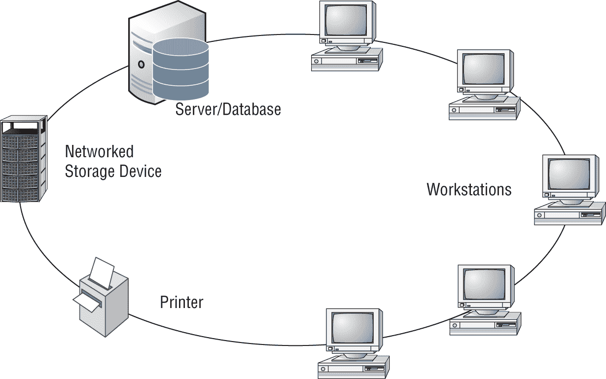

**FIGURE 4.9 Ring topology**

##### 总线拓扑

总线拓扑中的每个节点或系统都通过单根线路或主干电缆连接。与环形拓扑不同，总线配置会发生数据冲突，因为多个系统可以同时传输。总线拓扑确实具有冲突避免能力，因为系统可以监听电缆以确定是否有流量。当系统听到流量时，它会等待。当它不再听到流量时，它会将数据释放到电缆介质上。总线拓扑上的所有系统都可以听到网络流量。非预期接收方系统只需忽略数据。总线拓扑与环形拓扑一样，具有单点故障。如果总线从一段断开，该段就会宕机。但是，在该段内，节点仍可以相互通信。

总线拓扑的类型有线性总线和树形总线。 图 4.10 显示了每种的基本说明。线性总线拓扑采用单根主干或主线（称为 *backbone*），所有系统都直接连接到它。树形拓扑也有主干，但有多个段连接到主干，就像树上的分支一样。总线拓扑在网络两端均已终止。该特性使总线拓扑在现代互联网络中不切实际。

##### 星形拓扑

在星形拓扑中，连接的设备连接到一个中央流量管理设备，该设备是集线器或交换机。 图 4.11 显示了从每个设备到中央集线器或交换机的专用线路如何运行。星形拓扑的一个好处是具有段弹性；如果一条链路宕机，其余网络仍可正常运行。布线使用更高效，且损坏的电缆更容易检测和修复。

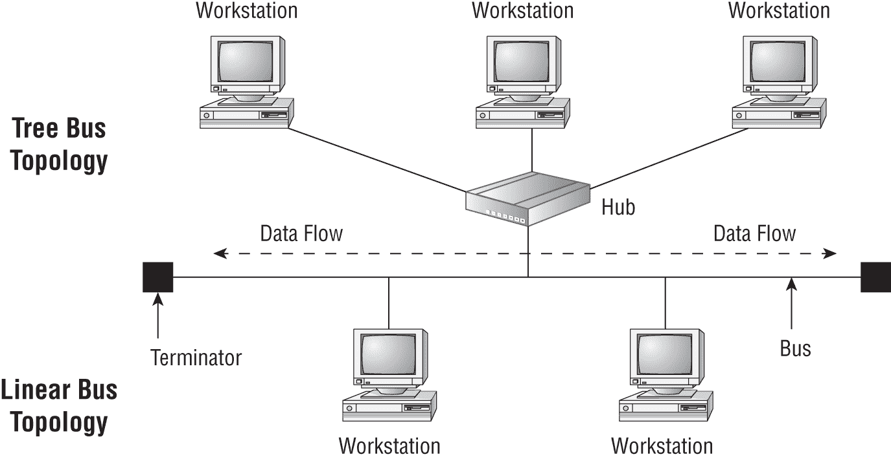

**FIGURE 4.10 Linear bus and tree bus topologies**

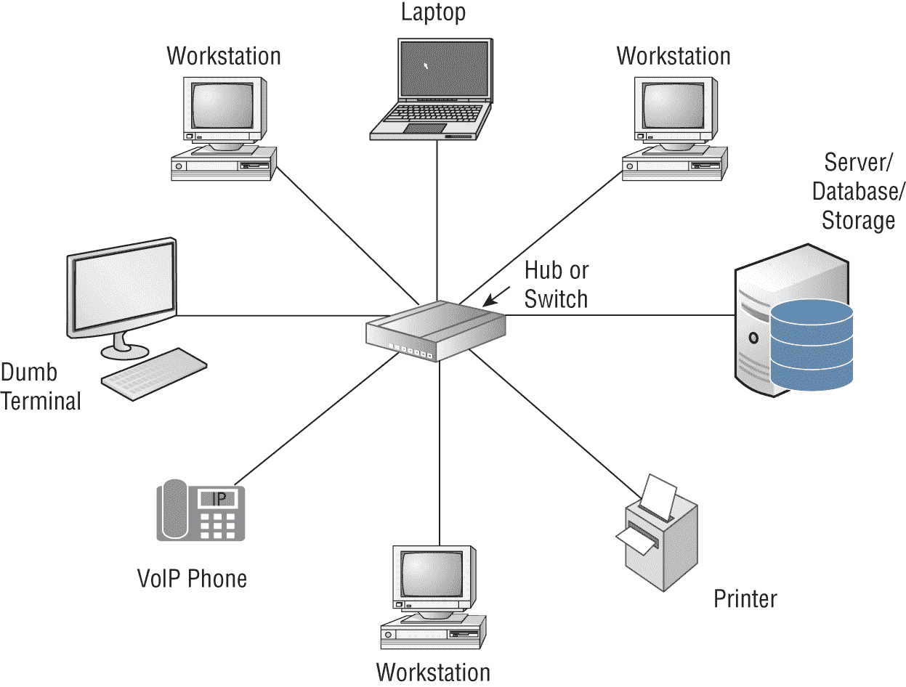

**FIGURE 4.11 Star topology**

总线或环形拓扑的各种逻辑配置可导致星形拓扑。以太网网络可以部署为物理星形，因为它基于总线。在这种情况下，集线器或交换机设备实际上是一个逻辑总线连接设备。物理星形模式可以用多站接入单元（也称为媒体接入单元，或 MAU）实现。MAU 允许电缆段以星形部署，同时设备内部建立逻辑环形连接。

##### 网状拓扑

综合起来，网状拓扑是将网络上的所有系统通过多个独立路径互连。全网状拓扑的概念意味着每个系统都连接到每个其他系统。部分网状拓扑没有达到完全连接，但确实将许多系统连接到许多其他系统。

网状拓扑的关键优势是其提供的最大弹性级别，因为冗余连接可防止一个段或设备故障时整个网络失效。网状拓扑的关键缺点是不成比例的额外费用和管理麻烦。这在查看 图 4.12 时可最好地理解。还值得注意的是，额外成本和管理可能会因资源紧张和网络复杂性而导致安全隐患。

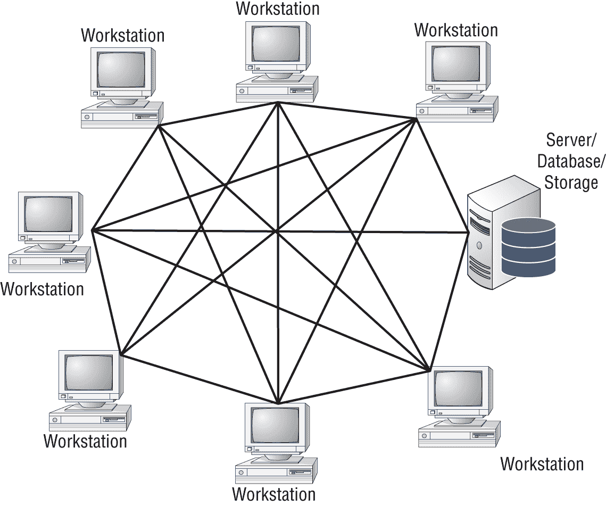

**FIGURE 4.12 Mesh topology**

### 网络访问控制

NAC 解决方案通过在所有用户和设备上强制执行安全策略，为内部网络基础设施提供额外的安全性。NAC 解决方案用于统一端点安全方法（如防病毒、主机入侵防御和漏洞评估）、用户或系统身份验证以及网络安全执行。NAC 设备旨在处理包含各种设备和技术的庞大企业网络，使其在移动设备和物联网持续普及的情况下特别有用。

使用 NAC 有几个基本目标：

*   缓解非零日攻击
*   网络连接的身份验证和授权
*   身份验证后基于角色的用户和设备控制
*   使用 802.1X 的协议（如 EAP-TLS、EAP-PEAP 或 EAP-MSCHAP）对无线和有线网络的流量进行加密（EAP、CHAP 和其他身份验证协议将在本章后面的“远程访问”部分介绍。）
*   强制执行网络策略，以防止端点在缺乏最新安全补丁或所需配置时访问网络
*   根据设备类型和用户角色控制对网络的访问能力
*   基于经过身份验证的用户身份进行身份和访问管理，而不是仅阻止 IP 地址

当未经授权或可疑的设备或用户尝试访问网络时，配置良好的 NAC 会自动检测并立即响应以阻止访问并防止攻击。NAC 的策略应一致地应用于每个尝试连接的设备、用户或实体。有效的 NAC 策略是定义并持续改进，以更好地控制、过滤、防止、检测和响应每一次内部或外部通信。

以下 NAC 概念值得记住：

**入网前与入网后：** 在入网前，终端在获得访问权限之前会被检查是否符合策略（例如，识别并阻止防病毒定义过期或缺少关键软件更新的终端或设备）。在入网后，网络访问被授予，但用户操作受到管控，并且根据是否符合网络行为规则来决定是否收回访问权限。

**基于代理与无代理：** 为了对终端做出决策，NAC 系统要么需要在终端上安装客户端应用程序以便在访问尝试时报告状态，要么 NAC 系统可以远程扫描并采用清单技术来确定访问决策。

**带外与内联：** 带外设备将分析功能与执行功能分离，并向中央控制台报告以进行管理。这种方法使用（或复用）现有的基础设施交换机、网关和防火墙来执行网络策略。一些从业者认为带外配置可能具有破坏性。内联设备位于流量流的中间，通常在接入交换机层以上，并在每个终端登录时决定是否允许或限制其流量。这些设备在过载时可能成为瓶颈。

**补救：** 补救是必要的，以解决阻止访问的问题（例如，更新防病毒软件）。补救有两种不同的方法：

* **隔离：** 终端被限制到特定的 IP 网络或分配的 VLAN，仅提供用户路由访问特定主机和应用程序，例如补丁管理和更新服务器。
* **人质门户：** 用户访问网站时会被拦截并重定向到一个 Web 应用程序，该应用程序引导用户完成系统补救。在补救完成之前，访问仅限于人质门户。

### 终端安全

终端包括我们都很熟悉的笔记本电脑、台式机和服务器，但也包括移动设备、物联网设备、工业控制系统、自主移动系统、机器人等。终端检测与响应（`EDR`）的概念是正在兴起的安全解决方案类别，旨在满足对所有类型终端上高级威胁进行持续监控和响应的需求。`EDR` 通过持续监控终端和网络事件并分析这些事件来检测、调查和响应可疑活动。

终端安全是一道重要的防线，无论设备是持续连接到网络，如服务器，还是间歇性连接，如移动设备，都很重要。让受感染或可疑的终端远离网络是合理的。允许易受攻击或已损坏的设备访问会使整个网络环境面临风险。NAC 和终端安全等概念与其它检测和响应技术（例如用户和实体行为分析，或 `UEBA`）结合使用，是良好安全实践的核心。

纵深防御方法一直将终端安全作为防火墙、代理、集中式病毒扫描仪以及入侵检测和入侵防御解决方案（在 Chapter 7，“Security Operations” 中讨论）等其它层的一部分。然而，攻击的性质已经改变。攻击者可以通过社会工程学获得有效凭证，或通过暴露的远程访问端口绕过边界安全控制。一旦外部人员成为内部人员，传统的边界和预防控制就变得效果大打折扣。零信任架构（本章前面讨论过），以及本地主机防火墙、高级威胁防护应用程序、多因素身份验证、审计、基于客户端的 IDS/IPS 和其它新一代终端控制是有益的。

#### 移动设备

移动设备对安全专业人员有特殊影响：

* 笔记本电脑、平板电脑和智能手机的小尺寸以及日益强大的计算和存储能力，使得移动设备丢失或被盗对组织构成重大风险。装满一整间房的纸质文件所需的数据量，仅占现代笔记本电脑存储空间的 5% 左右。
* 移动设备也更容易、更快地丢失，不像台式电脑、大型机和其它更难从组织中移除的设备。
* 移动设备也存在作为攻击发起平台的风险。无论是单独被恶意软件感染还是作为僵尸网络运行，移动设备都与互联网交互，能够协助对企业和政府网络发起攻击。

针对移动设备的适当安全方法首先始于适用于所有存储平台的指导：最小数据保留。如果数据不需要，就不要保存在移动设备上。最小数据保留围绕手机用户所需的最小数据量展开。定期删除任何曾经需要但已超出数据保留策略的数据。

保护移动设备数据的下一步是使用密码、生物识别或其它可用身份验证机制在不使用时锁定设备——尽可能使用多因素认证。另一个重要步骤是对移动设备上的静态数据进行加密。一些设备，如使用 Apple `iOS` 的设备，内置了 `AES-256` 级别的加密。其它平台具有用户启用的加密或支持第三方加密应用。如果敏感信息将在移动设备上使用或可能存储在移动设备上，加密至少是最佳实践，并且对许多组织而言是监管期望。

对于希望以一致方式管理移动设备的组织而言，集中管理移动设备是关键。此外，美国国家标准与技术研究院特别出版物 `800-124`（目前为 rev 2 草案）不仅涵盖管理，还涵盖在更高层面上改善移动设备的安全访问和身份验证的方面。例如，移动安全专业人员可能会重新考虑仅凭凭证就授予移动设备访问内部网络的权限。智能手机，特别是个人拥有的设备，可能被越狱或“root”。因此，组织应在授予完全网络访问权限之前考虑检查连接设备的完整性。为此，NIST `800-124` 深入探讨了移动设备安全的集中管理。

另一种近年来日益流行的技术是，企业允许在个人设备上维护企业数据，采用基于 BYOD 政策的“安全容器”。企业要求容器定期“回拨”以维持访问。此外，还使用加密和安全协议来进一步保护对设备上容器的常规访问。如果设备离线（即在设定时间内未回拨，例如 30 天），容器将被锁定，之后经过一段时间将被销毁。

前面提到的保护数据技术，以及人们对使用自己的移动设备的强烈偏好，使得企业采用 BYOD 政策变得更有价值。个人拥有移动设备有几个名称。例如，个人移动设备（`PMD`）、个人电子设备或便携式电子设备（`PED`）以及个人拥有设备（`POD`）都是同义词。

随着个人设备的普及，许多组织正在使用或考虑 BYOD 计划。BYOD 是一种政策和策略，允许员工使用自己的设备履行工作职责。有几个选项，包括以下一项或多项操作：

* 对个人设备进行无限制访问
* 仅访问非敏感系统和数据

*   访问，同时防止数据在个人设备上本地存储
*   访问，但 IT 对个人设备、应用程序和存储的数据进行控制

一些与安全相关的需要理解的通用技术是移动设备管理（MDM）、容器化和应用虚拟化。这些是软件解决方案和移动设备配置的示例，有助于识别、隔离并在移动设备上分层保护流程，同时保留个人隐私的需求。换句话说，在努力保护企业敏感信息时，并不总是需要跟踪或最终删除个人照片或个人健康记录等个人信息的非企业资产。

贵组织应要求员工签署声明，确认其知晓 BYOD 政策和程序，并且该政策必须包括公司有权远程擦除丢失或被盗移动设备的许可。设备擦除是指使用 MDM 解决方案远程联系移动设备并删除或移除设备上所有数据的过程。将此与企业拥有、个人启用（COPE）设备进行对比。在 COPE 模式下，企业向员工发放智能手机或移动设备，但允许他们更改设备并将其作为自己的个人设备使用（在合理范围内）。

## 根据设计实施安全通信渠道

本章前面，我们提供了示例和指南，以正确分析、设计、实施和监控各种网络协议、拓扑和基础设施组件。在本节中，针对语音、多媒体协作、远程访问、数据通信、虚拟化网络和第三方连接的特定方面和问题进行了阐述。

### Voice

语音通信已在很大程度上与许多信息技术平台集成。数字语音传输为系统引入了其自身的一系列漏洞。身份验证很重要，可阻止窃听者捕获媒体、身份、模式和凭据——并可能将其用于后续未经授权的连接或其他窃取数据的尝试。完整性是两个方面的关注点：消息完整性和媒体完整性。如果消息被截获，其内容可能会被更改或重建，或者消息会被重定向。实际媒体可能被劫持并降质，或者攻击者可以向媒体中插入新消息。为了保护传输中的语音数据，可以使用加密协议来封装甚至扰乱语音流量。然而，正如本章前面提到的，安全语音传输无法提供端到端保密性，因为所有流量的某部分会被解密以协助政府执法。虽然美国没有以公开法律强制要求，但中国于 2017 年颁布了《网络安全法》。《网络安全法》要求所有网络运营商配合中国当局进行抽查和“技术支持”，以便在要求时允许完全访问。

#### Private Branch Exchange and Plain Old Telephone Service

关于语音通信安全的讨论始于专用分支交换机（PBX）和普通老式电话服务（POTS）。PBX 是企业级电话系统，与住宅系统相对。它包括内部交换网络和控制器。模拟 PBX 的问题在于，它们安装时端口、代码和控制接口的默认访问配置。如果组织未更改这些配置，攻击者可以轻松利用它们。利用这些配置不当系统的常见方法的一个例子是每年耗费数十亿美元的巨额计费欺诈。计费欺诈是指恶意行为者拨打大量电话至高费率号码（如国际号码），并从这些电话产生的收入中获取一部分。

一些漏洞，包括默认配置，已得到缓解，因为模拟 PBX 已在很大程度上被支持 VoIP 的数字 PBX 取代。然而，仍存在一些残余风险。降低风险的第一步是识别问题。识别计费欺诈通常由负责检查组织电话账单的部门完成。一旦识别出欺诈性电话，特别是来自 VoIP 服务的电话，您就可以采取措施进行补救。如果没有对相关系统的强大漏洞管理，很难弄清楚黑客是如何滥用数字 PBX 系统或 VoIP 系统的。了解这些系统中的弱点有助于识别可能被利用以发起欺诈性电话的内容。随后使用强有力的政策和培训将进一步最大限度地减少内部员工的滥用。最后，考虑使用一些专用应用程序来监控通话并在可疑通话发生时发出警报。

POTS 仍然是住宅网络和一些企业的常见功能。它旨在通过双向模拟电话接口传输人类语音。通过 POTS 连接，语音通信容易被截获、窃听、窃听和其它利用。因此，POTS 和 PBX 安全控制在很大程度上依赖于物理控制以限制访问并保护设备。减轻风险的额外方法包括隔离网络流量并监控更脆弱的区域。许多报警系统和用于传真机、一些路由器和其他网络设备的带外网络链路可能会让 PBX 和 POTS 在组织中存在多年，这对安全专业人员来说是一个关注点。

#### Voice over Internet Protocol

VoIP 是一种使用多种技术通过 IP 网络封装语音通信和多媒体会话的方法。VoIP 已成为公司和个人使用 TCP/IP 网络连接运行电话解决方案的一种流行且经济实惠的方式。

VoIP 技术并不自动比模拟更安全。它本质上是明文通信，容易被截获和窃听。通过适当的配置，可以实现高度加密的解决方案，并且干扰或窃听的企图能够被阻止。即便如此，VoIP 仍需要安全专业人员的关注。黑客有多种 VoIP 攻击途径。

*   有工具可用于伪造来电显示，这会促进 vishing（VoIP 钓鱼）或互联网电话垃圾信息（SPIT）攻击。
*   呼叫管理器系统和 VoIP 电话本身可能容易受到主机操作系统攻击和 DoS 攻击。
*   MITM 攻击可能通过伪造呼叫管理器或端点连接传输而成功。
*   未加密的网络流量可能包含 VoIP，因此解码 VoIP 流是可能的。

这些问题的补救措施集中在采用加密、加强身份验证和强大的网络基础设施上。如前所述，一些供应商需要在存在协议或漏洞时采用创新手段来保护其自身服务。

### Multimedia Collaboration

“随时随地工作”这一表述凸显了多媒体协作对企业的影响，特别是在 COVID-19 大流行开始以来。共享视频、数据、图像和音频平台的增长也改变了个人福祉。地理距离已通过各种支持多媒体的通信解决方案得以弥合。当协作同时进行时，可以高效有效地使用电子邮件、聊天、VoIP、视频会议、数字白板、在线文档编辑、实时文件交换和版本控制等工具，仅举几例。远程会议技术已改变了企业世界，并改变了每个企业运营的方式。随着这些变化，有重要的安全影响需要解决。

#### Remote Meeting

# 远程会议概述

在当今时代，虚拟会议已成为生活的一部分。截至本文撰写时，世界各地许多人已超过一年没有进入过办公室内部。虽然我们相信这种情况很快就会改变，但 COVID-19 大流行向我们所有人证明了，参与者位于任意多个地理分隔区域的富有成效的会议也可以远程举行。为了实现这些远程会议，使用了多种不同的技术。有像视频摄像机和 VoIP 电话这样的硬件解决方案，而且越来越多地使用人们自己的个人或公司发放的移动设备进行电话会议。软件有助于管理会议并允许远程各方之间进行交互，例如使用共享屏幕白板。用于描述这些技术的术语有多种，例如数字协作、虚拟会议、视频会议、软件或应用协作、共享白板服务以及虚拟培训解决方案。归根结底，任何能够使人们进行通信、交换数据、协作处理材料/数据/文档并以其他方式共同执行工作任务的服务，很可能都在执行或促进某种形式的远程会议。

## 多媒体远程会议安全影响

多媒体远程会议服务具有安全影响。由于在物理会议室中出席并不意味着个人已被识别，因此远程会议中必须确保身份验证。为了提供这种保证，需要对与会者身份进行某种形式的验证或确认，例如员工必须使用唯一密码预先注册会议。语音、数据或视频的传输可能需要通过加密来保护。在每个人都在同一地点的物理会议室中，语音在发送者到接收者之间不需要特殊保护，除非采取物理措施，如关闭门和隔音墙。为了充分利用多媒体协作，特别是远程会议，必须解决安全问题。

## 即时消息

即时消息（`IM`），也称为 `private messaging`（`PM`），是一种协作工具，允许通过互联网连接的两名用户之间进行双向、实时基于文本的聊天。最初，每个用户都必须使用相同的客户端软件。最近的应用中，`JavaScript` 在 `IM` 中更为普遍，用户只需使用现代浏览器即可。某些 `IM` 工具允许进行文件传输、多媒体、语音和视频会议、屏幕共享、远程控制和命令脚本。某些形式的 `IM` 基于点对点服务进行直接通信。其他实现使用一个或多个集中控制的在线服务器。点对点 `IM` 容易受到多种类型的攻击以及数据潜在未经授权的访问。然而，它易于使用和设置，这使其在企业和个人使用中都很受欢迎。`IM` 容易受到攻击的一些常见方式如下：

* 当 `IM` 未强制执行强身份验证时，账户仿冒可能会威胁真实性。
* 没有加密，`IM` 易受数据包嗅探攻击，从而危及保密性。
* 文件传输和远程访问增加了恶意代码投放、感染或数据外泄的风险。
* `IM` 用户经常遭受多种形式的社会工程攻击，例如冒充或说服受害者披露敏感信息，如密码或机密数据。

## 电子邮件

有效保护电子邮件是组织信息保护的重要组成部分。电子邮件被广泛使用并被接受为正式通信或记录事项。它是最常用的互联网功能之一。电子邮件基础设施主要是使用 `SMTP` 的邮件处理服务器。服务器从客户端接收消息，将这些消息传输到其他服务器，并将其存入用户的基于服务器的收件箱。服务器使用邮局协议版本 3（`POP3`）或互联网消息访问协议（`IMAP`）等邮件投递协议与终端用户目的地通信。这些协议允许客户端从其基于服务器的收件箱中提取电子邮件。这些协议无论是在企业局域网还是在众多的基于网络的电子邮件服务中都使用。

安全专业人员应熟悉的流行 `SMTP` 服务器有 Unix 系统的 `Sendmail` 和 Microsoft 的 `Exchange`。随着 Google 和 Microsoft 在基于云的电子邮件服务中获得市场份额，一些安全影响发生了变化。就本章而言，了解一般 `SMTP` 服务器的基础知识就足够了。

事实上，`Sendmail` 和 `Exchange` 只是众多替代方案中的两个。虽然它们在提供企业或私人电子邮件服务方面很受欢迎，但使用 `SaaS` 电子邮件解决方案的流行度正在增长，其中 `Gmail` 用于企业或 `Office 365` 是两种更受欢迎的电子邮件 `SaaS` 选项。部署和保护 `SMTP` 服务器的关键因素首先是确保所使用的协议提供相同的<|message|>

### 访问控制
访问应限制在个人收件箱和归档中。在某些情况下，会建立具有多个收件人的群组电子邮件收件箱。具有访问权限的用户应被禁止将访问权限授予其他人。访问控制的实现方式应有所描述，以便用户认识到合法访问与一定程度隐私之间的平衡。至少，访问控制会阻止或防止未经授权的访问。

### 隐私
企业电子邮件系统的用户通常应习惯于对隐私没有合理期待。

### 电子邮件备份和保留策略
备份和归档对于数据恢复、法律程序以及许多审计都是必需的。保留规则对于指导组织不再保留不再有价值或因法律或监管原因不再需要的记录非常重要。过度的记录维护可能会导致另一种安全问题。备份可以是每日、每周或每月，例如。保留要求范围从几个月的归档到数年。在任何情况下，备份和保留规则都必须基于风险、业务需求以及任何法律或监管指南。

### 电子邮件安全解决方案
与所有安全方法一样，必须进行风险-回报（或成本-效益）分析。实施和维护安全控制的成本不应超过信息的价值（或丢失的成本）。安全控制应保持企业运营和发展的能力；否则，它们将是不必要的，因为企业可能正走向过时。就电子邮件安全而言，一个需要强调的关键考虑是保密性，因为电子邮件消息可能包含需要保护的有价值和敏感信息。

组织可以采用几种技术来加强其电子邮件通信的保护：
* 使用数字签名来打击冒充尝试
* 对所有传入电子邮件进行反恶意软件扫描
* 在网关处阻止可疑附件和潜在风险的文件名扩展名（如 `.zip` 和 `.exe`），以减少网络钓鱼和类似攻击
* 采用过滤器来减少垃圾邮件和邮件炸弹问题
* 使用加密来禁止窃听行为
* 培训用户了解识别和处理电子邮件中垃圾邮件或潜在恶意链接的重要性及方法
* 安装、运行和更新防病毒和终端保护

有几种协议、服务和解决方案可以增强电子邮件基础设施并提供安全，而无需对整个基于互联网的 SMTP 基础设施进行昂贵且彻底的改造。其中一些策略如下：
* 安全多用途互联网邮件扩展 (S/MIME)
* MIME 对象安全服务 (MOSS)
* 隐私增强邮件 (PEM)
* 域名密钥识别邮件 (DKIM)
* 很好隐私 (PGP)
* 强制加密

`S/MIME` 是一种电子邮件安全标准，使用公钥加密和数字签名来为电子邮件启用身份验证和保密性。`X.509` 数字证书用于提供身份验证。公钥密码学标准 (`PKCS`) 加密用于提供隐私。使用 `S/MIME` 可以形成两种类型的消息：
* **签名消息：** 提供完整性、发送者身份验证以及发送者的不可否认性
* **封装消息：** 提供完整性、发送者身份验证和保密性

`MOSS` 是另一种电子邮件安全标准，可以提供身份验证和保密性，但也可以为电子邮件消息启用完整性和不可否认性服务。`MOSS` 采用消息摘要 2 (`MD2`) 和 `MD5` 算法；Rivest、Shamir 和 Adelman (`RSA`) 公钥；以及数据加密标准 (`DES`) 来提供身份验证和加密服务。

`PEM` 是一种电子邮件加密机制，提供身份验证、完整性、保密性和不可否认性。与上述服务一样，`PEM` 也使用 `RSA`、`DES` 和 `X.509`。

`DKIM` 是一种通过验证域名身份来断言有效邮件由组织发送的手段。这增加了不可否认性和身份验证层，在识别和过滤电子邮件中的伪造地址方面特别有帮助。实施 `DKIM` 依赖于公钥和数字签名。

`PGP` 是一种公钥-私钥系统，使用多种加密算法来加密电子邮件消息。`PGP` 加密可用于保护电子邮件以外的文件和其他数字资产。`PGP` 的第一个版本使用 `RSA`，第二个版本使用国际数据加密算法 (`IDEA`)，但后期版本提供了多种算法选项。`PGP` 加密可用于保护电子邮件以外的文件和其他数字资产。`PGP` 不是标准，而是一种独立开发的产品，在互联网上具有广泛吸引力。

强制使用 `TLS` 进行电子邮件加密是另一种提供保证的方法。少数电子邮件服务提供商如 Apple 和 Google 使用 `TLS` 用于 `@icloud` 和 `@gmail`，即其各自的电子邮件服务。不可能强制 `TLS` 作为唯一选项。事实上，`RFC 2487` 规定公共 SMTP 服务器必须 *not* 强制 `TLS`，因为其实现尚不能（尚未）强制实施。然而，在业务合作伙伴之间的电子邮件域之间，强制 `TLS` 是一个可行的选项。

### 远程访问
互联的计算平台、多媒体协作的优势、业务的全球化以及“随时随地工作”运动是使分散的工作场所安排变得更常见的一些力量。远程办公，或远程工作，是指一个人与主要企业计算和存储平台分离，从另一个位置（如其家庭）通过笔记本电脑访问它们。人们对云托管资源的依赖也在不断增长，企业受保护的局域网上的员工需要远程访问由 CSP 托管的重要基础设施。

在远程办公或使用基于云的资源时，用户可能会使用以下其中一种访问路径：
* 通过互联网连接到网络，有或无 `VPN`
* 通过瘦客户端连接连接到终端服务器系统或访问网关

#### 远程办公的远程访问
要使远程办公富有成效并取得成功，员工需要在远程位置获得与在主要办公室相同或相当的许多资源。访问电子邮件、共享存储以及虚拟参加会议的能力是必要的。远程办公人员使用多种远程访问技术来建立与业务办公室网络所需的连接。主要有三种远程访问技术：
* **服务特定：** 如果需要某项服务，例如通过 Outlook Web Access (`OWA`) 的电子邮件，则服务特定的远程访问功能允许用户远程连接并使用它。服务特定的功能不仅限于本地应用程序的基于 Web 的版本。例如，终端服务访问可以仅限于时间和考勤应用程序。
* **远程控制：** 远程控制或远程访问的常见应用是帮助台或一级支持以及员工培训功能。远程控制允许授权用户获得对另一系统的远程访问并完全控制，就好像他们 physically 在远程系统前一样。远程控制存在重大的安全问题。潜在威胁包括黑客可能用来利用专有远程桌面协议 (`RDP`) 的暴力攻击，该协议 Windows 环境用于启用 Windows 远程桌面和终端服务器。

### 屏幕抓取
*屏幕抓取* 的过程涉及复制在一个应用程序中显示的信息，以便在另一个应用程序中使用或显示。屏幕抓取技术在金融行业中已被广泛用于在分析和其它应用程序之间收集和重用交易数据。在屏幕抓取过程中存在未经授权披露或泄露的风险，因此安全专业人员希望对任何屏幕抓取解决方案实施加密。

## 远程访问安全管理

允许远程访问的组织将其风险扩展到了象征性的企业边界之外。随着风险的扩大，也带来了额外的安全要求。私有网络可能因远程访问攻击而被入侵。图 4.13 说明了一些远程访问风险增加的常见区域。可以实施许多安全控制措施，其中最重要控制类别的几个如下：

* 需要强大的身份验证系统；多因素身份验证是保护敏感信息的标准。
* 将远程访问限制为仅那些需要它并且常规使用它的人。
* 在传输链路上实施加密，包括以下示例中的一种或多种：VPN、SSL、TLS、SSH 和 IPSec。
* 要明白 VPN 并不是一个完整的安全解决方案；能够进行身份验证并建立 VPN 的终端用户可能使用感染的计算机或移动设备访问网络。

正如本章所述，端点安全也至关重要。需要组合安全控制来管理和保护远程访问员工。

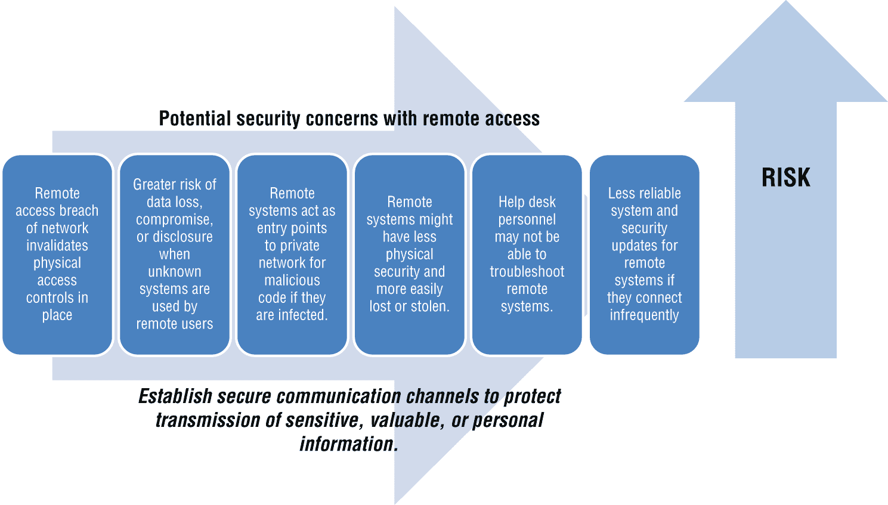

**FIGURE 4.13 Common areas of increased risk in remote access**

## 身份验证方法

由于远程访问将私有网络扩展到企业环境之外，使许多现有的物理控制失效，并增加了组织的信息风险，因此对远程访问用户的身份验证采取额外预防措施值得进一步探讨。组织将使用特定的远程访问协议和服务来加强远程客户端和用户的凭证管理及权限。最有可能的是，应部署集中式远程访问身份验证系统。远程身份验证协议的一些示例是 Password Authentication Protocol (PAP)、Challenge Handshake Authentication Protocol (CHAP)、Extensible Authentication Protocol (EAP，或其扩展 PEAP 或 LEAP)、Remote Authentication Dial-In User Service (RADIUS) 和 Terminal Access Controller Access Control System Plus (TACACS+)。

## 集中式远程身份验证服务

集中式远程身份验证服务在远程访问客户端和私有内部网络之间增加了额外的保护层。使用集中式服务器的远程身份验证和授权服务与用于本地网络客户端的类似服务不同且分离。这很重要，因为在远程访问服务器被入侵的情况下，整个网络的身份验证和授权服务不受影响。几个领先的示例是 RADIUS、Diameter 和 TACACS+。

* **RADIUS：** 用户将登录凭证传递给 RADIUS 服务器进行身份验证，与域客户端将登录凭证发送给域控制器进行身份验证的过程类似。
* **Diameter：** Diameter 本质上是 RADIUS 的继任者。Diameter 提供的一个重要改进是增加了可靠性。Diameter 通常用于移动设备服务的预付费和基于信用的使用模式，以及类似的应用。
* **TACACS：** 这是 RADIUS 的替代方案。TACACS 有三个版本：原始 TACACS、Extended TACACS (XTACACS) 和 TACACS+。TACACS 将身份验证和授权过程集成在一起。XTACACS 将身份验证、授权和记账过程分开。TACACS+ 通过添加双因素身份验证改进了 XTACACS。TACACS+ 是该产品线的最新且最相关的版本。

## 虚拟专用网络

VPN 是一种通信隧道，可在不受信任的网络（如互联网）上建立安全点对点连接。大多数 VPN 使用加密来保护封装的流量，但加密对于连接被视为 VPN 并非必要。

VPN 最常见的应用是在互联网上建立两个远程网络之间的安全通信，例如企业网络和远程办公人员的家庭网络。还有其他示例和 VPN 用途也应得到重视：

* 在私有网络内部提供额外的数据保护层
* 连接到 ISP 的终端用户系统之间
* 两个整个私有网络之间的链路
* 为依赖于风险或脆弱通信协议或方法学的遗留应用程序提供安全保障，尤其是在跨网络通信时
* 在不安全或不受信任的中间网络上提供保密性和完整性，但不提供可用性

### 隧道

隧道概念是理解 VPN 如何工作的基础。隧道是网络通信过程，它将数据包封装在另一个协议中以保护初始数据包。封装创造了在不受信任的中间网络上通信隧道的逻辑假象，即流量仅对隧道两端的系统可见，而对不受信任的网络隐藏。在隧道两端，初始协议数据包被封装和解封装以促进通信。

在需要绕过防火墙、网关、代理或其他网络设备的情况下，会使用隧道。授权数据被封装，传输被允许，即使隧道内部的访问受到限制。隧道的一个优点是流量控制设备无法阻止或丢弃通信，因为它们无法检查数据包内容。这对于简化重要内容和连接很有用。然而，这种能力也是潜在的安全问题，因为旨在保护私有网络免受恶意内容侵害的安全设备无法在数据包到达或离开时扫描它们。如果隧道涉及加密，尤其如此。敏感数据将保持保密性和完整性。然而，数据对网络和安全设备而言是不可读的。

安全专业人员无法监控隧道内流量的内容并不是隧道唯一的担忧。使用多种协议时，消息开销会增加。每个协议可能都有自己的错误检测、错误处理、确认和会话管理元素。这增加了复杂性和处理时间。隧道数据包的大小或长度比正常数据包更大。这需要更多的带宽资源，与其他网络资源竞争。网络饱和和瓶颈可能很快发生。此外，隧道是点对点通信机制，并不设计用于处理广播流量。

### 常见 VPN 协议

VPN 可以使用软件或硬件解决方案实现。在任何一种情况下，都有基于隧道如何实现的变体和组合。有三种常见的 VPN 协议提供了 VPN 如何构建的基础视图：

* **Point-to-Point Tunneling Protocol (PPTP)：** 数据链路层（第 2 层）用于 IP 网络。
* **Layer 2 Tunneling Protocol (L2TP)：** 数据链路层（第 2 层）用于任何 LAN 协议。

*   `IPSec`：网络层（第 3 层）在 IP 网络上使用；`IPSec` 已在本章前面的“安全协议”部分中介绍。

### 点对点隧道协议

该协议由拨号协议点对点协议（`PPP`）发展而来。它在 OSI 模型的链路层（第 2 层）对流量进行封装，并在 IP 网络上使用。`PPTP` 对 `PPP` 数据包进行封装，并在两个独立系统之间创建点对点隧道。它使用 `PPP` 支持的相同身份验证协议来保护身份验证流量：

*   Microsoft Challenge Handshake Authentication Protocol（`MS-CHAP`）
*   `CHAP`
*   `PAP`
*   `EAP`
*   Shiva Password Authentication Protocol（`SPAP`）

### 第二层隧道协议

`L2TP` 是为创建点对点隧道以连接不同的网络而衍生的。该协议不采用加密，因此不提供保密性或强身份验证。结合 `IPSec`，这些服务是可能的。`IPSec` 与 `L2TP` 是一种常见的结构。`L2TP` 还支持 `TACACS+` 和 `RADIUS`。最新版本 `L2TPv3` 在安全性方面有所改进，包括改进的封装以及使用帧中继、以太网和 ATM 等通信技术的能力，而不仅仅是在 IP 网络上使用 `PPP`。

### 数据通信

在本章的前几节中，我们谈了很多关于网络拓扑、媒体（有线或无线）和协议。最终，数据通过某种通信路径进入和离开您的场所。在本节的其余部分，我们将介绍一些最常见的数据通信框架和标准。

#### 帧中继

该框架使用分组交换来执行广域网，连接在数字通信信道的物理层和数据链路层运行的网络。帧中继还有另一个用途：它通常用于将局域网与主要骨干网连接。它通过 T-1 连接的租用线路连接独立的广域网和专用网络环境。帧中继有时用于视频和语音，但它并不最适合，因为它不提供稳定的传输流。

帧中继起源于 `ISDN` 的扩展，即帧中继在电路交换技术上集成了分组交换网络功能。该技术已成为创建广域网的一种独立且经济高效的手段。在专用网络中执行帧中继服务的设备称为 `data circuit-terminating equipment`（`DCE`）。连接到帧中继 `DCE` 的设备称为 `data terminal equipment`（`DTE`）。

#### 异步传输模式

这是一种高速网络标准，可同时支持语音和数据通信。它旨在集成电信和计算机网络。`ATM` 通常由 ISP 在其专用长途网络上使用。`ATM` 主要在数据链路层（第 2 层）运行，并可通过光纤或双绞线电缆使用。

`ATM` 与其他数据链路技术不同，尤其是以太网。`ATM` 不使用路由，而是使用称为 `ATM` 交换机的专用硬件，在端点之间建立点对点连接。数据直接从源流向目的地。另一个有趣的区别是以太网数据包长度可变。

`ATM` 的性能通常以光载波（`OC`）级别表示，写为“`OC-xxx`”。使用 `ATM` 可实现高达 10 Gbps（`OC-192`）的性能水平在技术上是可行的。`ATM` 更常见的性能水平为 155 Mbps（`OC-3`）和 622 Mbps（`OC-12`）。`ATM` 流量有几个组件以确保服务质量（`QoS`）。有四种基本类型：

*   `Constant bit rate (CBR)`：指定恒定的峰值单元速率（`PCR`）。
*   `Variable bit rate (VBR)`：指定平均或可持续单元速率（`SCR`），可在一定水平、即 `PCR` 达到峰值，最长间隔后才会有问题。
*   `Available bit rate (ABR)`：指定最低保证速率。
*   `Unspecified bit rate (UBR)`：流量分配给所有剩余传输容量。

`ATM` 具有设计能力，可处理既需要传统高吞吐量数据流量，又需要实时、低延迟内容（如语音和视频）的网络。`ATM` 在 OSI 模型的三个最低层运行：网络层、数据链路层和物理层。`ATM` 是在 `PSTN` 和 `ISDN` 的同步光纤网络（`SONET`）和同步数字体系（`SDH`）骨干上使用的核心协议。`SONET` 和 `SDH` 是标准化协议，使用激光或发光二极管（`LEDs`）通过光纤传输多个数字比特流。

`ATM` 提供的功能类似于电路交换和分组交换网络。它使用面向连接的模型，在实际数据交换开始之前，必须在两个端点之间建立虚拟电路。这些虚拟电路可能是永久的（即通常由服务提供商预先配置的专用连接）或交换的，即按每次呼叫设置，使用信令，并在呼叫终止时断开连接。

#### 多协议标签交换

我们已经介绍了 `ATM` 和帧中继的优点和优势。但 `MPLS` 似乎兼具两者的优点。`MPLS` 已在本章前面的“融合协议”部分中介绍。

### 虚拟化网络

虚拟化技术使用单台主机计算机的内存来托管一个或多个操作系统。在这种结构下，几乎任何操作系统都可以在任何硬件上托管。此场景中的操作系统称为 `guest` 操作系统。一台硬件主机计算机上可以运行多个操作系统，所有这些都视为来宾。操作系统、主机和来宾可以在同一虚拟机上有所不同。虚拟化可用于托管服务器、有限的用户界面（如虚拟桌面）、应用程序等。

随着操作系统虚拟化的有效性得到证明，虚拟化已扩展到涵盖其他机会，例如虚拟化网络。网络虚拟化是将硬件和软件网络组件组合成一个集成实体。 resulting 系统由软件控制所有网络功能，包括管理、流量整形、地址分配等。物理上存在于所有硬件位置不再需要。单个管理控制台或界面可用于监督网络的各个方面。请参阅本章前面的“微分段”部分，了解 `SDN`、`SDS` 及相关概念的介绍。

### 第三方连接

许多组织开展业务时通常需要与第三方进行各种连接。第三方通常可分为三类：

*   数据和电信提供商，例如您的 `ISP`
*   云服务提供商
*   供应商、客户、合作伙伴组织等

与第三方合作存在许多风险，您通常应将此类第三方保持在与您为组织制定的相同（或有时更高）的安全和隐私标准。服务水平协议（`SLAs`），如第 7 章中所述，是与外部方建立安全期望并在未满足期望时追究其责任的重要机制。

许多与第三方连接相关的考虑与本章“远程访问”部分以及本书其余部分所涵盖的主题一致。你应遵循最佳实践，例如传输中加密、强访问控制程序以及强大的电子邮件过滤。此外，对任何第三方连接进行持续监控应成为标准做法，以识别新的威胁、意外行为或偏离已商定 SLA 的情况。

与第三方连接相关的风险主要类别之一是合规风险。作为你和你的客户数据的所有者，你的组织有责任了解外部方如何管理和保护你的数据。你必须确认他们的控制措施符合保护数据的法律和监管义务，包括（但不限于）托管和处理数据的服务器和系统的地理位置方面的考虑。合规报告，例如 `SOC2` 报告，可以作为评估与第三方连接相关的安全和合规风险的良好起点，而 SLA 再次在追究第三方责任方面发挥关键作用。

## SUMMARY

通信和网络安全过去曾局限于保护组织物理范围内的资产和信息。今天，企业边界已发生了巨大变化。公司可能在家里、咖啡店或酒店大堂拥有员工。公司的边界远远超出了其物理建筑的范围，因此用于在公共和私人通信网络和媒体上传输时提供保密性、完整性和可用性的结构、传输方法、传输格式和安全方法已发生变化以适应这些扩展的边界。

本章包含诸如电话、数据通信、OSI 模型的各个层以及传输媒体和协议等基本概念。了解通信技术接口的历史发展、互操作性以及利用安全控制使一切协同工作并保护信息的高级方法，对于网络安全专业人员来说是无价的。

安全专业人员需要培养改进和管理远程访问、虚拟化和云服务以实现新业务和工作场所模式的技能。伴随着这些信息技术变革而来的有安全挑战和机遇。继续支撑适当安全管理的基础概念之一是，没有单一解决方案能够满足所有差距。安全专业人员必须理解描述纵深防御的分层解决方案方法。例如，访问控制、身份验证和加密协同工作以扩展企业计算边界、允许员工随时随地工作并降低提供信息安全的成本。安全攻击的性质也将继续演变。在本章中，我们讨论了 `DDoS`、`MITM` 和网络钓鱼等几种攻击类型，以强调信息安全作为一个职业的重要性及其动态性。随着威胁的变化，我们遏制它们的方法也必须随之改变。
