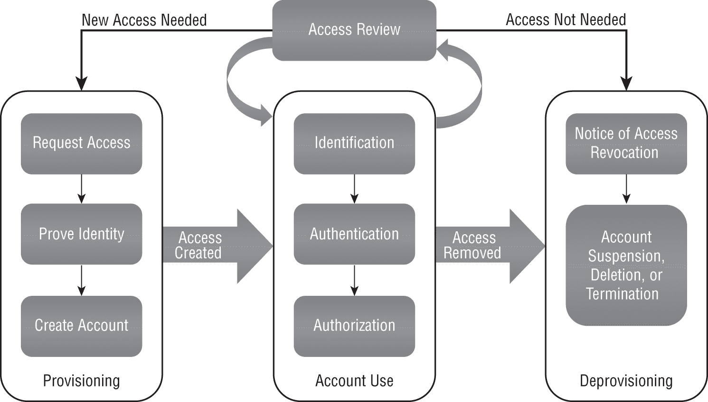

# DOMAIN 5

## Identity and Access Management

`IDENTITY AND ACCESS MANAGEMENT` (`IAM` or `IDAM`) 是信息安全的基础。控制对资源的访问需要能够识别并验证请求访问的实体，并使其对其采取的行动负责。实体可以是用户、系统、应用程序或流程，IAM 由四个基础要素组成：识别、身份验证、授权和问责 (`IAAA`)。

本章确定了每个 `IAAA` 要素以及它们如何配置和执行，这构成了许多访问控制系统的基础。对资产的物理和逻辑访问控制通常始于建立身份并为用户提供凭据，然后在每次请求访问时出示并进行身份验证。时不时地，这些凭据必须进行审查和更新，并在其使用寿命结束时退役。创建和退役访问凭据被称为 *provisioning* 和 *deprovisioning*，而凭据管理流程可以被视为一个生命周期。

IAM 涉及组织安全计划的几乎每个方面，因此认证信息系统安全专业人员 (`CISSP`) 最好确保存在足够的程序和技术系统来支持访问控制安排。这从了解身份信息的要求、选择和实施满足这些要求的系统开始，并确保像访问审查这样的管理控制支持技术控制以保持系统的安全。

## CONTROL PHYSICAL AND LOGICAL ACCESS TO ASSETS

物理访问控制对几乎所有读者来说都很熟悉——门、窗帘、围栏等是控制对房屋、学校和办公楼等建筑物物理访问的常见日常物品。逻辑访问控制同样无处不在，尽管它们对未经训练的眼睛来说并不总是那么明显。需要密码、个人识别码 (`PIN`) 或共享对称密钥才能访问的系统都是逻辑访问控制的例子。逻辑和物理访问措施均旨在限制哪些用户或系统可以访问特定资产，如系统中的数据或存放在保险箱中的贵重物品。

有各种访问控制方法，选择正确的组合需要安全从业者了解组织的资产和控制访问的优先事项。例如，贵重物理资产和对强保密性的要求需要强有力的物理访问控制，而对数据完整性有严格要求的信息系统可能需要应用逻辑等技术控制来满足要求。

访问控制系统通常对访问对象的主题实施控制。*subject* 可以是用户或程序，而 *object* 是主题试图访问的任何东西，如文件、应用程序、设施或数据库。通过这些系统控制访问对于执行保密性、完整性和不可否认性等安全概念至关重要。

### Access Control Definitions

访问控制模型使用标准术语集来讨论各种概念。以下内容在本章其余部分中使用：

*   **Objects** 是需要访问控制的资产。常见的对象包括信息，如文件或数据集，以及系统对象，如计算资源和网络。物理访问控制模型将设施作为对象处理，例如办公楼、计算机房和敏感信息处理设施。所有对象都有一个共同的需求，即保护基本安全属性，包括保密性、完整性、可用性、不可否认性和真实性 (`CIANA`)。

*   **Subjects** 可以是人类用户或非人类实体，如系统、进程和设备。主题需要访问对象，如文件、系统和设施，访问控制的基本实践定义了此类访问如何被授予、使用和监控。

*   **Access** 是主题被允许对对象执行或做的任何事情。例如，人类用户可以被允许或拒绝进入设施，系统用户可以被允许读取访问但被拒绝对文件的写入和更新访问，非人类用户如系统进程可以根据所涉对象的敏感级别被允许或拒绝访问特定数据对象。与控制访问相关的[content]

许多与第三方连接相关的考虑与本章“远程访问”部分以及本书其余部分所涵盖的主题一致。你应遵循最佳实践，例如传输中加密、强访问控制程序以及强大的电子邮件过滤。此外，对任何第三方连接进行持续监控应成为标准做法，以识别新的威胁、意外行为或偏离已商定 SLA 的情况。

与第三方连接相关的风险主要类别之一是合规风险。作为你和你的客户数据的所有者，你的组织有责任了解外部方如何管理和保护你的数据。你必须确认他们的控制措施符合保护数据的法律和监管义务，包括（但不限于）托管和处理数据的服务器和系统的地理位置方面的考虑。合规报告，例如 `SOC2` 报告，可以作为评估与第三方连接相关的安全和合规风险的良好起点，而 SLA 再次在追究第三方责任方面发挥关键作用。

## SUMMARY

通信和网络安全过去曾局限于保护组织物理范围内的资产和信息。今天，企业边界已发生了巨大变化。公司可能在家里、咖啡店或酒店大堂拥有员工。公司的边界远远超出了其物理建筑的范围，因此用于在公共和私人通信网络和媒体上传输时提供保密性、完整性和可用性的结构、传输方法、传输格式和安全方法已发生变化以适应这些扩展的边界。

本章包含诸如电话、数据通信、OSI 模型的各个层以及传输媒体和协议等基本概念。了解通信技术接口的历史发展、互操作性以及利用安全控制使一切协同工作并保护信息的高级方法，对于网络安全专业人员来说是无价的。

安全专业人员需要培养改进和管理远程访问、虚拟化和云服务以实现新业务和工作场所模式的技能。伴随着这些信息技术变革而来的有安全挑战和机遇。继续支撑适当安全管理的基础概念之一是，没有单一解决方案能够满足所有差距。安全专业人员必须理解描述纵深防御的分层解决方案方法。例如，访问控制、身份验证和加密协同工作以扩展企业计算边界、允许员工随时随地工作并降低提供信息安全的成本。安全攻击的性质也将继续演变。在本章中，我们讨论了 `DDoS`、`MITM` 和网络钓鱼等几种攻击类型，以强调信息安全作为一个职业的重要性及其动态性。随着威胁的变化，我们遏制它们的方法也必须随之改变。

# DOMAIN 5

## Identity and Access Management

`IDENTITY AND ACCESS MANAGEMENT` (`IAM` or `IDAM`) 是信息安全的基础。控制对资源的访问需要能够识别并验证请求访问的实体，并使其对其采取的行动负责。实体可以是用户、系统、应用程序或流程，IAM 由四个基础要素组成：识别、身份验证、授权和问责 (`IAAA`)。

本章确定了每个 `IAAA` 要素以及它们如何配置和执行，这构成了许多访问控制系统的基础。对资产的物理和逻辑访问控制通常始于建立身份并为用户提供凭据，然后在每次请求访问时出示并进行身份验证。时不时地，这些凭据必须进行审查和更新，并在其使用寿命结束时退役。创建和退役访问凭据被称为 *provisioning* 和 *deprovisioning*，而凭据管理流程可以被视为一个生命周期。

IAM 涉及组织安全计划的几乎每个方面，因此认证信息系统安全专业人员 (`CISSP`) 最好确保存在足够的程序和技术系统来支持访问控制安排。这从了解身份信息的要求、选择和实施满足这些要求的系统开始，并确保像访问审查这样的管理控制支持技术控制以保持系统的安全。

## CONTROL PHYSICAL AND LOGICAL ACCESS TO ASSETS

物理访问控制对几乎所有读者来说都很熟悉——门、窗帘、围栏等是控制对房屋、学校和办公楼等建筑物物理访问的常见日常物品。逻辑访问控制同样无处不在，尽管它们对未经训练的眼睛来说并不总是那么明显。需要密码、个人识别码 (`PIN`) 或共享对称密钥才能访问的系统都是逻辑访问控制的例子。逻辑和物理访问措施均旨在限制哪些用户或系统可以访问特定资产，如系统中的数据或存放在保险箱中的贵重物品。

有各种访问控制方法，选择正确的组合需要安全从业者了解组织的资产和控制访问的优先事项。例如，贵重物理资产和对强保密性的要求需要强有力的物理访问控制，而对数据完整性有严格要求的信息系统可能需要应用逻辑等技术控制来满足要求。

访问控制系统通常对访问对象的主题实施控制。*subject* 可以是用户或程序，而 *object* 是主题试图访问的任何东西，如文件、应用程序、设施或数据库。通过这些系统控制访问对于执行保密性、完整性和不可否认性等安全概念至关重要。

### Access Control Definitions

访问控制模型使用标准术语集来讨论各种概念。以下内容在本章其余部分中使用：

*   **Objects** 是需要访问控制的资产。常见的对象包括信息，如文件或数据集，以及系统对象，如计算资源和网络。物理访问控制模型将设施作为对象处理，例如办公楼、计算机房和敏感信息处理设施。所有对象都有一个共同的需求，即保护基本安全属性包括保密性、完整性、可用性、不可否认性和真实性 (`CIANA`)。

*   **Subjects** 可以是人类用户或非人类实体，如系统、进程和设备。主题需要访问对象，如文件、系统和设施，访问控制的基本实践定义了此类访问如何被授予、使用和监控。

*   **Access** 是主题被允许对对象执行或做的任何事情。例如，人类用户可以被允许或拒绝进入设施，系统用户可以被允许读取访问但被拒绝写入和更新访问文件，非人类用户如系统进程可以根据所涉对象的敏感级别被允许或拒绝访问特定数据对象。与控制访问相关的概念包括授权，在本章中进行了讨论。

### Information

信息通常是访问控制模型中的一个对象，而访问控制系统旨在根据主体提供的凭证来限制访问。最明显的例子是保护保密性——系统在授予访问权限之前会验证用户的凭证，从而防止未经授权的用户访问数据。可以使用多种模型来为此目的设计访问控制系统，并在本章后面进行讨论。

保护信息的完整性也可以成为限制访问的目标，如果授权控制得以实施，则只有经过适当培训的用户才能进行更改。安全策略通常利用访问控制系统来同时执行保密性和完整性：只有授权用户可以访问策略，而只有特定授权用户（如特定部门的受过培训的成员）才能进行更改。如果存储策略文档的系统支持更改日志和版本历史记录，则安全概念的不可否认性也将通过访问控制系统强制执行，因为任何对文档进行更改的用户都会生成日志条目。

识别信息访问控制的需求是安全从业人员的基本要求。并非所有信息都需要相同类型或级别的保护，并且保护特定信息的要求会随着时间的推移而变化。例如，股票所有权通常是公开信息，因为股票交易是公开信息。股票交易通常在执行前保密，这可以提供竞争优势，因此保密要求会很高。然而，一旦交易执行并公开，该需求就会发生显著变化；在这种环境中使用的任何访问控制系统都需要理解此信息生命周期，并在每个阶段确保应用充分且具有成本效益的保护。

### Systems

系统是一个难以定义的术语。任何硬件、软件、人员、策略、程序和其他资源的集合都可能构成一个系统，尽管该术语通常用于讨论电子信息系统。安全从业人员必须了解其组织中使用的系统的功能和目标，以及模拟流程、纸质数据或系统的电子元素等组件，以便设计适当的身份和访问管理控制。

系统需求可能要求多个安全目标，例如关键信息的保密性、可用性或完整性、系统本身的可用性，或系统用户的真实性和不可否认性。正确实施访问控制，特别是存在敏感数据和信息对象的的信息系统中，是 CISSP 需要执行的基本任务。访问控制对于数据的安全和隐私至关重要，并支持 CIANA 的基本安全概念，这些概念在 Chapter 1，“Security and Risk Management” 中有所介绍。CIANA 概念在系统级 IAM 中常见的实现方式如下：

* **Confidentiality** 要求系统中的信息免受未经授权的访问而保持安全。设施级别的物理访问控制将很重要，同时系统或组件级别的限制对于物理访问控制（如上锁的保险箱）和逻辑访问控制（如全盘加密 FDE）也很重要。
* **Integrity** 可以通过访问控制得到支持，通过防止未经授权的用户对信息进行更改。
* **Availability** 控制和完整性控制通常共享一个共同的实现；例如，上锁的服务器机柜可防止未经授权的用户恶意或意外关闭系统。这可以防止数据丢失或损坏以及系统可用性的丧失。
* **Authenticity** 利用 IAM 中的身份验证来证明系统中的信息、命令或其他信息是可信的。如果主体成功证明了身份，则可能对主体或其提供的任何数据的可信度做出判断。
* **Nonrepudiation** 与真实性有共同之处。不可否认性意味着用户或系统无法否认特定操作，并且要求 IAM 系统实施足够的问责制以证明该操作是由特定主体执行的。这取决于 IAM 系统唯一识别和验证主体的能力，以及系统操作和识别信息的日志记录。

为电子数据和系统访问设计、实施和维护 IAM 是安全从业人员经常执行的任务。这些任务需要大量的思考和分析，因为每个组织的流程和系统都是独特的。一个主要区别是访问控制决策制定和执行的实现。

*Centralized* IAM 管理使用专门的访问控制职能，如团队或特定部门来管理所有访问控制，这具有非常严格的监督和监控的优势。集中式 IAM 的缺点是存在单点故障。*Decentralized* IAM 管理将职能分解，通常将访问控制决策分配给系统或信息所有者。这可以提供更大的自由和灵活性，但潜在的缺点是执行不一致和缺乏统一监督。

### Devices

设备是信息系统的组件，也是系统本身，因此它们需要充分的 IAM。用户工作站包括笔记本电脑、台式机和平板电脑，都是具有存储、处理和网络能力的完整信息系统，这些功能需要适当的如受限逻辑访问的安全控制。对云计算服务存储和处理数据的日益使用也增加了组织必须考虑的设备数量，因为这些服务可以从任何互联网连接的设备访问。

设备 IAM 的主要关注点是确保访问仅限于授权用户。访问数据的设备类型激增导致了 IAM 挑战，例如早期智能手机仅支持四位数字 PIN 而非复杂密码。这些设备的快速发展也带来了安全优势，例如生物识别传感器（如指纹读取器和面部几何扫描仪）的商品化。这些设备的成本更低、效果更好，意味着它们可以纳入更广泛的系统，从而为多因素身份验证 MFA 提供更多选项。

设备有效 IAM 的一个要素是适当的端点安全。诸如端点检测和响应 EDR 等实践在 Chapter 4，“Communication and Network Security” 和 Chapter 7，“Security Operations” 中有更详细的介绍。必须确保访问控制以尊重这些设备的安全性。例如，移动设备管理 MDM 系统中维护的资产清单应指明每个设备的拥有者、主要用户或保管人。这支持在设备受损时进行事件响应能力。

设备在访问控制模型中既可以是对象也可以是主体。如果它们包含敏感数据或授予对敏感功能的访问权限，那么控制对设备对象的访问就很重要。设备也可以被视为主体或非人类用户；已知的 workstation 可以通过设备指纹、数字证书、cookie 文件等进行识别。当设备尝试访问敏感对象时，这些标识符可能会被提供以对设备进行身份验证。如果使用新的、不可信的设备登录，访问控制系统应配置为在授予设备访问权限之前要求额外的身份验证，例如 MFA。这种概念在网络访问控制（NAC）中得到应用，详见 第 4 章，它将设备视为对象并对加入网络的新设备应用额外标准。例如，用户的个人笔记本电脑可能会被置于隔离网络中，直到其补丁级别和 EDR 软件得到验证为止。

许多现代计算设备的可移植性也对保密性构成挑战。笔记本电脑、平板电脑、智能手机，甚至一些功能强大的台式电脑现在都足够小巧轻便，可以轻松携带。这意味着它们容易被盗、丢失，甚至在设备无人看管时在用户不知情的情况下被访问。诸如 MDM 之类的工具可以抵消这些设备及其所含数据的风险，具有以下功能：

* **设备保护：** 这会在每个设备上强制执行安全策略，包括密码复杂度、软件更新以及限制可以安装或使用的应用程序。EDR 软件也有助于识别可疑或恶意活动并启动额外的保护措施，如隔离、锁定或擦除设备。
* **设备限制：** 这会识别不受支持的硬件或已被 *越狱* 的系统，后者移除了设备及其操作系统的标准限制。越狱设备也会移除制造商施加的标准保护，这可能导致未经授权的数据访问。
* **远程锁定或擦除：** 如果设备被报告为被盗/丢失，这允许组织防止未经授权的用户获得访问权限。远程锁定可以在设备找到后恢复，而远程擦除可能会删除所有数据或使设备无法使用；它通常仅在设备无法恢复的情况下使用。
* **容器化：** 将组织数据置于逻辑容器中可将其与设备上的其他应用程序访问隔离。这对于允许用户从个人设备访问组织资源的自带设备（BYOD）政策的组织来说是一种常见选择。对个人设备的限制可能难以执行，因此限制仅限于容器，如果用户丢失设备或离职，容器可以被锁定或擦除。

物理访问控制是设备安全控制的关键要素。在典型的办公环境中，组织的物理访问控制为设施内的所有设备提供共享保护。便携式设备带来了挑战，因为设备通常会离开安全设施。在这种情况下，必须为便携式设备用户提供适当的政策和培训，例如绝不在公共场所无人看管，或在旅行时将设备存放在无标记的包或酒店保险箱中。

### 设施

设施为其包含的所有系统、设备和信息提供共享安全，因此确保充分的保护至关重要。物理安全在讨论信息系统安全时尤为重要——如果攻击者能够获得对设备的物理访问权限，那么即使是最好的逻辑安全控制也可能不足以防止 unwanted 数据访问。

传统的设施物理安全措施通常遵循安全边界范式，采用分层防御，提供不断增加的安全级别。第 7 章 包含更多细节以及物理纵深防御策略如何实施的图表。本节介绍设计和支持可部署的底层 IAM 系统的要求。

#### 物理访问控制系统

*物理访问控制系统*（PACSs）包括物理安全实施，如大门、围栏、旋转门、安全徽章和警卫。它们还包括操作这些控制所需的行政程序，例如警卫监控时间表、徽章要求、装卸码头程序以及访客登记和陪同。

在设计 PACS 时，建立保护要求至关重要，因为对物理基础设施的更改比软件升级等更改更困难。必须首先确定的第一个要求是究竟谁需要访问指定的设施。计算机房或配线间等功能区域可能只需要有限、不频繁的访问，这使得物理安全实施任务更容易，因为用户群体很小。其他设施，特别是办公楼，将具有更复杂的访问要求，因为更多个人需要访问，并且访客或商业合作伙伴使用此类设施的情况可能很常见。

一旦确定了访问要求，就可以开发和实施 PACS 设计。所选控制的复杂性必须反映所保护资产的价值——没有敏感数据或资产的设施不太可能需要 24/7 警卫和先进的入侵检测传感器。元素可能包括以下一项或多项：

* **用户识别：** 进入或离开安全区域的人员、车辆和其他资源应被识别。这可以通过徽章、贴纸、射频识别（RFID）标签、条形码等适当方式实现。人类通常会通过身份证、贴纸或徽章进行识别，而车辆或交付物可能通过 RFID 标签、条形码或快速响应（QR）码进行识别。
* **设备识别：** 非人类用户可以通过多种方法在整个设施或出入口点进行跟踪，包括识别贴纸和 RFID 标签。这允许跟踪和控制进入和离开设施的资产流动，并且可以与财产和资产管理系统集成。
* **围栏和大门**：围栏可以防止 unwanted 访问或根据设施的敏感性设计为引导人员进入受控入口点。大门提供了实施额外检查的能力，例如出示身份证或输入代码，在此进行识别和身份验证。
* **安全门**：与大门类似，安全门提供了做出访问决策的机会——未经授权的用户被拒绝访问，而能够出示适当凭证的人则被授予访问权限。这可以通过出示某种形式的身份证件或授权令牌（如智能卡、智能手机应用程序或 PIN 码）来完成。
* **锁和钥匙**：尽管通常安装在大门或门上，锁也可以用于控制对单个资产的物理访问，例如文件柜中的纸质数据、存放在保险箱中的敏感笔记本电脑或容纳敏感系统的上锁服务器机柜。锁可以是模拟的，需要持有钥匙或知道代码来控制访问。数字锁可以通过要求知道唯一代码或利用生物识别技术来提供对多个用户的唯一识别。

*   `Intrusion detection sensors`: 这些是侦查型控制措施，可以用于识别是否获得了不当访问。示例包括热（红外）、声音（声波）以及重量或压力传感器，它们可以根据体温、玻璃破碎声或入侵者走动时的移动来检测入侵者。

*   `Turnstile or mantrap`: 转闸和单人门禁都是专门设计用来限制进入设施的速率。转闸通常一次只允许一个人通过，而单人门禁要求用户先出示一套凭证进入安全门厅，然后再出示另一套凭证才能从门厅进入主区域。这些装置可用于防范`piggybacking`，即一名用户试图在紧跟授权用户其后而不出示凭证的情况下获得访问权限。

*   `CCTV surveillance`: 视频监控可以承担多种控制功能。摄像头的存在本身可能足以阻止或防止某些非授权访问，而捕获的画面可用于检测和应对情况。闭路电视（CCTV）画面通常需要人工审查才能发挥效果。然而，人工智能（AI）的最新进展使摄像头能够检测运动甚至特定物体如动物或人，从而实现持续监控并生成更智能的警报。

*   `Guards`: 保安人员是最有用、最灵活但也是最昂贵的物理访问控制形式之一。与只能遵循预设响应的技术系统不同，保安人员可以动态响应、进行批判性思考，并在需要时迅速赶赴事件现场。然而，保安人员也会产生技术系统所没有的额外成本，例如福利、休假以及无法持续工作。

设计 PACS 时还必须考虑紧急情况，因为人的生命、健康和安全始终是首要关切。PACS 在正常情况下的目标是限制物理访问；在火灾或职场暴力等紧急情况下，访问控制应设计为允许快速高效的疏散。安全门可以与火灾探测系统集成，并在火灾报警时设计为失效开启，或配备覆盖装置使门打开的同时触发警报。

## 设施的扩展定义

多种因素的结合创造了组织设施构成的新定义。服务器不再在计算机房中与组织控制的桌面工作站通信，云服务提供商（CSP）和个人拥有的智能手机已成为许多组织需要保护的新的“办公室”。确保组织无法控制的资产的物理安全几乎是不可能的，因此可能需要在 PACS 替代方案中采用补偿性控制措施。

如在 Chapter 1 中所述，资产所有者和保管人共同承担实施适当安全措施的责任。BYOD 或用于工作目的的个人设备的用户是这些设备的所有者，而被分配使用的组织资产的保管人则是其保管人。所有作为所有者或保管人的用户都必须强制接受这些设备的适当安全程序培训。该培训应涵盖常见的安保措施，如对设备保持物理控制，绝不在无人看管时将其解锁或使其可访问，以及防止未经授权的各方访问敏感资源。

MDM 和 MFA 可以结合起来，为远程工作增加、基于云的系统和 BYOD 带来的挑战提供强大的补偿性控制。传统上，用户及其连接的设备都被视为可信的。`zero trust` 的新兴范式意味着没有任何用户、设备或流程被视为可信；相反，所有访问都必须包括适当的身份验证，并且可能要求请求方满足某些标准。MFA 使组织能够对请求访问的实体获得更大的保证，而 MDM 可用于强制执行安全策略限制，例如在用户设备上使用复杂密码或加密。

身份联合也在推动设施定义的改变。联合身份系统中的用户不会全部属于同一组织，也不太可能在同一设施工作。除了本章后面讨论的联合身份的技术实现外，安全从业者还应确保对通过联合共享身份的任何第三方应用供应链风险管理实践。

云服务的扩展使用也在推动 IAM 的演进。使用云服务的组织与云中数据和系统的控制权共享——CSP 始终负责物理安全和与基础设施相关的逻辑安全方面，而组织始终负责控制其在云中的数据的逻辑访问。迁移到云的组织将失去设计、实施和管理 CSP 拥有的物理和逻辑控制的能力。

迁移到云通常涉及显著的 IT 成本节约；CISSP 应确保风险评估能够捕捉到这种控制丧失所固有的增加风险，并确保有足够的补偿性控制措施。补偿性控制措施可能包括增加活动日志记录和监督、仅使用经批准的 CSP 或特定 CSP 的特定服务，以及在将数据存储在云应用中之前进行额外的数据加密并由组织控制加密密钥。如果补偿性控制措施的成本大于迁移到云的成本节约，那么组织更有意义地自行托管。

### Applications

对应用程序的访问必须基于健全的访问管理原则授予，例如需知原则和最小权限原则。应用程序提供对数据的访问，为其设计 IAM 策略时应从以下角度考虑访问：

*   `Access to applications`: 并非所有用户都需要访问组织中使用的所有应用程序——销售团队成员不太可能需要访问人力资源（HR）应用程序，而人力资源团队成员不需要访问内部会计应用程序。基于角色的访问控制（RBAC）模型有助于识别常见的需知标准并授予适当但不过度的访问权限。

*   `Access by applications to specific data`: 可以利用访问控制来强制执行应用程序之间数据流的限制。这在 MDM 中尤其相关，其中容器化应用部署到用户的个人设备。这些应用在逻辑上与设备上的其他应用隔离，防止未受管理的未经授权应用访问组织数据。

*   `Access within applications`: 应用程序通常提供多级用户访问，例如普通用户和超级用户或管理员访问。大型应用程序还可能包含多个数据集，如为每个项目或部门设置唯一文件夹的文档管理系统。`Granularity` 描述了可控制访问的级别——粒度高的应用程序支持为每个用户定制对特定对象的访问，而粒度低的应用程序仅允许对应用程序及其包含的所有数据进行基本的允许/拒绝。不充分的粒度可能导致安全损失，如果用户，即使是内部的、非恶意的用户，获得了未经授权的访问。

应用程序也可以作为访问控制系统中的主体来处理。它们是非人类用户，可以访问其他系统、应用程序和数据。这种访问通常是在没有人类用户直接监督的情况下发生的，例如按计划运行或自动运行的批处理作业。应用程序也可以是访问控制中的对象，对控制访问有各种需求。运行应用程序的能力通常允许访问数据，因此任何访问该应用程序的主体都可以访问该数据。应用程序本身也可以是一个有价值的对象，因为访问可能需要许可证。在大型组织中，管理许可证以及对所有正在使用的应用程序具有访问权限的用户可能是一项全职工作。

## 管理人员、设备和服务的识别与认证

所有 IAM 系统都必须实现四个关键要素：识别、认证、授权和问责（`IAAA`）。创建用户身份、向其授予系统权限、在用户登录时授权用户，以及对用户操作进行监督，所有这些都依赖于在 IAM 系统中实施适当的控制。

`Identification` 是主体（如用户、系统或进程）声明身份的过程。这通常通过提供数字用户名或用户 ID 来完成，但也可能使用身份证等物理凭证。需要注意的是，身份管理是一个独特的流程，它甚至在主体尝试访问对象之前就开始了，并且身份管理流程将在后面的章节中更详细地介绍。`Authentication` 是证明所声明身份的过程，主体通过提供其控制下的某些信息来完成此操作。用于认证的因素包括用户所知道的东西、用户所拥有的东西，或用户所具有的某种特征的测量值。这些被称为因素，示例包括以下内容：
* `Type 1:` 这是用户或实体所知道的东西，例如密码、密码短语或安全问题的答案。
* `Type 2:` 这是用户或实体所拥有的东西，例如预先注册的移动设备或实体钥匙卡。
* `Type 3:` 这是用户生物特征之一的测量值，例如手部几何形状、指纹、虹膜扫描或面部几何形状。
* `Type 4:` 这是认证的一个新兴领域，正式定义可能有所不同。访问控制系统可以考虑主体尝试认证的方式和位置的细节，例如访问是否来自之前使用过的设备还是新设备。基于策略的访问控制可以根据此信息提供各种认证路径，例如如果用户在已知受信任的设备上，则只需提供用户名和密码。如果访问来自新设备或位置，则会生成 MFA 提示。

`Authorization` 是一个双重概念。在配置期间创建身份时，必须授予访问权限或权限，这是一个授权操作。每次主体请求访问时，系统还应再次确认授权，以确保主体仍有权访问给定的对象。此外，系统应强制执行对主体所采取的系统操作的 `accountability`，这通常通过记录操作以供审查来实现。

### 身份管理实施

典型组织中的用户将需要访问多个系统，例如电子邮件、协作工具以及来自合作伙伴或服务提供商的外部工具或系统。登录这些系统需要用户拥有一个或多个身份，而在任何超过基本计算环境的组织中，管理这些身份都可能很困难。

身份管理（`IdM`）系统不仅有助于管理用户访问的身份，而且它们管理的身份还能够实现认证、授权和问责功能，因为这些功能都依赖于经过验证的身份。IdM 的功能可以由独立系统提供，也可以与更大的 IAM 工具集成。这些功能支持访问管理生命周期中的关键任务，可能包括以下一项或多项：
* `Provisioning`：IdM 工具可能提供一种方法，通过请求身份创建来启动访问管理生命周期，并支持访问请求审查和批准流程。请求可能由多个方发起，包括用户、用户的经理，甚至人力资源部门，具体取决于组织内实施的 IAM 模型。
* `Deprovisioning:` IdM 也应支持类似的去配置用户流程；去配置请求可能由访问审查员、人力资源、系统所有者等发起。去配置操作可能包括暂时暂停用户账户，例如在休假期间，或永久性地在用户退休时。其他操作可能包括删除或禁用身份。操作的选择应由问责要求驱动——禁用用户账户可防止同一身份在未来被重复使用，并在需要历史日志时可能导致混淆。
* `Identity and account management:` IdM 可以支持集中式和分散式的账户管理功能，例如通过集中式机构（帮助台）或分散式服务（自助服务）进行密码重置。
* `Authorization management:` 一旦创建身份，IdM 就支持该身份的初始访问授权。例如，一旦创建用户账户，就可将其放入具有特定权限分配的组中。
* `Identity review:` IdM 通过提供有关授予身份的授权的关键详细信息来支持对身份和访问的监督。账户和访问的此列表构成了访问审查的基础——所有当前访问都将被审查其适当性，并在不再需要时进行去配置。

IdM 支持额外的功能，如本章其他地方讨论的身份联合，以及单点登录（`SSO`），这是一个可以同时提供安全性和运营效益的特性。在 SSO 环境中，用户只需认证一次，可能针对 SSO 门户或主应用程序（如网页邮件）。从那里，通过初始认证操作生成的令牌共享，授予对其他资源的访问权限。这提供了安全优势，因为用户需要记住的密码数量减少，从而降低了用户写下密码或选择不良密码的可能性。用户也受益，因为需要记住的密码更少。

尽管 SSO 提供了好处，但它也可能成为两种方式的单点故障。首先，如果 SSO 离线或无法访问，则所有启用 SSO 的应用程序的访问也不可用。其次，如果用户的身份被泄露，通过 SSO 授予的广泛访问权限会被放大——相比之下，在非 SSO 环境中，如果用户的身份被泄露，则只会授予对一个系统的访问权限。有趣的是，同样的能力也使从身份泄露中恢复变得更容易，因为使用 SSO 身份的攻击者可以一次性被锁定在所有系统之外。权衡 SSO 的好处与潜在风险是安全从业者在选择 SSO 时的关键任务。本章后面将讨论各种 SSO 解决方案的具体好处和缺点，包括 Kerberos 和开放授权（`OAuth`）。

### 单/多因素认证

# 身份验证

身份验证需要提供证明所声明身份有效性的信息；也就是说，用户确实是他们声称的那个人。身份验证因素有三种类型，它们的区别在于用于证明所声明身份的内容。这些包括用户所知道的东西（`Type 1`）、用户所拥有的东西（`Type 2`），或对用户所是或所做的测量（`Type 3`）。

## 单因素和多因素身份验证

单因素身份验证只需一个因素即可验证身份。最著名的例子是 `username`，即身份，以及 `password`，即 `Type 1` 身份验证因素。几乎所有系统都支持这种组合，用户在登录时也非常习惯使用它们。多因素身份验证顾名思义，需要使用一个以上的身份验证因素，例如 `username`、`password`，以及来自身份验证器应用的随机生成的代码。在此示例中，同时使用了 `Type 1` 和 `Type 2` 身份验证因素，因此这是双因素身份验证（`2FA`）。一个要求 `username`、身份验证器应用代码和指纹的系统才是真正的 `MFA`，因为它需要全部三种身份验证因素。

`MFA` 有助于防范钓鱼攻击等账户入侵。仅仅窃取用户的 `password` 是不够的，窃取额外的身份验证所需的工作量会使攻击变得不切实际甚至不可能。用户提供的用于身份验证的信息越多，例如 `password` 和来自受信任智能手机的身份验证器应用代码，系统就越信任用户是合法的。

与其他安全技术一样，需要确保在安全性和可用性目标之间取得平衡——要求用户每次登录时都打开智能手机应用并输入代码可能会变得负担沉重。在组织可以实施物理访问控制的设施中，未经授权访问的风险可能会得到部分缓解，这意味着 `MFA` 可能只需在用户首次登录时每天要求一次。对于在组织物理控制范围外的设施中工作的移动设备用户，如果访问的数据或系统足够敏感，则可能需要更频繁的 `MFA`。

已经进行了复杂的钓鱼攻击，其中设置了假网站让用户使用其 `username`、`password`，以及来自智能手机应用的随机生成的身份验证器代码进行登录。由于这些代码过期很快（通常 90 秒或更短），这些复杂的攻击依赖于自动化。捕获的凭据必须立即在合法网站上使用，攻击者才能获得访问权限。

## Type 1 身份验证因素

`Type 1` 身份验证因素是用户所知道的东西，例如 `password`、`PIN`，或安全问题的答案。基于知识的身份验证被广泛理解和接受；密码、密码短语、秘密词或类似内容在日常生活中被广泛使用。

`Passwords` 或密码短语是常见的 `Type 1` 身份验证因素，大多数操作系统、应用程序和信息系统都支持其使用。尽管被广泛接受，但密码安全实践的指导最近发生了范式转变。之前的指导主要基于美国国家标准与技术研究所特别出版物（`NIST SP 800-63`），对安全从业人员和普通用户来说都很熟悉。所谓的强密码应至少为八个字符，经常更改，并包含大写、小写、特殊和数字字符的混合。

虽然这种指导在攻击者主要采用手动手段尝试规避访问控制时是合理的，但在廉价、高性能计算硬件时代，它已被证明是不够的。`NIST SP 800-63` 系列文档现在包含管理数字身份、联合 IdM 和身份验证因素管理的指导。这些更新的指导，特别是 `800-63B`，“数字身份指南，身份验证和生命周期管理”，对管理身份验证因素采用了基于风险的方法。这包括 `Type 1` 因素，具体指导如下：

* **强调可用性而非复杂性：** 对复杂密码或密码短语的要求会导致难以记住但攻击者容易猜测的密码，例如在基本词后加上变化的数字，如“password123”和“password 246”。更新的指导强调允许使用常见单词的更长密码短语而不增加复杂性要求，并提供更宽松的输入尝试次数以考虑用户输错。
* **更强调长度而非复杂性：** 系统更倾向于实施密码短语而非密码，因为它们能创建更容易记住的身份验证材料。例如，密码短语可能是“RiskBasedSecurityIsTheFuture”，而复杂的密码可能是“r!skB@s3d”。前者更容易让用户记住，而后者更可能导致用户意外锁定。
* **更改频率降低**：由于复杂性增加，更新的指导要求密码更改频率降低。密码短语更难猜测或破解，因此当前指导要求仅在被泄露时才更改。

所有 `Type 1` 身份验证因素都有共同的优势和劣势。由于它们依赖用户记住秘密信息，如果用户忘记了秘密，就可能无效。当用于程序或脚本存储密码的系统账户时，忘记信息不是问题；相反，身份验证因素被泄露是主要弱点，因为计算机系统无法判断提供密码的是有效用户还是窃取了身份验证信息的攻击者。

## Type 2 身份验证因素

`Type 2` 身份验证因素是用户所拥有的东西，例如数字证书、身份识别徽章或智能卡。受信任的设备也是日益流行的 `Type 2` 因素，因为便携式计算设备已变得无处不在。物理身份验证令牌和基于智能手机的身份验证器应用也是流行的 `Type 2` 因素。它们以数字代码的形式提供额外的身份验证信息，用户必须在登录期间输入，进一步证明其所声明身份的真实性——只有指定用户应知道其密码并有权访问身份验证令牌或应用。

受信任设备身份验证因素的使用可以是静态的也可以是动态的。静态示例是组织发放的工作站，该工作站配置了用于登录虚拟专用网络（`VPN`）的数字证书。登录期间，用户必须提供其密码，并且 `VPN` 客户端还提供证书进行验证。虽然不是万无一失，但这种方法降低了被盗用户凭据的可用性并降低了用户 *friction*，即用户在使用系统时遇到的困难。如果 `VPN` 每次登录都需要密码和令牌代码，用户必须时刻随身携带令牌。将第二个身份验证因素存储在设备上可以减轻用户的负担，同时实现安全目标。

与 `Type 1` 因素不同，`Type 2` 因素不要求用户记住相关信息——用户在度假前更改密码可能难以回忆，但使用身份验证器应用不会出现同样问题。然而，一些 `Type 2` 因素确实要求用户记住随身携带设备，例如令牌、智能卡或受信任的智能手机。如果设备丢失或被盗，或需要电力但电池没电，如智能手机身份验证器应用的情况，用户将无法成功身份验证。

保护物理设备的保密性和可用性是一个重要的安全考虑因素，如果使用这些设备的话。用户应接受与这些设备相关的充分安全程序的培训，例如保持对其的物理控制，并在设备丢失或被盗时立即报告。制定事件响应场景和程序以处理与 Type 2 身份验证因素相关的问题也很重要。帮助台人员应接受如何处理丢失或被盗的智能手机或身份验证硬件的培训，并且还必须存在适当的<|message|>技术控制，例如用于注销或取消授权这些设备的中央控制台。

### Type 3 身份验证因素

生物特征是对人类用户的测量，通常被称为你所拥有的或所做的东西。人类生理特征或行为的独特性使得它们可用于证明身份。这包括通过扫描测量身体部位的几何形状，如面部或指纹识别，记录和比较语音样本，甚至监测用户输入样本文本（如密码短语）时的节奏和韵律。Type 3 身份验证很少单独用作单一因素，但通常用作 MFA 的第二或第三因素。

生物特征提供了证明身份真实性的最强方法之一，因为所测量的特征具有高度独特性——世界上只有极少数人会有显著相似的指纹或视网膜。复杂的生物特征系统还可以检测伪造的凭证，尽管所有系统都可能被攻破或被欺骗，并且有些系统存在缺陷或偏见，例如面部识别系统难以区分某些种族或肤色的人。

生物特征的额外弱点包括以下几点，这要求安全从业者平衡身份验证需求和对生物特征解决方案的接受度：

* **文化接受度：** 尽管不具侵入性，生物特征扫描仪仍需要可见的皮肤和对身体部位的公开访问，这在文化上可能不可接受。需要面部扫描的外部门在面部遮盖很常见的地方会成问题，因此安全从业者在设计身份验证方案时必须平衡用户和文化要求。
* **可访问性：** 残障用户可能难以使用生物特征系统，甚至缺乏所需的身体部位——缺少右手的用户将无法使用仅支持右手扫描的手部几何扫描仪。使用生物特征还引入了疾病传播的担忧；如果用户必须将身体部位与扫描仪接触，则必须考虑适当的消毒。
* **身体变化：** 随着时间的推移，用于生物特征身份验证的一些特征可能会发生变化，例如用户因疾病失去声音、眼睛退化，或疾病导致身体特征改变。生物特征系统必须支持用户在这种情况下更新其身份验证信息的方式，因为变化的生物特征会导致误拒。
* **无法轻易更改：** 与 Type 1 和 Type 2 身份验证因素不同，如果身份验证系统被攻破，用户没有简单的方法更改生物特征。人类的指纹或面部几何等身体特征无法轻易改变。这些系统应始终被归类为包含个人身份信息（PII），因为生物特征可用于唯一识别个人。选择使用此类系统会因其将存储和处理的数据类型而引入额外风险。

生物特征的使用存在许多问题，包括保持其保密性的相对难度。人类无法轻易防止指纹留在物理物体上，而高质量的照片由于社交媒体和监控几乎无处不在。对生物特征系统的重要测试是其确定“活体”或所呈现的生物特征数据是否来自活人还是照片等复制品的能力。这一概念在 Dorothy Denning 的工作中被详细探讨，可在此处找到：`liveness.com`。

### 常见访问控制错误

身份验证系统可能出现误拒或误接错误。误拒发生在系统拒绝对正确授权的主体进行访问时，而误接发生在系统授予未授权主体访问权限时。访问控制系统可以根据其出现这些错误的频率进行衡量，这些指标称为误拒率（FRR）和误接率（FAR），也称为 Type 1 和 Type 2 错误。

访问控制，如所有安全控制一样，实施需要成本。更昂贵的系统可能提供更多功能，而增加用户登录步骤会降低生产力，因为用户花费更多时间执行安全操作。成本更高的系统可能包括更敏感的身份验证机制，如生物特征传感器，从而提高 FRR。相比之下，成本更低且生物特征机制不那么敏感的系统可能会遭受更高的 FAR，从而向未授权用户授予访问权限。交叉错误率（CER）是 Type 1 和 Type 2 错误相等时的点，CER 是选择身份验证系统时的重要因素。对低价值资产的 Type 2（FAR）错误风险不如对高价值资产的影响严重，因为未授权访问高价值资产的影响会更大。

### 问责制

提供 *问责制* 的系统为用户和流程提供了一种机制，使其对其行为和决策负责。知道是谁（用户或流程）做了什么（操作）是问责制的基础，依赖于用户或流程的唯一识别和已证实的真实性。记录和监控操作是执行问责制的最常见方式，而执行审计或审查是利用收集的信息验证系统中执行活动的常见方式。

强制执行问责制需要强身份验证。如果所有用户共享相同的凭证，即使所有操作都被记录，也无法识别哪个用户执行了特定操作。所需问责制水平应在选择 IAM 工具时作为系统要求记录下来。例如，财务管理系统需要像 MFA 这样强大的问责制以满足监管要求，因为许多金融交易都受审计约束。设计用于内部社交互动的系统可能仅需要基本的用户名和密码，这足以让用户对其在平台上分享的材料负责。

设计具有职责分离（SOD）的流程或系统对于执行问责制很有用。要求第二用户审查和批准或执行请求提供了一种让用户对其特定政策或要求负责的方法。例如，如果用户费用报告要求所有费用都提供收据，报告审查员可以通过验证提交的信息并将任何不完整的报告退回给提交者来执行此要求。

### 会话管理

*会话* 是通信设备之间的交换，例如客户端和服务器在用户请求网页或执行诸如填写在线购物车和下订单等功能时交换信息。*会话管理* 是启动、管理和终止会话的做法，这一点至关重要，因为会话信息是一种身份验证方法。

# 超文本传输协议 (HTTP) 与会话管理

`Hypertext Transfer Protocol (HTTP)` 是无状态的——发送到 Web 服务器的每个请求都是在不知道任何先前请求的情况下处理的。会话可用于维护持久状态，例如用户放入在线购物车的商品，这反过来又允许更复杂的应用程序。每个用户的会话都是唯一标识的，用户浏览或放入购物车的商品都与唯一的会话标识符绑定。使用无状态的 `HTTP` 实现有状态体验的能力，即跟踪交互上下文的能力，导致了多种安全问题。

在购物车示例中，会话是在用户通过提供用户名和密码登录购物应用程序时创建的。会话 ID 以 cookie 文件的形式提供给用户，随后在后续请求中将其发送回 Web 应用。这允许应用程序将请求置于该特定用户的先前操作上下文中——例如，使用购物车中的所有商品继续结账。

通过跟踪令牌实现会话管理导致了许多安全漏洞，包括以下内容：

* `Session hijacking:` 如果攻击者冒充其中一个真实通信方，则会话会被劫持，通常目的是误导信息。中间人攻击通常用于劫持会话，因为信息在双方之间流动。会话重放攻击类似，涉及攻击者拦截会话令牌并随后使用它冒充授权用户。
* `Session sidejacking:` 用户可以通过在同一网络上执行数据包嗅探来窃取会话 cookie 信息，从而劫持会话，这使攻击者能够冒充授权用户。
* `Session fixation:` 固定攻击针对的是重用会话 ID 的 Web 应用程序。这种重用允许攻击者使用现有的会话 ID 诱骗用户的浏览器使用特定会话 ID 进行身份验证。一旦通过身份验证，攻击者也可以使用授予该 ID 的凭据。

开放 Web 应用程序安全项目 (`OWASP`) 发布了一份关于会话管理最佳实践的指南，以及避免、检测或减轻 Web 应用程序中会话管理漏洞的方法。会话管理备忘单可在 `cheatsheetseries.owasp.org/cheatsheets/Session_Management_Cheat_Sheet.html` 找到。

关于安全颁发和管理会话 ID 的指导包括确保其足够长且复杂，以避免猜测有效会话 ID 等弱点，并确保会话令牌不包含明显可识别的信息，如用户名和密码的明文。对于会话令牌以 cookie 形式存在的 Web 应用程序，还建议配置适当的安全性，例如设置 `Secure` 属性以强制浏览器在发送 cookie 时使用 `HTTPS`。

## 注册、证明和身份建立

用户访问的配置始于身份的创建，这需要用户提供一定量的信息并由配置组织验证。这可以简单到选择一个屏幕名称来在注册在线应用程序时声明身份，也可以复杂到在访问包含敏感数据的系统或设施时提交政府验证的身份证明。

`NIST SP 800-63-3`，“数字身份指南”，详细说明了凭证服务提供商 (`CSP`) 在创建身份时可使用的身份证明流程。该框架包括身份保证级别 (`IALs`)，对应于在执行身份证明时需要缓解的不同风险级别。

* `IAL1:` 这是最低级别，仅要求用户自行声明身份。`CSP` 不需要将个人与经过验证的现实生活身份关联。`IAL1` 适用于问责制不延伸至现实世界后果的系统，例如需要对用户行为采取刑事行动。
* `IAL2:` 此级别要求 `CSP` 当面或远程提交身份证明文件，且所需证据必须将用户与现实世界身份关联。`IAL2` 在就业情况下经常使用，其中必须向雇主提交有效的身份证明文件。
* `IAL3:` 这是最高保证级别，要求当面进行身份证明、出示政府签发的身份证件等高度可靠的身份证据，并由受过训练的 `CSP` 人员正式审查身份和支持文件。`CSP` 人员可以当面核实个人的身份和文件，而当面要求提供了用户就是其声称的人的额外信心。

一旦身份信息以适当级别呈现、验证并得到验证，就可为用户建立身份。这通常采取在系统上创建用户账户或用户名的形式，但也可能导致签发设施徽章或身份验证令牌等凭证。如果设施允许访客访问，进入设施时访客很可能存在一个简化流程：他们必须出示凭证供警卫或接待员验证，并签发访客徽章。

负责设计身份管理系统 `CISSP` 必须考虑系统及其数据的<|message|> 安全要求，如真实性、保密性和完整性。一种或多种这些属性的丧失将导致不同的影响，例如不便或个人困扰、组织声誉受损、敏感信息未经授权披露，甚至可能危及人员安全。以航空运营为例，不同员工可能有不同的身份识别要求，具体取决于其工作的敏感性。机场内为乘客提供指引的迎宾员可能对生命、健康和安全没有任何影响，因此只需要 `IAL 2`，而机械师和维护人员则需要更广泛的审查。

## 联合身份管理

*联合身份管理* (`FIM`) 方案中的用户可以对参与联合的任何一个系统进行身份验证，然后被授予访问其他联合系统的权限。需要共享信息和系统访问的组织进行联合，以减少为每个用户管理多套凭据的管理和用户开销。这些组织可以是独立实体，例如需要在项目上协作的商业伙伴，甚至是组织内部的部门，其中维护着独特的 IT 系统，而联合身份系统的目的与 `SSO` 类似。它可以简化账户创建和管理的管理开销，使用户受益于更轻松的访问，并允许简化访问取消授权等安全优势。

开销的减少是联合的主要优势，因此为跨组织联合身份管理提供了商业理由。对于安全从业者来说，正确评估联合中存在的风险至关重要；然而，另一个组织的身份管理实践现在将影响联合授予访问的任何系统。如果联合组织没有同等的安全控制，则对联合系统的风险会增加。

## 凭证管理系统

一个凭证将身份验证器，例如密码或数字证书，与标识符（如用户名或进程）绑定。凭证管理系统（`CMSs`）提供工具来配置、管理和审计以及取消配置这些凭证。密码管理器是 `CMS` 的一个常见示例，公共密钥基础设施（`PKI`）中用于管理数字证书的注册机构（`RAs`）和证书颁发机构（`CAs`）也是如此。`RA` 是在 `PKI` 中设计用于提供身份证明的功能，用户在此提交其身份信息以证明身份并获取数字证书。`CA` 由任何获得数字证书的用户用来验证其真实性。

一个 `CMS` 应支持注册用户、证明其声称的身份、向已验证用户签发凭证以及支持对现有凭证进行管理和监督所需的过程。这些包括以下注册步骤：
*   **Sponsorship：** 经授权的实体，例如雇主，赞助用户向服务提供商请求凭证。
*   **Enrollment：** 用户注册凭证并提供所需信息以声明身份，这将取决于凭证服务提供商实施的 IAL。
*   **Credential production：** 凭证由服务提供商生成，可能采用数字证书、身份徽章、智能卡等形式。
*   **Issuance：** 凭证提供给用户。
*   **Credential lifecycle management：** 在凭证的整个生命周期中，可能需要进行审计、监督或维护。这可能包括撤销不再需要的凭证，因用户更改姓名或角色等事件而重新签发，在用户辞职时暂停凭证，或在用户休假和返回组织时暂停和恢复凭证。

## Single Sign-On

`SSO` 描述了一种系统，其中用户具有统一的登录体验——他们登录到单一服务，并使用相同的凭证获得访问其他工具或资源的权限。实现 `SSO` 有多种方式，其中这两种方法很受欢迎：
*   **Web-based dashboard or portal：** 用户使用一套凭证登录特定网站，并被提供链接以访问额外的 `SSO` 启用应用程序。这种类型的 `SSO` 通常支持遗留软件或无法进行身份联合的应用程序；相反，`SSO` 软件存储用户的凭证，并在用户从 `SSO` 门户访问时将其传输到目标应用程序。
*   **Federated identity：** 用户登录到单一工作资源，如 Microsoft 365 或 Google Workspace 协作平台。经过身份验证后，他们能够使用组织凭证登录到其他外部资源，例如网络或智能手机应用程序。

`SSO` 在可用性和安全性方面具有主要优势和劣势。`SSO` 减少了用户记忆和管理密码的负担，这有两个关键好处：选择的弱密码会更少，用户记住各种密码的开销也更小。然而，`SSO` 中固有的集中化也可能是一个缺点——如果用户的 `SSO` 账户被攻破，那么所有 `SSO` 启用的应用程序也都会被攻破。这种单点故障并非完全是缺点。然而，被攻破的 `SSO` 账户确实会授予广泛的访问权限，但也提高了响应速度，因为暂停被攻破的账户也会暂停对所有 `SSO` 启用应用程序的访问。`SSO` 还可以作为访问日志数据的单一来源，因为所有访问都由一个系统管理。这种集中的监督点可以实现对被攻破账户或可疑内部人员访问的更快检测和响应，因为日志数据可在单一系统中进行分析。

## Just-In-Time

*Just-in-time* (`JIT`) 身份和访问管理有两个主要用例，两者都侧重于仅在需要时配置访问权限。用户的账户为合法用户和攻破凭证的攻击者提供相同级别的访问权限，而 `JIT` 身份是一种减少这种内部威胁的方法。

`JIT` 身份的第一个用例是在请求访问时才创建用户身份。在一个典型示例中，员工加入组织并创建主要账户，通常用于提供电子邮件访问。根据用户的角色或工作职能，他们可能还需要访问其他系统。在传统的访问管理模型中，此访问必须逐系统授予。在 `JIT` 模型中，用户基于角色被授权访问资源，并且使用安全断言标记语言（`SAML`）在用户首次访问资源时配置身份和授权。这减少了与用户管理相关的管理开销。

`JIT` 通常作为特权账户管理（`PAM`）的一个要素来实现，`PAM` 处理对特权账户（如系统管理员）凭证的管理。由于此类用户被授予广泛的、可能具有破坏性的授权，因此建议遵循最小必要访问原则并严格限制这些权限。`JIT` 访问管理策略不会让凭证始终可供用户使用，而是将访问这些功能所需的凭证放入安全保险库。当用户需要访问时，他们可以通过访问保险库来提升权限，这提供了额外的控制机会。访问保险库中的凭证，有时称为特权提升，是可以记录的事件并触发额外的安全监督。这通常被称为 *break the glass* 流程，指的是旧式报警系统，要求用户打破玻璃面板以访问报警按钮，从而降低了意外激活的可能性。`PAM` 工具还可以为凭证实施时间限制，并在时间限制到期后自动更改它们，从而限制提升权限的使用时间。

## FEDERATED IDENTITY WITH A THIRD-PARTY SERVICE

*Identity as a service* (`IDaaS`) 是联合身份概念的扩展，解决了跨不同团队、业务部门和组织协作需求增加的问题。这可能是由业务合作伙伴之间数据和信息系统共享增加或组织采用托管在组织直接控制之外的云服务所驱动的。

与其为将 IAM 方案扩展到外部实体而开发自定义方法，第三方 `IDaaS` 可以与传统系统以及外部或基于云的系统提供原生集成。`IDaaS` 默认实现 `SAML` 和 `OAuth` 等联合解决方案，并且这些解决方案通常旨在满足在内部和外部系统之间启用 IAM 的需求。

使用第三方 `IDaaS` 的决定要求安全从业者权衡访问外部系统的运营需求与两个主要风险。第一，`IDaaS` 可能成为单点故障——依赖 `IDaaS` 进行访问控制的系统在 `IDaaS` 宕机时不可用，尽管如果组织已使用集中式 IAM，则此风险很小。`IDaaS` 实际上可能降低风险，如果所选第三方具有比组织内部托管更强大的正常运行时间能力，尽管当然如果 `IDaaS` 提供商停止对目标系统的支持或停止运营，组织将陷入困境。

The second risk to consider is the loss of control inherent in using a third party, which is common to any decision to use a cloud service. Identification is the foundation of access control, so the potential risk of outsourcing this function can be high. If the `IDaaS` provider suffers a data breach, the organization's identity and access management information could be compromised.

## On Premises

On premises, sometimes shortened to `on-prem`, describes an architecture that exists in a facility controlled by the organization, such as a Lightweight Directory Access Protocol (`LDAP`) or Microsoft Active Directory (`AD`) system hosted in the organization's offices or data center. Many organizations have these systems deployed to support existing or legacy applications and infrastructure.

Key benefits of on-premises management systems include total control over the hardware and software used in the IAM system, unlike cloud or third-party systems where the organization gives up some control to the service provider. As a `CISSP`, it is important to review the benefit of total control against the additional costs incurred, such as full-time administrators needed to maintain a complex IAM system like Microsoft `AD`.

Extending an existing on-premise identity management system to cloud-based applications or federating it with external parties like business partners can prove difficult or impossible, if the tools in use were not designed to support this type of use. Retaining control over both the IAM system and the hardware offers security control opportunities, but limited federation capabilities can force organizations to seek alternatives. Many legacy IAM solutions can be quite complex to administer, which presents additional risk in the form of cost to maintain them and the potential for misconfiguration due to lack of adequate skills or understanding of a complex system.

The process of extending an existing IAM typically requires additional software and proper security configuration that allows the on-premise IAM to communicate with systems outside the organization's control. This might be achieved with native extensions or plugins to the IAM tool or with a separate application like a `SAML` gateway or `SSO` provider.

## Cloud

Newer organizations may be “cloud-first” or “cloud-native,” meaning they lack any on-premise or legacy infrastructure. Older organizations may pursue a strategy of migrating to cloud-only solutions due to the cost savings they provide. In both cases, a legacy IAM solution would be a poor fit due to significant costs to acquire hardware, software, and personnel skills to manage it; a cloud-based `IDaaS` is likely to be a more cost-effective solution.

Cloud-based `IDaaS` solutions act as an IAM broker and can be used to manage access controls for the organization's cloud-based systems and federated with other applications, services, or even organizations using the same `IDaaS`. Organizations migrating into the cloud can take advantage of hybrid `IDaaS`, which extends the `IDaaS` to support identity and access management for legacy applications, or `SSO` portal features, which allow users to access non-`SSO` applications by storing the credentials and facilitating automatic sign in.

Popular cloud services, including software as a service (`SaaS`) tools, offer native integration with popular cloud `IDaaS` platforms, which reduces administrative overhead associated with user provisioning. This can be used to implement `JIT` provisioning for new user accounts on cloud services; when a user attempts to log into a service for the first time, their authorization to use it is checked with the `IDaaS` provider. If they are authorized, an account is created; this benefits users and administrators, as it automates the process of checking authorizations and provisioning accounts.

## Hybrid

Hybrid `IDaaS` is a combined deployment of IAM elements in both the cloud and on premises and is often used as part of a migration strategy in organizations where legacy infrastructure requires an on-premise solution. For example, this hybrid approach is commonly used in Windows environments that rely on legacy `AD` for current applications migrating to a cloud-based setup with `Azure AD`, which is a cloud-based `IDaaS` platform hosted in the Microsoft Azure cloud. Both the legacy `AD` and `Azure AD` run simultaneously and synchronize information, with the ultimate goal of total migration to the cloud-based solution once all legacy applications have been identified and migrated.

Other third-party `IDaaS` solutions can also integrate with existing on-premise IAM tools and act as a centralized point for credential management. Even if the organization does not plan to migrate completely to cloud solutions, legacy applications continue to use the on-premise IAM provider, while any cloud services or federated third parties can use the cloud-based `IDaaS` provider. This divided access control approach offers benefits to users, who are required to maintain only one set of credentials, and acts like an `SSO` to reduce management overhead.

The risks of a hybrid setup like this include the need to dedicate sufficient resources to maintaining dual IAM implementation. Many organizations assume a move to the cloud means no resources are required for on-premise maintenance, but the hybrid approach does not completely remove this need. Additionally, the hybrid approach introduces the same risk as cloud-based IAM due to a third party managing identities and can pose additional risk if a breach of the `IDaaS` grants access to internal resources that rely on on-premise IAM synchronized with the `IDaaS` provider.

## IMPLEMENT AND MANAGE AUTHORIZATION MECHANISMS

Authorization can be the decision to grant a subject access to an object and confirmation that a subject is authorized to access an object when they attempt to access it. This implies decisions that are made before access, when a user is first enrolled in an IAM, as well as decisions made at the time of use when a user makes a request, such as trying to open a file or access a system. Authorization is simple to manage if a few subjects, like users or processes, require access to a few objects, like documents or an entire information system. However, complex organizations with hundreds or thousands of subjects accessing millions of objects are impossible to manage without a structured and orderly methodology. Even an organization with a hundred users and multiple information systems for various teams or departments will find that manually managing access on a per-user basis is inefficient at best, and at worst is totally impossible.

Access control models, which are described in the following sections, provide ways of identifying subjects and objects and establishing relationships to determine authorization. These relationships are foundational to access control systems, and the decision to allow or deny access supports fundamental security objectives like maintaining confidentiality, integrity, and authenticity of data. These models also provide a variety of methods for managing complex subject-object access needs, so they are useful to security practitioners in organizations with more than a few users and systems.

Modern information systems and IT environments often implement a mix of access control models, such as firewalls utilizing rule-based access control, file sharing systems with discretionary access control, and HR departments that identify specific job functions and associated permissions needed for role-based access control. `NIST SP 800-192`, “Verification and Test Methods for Access Control Policies/Models,” provides definitions of these models and guidance on how to identify requirements for an access control model to apply to a specific system or organization.

### Role-Based Access Control

RBAC 是一种根据用户在组织中的角色将主体映射到一组对象的模型。角色是一组工作职能，通常由部门或职位定义，所授予的访问权限基于该特定角色的需求。角色映射到对象访问授权，所有被授予特定角色的主体都获得相同的访问权限。

例如，负责安全的用户可能被授予安全分析师角色。具有安全分析师角色的用户被授予对安全信息和事件管理（SIEM）平台的读写访问权限，但被拒绝系统管理员权限，如 Windows 域管理员或 Linux `sudo`。在这种情况下，角色授予对安全日志的访问权限，但阻止分析师访问被监控的系统，这有两个目的。首先，分析师不需要访问权限来执行系统管理员功能，非分析师用户也不需要访问 SIEM，因此角色实现了最小权限原则。

其次，这种基于角色的访问可以保护数据完整性，从而支持问责制。在设计良好的 RBAC 模型中，所谓的毒性角色组合应被阻止。在此示例中，任何具有系统管理员角色的用户都应被禁止担任安全分析师角色，防止管理员用户对系统采取恶意操作并同时从 SIEM 日志中删除其操作的证据。

RBAC 减少了创建和管理用户授权的管理和开销。如果法律部门的成员需要访问 15 个系统，更有效的做法是创建一个具有这些系统访问权限的角色，然后将新成员放入与该角色关联的组中。这支持访问控制的重要安全目标，同时减少实施安全所需资源，符合业务或组织目标。

### 基于规则的访问控制
基于规则的访问控制，通常拼写出来以避免与基于角色的模型混淆或缩写为 RuBAC，是基于预定义规则列表来确定授权。从物理角度来看，宾客名单就是 RuBAC 模型。如果某人在宾客名单上，则授予其参加聚会的权限；否则，拒绝入场。

信息系统通常通过访问控制列表（ACL）实现 RuBAC。常见示例包括静态防火墙规则集，其定义允许和阻止的 IP 地址或端口，以及文件 ACL，其定义有权访问文件的人员及其权限，如读或写。当进行访问尝试时，系统会根据规则集进行审查。传统的或无状态防火墙会检查传入数据包是否来自允许的 IP 地址，而文件系统会将当前用户与文件的 ACL 进行比对，以确定请求的动作是否允许。

基于规则的系统还实现了隐式和显式权限的概念。在隐式允许系统中，除非定义规则禁止访问，否则所有访问都被允许，就像商店对公众开放，除了已知会偷窃的特定顾客。这些不受欢迎的用户被明确拒绝入场。

隐式拒绝则相反——只有批准名单上的人才允许入场，其他人均被拒绝。这有时被称为 *deny all* 或 *allow by exception*，是基本的安全最佳实践，因为它减少了未经授权访问的机会。

### 强制访问控制
强制访问控制（MAC）模型通常与军事或政府组织相关联，采用静态和分层的访问控制方法。MAC 可以被描述为 *nondiscretionary access control* 模型，其中访问控制是系统性强制执行的，不由数据所有者或其他人自行决定。

MAC 是通过对主体和对象应用安全标签来实现的；例如，绝密、机密和未分类。当对象创建时，所有者或创建者负责分配适当的安全标签。当主体尝试访问对象时，系统会验证安全标签并强制执行适当的访问控制。例如，安全标签为机密的用户将被拒绝访问安全标签为绝密的文件，但将被授予访问标签为机密或未分类的文件的权限。

在 第 3 章 “安全架构与工程” 中讨论的 Bell–LaPadula 和 Biba 安全模型是 MAC 的示例，常被用作现代系统访问控制功能的基础原则。两个模型描述的基本规则使用基于标签的数据保密性或完整性描述来实现 MAC。每个模型的属性描述了如何根据主体安全标签和尝试访问的对象标签来限制对对象的访问。

### 自主访问控制
在自主访问控制（DAC）模型中，访问决策由系统或数据所有者做出，他们自行决定哪些主体可以访问对象。对于文件，文件所有者可以定义其他可以访问该文件的用户。这扩展到这些用户可以执行的功能，如读取或更新文件。这可能表现为授予文档的公共读取访问权限，同时指定一小群可以更改文件的编辑者。

DAC 是一种分布式模型，在没有中央机构拥有足够信息做出访问控制决策时可能很有用。社交媒体网站是常见示例；上传图片等内容的用户最适合确定内容是否应可供平台的任何其他用户访问，或是否应限制为特定用户组，如密友或家人。在业务环境中，所有者通常是系统或数据集的所有者、创建者或保管人。集中式 IT 部门可能无法确定谁需要访问共享驱动器上的特定文件，但文件夹所有者确实知道哪些用户需要访问以进行协作。

DAC 的灵活性和去中心化特性也是潜在的安全缺点。当大量数据所有者做出访问控制决策时，强制执行一致性更困难，而数据所有者更改权限的能力可能被内部威胁滥用。

### 基于属性的访问控制
基于属性的访问控制（ABAC），有时被称为 *policy-based access control*，是一种新兴的访问控制模型，它结合有关主体的属性并将其与策略进行评估以做出访问控制决策。例如，属性可能是用户的身份、作为数据录入专业人员的角色以及一天中的时间。当用户尝试访问系统时，这些属性会与策略进行比较，策略规定数据录入用户的访问仅在标准工作时间内允许。如果数据录入用户在正常工作时间外尝试此访问，则访问请求将被拒绝。

ABAC 比其他访问控制模型提供更大的灵活性，可用于实现更动态和基于风险的访问控制。例如，用户可能仅在从新设备登录时才需要输入多因素身份验证。ABAC 与 RBAC 模型相似，但定义复杂的策略来允许或拒绝访问，而不是二元的允许/拒绝决策。有状态防火墙是 ABAC 的一个示例；如果主机传入流量对应于先前建立的通信会话，则允许该流量；否则，拒绝主机流量。传统或无状态防火墙如果阻止此类流量，可能对组织造成阻碍，这凸显了选择具有足够强大功能以支持组织需求的访问控制机制的重要性。

实现 ABAC 的系统利用一组策略属性来做出访问控制决策。可以测试的属性示例包括主体或对象所在的位置、请求发起的时间、请求者的角色，以及请求是否来自新设备。例如，例行用户在其标准工作站上在正常工作时间之外请求访问敏感生产文件时可以被允许。如果同一用户尝试访问相同数据，但请求来自之前未见过的设备且位于外国，则应拒绝访问。用户可能正在旅行并试图保持工作效率，但用户凭据很可能已被盗用的风险显著增加。

### 基于风险的访问控制

基于风险的访问控制模型建立在风险会随时间变化的假设之上。与认为风险是静态且不考虑风险随时间变化的其他模型不同，基于风险的模型可以使用多种参数来确定授权，从而提供动态访问控制。在 RBAC 或 RuBAC 等其他模型中，风险随时间的动态性必须通过手动更新访问控制（例如授予或撤销访问权限）来处理。实现这些模型的系统无法实时响应这些动态变化。

例如，IAM 可以集成威胁情报数据，并根据可用情报做出动态身份验证决策。如果另一个业务部门或合作组织遭到钓鱼攻击，那么 IAM 可能会暂时提高登录时 MFA 的频率以应对威胁增加。同样，如果组织的 SIEM 检测到失败登录尝试次数增加，则可以自动实施临时防火墙规则以阻止与失败登录相关的流量，这可能使暴力攻击变得困难或不可能。

基于风险的模型可以利用多种因素来动态定义身份验证要求。金融机构经常利用此模型在单个账户级别检测欺诈。很少旅行或进行在线购买的人的账户与频繁旅行者或在线购物者的风险状况不同，因此编写适用于所有账户持有者的静态规则几乎是不可能的。相反，一个账户的欺诈指标是任何在特定地理区域之外进行的购买，而另一个账户的指标是在实体零售店而不是在线零售商进行的购买。

## 管理身份和访问授予生命周期

创建账户的行为称为 `provisioning`。这包括在创建账户之前审查用户身份证明以确认其身份，以及设计用于审查和批准访问请求的程序。当账户不再需要时，访问权限会通过 `deprovisioning` 移除，这发生在用户离职或变更角色时，或系统账户在退役期间终止时。

必须定期进行审查，以确定所有已授予的账户是否仍然准确。任何不需要的账户或权限过度的情况都应使用适当的去授权操作（如撤销、禁用或删除账户或授权）终止。这种去授权通常侧重于移除访问权限，但去授权并不一定意味着账户被删除。相反，它可能出于问责目的而保留，因为用户的操作记录在日志文件中。

审查还可能发现需要但尚未授予的访问权限，这可以通过授予新的访问权限来解决。Figure 5.1 描述了此访问管理生命周期。

**FIGURE 5.1 The access management lifecycle**

### 账户访问审查

用户账户与个人相关联，而系统账户与非人类访问需求相关联。这些通常采用系统或服务账户的形式，用于执行备份、数据库维护或代表用户执行请求或流程等关键系统功能。非人类账户还包括设备，例如物联网 (IoT) 或系统应用程序编程接口 (API) 调用。用户账户和系统账户都必须定期审查，以确保它们仅被授予执行其预期功能所需的访问权限。

在制定访问审查策略时，安全从业人员必须平衡多个重要因素。审查的频率和要审查的账户可能由法律或监管义务决定。例如，非管理访问可能有年度审查周期，而管理账户必须每季度审查。由配置不当的管理账户可能造成的更大损害证明了进行更频繁审查的额外开销是合理的。

用户访问的审查程序必须包括识别用户被授予的系统、数据和权限。一旦识别出，这些访问属性必须与组织的访问策略以及最小权限等 IAM 实践进行核对。审查应针对每个用户包含以下要素，以及对访问适当性的检查：

* 用户可以访问的所有账户，无论是通过直接分配还是通过共享凭据使用。
* 用户可以访问的所有敏感数据集或系统
* 用户可以在每个系统或数据集上执行的操作，例如读取、写入或删除。
* 识别任何过度的权限，例如未执行管理操作但被授予管理访问权限的用户。
* 不活跃或休眠账户，特别是分配给已离职或变更角色的用户的账户。
* 分配给用户的角色以及角色授予的访问权限的任何潜在有毒组合。有毒组合发生在用户基于角色的访问违反分离职责等控制措施或造成利益冲突时。

系统和服务账户的策略也应定义，并且必须在审查频率与授予的特权之间取得平衡。非人类账户的变化将少于用户账户，因为它们不受晋升或工作变更等人类行为的影响，这些行为需要调整特权。然而，它们仍可能因不当的访问级别而带来安全风险——例如，默认本地管理员账户可能在故障排除期间启用。如果在故障排除完成后未正确停用或禁用，则存在被利用的风险。

在其他情况下，系统或服务账户可能默认被授予提升的特权，但在特定系统中实施时这些权限并不需要。系统可能包括默认本地管理员账户，如果计算机是 Windows 域或 MDM 等远程管理方案的一部分，则不需要该账户，或者服务账户即使工作站上未激活特定服务也保持启用状态。在这些情况下，访问审查类似于配置审计；两者都旨在识别系统配置，例如默认系统账户特权，与安全基线不一致的情况。

执行访问审查可能耗时且可能具有破坏性，如果账户因不当访问被错误标记。实施自动化对于及时进行审查至关重要，并且一些访问管理工具可以用于补充审查，通过主动控制来增强，例如在设定时间内未使用的账户将被禁用。诸如 SIEM 或安全编排、自动化和响应（SOAR）之类的安全工具可用于执行这些自动化审查。不进行审查的风险是不当或非预期的访问，这可能被内部威胁利用，或被入侵了有效用户账户的攻击者利用。

## 账户使用审查

用户、系统和非人类账户都应接受其所执行操作审查。这可以帮助组织识别权限的不想要或不当使用，以及账户权限不当的情况。使用审查可能是访问审查的一部分，可以使用 SIEM 等自动化工具执行，甚至可能涉及偶尔监督的过程，例如一年多次随机审计系统活动以发现意外或不当使用。

CISSP 可以通过使用审查实现多个安全目标，尽管主要原因是强制执行系统使用的问责制。自动化系统使用审查应在 JIT 身份系统使用时集成，以便在特权被使用时进行审查。例如，如果用户访问了管理凭据，这可能是合法的支持案例，也可能是攻击者的特权提升。将特权提升与工单或支持案例关联起来可以证明访问是必要的，而无缘无故访问管理凭据则是值得调查的可疑事件。

## 授予权限与撤销权限

授予权限是启用或创建访问的操作，而撤销权限是相反的操作，可能包括暂停、终止甚至删除访问凭据。这些流程通常与员工变动相关，如入职或离职、岗位调动或角色变更，如晋升。这些员工管理流程通常不由安全从业人员处理，因此安全团队必须与负责团队如人力资源或 IT 部门妥善协调流程，以确保安全措施得到设计、集成到流程中并得到正确执行。

撤销权限是一个特别重要的任务，因为如果不再需要访问的用户仍能访问数据和系统，风险会增加。必须执行访问审查以识别用户有权访问的系统和数据，并在访问被撤销时获得确认。访问管理政策和程序应考虑用户访问在以下三种主要情况下发生变化：

* **敌对或非自愿**情况包括员工因公司决定而被解雇。这种类型的离职风险更高，因为员工可能不满或报复性行为，流程通常要求更快地撤销权限并加强监督。
* **友好或自愿**情况包括员工辞职或退休，通常风险较低。在这些情况下，访问撤销可能进行得更缓慢，验证可以留到下一次访问审查以发现任何错误。
* **工作变动**在一些高安全组织中被视为与友好撤销权限相同以作额外预防。用户的当前访问将被完全撤销，并为用户变更后的工作角色请求并授予新的访问。

支持自助授予或自助撤销权限的系统必须在系统开发过程中解决访问控制要求。例如，允许用户自行注册账户的在线购物网站很可能会实施 RBAC。一个角色将是“客户”，有权访问与该特定用户相关的信息，而另一个角色可能是“客户支持”，用于需要访问所有客户有限信息的内部用户。用户自行授予账户的要求将根据应用程序类型而有所不同，并且身份证明要求必须考虑到与必须收集的身份证明材料相关的任何法律或监管合规要求。撤销权限很可能属于隐私立法或法规，因此必须提供禁用并可能删除与用户相关数据的适当方法。

## 角色定义

角色通过为分配特定角色的所有用户提供通用访问要求集来简化访问管理。例如，组织的角色可能根据部门定义，因此具有 IT 角色的用户被授予访问所有 IT 系统的权限，而财务用户被授予访问财务系统的权限。当新用户加入时，他们被放入组或分配特定角色，从而授予他们访问适当系统的权限。这简化了访问授予和撤销的过程，因为只需执行一个操作，而不是为将用户添加到每个系统而执行多个操作。

定义角色的过程必须遵循访问管理原则如最小权限原则，也可作为实施安全控制如职责分离的一种方式。例如，如果用户能够将自己的个人数据上传到 HR 系统但不应能够查询系统，则可以授予非 HR 角色写入权限并拒绝读取权限。系统和角色的矩阵对于可视化这些权限非常有用。

## 特权提升

特权提升是获得更高权限的过程。例如，如果具有只读访问权限的用户发现一个允许其写入数据的漏洞，这就使其特权超出了应有的范围。提升可能导致负面安全结果，如机密性、完整性、真实性甚至可用性的丧失，如果用户的提升特权允许其破坏系统操作。

特权提升也有合法用例。具有授权执行管理功能的<|message|> 用户不应始终使用其管理员账户，因为他们通常不需要访问其所有功能，并且可能无意中执行命令。诸如 Unix 系统上的 `sudo` 或其他系统的凭据保险库之类的功能可用于实施 *break-the-glass* 流程。需要时，用户可以虚拟地打破玻璃并获得凭据访问，这可能会触发诸如安全警报或增加日志记录之类的操作。如果访问不当，这些操作使防御者有更大的发现机会。

设计良好的 IAM 应限制用户对特权账户的访问，并且仅在必要时允许访问。例如，即使是系统管理员也不需要使用其管理特权来执行例行任务，如检查电子邮件或在网页浏览器中阅读新闻。实施对管理特权的限制可降低这些特权被意外或故意滥用的可能性。例如，如果用户在进行休闲网页浏览时未以管理员身份登录，则来自恶意网站的驱动下载可以被限制为无法以管理员级凭据执行。实施此类特权提升的方法示例包括以下内容：

`sudo` on Linux and Unix systems allows an authenticated user to perform superuser actions for a limited amount of time if they can provide the proper credentials. The extra act of authenticating creates a barrier to accidental misuse of administrative privileges.

Break-the-glass procedures or credential vaulting place administrative credentials in a restricted-access tool. Gaining access to the credentials requires a deliberate process and can be a trigger for alerts or alarms, thereby providing security with insight into the use of these credentials.

Managed service accounts are nonhuman accounts designed to perform specific functions. They are typically configured to perform only their designated function and cannot be used to log in to a system, which makes attacks like phishing these account credentials nearly impossible.

Privilege escalation attacks are a common security threat as well. In a vertical escalation attack, the attacker is seeking to gain increased privileges on a system, such as using Structured Query Language (`SQL`) injection to gain direct database access when the user is only authorized to access data through a web front end. Horizontal privilege escalation, also known as lateral movement, is an attack method that grants access to systems or resources the user is not authorized for and may exploit improperly configured `IAM` tools or features like roles. Horizontal escalation is often targeted at accessing other systems using already compromised credentials; goals may include performing vertical escalation on another system or gaining access to additional sources or types of data.

## IMPLEMENT AUTHENTICATION SYSTEMS

Once credentials are provisioned, subjects will use them to access resources. The credentials presented when the subject requests access must be authenticated, and a variety of authentication systems exist to support various use cases. These include local authentication functions that provide access to one computer or set of files and networked authentication systems like `LDAP` or `IDaaS`, which grants access to resources hosted across a network. Users are not always connected to the network or may need access across multiple networks, so authentication systems that support remote access or federated identities can also be useful to achieve access control security objectives, while still meeting user requirements.

### OpenID Connect/Open Authorization

Open Authorization (`OAuth`) is an “open protocol to allow secure authorization in a simple and standard method from web, mobile, and desktop applications,” as defined by the OAuth community website (`oauth.net`). The project is an Internet Engineering Task Force (`IETF`) working group, which lends its broad, global support, and, as the name implies, it is focused on authorization rather than authentication. The community website contains a variety of resources including specifications for platform-specific implementations and best-practice guides for using OAuth in various applications.

OAuth defines four key roles that systems in an OAuth federation must implement to exchange authorization information:

*   Resource owner: Any entity that grants access to a protected resource, such as an information system or dataset.
*   Resource server: Any server hosting the protected resource, which accepts and responds to access requests.
*   Client: Any application making requests for access to protected resources.
*   Authorization server: Any server issuing access tokens to clients after successful authentication; tokens are used across the federated system to gain access.

Open ID Connect (`OIDC`) adds authentication functions built on top of OAuth version 2.0 and federates identity management to provide users with an authentication experience similar to SSO. It is often implemented in web applications; and in OIDC, the user is presented with a choice of identity providers (`IdPs`), which are usually common email or social media platforms like Gmail, LinkedIn, or Twitter.

The user selects an `IdP`, which then provides authentication information to the relying party using OAuth. The authentication information in OIDC is passed from an OIDC provider (`OP`) to the relying party (`RP`) in the form of a token, which contains claims about the user and authentication of their asserted identity. IDaaS provider Okta has an illustrated developer blog highlighting the key steps of OIDC authentication (`developer.okta.com/blog/2019/10/21/illustrated-guide-to-oauth-and-oidc`).

As an example, a user registers for the eBay web application using a Twitter account; in the future, they can authenticate to eBay if they are able to successfully log in to Twitter. If they have authenticated to Twitter before opening eBay, then they may not even be required to perform any action — eBay can make an OIDC request to Twitter, which has an active, authenticated session for the user, and access is automatically granted. This user convenience can be beneficial to reduce the burden of user logins, but also carries risks similar to SSO. If the `OP` is unavailable, then all `RP`s will also lose availability. Other similar IdPs include Google, LinkedIn, Microsoft, and Apple, which provide user identification and authentication services that can be implemented in other websites, web apps, and many common smartphone apps.

### Security Assertion Markup Language

`SAML` is a framework for different systems to exchange security assertions, which consist of information needed to enforce access controls. It uses Extensible Markup Language (`XML`) to format messages regarding identities, resources, and access information like authentication and authorization. In SAML, there are three roles: first is the user agent (like a web browser) that makes a request to the second role, which is a service provider (like a web application). The service provider relies on the assertion made by the third role, called an identity provider (`IdP`), for user identification, authentication, and authorization.

There are four components in SAML:

*   Assertions define SAML attributes like how authentication and authorization message protocols or frameworks are to be used by the services.
*   Bindings define the request-response pairs to be used by the three roles to communicate.
*   Protocols include `HTTP` and simple object access protocol (`SOAP`), which are used to package and exchange messages between roles.
*   Profiles are the combination of assertions, bindings, and protocols in use within a specific SAML implementation.

The current version of SAML, v2.0, is an `OASIS` standard. Documentation and best practices for SAML implementation are maintained on the SAML wiki (`wiki.oasis-open.org/security/FrontPage`). SAML is most often used to provide an SSO experience to end users. Users access resources using normal system functions like clicking links to access a web application. Security assertion information can be provided as part of a custom URL pointing to the web application or sent as a cookie to the web application. This information is based on the user's previously provided information, such as their login credentials entered when signing into their computer or a web portal, which then grants access to other SAML-enabled applications.

### Kerberos

Kerberos is one of the earliest examples of an SSO designed to reduce the need for users to maintain separate accounts across multiple systems, and to reduce the overhead of individual information systems performing identification and authentication. It is widely implemented in modern information systems including Microsoft `AD`.

在 Kerberos 环境中，经过“kerberized”处理的应用程序或系统不再依赖自身进行用户身份验证，而是依赖 Kerberos 服务器进行身份验证。信息通过票据交换，票据用于标识用户是否真实以及是否应被授予访问特定资源的权限。用户真实性通过对称加密来证明，这要求用户必须控制自己的密钥才能进行身份验证。

Kerberos 域包含一组服务和资源，包括以下内容：

*   **Principals：** 这些是使用 Kerberos 进行标识和身份验证的各方，包括用户以及服务或应用程序。
*   **Key Distribution Center (KDC)：** KDC 用于为新用户进行注册并维护密钥数据库。
*   **Authentication Server (AS)：** AS 通过交换加密数据来执行对主体的身份验证功能。如果主体能够使用预共享的对称密钥（一种第 2 类身份验证因素）成功解密，则认为其已通过身份验证。
*   **Ticket Granting Server (TGS)：** Kerberos 使用票据运行，票据类似于令牌。TGS 向已通过身份验证的主体提供一张票据，使其能够请求服务票据。服务票据由 kerberized 应用程序使用，以向已正确身份验证的用户授予访问权限。

用户请求访问 Kerberos 域中的资源时，需遵循三步流程来标识、身份验证，然后获得资源访问权限：

1.  客户端通过传递使用客户端密钥加密的消息来向 AS 进行身份验证。如果成功，客户端将获得票据授予票据（TGT），该票据授予用户请求特定服务的服务票据的能力。
2.  客户端通过提供 TGT 来请求服务票据。如果其有权访问该服务，则会签发服务票据。
3.  客户端向目标服务提供服务票据，如果票据有效则被授予访问权限。

Kerberos 项目由 MIT 发起并维护。完整文档和代码可在 `web.mit.edu/kerberos` 找到。许多流行的 IAM 工具也实现了 Kerberos，例如 Microsoft AD。

### Remote Authentication Dial-In User Service/Terminal Access Controller Access Control System Plus

远程身份验证拨入用户服务（RADIUS）最初设计于 1990 年代初，由名称中包含拨入即可证明。当时，远程访问通常意味着使用调制解调器和传统电话线路，但其提供的身份验证、授权和计费（AAA）功能已在许多现代系统中实现，例如 802.1X 身份验证，该协议得到广泛支持并被现代桌面和智能手机操作系统使用。RADIUS 接受远程用户凭据并执行身份验证以强制执行访问控制，同时还提供远程会话的计费，例如传输的数据量。RADIUS 标准在 IETF RFC 2865 中规定，可在 `https://datatracker.ietf.org/doc/html/rfc2865` 获取。

另一种提供 AAA 功能的协议是终端访问控制器访问控制系统加（TACACS+），最初由 Cisco 系统设计。TACACS+ 通常用于控制对网络基础设施资源（如路由器）的访问，并使登录用户能够执行维护和其他管理功能。它支持用户身份验证并提供集中式用户访问授权方法，以及用户访问和操作的审计。其描述见 IETF RFC 8907，网址为 `datatracker.ietf.org/doc/html/rfc8907`。

## SUMMARY

安全性常被等同于数据的保密性，因此一个完全安全的系统只需不提供任何访问即可，这也保证了绝对的完整性。然而，可用性也是安全的一部分，因此必须授予对系统的访问权限。这会带来对安全其他要素的风险，包括真实性、不可否认性和保密性。IAM 由旨在将访问限制在仅得到适当授权用户的流程和工具组成。这种限制必须在系统可用性的需求与其他要求之间取得平衡，例如防止不必要的更改或数据未经授权的访问。

IAM 涵盖逻辑和物理访问控制、身份证明等管理控制、访问配置生命周期，以及身份联合或提供安全远程访问等技术系统实现。用于配置、审查和取消配置访问的生命周期应始终设计为管理提供对数据和系统访问所固有的风险，并将其与组织使命或目标取得平衡，而这些使命或目标由用户访问和处理数据来支持。
