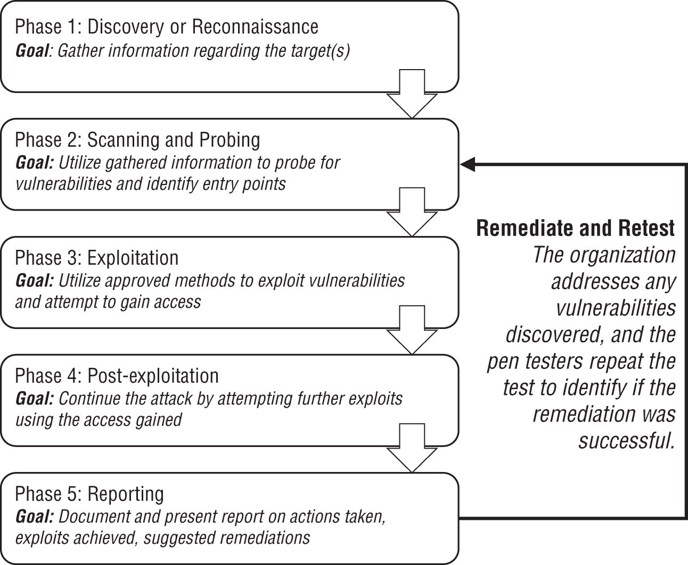

# DOMAIN 6

Security Assessment and Testing

**AN *ASSESSMENT* IS AN** 对对象的评估，例如特定风险发生的可能性或组织安全流程文档的质量。*audit* 类似，但是一种更正式的流程，涉及针对既定标准进行系统分析，以确定对象是否满足一组标准。两者都旨在衡量目标，例如组织面临的技术风险或系统的安全态势。例如，风险评估会识别组织拥有的资产，然后衡量或估计可能影响这些资产的风险的可能性和影响。相比之下，系统审计确定所讨论的系统是否满足支付卡行业数据安全标准（PCI DSS）等权威机构设定的特定客观要求。

审计和评估这两个术语经常被互换使用，但对于 CISSP 来说，了解它们之间的差异并在设计或监控安全计划时适当使用每个术语非常重要。两者都用于收集执行监督所需的信息，并支持确定安全控制的有效性和任何必要的补救措施的努力。

评估或审计的输出是一份报告，详细说明所采取的行动和发现。这可能包括具体的差距或问题清单，这些代表了组织的风险。未按预期工作的控制被称为 *deficiencies*，并指出了未得到适当缓解的风险。差距是组织缺少风险缓解的领域，可能由于新风险或现有控制不足所致。在这两种情况下，这些输出应像任何其他风险一样对待——优先修复并制定明确的补救行动计划。

测试是一种收集信息的方法。它可作为执行审计或评估的一部分使用，也可作为安全监控和监督的一部分独立使用。自动化和常规测试可以持续验证安全控制的有效性，并提供及时的数据以纠正问题。

## DESIGN AND VALIDATE ASSESSMENT, TEST, AND AUDIT STRATEGIES

与所有安全措施一样，审计、评估和测试都会产生成本。Certified Information Systems Security Professional（CISSP）应意识到这些成本，并制定策略以高效利用资源来执行监控活动，因为它们可用于识别和解决风险。审计或评估的范围和目标应设计为确保基于其对组织的价值以及满足监管或合同要求等义务，对适当的系统、流程和服务进行评估。

各种审计和评估方法标准都存在，可作为指导组织战略的起点。利用标准方法具有关键优势，包括可重复的测试和随时间推移更具可比性的结果。逐年按照同一标准进行审计可以证明组织在安全工作上的支出带来的投资回报（`ROI`），以及关键安全实践或流程成熟度的提升。本文介绍的所有概念将在本章后面的“Conduct or Facilitate Security Audits”部分中更详细地重新讨论。

## Internal

审计、评估和测试可以从两个角度进行。内部评估是在组织内部进行，使用组织的人员和资源。任何使用第三方评估员或审计员的情况都构成外部视角，这将在下一节中讨论。在设计审计策略时，不同的情况将驱动内部、外部或甚至同时使用两种审计视角的选择。

要进行内部审计，组织必须在员工中具备足够的技能和知识，必须有足够的时间和资源来执行审计，并且审计或评估不得要求由完全没有利益冲突的独立观察者执行。内部视角进行的评估适用于持续或连续评估流程的一部分，并且通常作为持续监控的一部分使用，并辅以频率较低的外部审计。

根据组织规模，可能需要有一名全职员工专门从事评估活动，或者评估的某些部分可分配给多名员工。例如，访问控制审查通常每季度进行一次，可能只需要几个小时的工作，因此一名 IT 员工可以在其他工作任务之外执行它们。在拥有复杂用户访问需求、多个办公室以及数百或数千个系统的跨国大型组织中，访问控制审查可能是一份全职工作。

有一句通用的说法：“谁写了政策就不应该去审计它”，而减轻利益冲突是审计或评估策略中的重要要素。内部审计员可能无意中对缺陷视而不见，也可能出于维护其职位利益而故意掩盖错误或不足。在某些情况下，这种利益冲突可以通过使用不直接向被审计部门主管汇报的内部审计团队来缓解。

虽然利益冲突可能是内部审计的问题，但对组织使用的技能、流程和系统的更深入了解是一个潜在的积极因素。内部测试人员可以利用内部人士的知识更准确地执行测试或评估，这有助于识别与内部威胁相关的问题。对具有复杂规则的复杂系统（如职责分离（`SoD`））进行测试对外部人员来说可能具有挑战性。

以下是在内部进行可能最合适的测试类型：
* 漏洞扫描，尤其是例行扫描以查找未修补软件或未知资产
* 流程和程序审计，如变更管理或培训完成情况
* 钓鱼模拟

## External

进行审计、评估和测试的另一个视角是组织外部。外部审计员不应有利益冲突，因为他们是受付费进行公正评估，而不是提供使自己的部门看起来良好的报告。外部评估还可以利用专业技能和知识，这些技能和知识很有价值但不需要全职。执行渗透测试，通常称为渗透测试，是一项重要且有价值的技能，但由于所需的专业技能和高薪，雇用全职渗透测试员对大多数组织来说都不具成本效益。聘请外部机构执行测试并与其他组织分摊成本是一种更明智的方法。

使用外部公司进行评估、测试或审计可以识别组织无意中不了解的问题；一双新的眼睛往往能更快地发现问题并提供组织原本会错过的见解。在某些情况下，尤其是出于法律或监管原因，外部测试可能是建议的甚至是必需的，例如针对成熟度模型的成熟度评估，这将在第 8 章，“Software Development Security”中更详细地介绍。

出于合规目的的审计——例如，`PCI-DSS`、`ISO 27001`和美国政府的联邦风险和授权管理计划（`FedRAMP`）——都要求使用独立的、授权的第三方审计员或评估员。这些评估的结果对于与被审计公司做生意的任何组织也需要可靠，因此使用没有利益冲突的第三方可以提高审计提供的保证。

## Third-Party

大多数组织依赖一系列相互连接的组织，即*供应链*来支持其运营。一个拥有员工进行基本数据处理和协作的标准办公大楼就依赖硬件制造商、公用事业提供商以及可能还有云服务，仅举几例。供应链中的漏洞可能会影响组织，因此需要审计策略来识别供应链中的风险和相关缓解措施。

供应链审计是在第 1 章，“Security and Risk Management”中介绍的主题，是任何安全风险管理计划的重要组成部分。健全的第三方审计策略必须确定范围，以包括对组织运营至关重要的任何第三方、处理对组织有价值的任何数据的第三方，或提供受监管服务（如支付处理）的第三方。审计可以由组织资源执行，也可以由组织聘请的第三方审计员对供应商进行审计。一些供应商可能能够提供由受信任第三方执行的报告，例如服务组织控制 2（`SOC 2`）类型 II 报告，该报告提供有关供应商安全控制及其有效性的详细信息。`CISSP`必须核实其组织使用的服务是否在供应商提供的审计报告范围内。

# CONDUCT SECURITY CONTROL TESTING

测试控制措施对于确保其按预期实施和运行以减轻风险至关重要。随着时间的推移，流程和系统会发生变化，组织面临的风险也在演变，因此`CISSP`必须设计控制测试计划，以提供有关控制状态的可靠和准确数据。这是至关重要的监督工作，必须支持在发现控制存在缺陷或不再有效时采取行动的能力。

测试可以从内部或外部视角进行，并且可能针对人员、流程和技术方面的复杂控制实施。例如，测试媒体处置控制可能涉及政策和程序审查、员工访谈、处置记录检查，以及对已处置的硬盘或其他媒体进行物理抽样，通过将其插入计算机来测试数据是否可恢复。

## Vulnerability Assessment

漏洞，即可能被利用的弱点，是风险管理的主要组成部分，并在第 1 章中有详细讨论。漏洞通常比风险评估更频繁地被披露，因此持续的漏洞评估是持续监控策略的关键要素。服务器、路由器、操作系统和应用程序等硬件和软件资产都可能受到攻击，因此在攻击者之前进行技术测试以识别漏洞是有用的。发现漏洞是过程中的一个步骤——评估漏洞的影响并优先处理修复工作也很重要，这正是安全从业人员技能发挥价值的地方。

评估已识别的漏洞包括分析其对组织的影响，考虑到组织独特的配置或情况。例如，允许攻击者完全接管并删除数据的漏洞对于组织的财务系统来说会造成极大的破坏，但对于仅分享办公室咖啡馆每日菜单等新闻的内部公司门户来说，只会造成轻微的干扰。员工随时可以走到咖啡馆查看打印的菜单！漏洞扫描器的输出还可以识别不安全协议的使用，例如文件传输协议（FTP），通常应避免使用。然而，可能存在补偿性控制措施来降低风险，例如网络分段或仅将 FTP 用于公开访问的非敏感数据。

## 资产清单

识别组织的关键资产是执行漏洞评估的重要前提。了解要扫描的系统类型及其关键性对于选择合适的扫描工具和优先安排扫描工作至关重要。资产清单应捕获来自其他组织流程的数据，例如业务影响评估（BIA），该评估可识别每个系统、应用程序或数据资产的关键性。对高度关键系统的漏洞应优先处理，因为利用低关键性系统的漏洞不太可能扰乱运营。

资产清单还可能捕获重要数据，例如系统分类，用于确定漏洞评估的范围。处理敏感或受监管信息的系统可能对漏洞评估有特定要求，例如必须扫描的频率、执行扫描时使用的特定配置，或用于比较的基线。扫描目标的范围也可以使用资产清单来确定；例如，清单中标记为 PCI 的所有资产可能使用 PCI 合规配置每周扫描一次，而内部非敏感资产可能使用组织的 安全基线配置每月扫描一次。

## 扫描工具功能和注意事项

许多流行的扫描工具可以识别主机、网络或应用程序中的漏洞。这些包括免费使用的开源工具以及商业选项；选择使用开源或商业工具可能包括支持的可用性、扫描特定系统或平台的能力以及操作工具所需的技能水平等因素。专有工具可能提供更多功能和支持，但价格也相应更高。

大多数扫描工具提供类似的基础功能集并以相同的方式运行。这些自动化工具识别目标，可能是单个网络端点或一系列 IP 地址，然后发送网络流量并监听响应以确定 IP 地址是否在使用。一旦发现资产，扫描就会执行其他自动化操作以识别漏洞，例如端口扫描以识别 FTP 等活动服务，或系统特定检查，例如查询 Windows 注册表以识别已安装的软件和补丁级别。一些扫描器可以执行应用程序特定检查，例如识别 Web 服务器支持的加密密码套件。

一旦漏洞扫描器识别出相关信息，它就可以将此信息与已知漏洞列表进行比较。例如，运行过时 Linux 内核版本的 Linux Web 服务器可以与该版本中已知漏洞的列表进行交叉引用；漏洞扫描器的输出就是漏洞列表，可用于识别需要采取的补救措施——在这种情况下，应用补丁。扫描输出应为每个发现识别关键性或严重性评级，通常使用通用标准，例如通用漏洞评分系统（CVSS）分数或特定的通用漏洞和暴露（CVE）引用。

在选择和配置漏洞扫描器时，有几个重要考虑因素可确保其提供有价值的输出。CISSP 应该了解这些因素如何影响工具的输出，并在两者之间取得平衡，以确保从工具中获得最大收益。

* **义务**，例如法律、合同或监管要求，可能规定扫描的范围、覆盖范围或频率。免费漏洞扫描器可能适用于没有受监管数据的较小环境，但对于受严格监管的金融服务公司来说可能不足。
* 扫描器的**深度、范围或覆盖范围**，包括通过使用管理员凭据对扫描目标进行身份验证来执行高级扫描的能力——有时称为*凭据扫描*。漏洞扫描器可能会产生误报或仅通过查看外部可访问信息提供低分辨率信息，但许多扫描器可以配置凭据，例如管理员密码或安全外壳协议（SSH）密钥，允许扫描器登录并执行额外检查。
* **平台支持**是具有混合 IT 环境的组织的主要考虑因素，例如 Linux 和 Windows 服务器操作系统或 macOS 和 Windows 工作站操作系统。与所有 IT 工具一样，漏洞扫描器的要求应被定义，例如平台支持或执行凭据扫描的能力。
* **云环境**可能对漏洞扫描提出独特挑战。软件即服务（SaaS）环境可能由于其带来的运营开销而阻止用户执行漏洞扫描，这会降低系统性能，并且并非所有漏洞扫描器都可针对本地网络之外的目标运行。一些服务提供商会分享他们自己的漏洞扫描实践的详细信息，这可以作为供应链风险管理的一部分进行审查。

## 常见漏洞评估问题

与许多自动化安全工具一样，漏洞扫描器可能会导致问题或遇到问题。避免这些问题需要安全从业人员进行规划以制定策略。以下是一些常见示例：

* 流量过大和拒绝服务（DoS）
* 警报或事件
* 跨职能所有权
* 数据完整性污染
* 网络分段

### 流量过大和 DoS

漏洞扫描器会产生大量流量，消耗网络带宽，并可能导致网络和系统出现 DoS 状况，这些网络和系统难以处理信息。适当的配置可降低这些问题的可能性，例如实施请求节流以限制扫描器在给定时间段内生成的请求数量。凭据扫描也有助于减少流量——凭据扫描可以直接从服务器操作系统读取配置信息以查看哪些端口是开放的，而无需向每个端口单独发送流量。

## 漏洞扫描注意事项
扫描调度也可能很有用，以确保扫描在用户活动较低时进行。将扫描分散到更长的时间段内也很有用——每天扫描少数几台主机可以降低对整个网络扫描的影响。

### 警报与事件
扫描主机以识别开放端口、已知漏洞或其他弱点是攻击者常用的策略。当漏洞扫描器执行相同操作时，特别是如果扫描触发了 DoS 攻击或异常主机活动，它会生成安全警报并可能触发事件响应（IR）流程。许多安全工具旨在标记攻击者和漏洞扫描器共同使用的活动，例如顺序端口扫描。攻击者可能会按顺序向每个端口号发送请求以识别可被利用的开放服务，这看起来与漏洞扫描器识别开放服务相似。配置其他安全工具以忽略合法的漏洞活动至关重要，例如将来自漏洞扫描器 IP 地址的端口扫描标记为非可疑。

### 跨职能所有权
跨职能团队和扫描结果的所有权可能是一个问题，要求 CISSP 不仅具备安全技能，还具备项目和业务管理技能。漏洞扫描器通常由安全或 IT 团队拥有，而发现漏洞的应用程序和网络资产则属于另一个团队。在这些团队之间建立关系至关重要，以确保漏洞得到认真对待并得到解决；否则，资产所有者可能会简单地忽略安全团队发来的有关扫描器发现问题的电子邮件！
即使资产所有者对漏洞评估的发现持开放态度，传达任何发现的背景也可能存在额外问题。例如，非安全人员通常不理解 CVSS 分数，因此这些分数对于优先修复发现的问题没有用处。向受众传达背景信息很重要，可能需要以最适合资产所有者的方式格式化结果。

### 数据完整性污染
漏洞扫描器可以执行自动操作，例如在 Web 应用程序上填写表单字段以检查包括结构化查询语言（SQL）注入或跨站脚本（XSS）在内的漏洞。此测试数据显然不是属于系统的真实数据，可能会导致期望系统中存储有效数据的报告或流程出现问题。某些扫描器可以配置为忽略某些类型的字段，例如电子邮件地址（这可能导致发送非预期消息），或扫描器可以配置为输入一种可识别的测试数据，该数据在扫描后可以轻松忽略或清理。可能有必要对完全不同的环境进行漏洞评估，例如与生产环境配置完全相同但没有实时生产数据的暂存环境。

### 网络分段
使用防火墙等访问控制将网络的不同部分分段或隔离是一种安全最佳实践，但在尝试进行漏洞扫描时可能会造成问题。漏洞扫描器本身就是一个网络端点，并且需要访问扫描范围内所有其他端点；如果网络使用虚拟局域网（VLANs）、路由器或防火墙规则进行分段，扫描器可能无法到达其目标。零信任网络架构和微分段在云计算环境中尤其具有挑战性，在这些环境中这些原则是默认设置，并且访问遵循默认拒绝、例外允许的模型。分布式扫描是一种架构，它将扫描代理放置在网络段内部以允许该段中的端点被扫描，然后将结果汇总到中央控制台。

## 渗透测试
渗透测试，或简称渗透测试，与漏洞评估类似，但更进一步。漏洞评估仅识别并报告系统中的漏洞，而在渗透测试中，测试人员将尝试利用已识别的漏洞。测试人员寻求模仿攻击者用于识别和利用漏洞的相同流程，这些测试人员通常被称为道德黑客。道德黑客有一个关键区别——结果是一份组织可以用来修复漏洞的报告，而真实攻击的结果通常是经济利益、盗窃或破坏。
渗透测试中漏洞的利用既有好处也有缺点。如果存在补偿性控制措施，很难证明漏洞扫描器的结果是否真的可以被利用。渗透测试人员通常使用漏洞扫描器来识别漏洞，然后尝试利用它们，从而证明或否定漏洞的严重性。这种方法的潜在缺点包括成本以及由于测试活动而导致中断风险增加。聘请合格的渗透测试人员比单纯运行漏洞扫描工具更昂贵，并且对缺陷的主动利用可能导致系统停机和停机时间；尽管测试人员通常避免造成中断，但事故或非预期后果可能会发生并且确实会发生。
提供给渗透测试人员的信息量取决于组织对测试的目标。不同的信息级别及其支持的测试目标包括以下内容：
* 白盒或水晶盒测试是完全透明的。渗透测试人员对要测试的系统或网络有完全了解，例如 IP 地址和系统版本号。此名称暗示了对被测试“盒子”内部的透明度或照明，因为测试人员拥有详细信息和知识。这允许更完整的测试覆盖范围并模拟内部威胁，尽管旨在将此信息隐藏在外部人员之外，例如网络地址转换（NAT）的控制措施不会被评估。
* 黑盒测试向攻击者提供零知识，而是依靠他们进行侦察以收集详细信息。该名称表明系统内部（“盒子”）对测试人员完全处于阴影或黑暗中。这可以验证旨在将信息如内部网络配置隐藏在外部人员之外而设计的控制措施，但存在测试人员无法发现的资产而遗漏的风险。
* 灰盒测试结合了白盒和黑盒方法的元素。会向渗透测试人员提供一些信息，但他们也负责查找其他信息如内部网络配置。
与渗透测试人员不同，攻击者通常不受时间和需要按计费小时工作以支持客户服务等限制。决心的攻击者可以花费数周、数月甚至数年观察组织的网络和资源，而渗透测试合同很少持续超过几周。即使是技术高超的渗透测试人员也可能在此有限时间内遗漏某些内容，因此灰盒测试提供了混合优势。

### 渗透测试规则
渗透测试是一种本质上危险的活动，可能导致内部事件甚至法律问题。如果测试导致非预期后果，许多渗透测试合同都包括对提供测试服务的个人或组织的赔偿；这可以防止订购测试的组织采取法律行动，例如提起诉讼。如果没有此类合同，渗透测试人员如果其测试活动导致中断，可能被指控犯有刑事活动或业务中断。

# 渗透测试参与规则与阶段

渗透测试参与应包含明确的行为规则，其中记录了渗透测试团队可以执行行为的严格指导方针。例如，如果发现漏洞并且可以被利用来发起拒绝服务攻击，渗透测试人员应记录它，但可能被禁止利用该漏洞。制定适当的行为规则和管理渗透测试参与是 `CISSP` 需要执行的关键任务。

## 行为规则

渗透测试的行为规则文档应为测试人员提供一套遵循的底线规则，并为组织提供足够的协调必要资源和计划的信息。例如，如果测试可能触发安全事件，则可能需要对适当人员进行简报，以确保他们相应地校准响应。与激活应急计划相比，第一步可能是确认事件是否由测试活动导致。在这种情况下，组织的完整响应能力未被测试，渗透测试人员的结果可用于识别和解决安全缺陷。行为规则文档中通常定义的项目包括以下内容：

* 测试范围内的系统、办公室或其他目标有哪些？
* 是否有任何系统、办公室或其他目标被明确排除在测试范围之外？
* 是否禁止任何测试方法，例如社会工程或密码破解？
* 物理安全是否在范围之内？如果是，包含哪些设施或目标？
* 测试人员将被授予什么级别的访问权限？可能会为测试人员配置账户，以便评估内部威胁，或在他们能够获得未经授权的访问时执行验证活动。
* 预期的沟通方式和频率是什么？一些组织可能要求立即通知任何潜在的关键安全问题，而其他组织可能满意等待最终报告。
* 谁执行测试，允许使用什么设备和软件，以及测试何时进行？
* 处理敏感数据（如内部网络配置、客户记录等）应使用什么程序？
* 测试结束时敏感数据将如何安全处置？
* 预期的服务水平是什么。例如，如果实施了修复，测试人员是否会立即进行重新测试或等待定义的重新测试期？
* 对文档的期望是什么，具体来说是发现的任何问题的细节，展示为验证测试结果而完成的工作，以及任何报告的格式？

## 渗透测试阶段

渗透测试活动可以根据渗透测试人员的目标分解为一系列逻辑相连的阶段。第一个目标是收集信息，这些信息用于查找测试人员随后尝试利用的漏洞。最后阶段是记录报告，这正是渗透测试与攻击流程分歧的地方——大多数攻击者不会记录其发现结果以帮助组织改进网络防御！图 6.1 总结了这些阶段，下面各节将对其进行描述。

**图 6.1 渗透测试阶段**

### 第 1 阶段：发现或侦察

发现或侦察要求渗透测试人员收集有关目标的信息。这通常从开源情报（`OSINT`）开始，因为测试人员希望模仿攻击者并保持未被发现。`OSINT` 来源包括以下内容：

* **社交媒体** 用于识别目标或用于网络钓鱼的有用个人详细信息。
* **公开记录** 如域名系统（`DNS`）或包含有关服务或位置信息的公司网站。
* **攻击面数据** 如枚举与目标 DNS 记录关联的 IP 地址以及有关正在使用服务的潜在详细信息。也可以使用公开可用的工具 `Shodan` 或 `Have I Been Pwned`。
* **物理观察** 如监控员工行动、拍照、路过或观察设施，或翻垃圾桶以获取纸质副本。

渗透测试人员通常会尝试规避组织的检测，并寻求组织监控能力之外的信息，如 DNS 记录，这些记录可公开访问并由域名注册商维护。并非所有渗透测试人员都会进行广泛的发现，尤其是在白盒或灰盒测试中，组织已提供这些信息。

### 第 2 阶段：扫描和探测

一旦在第 1 阶段收集了基本信息，测试人员就会识别潜在目标并收集更详细的信息。例如，通向包含非敏感数据的营销网站的 IP 地址可能被归类为低优先级目标，而明显托管高价值目标（如 `remote.*` 或 `webmail.*`）的 URL 则会被优先考虑更高。

扫描和探测需要向组织或目标系统发送一些流量，这会带来被组织安全流程检测到的风险。以下是渗透测试人员在此阶段可能使用的工具和资源：

* **网络足迹分析：** 测试人员定义网络的足迹，即存在哪些端点以及其上运行的服务。像 `Nmap`、`nslookup`、`ping` 扫描和端口扫描之类的工具用于执行查询，以确定网络上活动的网络主机和服务。
* **横幅抓取：** 测试人员分析端点返回的信息，其中通常包含有用的信息，包括软件名称和版本。
* **漏洞扫描：** 虽然这是一种显而易见的方法，但使用漏洞扫描器会提高渗透测试人员的效率。这些工具可自动执行诸如足迹分析和从横幅中解析信息等任务。
* **利用工具包：** 像 `Metasploit` 这样的工具将侦察、足迹分析、漏洞扫描以及部分或完全自动化的利用组合到单一软件界面中。由于这些工具结合了多种功能，因此在多个阶段中使用。

### 第 3 阶段：利用

这个第三阶段不言自明——测试人员利用已识别的漏洞并尝试获得访问权限。他们可能会使用参与规则中定义的多样化方法，这些方法将在后面的章节中详细讨论。利用的目标是获得不应可访问的系统或数据的访问权限。以下是一些自动和手动利用工具：

* **利用工具包** 如 `Metasploit`，可自动化渗透测试的许多方面
* **密码破解器** 如 `John the Ripper`、`Hashcat` 或 `Hydra`，如果测试人员收集了哈希密码并需要识别有效密码，则很有用
* **监控工具和代理** 如 `Wireshark` 和 `Burp Suite`，允许测试人员捕获、分析和修改网络流量
* **应用程序安全工具** 如 `Nikto` 或模糊测试工具，可识别并尝试利用诸如缓冲区溢出或 SQL 注入之类的应用程序漏洞

虽然渗透测试人员试图模仿攻击者，但他们可能存在一些限制。攻击者通常不会在时间框架或预算内工作，这使他们拥有更多资源用于搜寻和利用漏洞。渗透测试人员可能仅限于标准工具集，而攻击者可能拥有更多自由来尝试新工具和流程。

由于渗透测试活动可能导致实际的运营和安全事件，因此安全从业人员密切监控流程非常重要。虽然渗透测试人员通常会避免造成重大中断，但他们可能会发现导致应用程序崩溃或数据损坏的漏洞。诸如运营中断之类的非预期后果应迅速告知测试人员，以便停止测试活动，并且可能还需要内部沟通来提醒人员进行测试活动，避免采取激进措施，例如启动昂贵的灾难恢复计划。

## 第 4 阶段：后利用

一旦测试人员获得初始访问权限，他们将尝试 *横向移动* 或利用该访问权限获得进一步访问。例如，入侵非军事区（DMZ）中的系统价值并不高，因为敏感数据通常不会存储在此处。然而，DMZ 资产可能被授权连接到内部网络段上的端点，这可能使测试人员未经授权访问更有价值的目标。

被攻破的 DMZ 甚至可用于重复第 2 阶段活动，并对网络外部无法访问的内部资源进行网络足迹探测。发现的端点或资产将被分类，并将重点关注高价值目标。一旦网络端点被枚举，就会使用各种技术对其进行指纹识别——目标是发现有用的详细信息，如操作系统和应用程序软件版本。测试人员会在被发现、时间耗尽或用尽所有已识别可能性之前，对这些目标尝试利用。

## 第 5 阶段：报告

在整个测试过程中，应创建文档以记录执行的所有活动、发现的漏洞以及测试人员获得的任何访问权限。这些发现会被汇总成报告，通常测试人员会为组织提供修复任何已识别漏洞的建议。该报告通常在正式会议上提交，这标志着渗透测试任务的结束。

不同的报告或报告的不同部分可能针对不同的受众设计。执行摘要通常会包含范围、所执行测试的高层次概述以及发现数量，常用于与管理层或组织外部用户共享，而更技术性详细的报告部分则放在单独的文档或附录中，供内部 IT 人员使用。

## 物理渗透测试

物理安全是保护系统和数据的重要方面，因此一些组织可能需要进行物理渗透测试。测试人员尝试未经授权访问办公室或数据中心等设施，目的是识别物理安全控制中的潜在弱点。诸如携带笨重物品并请他人代为开门或伪装成官方人员出现之类的社会工程手段经常被利用。

在某些情况下，未经授权的物理访问特定设施是非法的，因此应为物理渗透测试人员提供一张 *免罪金牌* 卡，详细说明其活动的目的以及组织内可以核实其说法的联系人。如果测试人员被捕获或拘留，则测试结束，因为他们未能获得访问权限并逃避检测，并且可以出示该卡以帮助他们避免潜在的法律麻烦，例如被逮捕并被控非法入侵。在高安全性的组织中，尤其是有武装警卫的组织中，重要的是与警卫人员等利益相关者妥善协调渗透测试，以确保他们在发现测试人员时能够适当应对。

## 日志审查

日志和监控的基础知识在 第 7 章，“安全运营” 中有所介绍，但 CISSP 应该记住日志在安全计划中作为侦测控制发挥着重要作用。它们可以由大多数系统、端点、设备和应用程序生成，并且应打开日志生成功能并配置为捕获有意义的信息。通过审查这些信息使其变得有用——如果攻击者已获得访问权限，而记录恶意活动的日志被忽略，攻击者可能会逃避检测。

评估和审计通常依赖日志条目作为证据，直接证明组织的 technical controls 已到位并按预期运行。例如，如果组织的访问控制策略规定对关键系统的访问仅在正常工作时间内可用，则审计人员可能会查找该控制的正面和负面执行情况：执行此限制的系统配置，以及显示用户在尝试在定义时间之外访问时被拒绝访问的日志。

日志管理实践本身也受审计和评估的约束。应制定日志生成、管理和审查的政策、程序和技术配置，审计人员可能会检查这些内容以确定是否符合 ISO 27001 控制 A.12.4、PCI-DSS 要求 10.6 或 NIST SP 800-53 中审计和问责（AU）系列控制等标准。

## 合成事务

合成事务是对受监控目标运行的自动化活动，用于衡量其性能。对于 Web 应用程序，这可能涉及使用测试用户账户登录，以验证应用程序是否响应登录请求或对查询返回数据。术语 *交易* 不一定指金融交易，而可以是查询数据或请求服务等任何系统活动。受监控对象可以是任何系统或应用程序，例如 DNS 或动态主机配置协议（DHCP）服务器，而合成事务是对 DNS 解析或 IP 地址分配的请求。

合成事务可作为测试机制用于多种目的：

*   **SLA 监控：** 主机或基于云的服务可能保证一定的服务水平，例如保证 99.9% 可用时间的 SaaS 应用程序。合成事务可用于每小时登录应用程序，以验证服务是否达到约定的水平。

*   **数据完整性监控：** 具有复杂业务逻辑的系统可能有处理数据的动态规则。合成事务可用于监控这些规则，并在处理一组测试数据未产生预期结果时提醒管理员，这表明业务逻辑规则存在问题。

*   **系统或服务监控：** 即使没有服务水平协议（SLA），系统也可以被监控以确保其在线并按预期响应。这通常被称为 *心跳监控*，是一种侦测控制，可识别离线或无响应的服务。

真实用户监控（RUM）通常与合成事务一起讨论。RUM 实时监控用户与应用程序或服务交互的情况，可用于检测缓慢或无响应的页面等问题的有用。遗憾的是，RUM 工具也带来了隐私问题，因为它们通常会记录用户与应用程序或网页的每一次交互。这包括用户输入的敏感数据，可能被 RUM 代理捕获。即使应用程序保护用户输入的数据，RUM 工具也可能不保护；一些 RUM 工具因记录和存储敏感或受监管的信息（如财务数据和用户密码）而导致数据泄露。

## 代码审查和测试

# 代码审查与测试

代码构成软件，是信息系统的基础，因此审查和测试代码以识别并修复缺陷是一项基本的安全控制措施。代码中的错误或漏洞可能会影响整个系统的安全性以及其存储或处理的数据。有关代码审查、测试和软件安全的其他主题在 第 8 章 中有所涵盖，包括用于评估或描述软件漏洞的常见框架，如通用弱点枚举（CWE）、CVSS 以及开放式 Web 应用程序安全项目（OWASP）十大安全漏洞。

尽管 CISSP 可能不直接负责编写或维护系统中的代码（这是软件开发人员的职责），但了解充分的代码审查和测试措施的重要性至关重要。代码测试应设计并实施以检测和纠正软件漏洞，理想情况下应在代码编写时接近时间点检测到缺陷。在代码仍在开发期间进行更改通常更容易，并且可以使用两种主要方法来支持这一目标：
* **Black-box testing:** 测试人员无法访问源代码或应用程序的内部工作原理，模拟外部攻击者或用户的视角。
* **White-box testing:** 测试人员可以访问源代码或了解应用程序的内部元素，如应用程序编程接口（`API`），而局外人则无法获得。

代码测试可以使用自动化工具或手动流程进行，例如代码同行评审，开发人员手动审查和编辑同行的作品以发现错误。诸如 *static code analysis* 之类的自动化工具使用软件来模拟代码的执行并识别潜在的漏洞，例如缓冲区溢出或程序执行期间可能出现的不一致数据条件。*Dynamic analysis* 测试实际运行的程序以观察系统或应用程序的行为。

CISSP 应确保代码审查和测试控制措施满足安全和业务需求的目标。例如，测试应提供应用程序代码的充分覆盖，以检测缺陷，而不会在软件开发过程中引入不可接受的延迟。DevSecOps 中的开发实践在持续集成/持续交付（`CI/CD`）管道中大量依赖于自动化、可重复的测试，以平衡交付速度和安全性，而诸如安全编排、自动化和响应（`SOAR`）等新兴安全概念也同样侧重于自动化安全事件响应；这两个主题在 第 8 章 中有详细介绍。这些测试应通过不定期进行的渗透测试或正式代码测试等手动测试来补充，以确保进行更深入的分析。

## Misuse Case Testing

误用案例或负面测试旨在评估系统或应用程序对意外输入或情况的响应方式，并识别在这些意外情况下可能被利用的漏洞。在软件开发的背景下，用例描述了参与者（通常是用户或流程）与系统之间预期的交互。例如，系统登录的用例将描述用户到达登录提示、输入其凭据，然后根据情况被授予或拒绝访问的步骤。*misuse case* 描述的是相反的情况：当系统未按预期使用时会发生什么？

当用户在登录提示时提供不完整或意外的信息时，已在多个应用程序中发现漏洞。用例期望用户输入用户名和密码；相反，用户输入用户名但将密码留空。这可能会导致应用程序崩溃，更糟糕的是——苹果的 macOS 存在一个漏洞，其中通过提供用户名“`root`”并将密码字段留空即可访问安全配置设置，如 `CVE-2017-13872` 所记录。

误用案例测试的常见要素应纳入系统测试计划和活动中，通常侧重于在应用程序字段中输入意外值时的系统行为，例如不正确的数据格式或与预期显著不同的数据。例如，当在期望输入数值值的字段中输入一串文本，或将整本书的文本粘贴到仅设计用于包含几个词的字段中时，应用程序会如何表现？空值或空白值也应考虑，如先前描述的身份验证漏洞所示，其中用户名和空白密码错误地授予了访问权限。

误用案例可以测试应用程序在非故意情况下的行为，例如用户意外地在其手机号码字段中输入姓名。*Abuse case* 测试模拟系统或功能可能以未预期的方式被滥用的方式，并具体描述攻击者可能如何利用此弱点。对这些案例建模有助于识别对系统或其数据的威胁，并有助于设计控制措施以减轻风险。OWASP 提供了 Abuse Case 建模和测试的速查表：`cheatsheetseries.owasp.org/cheatsheets/Abuse_Case_Cheat_Sheet.html`。

## Test Coverage Analysis

测试覆盖率是指系统或应用程序中经过测试的函数数量，可以表示为已测试的系统总量的百分比，或测试的具体数量，例如函数或模块。测试涉及成本，因此安全从业人员的一个关键关注点是确保即使由于成本原因无法测试所有功能，也能为关键系统功能实现充分的测试覆盖率。由于代码测试可能是组织内其他团队的责任，CISSP 可能是负责传达需求并验证测试计划设计以确保所选工具和测试策略达到预期覆盖水平的利益相关者。

测试覆盖率分析衡量四个主要标准，以识别正在测试的程序或系统的子元素：
* **Branch coverage** 确保控制语句中的每个分支都已执行。
* **Condition coverage** 要求代码中的每个布尔表达式都针对真和假条件进行验证。
* **Function coverage** 确保程序中的每个函数都被调用。
* **Statement coverage** 验证程序中每个语句的执行。

额外的覆盖率测量包括更高级的标准，如 *decision coverage*，它验证函数和分支覆盖的组合以测试各种输入和输出场景，以及 *parameter coverage* 以测试接受参数输入的函数的行为。这可以识别与意外或格式错误的输入相关的漏洞，对于接受用户提供数据的应用程序尤其有用。

在理想情况下，系统或应用程序的测试覆盖率将为 100%，但与此级别测试相关的成本和复杂性可能具有禁止性。CISSP 在制定可接受的测试覆盖率要求时，应确定诸如系统处理的数据的敏感性、对人类生命或安全的影响以及系统的组织关键性等标准，并应确保测试覆盖率充足。“充分”的定义在系统和组织之间会有所不同，但通常，像用户管理、系统管理和敏感数据处理等敏感功能应进行最彻底的测试。还可以考虑补偿控制措施来减轻未测试的系统元素，例如物理隔离系统或额外的持续监控目标。

## Interface Testing

一个 *接口* 是与系统交互的接触点。示例包括用户界面（UI），它为人类用户提供与系统交互的方式，以及 API，用于系统间交互。UI 通常采用图形用户界面（GUI）形式，带有窗口和菜单，或使用命令行界面（CLI）进行基于文本的交互。API 可以使用多种方法实现，例如用于 Web 应用程序的表述性状态转移（REST）API、进程间通信（IPC）和远程过程调用（RPC）。

评估接口功能和安全性是系统测试的关键部分。应在接口中实施安全控制，以支持保密性等安全目标，通过访问控制，或通过记录使用接口执行的操作来实现不可否认性。接口测试可能是开发人员进行的标准软件开发测试的一部分，也是安全从业人员监督的安全测试活动中的关键要素，例如漏洞评估、渗透测试以及像入侵模拟这样的安全测试。

与许多系统测试功能一样，接口测试应确定接口在典型使用和异常情况（如处理意外或格式错误的输入）下是否按预期行为。接口如同系统的所有元素一样，应具有明确记录的需求、测试用例和验收标准，以确定它们是否充分实现了所需的数据保护级别。

拥有大型复杂系统或分布式组件的组织可能会发现服务器接口测试是一个合适的关注领域。应用程序服务器、Web 服务器和数据库之间的接口是安全控制实施的关键点，应作为目标以测试多层安全控制的有效性。例如，如果 Web 应用程序接受用户提供的输入，则必须测试应用程序的输入验证控制，以确保其拒绝不正确的数据。如果此控制失败，则到应用程序服务器的接口还可能包含逻辑以验证传入数据是否符合预期参数，提供纵深防御的输入验证控制。

Web 应用程序接口尤其复杂，因为可能包含组织无法控制的系统。具有外部用户的 Web 应用程序可能需要独特的访问管理控制，例如会话管理，以识别、验证和跟踪用户交互。如果 cookie 用于存储会话令牌或其他标识信息等信息，则在定义接口测试要求时应考虑外部用户系统与 Web 应用程序之间的接口。

### 入侵攻击模拟
入侵攻击模拟或违规和攻击模拟（BAS）是一种新兴的自动化测试方法，旨在模拟现实攻击者尝试获得未经授权的访问。BAS 结合了漏洞扫描和自动化渗透测试的元素。BAS 工具利用不断更新的攻击方法和新发现漏洞的数据库来测试组织抵御新演变威胁的能力。实施 BAS 解决方案可使此测试更频繁地进行，比传统的季度漏洞扫描或年度渗透测试等方法更早地发现潜在漏洞。

BAS 工具执行模拟攻击，其模式基于尝试入侵网络或系统时使用的真实攻击向量。如果模拟攻击被阻止，则安全控制按预期发挥作用。然而，如果攻击成功，则可能表明控制存在缺陷或存在现有控制未解决的新风险。BAS 执行的攻击类别通常按目标或向量分类，可能包括以下内容：

* **Endpoint:** BAS 对网络端点执行操作或针对网络端点执行操作，例如创建文件或进程以匹配已知恶意软件签名，从而测试端点检测和响应（EDR）能力。这可以通过 BAS 设备或控制台远程完成，也可利用在端点上运行的软件代理完成。
* **Network:** BAS 发送应被阻止的网络流量，如果已知不良或恶意流量未被防火墙或路由器等控制阻止，则会生成警报。
* **Email:** BAS 生成并发送的测试消息可以测试垃圾邮件过滤器、电子邮件欺骗控制和内容过滤器。如果消息到达收件箱或被打开，则表明电子邮件安全控制存在缺陷。
* **Behavior-based:** 高级 BAS 功能可以测试基于行为的安全控制，例如监控恶意网络扫描或应由 Web 应用程序防火墙（WAF）阻止的与应用程序的复杂交互的安全工具。

### 合规检查
合规框架通常结合特定行业或地区的风险集合，所需的安全控制旨在减轻这些风险。合规不应被视为安全目标，而应作为帮助组织风险管理计划的起点。

合规检查是监督的一部分，旨在验证为满足合规目标而实施的控制的状态。审计是检查此状态的常见方法；有关开展或促进审计的进一步细节将在本章后面介绍。正式审计或评估按既定时间表进行，例如 PCI-DSS 和 SOC 2 的年度审计，或每三年一次的 ISO 27001 审计。

大多数合规框架都认识到，单次时间点的审计不是监控安全风险的有效方式。计划审计的目的是在特定时间点评估安全计划，合规框架通常包括对关键控制或领域进行更频繁评估的要求。一些合规审计，如 SOC 2 Type II 和 ISO 27001，要求在一段时间内评估安全性，因此审计人员将审查特定时间段（通常为过去一年）的数据和工件，以确定组织的安全计划在该期间是否按预期运行。以下是一些需要合规审计的安全和合规框架示例：

* **ISO 27001** 审计每三年由外部审计员执行以获得认证，而组织必须进行持续监控和监督，包括年度内部审计和监督审计。
* **PCI-DSS** 要求组织每年由第三方审计员进行审计，并执行例行内部活动，例如季度漏洞扫描。
* **FedRAMP** 要求在初始完整安全评估后进行持续年度评估，并要求对关键风险实施持续监控策略，以维持运营授权（ATO）状态。

合规检查和持续监控（在 第 7 章 中讨论）具有共同目标：尽快识别弱点，并在攻击者发现弱点之前采取纠正措施。合规检查可以发现由于风险情况变化而存在缺陷或无效的控制，或不再得到正确执行的控制。CISSP 应在执行这些合规检查的成本和运营开销与组织面临的威胁态势之间取得平衡，包括不合规的风险。

## 收集安全流程数据

# 监控安全控制有效性

## 持续监控与指标

一旦组织识别出风险并实施了适当的控制措施来减轻这些风险，就必须监控这些控制措施的状态及其实现预期风险缓解效果的有效性。CISSP 必须确保收集和分析足够的数据，以支持对组织安全控制措施减轻风险效果的监控和监督。持续监控的策略和实践在 第 7 章 中进行了讨论，后续章节将讨论应监控的数据来源。

持续监控是一项复杂的任务，要求组织具备成熟的网络安全能力。与任何复杂流程一样，最好分阶段实施，从基础工作开始，例如进行彻底的风险评估并设计安全控制计划以减轻已识别的风险。一旦这些控制措施到位，就可以制定日志记录和监控策略，从启用所有系统的日志记录、集中日志文件以及使用安全信息和事件管理（SIEM）平台等工具实现监控自动化等基础工作开始。

监控安全流程和控制实施所产生的数据量可能使监控任务变得难以承受。与查看原始数据相比，测量或指标对于识别趋势或有用信息非常有用。数据趋势可通过自动化手段进行分析，以生成诸如关键绩效指标（KPI）等趋势数据，而新兴的人工智能和机器学习（AI/ML）领域为自动化数据分析任务提供了一些解决方案。

CISSP 应能够在查看所有可能的安全流程数据源时识别出需要监控的相关信息。逐一审查每个变更请求单并不是有效利用时间的方式，但监控需要回滚的变更数量可以成为识别变更审查流程不足的有用方法。该指标支持明显的后续步骤——应审查变更审查流程和需要回滚的变更，任何发现都可为流程变更提供参考。

设计安全指标计划需要两个关键要素。首先，必须了解安全计划目标，因为这是指标的参考点。其次，安全控制必须提供测量或量化的方式。例如，如果所有登录都需要多因素身份验证，则可以查询访问控制日志以确定该要求是否 100% 得到执行。

## 技术控制与流程

技术或逻辑控制是通过电子系统实现的，例如用于访问信息系统的用户名和密码提示，或防火墙的配置以拒绝来自已知恶意源的流量。由于电子系统通常原生支持日志记录，因此从技术控制中收集数据可能很简单。技术流程数据可能包括作为组织日志记录和监控策略一部分捕获的信息，也可能通过对该日志数据的分析生成。示例包括应用程序用户访问日志以及路由器或防火墙等网络设备的日志。

设计技术指标计划应以衡量组织实施多层安全性的有效性为目的。为此，有用的是在以下类别中捕获指标：

* **Prevent:** 预防性技术流程包括数据加密和保护解密密钥的访问、网络访问控制（如虚拟专用网络（VPN））以及端点控制（如基于主机的防火墙）。
* **Detect:** 这些技术流程包括检测事件或偏差的任何控制措施，例如 EDR 和 SIEM。侦测性安全数据可能来自与运营重叠的控制措施，例如监控硬件或软件状态以检测意外中断。
* **Respond:** 当出现问题时，应急控制旨在纠正问题，包括 EDR 以及基于网络和主机的入侵防御系统（IPS）。

## 管理控制

管理控制是在政策和程序中实施的，例如可接受使用政策、访问审查程序以及人员安全控制（如工作轮换）。与技术安全流程不同，管理流程不会自动生成可轻松监控的审计日志等数据。有关管理流程的数据可能来自对流程 *工件* 的评估，工件是在流程执行期间创建或使用的对象。

工件通常是间接来源，例如警卫记录他们在特定时间对设施进行了巡查，或警卫为巡查中发现的未锁工作站提交的事件报告。巡查记录表明流程已执行，而事件报告提供了违反屏幕清理政策的用户详情。直接来源通常包括文档，这可能令人困惑，因为文档通常以数字形式使用信息系统进行管理。即使数据来自信息系统，它仍然支持衡量管理控制。

例如，组织禁止在组织发放的设备上使用个人社交媒体的政策。该政策将具有管理组件，如可接受使用政策和员工培训与意识，并可能包括技术控制，如网络内容过滤器或阻止列表。关于该控制实施情况的指标可以衡量以下内容：

* **Policy reach:** 有多少用户通过签署表示已阅读并理解该政策？
* **Education effectiveness:** 有多少用户尝试访问受限内容？
* **Technology effectiveness:** 根据网络流量，有多少用户能够访问受限内容，技术控制在执行政策方面的有效性如何？

## 账户管理

账户是一组用于访问资源的凭证。用户名和密码是用户访问的常见示例，还有其他类型的凭证，如加密密钥，可用于保护数据并识别访问它的用户、系统或流程。身份和访问管理，包括用于配置、审查和取消配置这些访问控制元素的识别、身份验证、授权以及账户管理生命周期，均在 第 5 章 “身份和访问管理” 中介绍。

账户管理数据是在收集安全流程数据时需要重点关注的关键领域，因为访问控制是信息系统安全的基础。访问控制也是混合控制类型的典型示例——政策通过流程和程序实施，通过技术系统实施，并可能需要物理控制，如管理设施访问或保护账户令牌（如智能卡）。

例如，信息系统的账户管理要求。为了限制和监控访问，可以实施以下控制措施。这些控制措施生成的数据应被收集和分析以评估有效性。

* **Administrative process** 用于请求用户访问，包括在授予访问权限之前进行正式请求和批准。这可能需要访问请求单或纸质访问请求表。所有用户账户必须有相应的请求和批准文件，其中必须包含用户角色、访问理由和必要批准等所有必需信息。对这些流程和工件的审计和其他保证活动也是管理控制的一部分。

### 技术实现
可能包括提交请求的系统、执行审查和审批的流程，以及用户账户创建的实际身份和访问管理工具，如 Active Directory、Okta 或本地计算机操作系统。高度敏感的系统还可能使用网络访问控制，例如隔离的 VLAN 或限制性防火墙规则。如果系统支持唯一的 API 登录凭据，则可能还需要一种安全分发 API 密钥的安全方法，例如安全的 API 站点，以提供访问权限。

### 物理
控制措施也将用于强制执行访问控制，例如将信息系统组件放置在访问受限的空间中。用户访问控制的实现还可能利用物理设备，如令牌、智能卡或受信任设备，这些设备需要政策、程序和培训以确保受限的物理访问得到维护。

从账户管理流程中收集的关键流程数据包括以下内容：
* 按时进行账户管理，例如在用户变更角色或离职后在规定时间内移除访问权限
* 及时收到账户配置或去配置的通知，例如用户加入或离开组织后 24 小时内通知
* 按照组织定义的计划正确执行账户审查
* 正确执行流程，例如密码的越权分发、密码重置前的适当验证，或正确配置的网络访问控制

### 管理审查和批准
管理层负责定义和执行组织的使命，包括安全和隐私等支持职能。在某些组织中，像 CISSP 这样的安全从业者会担任执行角色以管理使命目标，而在其他组织中，安全从业者将被要求向管理层提供与安全和隐私流程相关的数据。管理层对安全计划的支持和赞助至关重要，因为它提供了方向和支持。
本章讨论的每种技术和程序都在管理层监督安全计划中发挥作用。评估、审计以及对安全流程指标的持续监控为管理层提供及时数据，这对于决策至关重要，例如识别组织风险和适当的缓解措施。示例包括短期决策，如灾难导致需要启动业务连续性计划（BCP），或长期决策，如由于自托管与外包的成本效益而将架构从本地托管更改为基于云的系统。
应执行对安全流程数据的管理审查和批准，以确保控制措施按预期发挥作用；也就是说，它们将风险降低到可接受的水平，并且先前接受的风险仍在可接受的参数范围内。对组织运营环境的变化可能会使控制措施失效，即使它们以前足以降低风险。示例包括推出新的业务线、新增系统或流程、新的合规或监管义务，以及组织变更，如合并、收购和剥离。
为了对安全计划进行充分的审查和监督，组织的领导层将监控各种来源。持续监控计划应生成指标和绩效指标，这些指标依赖于安全流程数据。这些主题在本章的另一部分中讨论，与 第 7 章 中涵盖的持续监控流程密切相关。

### 合规性管理审查
有几个框架正式定义了与安全相关的管理审查和批准流程。此监督任务是治理和风险管理的一个关键要素，其内容在 第 1 章 中有所介绍。具体的安全和合规框架及其对管理审查的要求包括以下内容：
* **ISO 27001** 控制措施 9.3 规定管理层必须定期审查信息安全计划的“持续适用性、充分性和有效性。”
* **NIST and FedRAMP** 定义了评估和授权以及持续监控的管理角色。管理层必须审查评估信息系统的计划和评估结果，然后通过签发运行授权（ATO）做出正式决定以授权系统使用。管理层使用持续监控数据以确保风险缓解措施保持有效。
* **Certification and accreditation** 与评估和授权类似。*Certification* 是根据一组标准正式评估系统或流程的过程，而 *accreditation* 是关于系统执行指定功能的适用性的正式决定。任何组织都可以使用此方法来制定管理流程，以根据安全能力和要求正式评估和批准系统。
* **SOC 2** 要求管理层建立“绩效衡量指标”，并生成和使用“相关、质量信息以支持内部控制的运行。”
* **Control Objectives for Information Technologies (COBIT)** 是 IT 和网络安全的管理框架，侧重于高层管理任务，如规划充足的资源、容量，以及监督任务，如审查组织的控制计划。

高级和执行经理并不是唯一负责审查和批准安全控制有效性的利益相关者。信息系统所有者、数据所有者和保管人也负责确保在处理数据时有足够的控制措施到位，并报告他们遇到的任何问题或缺陷。

### 关键绩效和风险指标
作为 CISSP，重要的是不仅要衡量现有绩效，还要保持对未来情况可能如何变化的认识。安全指标传达现有安全控制在降低风险方面的有效性，并监控可能在未来影响组织的风险状态。关键绩效指标（KPI）是现有风险缓解措施的监控工具，而关键风险指标（KRI）使组织能够保持对潜在未来风险的认识。两者对于治理、风险和合规（GRC）计划都至关重要，并为 GRC 战略提供主动和被动的输入。
每个组织都会发现不同的指标有用，并且在确定哪些指标有意义且值得监控时必须考虑各种因素。为了举一个非安全方面的例子，汽油便宜但道路维护不善的司机可能会监控汽车轮胎的健康状况。同一辆车在汽油昂贵但道路维护良好的地方的司机可能会更关心汽车每加仑英里或每升公里的性能。两者都是提供可用信息的有用指标，但情况决定了在特定情况下哪一个更适用。CISSP 必须了解其安全计划的业务背景，并确保 KPI 和 KRI 的选择能够提供这些有用信息。这需要与利益相关者协调，包括用户社区、管理层，以及可能的外部方，如监管机构或业务合作伙伴。

#### 关键绩效指标

# 关键绩效指标、指标和风险指标

## 关键绩效指标

KPI 和指标这两个术语经常被互换使用，但存在差异。指标只是简单的度量，例如应用于计算环境中的补丁数量。绩效指标使用指标并提供上下文（一种指示）。例如，环境中已修补终端点的数量除以终端点总数是补丁管理计划有效性的指标。如果组织期望在七天后达到 100% 的补丁覆盖率，则此 KPI 可用于衡量该计划相对于期望的绩效。如果该数字低于期望，则表明需要采取补救措施，例如手动应用补丁或将未修补的终端点从网络中隔离，直到它们得到妥善修复。

在为组织的安保计划设计 KPI 时，了解组织所需的信息很有帮助，并且必须确保 KPI 提供清晰的信息以支持决策。KPI 应该存在以识别控制措施在减轻风险方面的有效性，并提供通知如果控制措施无效，这表明风险可能更有可能发生。必须建立绩效基线，以及对所监控流程的上下限的阈值。流程可能对绩效有严格或宽松的要求，阈值将反映这一点——在严格流程中，基线的任何偏差都是令人担忧的原因，而在宽松流程中允许更大的变化。

补丁部署时间框架是 KPI 的一个很好的例子。如果组织将基线设定为补丁发布后七天，那么在严格情况下，七天窗口后部署的任何补丁都是负面指标。在宽松的例子中，发布后 8–10 天部署的补丁可能是可以接受的，但不需要额外操作。KPI 甚至可用于衡量改进工作的成功——如果补丁始终在七天内部署，则改进是有效的。

开发高质量的 KPI 可能具有挑战性。存在框架，包括 ISO 27004，“安全技术——信息安全管理——监控、测量、分析和评估”，以及 NIST SP 800-55，“信息安全绩效测量指南”。卡内基梅隆大学的软件工程研究所（SEI）还开发了一个名为目标-问题-指标-度量（GQIM）方法的框架，该框架旨在帮助组织定义提供有意义信息的测量策略。该方法文档可在 `resources.sei.cmu.edu/asset_files/TechnicalNote/2016_004_001_455107.pdf` 找到。

确定目标和监控频率应通过识别组织目标、关键系统以及为减轻对这些目标或系统的风险而采取的控制措施来完成。始终如一地，衡量成本与收益之间的平衡至关重要，因为每天对流程或系统进行采样可能代价高昂。需要跟踪的重要指标并为其定义 KPI 的示例包括以下内容：

*   **平均检测时间 (MTTD)**：它衡量检测安全事件或威胁所需的平均时间。
*   **平均解决时间 (MTTR)：** 它衡量解决事件所需的时间。
*   **安全评分：** 许多厂商提供安全记分卡或等级，这可以作为组织安全工作成熟度的指标。请注意，这些外部提供的评分可能无法涵盖所有必要细节，因此获得 A 或 100%，类似于通过合规审计，不应被解释为完全安全。
*   **投资回报率：** 对于许多 CISSP 来说，这是一个具有挑战性的领域，因为财务等业务问题通常超出了技术或安全从业人员的范围。然而，控制措施的风险降低效果必须始终与其成本相平衡。管理层可能需要一个指标来显示特定安全控制措施或计划在降低成本方面的有效性——例如，如果网络钓鱼每月给组织造成 100 小时的生产力损失，那么反钓鱼培训的成本必须低于 100 小时，并且导致因成功钓鱼攻击而造成的生产力损失减少。

### 关键风险指标

KRI 可以为组织提供未来风险的窗口，并且应设计为捕捉不断变化的风险格局可能如何影响组织。KRI 的指示可以推动主动缓解行动——例如，防火墙拦截的恶意流量量增加可能表明在防火墙不堪重负之前升级防火墙。KRI 通常支持长期管理决策，例如防火墙升级项目需要提前时间进行 IT 预算和资源分配，以避免恶意外部人员导致系统中断的风险。

KRI 的来源包括漏洞扫描、审计和评估、安全事件响应、恶意软件感染和遏制率以及其他安全流程数据等常见安全实践。指标应衡量现有安全控制措施应对不断变化的风险的充分性。

继续之前补丁部署的例子，KRI 可能会设定为最新补丁存在于特定百分比的终端点上。如果补丁部署延迟且未修补终端点的数量超过阈值，则组织面临任何未修补漏洞被利用的风险。采取纠正措施，如启动安全事件响应并手动部署补丁可能是适当的响应。其他有价值的 KRI 示例包括以下内容：

*   **安全事件数量：** 安全事件数量的增加可能表明威胁环境已经改变，需要更强大的安全工具或额外人员。
*   **发现数量：** 审计和评估中发现的增加可能表明安全计划存在缺陷，需要额外的关注或资源。
*   **检测到或报告的钓鱼尝试次数：** 钓鱼尝试的增加通常是攻击的前兆，因为攻击者寻求获得有效凭证以访问组织的资源。额外的系统监控、多因素身份验证（MFA）和用户培训都可作为对该威胁的响应而部署。

### 备份验证数据

数据和系统备份是完整性和可用性的基本控制，因此确保在数据丢失或损坏的情况下可以使用它们至关重要。第一步是识别组织为继续运营所需的关键数据或系统，并设计适合恢复需求的备份策略，这将在 第 7 章 中更详细地介绍。

一旦建立了执行备份的程序和系统，验证备份过程和备份数据的完整性就很重要。两者都可以通过从备份媒体执行测试恢复来评估，以确保所有必需的数据都存在且可读。如果数据丢失，可能表明备份配置问题，例如目录或系统被排除在备份之外，或备份媒体损坏。一些备份系统将完整性检查作为标准操作的一部分，并且可以配置为自动验证备份完整性，如果检测到完整性丢失则生成警报，并自动重试备份过程。

### 培训和意识

建立和维护一个提供安全意识、教育和培训的计划至关重要，因为用户既可以是对抗攻击的关键防线，也可以是攻击的高价值目标。设计该计划的主题在 第 1 章 中有更详细的介绍。为了测试和评估安全培训和意识计划的有效性，以下指标可能有用：

* **培训完成率：** 未完成培训的用户可能更容易错过诸如钓鱼邮件或异常系统行为之类的迹象。
* **长期信息保留和习惯养成：** 如果用户参加培训、完成测验后立即忘记信息，则该计划无效。
* **覆盖范围：** 威胁和风险不断演变；培训计划必须更新以应对这些。
* **受众需求：** 一些安全实践过于技术化或可能对所有用户都不重要，因此向受众提供适当水平的知识和培训材料很重要。

## 灾难恢复和业务连续性

业务连续性和灾难恢复 (BCDR) 主题，包括收集需求的策略、设计应对计划以及测试计划，均在 第 1 章 和 第 7 章 中讨论。需求收集和测试过程的输出是监控和衡量有效性的重要来源，因为 BCDR 活动支持保持可用性的目标。

在审计、评估和监控 BCDR 活动时收集的信息应能回答以下问题。不足或否定的答案表明存在弱点，可能通过更新计划文件或迭代业务影响分析 (BIA) 或计划演练等流程来解决。

* 是否存在适当的计划文件，并且已更新？示例包括 BCDR 计划、业务连续性计划 (COOP) 或单独的 BC 和 DR 计划。
* 关键人员是否了解其在计划下的角色和职责？
* 新员工是否在入职过程中接受了关键 BCDR 角色的培训？这可以是安全培训和 BCDR 数据收集之间的共享指标。
* 计划的当前版本是否易于访问且安全存储？
* 组织的当前关键功能是否已在计划中体现？
* 是否发生了未在计划中反映的重大组织变更？示例包括重大的 IT 架构变更以及并购、剥离或重组等业务活动。
* 计划是否定期测试，并且在测试期间发现的任何缺陷是否已得到解决？
* 组织是否依赖关键第三方或服务？如果是，这些依赖关系是否经过测试？
* 变更管理等其他流程是否与 BCDR 计划集成，以确保组织变更在规划文件中得到正确反映？

## 分析测试输出并生成报告

安全评估（如漏洞扫描、渗透测试、差距评估、持续监控和审计）会产生大量数据。审查所有生成的输出耗时且可能对非安全从业者来说是不可能的，尽管安全团队以外的用户确实需要访问与安全流程相关的数据。因此，生成报告至关重要，这些报告总结了测试和评估活动的主要细节，包括进行测试所使用的情况或假设、测试期间执行的操作、发现或发现的问题以及解决发现问题的任何建议补救措施。

准备报告的安全从业者必须首先确定报告的受众或使用者，这对于确定要包含的适当详细程度和类型至关重要。跨国公司的执行委员会不太可能对导致缓冲区溢出漏洞的具体代码问题感兴趣，而可能更关心战略风险管理行动，例如增加开发人员安全培训预算或要求更严格的应用程序安全测试。负责修复漏洞的开发人员更关心代码扫描仪等安全测试工具的原始输出，因此包含战略流程改进的报告是不合适的。

设计报告的过程可能需要根据多个受众的需求构建内容，模块化结构可能很有用。执行摘要和高层次的发现概述可以放在一个部分中，与高管、业务合作伙伴或客户共享，因为这些群体通常不需要高度详细的信息。测试的技术细节可以放在附录中，可单独与需要该详细程度来解决任何发现的适当技术受众共享。许多安全工具（如漏洞扫描器）也可以配置为以多种格式呈现相同的信息——为高管或安全从业者监控的仪表板，如果用户选择，还可以通过下钻获得更详细的信息。

在测试期间，还可能生成多份报告，这需要采用生命周期方法来管理文档。在正式安全评估中，在测试完成后可能会创建并共享草案报告，以尽快传达信息。评估人员仍需进行额外工作以完成报告，例如根据补偿控制措施调整严重性或关键性并删除任何误报。共享草案报告中包含的信息可能很棘手，因为初始报告中的“关键”发现一旦考虑补偿控制措施后，在最终报告中可能被标记为“中等”；如果在没有完整背景的情况下共享，初始评级可能会引起恐慌。

使用自动化工具执行的安全评估可能会自动生成报告；然而，出于几个原因，这些报告可能用处有限。安全从业者必须决定自动报告是否提供适当的信息，或是否需要人工报告。许多工具使用标准化格式（如基础 CVSS 分数）提供信息来定义关键性，但不考虑可能较不严重的 CVSS 环境或时间分数。这会扭曲发现的关键性，可能需要人工报告来弥补。

### 典型审计报告内容

CISSP 很可能需要阅读审计或评估报告，并且根据工作分配也可能被要求撰写报告。了解这些报告的常见部分以及它们通常包含的内容至关重要：

* **执行摘要：** 本部分包含对测试活动和发现的高层次概述，通常不超过一页。
  **仪表板** 以类似的高层次信息呈现，但没有叙述，常出现在漏洞扫描仪等自动化、重复性测试工具中。它们提供发现的摘要，并通常支持深入到更技术数据的能力。
* **假设或限制：** 测试通常涉及限制，例如时间或活动范围有限。由于这可能导致系统的某些部分未被测试，因此明确说明这些假设以提供报告发现的背景非常重要。
* **范围：** 读者了解发现和测试活动的覆盖范围至关重要。例如，像渗透测试或 SOC 2 审计之类的评估可能仅限于特定系统、网络或设施，因此报告不包括与该范围之外对象相关的漏洞的详细信息。

* **活动摘要：** 已执行的测试、评估或审计活动应进行汇总，以展示评估团队所执行的工作。
* **发现或问题：** 发现、缺陷或问题通常以表格或项目符号列表形式呈现，每个条目都应包括发现位置、严重程度以及支持该发现的任何证据等细节。
* **建议：** 评估人员可能会提供通用建议，例如“Apply all current patches”或更详细的建议，例如在特定 Web 服务器上应禁用哪些密码套件以及相关的系统配置命令。
* **附录：** 相关信息通常会被放在附录中以备参考，因为安全测试工具生成的原始数据可能复杂且冗长。将此类信息放在附录中可以提供一份更易于快速查阅的报告，同时也能为可能需要的更技术性的受众提供细节。

## Remediation
识别安全控制中的缺陷或问题是执行安全测试、评估、审查和审计的主要目标。因此，CISSP 必须实施一个名为 *remediation* 的流程来处理任何发现。这需要项目管理技能，例如对需执行的工作进行优先级排序、确定时间表和里程碑，以及跟踪工作直至完成。审计发现可以作为安全计划其他领域（如风险分析）的输入，并可使用该领域的流程进行处理。例如，关于控制措施不足的审计发现代表着尚未得到充分缓解的风险。风险管理流程通常涉及记录现有控制措施的缓解效果，因此该审计发现应触发对相关风险的审查。

当组织收到一组评估发现时，应制定计划来解决这些问题。这些计划的目标相同，尽管各种安全和合规框架使用不同的名称，如行动计划和里程碑（POAM）、风险缓解计划或审计问题缓解计划。无论名称如何，它们具有相似的特征：
* 发现的细节
* 缓解或其他相关情况
* 优先级
* 解决时间框架
* 所需资源
* 里程碑（关键日期）和期望

一旦补救计划已执行，重新进行测试以验证修复是否足够是明智的，特别是对于软件或技术控制漏洞而言。重新测试通常是渗透测试的既定阶段。测试人员甚至可能在报告发布前就提前通知已确认的发现，以便组织在重新测试前有更多时间解决这些问题。例行评估，如每月漏洞扫描，也可用于验证已实施的修复是否成功。

## Exception Handling
当审计或其他安全评估发现无法补救的问题时，必须通过例外流程来处理。这与记录政策例外类似并遵循相同的步骤，当特定系统无法满足政策中规定的要求时使用政策例外。虽然可以授予例外，但应注意例外仅应在临时基础上授予。如果永久请求例外，或同一问题频繁导致例外请求，这表明政策或风险管理决策未与组织的客观目标保持一致。可能需要更新政策以实现这种一致性，或需要审查和更新管理治理决策。

由于这些例外代表无法缓解已识别风险的能力，它们需要组织的安全职能和管理部门给予特别关注。这体现在对例外的文件记录以及相关细节和正式审查与批准上，该批准明确说明组织对风险的理解和接受程度。例外处理通常记录的信息如下：
* **风险详情：** 风险、缺陷或问题的具体情况，包括何时发现以及由谁发现。
* **例外原因：** 风险管理的预期结果是缓解，因此管理层需要了解为何特定风险无法得到缓解的细节。
* **补偿性控制：** 即使风险无法直接处理以满足组织的风险阈值，也可能通过补偿性控制（如增加监控）进行部分缓解。
* **例外批准：** 管理层必须明确决定承担额外风险，记录审查和批准流程可为此决策提供问责。
* **时间：** 大多数例外应临时授予。如果已识别的缺陷需要长期计划来解决风险，例如大型 IT 项目，则例外仅应授予完成项目所需预计时间。

## Ethical Disclosure
Web 应用、网站和服务（如 API）很可能包含漏洞。有一群不断增长的安全研究人员会识别并向受影响资源负责的组织报告这些问题，目标是在恶意行为者发现之前负责任地披露漏洞。这些研究人员通常是道德黑客，此过程被称为道德或负责任披露。

拥有 Web 资源的组织中的安全从业人员应确保已为漏洞的道德披露做好准备。这可能具有挑战性，因为道德黑客或安全研究人员在组织之外，沟通往往出乎意料。一种推荐的做法是制定并分享一份公开可用的披露政策，概述以下几个关键点：
* 如何报告漏洞以及应期望什么，例如何时期望初步响应、提交的任何发现需要多长时间进行验证，以及可能后续要求提供哪些额外信息。
* 对报告漏洞的任何付款或认可。一些研究人员不期望任何认可，而其他人可能对在漏洞修复时以补丁或安全更新中致谢等形式公开认可其工作感到满意。
* 明确在范围之内或范围之外的任何安全要素。许多组织选择排除不符合组织运营需求的“最佳实践”缺失报告、低关键性项目以及仅导致轻微运营问题的漏洞。

作为安全研究人员或道德黑客，或作为提供此类服务的组织，确保您的工作遵循这些政策的要求非常重要。虽然可能存在一些可进行尊重性辩论的领域，例如特定漏洞的关键性，但有几条道德披露规则是不容辩论的：
* 发现的任何漏洞都应报告给负责组织，并且绝不应仅为个人金钱或声誉收益而使用。
* 所有工作都应出于善意进行，组织应得到善意的推定。已识别的漏洞通常在特定时间后才公开披露，这给了组织时间来解决漏洞。如果组织做出响应并要求额外时间进行补救，则在修复可用之前不建议提前进行披露。
* 在法律允许的范围内行事。
* 作为组织，应乐于接受漏洞披露，除非研究人员以虐待方式行为，否则不要采取敌对态度。

许多组织正选择以漏洞赏金或披露奖励的形式向道德黑客提供经济激励。由于罪犯通常受利润驱动，为负责任的披露付费会改变经济状况，使其有利于合法研究和负责任的披露。存在第三方公司来管理道德披露流程以及对已识别漏洞的付款。这些服务提供了经过验证的安全研究人员库的优势，使用漏洞赏金提供商可以成为组织安全测试和评估策略的有价值补充。

如果安全研究人员或组织在不拥有或控制的系统中发现漏洞，则需要考虑与道德披露相关的四种情况。关于这些安全研究以及漏洞披露的规则、法律和法规在不同司法辖区差异很大且不断演变，因此任何进行安全研究的个人或组织都应为其活动寻求法律指导。负责任披露发现的特殊情况包括以下内容：
* **非披露：** 可能存在合同或法律义务阻止披露漏洞；例如，当披露漏洞可能损害正在进行的刑事调查时。
* **完全披露：** 这是一种哲学论点，即任何时候发现弱点时，都应尽快完整、透明地向负责修复的组织报告。虽然改善安全的目标是值得称赞的，但许多供应商可能对试图报告漏洞的研究人员持敌对态度。
* **负责任披露：** 这一原则规定发现者有责任及时向组织报告弱点，并在公开披露之前给予组织足够的时间修复漏洞。
* **强制报告：** 在某些情况下，向执法部门或其他当局报告发现的漏洞可能是强制性的。世界各地的法律和监管框架各不相同，因此如果发现者位于一个司法辖区，而负责软件或系统的组织位于另一个司法辖区，这可能是一个困难的情况。
* **举报：** 举报人是指感到有道德义务报告危险或非法情况的人，许多司法辖区都有法律旨在保护举报人免受报复。在发现安全漏洞的情况下，如果举报人遵循披露发现漏洞的正确渠道，则可能免于因版权侵权或其他数字犯罪而被起诉。
