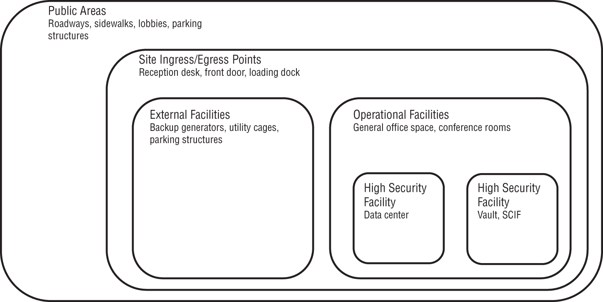

# 第 7 域

## 安全运营
**安全运营侧重于** 保持组织的各项安全控制处于功能状态，以及在人员、流程和技术方面维护安全所需的流程和程序。组织必须识别和评估所面临的风险，然后以安全控制的形式应用适当的风险缓解措施。安全运营（SecOps）涵盖组织内广泛的基础职能。其中许多领域将超出安全从业人员的管辖范围，例如物理安全，通常由建筑或设施工程师处理，但安全职能仍需对确保安全得到正确理解和处理负责。毕竟，即使是最好的逻辑访问控制也是毫无价值的，如果攻击者可以走到工作站前并访问其包含的数据！

SecOps 涵盖不同的职能，例如数据和运营设施的物理安全、事件响应、支持或进行调查、处理调查期间收集的材料和证据以及执行数字取证。其中许多领域高度专业化，而注册信息系统安全专业人员（CISSP）是通用认证。通才安全从业人员可能不具备执行所有这些职能所需的技能，但拥有这些技能很重要，无论是通过招聘或培训团队成员还是通过使用服务提供商。

如果做得正确，SecOps 应以最少的开销、成本或其他影响支持业务或组织运营。拥有组织有价值资产的全面清单并实施保护和监控它们的策略是安全职能的最终目标。本章概述了在维护实施以缓解风险的各种控制措施时需要解决的重要问题，包括最重要的：人员生命、健康和安全。

## 了解并遵守调查

# 调查、证据收集/处理与数字取证

调查、证据收集/处理与数字取证需要高度专业化的技能。这与医疗保健类似——你可能有资格在没有专业人士指导的情况下吃均衡饮食和锻炼，但如果需要大手术，就需要专业的外科医生。一些安全从业人员会专门从事数字取证和事件响应（DFIR）并持有这些领域的资质。对于许多 CISSP 证书持有者而言，支持调查和取证的过程需要与合适的专家协调，以妥善处理调查，因为存在需要专业技能和培训才能防止证据被篡改或销毁的关键问题。

正如该子域名称所暗示的那样，安全从业人员不一定负责管理调查，但需要遵守相关专业人员的外部要求。本节介绍了安全事件调查的要素以及安全从业人员必须发挥的关键作用；对于更深入的技术探讨，推荐阅读 John Bandler 和 Antonia Merzon 所著的书籍 *网络犯罪调查：面向每个人的综合资源*。

调查通常源于安全事件响应（IR），而在 IR 流程中，安全通才最有可能发挥最重要作用。任何事件都可能被认为严重到需要正式调查，可能的场景包括涉嫌刑事活动、严重违反安全政策以及无法解释的服务中断或停机。所应用的严格程度以及文档或证人证言等输出将根据调查类型而有所不同。

## 证据收集与处理

证据是任何表明命题为真或事实的信息；更简单地说，它是支持陈述的信息。例如，Alice 于上午 10 点进入建筑物的门禁控制记录以及她于上午 10:10 访问受限金库的 CCTV 录像支持了 Alice 进入金库的断言，但不一定支持 Alice 从金库窃取敏感资产的断言。

在调查安全事件时可能收集多种类型的证据。最明显的是数字证据，如日志文件、录音、计算机文件以及内存或硬盘等计算机系统组件。纸质材料也可能成为重要证据，尽管庞大的数据集很少会被打印出来。根据犯罪类型，可能需要收集指纹、头发或 DNA 等物证，这不仅超出了大多数 CISSP 知识范围，而且完全超出了数字取证的范围。此类调查可能涉及具有执法背景的多学科专业团队，而 CISSP 的角色将是支持并遵守这些专业人员的任何要求。

### 收集数字证据

由于数字信息的独特属性，收集数字证据可能特别具有挑战性，并且在开始事件响应时，保护所收集证据的完整性必须是首要关注点。数字证据通常寿命短暂，例如仅在 24 小时后就会被覆盖的日志文件，或在系统断电时丢失的易失性 RAM 中的信息。云服务进一步使问题复杂化，因为它们将信息存储在组织控制之外，可能无法提供数字证据。除非信息已写入专门设计为防止其被更改的特定介质，否则几乎所有数字信息都很容易被更改。这些因素使数字证据收集成为一项高度专业化的工作——调查人员必须不采取任何干扰所收集证据完整性的行动。否则，数据将无法作为证据被依赖来提出指控，因为如果证据在收集或分析过程中被篡改，被告可能会对证据的真实性提出质疑。

证据收集可能在初步事件响应期间就开始，远在正式调查之前，因此必须确保在响应期间收集的信息被视为未来可能成为证据来处理。为此，IR 流程必须编写为包括以下最佳实践：

* **记录并记录一切**，包括所采取所有行动的日期、时间、地点、所收集任何证据的状况以及相关人员。
* **始终制作副本** 的数字证据，并在可能的情况下对副本进行分析和调查。首选位级复制，因为它不仅对设备上的目录和文件，而且对任何已删除文件、数据残留和未分配空间都进行精确复制。这种复制方式比仅复制目录和文件的逻辑备份耗时更长、占用空间更大，但能提供更完整的证据。
* **防止不必要的更改**，方法是使用数据副本，如果发生不必要的更改，可以在不丢失证据的情况下丢弃副本，并使用硬件或软件来防止数据更改。简单地将可移动存储设备插入现代计算机就会导致数据更改，因为操作系统会执行诸如搜索索引等功能；在这些正常操作期间写入的数据可能会不可逆地损坏可能需要作为证据的数据。应使用称为 *写保护器* 的硬件设备和软件来防止媒体发生不必要的更改。
* **验证完整性**，以证明在收集或分析过程中未引入不必要的更改。这通常涉及计算和比较哈希值，以证明用于分析的数据与收集的数据相同，并且数据在分析过程中未被更改导致结果失真。
* **注意破坏性更改** 并尽一切可能避免。当出现问题时，存在自然倾向要关闭系统或退出应用程序，但这会冒着破坏存储在易失性内存如 RAM 或临时数据如应用程序缓存中的重要数据的风险。IR 程序应编写为在防止进一步损害的需求与保留潜在证据的需求之间取得平衡；与其拔掉受损系统的插头，不如将其隔离在网络段中，以便在不破坏证据的情况下进行调查。

### 处理数字证据

一旦数字证据被收集，最高优先级就是在调查人员处理证据时保持其完整性，定义为 *保管链*。保管链并不能证明信息在任何方面都没有发生变化；相反，它证明对证据所做的更改是在受控的方式下进行的，未干扰信息的完整性和真实性，因此其作为证据的可靠性。收集移动设备并将其带到实验室进行取证分析本身在技术上就是一种更改，但只要证据处于受过训练的专业人员保管之下，并且在运输过程中未做任何更改，这些设备所包含的任何信息都可信赖。

# 数字证据标准与处理

存在收集和处理数字证据的标准。对于不专门从事 DFIR 的安全从业人员而言，这些来源的建议最有可能在 IR 流程或程序中得到实施。在国际标准化组织（ISO）27000 系列中，有 ISO/IEC 27037:2012，《信息技术 – 安全技术 – 数字证据的识别、收集、获取和保存指南》，该标准为从台式机和笔记本电脑、手机、个人电子设备（包括移动导航设备）以及实施传输控制协议/互联网协议（TCP/IP）网络的计算机网络或设备收集和处理证据提供了指导。尽管发布于 2012 年，该 ISO 标准已于 2018 年进行了审查，仍然有效。

美国国家标准与技术研究所（NIST）特别出版物 800-86，《将取证技术整合到事件响应的指南》，也提供了将数字证据收集纳入 IR 实践的指导和建议，并涵盖了文件、网络流量、计算机应用程序和操作系统等数据源。该文件最后更新于 2006 年，并为创建 DFIR 程序提供了战略层面的指导，而这些程序又需要与组织 IT 环境相关的当前技能和能力。NIST 计算机安全资源中心（CSRC）拥有大量资源，包括项目和出版物，涉及当前取证关注的问题，如移动设备、云计算以及高级持续性威胁（APT）活动的分析，可在 `csrc.nist.gov` 找到。

云计算由于其运行的本质，对数字取证领域构成了特定挑战。诸如全球数据复制和托管等高可用性功能可能使确定犯罪或事件的确切发生地变得困难，如果事件发生在不同的法律管辖区，调查和收集证据的选项可能有限。在选择云服务模型和云服务提供商（CSP）时，CISSP 必须理解并提供意见，以平衡业务需求，例如成本节约、运营功能以及数字取证支持等安全能力。

## 报告与文档记录

证据与其它数据一样，会具有对其可靠性至关重要的重要元数据。谁收集了证据、何时收集以及使用了哪些步骤等细节必须记录下来，尽管所需元数据的级别将取决于所进行的调查类型。内部行政调查需要证据，但不需要高度严格的处理程序，而提交给法院的信息则需要彻底的文档记录和经确认的元数据来支持保管链。

文档应在证据的整个生命周期中创建，从事件的初始检测开始，包括采取的任何调查步骤、调查期间发现的信息以及对证据采取的所有行动。该文档应允许明确确定执行操作的时间和人员，类似于访问控制中的问责原则。任何犯罪调查电视节目的粉丝都会熟悉——当一次访谈开始时，侦探会在录音中报出自己的姓名和时间以便识别，并且任何发现的证据都会被装袋并贴标签以便保存并记录其收集条件。诸如工单系统和检查清单等调查工具应设计为自动捕获此信息或确保调查员正确记录它。

调查和证据的报告应包含足够的信息来说明事件的细节，而无需主观解释。收集的信息应清晰呈现，并附带预期受众所需的所有相关元数据，例如法院要求的保管链。

提交给法院的证据必须符合最严格的标准。被认为不可采纳而导致调查人员找到后续证据的证据可能导致所有证据都变得无用。总体而言，所有证据都应遵循以下原则：

*   **准确性**：证据和文档不得包含错误、与其它证据冲突或缺乏完整性。由于证据被用来证明案件，任何不准确都会削弱这种能力。
*   **真实性**：真实的信息或证据来源无可争议，这由保管链证明。非真实信息在最好的情况下会显示出无能，在最坏的情况下会质疑提交者的可信度。伪造或篡改的信息绝不应使用。排除相反信息也是有问题的，不被视为良好做法。
*   **可理解性**：这是一个棘手的问题，因为数字信息通常需要特定的技术知识才能理解。法庭上的律师和法官或在非法庭程序中审查案件的商业专业人士可能缺乏解释恶意软件取证或网络流量分析等复杂技术主题的能力。专家证人可以作为将技术术语翻译或解释为更友好的语言的有用资源。
*   **令人信服**：用户登录受限工作站本身不足以成为金融犯罪已被犯下的令人信服的证据。展示用户的行为以及他们收到大量意外银行付款的证据，在讲述特定用户犯下欺诈行为的故事时更具说服力。
*   **客观性**：证据必须能够独立支持论点或断言。显示用户活动的审计日志是客观的，而安全从业人员“有一种预感”用户道德可疑则是主观陈述，并不能明确证明案件。
*   **可采纳性**：这主要适用于提交给民事或刑事审判法院的证据。如果证据符合法院为支持法律论点而引入证据的要求，则该证据可被采纳。例如，直接证据如数字取证检查通常可被采纳，而传闻证据如“Sanjay 听说 Lupita 与团队成员分享了她的密码”则不可采纳。

安全从业人员不太可能是证据专家，因此寻求法律顾问、执法部门或其他调查专业人士的建议至关重要，以确保您收集、处理和准备的证据是充分的。

## 调查技术

在第 6 章《安全评估与测试》中讨论的“检查、访谈和测试”审计技术与用于调查安全事件和犯罪的技术相似。基本思想相同——收集和检查证据以支持结论。然而，在调查中存在一些独特问题，例如嫌疑人在被询问或调查时的法律权利。CISSP 可能会被要求支持或处理调查中的任务，并且与所有证据处理一样，应遵循专业人员的指导和建议。

以下是安全从业人员应熟悉的四个主要调查技术：

## 数据捕获
包括收集审计日志或网络流量等数据，以及专门的技术，例如收集事件现场及其相关调查的照片或视频证据。*自动化捕获*使用传统监控工具进行，并可利用组织的持续监控基础设施，如安全信息和事件管理（SIEM）工具或录制的摄像机画面。*手动捕获*是指法证调查人员采用的技术，如复制数据和媒体，以及通过照片或视频记录事件或犯罪现场。

## 面谈
是一种旨在从个人（通常是证人或了解事件情况者）获取信息的工具。面谈遵循问答格式，调查人员提出旨在获取信息的问题并记录答案，尽管被访者也可能作出陈述。一般而言，如果当地法律允许并且已记录被访者的适当许可，面谈应被记录。还鼓励多方面谈以提供信息更大可靠性，无论是安排多名面谈者，还是安排被访者代表在场以证明所收集信息的准确性。被访者通常具有法律权利，例如拒绝或终止面谈的能力，安全从业人员必须谨慎遵守所有法律——私自（像 CISSP 这样的私人公民）无故强行扣留某人，在大多数地方都是非法的！

## 审讯
比面谈要求更严格，通常由执法专业人员执行。审讯针对涉嫌犯罪的个人进行，通常在该个人被逮捕后进行。嫌疑人享有特定的法律权利，如果未遵守，这些权利可能导致审讯中获取的信息被视为不可采纳。

## 外部请求
调查人员可以向第三方（如互联网服务提供商（ISP）、政府机构）提出，或向特定方提出正式的信息请求，以收集信息。这些通常需要法律批准和程序，如搜查令和小额诉讼传票，因此安全从业人员在调查中可能仅与发起这些请求有间接关系。然而，如果被要求提供证据，CISSP 可能会受到这些程序的约束。在这些情况下，来自适当法律顾问的指导至关重要，无论是个人律师还是公司法律顾问。

### 数字取证工具、战术和程序
执行取证任务需要经过适当培训的专业人员，当然必须为其提供适当的工具和资源。组织必须决定分析师和调查人员是内部员工还是承包商，还是仅在需要时才调用的外部供应商。保留所需人才和资源在内部的成本必须与更快的响应时间和更定制化的程序带来的好处相权衡，并应考虑需要正式调查的事件发生的频率。

调查和取证团队应包括在计算机网络协议、安全工具和平台、系统管理员以及威胁和漏洞管理实践方面具有多样化技能和经验的人员。任何需要取证专业知识的调查很可能对组织而言是关键优先事项，因此取证团队成员应被授予能够联系组织任何成员并期望得到合作的权限，即使这会中断该成员的常规任务。在某些情况下，组织成员可能会被临时重新分配以支持调查，类似于事件响应团队。

#### 工具
数字取证专家使用物理取证工具，即使他们主要关注并处理数字或电子信息。取证工作需要跟踪和案件管理软件和设备、工作站，以及隔离且专用于取证的工作空间，以防止正在调查的证据受到污染。其他工具包括以下内容：

##### 写保护器和驱动器镜像工具
设计用于允许检查或镜像存储设备（通常是硬盘），而不向存储设备写入任何数据，否则将违反证据的完整性。

##### 法拉第容器
如袋子或盒子，其屏蔽以防止与物理设备之间的无线电通信。当数字证据存在于智能手机、平板电脑甚至笔记本电脑等便携设备上时，这些设备尤其有用，因为这些设备可以使用蓝牙、WiFi 或蜂窝连接等无线协议发送和接收命令。这可能会无意中更改数据，例如安装应用更新从而覆盖关键证据，或设备可被篡改以通过远程锁定或擦除来销毁证据。

##### 视频和音频记录
工具可用于记录犯罪或事件的证据，也可用于记录调查团队的活动以支持任何证据的完整性。分析人员在进行取证分析时不必花费额外时间记录所采取的步骤，只需简单地记录其工作的视频或音频日志即可。

一旦收集了所有物理证据，就必须对其进行分析，而取证调查人员可以使用各种软件工具。这些工具可以根据其预期用途或专业领域进行分类：

##### 网络流量分析
工具如 Wireshark 可用于网络数据包捕获（pcap）和网络流量分析，通过重建通信会话。随着软件定义网络（SDN）和虚拟化云基础设施的兴起，这些软件工具可能会取代使用 SPAN 端口捕获流量的等物理网络取证工具；其中一些捕获和分析可能由安全编排、自动化和响应（SOAR）或安全信息和事件管理（SIEM）等工具主动执行，作为组织持续监控策略的一部分。

##### 日志分析工具
如 SIEM 工具通常对调查人员很有用，可作为重建导致事件发生的一系列事件的方式。成熟度较低的组织可能没有部署 SIEM 工具，在这种情况下，日志可以手动收集并导入 SIEM 工具进行分析。

##### 数据恢复工具
帮助调查人员恢复已删除或被覆盖的文件和信息。大多数操作系统在用户删除文件时不会删除实际数据，而只是更新跟踪文件在磁盘上的存储位置以及空闲空间所在位置的分配表。已删除文件的内容仍然存在，但如果请求的话，没有任何东西可以阻止在那里写入新文件；如果没有写入新文件，只需读取驱动器上每个扇区的信息即可轻松恢复信息。根据媒体类型，甚至可能使用高度专业化的物理设备在磁盘被覆盖后重建数据。

##### 虚拟机
（VM）并非专门的取证工具，但对调查目的很有用。疑似恶意软件可以复制到并在与所有其他系统隔离的 VM 上运行，这使其可以在不威胁感染其他系统的情况下进行观察和调查。此类虚拟实验室或测试环境比其物理对应物更容易设置和拆除。

##### 代码分析
工具包括设计用于逆向工程软件的反编译器，以及设计用于在源代码级别观察程序功能的二进制分析工具。

## 哈希
工具对调查人员至关重要，并非因为它们能提供对所分析数据的任何洞察，而是由于它们在证明所收集和分析的数据持续完整性方面发挥着关键作用。哈希值和消息摘要可用于证明诸如应用程序或电子邮件之类的数据在传输过程中未被更改，并且哈希也可用于证明数据未被调查人员篡改。这证明了数据可以在支持任何断言或指控时被信赖。

## 工具包
是为特定目的（如法证调查）提供通用工具的软件套件，并且有许多法证工具包由商业供应商、开源项目制作，或甚至由特定法证专家挑选的工具组成以支持其工作。这些工具包结合了对法证调查人员有用的多种资源，包括系统特定分析软件，如 Windows 注册表分析器、数据恢复和重建应用程序，以及前面讨论过的工具，如网络流量分析器和软件写保护器。

## 技术与程序
为法证技术和易于遵循的程序做好培训准备非常重要，即使是受过训练的专业人员也在进行法证调查和事故调查。事故发生期间的情况经常具有压力大且时间敏感的性质，因此准备和工作辅助工具将证明有用。
第一步是定义事故期间使用的流程和程序，这属于 IR 计划的范畴。许多调查始于对事故的响应；在响应期间收集的细节如果事故原因被发现为犯罪或其他严重事项，则可能需要稍后进行法证分析。数字证据的收集、处理和调查的 documented 标准包括 ISO 27041、27042、27043 和 27050。SANS 还为调查人员和响应人员提供了许多有用的资源，包括速查表、快速入门指南以及针对常见任务（如使用 Linux 进行恶意软件分析或恶意文档分析）的海报。这些可以在 `digital-forensics.sans.org/community/cheat-sheets` 找到。NIST 还为法证调查人员提供资源，重点在于确保软件法证工具的质量以及为调查人员开发技能和培训计划。这些资源可以在 NIST 计算机取证工具测试计划（CFTT）网站上找到：`nist.gov/itl/ssd/software-quality-group/computer-forensics-tool-testing-program-cftt`。
这里提供了一套通用的法证分析程序步骤。这些步骤可以主动启动以调查疑似事故，或在证据指向严重安全问题时通过升级事故响应以进行进一步调查而被调用。

### 定义优先级
组织在响应事故时可能追求的三种可能的优先级是——尽快恢复正常运营、将损害降至最低，或保留有关事故的最大细节。通过擦除和重新镜像机器来恢复正常运营可以迅速让事情重新运行，但关键数据会丢失。完全将系统离线以进行调查可能会导致业务运营完全停止或需要昂贵的重复设备采购。组织必须确定每种情况的要求并选择适当的一组行动。

### 识别数据源
所有事故都需要发现相关信息，并且需要根据已识别的来源及时采取某些行动。例如，一些日志数据是短暂的，必须在被覆盖之前捕获，而一些内存可能会被频繁覆盖或易失，意味着存储在其中的数据只能在短时间内被收集。一些数据可能已经作为持续监控的一部分被捕获并长期存储，从而更容易访问。所有数据源必须迅速识别并优先收集。

### 规划数据收集并执行
一旦识别出数据源，就必须制定计划并付诸行动以收集所需信息。该计划应优先考虑临时数据，如设计为被覆盖的临时文件，以及易失性内存存储，如机器断电时消失的 RAM。执行数据收集涉及使用前面讨论的调查技术，并且可能需要正式流程，例如获取搜查令或传票。此步骤使用的工具将根据信息来源而有所不同，例如不同操作系统上数据恢复所需的特定程序以及不同类型媒体的物理收集和存储工具。

### 记录并保持完整性
数据收集是保管链中的第一个环节，因此对所做工作的记录至关重要。包括证据收集的时间以及其所经历的任何处理在内的细节必须记录在案。在某些情况下，证据本身已包含所需的元数据，例如 SIEM 工具中的只读日志文件，其中应包含日期和时间戳信息。在其他情况下，完整性元数据必须作为流程的一部分进行计算，例如在收集文件时计算哈希值，以证明所分析的证据自收集以来未被更改。

### 查找隐藏或已擦除的数据
调查所需的关键信息可能已被删除、覆盖或存在于隐藏目录中。在某些情况下，攻击者或恶意软件会故意删除或混淆数据以混淆调查，而在其他情况下，数据可能在常规系统操作或无辜用户行为期间被删除或覆盖。除非采用诸如覆盖或加密粉碎之类的特殊手段，否则已删除的数据可能可通过硬件或软件工具恢复。

### 执行分析
收集后，对数据进行法证调查。这可能涉及简单任务，例如审查文档、文件和通信以查找可疑用户活动，或更复杂的任务，例如网络流量分析以确定恶意软件如何在网络中传播。它甚至可能需要高度先进的任务，例如逆向工程恶意软件以调查事故。确定时间线或事件顺序也至关重要。

## 痕迹
Locard 交换原则是法证中的指导思想，以一位法证科学家和犯罪学家命名，他观察到罪犯会在犯罪现场留下其存在的痕迹并带走某物，两者都可作为法证证据。在对物理犯罪的调查中，这被称为痕迹证据，如头发、纤维和 DNA。在计算机犯罪中，数字取证通常侧重于 *痕迹*，即用户或程序与设备交互时留下的数字痕迹。寻找这些是数字取证的主要目标之一，因为这些活动痕迹讲述了事故的故事，并且在支持任何指控或案件方面至关重要。
鉴于数字取证的专业性质，该领域对培训和认证有高级要求。许多具有执法使命的政府组织和专门的 DFIR 提供商拥有内部培训和技能发展计划，涵盖应寻找哪些痕迹以及如何恢复它们。

### 计算机

在几乎所有情况下，使用计算机都会留下所执行活动的痕迹，而像安装程序或执行特定命令之类的操作会留下对调查人员有用的证据。日志文件会在系统事件（如登录）发生时创建，系统配置文件如 Windows Registry 或 Unix `.plist` 文件会被更新，并且文件会被写入、修改和删除。有关某起事件的一些信息可能由现有工具（如端点检测与响应（`EDR`）或基于主机的入侵检测系统（`HIDS`）代理）收集，而其他信息则需要人工调查。下面的列表强调了三大主要计算平台上一些常见的证据来源。它并非详尽无遗，就像系统管理员一样，取证调查人员通常也会专攻其中一个平台。

## 常见证据来源

* `Windows`: Windows 系统维护着可通过 `Event Viewer` 访问的日志，其中包含关键的系统、应用程序和安全事件条目。如果用户或恶意程序未采取额外步骤，已删除的文件可能仍在 `Recycle Bin` 中，并且还可能找到隐藏的元数据或已删除但可恢复的文件。`Windows Registry` 也是一个有用的信息来源，因为它包含配置更改和已安装软件的记录。
* `macOS`: Windows `Event Viewer` 和 `Recycle Bin` 在 Mac 上的等效物分别称为 `Console` 和 `Trash`，其调查遵循许多相同的程序。一些 macOS 特定技术也可证明是有用的调查点，例如自动生成的 `Time Machine` 备份系统、`Spotlight` 索引和系统范围搜索功能，以及被称为属性列表（`PLIST`）文件的配置文件。
* `Linux`: 与 Windows 和 macOS 的桌面版本不同，许多 Linux 系统设计为仅使用命令行界面（`CLI`）运行。访问证据的原生图形工具可能不存在，因此需要第三方工具包，或调查人员必须熟悉标准文件系统才能找到相关数据。示例包括存储用户文件的 `/usr` 文件夹、用于临时文件的 `/tmp`（易失性数据的重要来源，因为大多数 Linux 系统在重启时会删除此目录中的数据），以及存储频繁更改的文件的 `/var`，包括缓存、日志文件和有关当前正在运行进程的信息。
* `Browsers`: 用户的浏览历史包含足够的数据，以至于现在常有人开玩笑说个人有责任在某人去世后删除其浏览历史。然而，如果恶意软件感染的根本原因是用户访问了特定网站，则访问记录、放置的 cookie 以及网站本地存储的任何数据等活动记录都可能提供信息。
* `Local storage`: 物理调查通常涉及查看文件柜等物理存储，数字取证应通过浏览本地文件系统或可移动介质来执行数字等价操作。也许罪犯保留了一些支持调查的活动日志，或者存在可以证明某些操作（如关键文件删除）的元数据。
* `Cloud storage`: 由于缺乏对云系统的物理控制，证据可能要求调查人员遵循法律程序，如申请搜查令。云服务的种类繁多意味着取证调查可能针对与调查物理计算机类似的虚拟机，也可能针对完全新颖的工具，如微服务，在这些工具中甚至没有标准取证证据。

## 网络

传输中的数据是一种短暂的状态；也就是说，数据在通信网络中移动但不会存储在那里。然而，这些通信的元数据对于调查事件至关重要，在许多情况下，可以使用通信元数据识别或追踪事件中的存储数据或行为者。以下是一些网络证据来源：
* `NetFlow` 分析提供了网络设备（通常是交换机）上 Internet 协议（`IP`）流量和流量的概览。它可用于识别通信的详细信息，例如用于通信的端口、协议和地址。
* `Packet analysis`（通常称为 `pcap`）很有用，因为它同时捕获通信的详细信息和数据本身。数据包嗅探工具可以捕获网络中传输的数据包并重建发送或接收的数据，这些数据可以进一步分析。
* `Known bad traffic` 可用于识别可疑或不需要的活动，例如服务器向已知垃圾邮件域发送数据或与已知恶意软件服务器（如命令与控制（`C2`）或僵尸网络）通信。
* `Network device log files` 可能包含大量有用的信息，如果已配置为存储。交换机和路由器等设备包含通过网络的流量详细信息，而代理或虚拟专用网络（`VPN`）集中器等以安全为重点的工具是与安全事件相关的证据的有用来源。

## 移动设备

运行 Apple `iOS` 和 Google `Android` 的智能手机的取证调查在重大刑事案件后经常登上新闻，因为加密使取证变得困难甚至不可能。由于这些设备高度便携且包含大量敏感私人信息，强加密通常默认实现。如果调查人员没有解锁设备和解密其数据所需的信息，这使得取证变得困难甚至不可能。这些设备设计的软件通常假设有互联网连接也是一个潜在问题——智能手机应用程序可能不会本地存储数据，而是从云端访问数据。在这种情况下，取证需要识别所有数据源并执行适当的搜索技术，如收集物理设备证据并对云托管数据签发搜查令。

从移动设备收集证据将遵循之前讨论的许多相同程序。`iOS` 是 macOS 的变体，而 `Android` 是基于 Linux 的系统，因此收集证据的过程可能相似但使用专用工具。这些设备主要面向消费者的特性也可能成为调查人员的福音，因为编码不良或功能有限的应用程序可能阻止用户彻底删除数据。这些设备中的始终在线连接通常包括蜂窝、WiFi、蓝牙和近场通信（`NFC`）标准，因此网络取证与其它设备相似，只是网络接口更多且针对特定协议的工具更多。

移动设备持续连接带来的一个独特情况是数据可能丢失或被销毁。像 Apple 的 `Find My` 和 Google 的 `Find My Device` 之类的服务允许远程锁定或擦除丢失或被盗的手机，从而销毁关键证据。如果组织可以防止在可能包含证据的设备上执行这些操作，移动设备管理（`MDM`）会很有用。在这些情况下，物理设备需要特殊处理，包括将其放入法拉第袋中并在适当屏蔽的房间内分析，以防止蜂窝、WiFi 等信号到达设备。

## 执行日志记录和监控活动

# 日志记录与监控

日志记录和监控可能有些令人困惑，因为日志记录既涉及主动的防护措施，也涉及被动的对策。定义日志策略是主动的，包括要捕获哪些事件、数据存储位置以及强制性的审查或监控活动。事件的发生及其在日志中的记录显然是被动的活动，而对日志进行分析或审查以确定发生了什么本质上是事后活动。定义日志策略、选择有效的工具来实现它，以及基于所记录的数据进行主动监控或审查，是安全风险管理的基本要素。

## 入侵检测与预防

入侵检测系统（IDS）和入侵预防系统（IPS）是狭义定义的<|message|>安全工具类别，尽管在实践中，它们通常具有重叠的功能。两者都旨在检测入侵迹象，但 IDS 在检测并生成警报时停止，而 IPS 则更进一步以缓解入侵活动。一旦检测到入侵，IPS 可以采取多种行动，例如实施防火墙规则以阻止恶意流量、将文件恢复到被入侵前的状态，甚至关闭应用程序、服务或服务器以防止进一步入侵。

IDS 和 IPS 可以部署为基于网络的（NIDS 和 NIPS）或基于主机的（HIDS 和 HIPS）变体。基于网络的系统通常是专用设备，用于扫描所有网络流量以寻找攻击迹象。它们应放置在网络的关键瓶颈处，以监控重要的流量，例如非军事区（DMZ）与内部网络之间的连接，或 VPN 终结器与内部网络之间的连接。NIDS 和 NIPS 可以与其他安全设备（如防火墙和代理）集成，这些设备也部署在相同的网络节点上，而 IPS 尤其受益于这种集成，因为它允许监控和响应操作集成到单个设备中；例如，可以终止 NIPS 识别的恶意连接的代理。

基于主机的系统旨在部署在特定的网络端点（如服务器或工作站）上，通常以软件代理的形式。HIDS 和 HIPS 监控主机特定的网络流量，利用来自其他工具（如反恶意软件）的信号来检测攻击，或对关键系统或应用程序文件进行哈希以检测意外更改。新兴的 EDR 领域将反恶意软件、配置管理以及 HIDS/HIPS 等功能结合到单个软件代理中。

## 安全信息和事件管理

即使在小型 IT 环境中，日志数据的量也可能迅速变得难以承受——单台用户工作站每天可生成数百或数千条日志条目。SIEM 是多种工具和功能（如日志集中化、日志数据完整性保护和分析）的组合，用于从存储在日志中的数据生成可操作的情报。

SIEM 是对一个广泛的工具类别的宽泛定义，不同厂商可能以不同方式实现。然而，大多数 SIEM 工具提供与集中和管理日志数据相关的特定服务，以及从日志条目中提取有用信息以识别潜在事件。这些包括以下内容：

*   **集中化**：各个系统生成自己的日志文件，如果不将它们汇总到中央存储库中，搜索日志的任务将是巨大的。在如此大的环境中进行分析是不可行的，因此集中日志文件至关重要。SIEM 工具可以利用端点上的标准功能，通常称为转发，将其日志文件数据的副本发送到中央位置。不支持日志转发的端点可以配备软件代理来收集和转发日志。数据应从包括服务器、用户工作站、网络设备、云服务、应用程序以及防火墙等安全工具在内的设备中捕获。集中化还可以强制执行日志数据的重要访问控制：拥有受监控系统凭据的用户可能能够删除或更改这些系统上的日志，但可以很容易地被拒绝访问 SIEM 工具的权限。

*   **规范化**：Windows 系统生成的日志文件中的数据与 Linux 系统生成的文件类似但不完全相同。例如包括数字用户 ID 与用户名，或时间戳格式不同，如 YYYY-MM-DD 与 DD-MM-YY，这些差异会使跨系统搜索和关联流量变得困难。规范化发生在日志转发到 SIEM 时——数据被转换为标准化格式或应用标准标签以保持一致性。

*   **关联与检测**：一旦集中并规范化，数据就可以被处理以关联跨系统的活动并检测潜在的可疑行为。用户可能每天在同一时间登录其工作站并与公司应用程序交互，从而在工作站、目录服务器和应用程序上生成日志事件。同一用户在不同时间远程登录并从应用程序下载大量数据很容易被检测为异常。
    *   *关联*是指发现数据之间的关系；在前面的示例中，来自唯一位置且在不同时间进行的登录偏离了常态。这种偏差是对用户正常或预期行为的关联，从而可以检测到潜在的可疑事件，例如用户账户被入侵并用于数据外泄。
    *   更先进的 SIEM 工具提供集成以执行精细检测。例如，与旅行系统的集成可用于确定员工是否安排了有记录的工作出差，这降低了在奇怪时间或从新位置登录是恶意的概率。还可以关联其他外部信息来源，例如来自外部威胁情报源的数据或 CSP 的状态信息，以将应用程序停机与已知的云服务中断关联起来。通过此类外部来源为数据添加上下文称为 *丰富*。

*   **警报**：一旦数据被集中、规范化并分析，SIEM 的最终价值体现在生成警报上。SIEM 工具的速度和持续监控能力使安全运营中心（SOC）分析师等人力资源从翻阅数据的繁琐任务中解脱出来。相反，SIEM 可以为分析师生成工单或其他任务以供调查，这更好地利用了批判性思维和分析技能。工单或工作跟踪应捕获这些调查的详细信息，包括分配的分析师、采取的步骤以及导致工单或在调查期间捕获的任何证据。

## 持续监控

安全控制评估在 2000 年代初期仍然高度集中于正式的、特定时间点的流程，如审计或认证和认可。流行的框架如 ISO 27001 和美国政府的《联邦信息安全管理法》（FISMA）采用三年一次的审计周期；因此，许多安全计划仅在组织准备审计或接受审计时每三年进行一次监控活动。快速演变的威胁形势推动了对更频繁保证的需求，从而形成了持续监控的实践。

# 持续监控

持续监控顾名思义，需要更频繁的一系列检查，以确定安全控制措施是否到位并有效运行以降低风险。目标是在控制失效或因技术或威胁变化而变得无效时提供更及时的信息，从而使组织能够更快地响应。持续监控需要使用自动化，并高度关注指标，以提供有关控制措施的数据并指示所需的变化。

## 设计持续监控策略

设计持续监控策略时，重要的是解决几个关键问题。这始于政策和高层支持，并应使组织能够记录设计和运行持续监控计划的策略。制定该策略时需要考虑的方面包括以下内容：

### 定义的参考点
有效监控需要一组基线度量以进行持续比较。这可能是一个合规框架，如 PCI-DSS、ISO 27001 或 NIST SP 800-53。系统基线对于监控服务器和应用程序等信息系统组件也可能有用，可以是组织特定的基线或公共参考，如 CIS 基准。许多框架和基线还将包含优先级信息，以指导持续监控的实施。优先级更高的控制措施首先被选定实施，并以更频繁或更集中的监控为目标。优先级较低的控制措施可能评估频率较低。

### 自动化
审计即使是中等复杂度的信息系统也是一项重大工作，定期执行其中一部分活动也不是一件小事。自动化检查至关重要，首先要确定实现此自动化所需的数据源。可以以编程方式读取和分析的日志文件或系统信息是常见的起点，SIEM 工具中的信息也有助于实现近实时事件分析以检测异常行为。用于支持自动化安全监控的工具变得越来越普遍，例如 EDR 和用户实体行为分析（UEBA）代理，两者都会自动扫描网络端点，以查找违反策略的可疑活动或逃避检测机制的威胁。

### 频率
持续监控理想情况下应从静态审计转向更频繁的检查，但这并不意味着控制措施会一直被评估。确定控制评估节奏应由控制的优先级以及评估成本驱动，包括与监控解决方案相关的财务成本以及任何运营影响，如系统容量降低。

### 适当的指标
IT 环境中有许多有趣的数字可供监控，但持续监控计划中定义的指标应提供有关控制有效性的可操作情报。此外，对指标的解释必须谨慎进行。跟踪给定系统中每年发现的错误数量可能有用，但软件包含错误是意料之中的，该数字并不能提供关于漏洞管理有效性的有意义见解。跟踪补丁部署窗口是衡量组织有效处理软件缺陷带来的风险的更有意义的指标。指标应支持在检测到偏差时做出明确的决策。

### 定义的行动计划
没有上下文和行动计划，指标毫无用处。汽车仪表盘显示重要信息，如油位，驾驶员（希望）能够理解——油箱满意味着继续行驶，油箱接近空意味着是时候停车加油了。持续监控计划的指标应提供类似的行动呼吁，因此定义可接受范围和应对偏差的行动计划至关重要。如果配置管理工具在补丁可用两周后显示补丁部署水平低于 75%，则强制重启以进行补丁可能是合适的下一步。

### 平衡成本与价值
监控控制有效性实际上可以提高控制措施的价值——如果风险缓解措施变得无效但组织仍在为其付费，这笔钱就浪费了。如果检测到变化并采取补救措施，控制措施将继续提供价值。平衡持续监控计划的成本与所获得的价值更像是一项业务活动而非技术活动，但安全从业者理解并有效传达这一价值很重要。

有关持续监控系统的指导可在 NIST SP 800-37 中找到，特别强调在 NIST 风险管理框架（RMF）内实施实践并利用 SP 800-53 控制框架和 SP 800-53A 评估方法（`csrc.nist.gov/publications/detail/sp/800-137/final`）。另一项可免费获得的美国政府倡议是美国网络安全和基础设施局（CISA）持续诊断和缓解（CDM）计划（`us-cert.cisa.gov/cdm/home`）。ISO 27004，“Security techniques – Information security management – Monitoring, measurement, analysis and evaluation，”也为设计和执行安全控制有效性的监督和监控提供了一个框架。

## 出口监控

当攻击者获得对网络的访问权限时，通常目的是窃取存储或处理在该网络上的敏感信息。这被称为 *exfiltration*，它依赖于使用标准端口、协议和服务（如电子邮件、FTP 或 HTTP）发送信息。在许多情况下，这是在不试图隐藏活动的情况下进行的，而是将其伪装在高流量数据源（如 HTTP 流量）内部。由于使用端口 80 的网页和其他流量数量庞大，组织可能难以密切监控流量。

出口点被称为 *egress*；在网络术语中，这些可以是 Web、FTP 或电子邮件服务器，而在物理形式上，出口点可能是门、装卸码头或垃圾容器，笔记本电脑、可移动媒体甚至纸质材料等硬件可以从中移除。因此，出口监控包括监控和限制哪些数据和存储设备可以离开受控环境。

数据丢失或数据泄漏防护（DLP）是管理离开网络的电子数据的一种工具，这些工具可以使用常见模式或签名识别信息，例如四组四位数字——1111 1111 1111 1111——这通常是 Visa 或 Mastercard 信用卡号码。DLP 工具可以训练以识别特定于组织的敏感信息。如果您的组织使用账号或其他唯一标识符，DLP 工具可以配置为使用 *regular expressions* 在数据集中扫描并识别它们，*regular expressions* 是结构化搜索参数，例如 `CUSTIDnnnnaaa`。在此示例中，CUSTID 始终存在，而 `n` 代表数字，`a` 代表字母。任何与此配置匹配的数据字符串都可以被 DLP 识别。

DLP 解决方案在识别数据后可以执行多项重要功能。发现是指基于模式匹配、签名或数据标签扫描网络以识别数据的过程，DLP 可用于查找网络上存储的未知敏感数据存储位置。它还可用于识别网络中流动的敏感数据，例如当文件从文件共享复制到工作站或作为电子邮件附件发送时。根据 DLP 的配置，这些操作可能仅生成警报、暂时阻止操作并要求用户确认其确实打算发送文件，或完全阻止该操作。DLP 操作的选择将取决于所涉数据的敏感性。

除监控数据离开组织控制范围外，一些组织可能会实施 *入站* 监控以识别进入网络的数据。不应处理或存储的数据可能会被拒绝；例如，包含信用卡信息的电子表格的电子邮件可能会被邮件服务器拒绝。这可防止组织被迫执行清理和补救任务以遏制数据泄露。物理入站和出站监控也可能是合适的，例如筛查进入或离开设施的物理介质，以确保数据不会通过可移动介质等方式违反组织政策进行传输。

## Log Management

日志是许多安全运营活动的重要信息来源，主要包括持续监控和事件响应（IR）。包括 ISO 27001 和 NIST SP 800-53 在内的多个框架定义了创建日志策略时需要考虑的关键要素。此外，NIST SP 800-92 提供了安全管理日志数据的关键要求，以及标准化和分析收集信息的流程（`csrc.nist.gov/publications/detail/sp/800-92/final`）。

### Define Auditable Events and Thresholds

定义可审计事件和日志记录阈值是主动的安全决策。确定哪些事件写入日志文件、哪些不写入是在活动发生前进行的，需要谨慎平衡。日志记录过多，数据会变得难以处理，无论是存储空间还是所需的审查工作量。日志记录过少，组织将无法在发生事件时有效重建发生的细节。

大多数平台都提供基于某些事件信息设置可审计事件阈值的能力，而定制应用程序应具有支持日志记录的文档化要求。例如，像未发现问题的系统状态检查之类的标准信息事件可以忽略，而对重要系统配置文件所做的更改则必须被记录。应利用威胁情报和组织面临的风险来定义可审计事件——如果组织面临增加的钓鱼尝试，则增加对异常账户活动的日志记录是合理的。其他需要考虑的可审计事件包括以下内容：

*   系统登录、文件或数据访问以及应用程序访问等成功和不成功的访问尝试
*   用户权限的更改，尤其是使用 `sudo` 或其他管理员权限等权限提升
*   对安全工具（如 DLP）的更改或禁用
*   敏感文件的复制或导出
*   应用程序中执行的敏感数据交易

日志必须包含足够详细的细节以重建信息系统上发生的操作，包括谁、何事、何时。这意味着要捕获关于主体（用户或进程）、客体（文件、应用程序等）和操作（读取、写入、执行、删除等）的足够详细信息。为支持这些要求而应捕获的数据点通常包括以下内容：

*   用户或进程 ID
*   时间戳，最好采用 UTC 或整个组织使用的标准化时区等标准化格式
*   设备标识符、主机名、IP 地址或类似信息
*   访问的对象名称，如文件名或函数
*   触发日志事件的策略标识符，例如登录失败、管理员权限使用或文件删除

### Protect Log Data

NIST SP 800-92 规定了安全管理和保护日志数据的要求，特别强调保护数据的保密性和完整性。它引用了各种要求保护日志数据的合规框架，包括支付卡行业数据安全标准（PCI DSS），并强调了日志数据完整性的关键作用。已记录的信息可能成为未来安全事件的证据，因此日志收集和保护策略必须设计为提供真实数据的可辩护依据以及完整的不间断保管链。日志中包含的数据可能高度敏感，因为内部机密信息（如 IP 地址等系统信息），甚至应用程序日志中可能的受保护信息，如个人身份信息（PII）。

需要依赖于取证的日志必须具有完整的不间断保管链，因此日志文件通常写入高完整性存储介质，如一次写入多次读取（WORM）磁盘，这些磁盘在物理上防止日志数据在写入后被更改。将日志文件存储在具有不同访问权限的隔离系统上也有助于保证完整性，SIEM 工具可以实现这种职责分离。系统管理员可以篡改其管理的系统上的日志文件，但如果日志被转发到其无法访问的 SIEM 工具，篡改就会变得困难得多。在日志文件被写入、复制或转发时，应通过对原始文件进行哈希并存储哈希值以供后续比较来进行完整性检查。

日志中可能有意捕获敏感信息，例如系统事件信息，或偶然捕获，如应用程序日志中经常出现的情况。应用程序错误可能包含意外数据，例如导致错误的用户的表单输入。如果未经授权的用户能够查看这些信息，就可能发生内部数据泄露，因此保护日志通常需要将访问权限限制为仅授权的安全人员。再次强调，SOC 人员使用的 SIEM 或其他工具可以与生成日志的系统分开部署，从而避免对数据的未经授权访问。

尽管完整性和保密性对日志数据至关重要，可用性也是一个问题。随着更多事件被记录，日志数据会随时间增加，因此需要充分的容量规划。这包括确保存储空间充足，也可能涉及确定审计日志在被覆盖前保留的时间长度。对于服务器上的本地存储，可能实施两周左右的短时间以节省空间，而在 SIEM 工具上，日志数据可能保留数月、数年或无限期。日志数据可使用离线、成本更低的存储方法进行归档，这些方法以较低成本提供较慢的访问速度。

## Threat Intelligence

基于风险的安全需要对风险进行整体理解，包括可被威胁利用的漏洞。诸如补丁管理之类的安全实践侧重于被动地识别和解决漏洞。威胁情报是一种主动活动，使安全从业人员能够识别针对其组织的威胁和威胁行为者。例如，威胁情报可能有助于识别被潜伏恶意软件入侵的系统，该系统已被威胁行为者访问但尚未使用。在这种情况下，通过隔离受感染的终端并移除恶意软件，可以防止更大、可能更严重的泄露。

### Threat Feeds

## 威胁情报来源
可用于威胁情报的信息来源因组织的行业、地区和技术成熟度水平而异。具备高技术技能且拥有大量安全从业人员的组织可能具备自行进行威胁狩猎并生成相关信息的能力和资源。然而，存在威胁情报供应商，他们通过进行威胁狩猎和研究来创建相关信息的数据源，并以易于消费的形式提供数据。这些源从常规电子邮件或其他警报到可通过应用程序编程接口（API）访问的数据源不等，可与 SIEM 和 SOAR 工具集成。SIEM 集成可能会生成警报，而 SOAR 则可以主动响应，例如部署补丁、制定新的防火墙规则，甚至隔离受影响的系统。

除了威胁情报供应商外，还有免费可用的来源。在许多国家，负责网络安全职能的政府机构会发送通知，例如美国的 CISA 和加拿大网络安全中心。称为信息共享和分析中心（ISACs）的行业特定组织也会向其成员提供威胁信息。由于 ISACs 专注于特定行业，因此可以提供更有针对性的信息，而会员资格通常要求组织直接从事或以某种方式与该特定行业相关。ISACs 存在于零售和酒店、金融服务、市政府和医疗保健等多个行业。

## 威胁狩猎
正如名称所示，威胁猎人是寻找威胁数据的分析人员或软件代理。这些数据与有关如何应对威胁的有用信息相结合，构成了可用于采取具体行动的威胁情报。威胁猎人可以在组织的各个层面寻找威胁：
* **战略** 对组织的威胁是高层问题，例如需要首席信息安全官（CISO）指导组织的安保计划，或在遭受此类攻击严重打击的行业中需要更好的钓鱼培训。
* **战术** 威胁猎人生成的细节通常被称为入侵指标（IoCs），这些指标是在安全事件的取证分析期间收集的。这些细节可用于检测针对其他系统的特定威胁，与恶意软件签名用于更新反恶意软件工具以发现已知病毒文件的方式类似。
* **操作** 威胁狩猎旨在了解攻击者的工具、技术和流程（TTPs），在某些情况下可能非常技术化，在其他情况下可能简单如“金融服务公司正面临来自特定国家的分布式拒绝服务攻击增加。”

威胁狩猎通常作为特定组织之外的安全研究的一部分进行，研究人员社区通常出于让每个人更安全的精神分享他们的工作和发现。因此，威胁细节通常在博客等社交论坛、会议演讲和 Twitter 上分享，而 IoCs 等相关信息则与 SOAR、SIEM 和渗透测试工具包等安全工具集成。由威胁狩猎活动产生的行业特定威胁情报源可以在各自的行业特定 ISAC 中找到。

一些威胁猎人所做的工作依赖于搜索深网或暗网，两者都需要特定的一套技术知识和技能才能访问。*深网* 包括可通过互联网访问但未公开的内容，例如在线银行信息、私人社交媒体 feed，甚至新闻网站等付费墙后的内容。*暗网*，相比之下，存在于非公开可访问的网络上，需要使用 Tor 网络等特殊访问方法。访问所需的技能和复杂性正是威胁情报源成为有价值工具的原因，因为对于许多组织而言，获取具备此知识的人才的成本是难以承受的。

## 用户和实体行为分析
虽然名称复杂，但 UEBA 相对来说是一个相当直接的安全功能。实体是非人类网络参与者，包括路由器和服务器等硬件以及软件进程、线程或守护进程。用户是登录并与信息系统交互的人类用户。UEBA 结合机器学习和统计分析模型来分析和定义与信息系统交互的用户和实体的正常或预期行为基线。任何偏离此预期基线的活动都会被标记为可疑，并可作为其他安全工具的输入。

考虑 Alice，她每天大约在上午 10 点登录工作站，并且通常每天从内部财务系统下载 10–100 MB 的数据。下周一，Alice 的工作站开始从法律部门和研究与开发部门所属的高敏感系统下载数百 GB 的数据，并向外部 IP 地址发送 GB 级数据。这显然是一个可疑的情况，但传统安全工具可能由于缺乏针对 Alice 及其工作站的定向监控而遗漏。

UEBA 允许根据单个用户或实体制定有针对性和个性化的安全基线。Alice 的先前活动表明向外部来源上传大量数据是不寻常的——这可能表明她的职位职能发生了变化，她的工作站感染了恶意软件，或者她开始向竞争对手出售公司信息。如果 Bob 在制造部门工作，他可能会定期与公司外的制造合作伙伴交换大型设计文件，因此阻止所有大文件数据传输的安全工具显然会有问题。UEBA 提供了更精细的执行以及适应独特用户和组织需求的能力。

UEBA 监控的输出可以作为 SOAR 或 IPS 等其他安全工具的有用输入。服务器上可疑活动的警报可能会触发受影响机器的网络隔离，将其置于隔离的虚拟局域网（VLAN）中，或者如果在用户工作站上检测到可疑活动，则可以暂时暂停用户的访问凭据。可疑活动警报可以触发人工调查；如果触发活动出乎意料但合法，则可以移除阻止。如果警报与恶意活动有关，则响应可限制造成的损害。

这种有针对性的方法使安全工具能够通过为每个组织的独特情况提供适应性来实现更好的成本效益权衡。在一个组织中，一些用户需要向其工作站下载大量数据，而从事类似工作的不同组织可能实施全虚拟化桌面且无本地存储。UEBA 提供了识别独特组织基线并为偏离该基线的行为生成警报的灵活性。

# 执行配置管理
配置管理是正式流程，用于识别关键资产，其状态——也称为 *配置* ——应受控制，并实施旨在实现该目标的做法。保持信息系统处于已知良好或安全状态是可取的，以确保诸如安全代理、操作系统配置（如全盘加密（FDE））或将系统置于受控访问网络中之类的安全控制继续发挥作用。对这些配置进行更改可能会改变系统的安全态势，因此受配置管理控制的资产必须经过正式的变更审批流程以控制不必要的配置更改。

CM 需要若干基础要素。`Configuration items`（CIs）是配置管理下的项目，可包括整个系统、单个终端和源代码。CI 的安全配置称为 `baseline`，任何偏离基线的更改都需要使用正式的变更请求和审批流程，即变更管理。随着时间的推移，所有系统都会自然发生诸如修补、升级和功能扩展等变更。

组织关于实施硬件和软件资产配置管理的指导，包括所需角色、职责和资源，应记录在配置管理计划中。CMB 通常是负责实施和维护变更管理实践的组织机构，尽管这些流程需要全组织参与。负责系统维护的 IT 人员将参与维护系统配置，而变更管理中一些不明显的作用包括采购和物理安全等职能，以及维护采购订单管理和交付验证等控制措施，可防止不必要的变更。

## Provisioning

Provisioning 是指设置和部署系统或应用程序，与 CM 实践的联系显而易见——如果系统配置存在标准，在配置时遵循该标准是合理的。部署信息系统可能简单到在现有操作系统上安装应用程序，也可能涉及设计整个系统并开发自定义应用程序代码或组件。

传统 CM 的配置要求可能包括仅采购已批准的硬件/软件，然后根据定义的基线（在“Baselining”部分描述）进行安装和配置。这可能需要大量手工工作，因此存在诸如脚本和预配置系统安装镜像等工具，以加快流程并降低出错几率。虚拟化的出现使此任务变得更简单，因为 VM 可以从已应用所有必要配置的镜像中自动创建。

基于虚拟化优势的 Provisioning 在云计算领域已演进为高度自动化的系统和资源部署。虚拟化云服务允许在全球分布的数据中心中大规模配置，这依赖于系统部署和配置的定义文件。`Infrastructure as code`（IaC）是指使用基于文本的定义文件来指定虚拟系统参数，例如内存和处理能力的大小，以及诸如应启用或禁用哪些系统服务之类的配置。由于定义文件相对较小且易于阅读，因此可以轻松进行彻底审查并确保系统配置符合预期的基线。IaC 环境中部署的自动化特性也意味着人为错误的可能性更小。

### Asset Inventory

在配置时，将资产录入资产清单是 CM 流程的重要要素。组织无法对其不知道的资产进行配置管理，因此记录新的硬件、软件、云服务和其他信息系统资产至关重要。由于其基础性作用，资产清单可能值得采用纵深防御策略实施，既包括主动的也包括被动的清单控制。

主动资产清单控制包括与硬件、软件和服务采购的采购订单和财务系统集成。当组织获取新资产时，会连同制造商、主机名、版本/型号/序列号等详细信息一起录入清单。部署新硬件/软件也可以与清单更新服务集成，而自动化部署使流程变得更简单，因为使用 IaC 部署新服务时可以自动更新清单数据。当系统退役时，清单也可以通过移除或将这些资产标记为已退役的方式主动更新，使用相同的人工或自动化方法。

被动清单控制主要包括发现之前未知的资产并将其添加到清单的过程。许多 CM 工具、网络漏洞扫描器和云管理控制台都提供枚举或发现资产的能力，此列表可以与现有清单进行比较以识别差异。这种类型的侦测控制安全性较低，因为之前未知的资产可能是不需要的或配置错误的，但随着自动化程度的提高，近乎持续的资产检测扫描可以成为更新清单的合理方法。

## Baselining

A `baseline` 是系统的一组约定属性——在 CM 和安全上下文中，它是已知可实现期望安全状态的配置集合。基线提供了确定组织已实现的风险缓解程度的参考点，以及识别组织控制措施是否按预期运行的方式。维护基线的已知良好状态是配置管理的最终目标，而密切相关的变更管理实践则关注以受控方式从一个已知良好状态转移到另一个状态。

每个组织都可以开发自己的安全基线以满足独特需求，尽管也有可供任何组织按原样使用或作为起点的标准基线。包括以下内容：

* `DISA STIGs`：由于它们是为具有严格安全标准的美国国防部设计的，因此这些基线不太可能广泛适用，因为为了符合 STIG 必须禁用许多常见功能。然而，组织可以将其作为高安全性的起点，然后进行范围界定和定制以启用所需功能。STIG 适用于各种平台。

* `CIS Benchmarks`：CIS 发布免费的安全基准文档，涵盖 Apple、Google、Microsoft 和 Linux 各版本的各种桌面和移动设备，以及包括防火墙和路由器在内的网络设备，以及 Amazon、Microsoft、Apache 和 Oracle 等云和服务器操作系统，仅举几例。这些基于全球最佳实践，通常比 DISA STIGs 限制更少。

* `Vendor-provided guidance`：包括 Microsoft、Amazon 和 Apple 在内的大型技术厂商发布其产品的最佳安全实践和建议，其中包括加固和基线配置。这些包括有关如何启用特定安全增强功能（如开启静态数据加密）的文档。它们还包括有关可能提供有用功能但安全风险增加的配置或功能的文档，例如对不支持多因素身份验证（MFA）的旧应用程序提供基本用户名/密码身份验证支持。

配置管理和合规工具通常将上述基准纳入配置管理审计的自动化能力中。基线提供了统一的参考点，因此这些工具会执行扫描以识别未按预期基线配置的系统，而 STIGs 和 CIS Benchmarks 的免费可用性使其成为热门选择。配置管理审计通常涉及将一组系统与预期基线进行比较，以识别 `configuration drift`，即系统已被修改而不再按照预期安全基线配置的情况。

## Automation

安全配置错误仍然是安全事件的主要原因之一，而配置管理审计是检查这些配置错误的关键方法。即使是中等复杂度的 IT 环境，也可能难以频繁审计。持续监控策略需要更频繁的数据收集；结合对频繁应用程序和系统交付的期望不断提高，并得到向 DevOps 和 Agile 方法论的转变支持，需要自动化配置管理解决方案。

由 DevOps 和动态云服务的使用所支持的主动配置管理策略涉及使用 *不可变基础设施*，即未设计为可更改的基础设施。每次部署系统时，不可变基础设施都会被拆除，然后使用 IaC 定义文件重建。对基础设施的更改需要此拆除和重建过程，该过程是自动化的，并且比传统的逐系统升级更不易出错且劳动强度更低。虚拟化云环境使此过程变得简单，并且存在专门用于此目的的工具。这些包括厂商无关的工具以及来自主要 CSP 的工具，如 Amazon Web Services (AWS) CloudFormation 和 Microsoft Azure Resource Manager。

自动化不仅支持资源的部署，还可用于实施持续审计。存在专门的配置管理工具，可通过查询系统配置文件（如 Windows 注册表）来验证系统和应用程序配置。此功能也可在其他工具中使用，例如漏洞扫描器和自动化合规检查工具，而文件完整性监控（FIM）是一种使用关键文件的哈希值（例如系统和应用程序源代码或配置文件）来检测不需要更改的技术。存在独立的 FIM 工具，并且此功能也内置于许多 HIDS 和 EDR 解决方案中。

# 应用基础安全运营概念

SecOps 中良好的安全实践的基础上有几个概念，包括需知、岗位轮换和服务等级协议（SLAs）。这些控制措施包括安全计划的基础要素以及可在组织多个控制措施或部分中实施的总体概念。例如，基于最小权限限制访问需要人员安全以及物理和逻辑访问控制的结合。这些概念不应仅作为单独的控制措施实施，还应作为指导组织人员、流程和技术中其他控制措施的选择、实施和操作的策略。

## 需知/最小权限

需知和最小权限经常被互换使用，但两者之间存在细微差别。*需知* 是一个概念，描述用户根据组织定义的要求访问特定信息，例如项目或系统中包含的数据。财务部门的角色用户如果与财务无关，则没有要求访问技术研究项目中的敏感数据，而研究项目成员可能不需要访问公司的总账。需知通常用于设计访问控制系统，在这些系统中希望实现隔离，即即使在组织中从事不同项目的相同工作或职能的用户也被隔离，无法访问其他项目的数据。以这种方式隔离信息通常被称为 *隔离*。

*最小权限* 描述的是旨在为用户提供执行其工作职能所需绝对最少访问量的访问控制，有时也称为 *最小必要访问*。此访问应足以执行分配的工作职能，而不应超出该要求；例如，数据录入专员可能不需要管理员权限即可完成其工作职能。

最小权限和需知构成了访问管理的基石，也是实施 第 5 章 “身份和访问管理 (IAM)” 中讨论的控制措施的基础。从整个组织的角度来看，这些概念可在构建业务运营和设计信息系统时应用，这就是为什么它们是 SecOps 关注点的原因。如果具有不同需知要求的用户将使用同一系统，则该系统必须实现在粒度级别上限制访问的能力。如果没有，可能需要多个系统实例来正确隔离数据；随着虚拟化和云服务的出现，这变得显著更容易。

这些概念也可应用于查看不同时间所需的个人用户访问。例如，系统管理员在执行工作时并不需要始终具有提升的权限。在进行系统配置更改时，显然需要提升的管理员权限，但检查电子邮件或撰写报告可以用普通用户权限完成。单独的用户和管理员账户的架构，或提供类似 `sudo` 的权限提升方法，实现了符合这些原则的访问控制。访问管理中的一个新兴概念是即时访问，用户在需要时被授予特权凭据的访问权限，并在需要凭据的任务完成后撤销权限。

## 职责分离

分离职责或责任可以实现多重益处。它可以通过使欺诈活动更难以实施来挫败内部威胁，并且还通过要求多方参与来支持数据和流程的完整性。这提高了检测错误的几率，并可以通过防止单个用户篡改数据来保护数据的真实性。

职责分离（SoD）通过将流程步骤分给多名人员来限制资源滥用或恶意活动的可能性。典型示例包括费用报销提交，其中员工提交费用报销单，必须由财务管理员批准后才能支付，或零售商店中收银员和经理在每天结束时都必须共同清点和验证现金。在这两种情况下，流程效率降低，但目的是使任何个人更难实施欺诈、犯错或单独实施后果严重的行动。要做到这些，两名个人必须串通或被迫实施欺诈，这比个人单独行动或被胁迫更困难。

上述收银员和经理结账场景是 *双重控制* 的示例，这是一种需要两个或更多个人执行相同操作以实现目标的过程。*双人完整性* 是另一个相关概念，即没有单个个人可以在没有另一名授权个人在场的情况下访问资产，如文件或设备。实施此措施的其他系统包括加密密钥托管恢复，其中多个用户必须登录托管系统才能恢复密钥。

## 特权账户管理

权限，通常称为许可，是用户在系统上被授予的能力。特权账户是具有提升访问级别的账户，通常是管理员或超级用户；这种提升的访问级别也意味着与这些账户相关的风险更高——由于管理员可以执行更多功能，如果他们犯错、恶意行为或凭据被盗，固有风险更大。

# 管理特权账户

管理特权账户会在用户管理生命周期中增加额外的要求。在特权用户甚至被授予权限之前，最好先识别信息系统和组织流程运行所需的岗位和特权功能。这些角色，例如数据库管理员（DBAs）和访问控制管理员，应在设计时考虑到最小权限和职责分离（SoD）等原则，并且系统架构选择可能由这些要求驱动。例如，DBA 可能不需要访问其管理的数据库中的实际数据，因此采用应用层加密是合适的选择，这样可以让 DBA 访问数据库但阻止访问明文数据。此外，特权账户可能专门用于管理功能，用户应获得其他非管理员凭据用于日常任务，如网页浏览或检查电子邮件。

特权账户通常在访问管理生命周期中需要更高的严谨程度，例如更频繁的审查。不同阶段的额外控制措施包括以下内容：

* **Provisioning**：请求或需要特权访问的用户应接受额外的申请和审查程序。这可能需要在授予访问权限前提供更多文档并进行多级审查或批准。这些审查可能利用其他安全流程如人员筛选，特权用户需接受更彻底的背景调查。

* **Use**：如果可能，提升访问的凭据应有时间限制并自动过期。即时特权访问管理允许用户在有限时间内并遵循可审计的程序获得临时特权凭据。Unix 和 Linux 系统可通过 `sudo` 实现此功能，其在需要重新认证前可在设定时间内使用。还存在专用的特权访问管理系统，可用于实施所谓的“break the glass” 过程，即在紧急情况下可在有限时间内访问管理凭据。时间期满后，凭据会自动重置。应记录管理特权的用途，并在可能的情况下为特权和非特权活动使用单独的账户。在必须使用特权账户时，也应采用额外的认证机制，例如强制 MFA。

* **Review**：监控策略应侧重于特权账户的使用情况，且针对特权账户应更频繁地执行自动化或手动日志审查等监控任务。审查应识别意外或恶意的凭据使用。意外误用可能是用户在执行非特权工作前忘记从特权账户注销，而恶意使用可能是特权账户从不同国家远程使用。

* **Deprovisioning**：合规框架或义务可能要求特权账户活动保留更长时间，特别是当特权访问涉及医疗保健或金融信息等敏感数据时。归档与特权用户相关的日志或采用独特的去授权操作，如暂停账户而非删除，都是特权账户的常见做法，因为它们支持对这些用户所执行的高权限操作的调查。

## 职务轮换

在员工之间轮换工作有两个主要好处。它提供了跨岗位培训机会，使员工有机会提升技能，并为组织提供更强的韧性。如果某人休假或无法工作，其他人可以接替这些工作职责。这种可用性方面是 CISSP 应考虑在组织内实施职务轮换的一个原因，因为它支持业务连续性（BC）、灾难恢复（DR）和韧性能力。

职务轮换的第二个功能是减轻内部威胁如欺诈。单个员工重复执行相同功能时有机会实施欺诈并掩盖痕迹，但如果下个月由另一名员工执行该工作，被发现的可能性就会增加。这与职责分离或职责分离一起使用，如果要实施欺诈则迫使多名员工串谋。当未来会有未知员工轮换到该职位时，串谋变得更加困难。

在职务轮换期间接手流程的新用户也有机会发现并纠正非恶意的错误，这支持完整性。强制休假或休假，要求员工暂时脱离工作，也能有效发现欺诈性或无意的错误，并提供支持可用性的跨岗位培训机会。

职务轮换也可以作为长期策略来破坏潜在的恶意外部人员对员工的攻击。开源情报（OSINT）通常用于收集诸如工作职能、部门或角色等信息，这在制作 spear phishing 或其他社会工程场景时很有用。如果员工不在同一角色中停留较长时间，此类情报的价值会大大降低。

## 服务等级协议

组织越来越多地以外部方提供的服务形式获取技术。CSPs 和管理式安全服务提供商（MSSPs）是两个常见示例。由于构建云 IT 基础设施或安全功能如 SOC 所带来的成本，企业可能更倾向于向专业提供商支付这些服务的费用。在这种情况下，组织成为服务采购方，而 CSP 或 MSSP 是提供方。

管理服务提供商可能具有挑战性，因为提供方在采购方直接控制之外。如果组织希望 IT 系统提供高可用性和 99.9% 的正常运行时间，他们可以将其指定为内部系统开发人员和运营人员必须满足的要求。当使用提供方时，这些相同要求变为服务等级要求（SLRs），必须由双方记录并达成一致。SLRs 应该是必须满足的经常性或持续性需求，而非诸如满足灾难恢复时间目标等不频繁事件。SLRs 的相互协议即为 SLA，它规范了对 SLRs 的共同理解。

SLA 目标应是离散且可衡量的，例如一年内应用程序正常运行时间达 99%。这可通过计算 `365 × 0.99 = 361.35` 来衡量。为了满足 SLA，应用程序必须在一年中的至少 361 天内可访问并执行所需功能。换句话说，应用程序全年停机时间不应超过四天。这些商定的指标必须记录并仔细审查以确保双方一致同意。如果服务提供方将维护窗口排除在正常运行时间之外而采购方不排除，则双方对正常运行时间的计算可能不同，导致对服务是否满足要求产生分歧。

SLA 监控是一种第三方风险管理形式，应成为持续监控的关键部分。针对不同类型的 SLA 存在不同的策略；对于监控正常运行时间，有合成交易等工具，可验证交易结果是否符合预期结果，或心跳技术，可检查网页是否加载。SLA 报告也可以为响应时间等服务计算，其中提供方必须在特定时间内响应支持工单。

SLA 是一份服务提供商与采购方之间签署的具有法律约束力的文件，可能包括当服务未达到目标时的付款差异条款。如果未满足 SLA，则提供商必须提供与服务不可用或性能下降持续时间成比例的折扣或积分。这些条款和条件可能不是安全从业人员的直接责任，但确保在需要时存在替代控制措施以弥补服务故障非常重要。

# 应用资源保护

本书几乎全部内容都涉及保护资源，包括流程、程序和工具，以维护组织有价值资产的保密性、完整性和可用性。媒体是可以存储数据的任何材料，因此需要采取技术措施以确保数据免受未经授权的披露、篡改或破坏得到充分保护。

许多组织会以透明度措施的形式发布其媒体、信息和记录处理政策，以便客户或用户了解其提交的数据将如何被处理和存储。制定媒体处理政策时可使用的资源包括 ISO 27001 中的 A.8.3“媒体处理”要求，或 NIST 特刊 800-53 中的媒体保护（MP）控制族。关于安全媒体销毁程序的具体指导，NIST SP 800-88 修订版 1《媒体清理指南》是一份可自由获取的资源，涵盖了安全销毁媒体和数据的具体方法和工具。

虽然 ISO 和 NIST 文件为保护媒体提供了高层次标准，但许多组织还必须根据行业法规遵循具体指导。CISSP 应该了解这些要求，并确保任何资源保护政策和程序都考虑到了它们。例如，安全地粉碎可移动 USB 驱动器是对数据泄露的有效保护，但某些行业法规完全禁止使用此类设备。在这种情况下，必须制定政策和技术控制措施以防止数据写入 USB 驱动器，而非专注于其安全销毁。

## 媒体管理

媒体可以是纸质记录到传统硬盘或固态硬盘（HDD 或 SSD）等任何东西，并且越来越多地包括云环境中的存储。数据应根据组织的分类政策进行分类，并且确定的分类级别应用于选择适当的控制措施。

### 标记和标识

所有媒体都应以某种方式进行标记以指示其所含数据的分类，并且在可行时，数据还应包含其分类级别的标识符。在传统纸质副本中，这可能是带有分类级别的水印或文档页眉/页脚，而数字文档可以有水印、页眉/页脚，甚至像文件标签、文件名或其他嵌入属性等元数据来指示分类级别。

出于多种原因，标记数字媒体可能更困难。如果信息系统包含多个文件或数据集，正确的分类级别是什么？在这种情况下，政策应提供答案——通常媒体被分类为其所含数据的最高级别。同样，如果信息系统包含多个存储设备，政策和媒体程序应规定是否必须对每个存储设备单独进行标记。存储设备尺寸不断缩小可能使标记数据变得困难，因为没有足够的空间容纳所有重要信息，而像 VM 这样的其他技术则带来额外挑战。在 VM 的情况下，其创建所在的集群或数据中心可能是将其“标记”为特定分类级别的方法，并且必须制定限制以防止 VM 移动到分类级别较低的集群。

### 处理

标签的目的应是传达数据的分类级别，进而影响用户在处理媒体和数据时的行为。用户必须接受分类级别和媒体处理程序的培训。例如，如果数据位于标记为“仅限内部使用”的驱动器上，则用户可能会接受培训，永远不要将该驱动器或其数据从组织控制的设施中取出。处理程序还包括销毁或处置要求，这些要求可能在标签上标明，并在下一节中讨论。

## 媒体保护技术

保护媒体涉及应用数据分类所指示的安全控制。必须记录应用必要控制的流程和程序，用户必须接受培训，当然，用户必须实际实施所需控制。

组织应使用最小权限原则限制对媒体的访问，并为授权人员提供物理安全措施。这些措施可能包括上锁的袋子或箱子、安全电缆或其他物理安全手段，以及关于正确使用此类工具的培训。媒体还应不时接受盘点和检查，以确保其得到核算并得到妥善处理。

### 运输媒体

尽管数据在传输中的控制通常在保护网络通信的背景下讨论，但数据也可以通过物理媒体运输。确保在运输中保护媒体的控制包括以下内容：

*   **Encrypt** 在媒体上存储数据之前加密数据，或使用需要用户输入凭据才能访问数据的自加密媒体。
*   **Hash** 对写入可移动媒体的数据进行哈希处理，并将数据的当前哈希值与原始值进行比较，以确保数据在运输过程中未被更改。
*   **Physically secure** 使用上锁的箱子、不明显的标记以及严格的快递员或其他运输人员程序来确保媒体位置的知晓并防止其受损或被盗，从而对媒体进行物理保护。

### 清理和处置

如果媒体中包含的数据不再需要，可以对其进行清理，之后媒体可以被重复使用、出售或处置。存在各种清理和处置方法，并在 第 2 章，“资产安全”中作为数据生命周期的一部分进行了讨论。选择销毁方法必须考虑多个因素，包括销毁速度以及媒体的任何预期再利用。显然，物理销毁的媒体无法再利用，但通过覆盖来清理媒体所需的时间可能过于 excessive，以至于简单地购买新媒体更具成本效益。

在 FDE 的情况下，可以利用现有的安全控制进行数据清理或销毁。如果销毁了解密所需的密钥，则磁盘上 FDE 数据的保密性可以得到保持。清理磁盘只需安全销毁密钥即可，该过程称为 *cryptoshredding* 或 *cryptographic erasure*。对于无法覆盖或消磁的 SSD，这可能是物理销毁的可行替代方案，而在组织对存储媒体没有物理控制的云存储解决方案中，这通常是确保安全数据处置的唯一方法。

媒体销毁通常涉及昂贵的设备并需要使用授权的销毁提供商。在这种情况下，对销毁供应商的适当管理将是关键的合同和 SLA 活动。组织和提供商应就销毁任务的具体物理安全标准达成一致，并且合同应包含要求对因从已销毁媒体中恢复而导致的数据泄露进行保险的条款。

# 开展事件管理

There is a subtle but important difference between *事件* and *事故*; both are important for continuous monitoring and the practice of incident management.

*   *事件*是任何可观察的项目，如例行的用户或系统操作，例如用户成功登录系统或文件被访问。许多例行事件会被记录但不需要额外操作。
*   *事故*是既非计划又对组织产生不利影响的事件。它们通常需要由 IT、运营和安全人员中的某些组合进行调查和补救。事故的例子包括系统意外重启、勒索软件阻止用户访问系统，或计划内的系统停机超出分配时间。

所有事故都应被调查并得到补救，以尽快恢复组织的正常运营并最大程度地减少如生产力损失或收入损失等影响。恢复正常服务是事件管理的首要目标。虽然传统的事件管理流程侧重于手动检测、调查和响应事故，但 SOAR 平台旨在减少管理事故所需的时间。它们通过收集和分析数据来检测事故，然后自动化防御和保护系统所需的响应操作来实现这一点。

并非所有事故都需要安全团队参与。例如，由于新产品发布导致系统利用率增加是预期的，只需运营资源增加额外容量即可。然而，由外国国家发起的协调 DDoS 攻击则需要 IT 和安全人员共同参与才能成功补救。

## 事件管理计划

许多安全框架将事件处理称为*事件响应*，而 ITIL 等运营框架使用*事件管理*。两者的目标基本相同——处理事故并使组织恢复正常运营。这种 IR 能力的基础是一个有文档记录的 IR 计划，这是一种主动控制措施，旨在帮助组织在事故发生时更有效地响应。

IR 计划应记录识别、分类和补救事故影响所需的工具、资源和流程。IR 计划通常包含以下内容：

*   事故类型的定义，例如内部运营事故、安全事故或需要第一响应人员的紧急情况。
*   事件响应团队（IR 团队）人员。所需团队成员和技能将取决于事故类型，但应始终任命一名事件响应协调员来评估情况并确定所需的技能和行动。
*   各类事故中 IR 团队人员的角色和职责。这包括组织内部的角色，以及执法机构或业务合作伙伴等外部利益相关方的职责。
*   所需资源，例如便于检测和响应的运营或安全管理工具，如 SIEM 或 IDS。清单和程序文档在紧急情况下很有用，可确保团队成员在压力事件中执行正确的职能。
*   事件管理流程必须根据本节介绍的生命周期阶段进行规划，包括人员在事故首次被检测到、正在分诊以及补救计划确定后应遵循的流程。必须先检测到事故才能开始流程，然后 IRT 将执行适当的步骤进行调查、响应和补救。

所有事件响应框架都强调通过识别可能发生的场景并在发生前为每种情况制定适当的响应策略来提前为事故做准备的重要性。事故可能是一种高压力情况，*临时*响应不如预先计划、演练过的响应更可取。存在多种标准来支持组织开发事件响应能力，如以下列表所示：

*   ITIL 框架事件管理流程
*   NIST 特刊 800-61，“计算机安全事件处理指南”
*   ISO 27035，“安全事件管理”
*   欧洲网络和信息安全局（ENISA），“CSIRT 设置指南”
*   ISACA，“事件管理和响应”

组织事件管理能力的另一个重要方面是根据事故的影响和严重性对其进行适当的分类和优先级排序。这类似于风险评估，其中风险根据其潜在影响和可能性进行分析。事故已经发生，因此通常通过以下方式衡量：

*   **严重性/影响**：事故对运营的影响
*   **紧迫性**：为避免不可接受的影响，必须在该时间范围内解决事故

许多组织使用零到五的优先级评分（P0–P5）来对事故进行分类。P0 是最关键的，P5 是最不关键的，IRT 成员使用此评分来优先安排他们必须执行的工作。在许多组织中，达到或超过特定优先级评级的事故也可能触发其他组织能力，例如启动 BC 或 DR 计划。

### 事件响应测试和演练

IR 规划是一种主动控制，因此 IR 计划必须在事故发生前得到记录。对 IR 计划进行测试和演练具有两个重要功能。首先，在非紧急情况下测试计划可以帮助识别差距、疏忽或可能妨碍计划在真实事故中成功执行的问题。其次，演练可用于培训 IR 团队成员的职责，这减少了真实事故中的混乱或浪费，因为团队成员能够凭记忆做出响应。

IR 测试可以针对特定场景进行演练，目标是确定计划处理该类型事故的有效性。例如，勒索软件的广泛爆发可作为场景，用于衡量备份程序或系统接管运营的有效性。IR 演练可以与其他计划（如 BC 和 DR）的测试或演练相结合，因为安全事故通常会造成需要激活这些其他流程的情况。

### 第三方考虑

大多数组织将依赖某些外部实体，包括供应商或厂商，尤其是公用事业和云计算等服务。IR 和业务连续性和灾难恢复（BCDR）等活动可能需要包括这些厂商，以确保与外部服务提供商的适当协调，使组织能够继续运作。IR 计划应识别任何关键的外部服务提供商或第三方，如数字取证和事件响应（DFIR）提供商、网络保险承运商、法律或通信专家以及可能需要参与事件响应的数据泄露专家。IR 计划还应包含这些第三方的联系信息，以确保组织在事故期间能够调动所需的任何服务。

需要在紧急情况下使用其服务的第三方应包含在 IR 计划中。每个提供商的联系信息应记录以便快速参考，以及需要提供商参与的情况。第三方的角色和职责也应记录，以便团队清楚哪些任务必须内部执行，哪些任务将由第三方处理。

## 检测

# 事件响应流程

## 检测
在组织能够采取适当的响应措施之前，必须先检测到事件。监控运营和风险的工具和流程会检测到事件，然后向安全分析师生成警报或信号。自动化平台如 SIEM 工具、安全工具如反恶意软件，甚至人类都可以充当侦探，注意到异常并报告，无论是通过生成自动警报还是提交事件报告。
组织的日志和监控策略应以尽可能快速地识别并警报潜在事件为中心。当检测到事件时，应自动创建文档以开始跟踪与事件相关的工作和决策——像 SIEM 工具这样的工具会创建工作工单，可在其中记录后续步骤。该流程最初可能会产生误报，但通过持续改进和调整检测能力，自动化工具和警报应随着时间的推移变得更准确。
事件的检测可以通过生成事件报告并启动服务工单或检查清单等资源来自动触发事件响应流程，以开始调查。或者，检测可能会经过审查流程，在此期间分析师会审查事件并进行一些基础研究，以确定事件是否合法或为误报。如果分析师认为事件有效，则启动响应程序。

## 响应
分诊是针对已确认事件的早期响应流程，旨在识别事件类型的严重性和分类。对于技术事件，SOAR 工具可自动化部分或全部响应。如果事件已完全被 SOAR 遏制，则无需额外分诊。如果事件无法完全被 SOAR 遏制，则识别事件的影响（如数据泄露以及受影响的用户或系统）至关重要。
这些因素指导组建具有适当资源来处理当前特定事件的 IR 团队。例如，影响基于 Windows 的系统的勒索软件事件不太可能需要 Linux 管理员技能，而 Linux 系统的数据泄露事件则肯定需要 Linux 管理员以及泄露响应人员，例如法律顾问。
IR 阶段最明显的部分是开始应对当前事件，其中包括收集证据并做出如何恢复正常运营的决策。IR 计划应包含针对可能事件的基于场景的指导，以指导团队行动，例如应对广泛的恶意软件爆发或敏感数据泄露。遵循 documented procedures 并使用检查清单对于确保协调一致的响应至关重要，尽管 IR 计划中不太可能涵盖所有可能的情况。在不确定的情况下，IR 协调员或 IR 团队负责人必须根据现有信息做出决策并相应地协调团队响应。
IR 团队必须在事件被宣布后立即开始收集和保存证据。如前所述关于证据收集和处理，在开始时并不总是能够确定事件是否需要执法部门介入或在法庭上出示证据。如果事件需要这些行动，所收集的证据必须保留证据链，因此 IR 团队的活动应遵循严格标准，以确保收集的任何信息以后都可以使用。
在响应期间，还将执行报告的初始要素。报告的主要目标是准确记录事件发生前、期间和之后的情况，因此 IR 团队应生成包括以下内容的文档：
*   事件检测的摘要
*   调查和响应事件所采取的详细步骤，包括 IR 团队开展的任何活动的团队成员姓名、时间和目的
*   调查期间收集的与事件相关的任何信息系统事件、IoC 和证据
*   攻击的来源以及调查期间收集的 TTPs 的任何证据（如适用）
*   面谈或其他信息收集活动的证据
调查和响应事件的过程会产生大量数据，如果没有结构，数据可能难以使用或无法使用。通讯和安全公司 Verizon 制定了一个用于分类、捕获和管理与事件响应相关数据的框架，称为 VERIS 框架。这提供了一种结构化的方法来捕获和管理 IR 数据，这对于指导 IR 团队的活动很有用。项目的详细信息可在以下位置找到：`veriscommunity.net`。

## 缓解
缓解是组织开始实施修复事件所需措施的阶段。这需要了解事件原因，以及解决问题的<|message|> 人力和技术资源。缓解侧重于快速遏制事件并阻止影响蔓延，可能涉及短期修复以解决即时问题，但也包括长期修复以解决根本原因。
隔离或遏制事件通常涉及隔离、隔离检疫或以其他方式禁用有问题的系统或组件，如用户账户、服务器或工作站。这些步骤将高度依赖于事件类型——例如，恶意软件感染可能涉及受影响服务器的逻辑隔离或物理断开网络连接以防止恶意软件传播，而广泛的钓鱼攻击可能需要重置组织中所有用户密码并禁用电子邮件以防止更多用户受影响。鉴于潜在事件情况的多样性，缓解应遵循剧本、检查清单或其他准备好的反应指南，以减少所需的决策量——处于危机情况的人并不总是做出最佳决策，因此提前规划至关重要。
在缓解期间，需要报告响应工作的细节，因为所采取的行动可用于估计事件的影响并推动持续决策。例如，如果感染恶意软件的系统可以轻松隔离并从备份中恢复，对组织的影响很小。然而，如果同样的恶意软件感染已在网络中广泛传播，隔离和恢复可能不是有效的缓解措施。报告这些结果将有助于高层决策是否激活其他计划，如 BCDR。关于事件的情报迅速变化的可能性可能需要使用例行检查会议，例如每小时一次的状态简报，以确保所有利益相关者了解情况并能够相应行动。

## 报告
尽管报告是单一的 IR 阶段，但现实是报告在整个 IR 过程中持续进行。在整个过程中，各种利益相关者都需要信息更新，既用于态势感知，也为 IR 团队履行职责提供所需资源。然而，在不同时间点和针对不同利益相关者需要正式报告，应指定单一的 IR 协调员来处理与高层管理或公众等利益相关者的正式沟通。

### 内部报告

## 报告
事件报告将由不同的内部利益相关者出于各种目的要求。事件响应团队成员需要状态报告以保持团队活动与恢复正常运营的目标一致，并且他们需要诸如受影响的系统或数据、执行的调查步骤以及任何发现等详细信息。这些报告可能是非正式的，并在调查过程中生成，例如事件响应团队成员完成检查清单或记录事件调查和缓解活动。
对管理层和决策者的更正式报告也将是必需的。根据事件和所需步骤，报告可能是非正式的，例如仪表板上显示成功解决事件数量的指标，或针对特别严重事件的高度正式报告。在后一种情况下，该报告可能会提交给高级管理人员，以推动长期响应所需的战略决策，例如将关键服务的托管从本地迁移到云以减少停机时间。正式报告或通知关键决策者通常也是激活其他组织计划（如 BCDR）所必需的。

### 外部报告
事件响应团队成员在某些情况下可能需要为外部利益相关者准备报告。报告的内容、数据格式以及报告所需的时间线将根据外部利益相关者的要求而有所不同，因此事件响应团队通常需要与通信或法律专家协调以确保合规。请注意，本节的任何内容均不涉及数据泄露事件的报告，该内容将在后面的章节中详细说明。非泄露相关的外部报告在各种情况下可能都是必需的，包括以下情况：
* **政府组织**（包括政府承包商和关键基础设施提供商等私营部门实体）可能需要向政府机构（如计算机应急响应团队 CERT）报告某些网络安全事件，如入侵或数据泄露。这些机构通常要求特定的报告或提交信息的方法和时间框架。
* **行业监管机构**如支付卡行业（PCI）可能要求如果安全事件达到某些阈值（如受影响用户数量或泄露记录数量）则进行报告。在某些情况下，行业监管机构将拥有自己的事件响应团队和能力，可以被激活以协助调查。
* **执法机构**在事件由刑事活动引起的情况下将要求报告并共享详细信息。
* **业务合作伙伴、供应商和服务提供商**可能需要报告任何可能影响其业务或与受影响组织共享的数据的事件。这些报告的要求将在合同中规定，并在规划事件响应团队与通信相关的能力时应予以考虑。如果这些外部利益相关者是导致调查组织受影响的事件或泄露的原因，他们也可能需要被通知。
* **用户、客户和公众**可能需要被告知影响服务可用性或可用性的安全事件。为外部各方提供服务的组织可能需要在事件期间通知这些各方服务可能暂停或降级。请注意，这不包括数据泄露，后者将在下一部分进行说明。

### 泄露报告
数据泄露的定义在不同的法律、法规和安全框架之间略有差异，但本质上是任何未经授权访问数据的情况。该定义可包括内部和外部用户，但不同法规对报告有不同的要求。作为一名安全从业者，了解组织处理的数据类型、了解运营的法规或司法管辖区并获得有关组织泄露报告要求的适当法律指导非常重要。
在大多数隐私立法中，要求在一定时间内向监管机构报告影响私人信息的泄露。该时间段通常是在组织发现泄露后的一定小时数内，这为基本事件分诊和响应提供了时间——但值得注意的是，初始报告通常必须在完整的事件响应流程完成之前提交。在提交初始泄露报告时，调查和分诊可能仍在进行中，并且很可能监管机构会在事件响应进展时要求更新。具有泄露报告要求的隐私法律包括美国各州法律、加拿大联邦和省级法律、许多南美和亚洲国家的联邦法律，以及欧盟《通用数据保护条例》（GDPR）以及欧盟每个成员国的数据保护法律。
其中许多法律还要求直接通知任何受影响个人，并可能要求额外的泄露后义务。这些义务可能包括对潜在身份盗窃的持续监控，此类义务的成本应成为组织治理和合规策略中的关键考虑因素。

## 恢复
恢复的主要目标是恢复正常运营。并非所有事件都涉及恢复，例如仅导致员工受纪律处分的安全政策违规。那一步缓解措施就是事件响应流程的结束，因为正常运营并未受到干扰；如果员工利用软件漏洞窃取敏感数据，则包括系统修补和泄露响应的恢复活动是合适的。
恢复可能在检测发生后立即开始，并持续到事件完全结束。用户对钓鱼邮件做出响应后更改密码之类的操作可以是恢复步骤，而恢复阶段在组织恢复到正常的服务运营水平时结束。如果因事件宣布了 BCDR 事件，则恢复阶段可能持续到该声明也被解决为止。

## 补救
补救是一项旨在根除事件所确定的任何根本原因的长期战略活动。被确定为事件根本原因的潜在漏洞必须在补救期间得到解决，例如允许软件漏洞被利用的补丁部署监控不足。如果用户点击了钓鱼链接并输入了其凭据，补救措施可能包括为所有员工提供更强大的反钓鱼培训、阻止已知的恶意电子邮件发送者或钓鱼攻击中使用的域名，以及实施旨在阻止钓鱼的电子邮件安全工具。
事件造成的损害也在补救期间得到解决。这可能包括向监管机构、客户或受事件影响的用户等利益相关者支付货币费用/和解金。解决根本原因的长期组织措施，例如增加安全人员或资源，如果组织认为鉴于所面临的威胁这些额外资源是必要的，也可以是补救步骤。

## 经验教训
事件得到补救后，记录事件响应过程中学到的任何经验教训非常重要。这有两个目标：首先确定需要进行的事件响应流程改进，其次解决任何潜在或根本原因以防止事件再次发生。应收集和分析事件响应流程的指标以支持这一决策，其目的是突出事件响应的积极和消极方面以促进改进。

经验教训应在正式流程中收集、记录，并作为行动项目分配，明确完成责任。这些教训应识别出哪些做得好以及未来事件中可以改进之处，而该流程通常被称为 *事后分析* 或 *行动后* 报告。该流程应由中立方主持，帮助参与者区分与事件相关的相关事实和个人感受。事件可能具有压力且充满挑战，因此主持人的角色至关重要，以确保事实和指标得到妥善记录以支持改进工作。

## 运行和维护检测与预防措施

安全控制可以通过防止风险发生并降低其可能性来缓解风险，或检测已发生的风险以触发旨在降低影响的纠正措施。CISSP 应使用纵深防御范式设计安全计划，其中控制措施分层以同时发挥预防性和检测性功能。这种安排提供了主动和被动风险缓解，而实施的控制类型和数量必须与资产价值和相关实施成本相平衡。

为了真正有效，下文讨论的安全控制措施（如防火墙、入侵检测以及包含机器学习和人工智能的下一代工具）不应被视为纯粹的技术解决方案。必须考虑人员和流程，才能使这些工具真正有价值并实现缓解风险的目标。由于安全工具配置不当或更糟的是被忽视，本可更早阻止或完全预防的安全事件已经发生。调查和响应警报以及正确配置 SIEM 等平台的流程比拥有最新技术更重要，因为技术最终必须支持负责处理复杂风险的人类分析师。

安全从业人员将在这些控制措施的选择、实施、持续管理和监控的多个阶段参与其中。例如，安全团队可能是选择防火墙等网络安全工具的关键利益相关者，并在收集需求时应征求其意见。IT 或网络运营人员可能负责安装和维护防火墙，但防火墙生成的关于潜在网络攻击的日志数据是安全团队拥有的持续监控流程的关键输入。

运行和维护这些工具要求安全从业人员与其他部门或团队协作，因此有效的沟通和合作技能对 CISSP 来说需要成为优先事项。确保 IT 和运营团队理解他们维护的安全措施的要求和重要性至关重要，而成为有效的合作伙伴需要当这些团队遇到问题时提供互惠支持。当网络管理员请求在防火墙上开放端口时简单地说“不”，并不能支持 CISSP 将安全与组织使命相一致的使命，特别是如果请求的端口是合法业务目的所必需的。

### 防火墙

防火墙是访问控制设备，旨在隔离和控制网络不同段之间信息流。它们通过分析流量并应用规则来确定流量是否被转发（允许）或丢弃（拒绝）来实现这一点。根据防火墙的类型，它们可用于防止外部访问网络段中的资源、防止恶意请求到达应用程序，甚至控制特定主机的信息流入和流出。

有几种类型的防火墙，安全从业人员了解每种防火墙最有效地部署的具体用例非常重要。它们包括以下内容：

*   **静态包检查（无状态）**：这是原始的防火墙类型，旨在检查网络数据包并将其与规则集进行比较。例如，防火墙可能会在数据包头中看到 TCP 目标端口 23（Telnet）并丢弃该数据包，因为 Telnet 是不安全的协议。静态防火墙运行速度非常快，但在视频会议等复杂情况下难以应对，因为使用的端口不易确定，这使得定义规则变得困难。

*   **有状态**：这是静态防火墙的演进，提供防火墙理解通信上下文（称为状态）的能力。有状态防火墙通常会阻止高编号端口上的流量，但如果该终端之前已使用端口 20/21（FTP）建立连接，则允许特定终端的流量。由于 FTP 客户端通常会协商自定义端口用于传输文件，在之前流量的上下文中允许较高端口是有意义的。有状态防火墙具有更高的智能和灵活性，但会带来更高的处理开销和成本。

*   **Web 应用防火墙（WAF）和 API 网关**：这是一种高度专门化的网络访问控制设备形式，旨在处理特定类型的流量，而通用防火墙处理所有网络流量。WAF 和 API 网关分析专门针对 Web 应用程序或应用程序 API 的流量，可用于缓解 SQL 注入等复杂攻击。这些设备对 HTTP 会话应用一组规则并查找与应用程序的异常交互，可以识别在原始网络流量中不易察觉的攻击。

*   **基于主机的防火墙**：这些安装在特定终端上并使用特定于该终端的规则集。它们可以是有用的纵深防御措施，如果基于网络的防火墙失效则提供保护，但也会在终端上引入处理开销。它们在虚拟化环境中特别有用，并可实现 *微分段*，即单个终端存在于其自己的网络段中并具有自定义访问规则。

*   **下一代防火墙（NGFW）**：这更像是一个营销术语而非一种独特的防火墙类型，但 NGFW 将多个安全功能组合到单个设备中。这可能包括有状态防火墙和 API 网关，许多还包括基于人工智能或外部威胁数据的先进分析。NGFW 还结合了入侵检测或 VPN 服务等其他网络安全保护。集中这些功能可以降低配置网络安全设备的开销，但缺点是可能存在单点故障。

*   **安全组**：这些存在于 SDN 和云环境中，执行与防火墙许多相同的功能。全球负载均衡的应用程序可能存在于世界各地的多个数据中心，难以放置防火墙来控制高度动态的虚拟化资源。安全组（也称为网络安全组 \[NSGs\]）是一个抽象层，定义所需保护，虚拟化基础设施根据定义文件创建和部署，过程类似于 IaC。这种动态创建允许一致而灵活的部署并支持微分段。

防火墙、安全组和微分段是在零信任网络架构中有用的访问控制设备，在该架构中网络的任何部分都不会被隐式信任。组织控制范围内的单个终端和子网仍被视为潜在恶意，因此需要严格的访问控制。这假设攻击可能由受信任的内部人员或获得内部人员凭证的攻击者实施。

### 入侵检测系统和入侵预防系统

# 入侵检测与预防系统

IDS 可以检测系统入侵尝试，而 IPS 既可以检测也可以对系统入侵尝试做出反应。IDS 是一种被动设备，它分析流量或活动，并在检测到活动匹配已知恶意模式、偏离正常或预期系统操作，或两者兼有时生成警报。例如，大量的半完成 TCP 握手——其中同步（SYN）数据包被接收但从未被确认——是不寻常的，并且是 TCP SYN 洪水攻击的已知特征。更复杂的 IDS 可能会监控关键系统文件和系统使用模式，并在系统上的活动偏离既定基线时生成警报。

IPS 更进一步。与其仅仅生成警报并要求人工采取行动，IPS 可以自动做出预防性响应。在 TCP SYN 洪水示例中，IPS 可能会实施新的防火墙规则以阻止创建半开连接的 IP 地址的流量。虽然有明显的益处，例如更快的响应，从而减少入侵的影响，但 IPS 也可能采取不想要的行动。在可疑系统行为的情况下，相关系统可能会被关闭，从而使其无法使用。如果意外行为是合法的，IPS 就无意中造成了可用性损失。

IDS 和 IPS 都可以以两种方式部署，部署模型以及位置对于确保设备能够看到其有效所需的所有流量至关重要。基于网络的 IDS/IPS（NIDS/NIPS）位于网络上，应放置以观察所有流量，例如在网络的边缘，以获得最佳可见性。然而，与防火墙类似，NIDS/NIPS 在虚拟化环境中可能会遇到困难，在这种环境中，VM 之间的网络流量永远不会跨越交换机。基于主机的 IDS/IPS（HIDS/HIPS）部署在特定主机上以监控流量，这有助于克服流量可见性问题，但会带来许可证、处理开销以及与终端兼容性方面的额外成本。

## 白名单/黑名单

术语 *白名单* 和 *黑名单* 正被 *允许列表* 和 *拒绝列表* 等其他术语所取代；无论术语如何，这些都指明确允许或明确拒绝的实体列表，例如应用程序、IP 地址、网络端点，甚至来自特定国家的网络流量。

明确允许或拒绝实体将根据实体类型采用不同的实施方法。仅允许来自已知、组织控制的 IP 地址的网络流量访问云服务是防止外部人员非预期访问的常见策略，并迫使合法用户通过组织控制的网络连接，在这些网络中强制执行监控。阻止来自已知托管犯罪活动且贵组织不与其交互的国家的全部流量可以降低攻击的可能性。这两者都可以使用防火墙或 VPN 等网络技术来实现。

允许列表或拒绝列表也可以在其他工具中使用，例如操作系统、应用商店和电子邮件客户端。可以通过应用商店购买政策、配置管理工具，甚至内部培训材料（如“为访问企业电子邮件，只能使用已批准的智能手机电子邮件应用。”）来创建并执行明确批准和拒绝的应用列表。许多电子邮件安全工具提供从已知恶意域名或电子邮件服务器过滤流量的能力，这有效地拒绝了潜在恶意消息到达用户收件箱，并是一种拒绝列表形式。

## 第三方提供的安全服务

CISSP 必须做出的一个关键决定是是否在组织内部构建安全流程和服务，或从外部来源获取这些服务。大多数组织的核心竞争力在于安全以外的领域，有限的资源必须在组织内共享以实现各种安全和运营目标。从第三方获取安全服务可提供两个主要优势：更便宜的安全能力，以及专业知识。这些优势必须与使用第三方固有的控制权丧失、第三方可能成为攻击目标的可能性以及管理第三方的额外开销相平衡。

汇集和共享资源是一个基本商业概念，事实上也是使用云计算服务的主要驱动因素。MSSP 执行常见的安​​全功能，如 SOC 或 DFIR，其中构建功能、雇用合适人员并在内部运行服务通常是一项昂贵的任务。MSSP 通常拥有先进的工具、资源和知识，可以在所有客户之间共享这些资源。MSSP 的客户以更低的成本获得更强大的安全能力，这支持 CISSP 将安全与组织目标保持一致的目标。

MSSP 也存在缺点，因此组织必须就使用这些外部安全服务做出明智的决定。与任何第三方一样，由于关系间接，资源管理更为复杂，因此需要强有力的合同语言和 SLA 管理。MSSP 通常可以访问有关组织的敏感数据，因此必须解决数据安全问题——共享组织网络架构等数据的风险不得超过 MSSP 提供的增强安全能力的好处。

最后，MSSP 成为攻击者试图通过供应链入侵多个组织的攻击目标的情况并不少见。许多安全工具，如漏洞扫描器，需要特权访问才能执行安全功能，并且 MSSP 可能会被授权对他们监控的基础设施执行管理功能。入侵拥有 1,000 名客户的 MSSP 是获得对 1,000 个组织的特权访问的好方法，因此选择具有健全内部安全计划的 MSSP 是一个重要考虑因素。

通常从第三方获取的安全服务包括以下内容：

*   **SOC**：完全或部分 SOC 外包对于处理构建和运行 24x7 SOC 运营的成本和复杂性非常有用。组织的自有 SOC 可能在非工作时间由第三方补充，或完全外包。
*   **DFIR**：作为持续监控的自然延伸，调查事件和收集证据可能包含在 MSSP 的服务中。它也可能作为另一工具（如托管检测和响应（MDR））的一部分包含在内，后者通过分析和修复服务增强了传统的反恶意软件。数字取证需要高度专业化的知识，而这种知识并非每天都需要，第三方 DFIR 公司仅在需要时提供访问。
*   **Threat intelligence**：威胁情报服务提供有关可能针对组织的威胁的有用信息，通常特定于行业或技术。这些可以集成到持续监控和风险评估等程序中，以及可以自动化对已知威胁响应的 SOAR 等技术。

## 沙箱

沙箱可能是一个有些令人困惑的术语，因为它既适用于广泛的概念，也适用于特定技术。在最基本层面上，沙箱是一个隔离的环境，其连接到沙箱外部资源的能力受到限制。该术语的示例包括没有与其他系统连接的 VM，研究人员可以在其中执行恶意软件而不用担心感染其他系统（有时称为引爆）。概念验证软件环境也可以是沙箱，用户可以在其中进行实验，而不会违反实时系统的数据完整性。

除了概念上的沙箱外，还有软件强制执行的沙箱，它们实施了一套限制性规则来规范应用程序在执行期间的行为。一个例子是苹果的 iOS，它对应用进行沙箱化以限制其可以访问的数据和功能。有些规则是绝对的，而其他规则是可以配置的——应用无法在后台持久运行，而应用只能在获得用户明确许可的情况下访问其他应用中的数据。

MDM 可以作为智能手机上的额外安全层添加，它将沙箱概念扩展到容器——不要将其与应用程序容器化概念混淆，该概念在 第 8 章，“软件开发安全”中有所介绍。MDM 容器在用户智能手机上安装特定的一组应用，以允许访问组织数据，但限制来自安全容器外部的任何内容的 数据访问。这些限制可以作为防止文件级数据访问的规则来实现，以及用户限制，例如防止在沙箱应用内进行复制粘贴或截图功能。

## Honeypots/Honeynets
如果部署得当，蜜罐或蜜网可以用于检测或收集未经授权尝试访问数据和信息系统的信息。对外人来说，蜜罐看起来像是数据库或服务器等有价值的资源，但实际上并不包含有价值的数据。然而，试图访问它们的攻击者可能会被分散注意力或转移目标，远离高价值目标，并且通过访问蜜罐，还会泄露有关他们自己的信息，如其 IP 地址。

在大多数司法管辖区，使用蜜罐或蜜网存在重大的法律问题，特别是关于诱捕的概念。诱捕是指代理人诱使某人犯罪，从而使犯罪者对犯罪责任获得法律辩护。蜜罐或蜜网绝不应以吸引目标为明确目的而设置，也不应设计为“抓住坏人”，而应是被动观察工具。存在第三方蜜罐服务，它们提供了一种简单部署和监控蜜罐设备的方式。这些服务处理与蜜罐相关的法律挑战并避免诱捕，它们生成的警报可以集成到 SIEM 或 SOAR 工具中。

## Anti-malware
反恶意软件是首批广泛的信息或网络安全问题之一，防病毒（A/V）软件可追溯至互联网和个人计算的兴起。随着威胁从简单的计算机病毒演变为包括特洛伊木马、广告软件以及结合恶意软件与社会工程学的骗局或诈骗等更复杂的威胁，*反恶意软件* 一词逐渐取代了 A/V。

A/M 软件应使用纵深防御模型部署，以确保流量和活动能够被彻底扫描以检测恶意活动。该软件可以部署在电子邮件服务器或文件共享等关键资源上，也可部署在网络监控工具中，这些工具旨在查找网络流量中的特定攻击模式，例如与 SQL Slammer 蠕虫相关的对 UDP 端口 1434 的突发流量增加。

A/M 最新的演进源于这样一种认识：任何连接到网络的设备端点都可能成为恶意软件的目标。这包括用户工作站、路由器、服务器、平板电脑等移动设备，甚至像家用电器这样的物联网（IoT）设备。EDR 解决方案是下一代产品，将 A/M 功能与其他工具（如基于主机的防火墙、文件完整性监控和 UEBA）结合起来。一些提供商还提供对 EDR 检测到的警报或事件做出响应的服务，这通常以 MDR 的形式销售，结合了检测能力和第三方安全服务，以解决终端安全风险。

反恶意软件、A/V 和 EDR 使用多种方法来识别和响应计算机系统上的恶意软件和活动。*基于签名* 的工具会查找与已知恶意软件相关的签名，例如特定文件或活动模式。更复杂的检测可能依赖于对活动模式的统计分析，即 *启发式*，以检测潜在的恶意行为。一旦检测到，工具可以执行诸如隔离受影响的文件或系统以及向用户或集中式仪表板生成警报等操作。这些警报可以与 SIEM 等工具集成以实现集中监控和响应，甚至可以与 SOAR 集成以实现事件响应的自动化。

## Machine Learning and Artificial Intelligence Based Tools
机器学习（ML）和人工智能（AI）是数据科学的新兴领域。ML 关注通过经验改进计算机算法；例如，让计算机识别狗的照片，然后由人工验证哪些照片确实包含狗，哪些包含其他动物。算法学习并改进未来的识别；这些算法可用于各种应用，例如通过观察用户将哪些邮件标记为垃圾邮件来过滤不需要的电子邮件，并且广泛应用于旨在学习和适应组织独特环境的安全工具中。

AI 是计算机科学的一个领域，旨在设计能够表现出智能思维或问题解决能力的计算机系统，尽管该术语通常用于描述仅模仿人类任务（如玩策略类棋盘游戏或操作自动驾驶汽车）的系统。AI 和 ML 都需要大量数据进行学习，并且将组织数据提供给第三方用于训练 AI 或 ML 模型固有地存在诸多安全和隐私问题。

AI 和 ML 在安全工具中的好处包括更快地检测和响应事件，因为这些工具 24x7 工作，无需睡眠或休假。如果配置正确，它们还可以消除决策中的人为错误因素——尽管是否甚至有可能为高度复杂且难以理解的安全问题（如处理零日漏洞）配置此类系统值得商榷。EDR 和 IDS 等应用是 AI 的常见实施点，用于在处理新型威胁（如新兴恶意软件）时提高检测和决策速度。

AI 和 ML 的另一个潜在缺点是其决策的黑箱特性，这可能使发现错误或理解其输出变得困难。这种情况类似于在不展示计算过程的情况下解决复杂的数学问题——不可能识别解决方案中的潜在错误或了解解决方案是如何得出的。由于 ML 和 AI 算法的专有性，可能无法访问底层数据来分析这些工具的决策，因此基于警报采取行动可能很困难。与任何新技术一样，需要谨慎。

## IMPLEMENT AND SUPPORT PATCH AND VULNERABILITY MANAGEMENT
包含超过几行代码的软件很可能包含不可预见的错误，即使是简单的软件也运行在其他包含漏洞的复杂系统组件之上。与其他运营问题类似，CISSP 或安全从业人员可能不直接参与补丁的安装，但需要安全方面的输入来设计流程和技术系统，以确保及时部署补丁以解决软件漏洞。资产清单和配置管理流程与漏洞和补丁管理密切相关。资产清单识别出必须保持安全的系统，这意味着监控漏洞并安装可用补丁，而配置管理则要求在部署新软件版本或补丁级别时更新基线。

### Patch Management

# 补丁管理

补丁是一种旨在解决特定软件漏洞或问题的软件更新。并非所有补丁都修复安全问题——有些是为了解决功能限制或错误而设计的。智能手机应用和主要计算机操作系统现在都支持补丁的自动安装，因此术语 *软件更新* 也变得常见——这可能会有些令人困惑，因为软件更新是一个宽泛的类别，可能包括添加新功能。然而，软件更新的自动化特性是有益的，使用这一功能正成为最佳实践，因为它确保关键安全更新能够自动安装。

补丁管理流程的输入包括供应商公开通知用户补丁可用性，例如微软每月一次的 Patch Tuesday 和甲骨文每季度一次的 Critical Patch Update。这些补丁的通知通常会在供应商的支持网站上广泛发布，并通过 Windows Server Update Services (WSUS) 等软件工具向用户广播。内部开发的系统也需要补丁来解决在审计或扫描中发现的功能或安全问题，在这种情况下，组织的发布或部署流程应包括通知相关团队补丁可用。

补丁管理是一个涉及多方利益相关者的流程，包括发现漏洞的研究人员或测试人员、编写补丁的开发人员以及安装补丁的支持人员。涵盖所有利益相关者的通用安全补丁流程必须包括以下内容：

* **漏洞检测** 由扫描工具、安全研究人员、用户报告错误等进行。
* **发布补丁** 由供应商或开发团队在漏洞得到验证并编写相关代码以解决它之后发布。
* **评估补丁适用性** 由各组织的管理人员确定在特定环境中是否需要该补丁。
* **测试** 补丁以确保其不会引入不想要或有问题的更改。
* **应用和跟踪** 补丁以确保其不会对功能产生负面影响并部署到所有相关系统。许多组织会根据补丁所解决漏洞的严重性制定补丁部署的 SLA；例如，关键补丁必须在发布后七天内部署。
* **回滚** 如果遇到问题。
* **文档记录** 包含补丁的系统，该系统成为用于配置管理的新的基线。

补丁管理与其他许多运营问题一样，可能涉及内部流程和第三方混合。云服务提供商 (CSP) 或托管服务提供商 (MSP) 可能负责部分或全部补丁管理，并且应制定 SLA 并进行适当监控以确保补丁及时应用。

软件组成分析 (SCA)，在 第 8 章 中有更详细的讨论，是漏洞和补丁管理中的另一个第三方要素。软件部署的一部分应是分析任何第三方依赖项并确保始终使用这些依赖项的最新版本。否则，过时且易受攻击的软件将被纳入信息系统，从而使系统变得脆弱。

## 漏洞管理

漏洞是风险的一半，因此漏洞管理实践是安全从业人员职责的重要组成部分。漏洞管理计划可以简单到为小型组织基于云的 IT 基础设施面临的威胁进行年度漏洞识别，也可以复杂到跨国组织拥有专门的威胁狩猎团队全年工作以识别和测试组织的漏洞。工作量和投资水平应与所有安全决策一样，与组织的需求保持一致，可能包括以下内容：

* **威胁狩猎** 是寻找逃避组织现有安全解决方案并可能利用未知漏洞的威胁的做法。其范围通常很广，可以持续进行。
* **漏洞扫描** 通常是一种旨在检测已知漏洞（如不安全配置或未修补软件）的自动化活动，并且通常是识别补丁管理失败的关键检测控制。与其他方法相比，漏洞扫描器有一个显著缺陷——它们只能检测已创建签名的已知漏洞。然而，它们可以几乎持续运行以快速识别已知漏洞。
* **红队演练** 涉及针对漏洞的有针对性的测试形式，通常针对特定资产。人工测试人员在自动化工具的协助下可以发现以前未知的漏洞并尝试规避由蓝队运营的组织防御机制。两者之间的对抗关系是测试的一部分，红队的成功定义为通过利用发现的漏洞获取目标，而蓝队的成功定义为对同一目标的防御。
* **渗透测试和漏洞赏金** 是旨在检测漏洞的人工运行测试，可能范围广泛或狭窄。渗透（pen）测试人员按其服务的聘用获得报酬，而漏洞赏金猎人则按其发现的每个已验证漏洞获得单独的赏金。与红队演练不同，渗透测试或漏洞赏金的范围通常更广，且参与规则可能要求测试人员仅记录而不利用其发现的任何漏洞。

漏洞管理中的许多流程和工作流非常适合使用 SOAR 工具进行自动化，例如漏洞扫描和相应的补丁部署以修复已识别的漏洞。

## 理解并参与变更管理流程

变更管理关注保持组织有效运行并从一个安全状态转移到另一个安全状态。它与配置管理密切相关，但配置管理关注的是保持组织的系统处于已知良好状态，而变更管理则涉及审查、批准和管理变更的实施，以从一个已知良好状态转移到另一个已知良好状态。安全从业人员是这两个学科的利益相关者，应对流程和程序要求提供意见。

变更范围可以从对现有应用程序或系统的轻微修改到添加/退役整个信息系统。为了在不影响安全性的情况下做到这一点，组织必须主动执行一系列正式的活动和流程，以请求、审查、实施和记录所有变更。许多组织利用票务系统记录变更管理所需的步骤。创建变更请求是第一步，请求应捕获重要细节，如变更目的、变更理由、负责人、所需资源以及任何预期影响。

请求后，变更将由变更控制委员会或变更咨询委员会 (CCB 或 CAB) 进行审查。此次审查必须验证拟议变更是否提供与其相关成本相适应的业务利益/价值，正式审查变更的影响，并确保任何潜在影响或风险已连同缓解计划一起记录。此次审查可能涉及测试，可能包括决策分析等额外流程，如果变更委员会需要请求者提供额外信息，则可以迭代。

## 变更管理

一旦变更获得批准，即可由负责人根据 documented plan 执行。由于许多变更会导致获取新的硬件、软件或 IT 服务，因此在变更过程中会同时存在多个安全问题，包括获取安全管理、安全测试，以及如果变更规模足够大时使用组织的认证和授权流程。虽然一个 `CISSP` 可能不直接参与采购和部署新硬件等流程，但与相关团队协调以确保流程得到遵循至关重要。

变更管理流程中固有延迟，就像任何需要寻求批准的流程一样。这种延迟是有意为之的，允许有时间收集评估变更影响所需的信息。在某些情况下，这种延迟是不希望的，因此组织的变更管理可能具有灵活性。组织可能会为变更使用自定义类别。`ITIL` 定义的类别提供了有用的参考点，详细说明如下：

* `Standard changes`：这些变更风险较低，被认为不太可能产生负面影响，因此预先批准以减少运营开销。示例包括应用标准补丁、添加标准资产以解决容量问题（即部署标准服务器构建以提供额外的处理能力），或从批准列表中安装软件。
* `Normal changes`：这些变更在实施前需要完整的变更管理流程的请求和审查。它们通常遵循基于变更委员会常规会议节奏的计划。
* `Emergency changes`：在安全事件等紧急情况下，应对事件的过程不应因召集变更管理会议并获得批准，或进行大量测试以排除紧急补丁的潜在负面影响而受阻。在这些情况下，变更管理审查可能在事后进行——变更根据需要进行以处理事件或紧急情况，所有细节均记录下来以供后续审查。一些组织在这些情况下使用修改后的变更流程，其中采用精简的决策或负担较小的流程来平衡安全性和速度。

## 实施恢复策略

恢复主要与可用性安全目标相关，并包含确保组织具备恢复其关键数据、流程和系统的足够能力的策略。这些关键资产是通过执行业务影响分析（`BIA`）来识别的，`BIA` 列举了关键资产和能力，所设计的恢复策略应平衡组织的可用性需求与相关成本。

`BIA` 确立了管理层批准的关键流程或功能的 acceptable level of operation，并确立了用于设计恢复策略的关键参数。在发生扰乱正常运营的事件时，恢复能力负责恢复此最低可接受的服务水平。恢复通过多个关键指标来衡量，例如以下内容：

* `Recovery time objective (RTO)`：事件或灾难发生后，在使用应急程序恢复系统或流程（而非完全恢复正常）之前所经过的时间。
* `Recovery point objective (RPO)`：灾难发生时可容忍的数据丢失量，通常以交易或数据点的数量表示。`RPO` 也可以用时间表示，例如 `RPO` 不超过一天的数据。
* `Maximum tolerable or allowable downtime (MTD or MAD)`：组织在没有资产或流程的情况下可以存活的时间，超过此时间组织可能不再可行。`RTO` 应始终小于 `MTD`；否则，恢复就毫无意义，因为组织会在恢复发生前停止运作。

所有恢复指标都应由业务关键性和成本决策驱动。起初，所有系统和流程都将被视为关键并被赋予非常严格的 `RTOs`；一旦业务领导者看到高可用性或冗余系统的成本，这些指定很可能会改变。与所有运营任务一样，此过程涉及多项技能和团队，包括业务分析师、技术管理员和安全团队。

### 备份存储策略

数据备份对于防止因各种原因导致的数据丢失至关重要，包括用户错误、设备故障、恶意软件损坏、勒索软件攻击或自然灾害。设计备份策略需要了解 `RPO` 和 `RTO` 等要求，因为需要做出不同的技术和计划选择。例如，如果备份每周仅执行一次，则无法满足数据丢失 24 小时的 `RPO`——在此情况下，可能丢失长达六天的数据。

有多种备份方法，每种方法都有不同的成本和收益。`Full backups` 运行时间最长，使用空间最多，因为它们备份所有数据。`Differential backups` 捕获自上次完整备份以来更改的所有数据，因此运行更快且需要更少的存储。`Incremental backups` 捕获自上次完整备份或增量备份以来更改的所有数据，因此捕获的数据量最小，运行最快。在恢复时，增量备份通常需要最长的恢复时间，因为它们需要上次完整备份和此后制作的所有增量备份，而差异备份仅需要上次完整备份和差异备份。版本、快照和归档也可以用作关键数据的备份，只要这些替代副本能够承受主信息系统存储的丢失、损坏或故障即可。

设计备份计划需要在备份和恢复方面平衡所需的成本和速度。所需保留期限将决定存储容量大小，而更多的存储显然会花费更多资金。完整备份过程还需要更多的处理能力和系统时间，这可能成为正常系统运营的额外成本。具有非常高的 `RTO` 或 `RPO` 的系统不太可能需要每周一次完整备份和每天两次增量备份，因此与该备份相关的成本是不合理的。

#### 备份的完整性和保密性

尽管备份与可用性原则密切相关，但备份数据的完整性也是至关重要的。一些专用备份系统提供在数据写入备份介质（如硬盘或磁带驱动器）后执行数据完整性检查的能力。即使进行系统性的完整性检查，执行测试恢复以验证数据也是最佳实践，既可再次检查完整性，也可确保备份了正确的数据。

由于备份包含来自实时生产环境的所有数据，因此必须以至少相同级别的安全控制来对待备份介质。在许多情况下，需要替代或额外的控制措施；例如，如果备份介质发送到异地存储设施。备份介质上数据的访问要求也可能不同，因此可以利用独特的访问控制，如对静态数据的更强大的加密，以抵消介质在运送到异地存储设施途中被拦截的威胁。实时系统会轮换用于保护静态实时数据的加密密钥，但旧密钥必须保留，以便仍能读取用该密钥加密的备份驱动器上的数据。备份介质及其包含的数据应记录在资产清单中，并在风险评估和缓解过程中得到充分考虑。

#### RAID

# 数据存储、备份与弹性

## RAID

RAID 可指廉价磁盘冗余阵列或独立磁盘。RAID 背后的概念是将多个磁盘池化，这可能比单个等效大小的磁盘更便宜，以提供更大的空间、更高的读写速度、数据容错性，或三者的某种组合。

RAID 控制器用作磁盘的接口，磁盘被呈现为逻辑存储点。控制器处理数据操作，如在请求时拆分和重新组合文件。将多个磁盘池化可为用户访问创建一个更大的磁盘，而 `striping` 将传入数据拆分为更小块写入多个驱动器以提高读写速度。`Mirroring` 复制数据并将其写入多个驱动器，而 `parity calculations` 使用数学模型允许即使某些条带丢失也能重建条带数据。镜像和奇偶校验都提高了对物理驱动器故障的容错能力。

常见的 RAID 配置以数字标识——有些并不常用甚至不可行，但最常见的是以下几种：
* `RAID 0` 是一种无容错的条带磁盘阵列；主要优势是读写性能提升。
* `RAID 1` 是一种提供容错但无读写性能优势的镜像阵列。
* `RAID 5` 是带奇偶校验阵列的条带化，可提高读写性能并提供容错。
* `RAID 0+1 and 1+0` 是嵌套 RAID，以不同顺序实现 RAID 0 和 1 的双重功能。0+1 是镜像的条带阵列，而 1+0 是条带的镜像阵列。两者都结合了容错性和性能提升。

## Cloud

云计算改变了备份策略，正如它改变了计算的各个方面。如软件即服务（SaaS）之类的云服务通常配置为高可用性、自动数据复制和 `data durability`，即主动管理数据以保持完整性和可用性。在这种情况下，备份策略可能只是使用云计算服务。对于高关键性应用，非云备份或替代方案可能是合理的。

云也可以仅用于备份目的，由于其可用性以及相对于旧解决方案（如异地磁带备份存储）的相对低成本。在这种情况下，像基础设施即服务（IaaS）或平台即服务（PaaS）之类的存储解决方案可能适合获取可放置备份数据的存储容量。PaaS 可用于创建与组织生产环境类似的环境，如数据库，以便在中断时轻松切换。与所有云服务一样，数据物理控制的丧失需要与成本节约进行权衡。在将数据存储到云环境之前进行加密可能是一种有用的保护措施，前提是加密过程不会导致恢复出现不可接受的延迟。

## Recovery Site Strategies

恢复站点配置和位置的选择应由其所能支持的恢复速度及其与主位置的接近度的成本效益分析驱动。许多框架为选择恢复站点位置提供具体指导，以确保其在地理上与影响主站点的任何大规模事件隔离。然而，恢复站点越远，在必须迁移操作的情况下，关键人员到达所需的时间就越长。在 RTO 和 MTD 窗口非常短的组织中，将员工、资源和流程永久性地分配到多个站点是一种可接受但成本高昂的解决方案，称为 `mirror site`。

物理恢复站点使用温度等级进行分类，表示灾难发生时其可用性状态。`cold site` 是一个空设施，必须先配备设备和公用设施后才有用，这需要时间且不支持短 RTO，但它也不会在事件发生前产生重复基础设施的高成本。`Warm sites` 拥有部分设备但也需要部分建设，而 `hot site` 拥有与主站点相同的 infrastructure 和数据，成本高昂但有助于满足短 RTO 或 RPO。

第三方供应商存在于温站和热站恢复，帮助分担构建和维护这些能力相关的部分成本。另一种恢复选项是 `mobile site`，即可在需要时快速部署的数据处理设施。这些通常是部署在易于移动的结构（如集装箱）中的服务器机架，可装载到卡车、火车或船上并轻松运送到所需地点。许多政府灾害响应机构使用此类移动数据中心，在自然灾害后提供移动计算服务。

`Cloud bursting` 是一种相对较新的恢复策略，在灾难发生时临时利用云服务。使用基础设施即代码和类似技术（如容器化）使得在云中快速部署新虚拟基础设施在技术上成为可能，尽管需要数据的系统在云中执行数据恢复仍可能需要时间。Cloud bursting 可以是在组织自己的本地环境不可用时临时使用云环境，也可以在本地系统需求增加时用于增加临时容量。

## Multiple Processing Sites

组织可以通过主动设计跨多个处理站点的流程或功能来防范灾害影响，这些站点应地理分布以防止同一灾害影响多个站点。例如，处理来信的数据处理器可以根据邮政编码将邮件路由到该国东部和西部地区的设施。两个设施执行相同的流程，在西部地区发生灾难时，邮件将被重新路由到东部地区，并增加人员处理数据处理。

多处理站点的明显好处是内置的冗余。同样的冗余带来的缺点是租金、人员和设备成本更高。对于处理数据的组织，还存在在多个处理站点之间复制和同步数据的技术挑战，磁盘或数据库镜像等解决方案可能有用。许多云服务本质上旨在支持此用例，即时复制的数据存储是许多云数据库和 SaaS 工具的标准功能。这可以解决站点之间数据同步和复制相关的风险，但与任何迁移到云或外包服务提供商一样，存在与失去数据控制相关的增加风险。

## System Resilience, High Availability, Quality of Service, and Fault Tolerance

弹性描述了系统或流程抵抗故障的能力，通常依赖于考虑故障并内置纠正措施的稳健设计。示例包括能够检测卡住或挂起的进程并通过终止和重试进程自动重启它们的系统。CSP 通常以高度弹性设计其服务，不仅为了满足客户 SLA 义务，还为了自动化其控制的庞大基础设施的监控和维护。

# 可用性、服务质量与容错

系统可以被设计以满足严格的可用性水平，且这些要求应作为系统开发的一部分进行记录。高可用性（HA）配置是一种选择——通过使用负载均衡器或集群等技术，系统可在某个组件故障时提供冗余和请求的动态重路由。服务质量（QoS）经常被应用于网络技术，以便在带宽有限的情况下对非常重要流量进行优先级排序。这可能是应优先于非必要数据（如用户网页浏览）的重要任务数据，也可能是时间敏感型数据，例如必须及时传输以保持音视频同步的远程会议流。

容错在数据中心设计上下文中有特定含义。根据 Uptime Institute 等级定义，Tier IV 为“能够在不影响 IT 的情况下承受站点基础设施的任何非计划故障”。这要求数据中心为电力和网络连接等公用设施保持足够的冗余组件和分布，这成本高昂。对于能够承受中断的应用或系统，存在 Tier I、II 和 III，它们提供较低的保证正常运行时间，通常成本更低。等级规范和资源可在 Uptime Institute 网站找到：`uptimeinstitute.com/tiers`。

容错系统更一般地，如其名称所示，能够容忍硬件、软件或数据处理的故障并继续运行。RAID 可能能够容忍一块磁盘的丢失，如果其配置允许重建丢失的数据，或者数据库系统可以通过回滚并重试失败的交易来容忍故障，前提是适当的中间件应用程序支持此功能。

## 实施灾难恢复流程

在完成业务影响分析（BIA）后，组织可以开始主动规划在事件中断正常功能、流程和服务交付时该怎么做。DR 专注于恢复和恢复正常的 IT、信息和电信服务。DR 支持 BC 的总体目标，而 BC 主要关注在事件发生时继续开展业务。BC 和 DR，通常合称为 BCDR，都需要为各种系统设定 RTO 和 RPO。基于这些指标，组织可以选择支持这些恢复目标的技术解决方案，并设计在灾难响应中激活或切换到备用系统和程序所需的流程。由于恢复跨职能组织流程需要跨职能团队参与，安全从业人员不仅是关键利益相关者，还需要与其他职能密切协作。

当授权个人做出正式判定，评估情况并确定组织在当前情况下无法继续执行正常功能时，即 *宣布* 灾难或应急情况。宣布可能在灾难发生前进行，例如预测的极端天气，也可能源于不可预见的灾难，如重大火灾，或作为最初由 IR 流程处理的事件的升级。事件宣布后，DR 流程被激活，以将运营转移到 DR 计划中确定的替代方案。

DR 是 BC 的子集，专注于灾难发生时恢复 IT 服务和功能。相比之下，BC 专注于组织的业务运营连续性，而这些运营依赖于在 DR 计划中处理的系统和数据。一旦灾难得到遏制或以其他方式处理，DR 计划用于识别并执行将运营恢复到原始站点或选定的新主站点的必要步骤。这些组合的流程领域和相关计划文件有时被称为 BCDR。

### 响应

安全从业人员通常负责对灾难情况的初始响应；通常，最资深的安全官员是被授权宣布灾难的有限人员之一。宣布涉及重大财务成本并暂停正常流程和运营，因此这不是轻率做出的决定，不应由未经培训的员工做出。

对灾难的响应所需采取的行动将根据灾难类型而有所不同。在压力条件下，人们往往无法做出最佳决策，因此最好在 DR 和 BC 计划中记录预先批准的响应和行动计划作为指导。这些行动计划结合计划的培训和演练，可加快响应速度并帮助在灾难期间指导决策。计划中需要解决的一些任务包括以下内容：

*   **人员生命、健康和安全**，这始终是首要关注点。能够物理破坏数据或系统的灾难，如极端天气或社会动荡，也会危及人员，而数据和系统的保护是次要问题。
*   **协调响应**行动，在指定灾难或危机协调员的指导和监督下进行，对提供重点至关重要。
*   **清晰且一致的沟通**必须向各种利益相关者包括员工、高级管理层，以及可能公众或执法部门做出。
*   **记录**所做的一切，以支持灾后审查，并为保险或法律行动所需的任何证据提供支持。

### 人员

在所有情况下，人类的生命、健康和安全是安全最重要的目标。在灾难或应急运营期间，人员可能面临新的风险，可能来自扰乱运营的同一灾难，或来自响应行动，如新人员在不熟悉的环境中进行设备安装。安全从业人员在规划时必须考虑这些因素，并确保 BC 或 DR 计划包含减少风险的措施。

除了人员安全考虑之外，BCDR 计划还必须记录继续组织关键流程所需人员的角色和职责。这些人员可能拥有与组织的流程、系统以及如何运行、操作或维护它们相关的特定知识或技能。对于关键职能，如灾难宣布或危机沟通，应在计划中记录指定人员和联系方式，以确保职责明确分配。人员实践如轮岗和交叉培训可以支持应急运营，因为能够履行多重角色的人员在紧急情况下至关重要。

重大灾难或事件可能需要超出正常福利或士气运营范围的人员家属协调。在正常运营期间，安排住房或托儿等关切通常由员工自行负责，但在灾难发生时，可能需要迁移运营和人员。在这种情况下，特别是如果迁移时间较长，计划应包括为人员及其家属安排基本需求（如住房和食物）的安排。应考虑前往备用站点的交通，因为具有物理影响的灾难，如天气或社会动荡，可能使常规交通无法使用。

### 通信

在事件期间让利益相关者了解相关信息至关重要。危机沟通困难的原因在于信息有限或快速变化，以及需要及时通知各种内部和外部利益相关者。不完整或部分信息可能因谣言和恐惧而复杂化，因此制定一个考虑到动态环境并提供清晰信息的危机沟通计划至关重要。

# 危机沟通与灾难恢复

“单一声音”原则对于危机沟通至关重要，并规定组织在沟通时应保持统一的声音，尤其是在与外部利益相关者（如媒体或公众）沟通时。多名人员的多个说法，即使出于最好的意图，也可能令人困惑或可能造成危险。该原则应被记录并作为培训的一部分——任何收到媒体或其他外部人士请求的人员必须避免发表声明，而是转交给适当的沟通联系人。

危机沟通中的不同利益相关者将需要不同的信息和传递方式。每一次沟通的目的还应根据所涉及的利益相关者以及方法、响应要求等要求进行评估，具体包括以下内容：

*   **内部利益相关者**包括员工和管理层，他们不仅需要有关事件的信息，还需要参与响应的指导。员工可能被指派到替代工作地点或被要求撤离，指示中应包含与安全相关信息。

    与内部利益相关者沟通的方法和渠道可以包括主动方法，如电话树，要求每个被呼叫人员做出响应，或被动方法，如发布在员工可以访问的网站上的消息。所选方法应考虑接收人员的关键程度以及所传达的信息。

*   **外部利益相关者**可以包括客户或用户、公众成员以及可能受组织应急运营影响的业务合作伙伴或供应商。一些服务提供商可能被纳入此类别，而像承包商员工等其他人员可能被视为内部利益相关者。执法机构和响应提供商（如 DFIR 公司）也是关键的外部利益相关者，他们需要信息和访问权限来执行与响应行动相关的工作。

    与外部利益相关者沟通的方法和渠道可能由法律或合同义务决定，例如在发生泄露时进行隐私通知。根据情况应使用主动和被动方法，例如主动邮寄或致电客户通知他们，或发布供公众传阅的新闻稿。

### 评估

灾难评估类似于风险评估——主要目标是确定影响并优先安排应对所需步骤。这涉及识别灾难的性质和来源，例如人为或自然，并确定恢复行动的优先级，例如将人员疏散到替代地点或优雅地关闭设备并将运营迁移到替代设施。该过程可能是持续进行的，由于事件具有动态性，响应团队必须识别事件或灾难的当前和可能未来的影响。

灾难评估的结果必须传达给管理层和决策者以确定正确的行动方案。如果存在写得良好的 BCDR 计划，则响应应遵循现有的程序或步骤，并进行适当调整以适应特定灾难的具体情况。这些步骤当然需要优先考虑生命、健康和安全，并应考虑到对客户、监管义务的任何影响，以及直接和间接成本，如收入损失和声誉损失。

评估还将在恢复后进行，以确定灾难或事件的总体影响。该评估应包括组织的总财务成本，包括恢复成本和任何业务或生产力损失，以及如何改进未来灾难和连续性运营的信息。记录并使用经验教训将在后面的章节中更详细地讨论。

### 修复

组织可能在相对较长的时间内运行灾难或应急流程，而恢复活动将在这些流程实施的同时开始。应急运营通常低于组织期望或理想的服务水平，但支持核心功能和流程的连续性。一旦达到这一最低水平，DR 团队的重点就会转向恢复受灾难影响的原始站点或设施。在某些情况下，原始设施可能完全被毁，需要新的设施，因此可以使用术语 *主站点* 以避免旧设施和新设施之间的混淆。*恢复* 的目标是恢复关键业务功能——通常是在降低的产能下——而 *修复* 的目标是在主站点恢复正常服务水平。

将服务和运营转移到已修复或新的主站点可能与转移到替代站点一样具有破坏性，并包括相同后勤任务，如搬迁人员和设备。然而，修复通常发生在更理想的非紧急条件下。返回主站点的决定将由站点本身的安全性和可行性驱动。例如，如果建筑物因自然灾害受损，则必须在可以使用之前进行修复并可能获得入住认证。这需要 DR 团队持续评估并向负责做出修复决定的管理层报告。

修复中存在许多超出安全团队管辖范围的变量，但安全从业人员仍然是关键利益相关者。安全职能可能在 DR 计划中被分配关键角色，并且可能需要在有关在搬迁至主站点期间保护数据等决策上征求意见。

### 培训和意识

BC 和 DR 计划必须编写并测试，关键人员必须接受计划细节及其分配职责的培训。所有人员都应接受基本生命、健康和安全计划的培训，包括如何识别和应对紧急情况，如火灾或组织运营所在地区特定的极端天气准备。这些培训的目的有二：人员获得训练有素的响应，从而在紧急情况下加快反应时间；演练提供了识别计划中弱点的机会。

在 BC 和 DR 计划中确定的具有特定职责的人员需要更高级的培训。这些包括具有宣布权限的人员以及具有分配角色和职责的关键人员。IT 和安全在恢复 IT 服务以及确保应急运营期间安全控制保持有效方面具有明显的作用。人力资源、财务和法律团队等其他职能可能根据灾难类型发挥关键作用。人员可能需要额外的福利，如医疗或搬迁援助，而应对灾难产生的费用可能需要特别批准。如果灾难影响法律或合同义务，则需要法律顾问来确定必须满足的任何要求。

应定期提供培训和意识机会，以确保知识保持最新。定期消防或疏散演练是一种方法，BC 或 DR 计划的常规测试和演练对于关键人员的交叉培训和知识更新非常有用。

### 经验教训

持续改进是许多组织流程（包括 BC 和 DR）的有用模式。至少，应在修复完成后进行正式审查，并且在时间允许的情况下，可利用额外机会来识别：

*   进行良好的行动或流程。
*   进行不佳的行动或流程。

# 事后审查与经验教训

员工和人员的行动可能促进或阻碍恢复和重建。需要注意的是，这不应旨在归咎或指责，而是为了识别改进机会。因此，安排一名引导员有助于避免个人感到受迫害等问题。

这类审查可能被称为事后分析、行动后报告、回顾或经验教训。目标是识别计划或响应中运作良好的部分，以及未按计划进行的内容，并在未来灾难情况下的具体改进机会。

对灾难进行根本原因分析也可能很有价值，以识别降低未来事件发生可能性或影响的主动措施。例如，导致需要将灾难恢复到备用设施的广泛恶意软件爆发，可用于证明投资更强大的 EDR 工具的成本合理性。无论事后收集了什么信息，都必须将其用于推动 BCDR 规划和流程的改进。

## 测试灾难恢复计划

设计和记录 DR 计划是减轻灾难影响的一种方式，尽管可能导致灾难的风险可能需要其他旨在降低其发生概率的缓解措施，例如用于遏制火灾损害并防止其摧毁整个设施的消防系统。测试 DRP 是一种必要的、主动的风险缓解措施，具有两个主要目的。

首先，测试可以识别计划中不正确的假设或过时的信息，如果不加以纠正，会限制计划的有效性。其次，测试或演练计划的过程为员工提供了宝贵的培训机会。像消防演习一样的排练响应，能够为员工建立训练有素的响应能力，并在真实灾难或紧急情况下提高行动的有效性，因为人员将执行熟悉的程序。最后，可见的 BCDR 规划、测试和演练向员工、客户和其他利益相关者提供了组织认真对待安全的保证。

最佳的测试方法从简单开始，原因在于测试固有的成本和潜在中断，以及建立测试能力的需求。对程序不熟悉的员工应有机会随着时间的推移积累知识，而不是参与复杂的测试，因为如果处理不当可能导致真实事件。接下来描述的 DR 计划测试类型按从简单到复杂的顺序排列；除了从简单开始外，像通读这样负担较小的测试也可以更频繁地进行。即使每年进行一次全面中断测试，每季度进行一次通读也有助于识别组织中尚未反映在计划中的变化。

DR 计划测试的输出应为经验教训和计划更新，CISSP 可能会负责将其纳入计划。一旦必要的更改完成，计划应分发给关键的 DR 和 BC 人员，并且应采用抗灾格式。例如，可以分发计划的纸质副本，并指示员工将其存放在家中，以防中断导致信息系统或组织设施无法使用。

### Read-through/Tabletop

最简单的 BCDR 测试类型是对计划进行通读，通常由包括管理人员或各利益相关方代表的小组执行。这通常涉及组织中任何专职的 BCDR 人员、安全和 IT 部门以及其他业务部门的代表。

在通读中，会审查每个 BCDR 团队成员负责或承担责任的关键信息。这包括核实灾难期间通信所需的信息和程序，目标是发现缺失或过时的细节，以及任何不正确的假设。

桌面推演召集关键利益相关者，并将计划放在他们面前——在桌面上——进行响应角色扮演。每个参与者不仅讨论计划中呈现的信息，还讨论他们为执行程序将采取的步骤、场景中所需的信息以及他们预见的问题。主持人可以帮助记录细节，保持场景推进，并记录发现的任何需求、问题或计划更新。

通读和桌面推演是测试成本最低的方法，无论是时间、成本还是对正常运营的潜在干扰。即使采用更完善的测试形式，如年度模拟，通读也推荐作为更频繁的补充，以识别和纠正过时的信息。

### Walkthrough

实地演练在桌面推演的基础上扩展，但模拟在 DRP 中描述的实际地点进行响应。响应团队不仅讨论计划要素，还根据演练场景（如火灾导致数据中心无法使用）规定的要求，实际行走或移动执行相应的计划步骤。例如，在此场景中，网络工程团队不会仅仅说“Felicia and Joe drive to the alternate facility”，而是这些人员实际开车前往该设施。实际行走响应步骤可以让关键参与者建立一定的熟悉度，并有助于发现响应所需的缺失或搬迁设备等细节。

实际演练响应的目标有两个方面。它可以挑战所做的假设，例如“staff relocate to the alternate facility within one hour of a disaster declaration”。如果设施距离太远，无法在一小时内到达，RTO 显然无法满足。其次，它为员工提供了熟悉程序或设施的机会，使其在实际灾难发生时能够更快响应。

### Simulation

大多数人熟悉消防演习或火灾报警测试，这是一种灾难响应模拟形式。在火灾发生时，人员应有序撤离到指定的集合点。一些人员将被分配特殊职责，以确保所有人员已撤离设施，而其他人员可能负责确保残疾人员得到疏散协助。这种模拟对运营有明显的生产力损失影响，但在火灾情况下保护生命和安全的好处证明了这一成本的合理性。

消防演习是一种模拟，但其他场景也可用于模拟响应能力。例如，可以召集 DR 团队并提供一个需要激活备用设施、从异地存储中召回数据并加载的场景。这可以用来验证系统是否能够按照定义的 RTO 和 RPO 指标恢复，并且备份数据完整性完好。

### Parallel

在并行测试中，受灾难场景影响的系统与其备用系统并排测试，以确保备用系统能够处理现实的运营负载。如果组织拥有镜像热站点，则所有传入数据和系统任务都可能在主站点和镜像站点之间复制。这是一种连续并行处理形式；对于拥有温站点的组织，并行测试需要使温站点投入运行，然后将流量导向两个设施，以确保温站点能够成功处理处理量。

并行测试在提供对恢复能力进行测试的相对全面覆盖的同时，降低了对主要系统的冲击。它们确实会产生显著成本，并且可能带来运营影响，例如略微延迟处理或降低员工生产力，因为资源需要在日常运营任务和并行测试任务之间分配。由于测试范围广泛，并行演练可以发现其他测试可能遗漏的问题，例如配置不当的备用站点或不完整的数据备份。

## 完全中断

在完全中断测试中，组织的灾难恢复能力会被测试，仿佛发生了真正的灾难，这涉及高成本，并且如果测试不成功，可能扰乱正常运营。完全中断顾名思义，会中断正常处理并将组织切换到应急程序和备用站点，目标是识别 BCDR 计划和程序中的所有可能问题。

完全中断测试可以针对系统子集进行，以最大限度地减少相关影响或成本。例如，数据中心可以通过切断商业电力来执行完全中断。不间断电源（UPS）和发电机等备份系统正在接受测试，以确保在商业电力中断期间按预期运行。然而，即使此类灾难可能导致商业电力中断，组织的整体自然灾害响应仍未得到测试。

## 参与业务连续性规划和演练

安全从业人员和 CISSP 是规划和执行关键连续性任务的关键利益相关者，但他们通常不是业务连续性流程的所有者。关键任务包括提供有关应急操作期间安全要求如何变化的意见，以及实施或管理满足这些新要求所需的响应。例如，电子访问控制系统通常可防止对敏感信息的非授权访问，但导致停电的自然灾害需要备用物理控制措施（如挂锁）来弥补。

安全从业人员在业务连续性规划和演练期间可以发挥的另一个关键作用包括指导识别需要在业务连续性或灾难恢复计划中体现的变更的过程。例如，人员、流程的变更，或从先前事件或应急情况中吸取的经验教训可能需要更新计划。一旦更新完成，必须考虑计划文档的完整性和可用性。计划的新副本应为所有相关利益相关者提供，包括在信息系统无法访问时使用的离线副本。旧副本也必须收回并销毁，以确保在实际紧急情况下不会使用过时或错误的信息。

由于安全事件可能导致宣布灾难，安全职能可能在设计用于测试和演练业务连续性计划的场景方面发挥关键作用。例如，勒索软件攻击通常由事件响应程序处理，但如果范围足够广泛，可能需要宣布灾难并激活备用设施和程序。安全从业人员非常适合不仅制定此演练场景，还担任主持人，因为他们很可能具备在模拟期间回答问题所需的知识。

## 实施和管理物理安全

物理安全通常是 CISSP 在信息系统安全职责范围之外的职能，但防止对系统和数据的非授权物理访问是风险缓解中至关重要的一部分。即使物理安全并非安全从业人员背景的直接组成部分，在日常生活中也很容易找到例子，因为我们大多数人在职业和个人环境中都会使用或与物理安全系统互动。

实施或更改物理控制措施通常比逻辑控制措施频率更低，因为物理设施通常变化较少。改造提供了构建实施或修改物理安全控制所需的新物理结构的机会，并且许多物理访问控制机制依赖于会更频繁升级的信息系统组件。物理安全需要与设施维护、园丁或园艺师以及保安人员等员工共享的管理任务，因此与许多安全学科一样，它需要内部团队和第三方之间的积极协作。

如果攻击者获得了物理访问，保护数据或系统组件就很困难，因此安全计划必须采用适当的物理访问控制方法。这是健全纵深防御战略的一部分，应考虑多个访问控制点。实际上，组织的重点资产和资源周围存在多个边界，每个边界之间的边界都提供了实施控制的点，就像防火墙用于划分网络段一样。图 7.1 显示了这些边界。

这将 第 5 章，“身份和访问管理”，中介绍的逻辑访问控制概念扩展到信息系统之外，进入现实世界。用户在获得系统访问权限之前必须经过授权和身份验证，物理访问控制也应类似地限制未经授权的用户获得对设施或系统接口（如工作站）的物理访问。

**图 7.1 安全边界**

物理控制可以并且应该从多种控制类别中选择，例如预防性、威慑性、检测性、补偿性、恢复性、指导性和纠正性。它们还应结合物理（屏障、围栏）、技术（门禁读卡器）和管理控制（政策和程序）来实现。最有效的物理访问控制计划应采用分层模型来考虑设施，在外部世界与存放或处理高价值资产的房间或办公室之间设置多层和检查点。与所有控制措施一样，每个层级的物理访问控制的选择应以控制成本和受保护资产的价值为指导。

设计全面的物理安全战略的一种方法是通过环境设计预防犯罪 *通过环境设计预防犯罪* (CPTED)，它根据设施的风险需求指导设施的物理和环境设计。例如，具有受限或关键区域的设施应建造成使其与公众和日常员工交通隔离开来——服务器机房或其他重要设施不应放置在经常有人使用的员工休息室旁边。CPTED 的其他原则包括以下内容：

*   景观设计可用于提供物理安全，而无需将设施设计成堡垒。水景、灌木和树木都可用于限制访问，而无需建造墙壁或其他屏障。
*   照明在阻止非预期行为方面发挥着重要作用。光线充足的空间对罪犯吸引力较低，因为被抓获的可能性增加。
*   关于窗户的放置位置和所用材料的决策应考虑设施的安全需求。例如，将窗户正好放在门旁边可能会导致窗户被打破并从内部打开门，并且对于高安全应用，窗户可能需要额外的加固，如金属屏或网。

### 周界安全控制

# 周界安全控制

周界安全控制旨在在组织无法控制的区域（如公共道路或共享办公楼的大堂）与受保护的办公室、工作区或设备室之间实施访问限制。没有两个组织的设施布局完全相同。如果组织拥有自己的园区，公共区域可能位于围栏等安全周界之外；或者在共享建筑中可能存在公共大堂空间。由于这些区域不在组织的直接控制之下，可用于控制风险的选项较少。

## 公共区域

对于通往设施的公共通道，如道路或人行道，可能部署旨在减速、引导或阻碍交通的屏障，通常需要与房东或分区/规划委员会等机构协调。共享公共区域如停车场结构可能需要与设施管理人员协调，以实施员工出入的控制措施，如门禁读卡器。

监控公共区域通常很容易实现，因为在公共区域使用监控工具的限制较少。需要清晰的视线和充足的照明，并且可能需要能够覆盖大面积的摄像机，例如广角或云台变焦（PTZ）。

在停车场结构等公共区域，可能需要考虑人员安全控制措施如防风暴避难所，公共区域也可能是工作场所暴力预防程序的一部分。除了为组织资产安全进行监控外，观察公共区域的摄像机也可能需要被监控以寻找其他刑事活动的证据。此外，公共区域中存在电力、供水和污水连接等公用设施，可能需要监控或加固以防止篡改，例如上锁的公用设施笼或对公用设施接驳点的专用摄像机覆盖。

## 场址出入口

出入口是人员、车辆和资产进出设施的地点。这些包括装卸码头、邮件设施以及建筑入口如大堂。这些是物理访问控制的关键实施点，包括以下内容：

* **接待或警卫人员**：这些人员将实施访问控制，如身份验证、访客登记以及进出设施的物资检查。人员和资产的流动还应额外记录，以便追溯谁、何物、何时、为何进入或离开设施。
* **物理访问控制**：这些包括人员使用的旋转门、闸门、门和防尾随间，以及车辆交通使用的防撞柱、三角屏障和减速带。还可以使用管理控制措施，如访客检查和陪同程序，或将进入设施的新 IT 资产的交付与采购订单进行核对。
* **传感器**：这些可以检测温度或红外光、运动或压力以识别人员的存在或移动。通常它们会连接到报警或监控控制台，并用于检测会触发响应的非预期活动，如警卫调查或呼叫执法人员。用于检测入侵的传感器是一种物理入侵检测系统。
* **摄像机**：由于其用途广泛，摄像机值得特别讨论。摄像机的存在可以威慑恶意活动，如果监控摄像机画面，它们可以成为关键的侦测控制措施。警卫通常用于监控摄像机画面，但许多摄像机包含 AI 驱动的目标检测，能够识别人员、车辆甚至动物。
* **警卫**：它们与摄像机在能够执行的控制类别功能范围方面相似。人类警卫可以威慑、阻止、检测、纠正恶意行为并协助恢复。

## 外部设施

外部设施可能在组织的直接控制之下，但由于存在不属于组织的设备，通常需要共享控制。例如，备用发电机可能被围栏和大门安全封闭，但第三方人员必须能够进入进行维护。

类似情况也存在于商业电力、供水、污水和电信接入等公用设施，组织控制访问和物理安全，但第三方需要能够访问。

这些外部设施的控制措施主要侧重于控制物理访问以防止篡改。由于存在高度带电的电气设备和汽油等危险化学品等危险因素，还需要考虑生命、健康和安全控制措施。

包括手套、灭火设备和紧急切断工具在内的安全设备是明智之举，并可能根据当地法律要求配备。

景观设计可以成为组织物理安全计划的一部分，也是提升设施美观的一种方式。梯田花园或树木等景观特征可以作为阻碍人类或车辆交通的屏障，而清除设施周边枯叶或树枝等景观维护是至关重要的防火控制措施。确保景观设计不会妨碍监控能力也是一个重要问题，例如修剪遮挡摄像机视线的树木或灌木。

# 内部安全控制

内部安全控制的 defining 特征是组织能够施加的控制程度，因为相关区域在组织的直接控制之下。这些区域的控制措施旨在专门保护正在使用的数据和系统，但必须记住大多数设施需要以人的生命和安全为设计考量。

## 运营设施

运营设施包括那些通常由人员定期占据的设施，它们构成了组织物理安全控制的大部分。由于设施内有人员存在，生命、健康和安全控制措施如灭火设备至关重要，而维持温度或湿度等环境控制对于人员生命和设备保护都至关重要。

根据工作类型以及所使用信息价值或敏感性的不同，可能需要额外的控制措施，如安全建筑材料和入侵检测传感器。在这些区域需要考虑的控制措施包括以下内容：

* **火灾探测与抑制**：虽然主要为人员安全设计，但火灾也可能损坏贵重设备。火灾和烟雾探测器以及相应的抑制方法如喷淋系统、气体灭火和便携式灭火器可以帮助最大程度减少火灾影响。
* **访问控制**：在设施内部，可能存在休息室和会议室等共享或公共区域，以及个人或团队办公室等进行更敏感工作的区域。应实施物理访问控制以根据用户授权对设施区域进行分隔，使用门禁读卡器或锁等物理设备控制访问。
* **政策和程序**：在运营设施工作的员工应接受培训并预期遵守政策和安全程序，如清洁桌面和屏幕清理。这包括疏散和就地避难程序，可能需要与安全部门以外的团队协调，包括人力资源或设施管理。
* **照明和监控**：照明应足以支持人员定期工作的设施的安全人员占用，并足以在无人区域实现摄像机监控。应实施摄像机覆盖或例行检查，如警卫巡逻设施，以确保及时发现问题或潜在事件。

# 建筑材料
虽然通常超出了 CISSP 背景的范围，但足以支持安全要求的建筑材料至关重要。例如，为了实施对高敏感信息处理充分的物理访问控制，可能需要真正的从地板到天花板的墙壁——许多办公楼都有吊顶，且办公室之间的墙壁并未延伸到吊顶上方。门窗的适当材料也应考虑，既要兼顾安全，也要兼顾人的舒适度——用户看不到阳光的碉堡式设施不利于人的幸福，但对于某些类型的工作可能是必需的。

在运营设施内，存在特殊用途的房间，如用于媒体存储、重要布线、电信或公用事业接入的储藏室或机柜。这些需要额外的安全控制，通常表现为由于所含资产的敏感性而加强访问控制，以及在需要第三方维护时执行访客程序。如果房间内包含潜在危险设备，如高压布线，则可能还需要特殊防护设备，如手套或额外的消防抑制措施。

## 高安全设施
在运营设施内，可能存在因所含资产的价值或敏感性而被指定为高安全的特定区域。其中包括证据存储室、安全隔离信息设施（SCIFs）以及服务器室或数据中心。SCIF 一词最常与高度敏感的美国政府职能（如军事或国家安全）相关，尽管所描述的概念涵盖任何高度安全的数据处理设施。

这些高安全设施需要额外的安全控制类型，其中一些可能对用户负担较重，例如对进出设施的行李进行侵入性搜查、多层物理访问控制并配备多因素认证，或限制个人设备如智能手机的使用。这些控制措施还将导致成本增加，例如专门建造用于阻挡电磁场（EMF）的墙壁，即法拉第笼，这在这些区域存储和处理的高价值或敏感资产面前是合适的。

数据中心是具有独特安全考虑的高安全设施的特殊类别。数据中心的设计和维护需要专门的技能组合，在该领域拥有特定专业知识的安全从业人员很常见。这些设施需要高水平的安全保障，通常涉及比普通办公设施大得多的安全预算。它们通常也需要更少的人员进入设施，因此实施物理访问控制可能更容易。

设计标准存在于数据中心维护设备和确保可用性所需的环境控制，例如数据中心的 ASHRAE 热力指南（`tc0909.ashraetcs.org/documents/ASHRAE_TC0909_Power_White_Paper_22_June_2016_REVISED.pdf`），以及 Uptime Institute 的数据中心设备可用性分级评定（`uptimeinstitute.com/tiers`）。

# 应对人员安全与保障问题
人类健康和安全始终是任何安全计划最重要的考虑因素——选择安全控制措施应尊重使用组织系统和数据的人员的生命、健康和安全。许多人员活动都包括对人员本身以及组织资产（如系统和数据）安全的保障要求。

## 差旅
人员可能因工作需要出差，或在非工作相关旅行中携带包含组织数据的资产，如智能手机和平板电脑。出差时，人员可能需要组织提供的特殊服务，例如额外保险、医疗保障以及组织定义的应急程序。在存在社会动荡的地区，可能需要额外的物理或个人安全服务，如警卫或安全运输，以及翻译或当地向导等额外服务。

出差人员应接受额外的安全培训，了解包含组织数据的设备的安全实践。这包括组织拥有的设备以及在存在自带设备（BYOD）计划时个人的设备。保护这些数据可能包括对所有静态数据进行加密、提供安全的网络连接如 VPN，以及额外的控制措施，如发放专用设备供旅行期间使用，然后在发放给另一名出差用户之前进行擦除和重新成像。人员还应接受物理安全措施的培训，例如在离开办公室前确保在办公外使用的笔记本电脑的安全。

## 安全培训与意识
有效的安全需要知识和技能，因此需要对人员进行培训，既包括基本安全技能，也包括组织特定的政策和程序。尽管培训和意识通常一起使用，但它们存在细微差别。人员应根据履行其工作职能所需的技能获得相应的知识，可采用以下所述的一种或多种方法：

* **Awareness**是非正式的、面向广泛的且是可选的。其目标是通过海报、公司内联网网站上的通知或电子邮件通知等手段，为普通受众提供或强化基本信息。细节程度为基础，针对所有用户易于理解，并旨在影响行为。

* **Training**侧重于培养特定技能集的熟练程度，培训内容会根据每个用户的工作职能或角色而有所不同。其旨在传授履行工作职能所需的特定知识，例如系统管理员仅对某些任务使用特权账户以最大程度降低钓鱼风险。培训由权威来源提供，形式多样，包括计算机化培训和讲师指导培训。通常会跟踪完成情况，以确保关键人员已完成必要的培训课程并获得所需知识。

* **Education**是最正式的，侧重于解释理论及其应用。它通常以学术课程、继续教育或 CISSP 等认证的形式出现。它展示了个人深层次的知识水平，适用于组织中特定角色，如领导和管理信息安全计划。

意识、培训和教育可以通过多种格式提供，但无论格式如何，其有效性始终应进行衡量。这对于一般意识而言可能很困难，但对于培训和教育则相对容易，因为可以采用测试或评分作业作为衡量指标。意识、培训和教育材料的內容也必须保持最新，以确保员工能够应对快速演变的安全威胁。

## 应急管理
应急管理和危机管理是经常用来描述在紧急情况下管理人员安全、通信以及组织流程（如 BCDR）方面的术语。安全从业人员可能不直接负责管理应急响应流程，但确保关键安全控制要求得到理解、规划并在应急管理程序中传达至关重要。这些包括以下内容：

### 与响应者协调
医疗、消防或执法等第一响应人员可以支持组织对某些紧急情况的响应。一些组织，如机场或大型数据中心园区，可能会与这些响应人员协调应急演练或演习，以确保所有相关利益相关者都接受培训，并能够识别所涉及不同组织之间协调方面的弱点或问题。

### 通讯
在危机期间，正常的通信渠道如电子邮件或公司内联网可能无法使用，因此应急通信计划需要考虑向所需利益相关者传达关键信息的替代方式。这包括 BC 或 DR 计划的细节，如替代工作安排，以及关键的健康和安全通知，如就地避难命令。

### BCDR 计划执行
紧急情况通常需要激活 BCDR 计划和应急程序。危机通信必须包含简单、易于遵循的说明，旨在消除混淆和歧义。安全从业人员可能不直接参与创建或传递这些信息，但作为该过程中的关键利益相关者，他们必须确保重要的安全信息得到有效传达。

### 胁迫
胁迫描述的是一个人被迫违背其意愿做某事的情况。勒索和被扣为人质是极端的例子。虽然某些人员如高级管理人员更可能成为目标，但任何组织成员都可能处于胁迫之下，被迫违背自己的意愿或组织的政策行事，从而危及个人安全。

用于检测胁迫的安全控制应侧重于保护个人的健康和安全——如果攻击者知道受害者已求助，他们可能会采取行动伤害该个人。通过在电子锁上输入特殊代码或与同事使用暗语等方式进行的微妙胁迫指示，可以在不增加个人所面临危险的情况下实现胁迫的检测。

胁迫暗语或短语不应被外人立即识别。该短语可能听起来很普通，但不是个人在与同事的正常对话中可能说的话，例如，“顺便说一下，我姑姑西尔维娅问候你！”可能需要定期轮换这些代码，并对特别脆弱的员工，如高级管理人员或前往高风险地区出差的员工，进行胁迫代码使用和程序的培训。

## 摘要
安全从业人员在安全运营方面承担着多项责任。运行 SOC 只是其中一项职能，在该职能中会监控来自 SIEM、IDS 和 EDR 等各种工具的数据，并启动事件响应。其他职能需要在不同组织利益相关者和外部各方之间进行协调与协作，例如支持数字取证调查、处理证据保管链，或与人力资源部门协调工作轮换和强制休假安排。与安全的所有方面一样，这些 SecOps 职能必须设计为在安全控制的成本与其带来的收益之间取得平衡，以确保组织的安保计划和战略与组织目标保持一致。在设计设施和安全控制时，还必须考虑物理安全以及人员的生命、健康和安全，并需要与相关团队密切协调。
