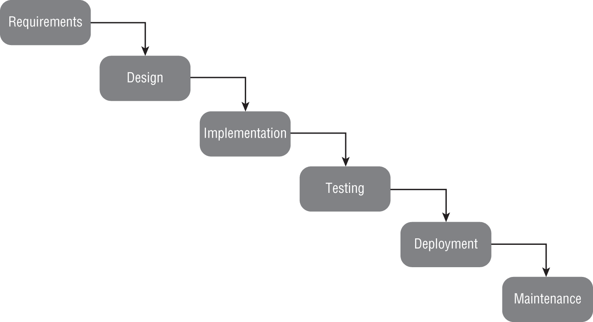
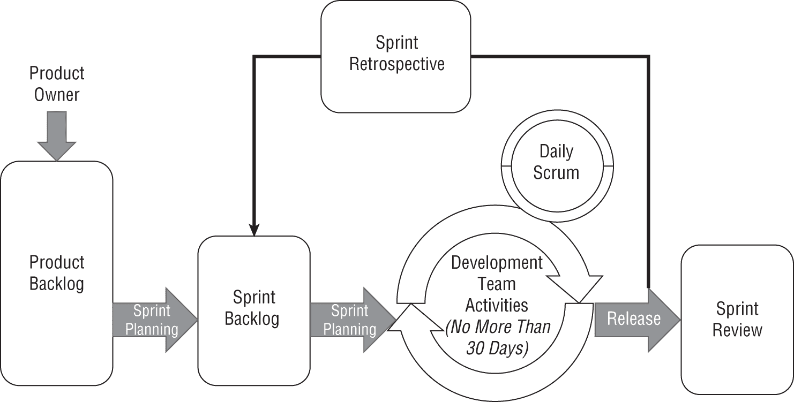
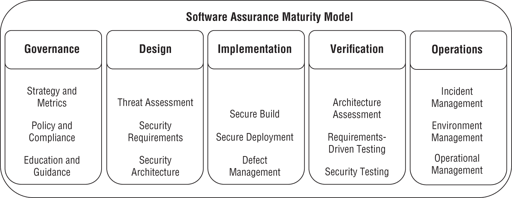

# 第 8 域
## 软件开发安全

## 信息安全讨论
信息安全讨论必须包括为这些信息系统提供支持的软件的安全性。保护软件的范围延伸到其开发环境，涵盖技术和流程两方面、诸如操作系统等基础软件组件，以及我们用于处理数据的应用程序，无论是定制构建、现成购买还是从开源存储库中选取。云计算也引入了使用和消费软件的新方式，尤其是软件即服务（SaaS），这将保护软件的许多责任从消费者转移到云服务提供商。

软件既可以是攻击的目标，也可以是攻击的载体，而软件环境的复杂性使其特别难以保护。计算系统需要由多个提供商交付的多种类型的软件，从为硬件提供动力的固件到操作系统或容器软件，再到实际的应用程序代码本身。这些组件的创建涉及多个开发人员，每个实体都必须实践软件开发安全。用户或组织可能负责在软件部署后对其进行安全配置和使用，尽管 *移动代码* ——代码在每次应用程序运行时通常通过网络浏览器动态交付 —— 带来了独特的挑战，因为代码无法提前验证。

本章提供了软件开发的广泛概述，从用于管理软件开发过程的方法论开始，以及可在开发过程各阶段使用的各种技术中实施的安全控制。还讨论了评估不同软件类型安全性的方法，因为安全从业人员在基于风险的决策中发挥着关键作用，以决定在特定环境中允许或拒绝使用软件。

## 理解并在软件开发生命周期（SDLC）中集成安全
软件是为响应用户群的需求而创建的，该用户群寻求实现特定的信息处理目标，例如希望高效搜索各种记录中包含的数据，而不是逐条阅读每条记录。这一创建过程称为 *开发*，通常遵循迭代生命周期；随着用户需求的变化，软件也必须更新以满足这些新需求。这种重复或迭代的特性使得该过程通常被称为 *软件开发生命周期*（SDLC）。

与所有生命周期一样，SDLC 被分解为基于其所需输入和产生的输出而逻辑排序的阶段。其中一些是显而易见的；例如，开发人员必须在需求阶段了解用户需求，然后再进入开发阶段，在该阶段创建满足这些需求的软件。其他则不太明显，例如在开始开发之前执行设计阶段活动（如界面 mockup）的需求。这就产生了不同的方法，例如瀑布模型，它是僵化的，要求在进入下一阶段之前完成某一阶段的所有活动。其他方法更灵活，例如原型制作；对完成的原型的评审和反馈用于创建新的改进设计。

无论使用何种 SDLC 方法，安全活动都必须贯穿每个阶段集成，以有效实施软件安全。认证信息系统安全专业人员（CISSP）可能不直接负责软件开发组织，但向开发人员提供这些要求的明确输入和指导至关重要。这意味着在开发开始前识别系统的安全需求，并提供足够的资源来支持为满足这些需求而实施的安全功能或控制的设计、开发和测试。还需要注意的是，系统生命周期（SLC）在其开发（SDLC）完成后涵盖信息系统的额外阶段。这包括运营和维护以及退役和处置，在此期间必须解决关键安全控制，如漏洞管理和媒体清理。

### 开发方法论

组织的开发方法选择将由诸多因素指导，例如可用时间、对软件中错误或漏洞的容忍度以及项目的复杂性。同一组织中也可能使用多种方法，因为不同团队会有不同的需求。总的来说，所有方法都包含相似的基础阶段，尽管它们在每个阶段的实际执行上有所不同。

## 软件开发生命周期阶段

将 SDLC 活动视为孤立过程的模型正被组织工程流程的更整体化观点所扩展，例如 ISO/IEC/IEEE 15288 中定义的内容，“系统和软件工程——系统生命周期过程”。描述 SDLC 中安全性的美国国家标准与技术研究院特别出版物（NIST SP），SP 800-64，“系统开发生命周期中的安全考虑”，已被撤回并由 SP 800-160 “系统安全工程” 取代，后者将安全考虑与 ISO 15288 中确定的 SLC 流程保持一致。

这并不是说 SDLC 模型或阶段不重要；相反，这反映了需要将安全视为组织范围内的整体视角来解决，而不是作为独立职能。它还为组织提供了更大的灵活性，以最佳方式实施流程（包括安全），以适应软件开发不断变化的本质。例如，在平台即服务（PaaS）环境中对安全控制的测试和验证可能不是单个系统开发工作的一部分，而是组织更大范围的云安全工作的一部分。这是一种共享控制，所有开发团队都可以使用，而执行测试的责任由云架构团队承担。

有许多 SDLC 模型可用，每个阶段的名称不同，但它们大致按逻辑顺序执行相同的步骤。包括以下内容：

* **启动：** 系统的业务需求和理由被表达，需求被记录，并分配资源。
* **开发：** 进行活动以设计满足需求所需的系统和底层架构；然后通过开发定制代码、购买或集成外部代码，或以其他方式构建系统来创建系统。
* **部署和交付：** 系统被置于运行环境中并准备好使用，其中将包括测试以确保系统适合用途并满足需求。
* **运营和维护：** 大多数运营和维护活动超出了开发工作的范围，但随着用户需求的演变，SDLC 可以迭代，因此像变更管理这样的关键流程可能会启动另一轮开发活动。
* **处置：** 本阶段的活动几乎完全属于 SLC 的管辖范围，但可能需要一些开发来执行归档或将数据迁移到替代系统等活动。

## 瀑布模型

瀑布方法是最古老的方法之一，由于其缺乏灵活性以及难以满足现代信息系统的复杂需求，已在许多组织中失宠。典型的瀑布开发项目的阶段包括需求、设计、实现、测试、部署和维护，如 图 8.1 所示。

**图 8.1 瀑布模型**

就像自然界的瀑布一样，该方法遵循一系列顺序阶段，要求所有任务完成后项目才能进入下一阶段。瀑布方法并非设计为迭代的，这在需求发生变化时会带来困难。要进入设计阶段，所有需求必须收集、记录并达成一致；一旦项目进入设计阶段，就无法纳入新需求。这种严谨性可以成为安全优势，因为瀑布方法强制执行严格的控制流程，如需求收集和测试。如果安全在开发项目中得到适当集成，这将导致安全需求得到充分记录和理解，以及对最终系统进行稳健测试。然而，如果系统不符合用户需求，安全优势就无关紧要。

瀑布模型的僵化使其适用于在开发开始前即可知晓所有需求且开发开始后无需更改的项目。在大型机计算时代，功能有限且硬件昂贵，这是有道理的。然而，软件和虚拟化硬件的可塑性意味着可以采用更灵活的方法来实现快速灵活的软件部署。快速演变的安全需求可能需要对系统功能进行重大更改，这一模型对此尤其服务不足。

## 敏捷

认识到像瀑布这样僵化的开发模型无法很好地适应现代软件开发需求，一个新的高层模型于 2001 年初由一个名为敏捷联盟的开发者团体提出。该团体由具有不同开发背景的成员组成，来自极限编程、Scrum 和特性驱动开发等方法论，其中许多方法论包含旨在解决瀑布等传统方法论不足之处的演进。敏捷联盟记录了 12 条原则以形成敏捷宣言，可在 `agilemanifesto.org/principles.html` 找到。宣言原则旨在更好地构建开发团队并分配资源，目标是提高开发活动的灵活性。例如，其中两条原则如下所述：

* **我们最高优先级是通过早期和持续交付有价值的软件来满足客户。** 而不是在项目开始前努力获取完整的需求集，敏捷开发可以识别最高优先级的项目并首先努力交付，然后反复迭代以实现剩余需求的交付。开发的重点是满足需求，而不是盲目遵循流程。
* **欢迎更改需求，即使在开发后期。敏捷流程利用变化为客户带来竞争优势。** 通过关注客户（用户）价值，敏捷开发努力交付满足用户需求的系统。这显然支持可用的安全目标，但也意味着复杂软件系统可以更好地设计以满足不断变化的保密性和完整性需求，例如更强大的加密或数据验证控制，这些在最初可能未被确定为需求。随着需求随时间变化，例如新的安全需求，软件项目也可以随之演进。

12 条敏捷原则本身并不是可以遵循来开发软件的开发方法论，而是管理软件开发项目的指导理念。正确实施时，它们力求通过更快交付功能软件并提高响应变化的能力来实现价值。软件以基本功能快速发布；然后开发过程迭代以包含额外功能，避免一次性大型发布，而倾向于更小、更频繁的发布。

每次迭代还将考虑从客户处获得的经验教训（例如，变更的需求）以及开发团队所获得的经验教训。理想情况下，团队应由来自开发和业务背景的跨职能成员组成，并应强调利益相关者之间清晰且频繁的沟通。这种开发元方法要求组织识别所有相关利益相关者，其中必须包括安全团队。所有利益相关者至少应在需求收集和测试期间参与，以确保系统需求得到记录，并进行测试以验证其是否得到满足。需求的变更，包括不断演进的安全需求，得到了敏捷方法学的良好支持，因为它们旨在频繁地重新评估需求并在迭代开发中纳入这些需求。

## 敏捷测试方法
敏捷高度重视速度和资源的高效利用，这促成了集成测试的使用，以支持功能软件的交付。与瀑布方法不同，瀑布方法中测试是在开发活动完成后进行的单独阶段，敏捷方法学将测试活动更紧密地集成到实际开发活动中。目标是双重的。首先，测试的对象更小、更易管理，因此修复通常更容易。其次，对变化需求做出响应的需求需要强大的测试，以确保新交付的功能不会引入错误、缺陷或漏洞。使用自动化测试工具可以使安全测试更接近开发时间进行，并针对更小的目标。这些支持防止缺陷进入生产环境的目标，同时由于其规模较小，也使测试结果更易于管理。
在敏捷方法学下保持软件交付速度导致对自动化有强烈关注。这对于功能测试等重复性流程尤其如此，因为自动化流程受人为错误影响较小，因此可靠性更高。安全测试也受益于自动化，因为像软件代码审查和漏洞扫描这样的关键控制可以自动且更频繁地进行。自动化测试是持续集成/持续交付（`CI/CD`）的重要推动因素，本文将在本章后面讨论。

## 敏捷开发方法
如前所述，敏捷是一套高层次的原则，并在各种开发方法中以不同程度实现。实施敏捷原则的开发方法三个示例包括极限编程、测试驱动开发和 Scrum。

### 极限编程
有时写作 `XP`，该方法引入了集成团队的使用，包括开发人员、客户和管理人员，以推动高价值软件功能的交付。用户故事被记录下来，以捕捉用户试图实现的目标以及实现这些功能的软件的验收标准，并且故事基于价值进行优先级排序。例如，在一个有 500 名用户需要登录并将数据保存到数据库，但只有 10 名用户需要从数据库打印记录的系统中，登录和保存数据的能力将被优先考虑。`XP` 方法和实现的完整细节可在 `www.extremeprogramming.org` 找到。
`XP` 利用一种称为结对编程的概念，将开发人员配对。开发人员轮流编写代码并提供建议/输入，目标是通过提供额外的监督和可借鉴的知识来实现更高质量的代码。
重构代码可能意味着很多事情，但本质上是一种通过删除过时、冗余或不需要的代码来改进软件功能的方法。开发人员过去可能做出了合理的决定，但随着系统和需求的演变，这些决定不再相关。重构可用于确保系统中不包含不必要的垃圾代码或被称为 cruft 的函数。

### 测试驱动开发 (TDD)
在教育中，有一个被称为“为考试而教”的概念；课堂教学旨在确保学生能够成功通过考试，就像驾驶培训课程旨在为学生准备驾驶考试一样。`TDD`，顾名思义，是由测试用例的使用驱动的：首先编写测试，然后运行。如果测试失败，则按需编写代码或重构代码以使测试成功；最终目标是确保所有测试通过。牢记最终目标可以帮助开发人员更好地理解他们试图构建的期望功能。`TDD` 对于现有系统尤其有效，在这些系统中，修改或更新必须以最小的复杂性实现，例如实施代码级安全控制，如修复缓冲区溢出或注入漏洞。

### Scrum
Scrum 项目的基础是一组轻量级的团队成员，不断迭代开发工作以实现整体产品目标。Scrum 引入了许多与敏捷开发项目相关的词汇，例如冲刺和产品待办事项列表。它专注于一个跨职能团队，该团队由三个关键成员组成，一个称为冲刺的时间范围，关键活动围绕其进行，以及几个重要的工件。

Scrum 角色和工件包括以下内容：
Scrum master: Scrum Master 在某些方面类似于一名协调员，其职责是消除团队成功的障碍。这些任务包括指导团队成员进行自我组织工作、收集关键利益相关者的意见以及促进团队活动。
Product owner: 作为客户的声音，产品负责人负责确保开发人员理解其软件旨在满足的目标。产品负责人还拥有产品待办事项列表，所有待完成的工作在其中被分解为工作单元并进行优先级排序，例如新功能和错误修复。
Development team: 这是一个广泛的团队，包括编写代码的传统开发人员、设计系统基础设施的架构师、数据科学家或分析师，以及对安全至关重要的测试人员和质量保证（QA）人员。所有开发工作都应进行安全测试，因此许多代码级和应用级安全控制将被委托给开发团队成员。
Backlogs: 在 Scrum 中维护的一个关键工件是待办事项列表。整体产品待办事项列表包含产品负责人已识别的所有需求，以及基于对客户价值的优先级排序。需求可能包括构建所需的努力或复杂性衡量，通常需要跨职能协作来确定这些数字。冲刺待办事项列表是从产品待办事项列表中提取的较小的需求列表，团队估计在分配的时间内可以交付。优先级更高的项目显然会更早交付，尽管如果冲刺中有空闲资源，但不足以解决更高优先级或更复杂的项目时，可能会添加低复杂性/努力/优先级的项目。

Scrum 的关键活动和来自工件的关键输入在 图 8.2 中显示，并在以下要点中描述。
Sprint: 冲刺只是项目中需要完成的一组时间盒工作；例如，两周内完成的所有开发工作被视为一个冲刺。虽然 Scrum 作为一种敏捷方法学拥抱变化，但一旦工作被承诺到冲刺中，尽可能避免变更。变更的需求可以在未来的冲刺中解决。

## Scrum 流程

### Sprint 规划
在开始开发冲刺之前，团队会召开冲刺规划会议。根据产品负责人设定的优先级，某些待办事项需求将被选入冲刺，团队就其认为在给定时间内可以完成的工作达成一致。一旦计划确定，应避免更改，因此范围界定和规划是一项关键活动。

### 每日 Scrum
开发团队应每日会面讨论进展、阻塞问题以及当天活动的计划。根据《敏捷宣言》，这些会议最好面对面进行，通常被称为 *站立会议*。

### 冲刺回顾与复盘
冲刺结束时有两个关键事件。冲刺回顾确定已完成的工作并包括向客户演示，支持用户与开发者集成的目标。冲刺回顾会议为开发团队提供了一个机会，通过反思近期冲刺中的成功、失败和机会来实现持续改进。

**图 8.2 Scrum 流程图**

## DevOps
DevOps 是开发和运维这两个传统上分离的功能领域的整合，目标是更好地支持组织的信息系统资源。开发人员和运维人员传统上各自为政，两个部门之间低效的交接流程意味着系统从开发转移到生产时关键信息会丢失。DevOps 团队实施敏捷倡导的做法，例如组建跨职能团队并强调频繁沟通以克服这些挑战。

DevOps 实践包括使用自动化、频繁测试以及强调频繁的软件集成和部署。通过遵循流水线的方式来加速软件交付，*流水线* 注重在构建中保证质量。开发人员被分配在特定时间内完成的可管理工作单元（冲刺中包含的需求），自动化测试旨在在代码交付到生产环境之前识别并修复缺陷。

QA 是除开发和运维之外 DevOps 团队的第三个成员，负责实施跨职能沟通的许多方面。QA 团队成员通常会参与与测试相关的前期活动，例如定义成功标准，然后在测试失败时向开发人员提供关键反馈。这些测试活动包含在冲刺的工作范围内，因此开发团队必须确保分配足够的时间和资源用于开发、测试以及修复交付期间代码中的任何问题。

如果安全需求已得到妥善记录并且要求 QA 验证系统是否满足这些需求，那么这种 QA 重点可以成为在 SDLC 中强制执行安全性的关键点。自动化安全测试和更快的交付减少了部署新软件时引入的漏洞数量，并在系统发现漏洞时提供更快创建和部署补丁的好处。

虽然更快的软件交付有好处，但开发和部署安全软件不应以牺牲为代价而仅仅更快地添加新功能。对于使用 DevOps 的组织来说，有一个至关重要的治理任务需要考虑：DevOps 团队拥有的特权角色和权限。像变更管理评审这样冗长的流程可能会挫败快速软件交付的目标，但它们确实为诸如漏洞扫描和人工评审等安全活动提供了有用的检查点。在必要时必须用自动化测试取代它们，并且还应为无法通过自动化工具完全测试的软件变更定义流程。

DevOps 团队成员很可能拥有特权访问，例如能够在生产环境中进行更改、创建新用户和权限以及访问日志数据。与其他特权访问一样，增加监控可能是合理的，多因素认证（MFA）和对这些员工的额外培训等控制措施也是如此。虽然跨职能团队很有用，但最小权限原则和职责分离原则仍必须实施。DevOps 成员需要仅限于其主要角色的权限，而不是访问 DevOps 团队授予的所有能力；例如，开发人员可能能够将代码标记为完成并准备部署，但需要另一位用户在代码部署前验证所有必需的测试是否已执行。在这里，自动化再次发挥关键作用，例如使用自动化代码部署工具，在将代码推送到生产环境之前系统地验证所有测试和其他要求是否已满足。

## DevSecOps
尽管如果在 SDLC 中正确实施安全，QA 可以在 DevOps 中执行关键的安全相关功能，但你会注意到安全并未得到特别说明。遗留软件开发的敏捷转型也在安全社区中得到体现，DevSecOps 的创建就是证明，甚至包括一份宣言和指导原则，记录在 `www.devsecops.org`。DevSecOps 的目标是优先考虑迭代而非完美，今天交付可行的安全解决方案并明天改进，比多年后交付完美的解决方案更受青睐——到那时系统可能已经遭受攻击或利用！

DevSecOps 原则为更好地将安全和合规活动及数据集成到开发流程中提供指导。这些原则展示了在传统 DevOps 之外更好地传达安全的重点，并包括以数据和安全科学取代恐惧、不确定性和怀疑，以及红队和蓝队利用测试而非依赖扫描和理论漏洞，两者都有助于安全从业者提供可操作的知识。与其说理论上的漏洞可能导致组织数据的完全丢失，DevSecOps 从业者，例如 CISSP，会执行红队测试以确定漏洞的确切性质。这结合真实的风险数据，为组织的领导者和开发者提供了一条合理且可操作的降低风险路径。

DevSecOps 的最终目标，正如其名称所示，是确保安全被构建到组织用于开发和运营其信息系统的流程中。传统的信息安全实践通常是 SDLC 的附加项，并且它们遭受与遗留开发方法论中确定的相同挑战。这种演变也反映在标准文档的演变中，例如 NIST 文档中从 SDLC 安全向安全工程流程的迁移，尽管值得注意的是，实施 DevSecOps 并没有标准方法。与安全风险缓解控制措施类似，每个组织都可能创建或调整流程以适应其独特的环境。

## 其他方法论
除了之前讨论过的瀑布模型和敏捷方法家族外，还有其他软件开发方法。虽然不期望 CISSP 熟悉所有可能的方法论，但对流行方法论及其相关安全优势和缺点有基本了解是个好主意。

# 软件开发生命周期方法论

对于需要比传统瀑布模型稍多灵活性的项目，*修改后的瀑布*可能比较合适。该方法论提供了两种次要选项，以解决传统瀑布方法所要求的严格方法无法服务的项目。首先，可能在当前阶段活动尚未全部完成之前就进入下一阶段；例如，在部分代码仍在开发的同时，测试可以开始于已完成的代码。其次，如果必要，可以退回一个阶段并迭代工作。如果开发人员意识到设计期间做出的架构假设在某些方面存在偏差，项目可以退回一个阶段，更新系统设计以解决缺陷，然后再次进入实现阶段。

传统瀑布方法的另一个演进是 *螺旋* 方法论。螺旋方法论是迭代的；也就是说，它被设计为以重复系列执行，并高度关注风险评估、分析和评估。大型、复杂且昂贵的项目是该模型的常见用途，因为它强调通过反复评估项目风险、成本和收益来随时间控制风险。该过程迭代经过四个阶段：
1.  确定目标、替代方案和风险
2.  评估替代方案并解决风险
3.  开发和测试
4.  规划下一阶段

其他 SDLC 方法论可在每个阶段内使用，以执行诸如收集需求或安排和执行开发等活动，而迭代的特性意味着不断变化或演进的需求可以轻松解决。该模型成本高昂，并在每个阶段引入大量以重复风险评估形式存在的开销；这种开销对于需求难以确定或需求可能发生变化的长期项目可能是合理的。

一些开发方法论是考虑到迭代而设计的，并假设项目将被重复。*原型* 模型就是一个例子，其中构建并发布系统的简化版本以供反馈和审查。基于反馈进行后续开发轮次，然后发布以供额外审查，如此往复，直到满足利益相关者的需求为止。该方法论适用于新类别或类型的系统，在这些系统中明确的需求可能无法获取，或将尝试新方法时。

与迭代模型不同，*洁净室* 方法论假设缺陷在开发完成后无法修复。它完全专注于缺陷预防。该概念遵循用于精密任务（如芯片制造）的模型，其中引入缺陷可能导致硬件完全无法使用；这种低风险容忍度要求昂贵的预防控制措施，例如设计用于捕获头发或灰尘的服装，以及特殊的空气处理系统。在软件开发中，类似的控制措施可以在牺牲开发敏捷性的情况下部署。终极目标是生产满足特定可靠性水平的软件，有时称为 *零缺陷*，重点在于健壮的设计和实现，而非测试和补救。洁净室方法论通常与其他开发模型（如瀑布模型）一起实施，并要求重点收集有关缺陷和控制措施的统计数据。这些指标用于证明诸如发布满足定义可靠、无缺陷功能水平的软件等决策。

## 成熟度模型

成熟度模型提供了一种衡量组织在某学科持续改进进展的方式，例如安全管理或软件开发。就像音乐根据音乐家的练习水平进行评级一样，成熟度模型级别详细说明了在执行特定任务的组织中期望的技能和能力，其目标是改进。企业成熟度模型通常被称为 *能力成熟度模型*，并且通常特定于软件开发等特定组织学科。

这些模型提供了一个基线来衡量组织的当前能力状态，定义期望的目标状态，并提供系统性建议以提高能力。这被称为 *流程改进*，总体而言，当其流程比混乱更正式、可重复且管理良好时，组织就更成熟。尽管在软件开发的背景下讨论，流程改进和成熟度模型可以应用于将关键 IT 功能作为服务获取的组织，以及其他学科，例如管理安全能力的改进。

### 常见成熟度模型组件

成熟度模型通常以相似的概念构建，关键区别在于模型所针对的流程领域，例如软件开发或系统集成。跨成熟度模型相似的组件包括以下内容：
*   **域：** 域是模型旨在帮助衡量的流程或业务方面，通常是常见的活动，例如度量和分析。域包括与该域相关的实践描述，例如定义指标收集的来源和频率。
*   **级别：** 成熟度模型将每个域中的实践集合组织成一系列递增的级别，通常范围为 1 到 5。级别按显示组织能力不断提高的比例排列，可能描述单个流程领域或成熟度模型所描述的流程整体集合。每个级别还包括审计或评估标准，由组织或外部审计员用来确定组织的当前成熟度级别。
*   **标准：** 要达到特定成熟度级别，组织必须满足该级别的标准。在某些模型中，特定域与每个级别相关联，例如基本流程定义是低级别标准，而基于指标的流程分析是更高级别标准。逻辑上，组织无法衡量临时或未定义的流程，因此该实践不会在组织成熟基本实践之前引入。在其他模型中，每个域在每个域内有一系列递增的要求，对应于域成熟度的提高，例如在较低成熟度时为临时文档，在较高成熟度时为模板驱动的文档。
*   **目标：** 目标描述了组织的期望成熟度水平。就像安全控制涉及风险降低的成本效益分析一样，改进流程的选择也必须带来明确的组织效益。虽然流程成熟度的提高降低了失败或管理不善项目的风险，但它也引入了成本和复杂性；不同组织会选择不同的期望成熟度水平。目标可用于执行差距分析并确定优先处理关闭已识别差距所需的活动。在某些情况下，如承包组织，特定的成熟度水平可能是与某些实体（如政府机构）开展业务的要求，而在其他情况下，向客户或业务合作伙伴展示成熟度可提供竞争优势。

成熟度模型、特定域或实践领域以及目标的选择将主要由组织的 objectives 指导。一些模型在特定行业中被广泛采用，或最适用于从事软件开发等特定任务的组织。在其他情况下，成熟度模型已围绕常见的安全实践（如安全数据处理）建立，并正迅速被作为代表客户和用户处理数据的服务提供商的要求而采用。

### 能力成熟度模型

最早被广泛采用的成熟度模型之一，即能力成熟度模型（CMM），由美国国防部与卡内基梅隆大学的软件工程研究所（SEI）联合开发。它源于对 1980 年代蓬勃发展的软件开发领域进行衡量和改进的需求，随着处理能力的提升和成本的降低，计算机系统的普及程度不断提高。由于当时计算机科学尚处于起步阶段，开发项目往往估计不准、控制不力、管理不善，因此 SEI 正式确定了一套在成功项目中常见的最佳实践。该模型的最初目的是评估政府承包商按时按预算交付项目的能力，但其他开发和业务流程也开始采用成熟度模型的思维方式。

## 能力成熟度模型集成
认识到 CMM 正在被改编用于新的业务流程，SEI 设计了能力成熟度模型集成（CMMI）。它最初针对开发（CMMI-DEV）、服务（CMMI-SVC）以及产品和服务采购（CMMI-ACQ）设计了专门的应用，并且该框架最近的 2.0 版本于 2018 年发布。该模型现由 ISACA 运营的 CMMI Institute 控制（`cmmiinstitute.com/cmmi`），并已得到调整，以应对敏捷开发以及新的业务关注领域，包括开发、服务、供应商管理以及人员（劳动力管理和职业发展），还有一个新兴的 Cybermaturity 项目，旨在将成熟度模型概念应用于网络安全治理和报告。

CMMI 模型被分解为称为 *流程域* 的域和五个成熟度级别。某些流程域在更高成熟度下包含不断增加的要求，而其他流程域仅适用于特定级别及以上。级别如下：
1.  **初始：** 流程不可预测且主要具有反应性。这是主要执行临时流程的组织的典型特征。
2.  **已管理：** 流程针对项目进行表征或记录，通常具有反应性。某些项目可能管理良好且可重复，但这种成功并未在整个组织中得到利用。
3.  **已定义：** 流程针对组织进行表征且具有前瞻性。3 级的组织拥有在各个项目/工作中共享的文档化流程，并采取主动措施确保项目成功，例如项目风险管理。
4.  **定量管理：** 流程通过度量进行衡量和控制。这是收集并响应指标的组织。
5.  **优化：** 组织专注于流程改进。5 级的组织拥有文档化流程，利用经验教训对其进行主动控制，并拥有强大的监督职能来收集指标和管理活动。

## 软件保证成熟度模型
软件保证成熟度模型（SAMM）由开放式 Web 应用程序安全项目（OWASP）维护，位于 `owaspsamm.org`。SAMM 是一个用于实施软件安全计划的规范性框架，重点是将安全活动集成到现有的 SDLC 中。它为评估当前状态、确定目标状态以及在 SDLC 范围内实施必要的改进提供了行动计划，包括对流程、人员、知识和工具的更新。

与其它模型一样，存在域，并细分为安全实践，如 图 8.3 所示。

**图 8.3 SAMM 域和实践**

在每组实践中，都有活动流，通常代表不同的职责。例如，在安全测试流 A 中，需要自动化安全测试工具，可由 QA 职能管理，而在流 B 中，需要对高风险组件进行手动安全测试。这种测试是一种专门职能，需要应用安全或渗透测试经验。每个安全实践也用三个成熟度级别表示。例如，安全测试的成熟度级别如下：
1.  执行安全测试（手动和基于工具）以发现安全缺陷。
2.  通过自动化并辅以定期的手动安全渗透测试，使开发过程中的安全测试更完整、更高效。
3.  将安全测试嵌入开发和部署流程中。

## 构建安全成熟度模型
正如其名称所示，构建安全成熟度模型（BSIMM）是一个成熟度模型，重点是确定安全软件创建能力的当前状态，识别改进机会，并优先考虑改进安全软件开发的努力。有关更多信息和 BSIMM 文档，可在 `www.bsimm.com` 找到。它试图通过访谈实际从事软件安全工作的专业人员来确定哪些实践实际上有效，从而为软件安全实践带来严谨性。这些软件安全举措（SSIs）是根据访谈中观察到的频率排序的。观察频率更高的 SSI 被认为是最广泛采用的实践，而观察频率较低的实践可能是新概念，或仅由成熟度非常高的组织执行。

BSIMM 的成功实施依赖于一个专门从事软件安全的内部职能，即 *软件安全组*（SSG）。BSIMM 在四个实践域中列出了 121 项活动：治理、情报、软件安全开发生命周期（SSDL）和部署。SSG 负责或对实施和完善组织选定的 SSI 负责。与所有成熟度模型一样，并非每个组织都必须处于同一水平，但 BSIMM 是组织衡量和改进软件安全性的经验指导的有用来源。

## CMMC
一个最近开发的对网络安全领域很重要的成熟度模型是网络安全成熟度模型认证（CMMC），由美国国防部发布。尽管 CMMC 广泛涉及网络安全，包括但不限于软件开发安全，但它专为代表政府客户处理敏感信息（称为 *受控非密信息*（CUI））的承包商设计。它可免费获取，并包含关于评估和提升网络安全和信息安全能力的广泛适用指导。CMMC 可以在组织层面或在特定项目或部门（如适用）实施和评估。模型和支持文档可在 `www.acq.osd.mil/cmmc/draft.html` 找到。

CMMC 中的成熟度级别与 CMMI 相似，从 1 级、已执行（与基本网络卫生相关的活动已在组织中实施并运行）到 5 级、优化（已建立先进的、持续优化的和主动的网络安全计划）。这些成熟度级别评估组织对流程、能力和实践的实施情况，并按域组织，这些域对于熟悉 NIST SP 800-53 控制族的从业人员来说会很熟悉：
*   访问控制（AC）
*   资产管理（AM）
*   审计与问责（AU）
*   意识与培训（AT）
*   配置管理（CM）
*   识别与身份验证（IA）
*   事件响应（IR）
*   维护（MA）
*   媒体保护（MP）
*   人员安全（PS）
*   物理保护（PE）
*   恢复（RE）
*   风险管理（RM）
*   安全评估（CA）
*   态势感知（SA）

* 系统和通信保护 (SC)
* 系统和信息完整性 (SI)

## 成熟度模型概述

成熟度模型有助于确定组织的实践所达到的能力和有效性水平，同时规划改进方向。它们对于软件开发和安全等复杂活动很有用，在这些活动中需要一致、可重复的实践，并且可以衡量增量改进以证明管理、运营或安全开销相关的成本是合理的。

讨论的每个模型都附带某种形式的评估，无论是像 BSIMM 这样的非正式内部评估指南，还是像 CMMC 这样的需要独立第三方评估和认证的正式外部指南。虽然对衡量很有用，但成熟度模型并不能保证任何特定工作的成功，因为它们无法解决软件开发项目可能面临的所有风险。

## 运营与维护

运营和维护，通常写作 O&M，是系统处于实时使用并运行在所谓的 *生产环境* 中的阶段，意味着它们正被终端用户积极使用。测试、验证和确认活动标志着开发的结束，而向 O&M 的过渡通常被称为 *推广* 或 *部署*。为了让软件保持运行并安全，在此阶段必须执行许多关键任务。O&M 期间并非所有任务都是安全从业人员的责任，因为系统运营通常不在安全团队的管辖范围内。其中一些任务，如持续的安全测试或漏洞评估，直接分配给安全团队；所有运营和安全任务都支持系统安全目标，特别是可用性目标。这些问题包括以下内容：

* **连续性：** 面对不利条件时系统的弹性，以及在中断发生时恢复的能力至关重要。业务连续性、灾难恢复和网络弹性等活动均在 O&M 阶段进行，例如生成系统备份。
* **监控和事件响应：** 实时生产系统是大多数安全事件发生的场所，因此组织的大部分监控能力将集中于此环境。当检测到事件时，调查和恢复过程通常侧重于补救问题并将生产恢复正常。帮助台响应和数字取证等流程对于确保安全事件得到妥善调查至关重要。
* **漏洞和补丁管理：** 扫描系统中的缺陷并进行补救是一项重要且持续的安全任务。某些缺陷可能会导致 SDLC 的迭代，特别是对于定制软件，尽管第三方软件的常规补丁部署是这项工作的主体。
* **访问控制：** 控制对开发和测试环境的访问很重要，但大多数系统的用户通常远多于开发人员，且敏感数据通常不用于测试或开发。授予、审查和撤销访问的流程将主要集中在运营系统上。
* **变更和配置管理：** 系统级变更和配置管理在 第 7 章，“安全运营，” 中有讨论，而源代码变更的具体细节在本章中另行讨论。值得注意的是，运营系统很可能置于配置管理之下，并有明确的流程用于请求、审查和实施变更以保持安全基线。

在系统的生命周期中，还会执行各种维护任务以保持其运行并保护安全。这些包括识别保持系统运行所需的升级或更新，例如需要系统升级或更换故障硬件的生命周期结束的操作系统。维护可能会对系统可用性产生负面影响，主动安排对于保持正常运行时间至关重要。维护窗口会提前很长时间公布，并通知用户系统将不可用；未宣布的紧急维护通常需要紧急情况作为理由。测试必须包含在维护任务中，特别是旨在识别系统变更导致的不利后果或现有功能丧失的回归测试。

## 变更管理

管理许多系统安全的一个关键方面是将其保持在已知的安全状态，这是配置管理的职能。然而，变更是必要的，因此也需要变更可以被请求、审查、实施和测试的流程，这就是变更管理的目标。这些结构化流程使系统能够灵活适应不断变化的需求或情况，同时充分解决安全问题，防止变更对系统安全态势产生不利影响。

重要的是要记住，变更管理通常不在安全部门的管辖范围内，但安全从业人员确实需要积极参与该流程。变更必须审查潜在的安全影响，测试计划必须记录以确保安全不受不利影响，并且如果变更执行不佳，可能会触发安全流程。例如，失败的变更可能会在变更能够被撤销之前引发业务连续性流程。

变更管理流程可以在多个不同层面上实施，对应不同的严格程度和流程集。在组织层面，例如操作系统 (OS) 替换等变更需要大量的预算和资源规划。在源代码层面，开发人员在将代码检入存储库之前可能会遵循安全的编码标准，例如注释代码和执行同行评审，该存储库充当组织的源代码配置和变更管理系统。代码保持在已知良好的状态，并且经批准的更改方法（如拉取请求和提交）必须遵循规则，以确保未经批准的开发人员更改不会导致源代码完整性丧失。在某个阶段，代码也可能达到完成状态，此后不允许进行任何更改，这一过程被称为 *冻结*。这对于执行测试、验证和确认练习很有用，因为测试正在进行更改的代码可能会导致误报或无意义的发现。

### 变更管理阶段与安全实践

大多数组织实施正式的变更管理机构，常见的名称包括变更“某物”委员会的某种变体，如变更管理、变更控制或变更咨询委员会 (CMB、CCB 或 CAB)。CMB 的组成通常包括来自 IT 和安全团队的永久核心成员，以及对于对这些部门产生影响或需要其输入的变更而加入的临时成员，如财务或人力资源。例如，重大的操作系统转变需要大量投资，因此财务和会计部门会参与其中，而人力资源部门可以提供有关变更对培训和生产力影响的详细信息。

CMB 负责推动变更管理流程，该流程与该组的名称一样，在不同组织中各不相同。这里概述了高级变更管理流程，以及在每个阶段推荐的相应安全实践：

# 在软件开发生态系统中识别和应用安全控制

## 变更管理流程

### 请求
许多变更流程涉及提交工单或其他正式的变更请求；工单系统的优势在于能够在一个位置捕获与变更相关的所有细节。请求必须捕获变更的完整细节以及预期的资源需求和影响。

### 分析和审批
一旦记录，变更将由变更管理委员会（CMB）审查，以识别变更的所有预期需求和影响。这遵循一套文件化的标准，其中应包括审查任何安全影响，例如引入新的风险或对现有安全控制的不利影响。例如，将所有用户从本地迁移到远程访问的变更将对组织实施的几乎所有安全控制产生影响。在变更管理委员会能够批准变更之前，了解这些影响并确保有足够的资源来解决它们至关重要。

### 变更开发
一旦变更获得批准，负责方必须制定实际执行变更的计划，例如安排时间执行所需的 IT 任务、收集必要的资源，以及采购或开发变更后的系统组件。这些行动必须遵循已记录并获批准的变更请求。

### 实施
在制定计划后，变更可以实施。与开发阶段一样，必须遵循所有已批准的变更程序。如果变更不成功，则需要回退或回滚程序，并且创建此类计划和程序通常是变更批准的要求。

### 测试
新变更的系统必须经过测试，以确保变更按预期工作、现有功能未被破坏，并且安全控制仍按预期运行。根据组织和变更的规模，此类测试可能包括认证和认可等高度正式的活动。

### 事后分析
通常需要进行一些变更后活动。必须完成已执行变更的文档记录，因为变更后的系统是新的已知状态，将由配置管理维护。新实施的功能可能需要用户培训，任何经验教训都应记录下来以实现持续流程改进。此阶段也可能被称为 *行动后* 报告、*经验教训* 或 *回顾*，但识别改进机会的目标是相同的。

### 紧急变更管理
延迟是变更管理流程的隐性部分，主要是因为需要时间收集所需的信息和资源。在某些情况下，这种延迟是不可接受的，例如需要变更来解决重大中断或新发现的关键漏洞。在这些情况下，等待变更在每周变更管理委员会会议上被记录和审查的风险超过了立即采取行动的风险，因此需要紧急变更管理流程。标准流程和特定紧急变更流程的细节在 第 7 章，“安全运营。” 中讨论。

与正常变更不同，紧急变更是在未经批准或仅在有限批准的情况下实施的。与要求整个变更管理委员会审查不同，单个成员可以授予批准，或 IT 人员可以被授权在未经任何事先批准的情况下实施变更。测试和验证流程同样得到简化。用于关闭关键系统漏洞的补丁可能先部署到单个系统，并在向所有系统推广之前进行有限或临时测试。在这种情况下，由于有缺陷的补丁导致运营停机的风险，与漏洞被利用的风险相比是可以接受的。

紧急变更并不意味着完全缺乏流程或程序，而是一种为速度而设计的修改。仍需要文档记录，许多组织在变更部署后进行追溯性变更审查和批准，以确保任何非预期后果或不可预见的影响得到理解、记录并得到适当处理。需要事后文档来支持此审查，测试应包括回归测试或安全评估，如漏洞扫描和渗透测试，具体取决于变更。当处理关键漏洞时，显然优先考虑尽快减轻风险而不是编写完整文档，但在漏洞得到解决后仍期望提供文档。

## 综合产品团队

综合产品团队（IPTs）是由跨学科人员组成的集合，他们共同负责交付产品或流程，类似于在 DevOps、DevSecOps 和敏捷软件开发中看到的组合。其指导概念是，具有不同观点的团队——包括用户、客户、开发人员和承包商，他们都是最终产品或流程的利益相关者——可以取得成功并提高复杂项目（如软件开发）的交付速度。

IPT 的目标是组装或随时提供与项目相关的角色、技能或知识的所有资源，通过组装这些资源，可以消除传统延迟或障碍。这包括了解系统需要满足的安全和合规要求的安全从业人员，他们应在系统开发或采购的尽可能早的阶段被纳入。IPT 这一概念起源于美国国防部，用于在复杂项目中整合关键利益相关者。

综合产品和流程开发（IPPD）的目标是将产品和流程设计结合起来，以确保产品，通常是信息系统，具有一套整体需求，用于设计系统和业务流程。这套整体需求应包括数据加密和访问控制等安全需求，并且 CISSP 可能是负责使用 IPPD 实践进行系统开发的 IPT 的关键成员。

IPPD 依赖于对系统和流程原型的广泛建模和测试，以及 IPT 的使用。这些团队将用户社区的利益相关者和开发人员结合起来，目的是加深对用户对系统的需求以及需要克服的任何技术限制的理解。这可以防止在信息不完整的情况下做出决策，并提供更及时的反馈，目标是在满足系统成本和性能目标的同时减少浪费的开发工作。这些概念与 DevOps 和敏捷开发方法相关，两者都促进利益相关者群体之间的更紧密协作，以实现更快的开发和团队之间更紧密的集成。

安全从业人员需要理解软件安全在组织中的关键性，以及开发人员在创建信息系统时所使用的软件和工具所扮演的基础性角色。CISSP 不一定需要在编程和软件开发的各个方面都是专家，但对编程有一个总览对于理解软件开发中必须解决的各种风险和相关安全控制措施是很重要的。特别重要的是要理解支撑现代编程语言的概念、它们运行的工具和环境，以及开发人员用于编写、测试和部署现代信息系统所需代码的过程。还有许多安全工具被设计为与这些开发人员集成并向其提供数据，其中包括大量应用安全测试工具，这些工具日益自动化，并提供近乎持续的反馈以改进软件的安全性。

## Programming Languages

由于代码是软件和信息系统的基础，它也是安全工作的重点之一。这些工作包括确保代码不会通过添加不需要的功能来破坏系统的完整性，并测试系统以识别可能对数据的保密性或完整性，或整个系统的可用性产生负面影响的非预期缺陷。为了执行这些功能，了解几个基本概念很重要。

编程语言代表了一组用于构建由计算机执行的程序的指令，通常目标是处理信息。这些语言由指令和书写这些指令的特定方式（称为 *syntax*）以及操作数据的方法组成。这些被组合起来创建算法，即实现数据处理目标的特定指令集。正如我们在人类语言中使用句子、段落和标点来传达意义一样，编程语言也有逻辑结构，旨在让计算机理解它们、执行指令并控制数据流。

### Language Types

有两种类型的软件语言，它们的主要区别是将类似 `print('Hello, world!')` 的人类可读指令转换为特定硬件系统可执行的指令所需步骤的顺序。*Compiled languages* 在运行前会被翻译成机器可读形式，这一过程称为 *compiling*。开发人员使用名为 *complier* 的程序来执行此任务，该程序将编写的程序作为输入，并生成通常称为 *binary* 的机器可执行代码作为输出。编译后的程序只能在为其编译的系统类型上运行，并且通常针对该特定系统类型进行了优化；例如，为 Windows OS 编译的程序在尝试在 macOS 或 Linux 上运行时将无法正常工作。这种优化意味着程序可以利用特定系统的功能，但代价是可移植性。此外，编译后的程序不会向最终用户暴露其源代码，因此如果代码是宝贵的知识产权资产，则编译语言是在保护保密性的同时分发它的最佳方式。C# 和 Swift 是编译语言的例子。

*Interpreted languages* 在运行时被翻译成机器可读格式，也称为 *on the fly*。这使得解释型代码在不同系统类型之间更具可移植性，因为各个平台上的用户可以安装特定于其系统的解释器，因此开发人员无需编译特定于系统的版本。解释型语言也有缺点，安全性尤其可能成问题。代码以编写的形式或中间形式分发，这都是人类可读的形式，因此解释型语言可能会暴露敏感的知识产权。由于解释过程，存在额外的运行开销，使得解释型程序比编译程序慢，尽管现代计算系统的速度在许多情况下使这成为可以忽略的问题。JavaScript 和 Python 是解释型语言的例子。移动代码的安全问题包括其动态特性——由于它在运行时加载，因此攻击者可能修改用户运行应用程序时请求的代码。这意味着之前测试过的代码可能不会被加载，而是攻击者的恶意代码被加载并执行。

数据库系统也有用于定义其数据结构、与存储数据交互以及管理数据库本身的语言。结构化查询语言（SQL）就是一个例子，它包括用于与数据库管理系统（DBMS）交互的子语言。这包括用于创建数据库和表的 数据定义语言（DDL），以及用于执行查询或插入新记录等操作的 数据操作语言（DML）。数据控制语言（DCL）主要关注数据库中存储数据的访问控制，这使其对实施安全至关重要。

安全测试也受语言类型选择的影响。安装在特定计算系统上的编译程序可以进行彻底测试，但许多解释型程序以 Web 应用程序中的移动代码形式远程交付。对于一些组织而言，程序代码的完整性可能是一个问题，因为解释型程序代码在用户每次请求网页时都会重新加载。解释器之间的差异也可能引入难以测试的安全问题，因为测试目标数量增加，且可能没有资源在所有可能的系统和解释器组合上进行彻底测试。

## Type Checking and Type Safe Languages

编程中经常影响安全的一个重要方面是程序处理的数据。在编程语言中，数据通常被归类为不同类型，如文本字符串、数值整数或布尔值如 true/false。数据类型在代码中具有关联的内存结构，这些结构通常用作占位符，表示程序创建时不存在的数据——程序接受的输入变量。如果用户输入的数据不符合预期结构（例如，用户在其生日数字信息字段中输入姓名），程序很可能会遇到错误。

*Static type checking* 由编译器执行，以验证程序的功能是否符合数据输入的类型约束。例如，如果两个输入变量都是存储代表货币的值的整数类型，则表达式 `price + tax` 可以成功求值。然而，如果程序声明了一个整数和一个文本值“yes”或“no”来定义项目是否适用销售税，则尝试添加这两条数据是不可能的。类型检查可以识别此类编程缺陷。*Dynamic type checking* 在程序运行时检查变量中存储的值，以确保数据与预期类型匹配。实现这些功能的语言被称为 *type-safe*，它们支持与数据完整性相关的重要安全目标。

强类型语言要求所有变量类型声明在编译时进行检查，而松散或弱类型语言则允许在应用程序运行时进行动态类型检查。强类型或弱类型语言的使用可能可以成为系统开发时需要决定的关键架构问题。用于确定使用强类型或弱类型语言的需求可能与数据完整性或系统可用性目标相关，因为用强类型语言编写的应用程序不应使用无效数据执行函数，从而导致错误。然而，用强类型语言编写的代码可能对不同功能的可重用性较低，导致需要额外开发工作。

## 编程范式

编程语言具有某些特性，基于它们实现所需的数据操作或处理过程的方式。*声明式*编程表达任务的逻辑，而不描述应如何执行；在这些语言中，系统必须解释逻辑并执行适当的任务。

SQL 是声明式范式的示例，用户发出命令，DBMS 负责按照其自身的内部约束执行命令。

这种抽象是一项重要的安全能力，因为它提供了控制用户可以做什么和不可以做什么的机会；例如，DBMS 可能会根据用户的身份为敏感的 SQL 函数实施额外的身份验证要求。

编程的*命令式*范式使用改变程序状态的语句或命令，类似于在人类语言中发出命令式命令，如“stand up”或“study for the CISSP。”

尽管这种直接控制可能带来安全挑战，现代命令式编程通常侧重于使用过程，有时称为*子程序*或*函数*，它们提供了对程序如何运行的更大控制。

用于访问文件系统中数据的标准化子程序可以被测试是否存在访问控制缺陷；每次重用该子程序时，都可以确保它以一致的方式实施访问控制。

*过程式编程*与命令式范式相关，基于程序调用过程的概念，过程类似于例程或子程序。

过程是一组待执行的步骤，并允许这些步骤在逻辑上分组，并在需要时动态调用。

除了过程之外，语言可能实现其他结构来对程序元素和程序代码的逻辑流程进行分组。

这提供了可读性和代码功能清晰度提高的好处，以及随着时间的推移可维护性提高，因为代码更容易理解。

这种做法称为*结构化编程*，因为代码使用像 `if`/`then` 这样的构造进行结构化，使得程序在给定时间将执行哪些步骤变得显而易见。

*块结构*编程语言利用块作为组织单元；程序元素如变量和函数的范围被限制在块内，以防止与代码其他位置的元素发生冲突。

*面向对象编程* (OOP) 是一种范式，专注于编程中的对象而非动作。

而不是编写特定命令来收集输入数据并对其执行过程，OOP 将数据和函数都视为对象，称为*类*，它们可以通过定义的交互相互链接。

对象是任何具有可跟踪状态的东西，例如等待数学变换以使其不可读的数据（加密过程）。

代码对象是自包含的函数模块，被“called”以执行其指定功能。

许多现代智能手机应用提供图像变换，如锐化照片；在这种情况下，照片是数据对象，标准图像变换是应用中的代码对象。

照片被传递给图像变换函数，处理后的照片在完成后被传回用户界面。

与 OOP 相关的有许多重要的安全概念，其中许多与将数据和函数视为以预定义方式通信的对象所固有的抽象有关。

这些概念包括以下内容：

*   **封装：** 这也称为*数据隐藏*，有效地是一种将数据与意外误操作隔离的方式。

直接访问一个类可以被拒绝给外部对象，从而将访问限制为仅批准的函数，称为*方法*。

*   **继承：** 数据对象的类可以有子类，继承主类部分或全部特征，例如访问限制。

例如，`Employee` 数据类可能有一个 `Salary` 子类，它实现了操作数据的相同方法，但具有额外的基于角色的访问控制限制。

该子类可以作为构建块重用，从而加快开发速度。

*   **多态：** 该术语指的是对象在创建或实例化时可能采取的多种（poly）形式（morphs）。

从现有对象实例化新对象通常会复制现有对象的属性和方法，但不同类型的数据可能导致安全问题，因为新数据类型需要不同的方法。

例如，将数据打印到屏幕上的函数对文字处理程序有用，但如果被调用来打印敏感数据如密码，则可能带来安全问题。

*   **多实例化：** 该术语意味着制作对象的多个（poly）副本（实例），通常目标是为该对象支持不同的保密性和完整性级别。

操作系统可能会创建共享资源空间的多个实例，如虚拟内存，以防止不同进程相互读写，或者数据库可能会为每个分类级别创建记录的副本，省略该分类级别以上的信息。

这防止了低级别用户甚至知道更敏感信息存在，降低了推断攻击的可能性。

## 标记和脚本语言

当许多人想到计算机编程语言时，他们想象的是像 C 这样复杂的语言，需要专门的知识和技能。

然而，提供数据结构或自动化基本任务集的语言也符合定义，因为这些语言为计算机系统处理数据提供指令作为输入。

这些语言的安全性经常被忽视，因为它们简单到即使是相对缺乏技能的用户也能编写。

然而，它们在通过互联网交付的网页等移动代码环境中的使用要求考虑安全性，并通过控制此类代码可能从何处加载或完全阻止像 JavaScript 这样不可信的远程代码来实施控制。

这些语言包括以下内容：

*   **超文本标记语言 (HTML)：** 指定交付给网页浏览器的文本的布局或显示元素。

*   **层叠样式表 (CSS)：** 允许定义网页文档应如何为显示进行样式设置，包括字体、颜色以及页面上元素的布局/间距。

*   **JavaScript：** 在客户端系统的网页浏览器内提供交互式应用程序，通常用于在用户屏幕上显示和操作数据。

JavaScript 可能需要访问用户机器上的特权功能，如本地文件访问，这是一个主要的安全问题，因为代码来自互联网上不可信的第三方。

## Python
一种高级语言，可用于多种用途，从小型个人程序到大型 Web 应用程序。作为一种解释型语言，它可以在多种平台上运行并与其他应用程序中的数据交互，例如由单个用户编写的本地脚本，用于自动化重复性任务，如清理电子表格中的数据，或通过应用程序编程接口（`API`）调用与其它系统和用户浏览器通信的分布式 Web 应用。

### 库
软件库是预先编写的常用函数、代码、类、脚本、过程或其它软件元素的存储库。它们使开发人员能够更快速、更轻松地将功能集成到程序中，而无需从头编写代码，因为库中的相关模块可以在需要时调用。许多平台（如操作系统、社交媒体网络和云计算服务）将其包含在所谓的软件开发工具包（`SDK`）中，这加快了开发人员构建集成这些平台功能的程序的任务。除了代码或函数之外，许多库还包括其它支持元素，例如帮助文档和预先编写的代码模板。

库的功能在所有使用该库语言或平台编写的程序之间共享，其价值来自于元素的易于重用。不仅这种重用加快了开发速度，而且还提供了更高的软件可靠性，因为这些共享函数很可能经过开发人员社区和实施该库的系统的广泛测试和改进。许多库还提供合规性导向的功能，例如设计为满足可访问性要求的用户界面组件，或受监管的函数，如信用卡处理，可以在无需解决支付卡行业数据安全标准（`PCI DSS`）合规性的情况下实现。

库通常实现许多标准功能，包括子程序、全局变量和类定义。根据库的不同，还可能提供额外的功能，例如用于常见任务（如加密）的预建算法，以及列表、表和数组等数据结构。针对特定平台（如操作系统）的库还提供与 `OS` 的各种功能的交互，包括文件系统访问、处理数据输入/输出以及通过驱动程序访问和控制设备。使用库的程序员可以像在程序中使用构建块一样轻松实现这些功能，而无需为每个任务完成编写软件的全部工作。

组织中库的使用应受多项要求的约束，包括需要经过验证且符合经证实的安全要求的库。组织可以使用受信任供应商的库、内部开发可在项目间共享的库，甚至在风险被认为可接受的情况下使用开源项目。包含易受攻击或恶意代码的库会给依赖它的整个应用程序带来风险。

### 工具集
有各种各样的工具可帮助程序员、工程师、测试人员和其他人员开发软件和系统。它们执行各种功能，包括创建和调试代码、在多人协作时保持代码的一致性以及启用测试。其中许多工具被组合成工具集，以满足开发人员的多种需求，例如以下内容：

* 源代码编辑器，可为开发人员提供编写和检查代码的能力。它们类似于文本编辑器，但包含特定于开发的功能，如语法检查器，用于识别编写不正确的代码、库集成，可自动建议适当的函数，甚至是开发人员可以利用以加快工作速度的常见功能的预建模板。注释和文档生成功能也可能是编辑器的一部分，使开发人员能够编写解释性注释，帮助其他开发人员理解给定代码片段的目的，或可用于自动生成有关程序特定功能的用户文档。
* 代码存储库和修订控制工具为代码提供集中存储和完整性保护。集中存储支持多名开发人员同时工作，而版本控制通过锁定已打开进行编辑的代码并维护带有时间戳和更改用户详细信息的修订历史记录，确保开发人员无法相互干扰工作。
* 调试器和错误数据库帮助开发人员查找和修复代码中的问题。有些通过突出显示已知问题或可识别的缺陷（如输入不正确的函数调用）来工作，而其他工具可以提供程序的逐行执行，以识别特定错误发生的位置。
* 编译器旨在创建特定于平台的应用程序二进制文件，由可在特定架构上运行的机器语言组成。许多编程语言可以编译为在各种平台上运行，使开发人员能够编写单个程序，然后使用适当的编译器支持他们想要的系统。
* 测试工具通常包括静态代码分析和单元测试工具。静态代码分析在不实际运行程序本身的情况下审查程序的底层代码；目标是识别可能导致缓冲区溢出条件等问题的不当编码问题。这些工具还可能执行数据流分析，其中函数可能生成的值会被审查，以确保其符合预期参数。

组织中使用的工具集应受配置管理、补丁管理和审计等安全实践的约束。应实施经批准工具的正确版本以及对这些工具的受控更改，并且使用这些工具的开发人员应接受其正确使用和维护安全程序的培训。这包括仅安装经批准的模块或函数、寻求新模块的批准，并利用现有工具执行组织安全 SDLC 程序中定义的安全控制。

### 集成开发环境
集成开发环境（`IDE`）是在单一环境中组合的工具，如桌面程序或 Web 应用程序，用于支持开发人员的工作。组合和集成工具的目标是提高生产力，同时通过减少管理多个工具的开销来确保一致性。经常纳入 `IDE` 的功能包括源代码编辑器、调试工具、构建自动化工具（如编译器）、测试工具以及部署自动化，如与容器编排和部署平台（包括 `Docker` 和 `Kubernetes`）的集成。

面向 `OOP` 语言的 `IDE`s 通常包括特定于语言的支持功能，例如用于语言中可用对象或为正在开发的特定程序创建的类的浏览器，类似于 Microsoft Excel 中的公式编辑器。源代码编辑器的功能可能特定于语言，例如对于类或对象可以在视觉布局中排列和链接以模拟数据流或程序执行的语言的视觉编程。

与工具集一样，`IDE` 的安全性也应成为安全计划的重点。任何正在开发的应用程序的基本安全性都受到用于构建它的工具的影响，因此确保 `IDE` 的组件得到批准和维护至关重要。

### 运行时

简而言之，一个 `runtime` 是运行应用程序所需的所有硬件和软件的集合。对于许多系统而言，这会相当复杂，因为硬件可能包含其自身软件（称为 `firmware`）以实现正常运行，可能需要设备驱动程序让应用程序与硬件通信，并且操作系统需要协调操作并调解对硬件的访问。用于提供这些信息系统服务的各种硬件和软件层，作为系统架构的一部分在 第 3 章 中进行了讨论，“安全架构与工程”。

编译程序代码、操作系统、设备驱动程序和固件的组合可能是编译语言程序运行所需的所有元素，尽管许多程序会通过 API、远程过程调用（RPC）或其他服务调用来访问运行所需的功能或数据。解释型语言也需要在运行时包含一个解释器，它将代码翻译成机器可执行格式，并且可能还负责执行诸如沙箱之类的安全控制。与所有信息系统一样，安全机会和漏洞存在于运行时的所有元素中，必须予以考虑和解决。

对于高安全应用，可能需要诸如可信计算基（TCB）之类的安全硬件。TCB 由负责执行安全的所有硬件、软件和固件组成，并充当参考监视器以控制访问并在系统内执行安全策略。要实现 TCB，需要对 TCB 元素进行适当的 设计、测试 和 隔离，然后才能支持对系统及其资源的受信任安全访问。TCB 是配置和变更管理的首要候选对象，所有操作系统和信息系统组件也是如此，因为它们是技术安全控制（如加密）和流程安全控制（如补丁管理）的明显实施点。

许多人想象的运行时的传统模型由运行 macOS 或 Windows 等标准操作系统的台式计算机（或笔记本电脑）组成。物联网（IoT）和边缘计算等趋势现在意味着执行计算功能所需的硬件和软件集合变得更加广泛。智能洗衣机、恒温器和传感器启用设备是运行时环境的一部分，可能包含一些基本的数据采集和处理能力。其中许多设备依赖 WiFi 或 Bluetooth 等网络技术来同步数据，这意味着它们是整体物联网运行时环境的一部分，必须作为组织安全计划的一部分予以考虑。

## 持续集成与持续交付

像 Agile 这样的开发方法 dramatically 减少了交付功能软件所需的时间，通常将开发时间从数年缩短到数月甚至数周。其驱动因素是通过更快速地发布功能软件来支持用户，以满足业务和功能需求。`Continuous integration`（CI）是指持续将开发人员的代码合并到共享主位置的做法，通常称为 `repository`。更频繁地集成代码可以降低进行大规模对账和集成活动（如调试新编写或修改的代码引起的问题）所需的成本和时间。这反过来又支持 Agile 的目标，即在每次迭代中交付一组渐进式功能，而不是单体部署。

代码仓库是配置管理的实现，它对项目如何进入和离开受控状态施加规则。例如，在 GitHub 仓库模型中，开发人员会创建拉取请求，突出显示新代码引入的更改。拉取请求必须在合并回基础代码分支之前接受检查，例如由其他开发人员进行人工审查或进行自动化测试。自动化安全测试也可以与这些集成活动结合使用。虽然自动化扫描无法找到所有问题，但更频繁地在更小的代码单元上执行可以提高其整体有效性。

持续交付（CD）是一种将代码自动交付到非实时生产环境的过程，或需要某些手动步骤才能部署到生产环境。这通常用于软件开发中需要具有手动测试流程的测试环境的情况，例如处理受监管或敏感数据的系统，或自动化可能不可行的复杂系统。在这些情况下，必须在新代码上线前进行人工验证。测试的完成可以作为部署新代码的自动触发器，或者在测试完成后部署可能是手动的。

一个密切相关且有些令人困惑的术语是持续部署（也称为 CD），它扩展了 CI 的概念，通过将集成代码自动部署到生产环境，无需人工干预——除非某个自动化步骤失败。实现持续部署要求组织在自动化质量保证和测试流程方面具有高度成熟度，以确保代码在部署前经过彻底测试并通过。经常需要自动化功能、集成和回归测试，以确保新开发的代码不会破坏系统或引入错误。

实现 CI/CD 的工具和流程组合通常被称为 `pipeline`，该管道包括交付功能软件到生产环境所需的所有步骤和要求。这将包括编写代码和解决出现的任何错误等手动步骤，以及运行测试和扫描等自动化步骤。打包代码，例如构建容器，以及部署它，是管道的最后阶段。CI/CD 管道将跨越从 IDE 到代码仓库再到云托管环境等多个系统，而管道中的每个系统和步骤都是实施安全控制的机会，例如完整性验证、保护机密性的加密，以及人工或自动化的测试和审查。

### CI/CD 管道中对测试的强调

CI/CD 严重依赖自动化来实现速度。CI/CD 管道不太可能手动构建计算机硬件、操作系统和启用诸如 Web 服务器之类的应用程序，而更可能利用虚拟化或云计算，在其中可以使用定义文件自动化和编排这些活动。这些定义文件指定在应用程序部署时需要配置的计算资源，这种做法称为 `infrastructure as code`（IaC）。由于存在定义文件来精确指定软件和虚拟硬件配置应是什么，因此配置管理、测试和审计变得容易得多；CISSP 可以通过将小型、自动化且可重复的安全检查实施到此自动化管道中，实现很大的安全影响。

应用安全（AppSec）是支持 CI/CD 管道的另一个重要的自动化测试功能。尽管自动化测试并不能完全取代手动测试活动，但它确实提供了若干优势。它可以比手动测试更频繁地执行，通常在每次部署或变更时进行，并且由于计算机化测试的速度快，可以测试应用程序的更大部分。单元测试、功能测试和回归测试都应包含在自动化测试活动中，以及诸如漏洞扫描等特定于安全性的测试。DevOps 和安全从业人员可以利用敏捷原则确定设计 AppSec 程序的方法，目标是将安全集成到 CI/CD 管道中，以确保满足安全要求，同时不影响组织的敏捷性。诸如持续安全等实践将这些原则中的许多进行了规范化，更多细节可在 `devops.com/9-pillars-of-continuous-security-best-practices` 找到。

自动化测试工具可以将工作重心从安全团队转移开，并打破一个常导致问题的关键障碍。安全测试通常由安全人员执行，然后结果必须传达给开发人员。这种传递可能导致信息丢失或传达错误，使安全漏洞得不到解决。自动化工具可以集成到 IDE 中，使测试结果能够直接传达给开发人员。例如，应用程序安全漏洞扫描器可以在代码推进到测试环境时自动运行，在那里它会在 Web 应用的某个页面上发现 SQL 注入缺陷。通过 API，该发现——包括具体的测试用例、页面的地址和其他细节——可以立即放入工单中，并分配给负责该 Web 应用功能的开发人员。开发人员仍然对代码记忆犹新，可以轻松使用提供的数据修复缺陷。

## 安全编排、自动化和响应

安全编排、自动化和响应（SOAR）是一个最近引入的术语，结合了多个流程和领域，通常作为软件平台或集成工具集提供。其主要目标是加快检测和响应安全事件的时间，通过整合不同的数据源和系统来协调自动化操作来实现这一目标。SOAR 常常与安全信息和事件管理（SIEM）混淆，但 SIEM 工具只是摄取数据，通过关联数据并为人工响应人员生成警报来支持响应活动。这种差异类似于入侵检测与入侵预防：入侵检测系统（IDS）生成警报，而入侵预防系统（IPS）会自动采取行动阻止入侵。

### 编排

这是 SIEM 和 SOAR 存在部分重叠的地方，因为它们都将来自不同系统的集成数据整合到单一数据集。然而，SOAR 超越了日志，还包括来自诸如用户和实体行为分析（UEBA）、IDS/IPS、外部威胁情报服务以及特定领域解决方案（如电子邮件反钓鱼工具、反恶意软件、应用程序安全扫描器等）等安全工具的数据。在许多情况下，SIEM 关于可疑活动的警报将成为 SOAR 平台的输入，依赖于 SIEM 跨网络或系统关联数据的能力。API 的使用对于数据摄取以及在目标系统上公开功能以实现响应自动化至关重要。例如，收到包含恶意文件的钓鱼邮件的用户会触发反恶意软件工具和 UEBA 代理的警报，SOAR 可以将其识别为与特定用户、电子邮件和一组操作相关。将这些不同系统的数据编排成连贯、可操作的情报是 SOAR 解决方案价值的第一步。

### 自动化

在前面的示例中，恶意文件下载可能会在受影响用户的机器上触发反恶意软件操作，例如隔离文件、删除恶意数据并向管理员发出感染警报。然而，单独的该警报可能会忽略其他用户收到了相同的电子邮件，或者附件利用了可能执行蠕虫的漏洞，该蠕虫会传播到其他端点，而检测可能发生也可能不发生。这种对问题的整体概述要求事件响应人员不仅调查恶意软件的原因，还要调查其在网络中的影响，这是一项复杂、耗时且容易出错的任务。流向 SOAR 的编排情报能够实现比人工调查速度快得多的自动化响应。

自动化遵循一组机器可执行的规则，通常收集在 playbook 或其他旨在响应特定触发器（如恶意软件检测）的指令集中。SOAR 相对于传统方法的优势在于其执行的速度。速度至关重要，因为这是风险事件发生后激活的对策，目标是减少事件的持续时间和影响。自动化诸如在用户工作站受恶意软件影响后强制更改密码、将受影响的机器与网络隔离、从其他用户的收件箱中隔离或删除电子邮件，以及打开预先填充相关详细信息的事件响应案例等操作，可节省时间并减少攻击造成损害的机会窗口。

### 响应

SOAR 将事件响应从传统的检测和手动响应模式演进为协调的自动化响应，在这种模式中，人类的专业知识、知识和才能以最有效的方式得到利用。信息系统可以比人类分析师更快地接收和处理数据；即使是配备齐全、24/7 运行的安全运营中心（SOC），其响应时间也比具有基础设施可见性和自动化能力的自动化系统慢。重复或易于自动化的任务可以由 SOAR 平台处理，例如识别一个用户收到的恶意电子邮件并在其他用户点击链接或打开恶意附件之前将其从其他用户的收件箱中删除。这为人类节省了时间和注意力，使其能够专注于新型威胁；SOAR 还可以通过汇总有意义的信息来增强人类能力，加快决策速度并减少响应事件所需的时间，这再次降低了事件对组织的影响。

作为示例，请考虑前面详细说明的恶意电子邮件事件。打开钓鱼邮件的原始用户可能由于网络上存在恶意软件而触发了警报。SOAR 可以作为编排的一部分接收相关信息，然后执行由传入数据触发的自动化响应。除了前面提到的隔离步骤外，SOAR 还可以启动恶意软件扫描以检测网络中的横向移动，并建立防火墙阻止访问与钓鱼邮件和恶意软件相关的任何恶意站点或 IP 地址的流量。这些操作可以在几秒钟内完成，而人类可能仅阅读初始警报就需要几分钟。

SOAR 并非寻求在事件响应中完全消除人工干预。许多平台都包含事件响应案例管理工具，旨在整合决策所需的信息，并提供可由响应人员启动的自动化操作链。继续以恶意邮件为例，一旦自动化响应执行完毕，可能会创建事件案例文件并分配给人工响应人员。该案例将包含所有相关数据，包括受影响的用户、密码重置等自动化操作，以及流程中建议的手动下一步。将与事件相关的所有信息集中在同一位置呈现，可使响应人员做出更明智、更快速的决策，同时也能为响应团队的所有成员提供一致的信息来源。

任何实施自动化响应的系统，例如 SOAR 或 IPS，都可能因误报而导致不必要的操作。SOAR 可能在检测到可疑登录活动时暂停用户账户，但如果用户确实在旅行或在非正常工作时间处理关键的时效性任务，SOAR 就造成了拒绝服务（DOS）状况。通过 *调优* 来调整这些工具以降低误报的可能性，*调优* 实质上是让它们学习组织环境的特定情况。该过程在 第 7 域 中有更详细的讨论，尤其是在实施人工智能（AI）工具的背景下。

## 软件配置管理

软件配置管理（SCM）是对配置和变更管理实践的实施，以支持安全的软件开发。其主要目的是为关键软件资源（如源代码）和程序资源（如需求文档）提供完整性。置于配置管理下的这些项目称为配置项（CIs）。每个 CI 必须具有唯一标识，并且对 CI 的更改必须遵循严格的变更流程，以确保更改得到协调且不会引入缺陷或破坏功能。

常见的 CI 包括源代码、软件库以及单个配置设置，如补丁级别或软件设置；一组 CI 共同代表基线，即系统的已知良好配置。在选择一组 CI 时，重要的是在所管理项目的数量与其关键性之间取得平衡。控制每个脚本文件或帮助文档的每一行可能是期望的，但将如此多项目置于配置控制下管理所带来的额外时间和开销可能会引入不必要的操作延迟。

基线代表一组稳定的不可变配置项，共同提供一个功能系统——请注意，该术语在安全控制的上下文中也使用，其中基线代表所需控制的最小集合。SCM 基线通常与期望的系统特性相关联，例如安全设置和配置或功能要求，如强制加密要求的已知良好设置或系统功能所需的 COTS 产品版本。由于构成基线的 CI 处于配置管理之下，对基线的更改必须遵循变更管理流程。这通常通过创建分支来实现，分支是一组与已知基线分开进行开发或更改的版本化 CI。在分支合并回并将更改纳入基线之前，必须满足测试、质量保证和验收标准。

SCM 的主要目标是促进对软件系统中所有元素的状态及其更改的可见性和控制。更改可能会引入错误或缺陷，从而对机密性、完整性、可用性、不可否认性和真实性（CIANA）等基本安全概念产生负面影响，必须维护源代码、需求文档和设置等系统元素的完整性。未受控制的更改可能会引入漏洞或产生其他非预期后果。在 SCM 领域，版本控制通常被用作根据版本号识别软件元素并通过强制执行关于何时以及如何创建新版本的规定来控制其更改的一种方式。实现这种管理的工具称为源代码版本控制或修订控制系统。

## 代码仓库

仓库，或通常所知的 *仓库*，是现代软件开发的基石，并提供支持多用户团队开发软件所需的关键功能。它们提供集中存储位置并通过允许多个用户访问和进行更改来支持协作工作，同时实施分支等限制，允许用户提取代码并对主代码隔离进行非破坏性更改。完成后，更改可以进行测试并合并回主代码。

### 保护源代码

源代码是宝贵的资产，其面临的风险与组织中的任何其他数据一样。仓库在支持 CIANA 安全基础方面提供了对源代码的许多控制点，而仓库本身由于其控制能力和有价值的内容也是宝贵的资产。在仓库上实施控制可用于实现以下安全目标，包括：

*   **机密性：** 仓库以授权的形式提供访问控制。有些比其他更精细，允许开发人员被授予对特定项目、代码模块或分支的单独读/写权限，而其他则简单地将仓库访问限制为仅授权用户。保护机密性的附加功能还可能包括防止将数据复制到本地计算机或便携式媒体设备等限制，从而允许更好地控制源代码的传播。

*   **完整性：** 大多数代码仓库对软件实施某种形式的配置管理和版本控制。开源协作项目可能配置仓库以允许任何授权用户进行更改，而严格控制的项目可能要求开发人员专门授权才能处理特定软件元素。一些仓库与项目管理或票务系统集成以允许动态访问控制；例如，开发人员被分配任务更新特定模块，这授予他们该模块代码的临时写访问权限。允许回滚到先前版本的版本控制系统也可作为应对非预期或不期望更改的对策。

*   **可用性：** 仓库的集中性质可能成为单点故障。拥有一个托管所有数据的系统也使备份和恢复系统变得更容易，因为该系统的健全备份计划可保证在需要时所有必需数据都可用。

*   **不可否认性：** 仓库中实施的访问控制机制——如唯一用户 ID、审计跟踪和版本历史记录——可用于识别用户并使其对其对源代码所做的更改负责。

*   **真实性：** 如果可以证明未发生损坏或非预期更改，则数据是真实的，源代码仓库可以通过使用版本控制回滚非预期更改并使用备份支持完整性来实现这一点。

### 保护仓库

# 软件仓库与应用安全

## 仓库保护

除提供管理代码的安全优势外，软件仓库本身也是需要保护的有价值资产。它们之所以成为有价值的目标，有多个原因，包括它们托管敏感数据，并且可被用来引入不需要的软件或功能。因此，仓库本身需要像其他所有有价值资产一样对待，进行风险评估并采取相应的安全缓解措施，例如以下内容：

* **数据：** 应部署诸如数据防泄漏（DLP）和入侵检测之类的工具，以监控仓库系统和主机上的数据和活动。
* **通信和网络：** 必须采取适当的安全措施来控制和监控对仓库的访问。由于远程可访问的特性以及分布式系统日益增长的趋势，特别重要的是通过实施 HTTPS 和传输层安全（TLS）等协议，或 VPN 或代理服务等安全访问解决方案来保护远程网络访问。
* **访问控制：** 必须考虑最小必要和最小权限原则，并且还应实施诸如请求审批和例行审查等访问控制程序。
* **备份和可用性：** 由于软件是大多数现代业务流程的基础，源代码以及部署所需资源（如 IaC 定义或构建说明）是保持可用性的根本重要资产。云托管的软件仓库提供高可用性和弹性配置，尽管要求更严格的组织可能被迫自行托管和维护自己的仓库。在所有情况下，配置都应通过确保在需要时可访问软件代码来支持组织的可用性目标。

## 应用安全测试

应用安全始于构成程序的代码的安全性。在理想世界中，这只需要预防性方法——在无限的时间和资源下，所有可能的错误都可被防止。不幸的是，大多数软件开发项目并非如此运作，并且存在诸如遗留代码和软件漏洞演变等多种因素，这意味着应用安全必须纳入主动搜寻漏洞。这种全生命周期方法涵盖了本章中讨论的应用设计和 SDLC 管理实践，以及对现有代码中缺陷或漏洞的持续评估和搜寻。

接下来概述了多种应用测试范式。应用安全测试的最佳方法将根据系统构成的组件以及组织在执行软件测试方面的工具、知识和成熟度，结合多种方法。

* **静态应用安全测试（SAST）：** SAST 评估源代码和其他非运行中的应用元素，如编译后的二进制文件。它可以轻松集成到 IDE 和开发人员工作流程中，在开发人员提交代码时执行自动化测试，并以开发人员易于理解的格式提供即时反馈。测试在开发或测试环境中执行，这意味着不会对实时生产环境产生影响。
  * **SAST 缺点：** SAST 工具通常只能理解一种编程语言，因此如果使用多种语言，则需要不同的工具。它们也可能由于 IDE 集成而难以被非开发人员访问，这意味着非开发人员的安全从业者被排除在外。由于它们不测试运行中的应用，因此无法检测到由于代码与底层系统元素（如操作系统漏洞）之间的接口而导致的复杂漏洞。
* **动态应用安全测试（DAST）：** 词 *动态* 是 DAST 的一部分，描述了这些测试工具如何执行应用以查找缺陷。它们通常可以针对具有接口或 API 的任何应用运行，而不考虑底层语言，并且与 IDE 的集成程度不如 SAST 紧密，这意味着非开发人员更容易访问。其中一些包含与 IDE 或 CI/CD 管道工具的集成；例如，当新代码推送到测试环境时，会启动自动 DAST 扫描，任何发现都会自动推送到开发人员工单或任务分配中。
  * **DAST 缺点：** 由于它们可能存在于开发人员的工具集之外，可能存在将信息传递给正确开发人员的组织挑战。一些 DAST 工具被设计用于作为侦测措施持续监控生产环境；这可能会导致性能问题，更重要的是，允许存在缺陷的软件进入生产环境，在被发现之前可能被利用。
* **交互式应用安全测试（IAST）：** 这组新兴的工具和能力结合了 SAST、DAST 和渗透测试的元素，通常使用复杂算法和机器学习来分析源代码并关联动态测试期间发现的漏洞。它很大程度上是在 CI/CD 实践兴起后出现的，因此大多数工具都提供与开发工具和安全平台的集成，确保对测试工作和结果有更好的可见性。
  * **IAST 缺点：** 如同任何新兴技术一样，会出现诸如需求旺盛的新功能成本更高以及市场上缺乏专业知识等成长阵痛。由于 IAST 结合了 SAST 类似的源代码分析，它也是语言依赖的，这意味着某些语言可能不受支持，并且如果在生产环境中运行，IAST 的动态元素可能会导致性能问题。
* **运行时应用自保护（RASP）：** 如名称 *运行时* 所暗示，RASP 在应用运行时与其一起执行；RASP 更少地是一种测试工具，但通常被纳入整体应用安全中以补充 SAST 和 DAST。RASP 安全工具与应用集成并分析程序的执行以发现异常或意外行为，然后采取纠正措施。这可能包括阻止特定请求或函数以关闭活跃攻击，还包括实施预防措施，如虚拟修补应用以防止未来再次使用相同的攻击向量。
  * **RASP 缺点：** 如同任何自动响应技术一样，RASP 的误报可能导致 DOS，就像 IPS 关闭意外但合法的流量一样。与 IAST 类似，作为相对较新的技术，RASP 将面临兼容性问题以及配置和管理工具所需的技能差距。

## 评估软件安全有效性

软件安全必须被衡量以评估其有效性并推动随时间的改进，类似于衡量和审计安全计划有效性的概念，如 SOC 2 审计，该内容在 第 6 章，“安全评估与测试。” 中讨论过。对软件环境的更改进行日志记录和审计，不仅是生产环境，也包括开发环境，提供验证为关键信息系统提供动力的软件完整性所需的关键数据。风险分析和缓解虽然是信息安全所有领域中的常见做法，但需要针对软件安全采取特定实践，以确保对软件独特风险的充分处理。这些包括对应用程序和信息系统的风险，以及对软件开发工具和源代码本身的风险，两者都是有价值的资产。

### 更改的审计与日志记录

# 事件、审计与日志记录

事件即使在中等复杂度的信息系统中每天也可能发生数千次。用户登录和注销，应用程序和服务启动和停止，用户输入错误密码，服务器和进程被重启，等等，所有这些都是非恶意且预期的操作。例如，在常规工作日使用的标准 Windows 10 工作站很容易产生数万条已记录的事件；手动审查每一项几乎是不可能完成的任务。

大多数事件都会以某种方式改变系统的状态；例如，服务器重启意味着系统在一段时间内不可用。这可能是由意外断电引起的，也可能是由部署添加用户所需功能的新代码引起的。跟踪这些变化并提供哪些是正常、哪些是不正常的可见性，对于诊断问题以及处理升级为安全事件的事件至关重要。

审计和日志记录是不同的，尽管经常被混淆的术语。它们经常被互换使用，例如在审计日志中，即使每个术语实际上都有自己的定义。以下是这些关键术语以及其他相关概念的定义：

## 关键定义

* 审计是对账户、文档或实践等进行正式或系统的检查。在软件环境中，审计侧重于软件安全控制的实施和有效性，并且通常依赖于 ISO、NIST 或 OWASP 安全框架等官方比较标准。变更管理和 QA 等审计流程通常依赖于在正常流程执行期间捕获的数据，这就是日志数据变得重要的地方。日志本身也可能接受审计，以识别违反组织要求的行为实例，例如用户尝试访问未经授权的资源。

* 日志记录仅仅是事件的记录。在软件系统中，日志由所有系统事件生成，例如用户登录应用程序，并且日志应捕获足够详细的细节以明确识别事件的关键信息。这包括事件是什么、谁/什么发起的操作、何时发生（通常称为 `timestamp`），以及事件的其他元数据，如严重级别。如果某些事件违反安全控制或导致系统性能下降，则会被归类为事件。

* 问责制是指识别发生事件的责任人或责任实体的能力，是身份和访问管理的一个关键要素。显然需要足够的数据；如果日志文件未记录用户名或时间戳，就无法识别在任何给定时间哪个用户执行了特定操作。

* 不可否认性是对特定个人执行特定操作的无可争议的证明。这个概念经常令人困惑，因为它是否定的——否认一个操作意味着拒绝承担责任。因此，不可否认性意味着拥有足够的证据来防止用户否认他们执行了该操作。并非所有日志数据都支持不可否认性；例如，在主入口收集的物理访问日志不足以证明某名员工在建筑物内的特定位置，除非访问控制在员工在设施内移动时创建日志数据。

## 日志记录和审计的应用

日志生成和常规审计都是反应性和侦测性控制措施。日志是在操作发生后生成的，因此它们不能防止风险实现，尽管它们支持检测何时出现问题的监控活动。日志只有在审计和监控流程使用它们时才变得有用；就像策略一样，如果记录下来但从未阅读或使用，则毫无用处。SIEM 工具将日志数据作为主要输入，然后对收集的数据执行监控活动，以查找可疑或不受欢迎的行为。SIEM 通常以持续且接近实时的方式执行此监控，所生成的警报是事件响应程序检测阶段的关键输入。

审计是对活动与预期基线进行审查的更正式和结构化流程，通常作为证明符合法律、监管或其他合规要求的一种方式。评估是一种更非正式的审查流程，通常是为了满足内部监督目标而非外部合规要求。日志数据对审计至关重要，因为它提供了一段时间内系统活动的记录，从而确认组织是否按照记录的治理方式运行。例如，如果所有软件变更都必须遵循变更管理流程，则软件仓库中的版本历史应与记录的变更请求保持一致。

源代码管理（SCM）是软件安全中日志记录和审计的一个特别重要的应用。SCM 提供了跟踪存储在仓库中的代码变更的能力，有时可精确到单个代码行的级别。这些日志如果某段代码导致错误，可以用于运营故障排除，也可用于通过识别可能偏离已识别要求的代码变更来审计合规性。代码完整性也得以维护，因为非预期或不需要的变更可以回滚到已知良好的版本。

在运营环境中的日志记录提供了系统在活跃使用期间用户和进程正在执行活动的洞察。这些日志通常用于访问审查或审计，以及运营和安全事件的调查。典型的日志事件示例包括用户登录和退出系统或应用程序、处理过程中遇到的应用程序错误，甚至环境控制问题，如电力波动和硬件中断。像用户登录这样的事件可能仅对审计和取证分析有用，但运营团队可能会监控硬件和环境控制的日志数据，因为这些可能是对系统可用性产生负面影响的故障的前兆。

日志数据可被组织中的多个团队用于各种监控目的，包括以下内容：

* **变更管理：** 系统变更的日志，如新应用安装或访问权限变更，可用于验证所做的变更是否与已批准的变更请求相对应。

* **安全事件：** 实时生产环境，尤其是具有面向公众或外部的组件（如 Web 服务器）的环境，会出现各种可疑和恶意活动。记录和监控这些操作是安全从业者的关键任务，通常构成安全分析师和事件响应人员工作职能的关键支柱。

* **性能管理：** 虽然不是明显的安全任务，但可用性是安全的一个组成部分。通过监控日志文件中的各种指标，例如 CPU 利用率、内存消耗和网络带宽使用，可以确保系统正在运行、可访问并能够支持所需用户负载。

* **云环境变更：** 在使用云服务时，大多数组织将失去对其 IT 基础设施部分部分的物理和部分逻辑可见性。与部署网络传感器来检测问题不同，具有状态信息的网页或 API 将提供关键的日志和监控数据，例如服务何时开始出现性能下降或中断以及何时恢复。如同为适应云计算而对其他控制措施进行的修改一样，日志记录和监控必须考虑可用于监控的数据类型以及如何有效利用这些数据。

对于日志记录和监控实践以及审计标准，存在权威资源。NIST SP 800-92《计算机安全日志管理指南》和 OWASP 日志记录备忘单涵盖了诸如策略要求和实施日志功能最佳实践等基础内容。许多合规框架要求特定类型的日志，或要求日志通常包含足以支持问责制的数据。这些合规框架，例如 PCI DSS，还提供了用于评估包括日志记录在内的安全控制措施实施情况和运行有效性的审计标准。

## 软件开发审计

审计是验证是否符合既定治理的重要合规工具，并在 第 6 域 中有更详细的讨论。软件开发项目应接受审计，以确保在创建安全软件时遵循所需的安全控制措施，并确保正在开发的软件实现了满足安全要求的必要功能。审计在安全之外对业务的多个方面也很有用，例如进度、预算和资源管理，以确保项目顺利运行并按时完成，这有助于实现诸如推出新产品或领先竞争对手等业务目标。

审计活动在 SDLC 的各个阶段有所不同，审计计划需要能够适应各种 SDLC 方法论。年度审计计划可能会在每年同一阶段遇到大型瀑布式项目，因此证据收集应是全年持续进行的活动，以确保审计人员在进行审查时拥有完整的图景。SDLC 各阶段的考虑因素包括以下内容：

*   **需求阶段：** 本阶段的审计证据大多是文档，例如需求分析文档和文档化的需求本身。需要审计的关键活动包括隐私影响评估（PIA）和数据分类或系统分类等审查。确保需求完整且理解有据可查，对于设计和构建具有足够数据保护机制的系统至关重要。

*   **设计阶段：** 在设计阶段，会根据需求评估备选方案，例如系统的云托管与本地托管。需要审计的关键活动包括用于确定拟议解决方案备选方案中哪一个充分满足所述需求的正式风险评估和决策流程，以及对残余风险的正式接受。

*   **实施阶段：** 编写代码、测试系统功能以及代码审查或渗透测试等安全测试等动手活动都应纳入审计计划范围。审计人员可能会进行文档审查以验证测试活动是否已执行且结果得到妥善处理，并可能对开发人员进行访谈以测试其对关键流程和程序的了解程度。测试也是重要的审计方法，用于证明流程和技术控制按预期响应，例如尝试已知违反职责分离政策的操作并理想情况下观察操作被阻止。例如，审计人员可能会使用同一用户账户编写并尝试部署代码，以验证系统控制是否到位以阻止部署。

*   **验证阶段：** 对测试活动的审计对于验证监督功能是否已实施且有效非常重要。这些应包括检查测试用例或数据的设计是否充分、测试覆盖范围、所有必需测试的执行情况，以及在系统部署前成功通过必需测试。

*   **运行和维护阶段：** 由于系统在该阶段花费了大部分生命周期，因此大部分审计工作在此进行。该阶段的系统还可能面临更多外部审计，因为许多法律法规要求对实时生产系统进行审计。许多审计框架现在同时纳入实时系统审计和 SDLC 审计，这是由于安全软件开发在整体系统安全中发挥的关键作用。

## 风险分析和缓解

风险评估、分析和处理在 第 1 章《安全与风险管理》中已有深入介绍，因此风险容忍度以及评估和缓解风险的方法等概念在此不予涵盖。软件开发和安全需要持续评估和缓解风险，因此这些概念必须应用于所有 SDLC 阶段和软件环境，包括开发环境以及终端用户或实时生产环境。目标仍然相同，主要包括识别需要保护的资产、各种漏洞和相关威胁的可能性和影响，以及管理风险的最具成本效益的方式。

软件风险需要独特的分析方法，第一步是确定分析目标。执行此风险评估时应考虑的软件开发环境和实践方面包括以下内容：

*   **数据风险：** 信息系统存储、传输和处理需要保护的信息，因此系统本身由于处理数据的角色而经常面临风险。软件、硬件以及网络连接和数据中心等技术服务的复杂组合使得难以找到分析的起点，而许多组织中信息系统的庞大数量更增加了挑战。安全从业人员应根据分类级别进行优先排序；处理最敏感或受高度监管数据的系统在发生泄露时可能造成最大影响。然而，这并不意味着低敏感性系统可以被忽略，并且对手可能入侵低分类系统并转向更高分类系统的可能性也必须考虑。

*   **新技术风险：** 运行标准化商业软件且配置和支持需求众所周知并得到适当支持和维护的信息系统通常比新兴技术风险更低。缺乏知识和专业技能会增加基于新技术或新兴技术部署系统时出现错误配置的可能性，而其新颖性可能意味着安全选项尚未可用。智能手机就是一个最近的例子——尽管在智能手机最初流行时，工作站操作系统已具备先进的全盘加密（FDE），但硬件和软件限制意味着智能手机上的 FDE 支持有限。这限制了使用这些设备的组织可用的风险缓解选项。

*   **系统变更：** 系统随时间变化的原因多种多样。组织需求会演变，新技术变得可用，旧技术不再受支持。系统变更可能引入新风险并显著改变现有风险，尽管在某些情况下，变更也可能减少或消除风险。将遗留应用程序从本地托管迁移到基于云的微服务架构可以由于高可用性云服务而降低系统停机的可能性，但对数据中心硬件的物理控制丧失增加了物理安全风险，同时也改变了可用的缓解选项。与其使用物理锁和访问控制，组织可能会使用保险来转移在云服务提供商处发生数据盗窃的风险，以及使用额外加密来降低数据盗窃的影响。这些风险应在变更管理的一部分中识别，并且要求必须在所有 SDLC 阶段得到记录并贯彻，以适当应对这些风险并测试已实施的缓解措施。

### 代码风险
软件即代码，非预期或恶意的变更会给安全的所有要素带来严重风险。处理不当的变更可能引入导致系统不可用的错误或缺陷，而未经批准的代码变更可能会损害系统处理的数据的完整性和真实性。SDLC 活动如代码审查、变更管理、测试和漏洞管理都应设计用于检测和纠正这些风险。代码也是保密风险的来源，因为编程和配置不当的系统无法实现所需的数据保密级别。

#### 风险评估与处理
风险评估方法论在 领域 1 中有所介绍，包括多种用于理解各种风险对组织运营的可能性和影响的方法。针对整个组织或单个信息系统执行风险评估，存在基于最佳实践的标准，包括 ISO 和 NIST。技术和信息安全领域的风险评估框架包括运营关键威胁、资产和漏洞评估（OCTAVE）以及失效模式和影响分析（FMEA）。

风险分析是风险评估的一个组成部分，涉及对已识别风险的影响或可能性进行系统审查。具体而言，就软件开发安全而言，CISSP 应该能够协助负责软件开发和交付的各个团队完成诸如识别系统或软件特定风险等任务。一旦识别出这些风险，就需要缓解计划将可能性或影响降低到低于组织定义的风险阈值的水平。

软件开发中的风险来源或 SDLC 中可检测风险的点包括以下内容：
* **规划：** 组织对系统开发的方法可能引入诸如进度或预算问题等运营风险。如果安全被笼统地计划为系统发布前一天的测试，则不太可能安全工作有效，或发现问题得到充分修复。
* **需求：** 新的系统功能，如使系统暴露于互联网访问或添加信用卡处理等新功能，会引入诸如新的攻击向量或监管合规负担等风险。
* **设计：** 系统所选的设计可能会增加或减少各种风险，如远程访问、缺乏支持所需安全控制的功能或云供应商锁定。例如，选择一家云供应商和 DBMS 可能会限制访问控制的粒度或可用的加密选项。替代 DBMS 或云提供商的成本可能过高，这推动了对补偿性安全控制的需求。
* **开发：** 在开发过程中，本章讨论的所有安全控制都必须得到解决以减轻软件开发风险。这包括适当使用开发工具集、正确使用安全编码指南和标准，以及测试以确保正在开发的软件满足功能和安全要求。
* **运营和维护：** 针对系统的绝大多数风险在最终用户实际使用期间影响系统。常规风险评估和持续监控计划对于衡量这些风险以及所选缓解措施的有效性至关重要。识别新风险的关键来源将包括常规风险评估以及事件响应流程。

诸如补丁和漏洞管理、监控威胁情报以及通过 SOC 进行持续监控等持续性流程均在运营阶段进行。处理诸如应用补丁、系统升级或预防性维护等维护问题也是在此阶段执行的关键风险缓解活动。

#### 缓解策略
与风险评估一样，包括成本效益分析、风险缓解与风险转移以及残余风险接受的缓解策略在 第 1 章，“安全与风险管理。” 中有所介绍。在讨论软件开发的安全控制选择时，重要的是要注意这些控制的实施必须集成到它们旨在保护的系统的现有 SDLC 流程中。

执行分析时需要衡量的一些成本包括直接成本，如软件或产品采购、专业服务支持，以及运营成本如支持合同。间接成本可能更难以明确定义或衡量，因为开发项目中存在许多因素的混合。例如，当开发冲刺还包含其他功能时，很难明确说明实施新的安全控制所带来的额外测试时间有多少。

诸如员工生产力等间接影响也可能难以单独衡量。新的安全控制流程启动后生产率下降可能归因于控制的开销，但夏季和冬季假期期间的季节性生产力损失或大量未经培训的新员工等其他因素也可能是原因。成本必须进行衡量以指导缓解策略的选择，但也应考虑不确定性和其他因素的核算，在非常复杂的情况下，定性衡量可能是最佳选择，以防止陷入衡量过程。

衡量安全控制的收益可能同样困难，特别是如果收益是负面或假设性的。通过查看客户产生的平均收入，可以衡量用户放弃注册流程导致业务损失的成本。决定是否添加导致部分用户放弃注册流程的额外身份验证要求时可以利用这些数据。例如，由于身份验证安全措施不足或疏忽而未被起诉的成本难以量化，而针对组织的诉讼价格显然更容易衡量，但在发生前难以假设。

定性影响衡量可以帮助这些情况；例如，“轻微”事件不太可能导致导致业务终结的罚款，而“灾难性”事件可能导致企业无力偿债。部分定量衡量也可以通过查看影响同行组织类似事件的公开数据或公开研究（如年度 Verizon 数据泄露调查报告（DBIR），可在 `enterprise.verizon.com/resources/reports/dbir` 获取）来进行。安全从业人员经常会发现他们需要基于非安全收益来证明安全控制的合理性，例如为移动或远程员工增强基于云的系统的可用性。在许多情况下，成本效益分析的最终结果将是对管理层提出各种替代方案以缓解、转移并最终接受残余风险，因此控制措施产生的成本以及任何收益都必须清楚地记录和传达。

## 评估采购软件的安全影响

关于安全性而言，采购的软件比自行开发的软件更难评估和控制。这种情况与管理不受组织政策和程序直接约束的第三方服务提供商所带来的额外复杂性类似。当软件由组织自行开发时，可以在整个 SDLC 过程中实施安全控制并获得直接证据。当组织不控制开发流程时，通常无法主动控制软件开发流程或进行软件修复以解决漏洞。这种控制权的丧失看似不可接受的安全风险，但与试图培养构建复杂信息系统所需技能和资源所带来的同样高昂的成本相平衡。从合适的来源获取软件可以加快关键业务目标的实现，并且应选择补偿性安全控制措施将风险降低到可接受的水平。

## 商业现成软件

如名称所示，商业现成（COTS）软件可随时向公众出售，可供购买、许可或租赁。COTS 可能很昂贵，但费用可通过支持的可用性、来自专用供应商的更强大的功能集，或由于其针对特定用例而设计的软件部署速度来抵消。COTS 软件最直接的安全缺点是无法了解源代码和开发实践，使用它的组织无法直接进行更改——它们可能能够请求更改，但供应商没有义务进行更改。大多数软件供应商不提供任何可见性，尽管有些会分享审计和保证报告，如代码扫描或 ISO 27001 等认证，该认证对供应商的安全计划提供保证，或 ISO 27034，该认证对供应商的应用安全控制提供保证。

美国网络安全和基础设施安全局（CISA）维护了一份管理 COTS 软件安全的最佳实践指南：(`www.us-cert.cisa.gov/bsi/articles/best-practices/legacy-systems/security-considerations-in-managing-cots-software`)。尽管云托管和无服务器和微服务架构等新型 IT 服务越来越多地被用于现代信息系统，但《COTS Security Considerations》文档中提供的指导对拥有传统或本地托管系统的许多组织仍然相关。这包括以下内容：

*   **识别 COTS 有风险的原因：** 众所周知且广泛使用的软件，如 Microsoft Windows 和 Internet Information Services，也为威胁行为者所熟知。这些系统的广泛采用增加了利用它们的盈利能力，因为潜在目标的池更大，而且如果软件中的缺陷导致安全事件，软件开发商通常仅承担有限责任。CISSP 应该意识到使用 COTS 的成本效益权衡，这应纳入组织基于风险的决策中，例如构建与购买。
*   **常见攻击方法：** COTS 软件经常遭受恶意修改或干扰，如远程代码执行（RCE）漏洞或 DOS 攻击。源代码的黑盒性质也意味着 COTS 软件可能包含不受欢迎的恶意软件或功能，组织无法通过 SAST 等常规手段识别。
*   **标准风险评估和缓解策略：** 使用 COTS 软件的组织必须拥有适合其用例的充分风险管理实践。这包括编制 COTS 软件和组件的准确清单，并确定漏洞信息来源，例如供应商披露、渗透测试和常规安全审查。SDLC 期间的缺陷预防策略不是一种选择，因此缓解措施必须侧重于纠正性和补偿性控制措施，例如入侵检测系统和网络访问控制。

## 开源

开源软件（OSS）是一类软件，正如其名称所示，使其源代码可自由获取。OSS 通常由社区为所有人的利益而开发，使组织能够共享和协作以改进软件，同时提供源代码可见性的好处。与 COTS 不同，所有使用 OSS 的组织都可以执行代码测试以验证安全性、错误或不需要的功能，并且可以将为解决安全漏洞而进行的修复分享回软件项目，以造福社区。

OSS 的社区驱动方法具有可争议的安全影响。一方面，开放的性质意味着错误或缺陷最终应该被发现，并且软件通常可免费使用。另一方面，OSS 项目的复杂性、使用软件所需的专业技能以及缺乏专用支持可能使其不如 COTS 替代方案有吸引力。在评估 OSS 时，有一些关键问题：

*   **执行充分的评估：** 有一种假设认为，只要有足够多的眼睛审视软件代码，所有缺陷都会变得明显。这确实如此，但忽略了一个关键要素：时间。Heartbleed 漏洞在 OpenSSL 中存在近五年才被发现，而该软件是互联网上使用最广泛的软件之一。依赖不受信任的外部人员进行的测试和评估也可能导致测试覆盖不足、目标不同，甚至如果不是由合格的测试人员执行，结果可能过时或不准确。同样，系统管理员可能从项目存储库中提取开源软件并构建一个功能系统，而没有足够的知识来审查代码并找到潜在的错误。仅仅依赖社区或管理员的智慧是不够的。
*   **验证源代码完整性：** OSS 存储库通常配置为公开可见和贡献，意味着任何人都可以添加、修改或删除源代码。曾有多起 OSS 项目被植入恶意代码的案例，以及从非真实来源提供预打包 OSS 的案例。在这两种情况下，下载并部署软件的毫无防备的用户除了合法软件外还获得了不需要的恶意软件。务必确保您审查对 OSS 所做的更改，以确保它们是预期的并且得到适当记录，并且只从合法的官方存储库下载 OSS。
*   **寻找商业支持：** OSS 通常许可免费使用和分发，这意味着组织也必须自行寻找支持。Red Hat 等公司通过为 Linux 等流行的 OSS 提供支持而兴起，这种安排的专用资源对 OSS 的整体质量和安全性具有有益的影响。这些公司可能能够吸引专门的人才加入项目，并提供将支持中获得的经验教训以文档和代码更新的形式回馈社区的好处。

## 第三方

第三方软件由贵组织直接控制范围之外的公司按合同开发，所产生的软件通常供贵组织独家使用。外部组织通常专注于软件开发，并拥有使其在软件开发方面更熟练的技能、资源和知识。这降低了承包组织因不熟悉技术或缺乏软件开发流程成熟度而产生的项目风险；开发流程缺乏熟悉度或成熟度还可能导致软件安全性降低，因为开发人员由于缺乏知识而容易犯简单错误。第三方开发组织的更具经验的共享资源不太可能犯此类错误，因此外包增加的成本可被项目和安全风险的降低所抵消。

与所有采购的软件一样，放弃对软件开发过程的控制固有风险，需要专门的缓解策略来执行合同、服务水平协议（SLAs）以及额外的验收测试，以确保交付的软件满足组织的要求。使用第三方开发软件是一个决定，应在审慎权衡成本和收益后做出。所需的高质量开发和项目管理监督的增加成本，可能因专业第三方开发公司能够提供的交付质量或速度而得到合理化。

源代码本身的可用性是需要考虑的第三方软件安全性的另一个重要方面。如果开发组织倒闭，承包组织可能发现自己无法获得关键系统的支持；*代码托管*是一种常用于防止这种情况的合同安排。开发组织将源代码的副本存放在受信任的第三方处，称为*托管代理*。在有限的情况下，例如开发商倒闭或违反合同，承包组织可以获得代码的访问权限，这使得系统的持续支持和开发成为可能。

## 托管服务（SaaS、IaaS、PaaS）

财务驱动因素与创新服务的可用性相结合，推动各行业组织采用云计算。直接的财务激励，如降低不必要的硬件或软件容量的成本，以及间接激励，如提供安全远程访问以支持分布式团队，已共同推动许多组织将信息系统作为托管服务来消费。这些服务通过计量消耗计费，通常采用按需付费模式。选择正确的服务将取决于组织的需求和技术能力。

各类云服务模型的广泛认可定义见 NIST SP 800-145，“The NIST Definition of Cloud Computing,” 并在 第 3 章 中也有介绍。新兴的云服务必须从软件安全角度考虑，包括无服务器和微服务架构，它们结合了托管软件、基础设施和平台的元素，以实现代码的更快部署。云服务选择会影响消费者软件安全评估的能力和责任。

### 评估共享责任

共享责任模型定义了云服务提供商（CSP）与云消费者在处理各种安全任务方面的分界线。例如，在所有服务模型中，CSP 负责数据中心的物理安全，而在所有服务模型中，消费者仍保留对放置在云环境中的数据的法律责任和保护责任。

其他责任因所选服务模型而异。例如，在基础设施即服务（IaaS）中，消费者负责对其部署的任何软件应用软件补丁，而在 SaaS 中，该责任归 CSP。软件评估责任根据服务模型遵循类似的划分：

* 在所有服务模型中，验证 CSP 对特定用途的适用性（如处理高度敏感数据）是消费者的责任。特定 CSP 或云部署模型的选择将由执行软件评估时可用的控制水平决定；例如，私有云或社区云提供的评估直接控制程度大于不允许消费者直接审计服务的庞大公共 CSP。
* 在 IaaS 中，消费者拥有部署软件的最大灵活性，因此也拥有执行软件评估的最大能力。IaaS 提供了信息系统功能的基础构建块，因此软件安全评估将根据消费者在 IaaS 环境中部署的软件类型，适当纳入 COTS、OSS 和第三方软件。
* 在 PaaS 中，部分选项已超出消费者的控制范围，因此需要补偿性流程，如审查软件保证的审计报告和 SLA。
* SaaS 为消费者直接评估软件安全性的选项最少。然而，鉴于 SaaS 提供商的共享性质，通常会有审计报告和健全的控制文档可供查阅，涉及 CSP 的软件开发、测试和托管安全实践。

### 审计与保证

如同所有第三方和供应链安全问题一样，*保证*是托管软件服务的一个关键概念。由于组织不负责软件开发，因此无法进行直接观察和控制，通常会涉及受信任的第三方以审计形式进行公正审查。这防止 CSP 受到消费者持续审查，同时为消费者提供有关安全控制设计、实施和有效性的可信信息来源。

与云计算相关的安全和合规框架有多个，这些框架在 第 6 章 中有详细介绍。如服务组织控制（SOC）、云安全联盟安全信任保证与风险（CSA STAR）以及 ISO 27000 系列（包括 ISO 27001、27017、27018 和 27034）等框架，均提供与云服务和应用相关的某种保证。CSP 可能会报告对 CMMI 或 BSIMM 等其他框架的成熟度或合规性，以向消费者保证 CSP 的软件开发和托管实践是健全的，不会带来不可接受的风险。如此多组织共享 CSP 资源的好处显而易见：CSP 有切身利益提供最健全的安全性以确保留住这些客户，而众多消费者的汇集资源使健全的安全控制和监督计划在财务上可行。显然，弊端是消费者放弃了对其风险的某种程度的直接控制。

## 定义和应用安全编码指南和标准

第 1 域 介绍了组织可用于管理风险的文档层次结构。政策提供关于目标和期望的战略性高层指导，而标准和指南则为具体任务和活动提供方向。标准通常是强制性的，而指南是旨在提供实现特定目标或任务方法的建议。

软件开发人员应获得指南和标准，以便他们编写的代码能够实现组织的战略目标，特别是保护系统和数据的保密性、完整性和可用性的要求。各行业和组织之间在安全编码实践方面存在显著的共性，这促使像 OWASP 这样的组织为各种语言、软件库以及 Web 和移动等应用程序环境设计编码指南和标准。这些资源可自由获取，任何组织或团队都可以使用，并通过社区贡献实现持续改进和知识共享。

有文档记录的指南和标准可用于实施多种控制措施。它们可以防止不良的程序员行为，例如根据个人偏好或熟悉程度而非组织标准来开发代码。与安全相关的编程实践随着时间的推移而不断演进，因此使用过时开发实践的开发人员会带来额外风险。标准还可用于漏洞检测，在审计或对代码运行自动化扫描时作为比较的基线。指南和标准可以作为管理控制措施以文档和培训的形式实施，也可以作为技术控制措施，如果它们被集成到 IDE 或测试平台等工具中。

## 源代码层面的安全弱点和漏洞

弱点和漏洞密切相关，但在两者之间存在细微差别。漏洞的存在是由于软件弱点的存在，例如系统源代码中的错误或缺陷，这可能是由于在架构、开发和实施系统时出现的错误或不正确的设计选择所导致。弱点可能存在于系统中而没有可行的利用方法，在这种情况下它们不是漏洞；弱点还可能影响系统的非安全方面，例如导致搜索性能缓慢的糟糕数据库设计。作为一名 CISSP，认识到这种区别很重要，因为非安全弱点可能由组织中的其他团队处理，而漏洞与 CISSP 负责的安全风险直接相关。

相比之下，漏洞是指弱点在软件系统中可能被利用的方式。非安全弱点显然不可利用，而某些不安全的源代码级弱点可能由整体系统的其他部分补偿，例如操作系统内存管理器可防止因代码编写不佳而导致的缓冲区溢出条件。这是在软件安全测试中面临的挑战之一：如果源代码弱点不可利用，则修复弱点的成本效益分析可能不支持所需的努力和资源。断定一个弱点不可利用可能很困难，因此会使用主观测量方法，而这些方法存在争议。

漏洞通常按其存在的软件进行跟踪，更具体地说是按受影响的版本进行跟踪，使组织能够确定漏洞是否影响其系统。弱点和漏洞使用通用系统进行编目和评分，以帮助识别、沟通和测试它们。这种跟踪和评分对于优先处理修复措施（如补丁）或补偿控制措施的部署非常有用。

### 通用弱点枚举

通用弱点枚举（CWE）由 Mitre 公司与包括美国国土安全部在内的多个美国政府机构合作维护。它可自由获取，并集成到安全产品（如扫描工具）中，作为识别和报告信息系统中潜在弱点的通用方式。CWE 在 Mitre 网站 `cwe.mitre.org` 上有最佳定义：

> `CWE™` *是一个由社区开发的软件和硬件弱点类型列表。它充当通用语言、安全工具的衡量标准，以及弱点识别、缓解和预防工作的基线。*

该社区开发的列表识别硬件、软件源代码以及可能导致可利用漏洞的软件功能实现中的常见弱点。每个 CWE 都被赋予唯一的标识符，例如 `CWE-561`：死代码，以及以下内容：

*   **Description, Extended Description:** 弱点及其影响的详细信息。`CWE-561` 的描述是：“软件包含死代码，该代码永远不会被执行。” 这是指代码在执行时跳过某些部分或从不调用这些函数，从而使其永远无法运行。
*   **Relationships:** 其他相关弱点类型，例如不良编码实践的高级类别。
*   **Modes of Introduction, Applicable Platforms:** 这标识该弱点可能在软件开发生命周期（SDLC）阶段引入的时间，这在设计部署到 SDLC 的安全控制时很有用。适用平台标识哪些语言或系统易受影响。`CWE-561` 出现在实施阶段并影响所有编程语言。
*   **Common Consequences, Demonstrative Examples:** 这些部分不言自明。死代码的后果包括非预期程序行为的可能性，因为预期死代码执行的函数永远不会执行。示范示例通过展示演示弱点的示例代码来帮助软件开发人员。
*   **Observed Examples:** 如果该弱点导致了实际利用，则会包含相关的通用漏洞和暴露（CVE）引用。CVE 在下一节中详细讨论。
*   **Potential Mitigations, Detection Methods:** 这些类别对安全从业人员最有用，因为它们提供了可操作的指导来检测和缓解弱点，例如使用静态代码分析检测死代码，以及缓解策略。在 `CWE-561` 的情况下，缓解措施看似简单：删除死代码。然而，如果死代码具有预期目的，则需要不表现出相同弱点的新代码。
*   **Miscellaneous metadata:** CWE 包含额外的元数据，如序数、分类法、引用和弱点的版本历史。

### 通用弱点评分系统

通用弱点评分系统（CWSS）是尝试根据评分对弱点进行评分并确定处理优先级。这有助于在时间有限的情况下识别应优先处理的高风险弱点，也可用于识别因所需成本高且收益小而不会处理的低风险弱点。

CWSS 评分包括对多个因素的评估，这些因素分为三个组：Base Finding、Attack Surface、和 Environmental。每个因素都有值来考虑复杂软件项目固有的不确定性，以及随着时间的推移关于弱点的可用信息量的演变。因素如下：

*   **Base Finding:** 这有助于量化弱点被利用的结果。指标包括以下内容：Technical Impact (TI)、Acquired Privilege (AP)、Acquired Privilege Layer (AL)、Internal Control Effectiveness (IC)、和 Finding Confidence (FC)。
*   **Attack Surface:** 这提供了利用弱点所需的因素的解释。指标包括 Required Privilege (RP)、Required Privilege Layer (RL)、Access Vector (AV)、Authentication Strength (AS)、Level of Interaction (IN)、和 Deployment Scope (SC)。
*   **Environmental:** 这描述了利用弱点的影响和可能性。指标包括 Business Impact (BI)、Likelihood of Discovery (DI)、Likelihood of Exploit (EX)、External Control Effectiveness (EC)、和 Prevalence (P)。

通用评分很少能为组织提供足够的使用上下文而不需修改，因此 `CWSS` 分数可能是一个有用的起点，用于对弱点进行分类，然后在组织内部进行进一步分析以确定修复的优先级。`CWSS` 的完整细节位于 `cwe.mitre.org/cwss`。

## 通用漏洞和暴露

类似于 `CWE`，通用漏洞和暴露（Common Vulnerabilities and Exposures）提供了一种一致的方式，不仅可以识别常见网络安全漏洞，还可以对其进行描述。`CVE` 通常会追溯到 `CWE`。例如，Apple 的 macOS 和 iOS 中的“goto” fail 漏洞（`CVE-2014-1266`）源于糟糕的编码实践，导致代码从未被执行，这就是之前讨论过的 `CWE-561`、死代码的一个例子。

`CVE` ID 由两个关键信息组成：在 `CVE` 列表上注册漏洞的年份和一个数字 ID。鉴于每年披露的漏洞数量之多，这可以防止 ID 过长而失去实用性。请注意，年份仅表示在 `CVE` 列表上创建正式条目的时间，而不是漏洞被发现或报告的时间。

`CVE` 记录包括漏洞的描述，其中包含受影响的软件和版本、未受影响的版本、与漏洞相关的风险以及变通方法或修复措施。还提供了参考资料，通常包括厂商发布的材料，如知识库文章或补丁信息，以及关于漏洞发现的相关资料链接。安全研究人员通常会在博客文章、概念验证代码和演示文稿中发布其研究的细节，参考资料通常也包含这些链接。

所有已报告的 `CVE` 的完整列表，可追溯至 1999 年，可在 `cve.mitre.org/index.html` 获取。

## 通用漏洞评分系统

`CVE` 仅是漏洞的标识符，并不能提供识别高优先级漏洞的有用方法。通用漏洞评分系统（`CVSS`）提供了该信息，类似于 `CWSS`。目前为 3.1 版，`CVSS` 提供了与每个 `CVE` 的影响和严重性相关的上下文。它们可在 `NIST` 维护的国家漏洞数据库（`NVD`）中访问，网址为 `nvd.nist.gov/vuln-metrics/cvss`。

`CVSS` 分数衡量与每个漏洞相关的三类信息，用于计算三个子分数，共同构成总体 `CVSS` 分数。还会创建 `CVSS` 向量，提供对底层漏洞测量的基于文本的引用，例如 `CVSS:3.1/AV:A/AC:L/PR:N/UI:N/S:U/C:H/I:N/A:N`。它由每个指标的分数组成，详情如下：

* `Base Score` 指标与特定漏洞的可利用性和影响相关，一旦确定，通常不会改变。可利用性指标包括攻击向量（`AV`）、攻击复杂度（`AC`）、所需权限（`PR`）、用户交互（`UI`）和范围（`S`）。影响指标涵盖了机密性（`C`）、完整性（`I`）和可用性（`A`）这一标准安全三要素。

* `Temporal Score` 指标捕捉特定漏洞风险随时间变化的情况，这意味着该数值也会随时间变化。当漏洞首次被发现时，利用它可能是一个高度手动的过程，技术上较为困难从而降低风险，但组织不太可能已有补丁进行修复，这会增加风险。随着时间的推移，漏洞利用被自动化并包含在 `Metasploit` 等工具中，这会增加风险，但组织也会通过修补来响应，从而降低风险。构成时间分数的指标包括利用代码成熟度（`E`）、修复级别（`RL`）和报告置信度（`RC`）。

* `Environmental Score` 指标捕捉特定漏洞对单个组织的影响。高度可利用、高影响的漏洞听起来很严重，但如果组织的唯一存在该漏洞的系统位于安全物理位置且未连接到网络，则修补过程并非应中断所有其他工作的紧急事件。环境分数指标修改其他类别的指标，并细分为三组：
    * `Exploitability` 包括攻击向量（`MAV`）、攻击复杂度（`MAC`）、所需权限（`MPR`）、用户交互（`MUI`）和范围（`MS`）。
    * `Impact` 衡量漏洞对组织 `CIA` 三要素的具体影响，包括机密性影响（`MC`）、完整性影响（`MI`）和可用性影响（`MA`）。
    * `Impact Subscore Modification` 修改基础分数影响指标，以使其适应组织特定的 `CIA` 要求，包括机密性要求（`CR`）、完整性要求（`IR`）和可用性要求（`AR`）。

`CVSS` 分数范围为 0 到 10，数值越高表示漏洞越关键，应优先修复。0 分归类为无，主要为信息性。0.1 到 3.9 分为低严重性，4.0 到 6.9 分为中严重性，7.0 到 8.9 分为高严重性，9.0 到 10 分为严重。安全从业人员可以监控 `NVD` 并使用 `CVSS` 计算器确定特定漏洞的环境分数，以优先安排修复活动。例如，之前讨论的 Apple “goto” fail 漏洞，`CVE-201401266`，得分为 5.8，这是由于机密性因未加密而丢失造成的高影响，同时也考虑了可能性有限，因为软件缺陷并不总是导致加密丢失。

## OWASP Top 10

开放式 Web 应用安全项目（`OWASP`）是一个社区驱动的项目，最初旨在分享知识并围绕 Web 应用开发制定最佳实践。其范围已扩展到包括其他应用类型，如移动应用，主要是由于越来越多依赖通过互联网访问的系统组件或服务的应用程序，以及用于 Web 和传统桌面应用的各种语言。

`OWASP` 最引人注目的项目之一是 Top Ten，它汇编了 Web 应用中最常见的 10 种漏洞（`owasp.org/www-project-top-ten/`）。请注意，Top Ten 列表不是像 `CVE` 那样的离散漏洞标识符集合，也不是像 `CVSS` 那样的评分/优先级系统。相反，它为开发人员、QA 和测试从业人员以及安全从业人员提供指导，帮助他们识别常见漏洞，并在编程时尝试避免，或通过测试和安全监控发现。

列表上的漏洞由数字标识符和其出现在列表上的年份标识，最后更新于 2017 年。每个漏洞还被分解为可能利用它的威胁主体和/或攻击向量、漏洞造成的安全弱点，以及利用漏洞可能造成的影响。当前列表包括以下内容：

* `A1:2017-Injection`：注入是通过不用于代码的通道进行的代码的非预期插入，例如网页上的数据表单字段。如果攻击者在数据字段中输入 `SQL` 代码语句而不是账号号码，该值可能会被传递给执行该 `SQL` 的应用程序。

* `A2:2017-Broken Authentication`：身份验证是访问控制的关键支柱，因此如果用户能够绕过或破坏身份验证，他们很可能获得未经授权的访问。此漏洞可能包括针对应用程序的凭证填充攻击以及会话劫持攻击。

## OWASP 十大风险 2017

### A3:2017-敏感数据泄露
此漏洞相当简单。应用程序缺陷可能会将敏感数据暴露给未经授权的用户，例如将其包含在错误消息中。这也可能是身份验证失效的应用程序的次要影响。

### A4:2017-XML 外部实体 (XXE)
这是一种高度技术性的漏洞，与用户提供的 XML 处理不当有关。XML 中不仅包含预期的数据，还可能包含对外部实体的引用，如文件或存储位置，这会导致应用程序执行不需要的远程代码或从外部存储位置加载恶意数据。这是由 XML 处理器存在漏洞的功能造成的，该处理器必须接受并处理不可信数据。

### A5:2017-访问控制失效
这个也很容易理解，尽管它很容易与 A2 混淆。属于此类漏洞包括通过修改 URL 来绕过访问控制以获取未经授权的资源、重放攻击（如发送相同的会话凭据），或应用程序内部访问控制粒度不当。

### A6:2017-安全配置错误
由于现代软件环境的复杂性，配置错误通常是最大的类别。确保正确设置参数、勾选框以及服务配置容易出错。支持过时 Secure Sockets Layer (SSL) 或 TLS 版本的 Web 服务器就是配置错误的一个例子。

### A7:2017-跨站脚本 (XSS)
XSS 利用了 Web 应用程序的动态和远程特性，这些应用程序设计为接受并执行远程代码，如 JavaScript。容易受到 XSS 攻击的应用程序可能会从远程源加载不可信或未经过清理的数据并执行其中包含的任何代码，从而允许远程攻击者在用户浏览器中执行不需要的操作，如将其重定向到恶意站点、读取数据，甚至劫持用户在安全站点上的会话。

### A8:2017-不安全反序列化
这是另一种复杂的 技术漏洞。数据通过将其转换为通用格式以嵌入通信流中来进行序列化，例如使用 JSON 结构化数据并通过互联网发送。然后接收系统反序列化数据并将其转换为接收方软件可以理解的格式。不安全反序列化，如执行反序列化数据中嵌入的代码，可能导致应用程序出现不需要或未经授权的行为。

### A9:2017-使用含有已知漏洞的组件
现代程序很少由单一实体完全创建。开发人员依赖库和开源模块，这使得软件交付更快、更高效、更安全。然而，像 Web 服务器、代码库和其他依赖项这样的组件可能会引入漏洞。如果用于格式化数据的外部库存在缺陷，否则安全的应用程序可能会被攻破，这类似于建造一栋完全安全的房子，但在前门安装一把可以轻松绕过的锁。

### A10:2017-日志记录与监控不足
这是软件安全中的另一个人为因素，与配置错误类似。没有足够监控或日志记录能力的应用程序根本不支持事件检测和响应。如果系统上发生事件但未生成警报，则不会部署任何安全对策。同样，缺乏支持调查和恢复的数据的事件由于安全响应人员可用的情报不足，很可能无法得到有效处理。

十大风险列表中的每个漏洞都附带了预防它们的提示和指导，例如使用自动实现反 XSS 的代码框架，或实施可重复且经过审计的加固程序以避免和纠正安全配置错误。这些应纳入组织的安全和意识材料中，特别是针对从事应用程序开发的开发人员以及负责访问控制、配置管理和应用程序安全的专业人员。

### 软件成分分析
一个新兴的安全关注领域是现代程序中开源组件、库和模块的日益增加的使用。它们甚至出现在定制开发的应用程序中，其使用与十大风险项目 A9:2017-使用含有已知漏洞的组件直接相关。这些组件通常被称为自由和开源软件（FOSS）*依赖项*，如果使用知名组件，它们带来的明显好处包括更快的发展和更高的可靠性。FOSS 意味着这些软件组件可以免费使用，并且代码可供检查或修改。然而存在安全弊端：如果依赖项存在缺陷或错误，结果的应用程序也将变得脆弱。这反映了依赖底层架构的系统的复杂性，例如 Web 应用程序也受其底层 Web 服务器和操作系统软件漏洞的影响。

2019 年的一次 OWASP 演示发现，应用程序中 FOSS 组件的比例从 1998 年的约 10% 增加到 2019 年的 90%，但许多组织在应对这些 FOSS 组件的安全影响方面遇到困难（`wiki.owasp.org/images/b/bd/Software_Composition_Analysis_OWASP_Stammtisch_-_Stanislav_Sivak.pdf`）。资产清单应捕获系统的所有元素，例如底层操作系统和硬件，并且该清单是漏洞和补丁管理流程的关键输入。然而，盘点和分析依赖项是否存在缺陷的做法未能跟上其使用量增长的步伐。

软件成分分析（SCA）是一种专门设计用于解决 FOSS 组件漏洞及其对软件影响的安全实践。存在许多工具供应商和方法，但大多数都包括创建所有依赖项清单并识别其中漏洞的基本功能。开源项目通常发布安全通知或包含发布说明或文档，说明通过更新修复的漏洞，SCA 工具可利用这些信息持续识别使用该组件的应用程序中的漏洞。此过程类似于操作系统供应商发布有关漏洞和更新的说明。

一旦在依赖项中识别出漏洞，补救步骤通常是应用更新。在某些情况下，FOSS 缺陷并不会转化为依赖该组件的给定系统的漏洞，因此无需采取行动。或者，组织可能需要根据缺陷导致组件功能的变化迭代 SDLC。DevOps 和 DevSecOps 实践也可以用于解决这些缺陷，例如在构建应用程序时纳入自动检查并纳入最新更新依赖项的 CI/CD 管道。这相当于自动补丁部署，可以自动化漏洞修复，尽管有时如果补丁破坏功能，可能会以可用性为代价。

### 应用程序编程接口安全

API 提供了对系统功能的标准化访问，而无需理解其内部工作原理。 通过 API 可访问的功能通常被称为通过 API 暴露，意味着它们可以使用标准化的方法调用，例如 `HTTP` 请求。 表征状态转移或 `REST` API 使用类似 Web 应用的 URL 暴露函数，并使用常见的 `HTTP` 动词如 `GET` 和 `POST` 来检索或向 API 发送数据。 而不是为每个应用程序创建自定义通信方案，使用 `REST` API 允许其他程序使用这些通用的协议进行交互。

API 是一种模块化软件开发形式，现代应用架构通常依赖 API 在复杂系统的函数、模块或层级之间传输数据。 还有其他形式的 API，包括现代操作系统中的内部软件 API，用于访问通用系统功能，如在用户界面中创建交互式窗口、为系统组件间交换消息而设计的简单对象访问协议 (`SOAP`) API，以及用于在分布式系统节点间执行函数的 `RPC` API。 大多数云服务都建立在 API 基础上，诸如云环境管理、数据处理以及数据存储桶和机器学习模型等服务通过 URL 暴露给用户，通常称为 API 端点。

API 的功能与 Web 应用非常相似，两者的安全要求通常也相似。 第一步也是最明显的一步是了解特定系统及其 API 面临的风险。 它是一个公开可访问的 API，允许读取或更新敏感信息吗？ 这样的 API 显然会面临对保密性和完整性的高风险，应实施适当的安全控制，以确保信息不会被未经授权的用户或程序通过 API 读取或篡改。 API 是否仅对公共信息（如天气数据）提供只读访问？ 在这种情况下，保密性和访问控制可能不是高优先级。

## API 安全最佳实践

API 安全指南和标准与安全编码指南和标准相似，尽管由于 API 是较新的概念，它们略显不够成熟。 OWASP 发布了大量关于 API 安全的免费资源，包括 REST API 的备忘单 (`cheatsheetseries.owasp.org/cheatsheets/REST_Security_Cheat_Sheet.html`) 和一份详细说明 API 安全面临的常见漏洞和问题的 API 安全 Top 10 列表 (`owasp.org/www-project-api-security`)。 除了 OWASP 的指导之外，在构建使用 API 处理数据的系统时，还有一些关键实践需要牢记。 尽管与 Web 应用的安全要求相似，API 被广泛用于系统间交互而非人类界面，这确实带来了独特的挑战。

### 身份认证与访问控制

API 通常不使用 Web 应用相同的用户名和密码组合，但对 API 用户（称为消费者）进行身份认证的目标仍然相同。 消费者必须证明其身份，并且应仅基于该身份获得对适当资源的访问权限。 身份认证可以通过多种方式进行，每种方式各有优势：
* **Basic authentication** 利用 `HTTP` 协议的一部分的简单认证方案，并发送经过 `base64` 编码的 `username:password` 字符串。 由于这不是加密形式，此种认证方法绝不应单独使用。 更强的认证方法更受青睐，但如果必须使用基本身份认证，则通信通道需要保护，例如 `TLS` 加密。
* **Key-based authentication** 具有双重目的。 共享的秘密对称密钥用于加密传输的数据。 如果接收方能够使用与唯一身份关联的秘密密钥解密数据，则可以验证发送方的身份，并且数据在传输过程中也得到保护。 许多具有 API 的应用程序允许用户登录安全的 Web 应用以检索用于加密和身份认证所需的 API 密钥，提供了一种密钥分发的带外通道。
* **Certificate-based authentication**，顾名思义，依赖于使用数字证书对身份进行认证。 这可以是单向的，即只有一方提供断言身份的证书，或双向认证，双方交换证书并进行验证。 这显然需要部署公钥基础设施 (`PKI`)，这意味着这可能并非适用于所有情况的选择。
* **Federated and single sign-on** authentication 依赖于另一组织的身份和访问管理 (`IDAM`) 工具来控制访问。 诸如安全断言标记语言 (`SAML`) 和 `OAuth` 等技术可用于联合或组合跨组织的 IDAM 能力。 API 安全可以依赖这些联合来委派访问控制决策；而不是由 API 提供者强制执行访问控制，消费者授予其用户的权限，然后通过 SAML 语句或 OAuth 断言传递相关的身份认证和访问控制信息。

对已认证的消费者必须实施访问控制。 实现此功能的方法多种多样，与在应用程序中控制用户访问类似，例如基于角色的访问控制、访问控制列表等。 在设计使用 API 的系统时，必须注意确保提供足够细粒度的访问控制来限制对数据和功能的访问，无论访问请求来自 Web 应用的单个用户还是通过 API 的消费系统。

### 输入验证与清理

每当数据由外部系统或用户提供时，应将其视为不可信并适当处理。 这可以避免代码注入攻击等不想要的应用程序行为，也可作为数据完整性的控制措施实施。 应用程序的 API 层是关键的控制点，因为它接收并处理由外部用户或系统提供的不可信数据。

转义内容是在其周围放置字符以明确将其标记为数据而非代码；这是一种输入清理形式，其中提供的数据被使其无害，是防止注入攻击的保障。 用于转义内容的配置、字符和方法因语言和技术而异，因此输入验证必须作为要求记录下来，并做出适当的 design 决策以实现它。 OWASP SQL 注入备忘单提供了各种转义策略的示例：`cheatsheetseries.owasp.org/cheatsheets/SQL_Injection_Prevention_Cheat_Sheet.html`。

应在 API 层实施输入验证检查，以验证传入数据是否符合预期。 语法验证强制执行数据的正确语法，例如，美国格式的电话号码应由 10 位数字组成，分组为 `nnn-nnn-nnnn`，而语义验证则强制执行正确的值；例如，“555” 在美国电话系统中不是有效的区号，应被拒绝为无效电话号码。 相比之下，津巴布韦的电话号码应由适当的区号、前缀号码和用户号码组成，例如 `(027) 2317555`，这需要不同的应用程序逻辑来执行语义验证。

执行语法和语义验证可以帮助避免因意外值导致的数据完整性问题和不想要的系统行为，而语义验证还可以帮助识别诸如 `Last_Name` 字段中期望简单文本字符串却出现 SQL 语句等不想要的内容。

不幸的是，语义验证极其困难，因为人类语言的各种组合使得编写所需的检查规则变得困难。例如，`'` 字符在 SQL 中具有特殊含义，可能是姓名字段中不需要的字符，但拒绝它会导致像 O'Brian 这样的常见姓名被拒绝。因此，转义内容被认为是对注入攻击的更好保护，而语义验证通常更有利于数据完整性。OWASP 输入验证备忘单提供了关于验证策略的全面资源：`cheatsheetseries.owasp.org/cheatsheets/Input_Validation_Cheat_Sheet.html`。

### 资源保护
API 必须以与用户访问管理相同的严格程度进行设计，以确保所暴露的功能无法被利用来攻击系统的保密性、完整性或可用性。这是安全问题的一个广泛类别，但由于 API 通常是为系统间通信或特权访问而设计的，并且在威胁建模期间没有考虑其被用于攻击的可能性，因此经常被忽视。

以 Facebook 开发者 API 为例，它提供了一个“View As”功能，旨在让开发者以特定用户的身份查看 Facebook 个人资料。API 不仅显示个人资料，还提供了用户身份验证令牌，这使得黑客能够使用该用户的凭据访问 Facebook。由于开发者被视为受信任的用户，显然应用于测试此功能严格程度不足，或者假设非开发者无法访问该功能进行恶意使用。Facebook 此后已更改此 API 的行为以防止这种非预期行为。

### 保护通信
Web 应用和其他通信实现了 TLS 等保护以在传输中加密数据，API 访问也应如此。幸运的是，加密具有多重用途——基于对称密钥的身份验证不仅可以验证用户的身份，还可以提供传输中数据的保护，基于证书的身份验证也可以做到这一点，其中公钥可用于加密数据或会话密钥。REST API 使用标准 Web 协议是一个优势，因为它们只需很少的开发工作即可使用 HTTPS。所需的通信安全级别当然应由数据的敏感级别驱动——公开数据可能只需要完整性验证，而高度敏感的信息应实施强加密以确保保密性和哈希以确保完整性。

### 密码学
密码学在 第 3 域 中有详细介绍，可用于多种安全功能。作为一般最佳实践，受信任、经过测试或验证的密码学模块优于自定义构建的密码学。当应用于 API 时，密码学可以提供以下功能：
* **保密性：** 如前所述，可以根据系统要求使用对称密钥和非对称密钥。必须做出的一项关键设计选择是何时加密数据，因为它可以在传输前加密或利用安全通信通道。
* **完整性：** 每当需要验证通过 API 接收的数据的完整性时，都应应用哈希函数。
* **真实性：** 证明数据的真实性通常依赖于证明通信双方是合法的发送方和接收方。诸如哈希消息认证码（HMAC）之类的策略可用于验证通信伙伴是否仍为预期方。
* **不可否认性：** 证明数据的来源或系统参与者的身份取决于识别密钥材料的持有者。例如，如果 Alice 可以使用仅与 Bob 共享的密钥或 Bob 的公钥非对称密钥解密数据，她可以可靠地假设 Bob 发送了相关数据。
* **访问控制：** 访问加密数据依赖于解密它，因此，通过扩展，控制对密钥的访问就控制了对数据的访问。对于对称密钥而言，这涉及实施加密密钥的安全分发和管理机制。对于非对称加密而言，这涉及选择用于加密数据的密钥。使用发送方的私钥将允许任何人使用相应的公钥解密数据，这证明了真实性但不提供保密性。使用接收方的公钥加密数据可提供保密性，因为只有接收方的私钥可以解密它，但由于公钥广泛可用，因此无法证明发送方的身份。

### 安全日志记录、监控和警报
通过 API 执行的系统操作必须是日志记录和监控策略的一部分，以验证通过 API 的系统使用是否符合安全要求。需要记录的操作可能包括 API 消费者身份验证的成功或失败、针对提供数据的输入验证结果，以及包括发送方 IP 地址和时间戳在内的 API 连接详情。应记录的事件应由系统对运营和安全监控的要求决定。主要的云服务提供商提供 API 网关，可提供安全和监控托管在 CSP 基础设施上的自定义开发 API 的功能，包括记录访问并将日志转发到客户的 SIEM。

日志只有在被审查后才有意义，因此它们必须由人员审查或根据组织的监控策略和资源摄取到 SIEM 等日志监控工具中以自动化该过程。违反安全约束或表明运营问题的事件应生成警报以启动事件响应等流程进行调查。在可能的情况下，应将来自多个来源的日志数据关联起来，为调查人员提供事件的整体视图，例如显示流量的网络设备日志、显示 API 访问和使用的应用程序日志，甚至可能包括外部数据，例如已知恶意 IP 地址，可用于确定安全事件是否为恶意攻击。

### API 安全测试
与所有系统功能一样，API 必须经过测试以验证其是否满足安全、性能和用户要求。 第 6 域 中介绍的所有测试方法和注意事项均适用于 API，例如根据 API 的风险概况设计具有适当深度和覆盖范围的测试策略。用于在部门之间交换财务数据且没有任何公共访问的内部 API，不应在进行功能测试以确保适当数据完整性之前安排渗透测试，因为完整性风险大于保密性泄露风险。

有许多 API 安全工具可用于设计和测试 API。工具和相关测试策略的选择应由所使用的技术驱动，例如 SOAP 或 REST、API 处理的数据的敏感级别以及 API 暴露的功能。OWASP 还拥有一个专门的 API 安全项目，其中包含资源，例如安全十大和计划中的 API 安全备忘单，可在 `owasp.org/www-project-api-security` 获取。

## 安全编码实践

# 安全编码实践

安全编码实践涵盖软件和系统开发过程中采取的全部行动。 不存在、组织混乱或理解不足的组织实践往往会产生存在缺陷或漏洞的软件和系统，而这些缺陷或漏洞进而成为弱点和漏洞。 经过良好记录、传达给所有利益相关者并在整个组织中有效应用的标准化的安全编码实践可以提高开发项目的质量。 这导致软件和系统开发流程力求最大限度地减少缺陷和漏洞，以及旨在尽快发现和修复漏洞的测试和监控流程。 尽管 CISSP 可能不直接参与安全编码标准的日常使用，但他们在为此类实践定义要求以及验证旨在满足这些要求的组织实践方面发挥着至关重要的作用。

## 安全软件开发标准

与软件安全中的许多实践一样，存在一些备受推崇的标准，可将与安全编码和开发相关的通用知识和惯例汇集在一起。 请记住，没有任何标准能完全适用于每个组织，因此这些标准应作为起点，供组织在此基础上开发和实施自己的实践，这一过程被称为 *定制*。

OWASP 项目包含大量关于安全编码实践的资源。 Cheat Sheet 系列（`owasp.org/www-project-cheat-sheets`）是一个关于安全实践指导的完整库，例如以下内容：
* 实现身份验证和访问控制
* 防止 XSS 和注入等常见漏洞和攻击
* 微服务、REST API 和 SAML 等技术的架构安全
* 包括 XML、HTML5、Docker 和 Kubernetes 在内的技术特定安全指导

一个技术中立的 OWASP 安全编码实践快速参考指南（`owasp.org/www-pdf-archive/OWASP_SCP_Quick_Reference_Guide_v2.pdf`）也可用，并为一系列常见开发活动提供建议和最佳实践。 尽管主要针对 Web 和移动应用编写，但该指导广泛适用于几乎任何应用程序和系统架构。

每个类别都包含安全编码实践的关键关注领域，这些实践可用于指导开发和实施针对您独特技术栈、编程语言和安全要求量身定制的组织特定实践。 有 13 个类别，每个类别都包含一份常见实践的检查清单，涵盖以下内容：
* 输入验证
* 输出编码
* 身份验证和密码管理
* 会话管理
* 访问控制
* 密码学实践
* 错误处理和日志记录
* 通信安全
* 系统配置
* 数据库安全
* 文件管理
* 内存管理
* 通用编码实践

卡内基梅隆大学软件工程研究所（CMU SEI）出版指南，涵盖安全编码实践和安全编码标准。 《十大安全编码实践》，实际上包含两个额外实践，是一套非常高层次的实施安全编码的原则，如使用输入验证并遵循“保持简单”规则。 《编码标准》是一套出版物，旨在为特定语言（包括 C/C++、Android 和 Perl）提供安全软件开发的标准。 虽然并非完全专注于安全，但它们确实涵盖了每种语言的最佳实践，并包含一些特定于安全的指导。 这些文档以及其他与安全编码相关的文档可在 CMU SEI CERT 安全编码 wiki 上找到，网址为 `wiki.sei.cmu.edu/confluence/display/seccode/SEI+CERT+Coding+Standards`。

## 教育与文化

仅靠文档不足以解决安全问题；组织中所有成员的日常活动必须遵循政策、标准和程序中规定的指导。 这是构建安全文化的精髓，在这种文化中，所有利益相关者都理解、支持并积极开展安全工作，并且必须在整个组织中广泛采用，因为网络安全是一门广泛的学科，是依赖数据和信息系统的任何流程的基础。 构建安全文化显然不仅仅涉及软件和系统开发，但鉴于其在设计安全系统中的关键作用，这些活动尤其重要。

安全文化始于清晰有效的政策和其他文档，为组织成员提供对其安全角色和职责的明确指导。 仅阅读政策文件是不够的，因为许多安全政策涉及或包含并非人人熟悉的概念。 虽然文档应清晰到足以供广泛阅读，但仍必须创建程序、指南、标准和检查清单等额外文档，为不同利益相关者提供具体指导。 例如，描述密码构造所需熵值的政策无疑是详尽的，但组织中的大多数用户可能不知道熵是什么。 用通俗语言撰写的可接受使用政策中的密码部分，并辅以有关安全密码实践的培训、教育和意识材料，是传达这一要求的更合适方式。 将安全目标纳入组织目标和优先事项并促进与安全的参与也是必不可少的。

安全文化的一个关键要素是其所建立的原则集，而软件开发所发挥的基础性作用意味着必须考虑若干关键原则才能创建成功的安全文化。 这些原则包括以下内容：
* **Secure by design：** 这一原则很大程度上源于软件工程领域成熟时的范式转变，以及导致 DNS 和 SNMP 等不安全技术的决策在现代信息安全风险的背景下被重新审视。 而不是在部署后尝试事后补救安全，该原则倡导的实践要求在系统的初始阶段——设计阶段——就纳入安全。 预期系统将受到攻击会推动设计和实施决策，提供固有的安全能力，而非依赖更昂贵且容易出错的补偿性控制措施。
* **Secure by default：** 这一原则是一系列提供更安全软件的最佳实践的集合，例如包含分层安全控制和为安全而设计的保守默认设置。 许多数据泄露共享的根本原因是不当保护的云存储服务将数据暴露给公众。 在默认安全配置中，这些服务应默认私有，并需要额外步骤才能打开公共访问。
* **DevSecOps：** 虽然严格来说不是安全原则，但 DevSecOps 的基础思想之一是将安全“左移”——换句话说，将安全活动推向软件开发生命周期的更早阶段，而不是在系统构建和部署后才制定安全策略。 在组织中实施 DevSecOps 从根本上说是一个建立安全文化并提供更高质量软件的机会。

### 构建安全：
SAMM 和 BSIMM 在本章前面已有讨论，它们代表了一套可用于推动企业向安全文化转变的实践和原则。成熟度模型通过提供组织当前状态的便捷度量、跟踪向期望未来状态进展的指标，以及一套用于提升安全软件开发能力的实践来实现这一目标。

### 软件定义安全
技术世界正在迅速演进为软件定义的替代方案，以取代过去需要物理硬件和软件结合的系统。例如，软件定义网络（SDN）将物理网络设备和软件配置抽象为纯软件可配置的虚拟网络，其重新配置的难度远低于基于硬件的等价物。云服务也使用以虚拟化形式存在的软件定义基础设施，常见的服务器和网络硬件等基础设施元素被更灵活的纯软件等价物所取代。

软件定义安全，有时缩写为 SDS 或 SDSec，反映了这一趋势，用于创建虚拟化、软件控制的安全基础设施。它扩展了诸如通过定义文件进行虚拟化基础设施配置的概念，以及利用 SDN 提供网络功能、路由和保护机制的便捷重新配置。安全功能的配置、监控和管理可以通过软件配置进行大量自动化和控制，从而取代过去手动、由人工驱动的流程。部署 SDS 代表了安全架构的演进，以支持更有针对性和更灵活的控制。它还考虑了由于云计算中出现的新服务而摒弃传统设计的新应用和系统架构。

例如，考虑一个传统的三层应用：Web 服务器、业务逻辑服务器和数据库服务器。每个服务器都安装了传统的安​​全工具，如反恶意软件、文件完整性监控、IDS/IPS 等，并且托管在具有防火墙等传统边界控制的数据中心中。相比之下，现代应用可能包含一个向用户提供基于浏览器的应用的 Web 服务器，其操作会触发对一组微服务的 API 调用以执行特定任务，如处理数据，而这些微服务又会向云托管数据库发出 API 调用。所有这些系统元素都地理分散且配置为高可用，因此用户请求可能在世界各地的数据中心处理，使用不同的硬件和软件配置。没有传统的边界，业务逻辑和数据库无法使用传统工具进行监控。微服务不存在于传统服务器上，云托管的数据库服务器也不在组织安全计划的管辖范围内。

在此新范式中，SDS 可以实现多项安全目标，并提供若干重要优势：
* **增强可用性：** 实施安全控制需要一定的确定性；例如，部署防火墙要求从业者知道数据将在两点之间流动，并且防火墙放置在中间。如果使用不同的通信通道，防火墙的保护就会失效。动态且地理分布的云应用使传统安全难以完成此任务，但 SDS 范式可确保安全控制跟随数据。软件定义文件易于移植，因此可以确保新虚拟服务器无论其位置如何都具有相同的配置和保护。安全工具灵活性的提高使组织能够利用云环境中的高可用性。
* **基础设施中立性：** 安全控制通常需要具有系统特定配置和管理知识的管理员。SDS 允许通用定义根据底层系统进行解释并使流程自动化。例如，“AES 且最小密钥长度为 256 位”的加密设置可以由虚拟化服务器解释并适当应用于所有新服务器，而与部署的主机操作系统无关。这类似于解释型代码范式，允许一次编写，到处运行的可移植性。SDS 定义还支持更高的配置可靠性和安全策略的一致应用，类似于使用标准配置文件而不是依赖手动构建流程。
* **微目标定位：** 安全工具通常比较粗放，缺乏执行控制所需的足够粒度，这需要权衡或补偿控制。这在网络分段中尤为明显，网络分段在 第 4 域，“通信和网络安全”中有所介绍，而 SDN 启用的微分段解决了这一问题。与其在保护单个主机和网络管理开销之间取得平衡，单个主机可根据目的驱动的模板自动接收适当的防火墙规则。其他安全工具的部署和配置也可以类似地自动化，例如根据服务器功能配置适当的 IDS 规则，或根据系统应用的分类标签配置加密。此粒度避免了管理开销与控制粒度不足之间的权衡。
* **集中管理：** 许多安全工具是平台或技术特定的，并且往往沿着这些线路形成孤岛。SDS 通过将安全控制细节从基础设施和相关管理工具中抽象出来，实现集中管理和监督。SDS 使安全从业者能够看到访问控制策略和控制实施的 consolidated 视图，而系统管理员仍可在 Active Directory 或 LDAP 服务器等系统特定工具中执行其任务。
* **标准化、集成和自动化：** 标准化与集成是实现此处讨论的 SDS 功能的关键。定义文件以 YAML 等标准格式编写，YAML 另可解释为 Yet Another Markup Language 或递归的 YAML Ain't Markup Language。这些文件可由各种云提供商、系统或平台解释，以强制执行适用于基础设施的所需安全配置。这种标准化，加上基础设施与安全组件（如云服务和 SOAR 工具）之间的集成，使安全控制的自动部署、执行和重新配置成为可能。
* **动态响应：** 安全控制可以主动降低风险发生的可能性，或在风险实现后被动降低其影响。SDS 结合并扩展了 SOAR 的自动化能力，以实现更快的响应时间。限制攻击者从被入侵服务器横向移动到其他主机的 时间，可降低其成功进行恶意活动的机会。动态响应利用重新配置虚拟化软件基础设施的便捷性来加快响应速度，而编排和自动化能力的使用意味着可将事件的情报用于自动向其他主机和系统部署主动缓解措施。具有这些能力的工具通常被描述为自愈，但需要注意的是，安全从业者仍必须保持警惕并手动执行某些操作。

正如云服务提供商让企业级基础设施面向更广泛的受众可用一样，SDS 能够为资源有限的组织提供更强大的安全能力。与通用系统和平台的集成以及自动化相结合，减少了时间和安全从业人员资源的需求，并可释放现有人员专注于其他问题。SDS 在某些情况下可能是唯一的选择，例如传统安全工具与微服务等新型架构和技术不兼容，或无法部署软件代理进行监控的情况。微软发布了一份文件，概述了其从传统基于边界的安全和传统工具向 SDS 转型的过程。这一变化部分由向云优先的 IT 基础设施转型驱动，该文件阐述了变化背后的战略；可在此处阅读：`microsoft.com/en-us/itshowcase/designing-a-software-defined-strategy-for-securing-the-microsoft-network`。

# 摘要
软件开发安全是现代信息安全的基石，因为信息系统在很大程度上依赖于软件。不幸的是，它也因其重要性认识较晚而受到一定挑战，相较于软件工程领域而言如此，而且还因过于常见的优先考虑交付功能或解决运营问题而非安全性的做法。
软件开发是一项复杂活动，新增需求并不总是受欢迎。然而，在开发信息系统时忽视安全不会带来积极结果，因此与所有安全问题一样，从业人员必须在与安全开发实践、测试和评估相关的成本与收益之间，以及将安全工具集成到开发者实践和环境中的成本与收益之间取得谨慎平衡。
软件开发领域可用的主动风险缓解措施包括记录安全编码标准和指南、实施成熟度模型以提升组织的安全开发能力，以及实施 DevSecOps 和 SOAR 等实践以提供自动化和效率提升。需要考虑的被动风险缓解措施包括设计和执行适当的日志记录和监控策略，以及旨在检测和纠正漏洞的评估和测试计划。
不期望安全从业人员是软件开发者。然而，鉴于软件在现代信息系统中发挥的关键作用，了解软件的工程和开发过程以及为缓解不安全软件带来的风险所需采取的适当控制措施至关重要。

## 索引
*   **A**
*   滥用案例测试, 438
*   访问控制, 379, 395, 404–408, 614
*   访问控制列表 (ACL), 337, 405
*   访问管理生命周期, 409
*   访问矩阵, 171
*   接入点 (AP), 325
*   可访问性，定义, 6
*   账户访问审查, 409–411
*   账户管理, 444–445
*   账户使用审查, 411
*   问责制, 388, 396
*   认可，定义, 445
*   收购，定义, 11
*   Active Directory (AD) 服务器, 111
*   临时模式, 328–329
*   地址解析协议 (ARP), 301, 354
*   地址空间布局随机化 (ASLR), 181
*   Adleman, Leonard, 240
*   administrative，术语用法, 49
*   管理控制, 16, 132, 136, 443–444
*   行政调查, 49–50
*   行政法，美国, 49
*   高级加密标准 (AES), 194, 233, 235, 239
*   高级持续性威胁 (APT), 467
*   非洲地区知识产权组织 (ARIPO), 38
*   敏捷, 553–557, 581
*   AirCrack, 331
*   AirSnort, 331
*   Akamal, 334
*   算法
    *   加密算法, 225
    *   数字签名算法, 241
    *   椭圆曲线数字签名算法 (ECDSA), 241
    *   国际数据加密算法 (IDEA), 365
    *   Luhn 算法, 255
    *   消息摘要 5 (MD5), 255
    *   NIST 作为研究和推荐合适的加密算法的责任方, 255
    *   安全哈希算法-3 (SHA-3), 255
    *   安全哈希算法 (SHA-1), 196, 228, 259
    *   密码学中的选择, 226
    *   生成树算法 (STA), 342
    *   流密码加密算法, 231
    *   弱点, 194
*   允许列表, 515
*   Amazon
    *   CloudFront, 334
    *   弹性计算云 (Amazon EC2), 341
    *   硬化和基线配置, 493
*   亚马逊网络服务 (AWS), 212, 223, 341, 494
*   美国注册会计师协会 (AICPA), 25–26
*   美国采暖、制冷与空调工程师学会 (ASHRAE), 267, 275, 544
*   放大器, 341
*   Anderson, James, 149
*   年度损失期望值 (ALE), 75
*   年度发生率 (ARO), 72
*   年度化损失期望值 (ALE), 72
*   ANSI/BICSI 002-2014，数据中心设计和实施最佳实践, 267
*   Ansible, 112
*   天线, 327–328
*   反恶意软件 (A/M), 518
*   任何即服务 (XaaS), 204
*   API 端点, 613
*   Apple
    *   Find My, 478
    *   硬化和基线配置, 493
*   应用层（OSI 参考模型）, 286, 287
*   应用层（TCP/IP 模型）, 301–302
*   应用程序编程接口 (APIs), 213, 439, 613–618
*   应用安全 (AppSec), 582, 588–590
*   应用虚拟化, 356
*   应用层加密, 193, 298
*   应用层防火墙, 338
*   应用，在访问控制系统中的, 386–387
*   架构原则, 150–154
*   ARP 欺骗, 289

## A
* 制品，收集，475–478
* 人工智能（AI），518–519
* 人工智能和机器学习（AI/ML），442，518–519
* 亚太经济合作组织（APEC）隐私框架，42
* 评估。*另见* 风险评估；安全评估和测试
  * 业务影响评估（BIA），424，451
  * 控制评估，76–77
  * 定义，419
  * 在灾难恢复（DR）中，532–533
  * 漏洞评估，423–427
* 资产价值（AV），72
* 以资产为中心的威胁建模，84–85
* 资产
  * 控制对...的物理和逻辑访问，378–387
  * 对...的数据安全控制，131–144
  * 对...的解密，106–108
  * 定义，70
  * 确保适当的资产保留，127–131
  * 处理，105
  * 识别和分类，97–103
  * 库存，109–112，424，492
  * 生命周期，112
  * 管理，112–115
  * 标记和标签，104–105
  * 定性价值，71
  * 定量价值，71
  * 威胁、漏洞、资产和风险之间的关系，69
  * 保留，127–129
  * 安全，97–108
  * 存储，105–106
* 假设被入侵，167
* 保证，604
* 非对称加密，219–242
* 异步传输模式（ATM），372–373
* 攻击面，84
* 攻击面最小化，150，155–156
* 以攻击者为中心的威胁建模，84
* 属性基访问控制（ABAC），394，407–408
* 可审计事件和阈值，485
* 变更审计（在软件中），590–595
* “审计标准”（PCAOB），25
* 审计
  * 常见审计框架，458–459
  * 进行或促进安全审计，458–461
  * 定义，419
  * 设计审计程序，458–459
  * 外部审计，421，422，460
  * 内部审计，421–422，459–460
  * 第三方审计，460–461
  * 典型审计报告内容，453–454
* 身份验证
  * API 的，614
  * 方法，368
  * 基本身份验证，614
  * 基于证书的身份验证，614
  * 挑战握手身份验证协议（CHAP），368，371
  * 计数器模式带密码块链接消息认证码协议（CCMP），325
  * 基于 DNS 的命名实体身份验证（DANE），246
  * 可扩展身份验证协议（EAP），324，368，371
  * 基于哈希的消息认证码（HMAC），255，256
  * 识别、身份验证、授权和问责（IAAA），377，387
  * 基于密钥的身份验证，614
  * 轻量级可扩展身份验证协议（LEAP），322，323，324–325，368
  * Microsoft 挑战握手身份验证协议（MS-CHAP），371
  * 多因素身份验证（MFA），271，381，385，389–395
  * 多因素身份验证技术，271
  * 开放系统身份验证（OSA），321，322
  * 密码身份验证协议（PAP），368，371
  * 受保护的可扩展身份验证协议（PEAP），324，368
  * 远程身份验证拨入用户服务（RADIUS），368，417
  * 共享密钥身份验证（SKA），321，322
  * Shiva 密码身份验证协议（SPAP），371
  * 单因素身份验证，389–395
  * 类型 1 身份验证因素，391–392
  * 类型 2 身份验证因素，392–394
  * 类型 3 身份验证因素，394–395
* 身份验证、授权和计费（AAA），417
* 身份验证头（AH），312
* 身份验证服务器（AS）（在 Kerberos 中），416–417
* 身份验证系统
  * 常见访问控制错误，395
  * 实现，414–417
* 真实性，6，8
* 运行授权（ATO）状态，441，445
* 授权，在 IAM 系统中，388
* 授权机制，实现和管理，404–408
* 自动化捕获，469
* 自动重传请求（ARQ），288
* 自动化，493–494
* 自治系统（AS），290
* 自治系统号（ASN），290
* 可用性
  * 作为 Parkerian 六元组的概念，8
  * 作为 CIA 三元组原则，6–7
* AWS Lamda，215
* Azure。*见* Microsoft

## B
* 背景调查，64
* 备份存储策略，524–527
* 备份验证数据，450
* Bandler，John，464
* 基带电缆，347
* “物联网基线安全建议”（欧盟），114
* 基线，57，490，492
* 基线设定，492–493
* 基本身份验证，614
* 基本服务集标识符（BSSID），329
* 堡垒主机，339–340
* 信标帧，329
* 用户和实体的行为分析，488–489
* Bellare，Mihir，255
* Bell–LaPadula（BLP）模型，169，170–172，406

## B
- 排除合理怀疑， 49
- BeyondCorp (Google)， 164
- Biba 完整性模型， 169， 172， 406
- 二进制， 573
- 绑定变量， 192
- 比特币， 253
- 黑盒测试， 429， 435
- 黑名单， 515
- 分组密码， 231， 232–233
- 区块链， 252–253
- 蓝牙， 287， 331
- 边界网关协议 (BGP)， 289， 290， 291， 343
- 僵尸网络， 307
- 自下而上方法， 15–16
- 分支历史缓冲区 (BHB)， 182
- 泄露报告， 509–510
- 破坏攻击模拟 (BAS)（又称泄露和攻击模拟）， 440–441
- Brewer–Nash (BN) 模型（原中国墙模型）， 173–175
- 网桥， 342
- 自带设备 (BYOD) 政策， 356， 385， 545
- 宽带电缆， 347
- 广播域， 284， 336
- 浏览器， 475
- 暴力攻击， 258–260
- BS 6266:2011， 278
- BS EN 15713， 124， 126
- 漏洞赏金， 521
- 构建安全成熟度模型 (BSIMM)， 565， 604
- 举证责任， 49
- 总线拓扑， 350， 351
- 业务连续性和灾难恢复 (BCDR)， 451–452， 505， 510， 529， 530–531
- 业务连续性 (BC)，识别、分析和优先排序要求， 58–63
- 业务连续性计划 (BCP)， 58， 61–63， 538–539
- 业务影响分析 (BIA)， 59， 523
- 业务影响评估 (BIA)， 424， 451
- 商业软件联盟 (BSA)， 36
- 商业战略， 9–10

## C
- 电缆， 347–349
- 缓存时序攻击， 262
- 加拿大网络安全中心， 487
- 候选人筛选和招聘， 63–64
- Canetti, Ran， 255
- 能力成熟度模型 (CMM)， 561， 563
- 能力成熟度模型集成 (CMMI)， 561， 563–564， 604
-  captive portal， 330
- Carbon Black， 167
- 卡内基梅隆大学，软件工程研究所 (SEI)， 88， 619–620
- 层叠样式表 (CSS)， 577
- Cavoukian, Ann， 165
- CCleaner， 89
- 闭路电视监控， 384
- 单元格级加密 (CLE)， 193
- 蜂窝网络， 333–334
- 互联网安全中心 (CIS)， 21， 493
- 集中式通用安全服务， 150， 156–157
- 集中式 IAM 管理， 381
- 集中式参数验证， 150， 156
- 证书颁发机构 (CAs)， 186， 244， 245， 246， 252
- 证书撤销列表 (CRL)， 245
- 基于证书的身份验证， 614
- 证书签名请求 (CSR)， 243
- 认证，定义， 445
- 注册会计师 (CPA)， 460
- 保管链， 466
- 挑战握手身份验证协议 (CHAP)， 368， 371
- 变更咨询委员会 (CAB)， 522， 569
- 变更控制委员会 (CCB)， 522， 569
- 变更管理委员会 (CMB)， 490， 569–570
- 变更管理 (CM)， 114–115， 490， 492， 522–523， 568–571
- Chaos Monkey (Netflix)， 538
- 备忘单系列 (OWASP)， 619
- Check Point，Phillips Hue 智能灯泡黑客攻击， 209
- Chef， 112
- 首席信息安全官 (CISO)， 14， 15， 487
- 首席安全官 (CSO)， 14
- 儿童色情预防法 (CPPA)（美国）， 29， 32
- 1998 年儿童在线隐私保护法 (COPPA)（美国）， 42， 43–44
- 中国
  - 网络安全法， 121
  - 其中的数据本地化法律， 41
  - 和信息技术， 40
  - 未经许可的软件使用， 36
- 中国墙模型。*参见* Brewer–Nash (BN) 模型（原中国墙模型）
- 选择密文，作为密码分析攻击， 261
- 选择明文攻击， 260
- CIA 三元组， 3， 4–8， 199， 200， 224， 253， 265， 609
- CI/CD 环境的审计， 595
- 密码块链接 (CBC) 模式， 228， 229， 236， 237
- 密码反馈 (CFB) 模式， 228， 229， 236， 237
- 密文， 225， 230
- 仅密文，作为密码分析攻击， 260
- 电路级防火墙， 338， 339
- CIS 基准， 482
- CIS 关键安全控制 (CIS Controls)， 17， 21–22
- 民事调查， 52–53
- Clark, David， 173
- Clark `–` Wilson 模型， 173
- 洁净室方法， 560
- 明文， 225
- 客户端相关漏洞， 187–189
- 云访问安全代理 (CASB)， 143–144
- 云爆发， 527
- 云计算， 203–204， 526–527
- 云取证能力成熟度模型， 475

# 索引
* 云安全联盟 (CSA)，176，216，475
* 云安全联盟安全信任保证与风险 (CSA STAR)，460，461，604
* 云服务模型，204–205
* 云服务提供商 (CSP)，88，166–167，385，474，603
* 基于云的系统，其漏洞，203–207
* 云优先，403
* CloudFlare，334
* CloudFormation (AWS)，494
* 云原生，403
* 同轴电缆（也称为 coax），346–347
* 代码分析工具，472
* 代码仓库，581，586–588
* 代码审查和测试，436–437
* 编码指南和标准，定义和应用安全编码指南和标准，604–624
* 编码实践，618–621
* 冷站点，527
* 碰撞，255
* 冲突域，284，336
* 命令控制 (C&C) 服务器，208
* 命令行界面 (CLI)，439，475
* 商用现成 (COTS) 软件，89，189，599–600
* 国家安全系统委员会 (CNSS)（美国），98
* 通用控制，136–137
* 通用漏洞和暴露 (CVE)，425，608
* 通用漏洞评分系统 (CVSS)，425，427，435，453，608–609
* 通用弱点枚举 (CWE)，435，606–607
* 通用弱点评分系统 (CWSS)，607
* 通信
    * 评估和实施网络架构中的安全设计原则，283–334
    * 在灾难恢复 (DR) 中，531–532
    * 根据设计实施安全通信通道，357–374
    * 保护网络组件，335–357
* 社区云，207
* 隔离，494
* 补偿控制，76
* 补偿性安全控制，137
* 编译语言，573
* 编译，573
* 复杂性，作为安全的敌人，162
* 合规性
    * 定义，23
    * 行业标准和其他合规要求，25–27
    * 立法和监管要求，23–25
    * 管理审查，445–446
    * 政策要求，67
    * 隐私要求，27–28
    * 义务的安全控制，271
* 合规检查，441–442
* 编译器，573
* 1984 年综合犯罪控制法，30
* 计算机取证工具测试计划 (CFTT)（NIST），473
* 计算机欺诈和滥用法 (CFAA)（美国），29，30–32
* 1990 年计算机滥用法（英国），29，36
* 计算机安全法，24
* 计算机安全资源中心 (CSRC)（NIST），467
* `Computer Security Technology Planning Study` (USAF)，149–150
* 基于计算机的培训 (CBTs)，93
* 集中器，341
* 条件 MFA，393–394
* 导体，348
* 机密，作为分类方案，99
* 保密性，4–5，8
* 保密性、完整性、可用性、不可否认性和真实性 (CIANNA)，362，379，380，586，587
* 保密性-完整性-可用性 (CIA) 属性，168
* 配置项 (CIs)，489–490，585
* 配置管理 (CM)，114，489–494，522
* 配置管理数据库 (CMDB)，115
* 利益冲突等级，174
* Console (macOS)，475
* 受限数据项 (CDI)，173
* 构建安全关键系统风险分析平台 (CORAS)，88
* 顾问协议和控制，67
* 消费者，定义，614
* 容器化，214–215，356
* 内容分发网络 (CDN)（也称为内容交付网络），220，334
* 业务连续性 (COOP)，58
* 持续交付 (CD)，581
* 持续部署 (CD)，581–582
* 持续诊断和缓解 (CDM) 计划 (CISA)，483
* 持续改进（安全控制），78
* 持续集成 (CI)，581
* 持续集成/持续交付 (CI/CD)，555，581–583
* 持续监控，442，481–483
* 承包商协议和控制，67
* 违反，28
* 控制评估，76–77
* 信息技术控制目标 (COBIT)，17，83，176，447
* 受控非密信息 (CUI)，565
* 控制非请求色情和营销攻击法案 (CAN-SPAM) 2003 年（美国），29，35
* 网络犯罪公约（也称为布达佩斯公约），35
* 融合协议，315–316
* 1976 年版权法，38
* 版权，38
* 关联，480–481
* 成本效益（安全控制），74–75
* 欧洲委员会 2001 年网络犯罪公约，29，35
* 计数器 (CTR) 模式，237，238
* 带密码块链接消息认证码协议的计数器模式 (CCMP)，325
* 对策选择和实施，73–75
* 覆盖实体（HIPAA），43
* COVID-19 大流行，其影响，71，179，276，359，360，496，534

## C
* 凭证管理[content]

## C
* 凭证管理系统 (CMSs)，399–400
* 凭证服务提供商 (CSP)，398
* 凭证化扫描，425
* 通过环境设计预防犯罪 (CPTED)，540–541
* 刑事调查，50–52
* 关键业务功能 (CBFs)，59
* 关键信息基础设施 (CII)，121
* 关键基础设施行业，19
* 关键基础设施保护 (CIP) 标准，200
* 关键补丁更新 (Oracle)，520
* 交叉错误率 (CER)，395
* 密码分析攻击，257–264
* 密码算法，225
* 密码擦除，502
* 密码哈希，253–254
* 密码生命周期，226–229
* 密码方法，229–242
* 密码模块，179，185–186
* 密码解决方案的选择与确定，224–257
* 密码系统漏洞，194–199
* 密码学
  * 基础，225–226
  * 定义，224
  * 椭圆曲线密码学 (ECC)，240
  * 生命周期，226–229
  * 方法，229–242
  * 公钥密码学，239
  * 量子密码学，242
  * 对称密码学，227
  * 应用于 API 时，616–617
* 密码学协议，196
* 密码处理器，182–186
* 晶体盒测试，428
* “CSIRT Setting Up Guide” (ENISA)，504
* 2001 年《网络犯罪法》(澳大利亚)，29
* *Cybercrime Investigations: A Comprehensive Resource for Everyone* (Bandler and Merzon)，464
* 网络犯罪，28
* 网络安全和基础设施安全局 (CISA) (美国)，483，487，600
* 《网络安全法》(中国)，41，121，358
* 网络安全成熟度模型认证 (CMMC)，565
* 循环冗余校验 (CRC)，323

## D
* 静止数据，133，134
* 数据泄露调查报告 (DBIR)，599
* 数据泄露，29，511
* 数据捕获，作为调查技术，469
* 数据分类，100–101
* 数据中心设计和实施最佳实践 (ANSI/BICSI 002-2014)，267
* 数据中心设计认证 (Uptime Institute)，275
* 数据中心的安全控制，267–268
* 数据电路终接设备 (DCE)，372
* 数据分类，99–100，120
* 数据收集，120
* 数据碰撞，336
* 数据通信，371–373
* 数据控制语言 (DCL)，575
* 数据控制者，46，118，119
* 数据保管人，118
* 数据去标识化，107
* 数据销毁，123
* 数据字典保护，192
* 数据耐久性，526
* 数据加密密钥 (DEK)，247
* 数据加密标准 (DES)，196，228，233，235，238
* 数据隐藏，577
* 传输中数据，133，134–135
* 传输中数据，133，134–135
* 使用中数据，133，135
* 数据泄漏，158
* 数据泄露预防，141–143
* 数据生命周期管理，115–127
* 数据链路层 (OSI 参考模型)，286，287，288
* 数据本地化法律，40–41
* 数据位置，120–121
* 数据丢失预防 (DLP) 系统 (也称为数据泄露预防)，105，111，141–143，484
* 数据维护，121–122
* 数据操作语言 (DML)，575
* 数据所有者，116–117
* 数据处理协议，118
* 数据处理者，118–119
* 1998 年《数据保护法》(英国)，42，45
* 《数据保护指令》(欧盟)，42，44–45
* 数据保护方法，141–144
* 数据恢复工具，472
* 数据残留，123
* 数据保留，122–123，127–129
* 数据角色，116–120
* 数据安全，确定控制和合规要求，131–144
* 数据状态，133–135
* 数据主体，46，120
* 数据篡改，85
* 数据终端设备 (DTE)，372
* 数据用户，120
* 数据库管理员 (DBAs)，496
* 数据库管理系统 (DBMS)，575，576
* 数据库系统漏洞，191–193
* 数据报，295
* 分布式 IAM 管理，381
* 声明式编程，576
* 解密，225
* 深度防御 (或分层安全)，167，213，270，355
* 侵权行为，定义，28
* 非军事化区域 (DMZ)，285，433–434，479
* 戴明循环，178
* 分布式拒绝服务 (DDoS) 攻击，86，158，306–307，600
* 拒绝列表，515
* 依赖项 (FOSS)，612
* 部署，567
* 部署模型，207
* 去 provision，377，388–389，411–412
* 设计原则，150，155–157
* 检测 (DE)，作为 NIST CSF 的核心功能，20
* 检测，505
* 在 SecOps 中的侦测和预防措施，511–519
* 开发，定义，550

### D
* 开发方法论，在 SDLC 中，551–561
* 设备识别，在访问控制系统中，383
* 设备，在访问控制系统中，381–382
* DevOps，557–559
* DevSecOps，559
* Diameter，368
* 差异备份，524
* Diffie，Whitfield，241
* Diffie `–` Hellman `–` Merkle，240，241
* DigiNotar，受信任的 CA 被入侵，246
* 数字证书，243，250–252
* 数字取证和事件响应 (DFIR)，464，467，475，516
* 数字取证，其工具、战术和程序，470–475
* 数字版权管理 (DRM)，141
* 数字签名算法，241
* 数字签名，250–252
* Directive 95/46/EC，42，44–45
* 董事，15
* 国家情报总监 (DNI)，35
* DISA STIGs，492–493
* 灾难恢复 (DR) 流程，529–534
* 灾难恢复计划 (DRP)，58，451–453，535–538
* 自主访问控制 (DAC)，406–407
* 自主安全属性规则，170，171
* 分布式网络协议 (DNP3)，314–315
* 分布式系统，其漏洞，207–208
* 分拆，13–14
* 基于 DNS 的命名实体认证 (DANE)，246
* 文档，467–469
* DoD 指令 5015:02，128
* DoDI 5015.02，128
* DoDI 8510.01，138
* 域，定义，151
* 域名系统 (DNS)，296，496
* 域分离，作为架构原则，150，151，152，284
* DomainKeys 识别邮件 (DKIM)，364，365
* DREAD，87
* 驱动器镜像工具，471
* 双重控制，270，495
* 双椭圆曲线确定性随机比特生成器 (Dual EC DBRG)，195
* 双模式操作，180
* 双用途技术，40
* 适当注意，22，117
* 尽职调查，22，117
* 胁迫，547
* 动态应用安全测试 (DAST)，589
* 动态主机控制协议 (DHCP)，296
* 动态类型检查，575

### E
* 经济间谍法 (EEA)，29，32
* 边缘计算系统，220–221
* 教育和文化，在安全编码实践中，620–621
* 出口监控，483–484
* 电场和磁场 (EMF)，544
* 电磁干扰 (EMI)，346，347
* 电子密码本 (ECB) 模式，228，229，235，236
* 电子通信隐私法 (ECPA)（美国），29，32
* 电子健康记录 (EHRs)，44
* 电子工业协会和电信工业协会 (EIA/TIA)，ANSI/TIA-942，268
* 权限提升，86，158
* ElGamal，240，241
* 椭圆，241
* 椭圆曲线密码学 (ECC)，240，241
* 椭圆曲线 Diffie `–` Hellman `–` Merkle (ECDH)，241
* 椭圆曲线数字签名算法 (ECDSA)，241
* 电子邮件，361–365
* 嵌入式系统，其漏洞，216–219
* 应急管理，546–547
* 雇佣协议和政策，64–65
* EN 50600 系列，268
* 封装安全有效载荷 (ESP)，312
* 封装，150，153，319
* 加密
  * 高级加密标准 (AES)，194，233，235，239
  * 应用层加密，193
  * 非对称加密，239–242
  * 单元格级加密 (CLE)，193
  * 密码块链接 (CBC) 模式，236，237
  * 密码反馈 (CFB) 模式，236，237
  * 计数器 (CTR) 模式，237，238
  * 数据加密标准 (DES)，196，238
  * 定义，225
  * 电子密码本 (ECB) 模式，235，236
  * 端到端加密，134
  * 字段级加密，134
  * 文件级加密，134
  * 文件系统级加密，192
  * 强制加密，364
  * 全盘加密 (FDE)，133，192，489，502
  * 链路加密，134
  * 一次性密码本，232
  * 量子计算对其可持续性的威胁，196
  * 密钥加密，230
  * 共享密钥加密，230
  * 对称块加密，228
  * 对称加密，226，230，238，239
  * 透明数据加密，192–193
  * 三重 DES (3DES)，238–239
* 端点安全，354–357
* 终端用户，15
* 认可密钥 (EK)，185
* 端点检测和响应 (EDR)，354，381，479
* 端点，613
* 端到端加密，134
* 工程流程，使用安全设计原则进行研究、实施和管理，149–167
* ENISA，258，317，504
* 企业风险管理 (ERM)，83
* 环境问题，其安全控制，275–277
* Equifax，数据泄露，511

* 错误和异常处理，准备，150, 157
* 转义内容，615
* 以太坊，253
* 以太网，287, 345
* 伦理披露，456
* 伦理黑客，428
* 伦理，2–3
* ETSI 量子安全密码学（QSC）工作组，242
* 欧亚专利组织（EAPO），38
* 欧洲理事会法规（EC）第 428/2009 号，40
* 欧洲专利局（EPO），38
* 关键基础设施保护欧洲参考网络（ERN-CIP），200
* 欧洲电信标准协会（ETSI），196, 242, 275
* 欧盟-美国隐私盾，42, 45
* 事件查看器（Windows），475
* 事件，与事故不同，502
* 证据，收集和处理，465–467
* 证据存储，安全控制，269–270
* 异常处理，455
* Exchange（Microsoft），362
* 异或（XOR）函数，231, 236, 256
* 数据外泄，483
* 暴露因子（EF），72
* 扩展服务集标识符（ESSID），329
* 可扩展认证协议（EAP），324, 368, 371
* 可扩展标记语言（XML），415
* 外部审计，421, 422, 460
* 外部 BGP（eBGP），290
* 外部请求，作为调查技术，470
* 外联网，284
* 极限编程，553, 555

## F
* 设施，在访问控制系统中，383–386
* 设施安全控制，设计，265
* 失效开启设计，161
* 失效保护（也称为失效安全或失效关闭），161
* 失效模式和影响分析（FMEA），597
* 公平信用报告法，124–127
* 误接受率（FAR），395
* 误报，479
* 误拒率（FRR），395
* 法拉第容器，471, 544
* 故障注入，作为密码分析攻击，263
* 容错，528–529
* 面向特征的开发，553
* 联邦信息处理标准（FIPS），56–57
* 联邦信息安全管理法（FISMA）（美国），24–25, 122, 481
* 1974 年联邦隐私法（美国），41, 42
* 联邦身份管理（FIM），399
* 重罪，28
* 围栏和大门，在访问控制系统中，384
* 以太网上光纤通道（FCoE），315–316
* 字段级加密，134
* 文件完整性监控（FIM），494
* 文件传输协议（FTP），143, 295, 298, 302, 312, 313, 361, 424, 425, 483, 484, 513
* 文件级加密，134
* 文件系统级加密，192
* 1999 年金融服务现代化法案（又称格雷姆-里奇-布莱利法案 GLBA），42, 44
* 查找我的（Apple），478
* 查找我的设备（Google），478
* 有限状态机（或状态机），定义，168
* 有限状态模型，169
* FIPS 140\-2, 186
* FIPS 199, 139
* FIPS 200, 139
* FIPS 202, 255
* 火灾预防、检测和抑制，安全控制，277–281
* FireEye，89
* 防火墙即服务（FWaaS），341
* 防火墙，336–341, 512–514
* 固件，580
* 仅供官方使用（FOUO），100
* 强制加密，364
* 取证，在云中，474–475
* 帧中继，371–372
* 自由和开源软件（FOSS），612–613
* 频率分析，作为密码分析攻击，261
* 完全备份，524
* 完全披露，457
* 全盘加密（FDE），133, 192, 489, 502
* 完全中断测试，537–538
* 全双工模式，296
* 函数，576

## G
* 游戏化，定义，93–94
* 网关，343
* 通用数据中心冗余等级，272
* 通用数据保护条例（GDPR）（欧盟），12, 42, 45–48, 68, 85, 98, 116, 118, 119, 120, 122, 129, 138, 144, 166, 175, 176, 271, 510
* 发电机故障，导致主要数据中心停机，274
* Geomena，331
* GET，613
* GitHub，581
* Gmail（Google），362
* GnuPG，365
* 目标-问题-指标-度量（GQIM），448
* 目标，9–10
* Goguen `–` Meseguer 完整性模型，170
* Google
  * BeyondCorp，164
  * Chrome，245
  * 云函数，215
  * 云平台（GCP），223
  * 查找我的设备，478
  * Gmail，362
* GovCloud，40
* 治理、风险和合规（GRC），447
* 治理委员会，11
* 政府云（GovCloud），207
* Graham `–` Denning 模型，174

## G
* 格雷姆-里奇-布莱利法案 (GLBA) (也称为 1999 年金融服务现代化法案), 42, 44
* 图形用户界面 (GUI), 439
* 灰盒测试, 429
* 保护国家秘密 (中国), 98
* 守卫，在访问控制系统中, 385
* 指南, 56, 57, 58

## H
* 半双工模式, 297
* 加固, 491
* 硬件，操作， 335–341
* 硬件安全模块 (HSM), 106, 179, 186–187, 247–248
* Harrison `–` Ruzzo `–` Ullman 模型, 174
* 哈希碰撞, 251
* 哈希函数, 250, 251, 253–254, 257, 310, 323, 617
* 基于哈希的消息认证码 (HMAC), 255, 256
* 哈希函数, 253, 255, 256
* 哈希工具, 472
* 经济与临床健康法案中的健康信息技术法案 (HITECH 法案) (美国), 42, 44
* 健康保险流通与责任法案 (HIPAA) (美国), 12, 16, 41, 43, 44, 68, 82, 85, 99, 104, 119, 122, 124, 129–130, 138, 140, 144, 175, 271
* Heartbleed, 197
* Hellman, Martin, 241
* 高可用性 (HA), 528
* 高性能计算 (HPC) 系统，漏洞, 219–220
* 劫持攻击, 310–311
* HIPAA 违规通知规则, 44
* HITRUST 通用安全框架 (CSF), 17
* 国土安全法 (美国), 29, 34–35
* 蜜罐/蜜网, 517
* 基于主机的防火墙, 513
* 基于主机的入侵检测系统 (HIDS 或 HIPS), 475, 479
* 主机到主机传输层, 301
* 热备站点, 527
* 集线器, 341
* 混合云，作为部署模型, 207
* 混合 IDaaS, 403
* 超文本标记语言 (HTML), 577
* 超文本传输协议 (HTTP), 134, 143, 195, 196, 197, 244, 263, 295, 298, 302, 313, 361, 396, 397, 416, 483, 513, 588, 613, 614, 616
* 虚拟机监视器, 222, 223

## I
* 身份识别、认证、授权和问责 (IAAA), 377, 387
* 身份识别，在 IAM 系统中, 387–388
* 识别 (ID)，作为 NIST CSF 的核心功能, 20
* 身份和访问管理 (IAM 或 IDAM)
  * 控制对资产的物理和逻辑访问, 378–387
  * 元素, 377
  * 在联合身份验证和单点登录中, 614
  * 与第三方服务的联合身份, 401–404
  * 实现和管理授权机制, 404–408
  * 实现认证系统, 414–417
  * 管理人员、设备和服务的身份识别和认证, 387–401
  * 管理身份和访问配置生命周期, 408–414
* 身份和访问管理 (IAM) 技术, 189
* 身份即服务 (IDaaS), 401–402, 403
* 身份保证级别, 398
* 身份保证级别 (IALs), 398
* 身份管理 (IdM), 388–389
* 身份提供者 (IdP), 415
* 身份盗窃和冒用遏制法 (美国), 29, 32–33
* 身份盗窃，定义, 32–33
* IEEE 802, 288
* IEEE 802.1X, 324
* IEEE 802.11, 320–321, 346
* IEEE 802.11i, 323
* IEEE 802.15.4, 331
* IEEE 802.3, 344, 345
* 不可变基础设施, 493
* 命令式编程, 576
* 实现攻击, 261
* 进出口管制, 39
* 事件管理, 502–511
* “事件管理与响应” (ISACA), 504
* 事件管理计划, 503–505
* 事件响应 (IR), 427, 464, 465, 473, 503
* 事件响应计划 (IRP), 503
* 事件响应团队 (IRT), 503
* 事件，与事件的区别, 502–503
* 攻击迹象 (IoCs), 488
* 工业控制系统 (ICS)，漏洞, 199–203
* 行业标准 (与调查相关), 54, 55
* 信息
  * 在访问控制系统中, 379
  * 识别和分类, 97–103
* 信息披露, 86, 158
* 信息流模型, 169
* 信息安全
  * 定义, 4
  * 信息和资产所有权, 108–109
* 信息安全管理体系 (ISMS), 17
* 信息共享和分析中心 (ISACs), 487
* 信息系统，了解其安全能力, 179–186
* 2000 年信息技术法 (印度), 29, 36
* 信息技术资产管理 (IT 资产管理或 ITAM), 113
* 信息技术基础设施库 (ITIL), 115

* 基础设施即服务 (IaaS)，204，205，206，526
* 基础设施即代码 (IaC)，491，582
* 基础设施模式，328–329
* 内在风险，68
* 初始控制基线，177
* 初始化向量 (IV)，195，198，236
* 即时消息 (IM)，361
* 集成开发环境 (IDE)，579–580
* 集成产品与流程开发 (IPPD)，572
* 集成产品团队 (IPT)，571–572
* 完整性
  * 作为 Parkerian Hexad 的概念，8
  * 用于保护的密码学方法，253–257
  * 作为 CIA Triad 原则，5–6
* 完整性验证程序 (IVPs)，173
* 情报，516
* 知识产权要求，36–38
* 2004 年《美国情报改革与恐怖主义预防法》，29，35
* 交互式应用安全测试 (IAST)，589
* 接口，定义，439
* 内部网关协议 (IGPs)，292
* 中间分发设施，安全控制，266–267
* 内部审计，421–422，459–460
* 内部 BGP (iBGP)，290
* 内部安全控制，543
* 国际数据中心协会 (IDC)，275
* 国际数据加密算法 (IDEA)，365
* 国际电工委员会 (IEC)，17
* 国际标准化组织 (ISO)，17
* 国际安全港隐私原则，42，45
* 国际标准组织 (ISO)，79
* 国际电信联盟 (ITU)，243
* 国际贸易委员会 (ITC)，38
* 《武器出口管制条例》(ITAR)，39，40
* 互联网，定义，284
* 互联网活动委员会 (IAB)，3
* 互联网号码分配机构 (IANA)，290
* 互联网控制消息协议 (ICMP)，290，293，301
* 互联网名称与数字地址分配机构 (ICANN)，496
* 互联网工程任务组 (IETF)，292，414
* 互联网组管理协议 (IGMP)，290，293
* 互联网密钥交换 (IKE)，311，313
* 互联网层（TCP/IP 模型），299，301
* 互联网消息访问协议 (IMAP)，362
* 物联网 (IoT)
  * DDoS 与，308
  * 其漏洞，208–212
* 互联网协议 (IP)，285，289，290，292，301
* 互联网协议 (IP) 网络，302–311
* 互联网协议安全 (IPSec)，290，311，312
* 互联网协议第 4 版 (IPv4)，302–305
* 互联网协议第 6 版 (IPv6)，305–306
* 因特网服务提供商 (ISP)，470
* 互联网小型计算机系统接口 (iSCSI)，316
* 互联网分组交换 (IPX)，289
* 解释型语言，573
* 进程间通信 (IPCs)，439
* 审讯，作为调查技术，470
* 访谈，作为调查技术，469–470
* 内联网，284
* 入侵检测传感器，384
* 入侵检测系统 (IDS)，478–479，514–515，583
* 入侵防御系统 (IPS)，478–479，514–515，583
* 调查
  * 示例，50
  * 类型，49–54
  * 理解和遵守，464–478
* 调查技术，469
* IP 安全，370
* IPsec，255
* ISACA（原名信息系统审计与控制协会），83，176，504
* ISO 9001，124
* ISO 15489-1:2016，128
* ISO 19770，113
* ISO 27000，81
* ISO 27001，17–18，140，176，441，445，460，481，482，484，600，604
* ISO 27002，17，18，140，499
* ISO 27004，448，483
* ISO 27034，600
* ISO 27035，504
* ISO 27037，475
* ISO 27041，473
* ISO 27042，473
* ISO 27043，473
* ISO 27050，473
* ISO 28000:2007，91
* ISO 31000，79–81
* ISO 31004，80–81
* ISO 55000，113
* ISO/IEC 7498-1，286
* ISO/IEC 7812-1，255
* ISO/IEC 15408-1:2009，458
* ISO/IEC 17788，204
* ISO/IEC 18045:2008，459
* ISO/IEC 19249，150–157
* ISO/IEC 27006:2015，459
* ISO/IEC 27037-2012，467
* ISO/IEC 30134 系列，268
* ISO/IEC 62443，200
* ISO/IEC Guide，73，81
* ISO/IEC/IEEE 15288，551
* 以色列，供水网络攻击，201
* IT 资产管理 (ITAM)，113

## J
* 越狱，382
* JavaScript，577
* 工作轮换，498
* 跳板主机（或跳板机），339
* 管辖权，定义，23
* 即时访问 (JIT)，155，401

## K
* 卡巴斯基实验室，40
* Kerberos，264，311，312，416–417
* 密钥，在密码学中，226

## K
* 密钥分发中心 (KDC)（在 Kerberos 中），416
* 密钥加密密钥 (KEK)，247
* 密钥管理实践，246–250
* 关键绩效指标 (KPIs)，77，442，447–449
* 关键风险指标 (KRIs)，447，449–450
* Key Scrum，556–557
* 基于密钥的身份验证，614
* KillDisk 恶意软件，201
* Kindervag, John，163
* 已知不良流量，477
* 已知明文，作为密码分析攻击，260
* Krawczyk, Hugo，255
* Kubemetes 平台，214

## L
* LAN 扩展器，344
* 晶格，定义，168
* 晶格安全模型，169，173
* 法律，定义，23
* 第二层隧道协议 (L2TP)，370
* 分层安全，167
* 分层，150，151–153，284，285
* 最小权限，5，150，155，270，494–495
* 法律和监管问题，作为整体背景下与信息安全相关的理解，28–48
* 立法和监管要求，23–25
* 经验教训
    * 在灾难恢复 (DR) 中，534
    * 在事件管理中，511
* Level 3 Communications，334
* 库（软件），577–578
* 许可要求，37
* Li-Fi（光保真），331
* 轻型目录访问协议 (LDAP) 服务器，111，402
* 轻量级可扩展身份验证协议 (LEAP)，322，323，324–325，368
* 有限官方使用，100
* 线性总线拓扑，351
* 链路（或网络访问）层（TCP/IP 模型），299，300
* 链路加密，134
* Linksys（Cisco Systems），288
* Linux，475
* 瓣状图案，327
* 局域网 (LAN)，283，345–349
* 锁和钥匙，在访问控制系统中，384
* 日志分析工具，471
* 日志管理，484–486
* 日志审查，435
* 日志记录
    * 活动，478–489
    * 应用于 API，617–618
    * 更改（在软件中）的，590–595
* 日志速查表 (OWASP)，593
* 逻辑寻址，288
* 逻辑链路控制 (LLC)，288
* Luhn 算法，255

## M
* MAC 过滤器，330
* 机器学习 (ML)，518–519
* 恶意行为/威胁，5–7
* 托管检测和响应 (MDR)，516
* 托管安全服务提供商 (MSSPs)，498，516
* 托管服务，602–604
* 管理控制，也称为行政控制，16
* 管理审查和批准，445–447
* 经理（或项目经理），15
* 强制访问控制 (MAC)，406
* 强制报告，457
* 中间人 (MitM) 攻击，189，246，263，289，309–310，331
* 守卫室，384
* 手动捕获，469
* 成熟度模型，561–567
* 最大可接受中断 (MAO)，59–60
* 最大允许停机时间 (MAD)，524
* 最大可容忍停机时间 (MTD)，59–60，524，527
* 平均检测时间 (MTTD)，449
* 平均解决时间 (MTTR)，449
* 媒体访问控制 (MAC)，288
* 媒体访问单元 (MAU)，351
* 媒体管理，500–501
* 媒体保护 (MP)，499
* 媒体保护技术，501–502
* 媒体存储设施的安全控制，268–269
* 兆比特每秒 (Mbps)，345
* Meltdown，181，182，262
* 内存保护，179，180–182
* 合并，定义，11
* 并购 (M&A) 的风险因素，11–12
* Merzon, Antonia，464
* 网状拓扑，352
* 消息摘要，250
* 消息摘要 5 (MD5)，255
* 城域网 (MAN)，284
* 微分段，316–319，513
* 微服务架构，212–213，214
* Microsoft
    * Active Directory (AD)，402
    * Azure AD，403
    * Azure CDN，334
    * Azure Functions，215
    * Azure 资源管理器，494
    * Exchange，362
    * 硬化和基线配置，493
    * Office 365，212，362
    * Patch Tuesday，520
    * STRIDE，85–86
* Microsoft 挑战握手身份验证协议 (MS-CHAP)，371
* MIME 对象安全服务 (MOSS)，364，365
* 最小必要访问，494
* 最低安全要求 (MSRs)，90
* Mirai DDoS 攻击，208，209
* 镜像站点，527
* 镜像，526
* 轻罪，定义，28
* 使命，安全职能与之的对齐，9–10
* 使命宣言，定义，9
* 缓解
    * 在事件管理中，507–508
    * 在软件开发安全中，595–599
* MITRE ATT&CK，311
* Mitre Corporation，606
* MITRE 组织（也称为 MITRE），311
* 移动代码，550
* 移动设备管理 (MDM)，356，381，382，385，478，517

## M
- 移动设备，对安全专业人员的影响，355–357
- 移动站点，527
- Modbus，315
- 模型，定义，168
- 监控
  - 活动，478–489
  - 应用于 API，617–618
  - 持续监控，442，481–483
  - 出口监控，483–484
  - 以及度量（安全控制），77
  - 真实用户监控 (RUM)，435
- 单体架构，212，213
- 多因素认证 (MFA)，271，381，385，389–395
- 多宿主防火墙，339
- 多层协议，其影响，313–315
- 多媒体协作，359–371
- 多个处理站点，527–528
- 多端口中继器，341
- 多协议标签交换，373
- 多协议标签交换 (MPLS)，316

## N
- 国家基础设施保护中心 (CPNI) (英国)，200
- 国家清单计划 (NCP)，114
- 国家反恐中心 (NCTC)，35
- 国家网络安全中心 (NCSC) (英国)，92
- 国家标准与技术研究院 (NST)。另请参阅特定 NIST 出版物
  - 计算机取证工具测试计划 (CFTT)，473
  - 计算机安全资源中心 (CSRC)，467
  - 定义，18
  - 描述，81–83
  - 国家漏洞数据库 (NVD)，608
  - 作为负责研究和推荐合适的加密算法的机构，255
- 国家安全局，40
- 国家漏洞数据库 (NVD)，608
- 近场通信 (NFC)，478
- 需知原则，494
- 邻居发现协议 (NDP)，354
- Netflix，混沌猴，538
- NetFlow，477
- 网络访问控制 (NAC)，323
- 网络访问控制 (NAC)，352–354，382
- 网络地址转换 (NAT)，303–305，344，428
- 网络架构，评估和实施其中的安全设计原则，283–334
- 网络攻击，306–311
- 网络布线，346
- 网络设备日志文件，477
- 网络硬件，操作，335–341
- 网络接口卡 (NICs)，300
- 网络层（OSI 参考模型），286，287，289–293
- 网络安全
  - 在网络架构中评估和实施安全设计原则，283–334
  - 根据设计实施安全通信通道，357–374
  - 保护网络组件，335–357
- 网络拓扑，349–352
- 网络流量分析工具，471
- 网络附加存储 (NAS)，315
- 基于网络的入侵检测系统 (NIDS 或 NIPS)，479，514
- 下一代防火墙 (NGFW)，339，513
- NFPA 75，278
- NFPA 76，278
- NIST 800-94，479
- NIST 800-154，87
- NIST 网络安全框架 (CSF)，17，19–21，83，138，176，177，459
- NIST SP 800-33，7
- NIST SP 800-37，138，176，177，178，483
- NIST SP 800-53，17，18，20，122，135，177，482，483，484，499
- NIST SP 800-53 Rev 5，139
- NIST SP 800-53A，459，483
- NIST SP 800-53A Rev 4，139
- NIST SP 800-55，448
- NIST SP 800-61，504
- NIST SP 800-63，391
- NIST SP 800-64，551
- NIST SP 800-70，114
- NIST SP 800-82，200
- NIST SP 800-86，467
- NIST SP 800-88，499–500
- NIST SP 800-92，129，484，486，593
- NIST SP 800-124，356
- NIST SP 800-133，199
- NIST SP 800-145，204，603
- NIST SP 800-160，551
- NIST SP 800-192，404
- 禁止向下读，172
- 竞业禁止协议，65
- 保密，457
- 保密协议 (NDA)，65
- 非干扰模型，169–170
- 不可否认性，6，252–253
- 北美电力可靠性公司 (NERC)，200
- `n`-层架构，152

## O
- 目标，9–10
- 面向对象编程 (OOP)，577
- 对象，在访问控制系统中，378
- Office 365 (Microsoft)，212，362
- 官方保密法 (OSA) (英国)，98
- OIDC 提供者 (OP)，415
- 本地部署 (on-prem)，402–403
- 即时，573
- 入职，65–66
- 一次性密码本，232
- 一次性密码 (OTPs)，393
- 在线证书状态协议 (OCSP)，245
- 开放授权 (OAuth)，402，414，614
- Open ID Connect (OIDC)，415
- 开放最短路径优先 (OSPF)，289，290，292，343
- 开源情报 (OSINT)，432
- 开放系统认证 (OSA)，321，322
- 开放系统互连 (OSI) 模型，284，285

## O
* 开放式 Web 应用程序安全项目 (OWASP), 58, 397, 564, 604, 609–612, 613, 619
* openBmap, 331
* OpenPGP, 365
* 开源软件 (OSS), 601–602
* 运营与维护 (O&M), 567–568
* 运营关键威胁、资产和漏洞评估 (OCTAVE), 88, 597
* Oracle 关键补丁更新, 520
* 组织流程, 10–14
* OSI 参考模型, 286–298
* Outlook 网页访问 (OWA), 366
* OWASP 日志速查表, 593
* OWASP 安全编码实践快速参考指南, 619
## P
* 数据包, 295
* 数据包分析 (PCAP), 477
* 数据包捕获 (pcap), 471
* 数据包嗅探, 310, 331
* 分组交换技术, 372
* 填充, 235, 236
* 填充 Oracle 攻击, 235, 262
* 结对编程, 555
* 云台变焦 (PTZ), 541
* 并行测试, 537
* 奇偶校验计算, 526
* Parker, Donn B., 7–8
* Parker 六边形, 8
* pass-the-hash，作为密码分析攻击, 263–264
* 密码认证协议 (PAP), 368, 371
* 密码指导, 392
* 密码管理器, 392
* 密码盗窃, 331
* 基于密码的密钥派生函数 2 (PBKDF2), 259
* 补丁管理, 519–521
* Patch Tuesday（微软）, 520
* 专利, 38
* 支付卡行业数据安全标准 (PCI DSS), 25, 26–27, 54, 76, 85, 138, 144, 176, 177, 271, 419, 422, 435, 441, 482, 486, 578, 593
* 支付卡行业 (PCI), 16, 460
* 支付卡行业安全标准委员会 (PCI SSC), 26
* 渗透测试, 429–434
* 渗透测试, 428–435, 521
* 人员，在业务连续性计划 (BCP) 中, 61–62
* 周界安全控制, 541–543
* 权限, 496
* 个人区域网络 (PAN), 284
* 个人移动设备 (PMD), 356
* 个人身份信息 (PII), 5, 27–28
* 个人自有设备 (POD), 356
* 人员
  * 解决人员安全和保障问题, 545–547
  * 在灾难恢复 (DR) 中, 530–531
* Phillips Hue 智能灯泡入侵, 209
* 网络钓鱼, 93
* 物理访问控制系统 (PACSs), 383–385
* 物理寻址, 288
* 物理控制, 132, 137
* 物理层（OSI 参考模型）, 286–287
* 物理渗透测试, 434–435
* 物理安全，实现和管理, 539–545
* 物理拓扑, 287
* 管道, 558
* PKI 证书, 244, 245
* 普通老式电话服务 (POTS), 358, 366
* 明文, 225, 230
* 行动计划和里程碑 (POAM), 454
* 计划-执行-检查-行动循环（也称为 PDCA 或戴明循环）, 178
* 平台即服务 (PaaS), 204, 205, 206, 526
* 点对点隧道协议 (PPTP), 370–371
* 政策，政策、程序、标准和指南之间的关系, 56
* 政策，定义, 55
* POODLE 漏洞, 196
* 便携式电子设备 (PED), 356
* POST, 613
* 邮局协议版本 3 (POP3), 362
* PQCrypto 项目（欧盟）, 196
* 前缀, 288
* 证据优势, 49
* 表示层（OSI 参考模型）, 286, 287, 297–298
* 很好隐私 (PGP), 364, 365
* 主账号号码 (PAN), 227
* 主站点, 533
* 隐私
  * 定义, 8, 27, 41
  * 重点, 5
  * 政策要求, 68
  * 相关法规, 41–46
* 隐私和公民自由监督委员会, 35
* 隐私设计 (PbD), 165–166
* 增强隐私邮件 (PEM), 364, 365
* 隐私政策, 68
* 隐私增强技术 (PETs), 165
* 私有，作为分类方案, 100
* 专用分支交换机 (PBX), 358, 366
* 私有云，作为部署模型, 207
* 私人消息 (PM), 361
* 特权账户管理, 496–497
* 特权提升, 86, 158, 413–414
* 特权标志，在容器中, 215
* 过程式编程, 576
* 程序
  * 定义, 57
  * 政策、程序、标准和指南之间的关系, 56
* 攻击模拟与威胁分析流程 (PASTA), 86–87, 159–160
* 流程，在业务连续性计划 (BCP) 中, 62
* 生产环境, 567
* 职业道德，(ISC)² 行为准则, 2–3
* 项目经理（或经理）, 15
* 编程语言, 572–577
* 混杂模式, 311
* 推广, 567
* 属性列表 (PLIST) 文件, 475
* 专有，作为分类方案, 100

## P
* 保护（PR），作为 NIST CSF 的核心功能，20
* 受保护的计算机，30
* 受保护的可扩展认证协议（PEAP），324，368
* 受保护的健康信息（PHI），16，43
* 协议转换器，343
* 协议的弱点，194
* 原型模型，560
* 配置，377，388，408，411–412，490–492
* 代理，343–344
* 伪随机数生成器，247
* PTSN，366
* 公开，作为分类方案，100
* 公有云，作为部署模型，207
* 公共公司会计监督委员会（PCAOB），25
* 公钥密码学，239
* 公钥密码学标准（PKCS），364
* 公钥基础设施（PKI），243–246，399
* Puppet，112
* Python，577

## Q
* 质量保证（QA），558
* 服务质量（QoS），528
* 定量风险计算，71–72
* 量子计算，作为加密可持续性的威胁，196
* 量子密码学，242
* 量子密钥分发（QKD），242
* 隔离处理，354

## R
* 射频识别（RFID），112，216，383
* 随机数生成器（RNGs），247
* 勒索软件，作为密码分析攻击，264
* RC2，239
* RC4，195，228，239，260，322，325
* RC5，239
* RC6，239
* 读穿，536
* 里根，罗纳德，162
* 真实用户监控（RUM），435
* 实时定位系统（RTLS），216
* 记录保留，129–131
* 恢复（RC），作为 NIST CSF 的核心功能，20
* 恢复，在事件管理中，510
* 恢复点目标（RPO），60，524
* 恢复站点策略，527
* 恢复时间目标（RTO），60，524，527
* 回收站（Windows），475
* 红队演练，521
* 冗余，作为架构原则，150，153–154
* 独立磁盘冗余阵列（RAID），525–526
* 低成本磁盘冗余阵列（RAID），525–526
* 代码重构，555
* 注册、验证和身份建立，397–398
* 注册机构（RAs），399
* 正则表达式，484
* 法规，定义，54
* 监管调查，53–54
* 对监管问题的理解，与信息安全在整体背景下的相关性，28–48
* 依赖方（RP），415
* 补救措施
  * 在识别安全控制缺陷中，454–455
  * 在事件管理中，510–511
* 远程访问，365–371
* 远程身份验证拨入用户服务（RADIUS），368，417
* 远程代码执行（RCE），600
* 远程桌面协议（RDP），366
* 远程会议，359
* 远程过程调用（RPCs），296，439，613
* 远程终端单元（RTUs），315
* 重复器，341
* 报告
  * 泄露报告，509–510
  * 在事件管理中，508–510
  * 在调查中，467–469
  * 强制报告，457
  * 关于安全控制，77–78
* 仓库（repo），581，586–588
* 表征状态转移（REST），439，613，616，618，619
* 否认，85–86，158
* 残余风险，68
* 资源保护，499–502
* 资源，IT 资源的配置和取消配置，108–115
* 响应（RS），作为 NIST CSF 的核心功能，20
* 响应
  * 在灾难恢复（DR）中，529–530
  * 在事件管理中，506–507
* 负责任披露，457
* 恢复，在灾难恢复（DR）中，533–534
* 受限和工作区域安全，安全控制，270–271
* 投资回报率（ROI），420，449
* RFC 1087，3
* RFC 2104，255
* RFC 3161，252
* RFC 6960，245
* RFC 8907，417
* 被遗忘权，129
* “《被遗忘权》”（GDPR 第 17 条），129
* Rijndael 分组密码，239
* 环形拓扑，349–350
* 风险
  * 与硬件、软件和服务相关，88–89
  * 定义，68
  * 固有风险，68
  * 定量风险计算，71–72
  * 威胁、漏洞、资产和风险之间的关系，69
  * 残余风险，68
* 风险接受，73
* 风险分析
  * 针对每个 CBF，59–60
  * 在软件开发安全中，595–598
  * 作为风险评估步骤，70–71
* 风险评估
  * 定义，70
  * 作为迭代过程，148
  * 步骤，70–72
* 风险分配，73
* 风险规避，72–73
* 风险指定，63
* 风险评估，72
* 风险框架，78–83
* 风险识别，70
* 风险管理
  * 应用供应链风险管理概念，88–92
  * 定义，68
  * 框架，90–92
  * 识别威胁和漏洞，68–70
  * 最低安全要求（MSRs），90

* 服务级别要求，90
* 第三方评估和监控，89–90
* 理解和应用概念，68–83
* 风险管理框架 (RMF) (NIST)，81–83，483
* 风险缓解，73
* 风险修改，73
* 风险降低，73
* 风险响应/处理，72–73
* 风险分担，73
* 风险转移，73
* 基于风险的访问控制，408
* RiskIT，83
* Rivest，Ron，239，240
* Rivest 密码，239
* rogue WAPs，326
* 角色定义，412–413
* 基于角色的访问控制 (RBAC)，405
* 轮数（在分组密码中），定义，232
* 路由器，343
* 路由信息库 (RIB)，291
* 路由信息协议 (RIP)，289，290，291–292，343
* RSA (Rivest-Shamir-Adleman)，240，241
* RSA El Gamal，240，241
* 基于规则的访问控制 (RuBAC)，405–406
* 运行时，580–581
* 运行时应用自保护 (RASP)，590
* 俄罗斯，数据本地化法律，41

## S
* 安全港，42，45
* 盐，定义，259
* 抽样，459
* 制裁，使用，39
* 沙箱，517
* SANS，21，210，473
* Sarbanes `–` Oxley Act (SOX) (美国)，25
* 扫描工具，424–426
* Schneier，Bruce，194
* 范围界定，135–137
* 屏幕主机，339
* 屏幕抓取，366–367
* Scrum，553，555，556
* 密钥加密，230
* “Secure by Design” Improving the cyber security of consumer Internet of Things Report” (英国)，211–212
* Secure Coding Practices Quick Reference Guide (OWASP)，619
* 安全密码处理器，182–186
* 安全默认值（或默认安全），160–161
* 安全哈希算法-3 (SHA-3)，255
* 安全哈希算法 (SHA-1)，196，228，259
* 安全多用途互联网邮件扩展 (S/MIME)，364
* 安全协议，311–313
* Secure Shell (SSH) 协议，302，311
* 安全套接层 (SSL)，196，298
* 在访问控制系统中，安全门，384
* 安全
  * 将安全职能与业务战略、目标、使命和目标保持一致，9–10
  * 资产安全。*见*资产安全
  * 复杂性是敌人的，162
  * 对人员安全政策和程序的贡献和执行，63–68
  * 确定合规性和其他要求，23–28
  * 开发、记录和实施安全政策、标准、程序和指南，55–58
  * 适当注意和勤勉尽责，22
  * 建立和维护安全意识、教育和培训计划，92–95
  * 评估和应用安全治理原则，8–22
  * 识别、分析和优先考虑业务连续性要求，58–63
  * 组织流程，10–14
  * 组织角色和职责，14–15
  * 安全控制框架，15–22
  * 用于软件开发，549–624
  * 理解和应用概念，4–8
  * 在整体背景下理解与信息安全相关的法律和监管问题，28–48
  * 理解调查类型的要求，48–55
* 安全分析师，14
* 安全架构，评估和缓解其漏洞，187–224
* 安全断言标记语言 (SAML)，401，415–416，614
* 安全评估和测试
  * 分析测试输出并生成报告，452–457
  * 收集安全流程数据，442–452
  * 进行或促进安全审计，458–461
  * 进行安全控制测试，423–442
  * 设计和验证评估、测试和审计策略，420–423
  * 简介，419–420
* 安全关联 (SAs)，313
* 安全意识计划，93
* 安全基线，57，114
* 信息系统的安全能力，179–186
* 安全倡导者，93
* 安全内容自动化协议 (SCAPP)，114
* 安全控制评估 (SCA)，76–77
* 安全控制框架，16
* 安全控制
  * 适用的类型，75–76
  * 定义，16
  * 设计场地和设施安全控制，265–266
  * 内部安全控制，543–545
  * 周边安全控制，541–543
  * 根据系统安全要求选择控制措施，175–179
  * 测试，423–442
* 安全设计，评估和缓解其漏洞，187–224
* 安全工程，147
* 安全工程师，角色，149
* 安全框架，138，176–179
* 安全治理，8，10
* 安全组，341，514
* 安全信息法 (加拿大)，98
* 安全信息和事件管理 (SIEM) 平台，405，442，471，480–481，486，487，488，583
* 安全模型，168–175
* 安全运营中心 (SOC)，491，498，584
* 安全运营 (SecOps)
  * 处理人员安全和保障问题，545–547

  * 应用基础安全运营概念，494–499
  * 应用资源保护，499–502
  * 进行日志记录和监控活动，478–489
  * 实施和管理物理安全，539–545
  * 实施和支持补丁和漏洞管理，519–522
  * 实施灾难恢复流程，529–534
  * 实施恢复策略，523–529
  * 事件管理，502–511
  * 引言，463–464
  * 运行和维护检测性与预防性措施，511–519
  * 参与业务连续性规划和演练，538–539
  * 执行配置管理，489–494
  * 测试灾难恢复计划（DRPs），535–538
  * 理解并遵守调查，464–478
  * 理解并参与变更管理流程，522–523
* 安全编排、自动化和响应（SOAR），411，471，487，488，503，506，583–585
* 安全边界，540
* 安全策略，定义，55
* 安全评分，449
* 安全解决方案要素，评估和缓解其漏洞，187–224
* 安全标准，138–139
* 安全培训和意识，546
* 段终止符，347
* 自加密驱动器（SED），134
* 自签名证书，244
* 语义验证，615
* Sendmail（Unix），362
* Sensitive，作为分类方案，100
* 敏感隔间信息设施（SCIF），271
* 职责分离（SoDs）（也称为职责隔离），161，248，270，396，495–496
* 服务器加固指南，190
* 服务器机房，安全控制，267–268
* 服务器漏洞，189–190
* 无服务器计算，漏洞，215–216
* 服务标记，38
* 服务组织控制（SOC），423，516，604
* 服务集标识符（SSIDs），326，329–330
* 服务等级协议（SLA），90，120，374，498–499
* 服务等级要求（SLRs），498–499
* 会话，定义，396
* 会话固定，397
* 会话劫持，397
* 会话层（OSI 参考模型），286，287，296–297
* 会话管理，396–397
* 会话管理备忘单，397
* 会话侧面劫持，397
* setuid 位，153
* Shamir，Adi，240
* Shannon，Claude，232
* 共享密钥认证（SKA），321，322
* 共享责任模型，166–167
* 共享密钥加密，230
* 屏蔽双绞线（STP），348
* shimmer，216
* Shiva 密码认证协议（SPAP），371
* 侧信道攻击，198，261
* 信号干扰，331
* 重要系统，术语使用，102
* 简单完整性属性规则（也称为禁止向下读），172
* 简单邮件传输协议（SMTP），143，298，302，361，362，364，365
* 简单网络管理协议（SNMP），296
* 简单对象访问协议（SOAP），613
* 简单安全属性（ss 属性）规则，170，171
* 单工模式，297
* 模拟，537
* 单因素认证，389–395
* 单次损失期望值（SLE），72
* 单点登录（SSO），389，400，416，614
* 站点设计，应用安全原则，265
* 站点安全控制，设计，265
* 现场勘查，326
* 读卡器，216
* SMART 目标，9–10
* SMS，393
* SOC 2，25，26，423，441，447，453，458，460，461，590
* SOC 3，25，26
* 社会工程学，93
* 套接字，294
* SOCKS，344
* 软件即服务（SaaS），204，205，206，341，362，403，603
* 软件保证成熟度模型（SAMM），564
* 软件组成分析（SCA），521，612–613
* 软件配置管理（SCM），585–586
* 软件开发工具包（SDK），577
* 软件开发生命周期（SDLC），理解并集成安全，550–572
* 软件开发安全
  * 评估软件安全有效性，590–599
  * 评估采购软件的安全影响，599–604
  * 定义和应用安全编码指南和标准，604–624
  * 在软件开发生态系统中识别和应用安全控制，572–590
  * 引言，549–550
  * 理解并将安全集成到 SDLC，550–572
* 软件工程研究所（SEI），卡内基梅隆大学，88，619–620
* 软件库，577–578
* 软件安全组（SSG），565
* 软件更新，519–520
* 基于软件的随机数生成器（RNGs），247
* 以软件为中心的威胁建模，85

*   软件定义网络 (SDNs)， 222, 285, 317–318, 341, 621–624
*   软件定义安全 (SDS 或 SDSec)， 318, 621–624
*   软件定义广域网 (SD-WAN)， 318–319
*   SolarWinds Orion Platform， 89
*   源代码管理 (SCM)， 592
*   源代码保护， 586–588
*   垃圾邮件， 361, 362
*   SPAN 端口， 471
*   生成树算法 (STA)， 342
*   Spectre， 181, 182, 262
*   螺旋模型， 560
*   欺骗， 85, 157
*   Spotlight (macOS)， 475
*   SSL/TLS， 298, 313, 370
*   标准
    *   定义， 56
    *   政策、程序、标准和指南之间的关系， 56
    *   选择， 137–141
*   站立会议， 557
*   星形完整性属性 (\* 完整性属性) 规则， 172
*   星形属性 (\* 属性) 规则， 170, 171
*   星型拓扑， 350–351
*   状态机，定义， 168
*   有状态检测防火墙， 338–339, 513
*   鉴证业务准则声明 (SSAE)， 25–26, 458, 460
*   静态应用程序安全测试 (SAST)， 588–589, 600
*   静态数据包过滤防火墙， 338
*   静态数据包检查 (无状态)， 513
*   静态类型检查， 575
*   Steinberg, Joseph， 197
*   存储区域网络 (SAN)， 315
*   流密码， 230, 231, 232
*   STRIDE， 85–86, 157–158
*   条带化， 526
*   结构化查询语言 (SQL)， 575, 576
*   Stuxnet， 203
*   主体，在访问控制系统中， 378, 379
*   子程序， 576
*   SUNBURST 攻击， 89
*   监控与数据采集 (SCADA)， 314–315
*   供应链， 423
*   供应链风险， 88–92
*   监控， 384
*   交换机， 342
*   对称块加密， 228
*   对称密码学， 227
*   对称加密， 226, 230, 238, 239
*   SYN 洪泛， 307–308
*   语法验证， 615
*   合成事务， 435–436
*   系统与组织控制 (SOC)， 25–26
*   系统基线， 114
*   系统加固， 155
*   系统生命周期 (SLC)， 551
*   记录系统，定义， 110
*   系统弹性， 528
*   系统中心威胁建模， 85
*   系统，在访问控制系统中， 380

## T
*   桌面演练， 536
*   定制， 135–137
*   Take-Grant 模型， 175
*   篡改， 158
*   TCP SYN 洪泛攻击， 514
*   TCP/IP， 285, 289, 299–302, 304, 313, 314, 315, 316, 359, 467
*   技术控制
    *   用于数据安全， 132
    *   示例， 136
*   技术控制和流程， 443
*   技术，在业务连续性计划 (BCP) 中， 62–63
*   数据中心电信基础设施标准 (ANSI/TIA-942)， 268
*   远程办公， 365–366
*   Telnet， 302, 311
*   临时密钥完整性协议 (TKIP)， 322, 323, 325
*   终端访问控制器访问控制系统加 (TACACS+)， 368–369, 417
*   终止流程， 65, 66–67
*   测试驱动开发 (TDD)， 555
*   测试
    *   应用程序安全测试， 588–590
    *   代码审查和测试， 436–437
    *   完全中断测试， 537–538
    *   接口测试， 439–440
    *   误用案例测试， 437–438
    *   并行测试， 537
    *   渗透测试， 429–434
    *   渗透测试， 428–435, 521
    *   安全测试 API， 617–618
    *   测试覆盖率分析， 438–439
*   第三方审计， 423, 460–461
*   第三方连接， 374
*   第三方软件， 602
*   第三方提供的安全服务， 515–516
*   威胁狩猎， 521
*   威胁情报， 486–488, 516
*   威胁建模
    *   概念， 84–85
    *   定义， 83, 157
    *   DREAD， 158–159
    *   方法论， 85–88
    *   攻击模拟与威胁分析流程 (PASTA)， 159–160
    *   STRIDE， 157–158
    *   理解和应用概念和方法论， 83–88
*   威胁， 69
*   票据授予服务器 (TGS)（在 Kerberos 中）， 417
*   层，术语的使用， 102
*   分级标准 (Uptime Institute)， 268
*   Time Machine 备份 (macOS)， 475
*   时间戳机构 (TSA)， 252
*   及时性，定义， 6–7
*   时序攻击， 263
*   令牌化， 108, 227
*   工具集，在软件开发安全中， 578–579
*   工具包， 472
*   工具、技术和流程 (TTPs)， 488
*   自上而下的方法，用于安全管理， 16
*   拓扑， 349–352
*   商业秘密， 39
*   商标法条约实施法， 38
*   商标， 38

## T
* 培训和意识
  * 关于安全，450–451
  * 在灾难恢复 (DR) 中，534
* 跨境数据流动，40–41
* 转移，65，66
* 转换程序 (TPs)，173
* 传输控制协议 (TCP)，285，294–295
* 传输介质，345–352
* 透明数据加密，192–193
* 传输层
  * OSI 参考模型，286，287，294–296
  * TCP/IP 模型，299，301
* 传输层安全 (TLS)，134，188，189，191，195，197，228，239，244，256，297，298，310，312，324，365，367，588，611，614，616
* 传输模式（互联网协议安全），313
* 陷门函数，240
* 废纸篓 (macOS)，475
* 树形总线拓扑，351
* Trike，88
* 三重 DES (3DES)，233，238–239
* 真随机数生成器 (TRNGs)，183
* “信任，但要核实，” 162–163
* “信任服务原则” (AICPA)，26
* 可信计算基 (TCB)，580
* 可信平台模块 (TPM)，134，179，184–185
* 可信主体，定义，170
* 隧道模式（互联网协议安全），313
* 隧道，369–371
* 转闸，384
* “无服务器应用程序的 12 项最关键风险” (CSA)，216
* 双绞线布线，348
* 双人完整性，495–496
* 第 1 类认证因素，391–392
* Type 1 虚拟机监控程序，222，223
* 第 2 类认证因素，392–394
* 第 2 类错误，395
* Type 2 虚拟机监控程序，222，223
* 第 3 类认证因素，394–395
* 类型检查，575–576
* Type I 错误，395

## U
* 英国网络安全 10 步，138
* 乌克兰，电网网络攻击，201
* 无约束数据项 (UDI)，173
* 统一合规框架，176
* 不间断电源 (UPS)，272，273，274，538
* 美国军需品清单 (USML)，39
* 美国专利商标局 (USPTO)，38
* 《爱国者法案》(USA PATRIOT) Act，29，33–34
* 未授权软件，36
* 非屏蔽双绞线 (UTP)，348
* Uptime Institute，268，275
* 美国版权局，38
* 美国国防高级研究计划局 (DARPA)，299
* 美国卫生与公众服务部 (HHS)，关于记录保留，130
* 美国国土安全部 (DHS)，35
* 美国联邦风险和授权管理计划 (FedRAMP)，422，441，445，458，459
* 美国 [Healthcare.gov](http://Healthcare.gov) 项目，网站不堪重负，561
* 美国国际贸易委员会 (ITC)，38
* 美国国际武器贸易条例 (ITAR)，39
* 美国国家标准与技术研究院 (NIST)。*参见* 国家标准与技术研究院 (NST)
* 美国国家安全局 (NSA)
  * 中央安全局 (CSS) 政策手册 9–12，124–125
  * 关于纵深防御，167
* 2001 年《爱国者法案》，29，32，33–34
* 可用性，定义，6
* USB，作为物理层实现，287
* 用户
  * 定义和职责，15
  * 在访问控制系统中的识别，383
* 用户和实体行为分析 (UEBA)，67，482，488–489，583
* 用户数据报协议 (UDP)，294，295–296
* 公用设施和暖通空调，安全控制，272–275

## V
* 验证，API 的，615
* VdS 防火和抑制指南，278
* 供应商协议和控制，67
* VERIS 框架 (Verizon)，507
* Verizon
  * 作为 CDN 服务提供商，334
  * 数据泄露调查报告 (DBIR)，599
  * VERIS 框架，507
* 视频和音频录制工具，471
* 视频监控，384
* 虚拟电路，372
* 虚拟可扩展局域网 (VXLAN)，319
* 虚拟局域网 (VLAN)，285，314，342
* 虚拟机逃逸，223
* 虚拟机 (VMs)，472
* 虚拟私有云 (VPC)，341
* 虚拟专用网络 (VPNs)，164，369
* 虚拟化，150，154，222，373
* 虚拟化网络，373–374
* 虚拟化系统，漏洞，221–224
* 可视化、敏捷和简单威胁建模 (VAST)，88
* 语音通信，357–359
* 语音 over IP (VoIP)，296，316，359
* 漏洞
  * 定义，69
  * 安全漏洞示例，69
  * 威胁、漏洞、资产和风险之间的关系，69
  * 源代码级的安全弱点和漏洞，605–612
* 漏洞评估，423–427
* 漏洞管理，521–522

## W
* 漏洞扫描, 521
* 走查, 536–537
* WannaCry 恶意软件, 36
* 战争拨号, 331
* 战争驾驶, 331–332
* 战争无人机探测, 331
* 温备站点, 527
* 瀑布模型, 550, 552–553
* Web 应用防火墙 (WAF), 513
* 举报, 457–458
* 白盒测试, 428, 435
* 白名单, 515
* 广域网 (WAN), 284
* Wi-Fi（也称为无线保真）, 320–325, 346
* Wi-Fi 联盟, 322, 323, 324
* Wi-Fi 保护访问 (WPA), 321, 322–323
* WiGLE, 331
* Wilson, David, 173
* Windows 注册表, 475
* Windows Server 更新服务 (WSUS), 520
* 有线等效保密 (WEP), 195, 260, 321, 322
* 无线接入点 (WAPs), 320, 325–330, 344
* 无线攻击, 331–333
* 无线信道, 328
* 无线局域网技术 (Wi-Fi), 346
* 无线网络, 319–333
* Wireshark, 471
* 布线间的安全控制, 266–267
* 工作因子, 225
* 世界海关组织 (WCO), 36
* 世界知识产权组织 (WIPO), 36
* 世界贸易组织 (WTO), 36
* WPA2, 321, 322, 323, 324, 325
* WPA3, 195, 321, 322, 323–324, 325, 330
* 写保护器, 471
* 一次写入，多次读取 (WORM), 486

## X
* X.509 证书, 243–244

## Z
* 零信任, 163–164, 385
* 零信任架构, 163
* 零缺陷, 560
* ZigBee 协议, 209, 331–332
* Zoom 视频会议, 360
* Zoom 轰炸, 360

# Wiley 最终用户许可协议
访问 [www.wiley.com/go/eula](http://www.wiley.com/go/eula) 以获取 Wiley 电子书 EULA。
