# Cloud FinOps：协作、实时云价值决策，第2版


## 云 FinOps

FinOps 为云的变动支出模式带来财务问责。该管理实践被全球大多数企业采用，已从边缘活动发展成为事实上的云支出管理学科。在本书中，作者 J.R. Storment 和 Mike Fuller 借鉴了大规模云支出者的现实成功与失败，概述了建立云 FinOps 文化的流程。

工程和财务团队、高管以及 FinOps 从业者都将学习如何构建高效有效的 FinOps 体系，以实现数据驱动的云价值决策。本修订版第二版附带入门路线图，其中新增章节涵盖预测、可持续性以及与其他框架的连接。

您将学到：

-   在高管支持下建立 FinOps 文化的路线图
-   如何理解和预测您的云支出
-   如何赋能工程与财务实现合作伙伴关系
-   创建云和容器支出问责制的成本分配策略
-   来自云承诺的费率折扣策略
-   何时以及如何实现重复成本任务的自动化
-   如何赋能工程团队在成本效率方面的行动
-   如何使用单位经济学指导数据驱动的决策

> “采用 FinOps 需要高层和基层的支持。本版 FinOps 权威指南详细说明了如何与工程团队建立合作伙伴关系、如何准确预测支出、如何利用其他框架的数据影响决策，以及文化变革最终如何胜过强制规定。”
> —Beth Marki
> JPMorgan Chase 云财务管理执行董事

J.R. Storment 是 FinOps Foundation 的执行董事。他与全球最大的云消费者合作，通过社区、教育和标准提升其人才。

Mike Fuller 是澳大利亚 Atlassian 云 FinOps 团队的主工程师，负责发展 FinOps 实践并使工程团队能够高效地保持对云支出的控制。

## 探索 VMware 云 FinOps 最佳实践如何让您的组织受益

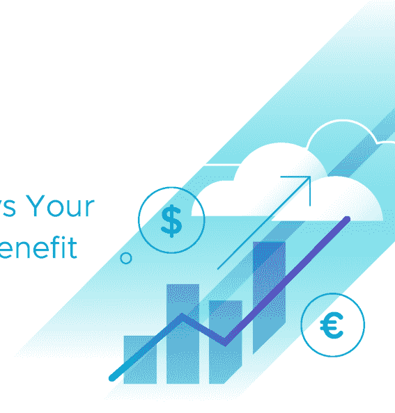


理解您的云数据


优化并控制您的云支出


提升您的云管理实践

## 对《云 FinOps》的赞誉

> 安全是第 0 项工作，FinOps 是第 0.5 项工作。正如安全是每个人的工作，FinOps 也是如此。《云 FinOps》第二版提供了 FinOps 成功的配方。
>
> —Marit Hughes，德勤

> FinOps 将业务、财务和工程整合在一起，推动云支出管理的透明度和问责制文化。Google Cloud 和 FinOps Foundation 正在共同努力开创开放的计费标准，以进一步提高透明度并加速云业务价值。本书综合了这些协作成果。
>
> —Mich Razon，Google Cloud 商业平台负责人，副总裁兼总经理

> 优化成本对云迁移和向消耗型模式的转变至关重要。云优化应成为公司的重点关注领域。《FinOps》一书概述了如何推动在云端大规模运行的企业技术、财务和业务组织所需的文化变革的路线图。
>
> —Fred Delombaerde，Microsoft 核心商务副总裁

> 如今，公有云成本管理超越了任何单个供应商。大型组织需要将各种供应商的成本和使用数据规范化并合并为单一视图，以便工程、业务和财务部门做出数据驱动的决策。FinOps Foundation 持续迭代 FinOps 框架并促进创建开放标准至关重要，以便供应商能够一致地展示其成本和使用数据，从而支持 FinOps 从业者的工作。
>
> —Udam Dewaraja，Citi 云财务管理负责人

> 任何希望优化云成本的公司都应首先查阅 *云 FinOps* 书籍，其次是 FinOps Foundation 的资料和社区。这两种资源共同帮助为 Target Corporation 的 FinOps 实践奠定了成功的基础。我们利用 FinOps 领域和能力为领导者和工程师构建工具。凭借《云 FinOps》第二版中包含的七个新章节，包括“将数据置于工程师路径中”和利用“FinOps 的用户界面”等关键概念，我们将成熟我们的 FinOps 实践和采用，以用于我们的公有云和私有云使用。
>
> —Kim Wier，Target Corporation 工程总监

> 作为一种理论，FinOps 对一些高管来说可能难以理解。领导层更有可能支持已经显示出可证明、可量化的成功的努力。证明价值，您就会获得所需的支持。《FinOps》一书中的新章节，如“FinOps 的用户界面”和“采用 FinOps”，提供了关于如何推动工程团队在成本效率方面的行动并获得高管支持的宝贵见解。
>
> —Jason Rhoades，Intuit

> 采用 FinOps 需要高层和基层的支持。本版 FinOps 权威指南详细说明了如何与工程团队建立合作伙伴关系、如何准确预测支出、如何利用其他框架的数据影响决策，以及文化变革最终如何胜过强制规定。
>
> —Beth Marki，JPMorgan Chase 云财务管理执行董事

> FinOps 已成为定义财务和技术团队未来合作方式的新模式。《云 FinOps》一书为那些希望在不减缓技术团队和创新的情况下发展云支出管理与优化方式的组织提供了路线图。这对财务和技术团队来说都是必读之作，以帮助他们了解自己在云财务管理世界中的角色！
>
> —Keith Jarrett，云财务管理负责人


## 献给我们的家人

致 Triangle 的 Jessica 和 Oliver，感谢你们再次的耐心与支持。还有 Wiley，我们每天都能感受到你的影响。
—J.R.

Lesley、Harrison 和 Claire，没有你们的爱与支持，这一切都不可能实现。
—Mike

# 第一部分. 介绍 FinOps

## 1. 什么是 FinOps？................................................ 1
- 定义“FinOps”术语 1
- FinOps 英雄之旅 2
- FinOps 从何而来？ 4
- 数据驱动的决策制定 7
- 实时反馈（又称“普锐斯效应”） 8
- FinOps 核心原则 10
- 何时开始 FinOps？ 11
- 以终为始：数据驱动的决策制定 14
- 结论 15

## 2. 为什么是 FinOps？................................................ 17
- 因正确原因使用云 17
- 云支出持续加速 19
- 未采用 FinOps 的影响 21
- 有根据的忽视：为何现在开始？ 23
- 结论 26

## 3. 文化转变与 FinOps 团队................................................ 29
- 戴明论业务转型 29
- 谁来做 FinOps？ 30
- 为何需要集中团队？ 32
- FinOps 团队不做 FinOps 33
- FinOps 中各团队的角色 34
- 高管与领导层 34
- 工程与开发人员 35
- 财务 35
- 采购与采购 35
- 产品或业务团队 35
- FinOps 实践者 36
- 一种全新的协作方式 36
- 你的 FinOps 团队向谁汇报？ 36
- 理解动机 38
- 工程师 38
- 财务人员 39
- 高管与领导层 40
- 采购与采购人员 40
- 组织中的 FinOps 41
- FinOps 招聘 41
- FinOps 文化在行动 43
- 激励人员并非新问题 44
- 促成行动的因素 46
- 阻碍行动的因素 46
- 让天平倾向你 46
- 结论 47

## 4. FinOps 的语言.................... 49
- 定义通用词汇表 50
- 定义基本术语 51
- 为云专业人士定义财务术语 54
- 抽象有助于理解 56
- 云语言与业务语言 58
- 在你的 DevOps 与财务团队之间创建通用翻译器 59
- 教育各学科的必要性 60
- 基准测试与游戏化 60
- 结论 61

## 5. 云账单的构成.................... 63
- 云账单类型 63
- 云计费复杂性 64
- 计费数据的基本格式 65
- 时间，为什么你要惩罚我？ 67
- 微小部分的 tổng 和 68
- 云计费数据的简史 69
- 小时数据的[content]
## 献给我们的家人

致 Triangle 的 Jessica 和 Oliver，感谢你们再次的耐心与支持。还有 Wiley，我们每天都能感受到你的影响。
—J.R.

Lesley、Harrison 和 Claire，没有你们的爱与支持，这一切都不可能实现。
—Mike

## 第一部分. 介绍 FinOps

### 1. 什么是 FinOps？................................................ 1
- 定义“FinOps”术语 1
- FinOps 英雄之旅 2
- FinOps 从何而来？ 4
- 数据驱动的决策制定 7
- 实时反馈（又称“普锐斯效应”） 8
- FinOps 核心原则 10
- 何时开始 FinOps？ 11
- 以终为始：数据驱动的决策制定 14
- 结论 15

### 2. 为什么是 FinOps？................................................ 17
- 因正确原因使用云 17
- 云支出持续加速 19
- 未采用 FinOps 的影响 21
- 有根据的忽视：为何现在开始？ 23
- 结论 26

### 3. 文化转变与 FinOps 团队................................................ 29
- 戴明论业务转型 29
- 谁来做 FinOps？ 30
- 为何需要集中团队？ 32
- FinOps 团队不做 FinOps 33
- FinOps 中各团队的角色 34
- 高管与领导层 34
- 工程与开发人员 35
- 财务 35
- 采购与采购 35
- 产品或业务团队 35
- FinOps 实践者 36
- 一种全新的协作方式 36
- 你的 FinOps 团队向谁汇报？ 36
- 理解动机 38
- 工程师 38
- 财务人员 39
- 高管与领导层 40
- 采购与采购人员 40
- 组织中的 FinOps 41
- FinOps 招聘 41
- FinOps 文化在行动 43
- 激励人员并非新问题 44
- 促成行动的因素 46
- 阻碍行动的因素 46
- 让天平倾向你 46
- 结论 47

### 4. FinOps 的语言.................... 49
- 定义通用词汇表 50
- 定义基本术语 51
- 为云专业人士定义财务术语 54
- 抽象有助于理解 56
- 云语言与业务语言 58
- 在你的 DevOps 与财务团队之间创建通用翻译器 59
- 教育各学科的必要性 60
- 基准测试与游戏化 60
- 结论 61

### 5. 云账单的构成.................... 63
- 云账单类型 63
- 云计费复杂性 64
- 计费数据的基本格式 65
- 时间，为什么你要惩罚我？ 67
- 微小部分的總和 68
- 云计费数据的简史 69
- 小时数据的重要性 72
- 一个月不是一个月 72
- 一美元不是一美元 73
- 影响账单的两个杠杆 73
- 谁应避免成本，谁应降低费率？ 74
- 集中化费率降低 75
- 为何应分散使用量降低 76
- 结论 77

### 6. 采用 FinOps................................................ 79
- 一段坦白 80
- 针对不同层级的不同高管推介 81
- 起步推介 82
- 进阶推介 83
- 推进 FinOps 团队的示例人员配置计划 85
- 向高管赞助人推介 86
- 投其所好 87
- 驱动者必须影响的关键角色 88
- CEO 角色 88
- CTO/CIO 角色 89
- CFO 角色 89
- 工程负责人角色 89
- FinOps 采用路线图 90
- 阶段 1：在组织中规划 FinOps 90
- 阶段 2：在组织中推广 FinOps 以实现采用 92
- 阶段 3：为组织做好 FinOps 准备 94
- 与组织的对齐类型 95
- 全职、兼职、借用时间：关于资源的一点说明 96
- 从零开始设计的复杂系统永远无法运作 97
- 结论 97

### 7. FinOps 基金会框架................................ 99
- 实践的运营模式 100
- 框架模型 100
- 原则 101
- 角色 101
- 成熟度 102
- 阶段 102
- 领域与能力 102
- 领域的结构 103
- 能力的结构 104
- 使框架适应你的需求 106
- 与其他框架/模型的连接 107
- 结论 108

### 8. FinOps 的用户界面. 109
- 自建与购买与原生 109
- 何时使用原生工具 110
- 何时自建 111
- 为何购买 112
- 运营化报告 114
- 数据质量 114
- 完美是好的敌人 116
- 报告分层 116
- 推出变更 118
- 通用报告 118
- 可访问性 119
- 颜色 120
- 视觉层级 120
- 可用性与一致性 120
- 语言 121
- 颜色与视觉表示的一致性 121
- 识别与回忆 121
- 心理概念 122
- 锚定偏差 122
- 确认偏差 123
- 冯·雷斯托夫效应 124
- 希克定律 125
- 报告视角 126
- 角色 126
- 成熟度 126
- 多云 127
- 将数据置于每个角色的路径中 127
- 数据在财务的路径中 128
- 数据在领导层的路径中 128
- 数据在工程师的路径中 128
- 将 FinOps 连接到业务的其余部分 129
- 先求理解 129
- 结论 131

# 第二部分. 告知阶段

## 9. FinOps 生命周期................................................ 135
- FinOps 的六项原则 135
- #1：团队需要协作 136
- #2：决策由云的业务价值驱动 136
- #3：每个人对其云使用负责 136
- #4：FinOps 报告应可访问且及时 136
- #5：集中团队推动 FinOps 137
- #6：利用云的可变成本模式 137
- FinOps 生命周期 138
- 告知 139
- 优化 141
- 运营 142
- 考虑因素 144
- 你从哪里开始？ 145
- 你不必找到所有答案 145
- 结论 146

## 10. 告知阶段：你现在在哪里？................................ 147
- 没有上下文的数据毫无意义 147
- 先求理解 148
- 此阶段的组织工作 150
- 透明度与反馈循环 150
- 基准测试团队绩效 152
- 优秀的样子 153
- 结论 154

## 11. 分配：不让一分钱落下..................................... 155
- 分配为何重要 155
- 摊销：这是一个权责发生制世界 156
- 与会计共同创造 goodwill 与可审计性 158
- “支出恐慌”临界点 159
- 分摊共享成本 160
- 成本回拨与成本展示 162
- 适合目的的模型组合 163
- 账户、标签、账户组织层级 164
- 成本展示模型在行动 165
- 成本回拨与成本展示的考虑 166
- 结论 166

## 12. 标签、标签和账户，天哪！.................................... 169
- 基于标签和层级的[content]
## 献给我们的家人

致 Triangle 的 Jessica 和 Oliver，感谢你们再次的耐心与支持。还有 Wiley，我们每天都能感受到你的影响。
—J.R.

Lesley、Harrison 和 Claire，没有你们的爱与支持，这一切都不可能实现。
—Mike

## 第一部分. 介绍 FinOps

### 1. 什么是 FinOps？................................................ 1
- 定义“FinOps”术语 1
- FinOps 英雄之旅 2
- FinOps 从何而来？ 4
- 数据驱动的决策制定 7
- 实时反馈（又称“普锐斯效应”） 8
- FinOps 核心原则 10
- 何时开始 FinOps？ 11
- 以终为始：数据驱动的决策制定 14
- 结论 15

### 2. 为什么是 FinOps？................................................ 17
- 因正确原因使用云 17
- 云支出持续加速 19
- 未采用 FinOps 的影响 21
- 有根据的忽视：为何现在开始？ 23
- 结论 26

### 3. 文化转变与 FinOps 团队................................................ 29
- 戴明论业务转型 29
- 谁来做 FinOps？ 30
- 为何需要集中团队？ 32
- FinOps 团队不做 FinOps 33
- FinOps 中各团队的角色 34
- 高管与领导层 34
- 工程与开发人员 35
- 财务 35
- 采购与采购 35
- 产品或业务团队 35
- FinOps 实践者 36
- 一种全新的协作方式 36
- 你的 FinOps 团队向谁汇报？ 36
- 理解动机 38
- 工程师 38
- 财务人员 39
- 高管与领导层 40
- 采购与采购人员 40
- 组织中的 FinOps 41
- FinOps 招聘 41
- FinOps 文化在行动 43
- 激励人员并非新问题 44
- 促成行动的因素 46
- 阻碍行动的因素 46
- 让天平倾向你 46
- 结论 47

### 4. FinOps 的语言.................... 49
- 定义通用词汇表 50
- 定义基本术语 51
- 为云专业人士定义财务术语 54
- 抽象有助于理解 56
- 云语言与业务语言 58
- 在你的 DevOps 与财务团队之间创建通用翻译器 59
- 教育各学科的必要性 60
- 基准测试与游戏化 60
- 结论 61

### 5. 云账单的构成.................... 63
- 云账单类型 63
- 云计费复杂性 64
- 计费数据的基本格式 65
- 时间，为什么你要惩罚我？ 67
- 微小部分的總和 68
- 云计费数据的简史 69
- 小时数据的重要性 72
- 一个月不是一个月 72
- 一美元不是一美元 73
- 影响账单的两个杠杆 73
- 谁应避免成本，谁应降低费率？ 74
- 集中化费率降低 75
- 为何应分散使用量降低 76
- 结论 77

### 6. 采用 FinOps................................................ 79
- 一段坦白 80
- 针对不同层级的不同高管推介 81
- 起步推介 82
- 进阶推介 83
- 推进 FinOps 团队的示例人员配置计划 85
- 向高管赞助人推介 86
- 投其所好 87
- 驱动者必须影响的关键角色 88
- CEO 角色 88
- CTO/CIO 角色 89
- CFO 角色 89
- 工程负责人角色 89
- FinOps 采用路线图 90
- 阶段 1：在组织中规划 FinOps 90
- 阶段 2：在组织中推广 FinOps 以实现采用 92
- 阶段 3：为组织做好 FinOps 准备 94
- 与组织的对齐类型 95
- 全职、兼职、借用时间：关于资源的一点说明 96
- 从零开始设计的复杂系统永远无法运作 97
- 结论 97

### 7. FinOps 基金会框架................................ 99
- 实践的运营模式 100
- 框架模型 100
- 原则 101
- 角色 101
- 成熟度 102
- 阶段 102
- 领域与能力 102
- 领域的结构 103
- 能力的结构 104
- 使框架适应你的需求 106
- 与其他框架/模型的连接 107
- 结论 108

### 8. FinOps 的用户界面. 109
- 自建与购买与原生 109
- 何时使用原生工具 110
- 何时自建 111
- 为何购买 112
- 运营化报告 114
- 数据质量 114
- 完美是好的敌人 116
- 报告分层 116
- 推出变更 118
- 通用报告 118
- 可访问性 119
- 颜色 120
- 视觉层级 120
- 可用性与一致性 120
- 语言 121
- 颜色与视觉表示的一致性 121
- 识别与回忆 121
- 心理概念 122
- 锚定偏差 122
- 确认偏差 123
- 冯·雷斯托夫效应 124
- 希克定律 125
- 报告视角 126
- 角色 126
- 成熟度 126
- 多云 127
- 将数据置于每个角色的路径中 127
- 数据在财务的路径中 128
- 数据在领导层的路径中 128
- 数据在工程师的路径中 128
- 将 FinOps 连接到业务的其余部分 129
- 先求理解 129
- 结论 131

## 第二部分. 告知阶段

### 9. FinOps 生命周期................................................ 135
- FinOps 的六项原则 135
- #1：团队需要协作 136
- #2：决策由云的业务价值驱动 136
- #3：每个人对其云使用负责 136
- #4：FinOps 报告应可访问且及时 136
- #5：集中团队推动 FinOps 137
- #6：利用云的可变成本模式 137
- FinOps 生命周期 138
- 告知 139
- 优化 141
- 运营 142
- 考虑因素 144
- 你从哪里开始？ 145
- 你不必找到所有答案 145
- 结论 146

### 10. 告知阶段：你现在在哪里？................................ 147
- 没有上下文的数据毫无意义 147
- 先求理解 148
- 此阶段的组织工作 150
- 透明度与反馈循环 150
- 基准测试团队绩效 152
- 优秀的样子 153
- 结论 154

### 11. 分配：不让一分钱落下..................................... 155
- 分配为何重要 155
- 摊销：这是一个权责发生制世界 156
- 与会计共同创造 goodwill 与可审计性 158
- “支出恐慌”临界点 159
- 分摊共享成本 160
- 成本回拨与成本展示 162
- 适合目的的模型组合 163
- 账户、标签、账户组织层级 164
- 成本展示模型在行动 165
- 成本回拨与成本展示的考虑 166
- 结论 166

### 12. 标签、标签和账户，天哪！.................................... 169
- 基于标签和层级的方法 170
- 从策略开始 172
- 传达你的计划 172
- 保持简单 172
- 制定你的问题 173
- 比较三大厂商的分配选项 173
- 比较账户和文件夹与标签和标签 174
- 将账户和项目组织成组 175
- 标签和标签：最灵活的分配选项 176
- 使用标签进行计费 177
- 尽早开始标签 178
- 决定何时设定标签标准 178
- 选择合适的标签数量 179
- 在标签/标签限制内工作 180
- 保持标签卫生 181
- 报告标签绩效 182
- 让团队实施标签 182
- 结论 183

### 13. 准确预测.................................... 185
- 云预测现状 186
- 预测方法论 187
- 预测模型 189
- 云预测挑战 189
- 手动与自动预测 190
- 不准确性 190
- 颗粒度 190
- 预测频率 192
- 沟通 193
- 未来项目 194
- 成本估算 195
- 成本优化对预测的影响 196
- 预测与预算 198
- 管理团队预算的重要性 199
- 结论 202


# 第三部分. 优化阶段
## 14. 优化阶段：调整以实现目标.................................... 205
- 为什么设定目标？ 205
- 首要目标是良好的成本分配 206
- 节省是目标吗？ 206
- 铁三角：好、快、便宜 207
- 用 OKR 实现目标 208
- OKR 重点领域 #1：可信度 209
- OKR 重点领域 #2：可维护性 209
- OKR 重点领域 #3：控制 209
- 目标作为目标线 211
- 预算差异 213
- 使用更少与支付更少 214
- 结论 215
## 15. 使用更少：使用优化.................................... 217
- 云消耗的冷酷现实 217
- 浪费从何而来？ 219
- 通过移除/迁移减少使用 220
- 通过调整大小（适度配置）减少使用 221
- 常见的适度配置错误 223
- 依赖仅使用平均值或峰值的建议 223
- 未在计算之外进行适度配置 225
- 未解决资源“形状”问题 225
- 在适度配置前未模拟性能 225
- 因预留实例不确定性而犹豫 226
- 超越计算：控制云成本的技巧 226
- 块存储 226
- 对象存储 228
- 网络 229
- 通过重新设计减少使用 229
- 扩展 229
- 定时操作 230
- 对预留实例的影响 230
- 收益与工作量 231
- 无服务器计算 232
- 并非所有浪费都是浪费 233
- 使用优化的成熟 235
- 高级工作流：自动退出适度配置 236
- 跟踪节省 239
- 结论 241
## 16. 支付更少：费率优化 .................... 243
- 计算定价 243
- 按需/即用即付 244
- 抢占资源使用 244
- 基于承诺的折扣 245
- 存储定价 245
- 批量/分层折扣 246
- 基于使用量 246
- 基于时间 247
- 谈判费率 248
- 定制定价 248
- 卖方私有优惠 249
- 自带许可考虑 249
- 结论 250
## 17. 了解基于承诺的折扣 .................... 251
- 基于承诺折扣简介 251
- 基于承诺折扣基础 253
- 计算实例大小灵活性 255
- 转换与取消 257
- 三大厂商提供的用量承诺概述 258
- 亚马逊网络服务 258
- RI 提供什么？ 259
- AWS 承诺模式 260
- AWS 预留实例 260
- 成员账户亲和性 261
- 标准与可转换 RI 263
- 实例大小灵活性 264
- AWS 节省计划 267
- 节省捆绑包 268
- 微软 Azure 269
- Azure 预留 269
- 实例大小灵活性 271
- Azure 节省计划 272
- 谷歌云 274
- 谷歌承诺使用折扣 274
- 在 Google 按核心而非按小时付费 275
- 谷歌计费与共享 CUD 275
Google 计费账户与所有权 276
在项目中应用谷歌 CUD 277
谷歌灵活承诺使用折扣 277
结论 278
## 18. 建立基于承诺的折扣策略.................... 281
- 常见错误 282
- 建立基于承诺折扣策略的步骤 282
- 第 1 步：学习每个计划的基础知识 282
- 第 2 步：了解您对云服务提供商的承诺程度 286
- 第 3 步：建立可重复的基于承诺的折扣流程 286
- 第 4 步：定期且频繁地购买 289
- 第 5 步：衡量并迭代 290
- 第 6 步：适当分配前期承诺成本 291
- 如何管理承诺策略 293
- 准时采购承诺 293
- 何时适度配置 vs 承诺 295
- 区域方法 296
- 谁为承诺买单？ 298
- 策略技巧 300
- 结论 302
## 19. 可持续性：FinOps 与 GreenOps 合作.................... 303
- 云碳排放是什么？ 305
- 范围 1、2 和 3 排放 306
- 云提供商环保吗？ 307
- 访问 308
- 完整性 308
- 细粒度 309
- 与工程师合作实现可持续性 309
- FinOps 和 GreenOps 更好吗？ 310
- GreenOps 补救措施 312
- 避免 FinOps 与 GreenOps 背道而驰 313
- 结论 314
# 第四部分. 运营阶段
## 20. 运营：使团队与业务目标保持一致.................... 319
实现目标 319
- 人员配置和扩充您的 FinOps 团队 320
- 流程 320
- 上岗培训 321
- 责任 322
- 可见性 322
- 行动 323
- 责任如何帮助文化？ 324
- 奖励与惩罚方法 324
- 处理不作为 325
- 将运营付诸行动 326
- 结论 326
## 21. 自动化成本管理 329
- 您想实现什么结果？ 330
- 自动化与手动任务 330
- 自动化工具 332
- 成本 332
- 其他考虑 333
- 工具部署选项 333
- 自动化协同工作 335
- 集成 335
- 自动化冲突 335
- 安全与保障 336
- 如何开始 337
- 自动化什么 338
- 标签治理 338
- 定时资源启动/停止 338
- 使用量减少 338
- 结论 339
## 22. 以指标驱动的成本优化 341
- 核心原则 341
- 自动化测量 342
- 目标 342
- 可实现的目标 342
- 数据驱动 346
- 以指标驱动与以节奏驱动的流程 347
- 设定目标 349
- 采取行动 349
- 整合一切 350
- 结论 352
## 23. 容器世界的 FinOps
- 容器 101 354
- 向容器编排的转变 355
- 容器 FinOps 生命周期 356
- 容器告知阶段 357
- 成本分配 357
- 容器比例 357
- 标签、标签和命名空间 361
- 容器优化阶段 362
- 集群放置 362
- 容器使用优化 362
- 服务器实例费率优化 365
- 容器运营阶段 365
- 无服务器容器 366
- 结论 366
## 24. 与工程师合作以实现 FinOps
- 将我们与他们整合 369
- 工程师在想什么？ 370
- 约束与解决难题 372
- 实现成本高效工程的原则 373
- #1：最大化价值而非降低成本 374
- #2：记住我们是一个团队 375
- #3：优先改进沟通 375
- #4：在产品开发早期引入财务约束 376
- #5：赋能，而非控制 377
- #6：领导支持不是有帮助的，而是必不可少的 377
- 工程师路径中的数据 379
- 与工程团队合作的模式 380
- 直接贡献 380
- 间接协作 380
- 具有针对性贡献的间接协作 380
- 结论 381
## 25. 与其他框架的连接
- 拥有总成本 385
- 与其他方法论和框架合作 385
- 了解谁在那里 386
- 交朋友并分享目标 387
- 分享影响力、术语和流程 388
- 分享基础设施 389
Share Knowledge 389
结论 389
## 26. FinOps 极乐：数据驱动决策 391
单位经济和指标 392
单位经济不一定与收入有关 393
计算单位经济指标 394
花钱没问题，浪费不行 394
基于活动的成本核算 397
回到铁三角 399
方程中缺少什么？ 400
何时在 FinOps 中获胜？ 401
结论 403
## 27. 你是秘密成分 405
行动呼吁 406
### 后记：优先考虑什么（来自 J.R.） 409
### 索引 411
亲爱的读者，

我是 J.R. 和 Mike，这本书的合著者。我们于 2022 年初开始了第二版的工作。当我们在 2019 年撰写本书第一版时，世界是不同的。COVID 大大加速了向云的迁移，打破了之前所有关于云支出增长的估计。在我们开始撰写这一版后，全球经济衰退迫使组织——包括主要的云服务提供商——将云支出效率的重要性提升到董事会层面的讨论。亚马逊的 CFO 已承诺帮助客户削减云账单，而微软的 CEO 表示，他们的首要任务是帮助客户用更少的资源做更多事情。

## 世界颠倒了

FinOps 作为一个概念，从一个晦涩的术语变成了业务必需。在 2020 年之前的会议上，我们经常听到：“FinOps 到底是什么？”预计到 2023 年，使用云服务的 80% 组织将建立专门的 FinOps 部门。FinOps 基金会从我们眼中的一丝火花发展成为一股全球力量，拥有近 10,000 名从业者，代表每个主要行业以及财富 500 强、富时 100 强和澳洲证券交易所 250 强的大多数公司。FinOps 从一个边缘术语发展到获得的搜索流量和分析师提及量是大型云厂商如亚马逊网络服务推动的“云财务管理”称号的 10 倍。

按需付费 模式——也称为 *变量支出模型*——允许工程师快速获得基础设施，以便他们能够快速创新。我们听到的故事仍然是：工程团队仍在云中消耗资源，成本效率的优先级不足。财务团队难以理解并跟上团队的支出情况，并正确分配云投资。领导层仍然不知道该拉动哪些杠杆来实现 FinOps 转型并推动更多云支出投资指导。


问题在过去三年中变得更加复杂。云服务提供商增加了数十万种额外的产品库存单位（SKU），由数千项新功能驱动。在本版出版前的几个月里，Google Cloud 和 Azure 以 Azure Savings Plans 和 Google Flexible Committed Use Discounts（Flexible CUDs）的形式提供了全新的折扣承诺方式，再次改变了游戏规则。

在我们各自职业生涯的过去十年里，我们从从业者和高管那里听到了一个一致的主题：缺乏可用的云价值教育和知识。Mike 在为 Atlassian 庞大的云部署运行云成本优化时听到了这一点。J.R. 在担任 Cloudability 云支出管理平台（2019 年被 Apptio 收购）的联合创始人期间，从 2011 年到 2020 年指导全球最大的云支出者，后来作为 Linux Foundation 的员工担任 FinOps Foundation 的执行董事时也听到了这一点。

基于我们所有人都可以学习的资源的需求，以及有人正式定义 FinOps 的需求，我们于 2019 年初与行业中的 26 位专家从业者联手创建了 FinOps Foundation。

来自 FinOps Foundation 的近 10,000 名从业者组成的社区提供了我们将在本书中介绍的大部分最佳实践。本书中的示例来自他们在各种社区论坛上分享的宝贵经验和实战故事。我们还融入了他们的引语，以帮助将内容与关于 FinOps 的真实想法和观点联系起来。

## Who Should Read This Book

任何在运行或有志于在公有云中运行的公司从事工程、财务、采购、产品所有权或领导工作的人员都将从本书中受益。随着组织了解 FinOps 中的角色，它可以将它们映射到业务各地的相关团队。

工程师最可能不习惯将成本视为日常关注点。在云计算之前的日子里，他们主要关心的是与硬件相关的性能。受采购限制，无法在需要时随时获得更多服务器，他们必须提前很久规划。他们必须考虑基础设施选择的成本及其对业务的影响。起初，这可能会感觉陌生，与他们主要关注的产品和功能增强交付相冲突。随着时间的推移，他们将成本作为另一个效率指标来调整，以积极影响业务。

> *很多工程师会直接用硬件来解决问题。FinOps 要求工程师考虑成本和利润率。*
> 
> —John Stuart，Jobvite 的副总裁，负责 DevOps、安全与 IT

*财务* 传统上专注于按月或按季度进行的追溯性报告，基于很快就会过时的固定预算。现在这项工作已经演变，以帮助业务持续向前发展，并主动与技术和工程团队合作进行支出预测，基于工程师的行为（他们不习惯考虑这些成本）。换句话说，他们正从不透明且固定的资本支出（CapEx）报告转向透明且灵活的运营支出（OpEx）预测。作为这一角色的一部分，财务团队成为了解在数千种 SKU 中云支出驱动因素的工程团队合作伙伴。他们帮助从根本上重新构想财务职能的执行方式，同时重新思考如何向高管和投资者报告技术支出。

*采购团队* 习惯于严格控制支出、仔细的费率谈判，并在供应商付款前行使采购订单的权力。现在采购团队成为战略采购。他们将所有违规支出整合到与云服务提供商的企业协议中，以获得工程师已在使用以创造价值的资源的最佳费率。

> *我们不是靠从云服务提供商身上削减几分钱获胜。我们靠向客户交付功能获胜。*
> 
> —Alex Landis，Autodesk

*产品负责人* 负责其产品的定价和利润率，在云计算之前的世界里，他们很难理解为服务客户或运营商业产品而产生的全部成本。云计算让他们能够了解交付数字价值的全部或大部分成本，了解新功能对成本的影响，并了解客户使用案例如何造成应用程序成本的差异。这使得产品团队能够与开发产品的工程团队更有效地协作，更有效地预测收入和利润率，并更有效地针对客户需求。

*领导层*，C 级高管、副总裁、董事或管理团队预算的技术领导者，往往已失去对云支出决策的直接控制，现在依赖其团队在合理预算内运营。技术高管不再提前很久规划大额采购决策。相反，他们更关注如何预测和管理已经发生的支出。讨论已从确保服务有容量转变为确保他们为工作花费了合适的资金。他们希望对花费多少有更多控制，并对花费在何处有更强的战略影响力。

本书旨在通过制定共同的词汇表和一套最佳实践来遵循，打破这些角色之间的壁垒。

## About This Book

在接下来的章节中，我们将正式定义 FinOps。我们创建的定义是由地球上最有经验的云财务管理团队制定的，他们管理的云支出每年达数亿美元（在某些情况下为数十亿美元）。我们收集了他们实现云成功的共同做法，以及他们已识别并解决的一些陷阱。我们将展示有效的 FinOps 是什么样子的，以及如何在您的组织中启动 FinOps 转变。

以前，获取这些知识的唯一途径是参加这些专家会展示其想法的公开活动。本书和 FinOps Foundation 通过充满活力的社区、深入的培训资源和标准化的最佳实践改变了这一点。

在您阅读完本书后，我们鼓励您参与 FinOps Foundation 的各种计划，作为继续磨练您的技能和职业生涯的途径。该基金会的使命是推进每一个管理云价值的个人。社区就在这里为您服务。我们希望本书中的现实策略、流程和故事能够激励每个人更好地控制云支出。在此过程中，我们可以使我们的组织以及我们自己的职业生涯更具竞争力。

## What You Need to Know Before Reading On

在撰写本文时，我们假设读者至少对三大主要公有云提供商之一（Amazon Web Services [AWS]、Azure 和 Google Cloud Platform [GCP]）有基础水平的了解。读者应了解云的工作原理以及资源计费方式。他们还应熟悉主要的资源类型，如计算和存储，以及更高级别的服务，例如托管数据库、队列和对象存储。

对于所需的 AWS 知识水平，一个良好的起点是 AWS Business Professional 培训，或更好的是 AWS Cloud Practitioner 认证。两者都涵盖在 AWS 中运营的基础知识。对于 Google，请查看 GCP Cloud Digital Leader 课程。对于 Azure，请尝试 Azure Fundamentals 学习路径。这些通常可以在一天的工作坊中完成或通过在线培训完成。

读者还应了解云计算的工作原理基础；了解其云提供商上的关键服务，包括其常见用例；并对按需消费模式中的计费和定价有基本了解。

例如：作为 AWS 用户，您应该已经知道 EC2（Elastic Compute Cloud）和 RDS（Relational Database Service）之间的区别。您应该了解为这些资源付费的不同方式，例如按需，

预留实例 (RIs)、节省计划 (SPs) 和 Spot。如果您不了解 RIs 或 SPs 的详细工作原理或如何为其制定采购策略也没关系——我们将对此进行介绍——但您应该已经明白它们可用于节省计算资源费用。

## FinOps 正在演进

过去几年里，我们所称的 FinOps 发生了如此多的演进——而且它仍将继续演进。随着云服务提供商提供越来越多的服务，并继续提供优化其平台的不同方式，FinOps 将不断适应。我们建议在阅读本书时始终确认我们探讨的云服务提供商提供的细节。如果本书中存在任何更正、不同意见或批评，我们鼓励读者与我们联系。毕竟，正是有勇于挑战现状的人们帮助制定了我们今天所拥有的成功的 FinOps 实践。

## 本书使用的约定

本书使用以下排版约定：

*斜体*

表示新术语、URL、电子邮件地址、文件名和文件扩展名。


此元素表示提示或建议。


此元素表示一般说明。


此元素表示警告或注意。

## O'Reilly 在线学习


四十多年来，*O'Reilly Media* 一直为帮助企业成功提供技术和商业培训、知识和见解。

我们独特的专家和创新者网络通过书籍、文章和我们的在线学习平台分享他们的知识和专业技能。O'Reilly 的在线学习平台为您提供按需访问实时培训课程、深入学习路径、交互式编码环境，以及来自 O'Reilly 和 200 多家其他出版商的庞大文本和视频收藏。有关更多信息，请访问 https://oreilly.com。

## 如何联系我们

请将有关本书的评论和问题发送给出版商：

O'Reilly Media, Inc.
1005 Gravenstein Highway North
Sebastopol, CA 95472
800-998-9938 (in the United States or Canada)
707-829-0515 (international or local)
707-829-0104 (fax)

我们为本书设有网页，在此列出勘误、示例和任何其他信息。您可以访问 https://oreil.ly/cloud-finops-2e。

请发送电子邮件至 bookquestions@oreilly.com 对本书发表评论或询问技术问题。

有关我们书籍和课程的新闻和信息，请访问 https://oreilly.com。

在 LinkedIn 上找到我们：https://linkedin.com/company/oreilly-media。

在 Twitter 上关注我们：https://twitter.com/oreillymedia。

在 YouTube 上观看我们：https://youtube.com/oreillymedia。

## 致谢

首先，感谢我们的家人（Lesley、Jessica、Harrison、Oliver 和 Claire），他们在我们最初撰写本书以及第二版时牺牲了无数个夜晚和周末，并且忍受了我们除了谈论 FinOps 之外的其他话题：谢谢你们。

感谢 O’Reilly 的团队（Corbin Collins、John Devins、Kate Galloway、Kristen Brown 和 Sara Hunter）：没有你们的努力，这一切都不会发生。

Rob Martin，他重新阅读、评论并提出了比我们能考虑的还要深思熟虑（而且往往冗长！）的修改建议。

感谢 Amazon Web Services、Google Cloud 和 Microsoft Azure 的团队对我们持续的反馈和审阅。

技术审阅者：Jason Rhoades 和 Joshua Bauman，他们迅速介入，处理了我们几乎定稿的草案中大量评论、修订和建议的蜂巢。

我们谨向 FinOps Foundation 的所有成员表示感谢。自 FinOps Foundation 成立以来，我们为报名公司和从业者的数量以及创始成员愿意协助明确 FinOps 是什么感到谦卑。

致 FinOps Foundation 员工：Andrew Nhem、Ashley Hromatko、Ben de Mora、Joe Daly、Kevin Emamy、Kyle McLaughlin、Natalie Bergman、Rob Martin、Ruben Vander Stockt、Samantha White、Stacy Case、Steven Melton、Steven Trask、Suha Shim、Thomas Sharpe 和 Vasilio Markanastasakis。感谢你们为帮助建立基金会所做的努力。

Mike 想感谢他在 Atlassian 的 FinOps 团队。Daniel Farrugia、Diana Mileva、Florence Timso、Letian Wang、Sara Gadallah、Teresa Meade 和 Tom Cutajar。

多年来，我们与许多人合作，他们分享了公司在云挑战方面的故事以及为解决这些问题而实施的方法。人数太多无法一一提及，但对你们所有人：谢谢。

最后，感谢所有在途中提供帮助的人；没有你们的努力，这本书不会成为今天的样子：Aaron Edell、Abuna Demoz、Adam Heher、Alex Hullah、Alex Kadavil、Alex Landis、Alex Sung、Alexander Price、Alison McIntyre、Alison Pumma、Ally Anderson、Amelia Blevins、Anders Hagman、Andrew Midgley、Andrew Thornberry、Anthony Tambasco、Antoine Lagier、Ben Kwan、Benjamin Coles、Bhupendra Hirani、Bindu Sharma、Bob Nemeth、Brad Payne、Casey Doran、Dana Martin、Darek Gajewski、David Andrews、David Angot、David Arnold、David Shurtliff、David Sterz、David Vale、Dean Layton-James、Dieter Matzion、Elliot Borst、Elliott Spira、Ephraim Baron、Erik Onnen、Gavin Cahill、Geoffrey Anderson、Ilja Summala、James Jackson、Jason Fuller、Jerome Hess、Jess Belliveau、John McLoughlin、John Merritt、John Stuart、Jon Collins、Justin Kean、Keith Jarrett、Ken Boynton、Lindbergh Matillano、Manish Dalwadi、Mark Butcher、Mark Richter、Marsha Shoemaker、Martin Bleakley、Mat Ellis、Matt Finlayson、Matt Leonard、Michael Flanakin、Michele Allesandrini、Nabil Zakaria、Naveen Chand、Pedro Silva、Phillip Coletti、Renaud Brosse、Rich Hoyer、Rick Ochs、Sarah Grey、Sascha Curth、Shane Anderson、Stephanie Gooch、Stephen Elliot、Tom Cross、Tom March、Tom Marrs、Tony Curry、Umang Sehgal、Virginia Wilson、Webb Brown、Wendy Smith 和 William Bryant。

感谢本书中允许我们引用他们言论的每一个人。

## 第一部分

### 介绍 FinOps

在本书的第一部分，我们涵盖了许多基础知识，例如 FinOps 是什么、团队如何运作、FinOps 的语言、云服务的计费方式，以及在 FinOps Foundation 框架指导下开始您自己的 FinOps 之旅的路线图。

## FinOps 是什么？

最简单地说，FinOps 将财务问责制带入云的可变支出模式。但这种描述仅暗示了结果。运行在云中的文化变革将技术和财务决策的所有权从采购转移到组织的边缘，转移到工程、架构和产品团队。它使技术、财务和业务专业人员能够以更高效的方式共同工作。

世界各地的组织都在积极转向云，无论它们是否准备好。就像从大型机到客户端/服务器、到网络或到移动的转变一样，向云的转变（以及从项目到产品）带来了传统业务职能需要核算、请求和管理技术成本方式的巨大变化。

FinOps 要求您承认，管理基础设施的旧方法不仅无效；它们会造成失控的云成本威胁业务的情况。虽然未来仍需要传统的基础设施管理方法来管理自有基础设施，但无论多么严格地遵守这些方法——它们对云的可变消费模式处理不佳——都无法让组织在没有引入 FinOps 的情况下有效管理云。

### 定义“FinOps”一词

截至 2023 年初，FinOps Foundation 对其的定义如下：

> FinOps 是一种不断发展的云财务管理学科和文化实践，通过帮助工程、财务、技术和业务团队就数据驱动的支出决策进行协作，使组织能够获得最大业务价值。


其核心，FinOps 是一种文化实践。它是团队管理云成本的方式，每个人都对其云使用负责，并得到中央最佳实践组的支持。工程、财务、产品、采购等跨职能团队共同协作，以实现更快的产品交付，同时获得更强的财务控制力和可预测性。


FinOps 是 “Finance”（财务）和 “DevOps” 的混成词，强调业务团队与工程团队之间的沟通与协作。Cloud FinOps 有时会被错误地称为 “Cloud Financial Operations”（云财务运营），但该术语因其与财务中更传统的 “Financial Operations”（财务运营）角色存在歧义而逐渐不受青睐。该实践的其他同义词包括 “Cloud Financial Management”（云财务管理）、“Cloud Financial Engineering”（云财务工程）、“Cloud Cost Management”（云成本管理）或 “Cloud Optimization”（云优化）。无论你如何称呼它，FinOps 都是从云支出中获取最大业务价值的做法。

本章讨论 FinOps 的核心原则、相关文化转型的开始过程，以及为什么每个组织都需要拥抱这一学科以实现云成功。

但首先，让我们通过一个典型从业者旅程的故事来为定义 FinOps 设定背景。

## FinOps 英雄之旅

当今的 FinOps 负责人通常来自管理、规划和核算传统 IT 和虚拟化服务器的世界。以下是一个典型的故事，是我们多年来听到的故事的综合。你可能即将踏上类似的旅程，正在其中，或已经完成了其中的部分。故事中的主角名叫 Finn。

*对 Finn 来说，一切都相当直接：回顾性财务报告每季度完成一次，而容量规划意味着外推使用趋势，以猜测组织未来几个季度的生产需求，以满足其产品不断变化的需求。支出方面并没有太多意外。*

*然后 Finn 注意到越来越多的 AWS 或 Google Cloud 应付款项在没有采购订单的情况下到来。他的一位精通云的同事 Ana 解释了云高度可变的特点，以及它与本地数据中心相比确实、嗯、不同——并且有一种全新的管理方式，以及一种新兴的专业学科来做到这一点。*

*Finn 仔细考虑了 Ana 的话。听起来确实有趣，也很有吸引力。但随后 Finn 想起了他为组织 8,000 台本地服务器制定的流程工作得有多好。云不可能有那么大的不同。肯定如果他只是更勤勉地应用现有流程，云成本也能得到管理。*

下一季度，云支出意外翻倍，Finn 夹着尾巴回到 Ana 身边。他承诺尝试一套新的流程，更频繁地查看支出，并增加与产生支出的工程团队的沟通时间。

突然间，之前从未关心云支出的财务负责人开始推动 Finn 回到季度报告，称他采用的实时方法与公司的其他流程不匹配。技术负责人则表示反对，称她无法同时考虑成本并满足产品交付期限。Finn 的执行团队鼓励采用自上而下的控制方法。Finn 再次向 Ana 求助，她将他引向 FinOps Foundation 的同行旅者。通过学习他们的失误和成功，Finn 开始制定计划，如何重置公司的流程，并更雄心勃勃地推动文化变革。

时机已到。Finn 推出了新的云支出分配策略、标签指南、rightsizing（即调整云资源以更好地匹配工作负载需求）的标准，以及对云服务提供商的初始费率优化承诺。终于出现了一条前进的道路，似乎让他能够核算支出，同时团队能够无摩擦地获得所需的技术。云迁移开始激增。

就在事情似乎进展顺利时，一位新 CFO 上任，称云在规模上成本过高，主张广泛回归数据中心。这是 Finn 最大的考验：与他的精通云的同事合作，证明云不仅仅是一个成本中心。他们必须展示云如何以本地数据中心无法实现的方式推动创新和速度，为公司带来竞争优势。CEO 看到了更大的图景并表示同意，为云优先战略铺平了道路。

信心倍增，Finn 勇往直前，打破团队之间的壁垒，帮助推动组织实现真正的变革。但他面临最后一次战斗：云支出现在达到实质性水平，影响了底线。CFO 介入，采取一切必要手段遏制上涨趋势，以确保组织的利润率不受影响。Finn 超越了仅关注云支出的单一维度视角，转向将支出与业务价值挂钩的单位经济模型，这使他能够清楚地证明云支出走在正确的道路上。

最终，Finn 意识到这段旅程只是开始。云在不断演进，FinOps 亦然。Finn 和 Ana 将通过帮助定义其最佳实践，在这个新领域产生最大影响，他们认为这是回馈帮助他们完成自身旅程的社区的关键方式。

这段旅程的某些方面可能与你产生共鸣，而其他方面可能在你未来的旅程中出现。现在你已经听过一个典型故事，让我们看看 FinOps 从何而来。

## FinOps 从何而来？

像 Adobe 和 Intuit 这样的先行者，作为公共云的早期扩展者，早在 2012 年就在湾区向合著者展示了未来 FinOps 的第一个 glimpse。在 2010 年代中期，他们与像 GE 和 Nike 这样的大公司互动，因为这些公司开始了与云使用快速扩张相关的早期 FinOps 之旅。几年后，Mike 看到澳大利亚的前瞻性企业，如他自己的 Atlassian 以及 Qantas 和 Tabcorp 等，开始了类似的做法。最后，在 J.R. 2017 年至 2019 年在伦敦的两年任期内，他亲眼目睹了 BP、HSBC 和 Sainsbury’s 等企业如何在其公司文化中发展这种新方法。FinOps 缓慢而同时地在世界各地诞生，因为随着各个行业和地区开始采用实质性的云量，云的财务和问责挑战在全球范围内大规模出现。图 1-1 追踪了该术语的日益普及。

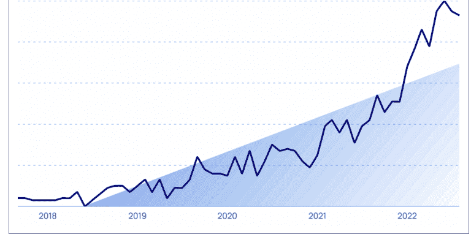

图 1-1. 2018 年至 2022 年间 “FinOps” 术语的搜索请求（来源：speakeasystrategies.com）

“FinOps” 是一个姗姗来迟的术语。在早期，公司 simply 将该实践称为 “cloud cost management”（云成本管理）。后来，“cloud cost optimization”（云成本优化）开始流行，尽管它没有涉及云的分配挑战。AWS 和其他云服务提供商开始使用 “cloud financial management”（云财务管理）这一短语，这是一个总称标题，根据图中引用的搜索和分析师提及，正在越来越多地被 “FinOps” 取代。其他公司，如零售商 Target，将其内部实践称为 “Engineering Efficiency”（工程效率）。图 1-2 显示了行业分析师对 “FinOps” 提及的增长。

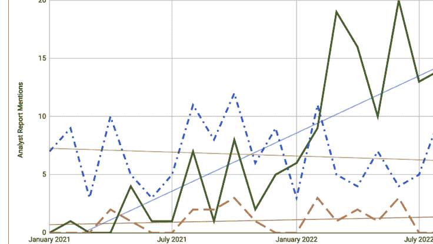

图 1-2. 分析师文章中 FinOps 不同名称的提及（来源：speakeasy-strategies.com）

在图 1-2 中，你可以看到云分析师文章中最近使用 “FinOps” 术语来描述这一实践领域的增加，而像 “cloud financial management” 这样的旧术语在关注度上有所下降。选择这个刻意呼应 DevOps 的复合术语，将这一运动至关重要的跨职能和敏捷方面推向前台。

而现在 FinOps 正成为全球独立的职业。图 1-3 显示了 LinkedIn 平台成员将 FinOps 列为技能的增长。2022 年 FinOps 状态数据显示，从金融服务到零售再到制造业及以外的几乎每个主要行业现在都在运行 FinOps 实践。


## LinkedIn（人员 #FinOps）

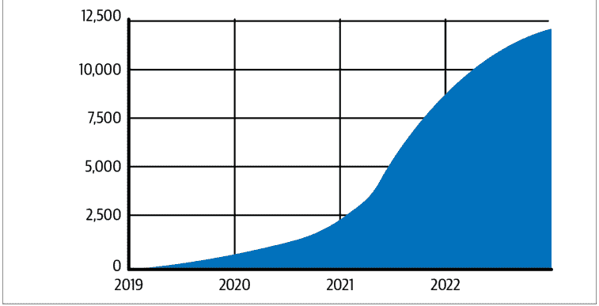

图 1-3. 在 LinkedIn 上将 FinOps 列为技能集的人员数量


2021 年的 FinOps 状态数据显示，95% 在该领域工作的人将其视为可能的职业发展路径。

在 LinkedIn 和 FinOps 基金会网站上，经常出现来自苹果、迪士尼、CVS Health 到耐克等财富 500 强企业 FinOps 从业人员的公开职位招聘信息。

今天的挑战较少在于在 FinOps 领域找到工作，而更多在于企业找到足够熟练的候选人来填补现有岗位，这推动了寻求 FinOps 认证和相关技能的人数激增。

## 故事来自云端—J.R.

我首次在 2016 年华盛顿特区举行的 AWS 公共部门峰会上，与 AWS 的 Emil Lerch 共同进行了一场 DevSecOps 谈话¹ 中提及了 FinOps 概念。我们从 *《凤凰项目》* 作者 Gene Kim 提出的 DevOps 定义开始：

> “DevOps”一词通常指的是倡导开发与 IT 运维之间协作工作关系的[content]
## LinkedIn（人员 #FinOps）


图 1-3. 在 LinkedIn 上将 FinOps 列为技能集的人员数量


2021 年的 FinOps 状态数据显示，95% 在该领域工作的人将其视为可能的职业发展路径。

在 LinkedIn 和 FinOps 基金会网站上，经常出现来自苹果、迪士尼、CVS Health 到耐克等财富 500 强企业 FinOps 从业人员的公开职位招聘信息。

今天的挑战较少在于在 FinOps 领域找到工作，而更多在于企业找到足够熟练的候选人来填补现有岗位，这推动了寻求 FinOps 认证和相关技能的人数激增。

## 故事来自云端—J.R.

我首次在 2016 年华盛顿特区举行的 AWS 公共部门峰会上，与 AWS 的 Emil Lerch 共同进行了一场 DevSecOps 谈话¹ 中提及了 FinOps 概念。我们从 *《凤凰项目》* 作者 Gene Kim 提出的 DevOps 定义开始：

> “DevOps”一词通常指的是倡导开发与 IT 运维之间协作工作关系的[content]
## LinkedIn（人员 #FinOps）


图 1-3. 在 LinkedIn 上将 FinOps 列为技能集的人员数量


2021 年的 FinOps 状态数据显示，95% 在该领域工作的人将其视为可能的职业发展路径。

在 LinkedIn 和 FinOps 基金会网站上，经常出现来自苹果、迪士尼、CVS Health 到耐克等财富 500 强企业 FinOps 从业人员的公开职位招聘信息。

今天的挑战较少在于在 FinOps 领域找到工作，而更多在于企业找到足够熟练的候选人来填补现有岗位，这推动了寻求 FinOps 认证和相关技能的人数激增。

## 故事来自云端—J.R.

我首次在 2016 年华盛顿特区举行的 AWS 公共部门峰会上，与 AWS 的 Emil Lerch 共同进行了一场 DevSecOps 谈话¹ 中提及了 FinOps 概念。我们从 *《凤凰项目》* 作者 Gene Kim 提出的 DevOps 定义开始：

> “DevOps”一词通常指的是倡导开发与 IT 运维之间协作工作关系的[content]
## LinkedIn（人员 #FinOps）


图 1-3. 在 LinkedIn 上将 FinOps 列为技能集的人员数量


2021 年的 FinOps 状态数据显示，95% 在该领域工作的人将其视为可能的职业发展路径。

在 LinkedIn 和 FinOps 基金会网站上，经常出现来自苹果、迪士尼、CVS Health 到耐克等财富 500 强企业 FinOps 从业人员的公开职位招聘信息。

今天的挑战较少在于在 FinOps 领域找到工作，而更多在于企业找到足够熟练的候选人来填补现有岗位，这推动了寻求 FinOps 认证和相关技能的人数激增。

## 故事来自云端—J.R.

我首次在 2016 年华盛顿特区举行的 AWS 公共部门峰会上，与 AWS 的 Emil Lerch 共同进行了一场 DevSecOps 谈话¹ 中提及了 FinOps 概念。我们从 *《凤凰项目》* 作者 Gene Kim 提出的 DevOps 定义开始：

> “DevOps”一词通常指的是倡导开发与 IT 运维之间协作工作关系的[content]
## LinkedIn（人员 #FinOps）


图 1-3. 在 LinkedIn 上将 FinOps 列为技能集的人员数量


2021 年的 FinOps 状态数据显示，95% 在该领域工作的人将其视为可能的职业发展路径。

在 LinkedIn 和 FinOps 基金会网站上，经常出现来自苹果、迪士尼、CVS Health 到耐克等财富 500 强企业 FinOps 从业人员的公开职位招聘信息。

今天的挑战较少在于在 FinOps 领域找到工作，而更多在于企业找到足够熟练的候选人来填补现有岗位，这推动了寻求 FinOps 认证和相关技能的人数激增。

## 故事来自云端—J.R.

我首次在 2016 年华盛顿特区举行的 AWS 公共部门峰会上，与 AWS 的 Emil Lerch 共同进行了一场 DevSecOps 谈话¹ 中提及了 FinOps 概念。我们从 *《凤凰项目》* 作者 Gene Kim 提出的 DevOps 定义开始：

> "DevOps" 一词通常指的是倡导开发与 IT 运维之间协作工作关系的[content]
## LinkedIn（人员 #FinOps）


图 1-3. 在 LinkedIn 上将 FinOps 列为技能集的人员数量


2021 年的 FinOps 状态数据显示，95% 在该领域工作的人将其视为可能的职业发展路径。

在 LinkedIn 和 FinOps 基金会网站上，经常出现来自苹果、迪士尼、CVS Health 到耐克等财富 500 强企业 FinOps 从业人员的公开职位招聘信息。

今天的挑战较少在于在 FinOps 领域找到工作，而更多在于企业找到足够熟练的候选人来填补现有岗位，这推动了寻求 FinOps 认证和相关技能的人数激增。

## 故事来自云端—J.R.

我首次在 2016 年华盛顿特区举行的 AWS 公共部门峰会上，与 AWS 的 Emil Lerch 共同进行了一场 DevSecOps 谈话¹ 中提及了 FinOps 概念。我们从 *《凤凰项目》* 作者 Gene Kim 提出的 DevOps 定义开始：

> "DevOps" 一词通常指的是倡导开发与 IT 运维之间协作工作关系的[content]
## LinkedIn（人员 #FinOps）


图 1-3. 在 LinkedIn 上将 FinOps 列为技能集的人员数量


2021 年的 FinOps 状态数据显示，95% 在该领域工作的人将其视为可能的职业发展路径。

在 LinkedIn 和 FinOps 基金会网站上，经常出现来自苹果、迪士尼、CVS Health 到耐克等财富 500 强企业 FinOps 从业人员的公开职位招聘信息。

今天的挑战较少在于在 FinOps 领域找到工作，而更多在于企业找到足够熟练的候选人来填补现有岗位，这推动了寻求 FinOps 认证和相关技能的人数激增。

## 故事来自云端—J.R.

我首次在 2016 年华盛顿特区举行的 AWS 公共部门峰会上，与 AWS 的 Emil Lerch 共同进行了一场 DevSecOps 谈话¹ 中提及了 FinOps 概念。我们从 *《凤凰项目》* 作者 Gene Kim 提出的 DevOps 定义开始：

> "DevOps" 一词通常指的是倡导开发与 IT 运维之间协作工作关系的[content]
## LinkedIn（人员 #FinOps）


图 1-3. 在 LinkedIn 上将 FinOps 列为技能集的人员数量


- FinOps 报告应易于访问且及时。
  - 尽早处理并共享成本数据，一旦数据可用即刻进行。
  - 实时可见性可自主推动更好的云利用率。
  - 快速反馈循环带来更高效的行为。
  - 组织各层级均可获得对云支出的持续可见性。
  - 创建、监控并改进实时财务预测和规划。
  - 趋势和差异分析有助于解释成本为何增加。
  - 内部团队基准测试推动最佳实践并庆祝成果。
  - 行业同行水平基准测试评估贵公司绩效。
- 集中化团队推动 FinOps。
  - 中央团队在共享问责制模式下鼓励、推广并使最佳实践成为可能，类似于安全团队：设有中央团队，但每个人仍对其负责的部分负责。
  - 需要高层管理者对 FinOps 及其实践和流程的支持。
  - 费率、承诺和折扣优化集中化，以利用规模经济。
  - 消除工程师和运营团队需要考虑费率谈判的需求，使他们能够专注于自身环境的使用优化。
- 利用云的变动成本模式。
  - 云的变动成本模式应被视为提供更多价值的机会，而非风险。
  - 采用即时预测、规划和容量采购。
  - 敏捷迭代规划优于静态长期计划。
  - 采用主动系统设计，通过持续的云优化调整取代不频繁的被动清理。

## 何时开始 FinOps？

自本书第一版以来，确定何时开始 FinOps 已发生了相当大的变化。几年前的实践通常是在公司出现 *spend panic* 时刻才开始，即无意中花费远超预算。该实践的采用现在已大幅提前到云成熟度生命周期的早期阶段。如今在云采用的最早期阶段就开始该实践的公司已很常见。这部分源于对云计费挑战的更好理解，也源于三大云服务提供商的大力推动，鼓励客户尽早解决任何成本问题。三家公司还积极完善了提供的成本工具和数据，以便工程师和架构师在设计云解决方案时尽早考虑成本。

不幸的是，许多人仍认为 FinOps 只是关于省钱或减少消耗；因此，这些人倾向于认为实施 FinOps 的合适时机应以其云支出金额来衡量。公平地说，这在某种程度上是有道理的。例如，大量使用云的公司可以立即发现大量潜在节省。然而，对云支出的问责制和完全分摊成本的能力是高效 FinOps 实践的关键组成部分，如果从追溯性省钱的角度思考，这些往往得不到实施。

此外，FinOps 对工程团队和财务团队所需的文化和技能集变化可能需要数年时间才能实施。组织规模越大、环境越复杂，越早开始实践所获得的复合收益就越大。

成功的 FinOps 实践不需要大规模的云部署或数百万美元的云账单。尽早开始 FinOps 将使组织在运营刚刚开始扩展时也能更轻松地做出有关云支出的明智决策。因此，了解 FinOps 成熟度至关重要；创建 FinOps 实践的正确方法是组织从小开始，随着业务价值要求活动成熟而在规模、范围和复杂性上增长。

正如你在第 6 章将学到的那样，无论过去的经验如何，都不可能从零开始建立一个完整的 FinOps 实践。需要时间来改变工程师的工作方式、教育财务人员了解云的工作原理，并让高管了解使用云的正确理由。这是工作方式的文化变革，数据驱动的问责和决策能力必须随着时间的推移而培养。

没有一个团队单独做 FinOps；中央 FinOps 团队的工作是使组织内众多必须协同工作以管理云业务价值的团队得以实现。此外，大型组织中的各个团队在 FinOps 之旅中可能长期处于非常不同的阶段，因为每个团队都会达到个体采用变得合理的临界点。

尽管本书可以指导组织实现成功实践并帮助团队避免常见陷阱，但没有任何组织可以直接从零 FinOps 过渡到高效 FinOps。每个组织和团队都必须逐步实施 FinOps 流程，在过程中花时间相互学习。


如同之前的 DevOps 一样，FinOps 是一次文化转变，越早开始，组织受益越早。

我们的经验表明，你应该从第一天起就做 FinOps，但在规模扩大时参与更多流程。多年来，我们看到公司在两种典型时间开始采用 FinOps：

- 以前，最常见的方法是在事情失控时实施。在此场景中，支出达到某一点，执行者强制停止云增长并要求实施新的管理模式。尽管这是一个常见的驱动因素，但这并不是采用 FinOps 的理想方式。在这次执行层面的紧急处理期间，创新和迁移会放缓甚至暂时停止。
- 更明智的做法是由见证过云之旅的执行者采用，并与 *FinOps.org* 上的 FinOps 成熟度模型保持一致。FinOps 实践需要以与公司在 FinOps 成熟度周期中的位置以及公司整体云使用成熟度相匹配的速度发展。最初，可能会指派一个人来管理与云服务提供商的承诺。他们着手实施初始账户、标签和标签层级。从那里开始，随着实践规模扩大，每个流程部分都可以逐步扩展。我们现在看到大多数新从业者在加入 FinOps Foundation 时都采用这种采用故事。

但无论公司如何决定实施 FinOps，第一步关键是及时向相关团队提供云支出的可见性，以便每个人开始了解正在发生的事情并确定如何在成本超支变得过大之前解决。在成熟的实践中，成本超支会在开始前就通过深思熟虑的架构设计得以预防。在实现这种可见性水平的同时，FinOps 团队开始教育更大的业务利益相关者。随着跨职能团队共同工作，财务人员将学习更多云的语言，而工程师开始掌握相关的财务概念，业务人员可以对资源投资做出更好的决策。

尽早开始这种文化转变的价值不言而喻，FinOps 实践的益处几乎可以立即感受到和衡量。

## 以终为始：数据驱动的决策制定

FinOps 最重要的概念之一是使用单位经济指标使工程团队能够进行数据驱动的决策制定。其思想是衡量云支出与业务产出或价值指标，然后根据所提供的洞察采取行动。这就是实时反馈循环，即之前讨论的 Prius Effect 正在发挥作用。

为基础设施的每个部分选择合适的业务指标是一个复杂的过程，这在第 26 章中有所介绍。目前要记住的主要一点是，提供单位经济指标以实现数据驱动的决策制定依赖于 FinOps 的几乎每个方面，包括标签、成本分摊、成本优化、与其他财务框架的连接以及 FinOps 运营。

业务指标很重要，因为它使你能够将对话从仅仅关于支出金额转变为关于效率和云支出的价值。能够说“为带来 $Y 收入的客户提供服务花费 $X”提供了上下文，帮助你判断 $X 和 $Y 是否是对组织的合理投资。然后，随着产品演进或因新功能而完全改变，公司能够通过这些业务指标衡量这些变化的影响。

结果是可以确定好云支出和坏云支出的区别并随时间跟踪这些决策。你应该在整本书中以及在组织内部实施 FinOps 时始终牢记业务价值指标。

我们正在构建的理想状态是，你的组织能够持续就从云支出中获得的价值做出数据驱动的业务决策。

## 云上的故事——Jason Fuller

Jason Fuller 负责 HERE Technologies 的云业务，HERE Technologies 是一家提供全球地图服务的跨国组织，他在一次 FinOps Foundation 会议上分享了一个很好的故事：

> 我们有一个团队严重超预算，每月使用 90 亿个 lambda 函数。我无法直接影响这一点。但我能做的就是与团队坐下来，了解你在 lambda 中编写的算法质量，并判断它是否可以更精简。
> 
> 我们需要你提供的毫秒级精度吗？需要。好的。现在业务部门明白它如此有价值。


> 现在我们可以来看一下销售该服务的定价模型。我们可以根据我们认为该产品有多有价值，以及在市场上作为产品实际能获得多少来做出业务决策。
> 
> 因此，我们不再为基础设施争吵——我们讨论的是其业务价值。

## Conclusion

本章中我们定义了 FinOps，并描述了指导任何组织开始实践的核心原则和价值观，以确保他们在 FinOps 转型的漫长旅程中不断成熟并取得成功。

To summarize:

总结如下：

- FinOps is a cultural change that drives collaboration between all teams inside an organization.
- FinOps 是一种文化变革，推动组织内部各团队之间的协作。
- Everyone has a part to play and should become cost-aware: from engineers to finance to procurement to executives.
- 每个人都有自己的角色，都应具备成本意识：从工程师到财务、采购再到高管。
- Real-time feedback loops on spending encourage continuous improvements to spend efficiency.
- 支出上的实时反馈循环鼓励持续改进支出效率。
- Use unit economics and business value metrics to move beyond talking just about the cost of cloud to making data-driven decisions about cloud investments.
- 使用单位经济和业务价值指标，超越仅讨论云成本的范畴，做出关于云投资的数据驱动决策。
- Implement FinOps in your organization as early as possible and grow incrementally.
- 尽早在组织中实施 FinOps 并逐步发展。

Now that you have a basic understanding of what FinOps is, let’s look at what the cloud enables inside organizations, and how you can avoid implementing processes that will hamper the good results of a successful FinOps practice.

现在你对 FinOps 有了基本了解，让我们来看云在组织内部能实现什么，以及如何避免实施会阻碍成功 FinOps 实践良好成果的流程。

## Why FinOps?

When you look at why organizations use the cloud and the benefits they get by doing so, the importance and necessity of FinOps become obvious. A successful FinOps practice expands and accelerates the business benefits made possible by cloud. Cloud shouldn’t be viewed simply as a rehosting alternative but rather as a business accelerator. In the same way, FinOps isn’t just about cost optimization, it’s about maximizing value.

当你审视组织使用云的原因及其带来的益处时，FinOps 的重要性和必要性变得显而易见。成功的 FinOps 实践会扩展并加速云所带来的业务优势。云不应仅仅被视为再托管的替代方案，而应被视为业务加速器。同样，FinOps 不仅仅是成本优化，而是关于最大化价值。

## Use Cloud for the Right Reasons

Cost savings are often touted as the primary benefit of the cloud. But the most successful cloud-first companies have shown the world that scalability and innovation are the true advantages.

成本节约常被宣传为云的主要益处。但最成功的云优先公司向世界展示了可扩展性和创新才是真正的优势。

Consider Spotify, which uses the scale of the cloud to stream content directly to customers all over the world. Or Flickr, which stores a massive amount of customer data safely in the cloud for secure, fast access. Because of the cloud, these companies compete in a way that they never could with their own data centers. Price is always a factor, but it’s a distant third to scale and global availability.

以 Spotify 为例，它利用云的规模直接向全球客户流媒体传输内容。或者 Flickr，它将大量客户数据安全地存储在云中以实现安全、快速访问。由于云的存在，这些公司能够以其自建数据中心永远无法实现的方式竞争。价格始终是一个因素，但它远次于规模和全球可用性。

Using the cloud also gives enterprises the ability to move faster and grow their revenue. Even businesses in “nontech” sectors, like financial services, airlines, and retail companies, are turning to software and data to differentiate themselves from competitors. In fact, the top industry represented in the 2022 State of FinOps data was financial services and banks.

使用云还使企业能够更快地发展并增长收入。即使是金融服务、航空公司和零售公司等“非技术”行业的企业，也正在转向软件和数据以区别于竞争对手。事实上，在 2022 年 FinOps 状况数据中代表性最强的行业是金融服务和银行。

Software helps connect businesses with their customers, optimizes their physical assets, and monitors their factories. It delivers the latest pop song, a retail package, and even people themselves all over the globe.

软件帮助企业与客户建立联系，优化其有形资产并监控其工厂。它在全球范围内提供最新的流行歌曲、零售包裹，甚至是人们本身。

> We're no longer an airline. We're a software company with wings.
> —Veresh Sita, CIO of Alaska Airlines¹
> 我们不再是一家航空公司。我们是一家有翅膀的软件公司。
> ——阿拉斯加航空公司首席信息官 Veresh Sita¹

As of early 2023, the majority of Fortune 500 companies are massive consumers of public cloud and the big three cloud providers themselves all rank in or near the top 15 most valuable companies in that list. Tech titans such as Microsoft, Amazon, Alibaba, and Tencent sit alongside banking icons like JPMorgan Chase, HSBC, and Bank of America, all using cloud as the primary way of connecting to their customers. Even traditionally nontechnology companies on that list, ExxonMobil and Johnson & Johnson, are accelerating their digital transformations to distinguish themselves from their competitors.

截至 2023 年初，财富 500 强公司的大多数都是公共云的巨量消费者，而三大云服务提供商本身也都位列该榜单最有价值公司前 15 名之列。微软、亚马逊、阿里巴巴和腾讯等科技巨头与摩根大通、汇丰银行和美国银行等银行巨头并列，都将云作为连接客户的主要方式。即使是该榜单上传统上非技术公司埃克森美孚和强生也在加速其数字化转型以区别于竞争对手。

The key components of success are now business agility and speed to innovation. As companies move past thinking of cloud simply as a cost-avoidance strategy, they’re increasingly looking toward cloud as their primary driver of innovation. XaaS (anything as a service) allows companies to experiment with more technologies more quickly, while IaaS (infrastructure as a service) provides computing resources at speed and scale never before possible.

成功的关键要素现在是业务敏捷性和创新的速度。随着公司超越将云仅仅视为成本规避策略的思维，他们越来越多地将云视为其创新的主要驱动力。XaaS（即服务的一切）使公司能够更快地尝试更多技术，而 IaaS（基础设施即服务）则以前所未有的速度和规模提供计算资源。

Racking servers in a data center and working to engineer already “solved problems” from the ground up is no longer how companies differentiate themselves. Cloud has made the latest technology—scalable infrastructure, machine learning, or IoT (Internet of Things)—available on demand for businesses of all sizes. Complicating efforts to run on-premises data centers, traditional enterprises struggle to compete against the technology scale of Google, AWS, and Microsoft in running infrastructure and attracting the talent to support it.

在数据中心机架服务器并从头开始工程化已经“解决的问题”不再是公司实现差异化的方式。云使最新的技术——可扩展基础设施、机器学习或物联网（Internet of Things）——能够按需为各规模的企业提供。复杂化本地数据中心的运营，传统企业在基础设施运营和吸引支持人才方面难以与 Google、AWS 和 Microsoft 的技术规模竞争。

The enterprises that win align around empowering their engineers to write better and faster code to deliver value to their customers. And those engineers can increasingly get whatever they want, whenever they need it. The cloud has fundamentally transformed their ability to deliver more competitive products.

获胜的企业围绕赋能工程师编写更好、更快的代码以向客户交付价值展开。而这些工程师可以越来越多地在需要时获得他们想要的任何东西。云从根本上改变了他们提供更具竞争力的产品的能力。

The cloud value proposition shown in Figure 2-1 from the FinOps Foundation’s FinOps Certified Professional course outlines the flywheel effect driving the organization’s business outcomes. This is enticing to executives who may feel that their IT function has the potential to drive the organization’s digital future and that adoption of the public cloud is a key tool in enabling this vision.

FinOps 基金会 FinOps 认证专业课程中图 2-1 所示的云价值主张概述了推动组织业务成果的飞轮效应。这对可能认为其 IT 部门有潜力推动组织数字未来的高管具有吸引力，并且认为采用公共云是实现这一愿景的关键工具。

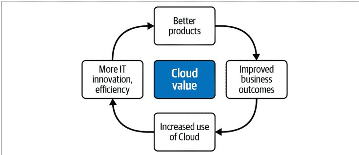

Figure 2-1. Cloud value proposition from the FinOps Certified Professional course

图 2-1. 来自 FinOps 认证专业课程的云价值主张

Cloud service providers have truly become a force multiplier for innovation inside any organization—with almost limitless possibilities.

云服务提供商已真正成为任何组织内部创新的力量倍增器——几乎拥有无限的可能性。

## Cloud Spend Keeps Accelerating

When we wrote the first edition of the book, cloud spending had begun to hit a tipping point. In 2019, Gartner had forecast 2022 cloud spend to be around $360 billion, but actual spending in 2022 ended up closer to $500 billion. The latest Gartner forecast predicts that more than half of enterprise IT spending will shift to the cloud by 2025. That's $1.8 trillion that could potentially be moved to the cloud. In our experience, organizations chronically underestimate their cloud spend and industry forecasts are regularly revised upward. Cloud is becoming a material part of organizational IT budgets, impacting both the top and bottom lines for enterprise P&Ls (profit and loss statements). Large enterprises commonly spend in the nine-figures-per-year territory, and we know of a number of individual enterprises whose annual public cloud bills extend beyond a billion dollars.

当我们撰写本书第一版时，云支出已开始达到临界点。2019 年，Gartner 预测 2022 年云支出约为 3600 亿美元，但 2022 年实际支出接近 5000 亿美元。最新的 Gartner 预测显示，到 2025 年，超过一半的企业 IT 支出将转向云。那是可能转移到云的 1.8 万亿美元。根据我们的经验，组织经常低估其云支出，而行业预测也经常被上调。云正成为组织 IT 预算的重要组成部分，影响企业损益表（profit and loss statements）的上行和下行。大型企业通常每年花费达九位数，我们知道一些企业的年度公共云账单超过十亿美元。

With all that growth, the time-honored silos between tech, finance, procurement, and business teams have become a problem. To understand why, let's look at our favorite definition of cloud, by Dave Nielsen back in 2011 in his “Cloud Computing Is OSSM” talk. To be called “cloud,” Dave said, an infrastructure provider had to be “OSSM”:

随着所有这些增长，技术、财务、采购和业务团队之间长期存在的壁垒已成为问题。为了理解原因，让我们来看一下 Dave Nielsen 在 2011 年其“Cloud Computing Is OSSM”演讲中对云的定义。要被称为“云”，Dave 说，基础设施提供商必须为“OSSM”：

- On-demand
- 按需
- Scalable
- 可扩展
- Self-service
- 自助服务
- Measurable
- 可衡量

In the public cloud, the “OSS” in OSSM is what drives incredible innovation while at the same time creating the need for FinOps. Being self-service, scalable, and on-demand allows an engineer to spend company money with the click of a button or a line of code, without going through traditional finance or procurement approval processes. As a result, everyone’s role has shifted.

在公共云中，OSSM 中的“OSS”推动了令人难以置信的创新，同时也创造了对 FinOps 的需求。具备自助服务、可扩展和按需的能力使工程师能够通过点击按钮或一行代码花费公司资金，而无需经过传统的财务或采购审批流程。因此，每个人的角色都发生了转变。

Gone are the days of prepurchasing large amounts of equipment in three- to five-year cycles. In the cloud, the new normal is buying very small units of resources for pennies an hour, making traditional procurement and finance processes ineffective. Engineers aren’t getting approval from central procurement teams for each individual cloud resource, and the idea of trying to implement a micro-approval process threatens to slow innovation, one of the main benefits of cloud.

预先购买大量设备并在三到五年周期内进行的时代已经过去。在云中，新的常态是以每小时几美分的价格购买非常小的资源单元，使传统的采购和财务流程变得无效。工程师不会为每个单独的云资源获得中央采购团队的批准，而试图实施微审批流程的想法威胁到减缓创新，而创新是云的主要优势之一。

Let’s look back at the traditional processes for the data center:

让我们回顾一下数据中心的传统流程：

- Equipment was intentionally oversized, with built-in spare capacity to ensure that unexpected growth during the depreciation term could be accommodated.
- 设备故意过大，内置备用容量以确保在折旧期内意外增长能够得到容纳。
- If one service used more capacity than was reasonable, it wasn’t an issue unless capacity was running low.
- 如果一项服务使用的容量超过合理范围，只要容量没有耗尽，就不是问题。
- Reducing resource usage wasn’t likely to result in any savings, and services that consumed spare capacity often wouldn’t cost any more.
- 减少资源使用不太可能带来任何节省，而消耗备用容量的服务通常不会花费更多。
- Capacity management was the major cost control used during equipment lifecycle. When capacity was running low, the services resource allocation would be reviewed and adjusted.
- 容量管理是在设备生命周期中使用的主要成本控制手段。当容量不足时，会审查并调整服务的资源分配。
- The cost of the equipment was paid up front, with possible well-understood monthly costs like data center fees, software licensing, and so on.
- 设备成本预先支付，同时可能还有数据中心费用、软件许可等众所周知的月度成本。
- Costs were reported and reviewed monthly or even quarterly. Infrequent reporting was acceptable, because the day-to-day costs of the data center did not vary.
- 成本每月甚至每季度报告和审查。不频繁的报告是可以接受的，因为数据中心的日常成本不会变化。

And now let’s look at the cloud in comparison:

现在让我们比较一下云：

- There is no up-front equipment to purchase, and spare capacity is always available. Prepurchasing capacity isn’t usually required, and companies can save by not paying for capacity when it isn’t needed.
- 没有需要预先购买的设备，并且备用容量始终可用。通常不需要预先购买容量，公司可以通过在不需要时不支付容量费用来节省开支。
- When services use more resources than they need, the result is higher running costs. Reducing the size of the resources allocated to services results in realized cost reductions.
- 当服务使用超出其需要的资源时，结果是运营成本更高。减少分配给服务的资源规模会带来实际的成本降低。
- Due to the availability of capacity from cloud service providers, capacity management is not a major concern. Removing this process means services are no longer artificially capped in resource availability.
- 由于云服务提供商的容量可用性，容量管理不再是主要问题。取消这一流程意味着服务不再在资源可用性方面受到人为限制。


- 资源可以在繁忙时期被消耗，然后在较慢时期被移除。这种可变消耗模式导致运营成本降低，但也使成本预测变得困难。
- 计费不再简单易懂，因为资源以微小金额单独计费。

按季度甚至每月审查成本时，往往会因意外或被遗忘的资源使用累积到账单中的实质性水平而感到震惊。

从固定支出到可变支出的巨大转变改变了你必须报告成本的方式。一系列限制被移除，从根本上改变了公司构建和交付软件的方式，无论好坏。管理这种支出的可变性，与 IT 以可靠的固定成本运营业务时相比，今天是一项完全不同的工作。

## 未采用 FinOps 的影响

在数据中心，工程团队能够快速访问的可用容量存在人为限制。成本的增加受到严格控制，由用于审查和批准任何额外支出的业务流程控制。这限制了成本变化的速度以及团队实验和创新的速度。云消除了存储和计算可用性的限制，并使工程团队能够快速访问所需的资源。你的工程团队不可能调用一个 API 在数据中心配置数百台新服务器，然后你需要为此付费。在云中，工程师们经常这样做。

当你专注于速度和创新时，云账单很容易飙升。作为回应，公司经常过度限制云使用，导致创新放缓，并威胁到它们的竞争力。

麦肯锡于 2020 年 9 月发布的研究 titled “How CIOs and CTOs Can Accelerate Digital Transformations Through Cloud Platforms” 得出结论，从云平台中获益的公司将采用视为业务技术转型，通过以下三件事实现：

- 将投资集中在云能够实现收入增长和利润率改善的业务领域
- 选择技术和采购模式，使其与业务战略和风险约束保持一致
- 开发并实施以云为导向的运营模式

然而，他们还发现，所需的云经济、技能、流程和组织变革过于复杂，涉及业务的太多不同部分，以至于基础设施负责人无法独自管理，导致绝大多数大型机构出现以下一种失败模式：

### 试点停滞

初始云工作负载或迁移的价值证明不足，阻止了扩展云使用的成功商业案例。

### 云僵局

由于 IT 无法构建使用公共云平台服务所需的自动化或参考架构，以安全、弹性且合规的方式使用，导致云计划在队列中受阻。

### “迁移上云”缺乏价值

在未利用云优化杠杆或原生技术的迁移之后，对云的支持会崩溃，导致成本回报不足。

### 云混乱

领导层缺乏指导，导致工程师自行配置云服务，从而导致成本、安全和合规问题。

麦肯锡得出结论，因此，尽管支出快速增长，但只有 10%–15% 的企业工作负载已成功从数据中心过渡到云。

投资 FinOps 使 FinOps 能力得以发展，并带来更好的云服务财务管理。这确保云计划提供可衡量的业务价值，而每一项以价值驱动的计划都会为云价值飞轮提供另一推动。

通过添加 FinOps 扩展图 2-1 中的云价值主张，如图 2-2 所示。为了维持对 FinOps 的投资，必须展示云价值的可衡量改进。在组织对 FinOps 和云的业务价值建立信心之前，需要快速见效。每当 FinOps 计划带来业务价值的改善时，只要将其传达给投资于云和 FinOps 的利益相关者，就会进一步推动云价值飞轮和 FinOps 价值飞轮。如果这些业务价值的改善未得到传达，它们就不存在，公司范围内的云采用可能会停滞。

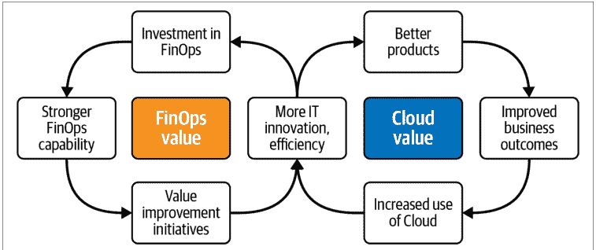

图 2-2。组织应在其 FinOps 投资得到云业务价值改善证明的情况下持续投资（摘自 FinOps 认证专业课程）

## 有意识的忽视：为什么现在就开始？

在讨论 FinOps 中的有意识忽视之前，让我们先谈谈简单忽视 FinOps。忽视发生在你不进行任何支出效率测量时。你（或你的领导层）已决定目前无需关注云成本。担忧是 FinOps 实践会减慢速度。你只需要完成迁移或发布一组功能，无论成本如何。

这种情况通常是这样进行的：企业决定有大笔资金用于迁移，比如 $50 million。类似这样的说法会被抛出来：“Just get the engineers to get it done and we’ll worry about cost later.” 业务领导者认为他们永远不会达到如此巨大的云支出数字，尤其是在开始时，当月账单从 $5,000 到 $50,000 到 $250,000 到 $1 million 时。与大型企业的其他 IT 成本相比，它们仍然是小数目。

因此，工程师们继续努力进行迁移，期间积累了大量低效。在某个时候，成本将开始超过收益，并与企业的期望脱节。这是我们出版本书第一版时的常态， invariably 公司只有在支出恐慌时刻被迫后才会开始 FinOps。

值得庆幸的是，在过去几年中我们看到了转变，越来越多的知情从业者在向云过渡的同时建立了 FinOps 实践。在这些情况下，我们越来越多地看到有意识的忽视方法。重点是从一开始就了解成本，确保全面的成本分配策略到位，报告主要成本驱动因素，监控异常情况，并探索提高成本效率的机会。但在此期间不一定会采取降低成本的行动；相反，会进行主动监控和预测，以确保支出仍与业务期望一致。

相反，采用简单的 *ignoring* 方法时，除了付账单时，没有人密切关注支出。在 *informed ignoring* 方法中，企业有意识地观察成本的增加，预测其增长，并分析节省机会，以确定何时达到业务舒适度阈值，从而被迫采取行动采用 FinOps 实践的额外领域，例如使用或费率优化，如第三部分所述。

至关重要的是，正在进行工作以让每个人做好积极 FinOps 的准备：报告和可见性正在建立，跨团队沟通策略正在实施，而工程师仍专注于不计成本的速度，同时复杂的流程如云支出预测也在不断完善。在某个时候，预测表明到某一天支出将超过舒适点，但在 *informed ignoring* 方法中，该日期在数月之后，留出时间温和地改变组织的进程，而非要求对云支出进行激进的限制，这最终可能阻碍云采用并破坏更大的业务目标。

这是 FinOps 的温和之手：让工程师保持意识，提升财务部门以应对新的复杂性，并在仍有时间时允许高管做出明智选择。有了这种可见性，工程师在部署基础设施时倾向于开始考虑成本。他们意识到如果浪费过高，企业最终会要求他们解决。支出效率的反馈循环开始萌芽。

在图 2-3 中，Forrest Brazeal 巧妙地说明了迁移上云的价值递减和危险增长。组织如果利用迁移上云的快速收益，但随后没有跟进向云原生迈进的步骤，就会发现迁移上云创造的积极价值被其负面副作用所淹没，云价值仅仅因时间的推移而被侵蚀。基于云支出带来的价值进行衡量和决策，有助于组织在投资降低云迁移风险的同时保持从云中获得的价值。


## LIFT+SHIFT 投篮计时钟
@forrestbrazeal

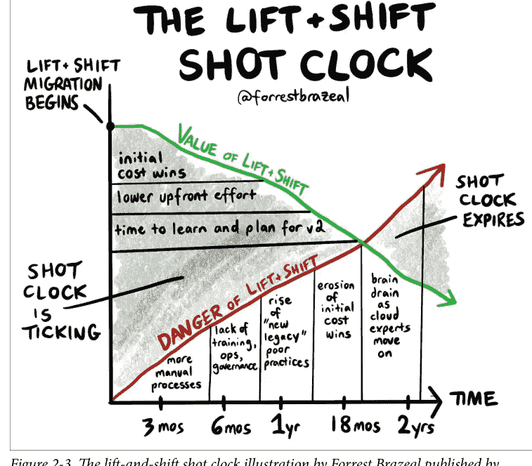

图 2-3. 由 Forrest Brazeal 绘制的 lift-and-shift 投篮计时钟插图，由 A Cloud Guru 于 2020 年 2 月发布

业务领导者做出的忽视机会的决定并非一次性做出，而是在您云端之旅持续进行的过程中反复出现。随着对支出水平或节约机会规模的舒适阈值变得显著，您的业务领导者可能会改变忽视的决定，开始将优先级分配给 FinOps 活动。如果您不让业务领导者了解支出规模和节约机会，他们将不受控制地增长，与预期脱节，最终成为意外之惊。

有意识忽视的核心概念是，组织选择不花费时间减少云支出是可以的。但企业内部，尤其是财务和业务领导者之间，需要有意识才能决定忽视它们。

最后，有些决定永远不应被忽视。在您拥有数百万美元的云支出之后，再回头逆向工程一套全面的标签/标记/账户方法学是非常困难的——本书第二部分稍后会详细介绍。正如您在图 2-4 中看到的，2022 年 State of FinOps 数据显示，成本分配被认为是最重要的 FinOps 能力。如果您绕过基础的分配能力，最终将无法构建能够让您首先进行有意识忽视的报告，留下简单忽视作为唯一选择。

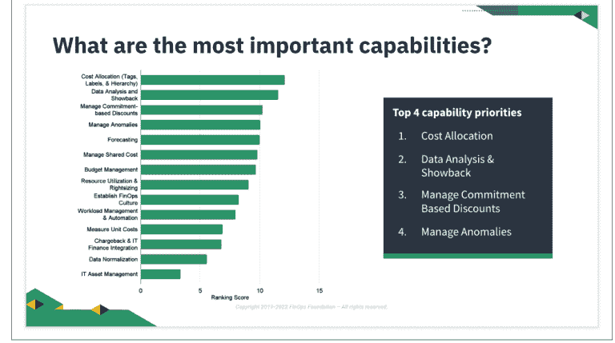

图 2-4. 按堆栈排名的 FinOps 框架顶级能力列表显示，成本分配、数据分析和回溯是 FinOps 实践中最重要的部分（来源：2022 State of FinOps 报告）

即使您没有时间和资源实施主动的 FinOps 实践，也请现在就开始进行分配、跟踪和预测云支出的实践，以便在需要时做好优化准备。

## 结论

云的主要优势是交付和创新的速度，而非成本节约。

总结如下：

- 云支出现在或很快将对组织资产负债表产生重大影响。
- 早期缺乏对 FinOps 的投资可能导致云采用遇到阻力或停滞。
- 采购团队不再控制支出。在云中，这一权力已下放到工程师手中。
- FinOps 允许您以云的每秒速度运营，而非依赖传统的月度或季度支出审查，从而避免意外成本。
- 在准备好执行所有 FinOps 领域以进行主动 FinOps 实践之前，先采用 *有意识忽视* 方法。

FinOps 对大多数公司而言是全新的，虽然不必一次性完成，但最终必须在整个组织中实施和采用才能成功。下一章将探讨 FinOps 的文化以及每个人必须扮演的角色，以在组织内部实现成功的 FinOps 实践。

## 文化转变与 FinOps 团队

FinOps 不仅仅是交给团队的技术解决方案或清单。它是最大化云价值的一种生动方式。技术当然有助于解决诸如监控优化建议和检测异常支出等问题，但它无法就这些行动的业务价值进行对话。

在本章中，我们将探讨谁推动 FinOps 以及他们在组织中通常处于何处。我们将审视 FinOps 的角色和职能，因为最终是人让 FinOps 发挥作用。

组织中围绕支出的公司文化必须与工具和流程一起演进。实施成功的 FinOps 实践存在许多障碍和挑战。它们要么由人员和团队造成，要么由他们解决。最终，这取决于您。您的团队是否会开发和采用成功 FinOps 所需的正确原则和实践？

## Deming 论业务转型

在为本书第二版进行研究时，我们发现了著名工程和商业教授 W. Edwards Deming 于 1982 年发表的管理业务转型的关键原则。FinOps 的许多关键点与 Deming 的原则相呼应，因此值得看看 Deming 的几个关键原则。

Deming 专注于目标的恒定性。他的观点是，推动公司实现长期成功的最佳方式是培养长期思维并不断实施持续改进。

他还强调，所有参与转型的团队都需要作为一个整体单元工作，打破部门之间的壁垒，使整个组织能够及早发现问题并协作解决问题。同样，成功的云和 FinOps 转型要求每个参与云管理的团队都理解转型是每个人的工作。

领导力和教育在 Deming 的原则中占有重要地位。他不建议领导主要通过目标和数字来管理，而是以一种让员工能够以对工作的自豪感做出贡献的方式管理系统。在第 24 章，我们将讨论相关的概念，即领导层对 FinOps 的支持不是可选的，而设定任意目标的强制令最终会失败。相反，领导层需要支持并推动文化转变，使团队能够在权衡云的成本与价值之间做出决策。

Deming 还补充说，需要大规模培训来培养打破传统的勇气，并且每项活动和每份工作都是流程的一部分。


组织的 FinOps 转型与四十年后 Deming 的原则密切相似。我们鼓励您阅读 Out of the Crisis（MIT Press）中发表的所有 14 条 Deming 原则。您可能会发现，在向组织推介 FinOps 时参考 Deming 的工作会有所帮助。

## 谁来做 FinOps？

从财务到运营到开发人员到架构师再到高管，组织中的每个人都有一部分要发挥。看看本书中引用的各种工作头衔，您就会明白我们的意思。

> 这是每个人帮助公司更快发展的职责。在敏捷的世界里，我们都是服务型领导者，帮助工程师交付他们正在做的事情。其他每个人都应该在那里以解除交付障碍。
> —David Andrews, Senior Technology Manager, Just Eat

无论是只有少数员工部署云资源的初创企业，还是拥有数千名员工的大型企业，FinOps 实践都可以并且应该在整个组织中实施，尽管在不同地点所需的工具和流程水平以及节奏不同，具体取决于每个地方提供的价值。

那么 FinOps 团队需要具备哪些技能和角色？在本书中，随着我们逐步进行优化阶段，我们将介绍 FinOps 团队生成需要由更广泛组织考虑的建议的方式，例如更改资源配置或向云服务提供商做出承诺。虽然这些无疑会为组织节省资金，但产品、财务和工程之间需要信任才能执行。

为了尽快建立这种信任，FinOps 团队必须具备云专业知识。如果没有，推荐可能会完全错误，或者工程团队可能会浪费宝贵的开发时间，试图解释为何不进行必要的性能修改。具备云领域专业知识的 FinOps 团队建立了信任和信誉。

FinOps 必须得到高层支持，能够分享最佳实践，并使用将学科联系起来的共同语言，正如我们将在下一章讨论的那样。这不仅有助于传播 FinOps 对公司重要的信息，而且还确保员工有时间分配来执行所需任务。做得好的话，FinOps 不会增加技术团队和业务团队之间的冲突。相反，这种冲突被消除。这是团队使用有助于围绕业务目标创造一致性的共同语言时实现的，从而确保每个人都理解并支持这些目标。

中央 FinOps 使能团队是推动整个组织 FinOps 思维的驱动力，倡导将成本考虑纳入开发计划的最佳实践。FinOps 实践者执行一些集中任务，如管理并向云提供商报告基于承诺的折扣，或集中报告以确保每个人查看的数字相同。这防止了其他团队重复造轮子，同时利用与承诺相关的规模经济。

然而，许多 FinOps 最佳实践的实际实施必须分散到公司各产品和应用团队内部的工程师。rightsizing 和空闲使用减少就是一个很好的例子。虽然中央 FinOps 团队可能在数据和目标设定方面提供帮助，但各业务线的工程师必须根据业务价值和工作量做出数据驱动的决策，决定何时对基础设施进行更改。

> 当你能在 24 小时内而不是一个季度后向财务发出支出激增的警报时，这会赢得很多信誉。如果花上数月时间才弄清楚导致超支的原因，财务将不会相信技术知道自己在做什么。
> —Joe Daly, formerly Director of Cloud Optimization, Nationwide

中央 FinOps 团队的另一个重要角色是促进团队之间的对话并培养信任。财务团队必须与工程师合作，使用共享数据和报告，使每个人都能快速找到并解决需要处理的情况。

借助 FinOps 团队的报告和计费知识，工程师将能够展示计划或成本何时、为何超出预算。这种共享知识建立了信心、信任和效率。


与其将重点放在集中化支出审批上，FinOps 更注重向相关部门提供支出可见性以建立问责制。FinOps 团队的云感知专业知识使其他团队能够理解如何将每个具体的计费项目分配到分摊计费和回溯计费中。这些术语用于描述成本的展示和处理方式。我们将在第 11 章更深入地探讨这一主题。

## 为什么需要一个中央团队？

我们迄今为止多次提到 FinOps 团队以及 FinOps 团队执行的集中化职能。这里值得指出的是，本书中我们将继续提及一个集中的 FinOps 团队，但实际上有多种可行的 FinOps 团队模式。FinOps 团队的结构很大程度上取决于组织的类型以及它如何支持 FinOps 团队所代表的跨学科协调机制。

虽然我们仍会提及 FinOps 团队，但请将其理解为推动 FinOps 最佳实践的协调机构，但要明白无论采用何种组织设计，FinOps 团队在组织范围内都应承担一些职责，以使转型尽可能成功。

这个公正的中央团队与业务领导者、工程团队和财务团队保持联系，分享客观的最佳实践和建议。该团队成员从不会被视为推动特定议程以谋取自身利益，这增强了他们建议的可信度。至关重要的是，他们还必须努力为每个云工作负载纳入业务目标。

当这个中央团队制定成本分摊规则并传达团队表现的清晰沟通时，每个人都会确信他们是按照相同标准进行管理和衡量的。如果由持有预算的团队主导流程——这种情况发生在某个团队负责绝大部分云支出时——就会引发对信息完整性的质疑。如果成本分摊由各团队独立完成，支出数据不可避免会出现重叠或缺口。无论哪种情况，怀疑都会滋生。而当团队对数据失去信任时，就无法对其负责。

当各团队尝试建立自己的云报告流程时，会出现关于成本归属的争议。组织范围内的 FinOps 团队解决了这一问题，促进了对支出数据正确性的共识，然后客观地将每项成本归属到适当的工程团队。

最后，中央团队定义组织使用的业务指标。事实上，这也是 FinOps 团队的关键早期任务。对于云支出而言，一美元并不仅仅是一美元。可以选择查看是否摊销的成本，以及是否应用或排除自定义费率。来自其他服务的应用程序的共享成本可能被包含或不可见。当跨团队使用的业务指标被明确定义时，每个人都使用相同的语言。在下一章中，我们将更深入地探讨 FinOps 的语言。

## FinOps 团队不做 FinOps

很容易认为 FinOps 的日常工作可以分配给一个中央团队并与业务其他部分隔离。但 FinOps 不仅发生在 FinOps 团队内部；他们主要是一个赋能团队，利用其在云计费数据和定价模型、集中化数据和报告、承诺管理以及相关职能方面的专业知识支持组织其他部分，同时帮助分布式的工程团队获取做出基础设施日常决策所需的数据。不应期望其成为管理基础设施或执行大部分优化活动的中央团队。这种责任被推给了最了解自身基础设施和业务目标的团队。FinOps 团队旨在在整个组织中推广可重复的模式，以加速边缘的 FinOps 实践。

> > 我们组织中的其他团队要求我向他们介绍 FinOps 并解释我们将如何保护他们免于超支。对此我会说，我不会，我会帮助你们保护自己。
> >
> > —Alison McIntyre，Lloyds Banking Group 的云 FinOps，The FinOpsPod，2022

在组织云成熟度的早期，FinOps 团队会承担更多工作，因为每个人都在熟悉新的职责。但随着时间的推移，团队将变得更加自给自足，FinOps 团队将能够处理更少的例行任务，并专注于与云效率相关的更复杂项目。

> > 为什么需要云计费方面的专业知识？例如，AWS 的 S3 存储服务至少有 6 种不同的“操作”会产生费用——存储定价、请求和数据检索定价、数据传输和传输加速定价、数据管理和分析定价、复制定价，以及使用 S3 Object Lambda 处理数据的价格。此外，至少有 8 种不同的存储类型，从标准到低频访问再到 Glacier 到深度归档。这对于单一服务来说就是 48 种定价选项的组合。亚马逊目前有数百种不同的服务，每种都有不同的定价选项。FinOps 团队的专业知识可以帮助应对这种复杂性。
> >
> > —Ashley Hromatko，前 Pearson 云 FinOps 总监

随着 FinOps 团队的成熟，他们也可能会承担更多自动化例行任务的责任，而这些任务并非工程团队效率低下所致。迁移到云时不可避免会产生一定技术债务，例如将存储放在比所需更昂贵的层级，或购买超出需求的更高服务层级，FinOps 团队在建立足够信誉并与工程团队建立信任后，可能被授权自行修复这些问题。

这种赋能模式并非新概念；请考虑云安全。它是一种共享责任模式。正如组织中的安全团队并非唯一负责安全一样，FinOps 团队也不是为了优化所有事物而存在。它存在的目的是为最接近云资源的工程师提供资源，以便他们在正确的时间做出正确的优化决策，或使用第 2 章中介绍的 *知情忽略* 来选择不进行优化。

你中央 FinOps 团队所做的工作使组织能够更有效地使用云，并加速这一进程。它并不会取代其他工程团队和业务领导者持续优化自身基础设施的日常职责。

## FinOps 中各团队的角色

图 3-1 展示了组织如何在 FinOps 模式下运作。跨职能团队，例如云卓越中心（CCoE），负责管理云战略、治理和最佳实践，然后与业务其他部分合作，改变云的使用方式。

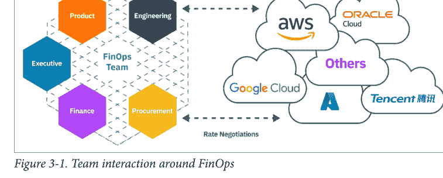

图 3-1. FinOps 周围的团队互动

组织中各个层级和各个领域的个人在 FinOps 实践中扮演不同的角色，包括以下内容。

### 高管和领导层

高管（例如基础设施副总裁/负责人、云卓越中心负责人、首席技术官或首席信息官）专注于推动问责制和建立透明度，确保团队高效运作且不超出预算。他们也是推动文化转变的推动者，帮助工程师开始将成本视为效率指标，详见第 24 章。

### 工程和开发人员

工程师和运维团队成员——例如首席软件工程师、首席系统工程师、云架构师、服务交付经理、工程经理或平台工程总监——专注于为组织构建和支持服务。成本作为指标被引入，与其他性能指标的跟踪和监控方式相同。团队通过诸如 rightsizing（将云资源调整大小以更好地匹配工作负载需求的过程）、分配容器成本、查找未使用的存储和计算资源，以及识别支出异常是否预期等活动来考虑资源的高效设计和使用。

### 财务

财务团队成员使用 FinOps 团队提供的报告进行会计和预测。他们与 FinOps 实践者密切合作，了解历史计费数据，以便构建更准确的成本模型。他们利用自己的预测和来自 FinOps 团队的专业知识，与云服务提供商进行费率谈判。

### 采购和采购

采购和采购人员管理企业与供应商（包括云服务提供商）的关系。这种关系可能与公司过去管理的其他 IT 服务关系非常不同，并且可能更复杂、变化更多。他们关注为公司对每个供应商做出的承诺获得最佳价格，并确保组织随着时间的推移获得其赞助和承诺带来的所有利益。

### 产品或业务团队

产品团队成员，包括产品经理、产品负责人、投资组合负责人、服务负责人、应用负责人等，负责一项服务、产品或产品线。他们将与 FinOps 团队密切合作，了解其产品或应用程序功能的运行总成本——这种了解方式在数据中心支持时往往无法实现。产品负责人关注为客户需求提供新功能，并能够利用 FinOps 提供的数据了解产品盈利能力、指导成本效率工作，以及根据新功能发布更准确地预测成本。


## FinOps 从业者

> *财务人员把我看作技术人员。技术人员把我看作财务人员。*
> 
> —Ally Anderson, 商务运营经理, Neustar

FinOps 从业者是 FinOps 实践的核心动力。他们理解不同的视角，具备跨职能的认知和专业知识。他们是推动最佳实践进入组织的中央团队（或个人），在各个所需层级提供云支出报告，并作为业务各部门之间的接口。他们可以是精通云的财务领导者，也可以是注重成本的工程师。

## 一种全新的协作方式

每个之前的职能都需要前所未有的整合。有人说工程师需要更像财务人员那样思考，而财务人员需要开始像工程师那样思考。这是一个很好的开始，但整个组织需要从集中式的成本控制模式转向共同责任制。只有这样，中央 FinOps 团队才能赋能组织更快地移动和创新。

这种文化转变也使领导层能够以目前尚未实现的方式参与决策。根据领导层的意见，团队可以就其是否仅专注于创新、交付速度或服务成本做出明智选择。一些团队会全力投入某一领域，采用不计成本增长的心态。最终云账单变得过大，他们就必须开始同时考虑增长和成本。例如，“快速推进，但保持我们每个客户交易的成本低于 0.45 美元。”

## 你的 FinOps 团队向谁汇报？

通常情况下，FinOps 团队向技术领导者汇报，但它们也可以向财务或其他职能汇报。FinOps 状态调查询问 FinOps 团队向谁汇报，正如你所见，图 3-2 的结果显示 FinOps 团队在不同组织中向多个部门汇报。最常见的是，FinOps 团队与技术团队保持一致或并列。

### 贵组织的 FinOps/云财务管理向谁汇报？

（多选问题；答案总计超过 100%）

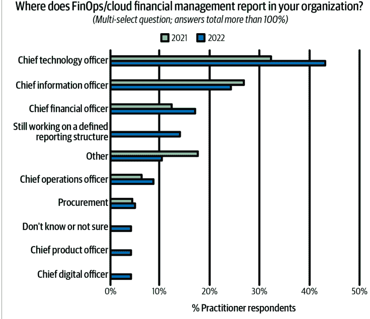

图 3-2. 来自 2022 年 FinOps 状态报告的最常见的 FinOps 向高管汇报对象

这意味着它通常是 CTO 或技术负责人职能的一部分。一些组织也将其置于 CIO 职能之下，尽管这种情况随着时间的推移正在下降。让技术领导层监督技术支出可能类似于让狐狸看守鸡舍，因为花钱的群体也是监督它的群体。然而，将 FinOps 放在技术组织中具有诸多优势。最初，工程和技术运营团队会更重视其建议并赋予其可信度，而他们可能会对来自财务团队的建议持怀疑态度。最重要的是，技术团队最了解云的复杂性，能够最快建立管理高度可变云支出的实践。由财务驱动的 FinOps 通常最初会尝试应用现有的财务报告和预测系统，而这些系统并非为云账单设计，云账单每月可能有数百万笔单独费用，且每日按可变用量和费率变化。我们越来越多地看到一种混合职能的出现，即在 CTO 领导下设有技术 COO 或技术 CFO。Equifax 的一个案例在第 6 章中展示了这种结构。

无论它们处于何处，中央 FinOps 团队都必须与财务和工程组织密切合作。小公司可能没有为 FinOps 团队在组织中设立专门的位置。在这种情况下，一个常见的模式是指定一个人或分配个人部分时间来在业务中实践和推广 FinOps。大型、复杂的支出方可能在中央 FinOps 团队中有 10 名或更多人员。

## 理解动机

> *信任通常在对他人问题领域产生共情时才会建立。*
> —Sascha Curth, OLX 云经济与治理负责人

每当来自组织不同部门的一群聪明人聚集在一起时，必然会产生一些摩擦，主要是因为他们有不同的目标和指标。财务关注成本效率并确保预算目标不被超出，而运营团队则关注提供高质量服务并尽量减少服务问题和中断。

让我们更深入地了解参与 FinOps 的各种角色的动机。

### 工程师

- 希望从事有意义且富有挑战性的难题
- 希望快速可靠地交付软件
- 厌恶低效，追求资源的高效利用
- 保持对最新技术的了解
- 以性能、正常运行时间和弹性作为衡量标准
- 希望交付功能、修复错误并提升性能

通常，工程师的激励是让最新的软件功能或错误修复交付给客户，而不是财务方面的工作。

FinOps 团队倾向于要求工程师帮助他们了解成本、审查其环境以寻找潜在优化机会，并确定其成本效率如何。

HERE Technologies 的云负责人 Jason Fuller 就是这样与他的工程师合作的：

> 让我的团队和 FinOps 组织来为你做这些。让我为你设置存储生命周期策略。你作为工程师认识到自己应该有这样一个策略，但它在 100 项待办清单中排在第 100 位。所以我会来处理这件事。对他们最有效的策略是“让我来帮你。我会处理好这一切。让我来标准化和编写你的存储生命周期策略，这样你就不用操心了。”

在某些情况下，FinOps 从业者会与工程师合作花费时间执行这些重复性任务，突出数据以发现工程师能够优化的潜在领域，然后通过移除并标准化可以集中的流程来帮助他们。有时 FinOps 团队会推动工程尽早自行承担优化任务，而其他时候它有足够的信誉来为他们承担部分技术债务的自动化清理工作。

### 财务人员

- 希望准确预测和预估支出
- 希望能够回收费和/或分配 100% 的支出
- 寻求将成本合理摊销给负责的团队
- 希望拆分共享成本，如支持和共享服务
- 希望控制和降低成本，同时保持质量/速度
- 希望帮助高管制定云战略
- 希望提前了解预算风险

当组织首次采用云时，财务人员可能会感到 sticker shock。支出审批流程的变化、从具有可预测折旧计划的资本支出转向运营支出、高度可变且难以预测的支出，以及成本和用量信息的冲击都可能令人迷惑。他们有时不确定如何跟上变化的速度，也不知道能否信任来自云提供商账单数据的数字。

因此，提醒传统财务团队云符合他们已理解的模型是很重要的。它只是一种基于消费的服务，如公用事业。它只是恰好拥有 100,000 个 SKU，按微秒移动，其支出可能在一周末内失控。当然，采购流程和粒度是不同的，但它仍然是相同的财务模型。然而，对于刚接触云的财务人员来说，很容易感到畏惧。

### 高管和领导层

- 希望推动团队共同承担责任
- 渴望实现数字化业务转型
- 希望缩短新服务上市时间
- 寻求竞争优势
- 希望建立成功的云战略
- 需要定义和管理 KPI（关键绩效指标）
- 必须证明技术投资的价值

第 2 章展示了组织如何使用软件和互联网连接技术来区别于竞争对手。云是加速这种数字化变革的主要工具之一。高管正在设定他们的云优先战略并带领团队进入云。随着云支出在组织内变得重要，这些高管必须推动工程团队跟踪和平衡成本的重要性。高管支持 FinOps 从业者正在组织内实施的文化变革。从上而下，领导层提供有关好、快、便宜之间优先级平衡的指导。为了让 FinOps 发挥良好作用，领导者和高管还必须在跨学科和垂直层级上就云的目标及其使用控制达成一致。

### 采购和采购人员

- 传统上以谈判中获得的折扣作为衡量标准
- 希望确保支出符合供应商协议
- 希望与战略供应商合作伙伴建立关系
- 希望谈判和续签供应商合同

采购不再是 IT 支出的守门人。随着工程师直接设置云资源，采购已成为分布式责任的世界。保持对云支出的可见性并生成准确的预测变得更加重要，以便这些数据可用于推动供应商关系和合同谈判。随着采购团队拥抱 FinOps，他们不会对云支出施加微观审批流程。相反，他们选择帮助推动问责，同时使团队能够获得创新所需的资源。


## FinOps 在整个组织中

不再允许团队只考虑自身优先事项。如果技术运营团队不考虑其云支出带来的影响，财务部门将面临预测和预算组织云支出的不可能挑战。相反，如果财务部门完全控制云支出并要求对每个资源进行审批，组织将难以利用可变支出资源和按需基础设施带来的速度和敏捷性。请记住，云的优势在于创新的速度。

## 云端故事——Rob Martin

Rob Martin，FinOps Foundation 学习总监，分享了来自近期 FinOps 认证从业者培训课程的一个匿名故事，讲述 FinOps 角色是如何协同工作的：

随着问责制的 FinOps 文化在整个组织中建立起来，所有学科开始更紧密地协同工作。当产品经理确定一个新功能时，他们可以迅速识别提供该功能带来的收入或客户影响，以及他们需要承担的利润率。负责产品所在损益表的领导可以批准投资，并有灵活性调整开发团队的预算，因此他们会明确成功参数，预计成本和销售情况。这为工程领导层提供了明确的方向来制定计划，将工作安排到冲刺中以创建最小可行产品（MVP），并估算在构建期间的成本曲线，财务部门对此具有可见性。随着该计划的确定化，每个人都可以回头审视，预算会进行调整，资源会按我们共同参与的适当标签提出申请。在过去，这个流程需要数月时间来简报、协调和获得批准；现在我们可以在几天或几周内完成。

## 招聘 FinOps 人才

需要注意的是，仅通过聘请从业者或引入承包商无法推动向 FinOps 的文化转变。在 FinOps 中，组织中的每个人都有各自的角色。应将 FinOps 要求添加到所有招聘中，从高管到财务再到运营，例如将 FinOps——更具体地说，云所产生的价值管理——列为每个职位描述的一部分，或在新员工入职时提供 FinOps 培训。询问工程师成本指标如何在良好的服务设计中发挥作用，并询问财务部门云的可变支出如何改变正常的财务实践。如果没有聘请具备 FinOps 理解力的人才，或对加入团队的新成员进行持续培训，你所建立的文化将逐渐被缺乏正确思维方式的新员工侵蚀。

角色将演变以满足 FinOps 的需求。拥有商业头脑的多技能员工，财务人员在 FinOps Foundation《2022 年 FinOps 状况》调查中显示，激励工程师是最大的挑战

## 云端故事——Mike

我曾与一家大型科技公司内部的 FinOps 团队交谈过。话题转向如何激励工程师采取行动时，其中一名团队成员与我分享了一个故事。他的父亲在硅谷的科技行业工作了几十年，他正向父亲讲述自己在工作中遇到的挑战，即让工程师更改其云配置。在这次对话中，他的父亲笑着说了一些类似的话：“You don’t have a new cloud problem. You have an age-old problem of motivating other humans to do something you want.”


很容易陷入认为这个问题独属于云的陷阱。作为 FinOps 实践者，你会识别优化机会并向工程团队报告这些机会。这些建议要求你的工程师花费时间审阅它们，然后对他们的云资源进行必要的更改。这些单独的建议详细说明了各种云资源如何计费和配置，以及可用的替代选项。你可以看到这个问题在个体层面看起来有多么云特定，以及向工程师突出需要跟进的机会这一做法有多新。

重要的是从云特定的概念中抽身，开始关注核心问题，即：你如何激励他人做出改变并将新事物纳入他们的工作流程？当你将挑战概括为“你需要工程师抽出一些时间执行建议的操作”这样简单时，请考虑你试图实现的目标。

如图 3-4 所示，行动量表可视化了工程师实施你的建议的可能性之间的平衡。该量表有许多因素会使天平倾向于行动或反对行动。

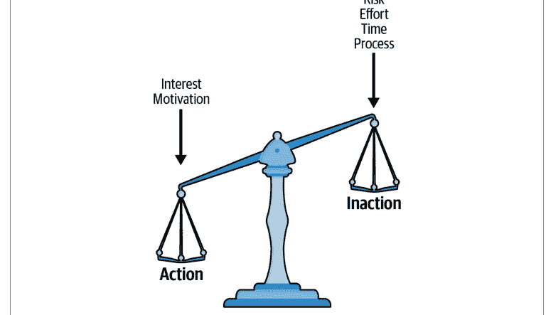

图 3-4. 行动量表

## 有利于行动的因素

在使量表倾向于行动的一侧，你有：

### 兴趣

你的工程师对该建议有多大兴趣？不要以“你需要审阅此建议”的方式提出建议，改为说“你知道是什么导致了此建议吗？”对建议的兴趣通常会导致动力增强。

### 动力

你的工程师在与成本相关的成果方面受到衡量或奖金激励去处理给出的建议的动力越大，他们花费时间审阅和实施这些建议的可能性就越高。

### 理解

为了让工程师采取行动，他们需要理解建议、建议是如何制定的、应如何审阅它们，以及完成必要更改需要什么。

## 阻碍行动的因素

与有利于行动的因素相对，你有以下阻碍因素在阻碍工程团队采取行动：

### 工作量和时间

我们怀疑你的工程师有很多空闲时间。工程师实施建议更改所需花费的时间会降低采取行动的可能性。

### 流程

随着需要遵循的流程数量增加，尤其是手动步骤和审批，工程团队的动力会降低。

### 风险

建议并非零风险。更改云资源的配置可能导致意外结果。一旦工程团队遇到问题或听说他人的失败，对建议的信任就会受到影响。

## 使天平倾向于你

你可以用两种方式来应对推动行动的挑战：提高促进因素或对抗阻碍因素。实际上，你需要两者兼顾。

## 提高动力

与你的工程师互动，询问他们需要什么才能参与进来。指导他们处理工作的方式。然而，尽量不要过于规定性，允许他们自由决定工作如何完成。当团队参与到流程中时，向所有工程团队展示他们努力的成果以激励他人，最后，表达赞赏并奖励他们的努力。我们看到团队使用内部博客或在全员大会/全体会议上发表演讲来庆祝成功，这是一种很好的传播方式。为完成培训提供贴纸和 T 恤可以成为激励团队了解你的计划的绝佳方式。

## 教育团队

思考你如何解释需要工程师做什么。确保你的工程师理解为什么需要他们执行任务以及你期望他们在什么时间范围内完成。如果工程师不清楚如何完成任务或其益处，他们会忽略请求。提供培训、关于建议是如何制定的以及如何调整云资源设置的文档链接，并让自己随时待命回答问题。

## 减少工作量

你花费在验证高质量建议上的时间越多，工程师审阅它们所需的时间就越少。与你的工程师合作，确定可以在请求时提供哪些信息。将相关信息汇总供工程师一次性使用，可减少收集工作量。自动化可以减少实施任务所需的时间和精力。

## 避免信任受损

失败后，你需要了解任务为何未成功。删除高风险建议，并与工程团队分享他们如何更好地评估建议以避免再次发生事故。

专注于建立一种公司文化，使财务能够与工程团队建立合作伙伴关系，并让他们理解彼此的动机并形成对组织目标的共同理解。为了影响变革，授权团队参与需要遵循的流程的创建，并确定能激发人们帮助兴趣的项目。

## 结论

在本章中，我们强调每个团队都必须采用 FinOps 思维。你组织内的所有团队都能够与中央 FinOps 团队一起合作，以了解彼此的目标，而该团队正在帮助建立报告和实践以协助每个人实现目标。

总结如下：

- 所有团队在 FinOps 中都有发挥作用。
- 团队有不同的动机驱动支出和节省。
- 团队需要以相互理解彼此目标的同理心平衡地合作。
- FinOps 实践者帮助团队与组织目标保持一致。
- 激励工程师采取行动并不是一个新的云问题，而是人类长期面临的挑战。
- 行动量表有助于可视化促使工程师采取行动的因素以及阻碍其行动的因素。
- 为了使行动量表倾向于行动，你需要实施计划来帮助促进因素并减少阻碍因素。

在下一章中，我们将探讨团队如何相互交流。你会发现良好的协作需要的不仅仅是将团队放在同一个房间。财务语言可能与工程语言大不相同，因此每个人都必须拥抱共同的语言。

## FinOps 的语言

你组织内的每个团队可能使用特定学科的术语，从不同角度查看云计费数据，并对想要实现的目标有不同的动机。本章讨论了你如何通过教育员工了解每个团队使用的特定术语并定义共同词汇表来促进团队更有效地协作，从而鼓励一致性和信任。

## 云上的故事——Mike

在 Atlassian 开始 FinOps 实践之前，团队自行跟踪成本并使用自己的方法来决定哪些账单部分是他们的责任。我的第一步行动是创建报告并发送给业务团队。但我遗漏了一个关键步骤。团队像以往一样，从自己的角度阅读报告。我的报告没有澄清云支出——反而让它变得混乱。我使用的术语对每个人来说都不合理，因此不同团队对报告有效性产生了不同的看法。

看到这一切，我意识到我们需要一种共同语言。我需要创造对 FinOps 术语更广泛的理解，以及一套所有团队都可以使用来跟踪支出和优化的通用报告。我之前的报告充满了云特定基础设施语言，给财务团队造成了困惑和挫败感，就像关注云财务的报告给工程团队造成的困惑一样。

初创公司通常从简单的每日支出可见性开始，向团队展示各自的支出。然而，共同词汇表对于刚开始 FinOps 的人很重要，甚至对最精通 FinOps 实践的人也很重要。随着你在云中的成熟度提高，成本报告中使用的术语数量会增加。随着你在 FinOps 实践中继续增加能力领域，

增加对额外云服务的消耗，并在报告中变得更加精细化，你最终会得到更多学科特定的术语。这增加了使用模糊（或重复）术语的可能性，这会造成混淆并削弱对数据的信任。一致性在后期阶段变得更加重要，以便更好地理解所有报告之间的关联并推动对各自团队的问责。尽量避免使用来自财务或工程领域的晦涩学科特定术语，并力求就标准化的词汇表达成一致。

## 定义通用词汇表

强调通用词汇表的必要性很容易：只需请财务团队和工程团队各自描述一项服务即可。财务团队通常会考虑服务的成本和费率，而工程师则更关注其*服务可用性*、*可靠性*和*可用容量*。两者都正确。脱节之处在于这些团队尝试相互沟通时出现，而云计算迫使他们比数据中心时代更频繁地这样做。在那个不算遥远的过去，运营团队仅在提出新设备采购时才会与成本打交道。之后，他们的日常工作集中在服务的效率和性能上。与此同时，财务团队则关注已承诺的支出以及应计入哪些预算进行折旧。

当你在整个组织内分散技术采购权时，你需要确保所有团队在描述成本时使用相同的词汇——并且不要让术语对不同的人意味着不同的东西。当加入云服务提供商特定的术语时，语言变得更加复杂，随着你在多个云服务提供商及其供应商特定命名法之间切换，它很快就会变得难以理解。

如果你生成的每份报告都需要附带术语词典——更糟糕的是，有人必须坐下来教团队如何阅读报告——这会阻碍 FinOps 核心的跨团队协作。人们会拒绝花费理解报告所需的时间，而 FinOps 从业者很快就会耗尽带宽来让每个人保持知情。

要在整个组织内建立共同语言，报告必须始终如一地使用特定术语，并且团队必须学会如何正确解读它们。虽然一个人可能理解*分摊成本*与*成本分配*含义相同，但在 FinOps 初期这不会成为常识。

在可能的情况下，使用现有的语言结构比创造团队必须学习的全新术语更好。如果云服务提供商使用的术语与现有业务语言不一致，最好在向团队汇报前将其翻译过来。

## 定义基本术语

当然，让每个人阅读本书也有助于建立对 FinOps 中使用的术语的共同理解。让我们定义行业中使用的一些术语：

### 成本分配（或成本归因）
将云账单拆分并将成本关联到各个成本中心的过程。第 12 章更详细地介绍了这一过程。让团队了解成本是如何分配的，以及拥有集中、受控且一致的成本分配策略非常重要。

### 浪费的使用
组织未积极使用的资源使用情况。如果资源已被配置，云服务提供商仍会对其收费——即使未使用。

### 过大/过小配置
当云资源配置的规模大于所需时，例如内存或计算能力过多，则被视为过大。值得注意的是，相反的情况也可能成立。对于配置不足的资源，如果增加规模能带来更多业务价值，则可以增大其规模。

### 适配化
适配化是指将已配置资源的规模更改为更符合需求的规模。

### 工作负载管理
确保云中运行的资源仅在需要时运行的做法。它是工程师优化使用的一系列实践之一。

### 按需费率
为云资源支付的正常或基础费率。这是云资源的公开定价。

### 费率降低
使用基于承诺的折扣，例如 Savings Plans（SPs）、Reserved Instances（RIs）、Committed Use Discounts（CUDs）、Flexible CUDs，或组织与云服务提供商之间的商业协议，以获得所使用资源的更低费率。

### 成本规避
通过减少资源使用，无论是通过完全移除资源还是对其进行适配化，你可以避免为本会产生费用的资源付费。这种降低云支出的方法将在第 15 章中介绍。请注意，账单数据中不会有实际追踪成本规避的内容；它通常被衡量为当月计费周期成本金额的减少。

### 成本节约
通过降低你为资源支付的费率，你可以产生节约。与通过减少使用来规避成本不同，成本节约会反映在你的账单数据中。使用量仍然存在，但你为其支付的费率更低。通常你可以在账单数据中追踪节约，要么直接通过监控应用于账单的抵扣额，要么通过比较为资源支付的费率与正常公开价格。然而，工程师应与财务部门确认“节约”一词的任何用法含义，因为有些财务部门将节约解释为减少预算的能力。

### 已实现节约
当节约应用于账单数据时，你能够追踪在云账单中产生的节约金额。通过将已实现节约与产生和维持它们的努力进行对比，你能够确定 FinOps 实践的整体有效性。

### 节约潜力
在查看云账单预测时，你可以使用现有承诺和商业协议预测节约金额。但在这些节约应用于你的账户之前，这只是节约潜力。

### 基于承诺的折扣
通过使用 SPs、RIs 或 CUDs 向云服务提供商预先承诺一定量的资源使用，你可以获得这些资源正常费率的降低。

### 未使用/未利用的承诺
对于你承诺但未使用的每个资源使用小时，该预留就会未使用或未利用。另一种说法是预留空置。

### 承诺浪费
只要你获得的折扣大于未使用预留的成本，拥有一定程度未利用的预留并不是问题。当预留的成本超过你将节省的金额时——即其利用率不足以节省超过预留成本的金额——你称之为承诺浪费。

### 被覆盖的使用
当资源费用因预留而获得折扣时，你称其为被覆盖。使用量由预留覆盖，结果是收费费率更低。

### 可覆盖的使用
并非所有云中的使用量都可以用承诺来覆盖。例如，如果你有在工作时间激增然后在工作时间后移除的资源使用量，做出承诺可能会导致承诺浪费且不会节省资金。然而，也有可能在日间使用量下降时开始一些夜间批处理工作，而承诺可以覆盖这两个工作负载，从而为两者节省资金。当用承诺覆盖使用量会产生节约时，将其归类为可覆盖。重要的是资源集合能够提供足够的稳定使用量以使承诺得到利用从而节省资金，而不是单个资源是否稳定运行。

### 未混合费率（AWS 特定）
某些资源的使用量越多，收费费率越低。（有关批量折扣的更多信息，请参阅第 16 章。）这意味着随着你使用更多资源，或在当月更长时间内使用，你会被收取不同的费率。通过查看账单，你可以看到某些资源成本高于其他资源，即使是相同类型的资源或相同的资源。当费率以这种方式呈现时，在 AWS 用语中它们被称为未混合。

### 混合费率（AWS 特定）
AWS 在其账单数据中提供混合费率。这种混合费率通过将费用平均分配给每个资源来标准化你为同类型资源支付的费率，除非使用量由基于承诺的折扣覆盖。虽然 AWS 在其详细账单数据中提供这种混合费率，但成本的混合方式通常并不完全均匀，或者某些资源成本未被混合，因为它们由承诺覆盖，这可能导致对资源真实成本的混淆。在使用成本和使用报告（CUR）数据文件对账单进行核对时，混合费率仍有特定用途，但除此之外，混合费率很少有用。

### 摊销成本
某些云资源和基于承诺的折扣可以预付费用购买。资源的摊销成本会考虑这笔初始付款并将其分摊，归因于每个计费小时（或秒，或毫秒）的按比例成本。例如，一年期全额预付的承诺工具（SPs、RIs 或 Reservations）将在该承诺应用于资源的整个时间段内进行拆分。

### 全面加载成本
全面加载成本是摊销的，反映公司为云资源支付的实际折扣费率，公平地计入共享成本，并映射到企业的组织结构。本质上，它们显示了你的云的实际成本以及驱动因素。你的组织可能会根据你希望计入的折扣和成本组成部分以不同方式定义全面加载成本

包含。或者您可以在组织的报告中定义另一个术语来表示这一点。

## 为云专业人员定义财务术语

来自财务学科、工程师理解起来有帮助的一些术语包括：

### 配比原则

费用应在收到价值的期间记录，而不一定是在云服务提供商开具发票的期间或付款时。配比原则适用于权责发生制会计，也是与现金制会计的主要区别。在 IaaS 计费中，您从云服务提供商处收到的（通常为每月）发票可能包含前期付款，这些付款将在承诺的较长期限（12 个月或 36 个月）内对资源提供优惠——折扣；前期付款的大部分利益并不在此会计期间。这意味着您应使用计费数据（例如 AWS 中的 Cost and Usage Reports、Azure 中的 Azure Billing File）来费用化支出，而不是使用提供商的发票。

### 资本成本/WACC/ICC

资本成本是指企业将资金投入投资所需的成本。有时也称为内部资本成本（ICC）。在云中，资本成本在考虑为承诺如 RI 支付前期费用以获得额外折扣时是一个重要因素。例如，如果一家公司以 8% 的利率借款，那么其资本成本就是 8%。这 8% 成为公司投资回报需要超过的门槛。然而，这个 8% 的例子被大大简化了。实际上，大多数公司通过多种渠道获得资本。各种类型的债务和股权融资可能带来非常不同的利率。在这种情况下进行资本成本计算时，公司必须使用这些利率的混合，称为加权平均资本成本（WACC）。大多数财务团队会知道自己的 WACC，并在进行前期 RI 采购时必须考虑它。

### 商品销售成本（COGS）

COGS 衡量在特定期间产生收入需要多少美元支出。例如，如果一家电力公司将煤炭从储存中运出并运入发电厂，它会记录被燃烧的煤炭成本。该成本没有未来利益，因此它将是可直接追溯到该期间收入的费用，使其成为 COGS 费用。COGS 的测试是：它们是否直接费用化并且与同一期间的收入直接相关？

> 用于研发的托管成本可能比用于 COGS 的成本获得更优惠的税收待遇，因此能够清晰地区分两者是 FinOps 工作的一项潜在有价值的能力。
> 
> —Jason Rhoades, Intuit

对于一家软件公司，COGS 将是运营其软件的每月云账单、销售人员佣金和支持成本。值得注意的是，云是最具可变性且优化潜力最大的部分。由于通常不好的商业做法是拒绝您的销售佣金或解雇您的支持人员，这将聚光灯集中在优化云支出而不减少收入上。

### COGS 何时可成为资本化资产

就费用如何使用而言，存在一个潜在的意外情况。假设一家电力公司将其部分煤炭用于制造钻石。如果它燃烧煤炭来发电并出售以获得收入，公司会将煤炭成本记为 COGS。但如果它用煤炭制造钻石，而这些钻石并未在该期间出售，而是存入库存以在未来某个期间出售，则煤炭的成本将是研发支出，因此被资本化为资产。然而，一旦这些钻石被出售，煤炭的成本就会在销售期间重新转为 COGS。

为了说明这一点，我们之前看到一家正在开发新购物平台产品的零售商以有趣的方式应用 COGS。

该公司将产品生成期间使用的云计算小时数记为资本化资产，在该期间未费用化。它能够这样做是因为正在开发的产品并未产生任何收入。零售商使用云计算小时数来创造将在未来期间产生收入的资产，就像电力公司用煤炭制造钻石而不是将其燃烧发电一样。

一旦该购物产品上线，资本化的计算成本就开始在产品开始产生收入的相关期间进行摊销。请注意，购物平台产品不是有形资产，因此被摊销而不是折旧。

在云中，RI 通常在为期一年或三年的使用期间内摊销到所使用的期间。

### EBITDA

息税折旧摊销前利润（EBITDA）是衡量企业盈利能力的广泛使用指标。该指标还通过将利息支出和税款加回收益来排除与债务相关的费用。

尽管如此，它是衡量企业绩效的更精确指标，因为它能够在会计和财务扣除的影响之前显示收益。EBITDA 可用于将公司相互比较以及与行业平均水平比较。EBITDA 是衡量核心利润趋势的良好指标，因为它消除了一些外部因素并提供更准确的公司间比较。

### 抽象有助于理解

人类往往很难处理非常大和非常小的数字。例如，如果某物每小时花费 1 美元，计算 10 美元可以获得多少小时相对简单。然而，如果资源每小时花费 0.0034 美元，计算 10 美元可以获得多少小时就需要计算器。数字格式也很重要。没有格式，100000000 很难以阅读。大多数人需要数零并添加逗号才能确定其表示的金额。

人类对大数字的另一个问题是我们往往会失去尺度感。当团队处理大额美元金额时，这可能成为一个问题，例如数千、数百万、数千万或更多。正如 Hans Rosling 在他的书《Factfulness》（Flatiron Books）中指出的那样，当人类处理非常大或非常小的数字时，大小直觉就会启动，您需要找出应对方法。

在一次 FinOps Foundation 会议上，其中一位成员展示了如何使用抽象来协助 FinOps。他通过指出一十亿和两十亿之间的差异听起来不大，但实际上是一个巨大的变化来加强他的观点。

许多拥有大量云支出的组织很难为其工程师提供有意义的支出指标。想象一个组织每年将在云上花费 1 亿美元。在这种规模下，所有人类都将难以理解所涉及数字的规模。而当您对规模感到困惑时，很难回答以下问题：

- 一个月 30,000 美元的优化是多一点还是少一点？
- 值得投入多少精力来实现节省？
- 这对业务真的很重要吗？
- 是否有更重要的优先事项？

### 来自云的故事——J.R.

J.R. 与一家财富 50 强云支出者合作，该公司在一年多时间内拒绝采取每月 150 万美元的基于承诺的折扣。技术副总裁（也是 IT 组合的 COO）的常说的话是“我每年有二十亿美元的 IT 预算。鉴于采取这些优化所需的努力，这些优化对我来说没有推动作用。”他有更大的鱼要炸，这就是更紧迫的公司目标——尽快关闭数据中心。虽然看起来可能不是这样，但该副总裁仍在通过实践第 2 章中介绍的 *informed ignoring* 概念进行 FinOps。他知道组织可用的优化以及实现它所需的努力；一旦这种价值与努力的方程式达到组织的阈值，就会采取行动。如果组织优先执行优化而不是专注于关闭其数据中心，所实现的节省与为与数据中心提供商谈判合同延期而产生的额外成本相比将是微不足道的。

保持问责文化，这对成功的 FinOps 实践至关重要，当数字变得太大而无法关联时变得越来越困难。

为了帮助提供背景和理解，有时不使用通用词汇是有帮助的，因为花费或节省的具体美元数可能不是关键要点。如果对业务的支出或节省的影响可以用其他计量单位来表述，信息会传达得更清晰。

例如，一位 FinOps Foundation 成员将成本节省与啤酒相关联。如果团队采取某组行动，他表明他们可以节省相当于一千杯啤酒的费用。在本书第一版以来的几年里，同一位 *beer metric* 实践者已经能够将其报告发展到包括可衡量的业务指标，例如所服务的请求、交付的收入以及为其产品服务的客户。

这种远离仅以美元报告的做法很重要，因为每个涉及云支出的团队都有不同的动机。使用团队的动机来找到合适的例子是使云支出更具意义的一种方法。例如，工程团队的一个新兴动机是引入可持续性指标，如碳排放。有关可持续性与 FinOps 的更多信息，请参阅第 19 章。

对于企业领导者来说，将云成本与重要的业务价值指标联系起来，例如所支持产品收入的百分比或某些关键活动的产出，可以更清楚地了解云支出的整体效率。然后组织可以为支出百分比设定目标限制并使用

这旨在推动项目采用多种技术进行优化，以减缓云支出增长相对于收入增长的速度。第三部分讨论了优化方法。

但总体业务战略并不能直接关联到团队的动机。例如，工程团队将努力转化为用户功能，因此他们的动机围绕着扩大工程团队并交付更多功能。一位 FinOps 基金会成员发现，通过以工程团队的月度成本形式报告云支出，他找到了一个有意义的方式来吸引工程师。在评估成本节约措施时，他们能够说出优化措施可能带来特定数量的额外人员编制，或者可以说明成本节约措施多快能支付团队的薪资。

了解团队的动机有助于你找到有效的方式来吸引他们。对于服务经理而言，以替代单位如每位日活跃用户成本（DAUs）进行报告是很好的策略。通过将云支出除以其服务的 DAUs 数量，他们可以展示这些服务每花费一美元所产生的业务价值。

随着 FinOps 实践不断成熟并开始采用单位指标，你可以将真实成本关联到业务职能，并开始将成本对话引导为价值对话。对于一家运输公司，你的单位指标可能是已交付包裹数，或可从更简单的指标如每次请求或 API 调用的成本开始。当你能将云成本与每次业务交付等同起来时，你就可以以从节省中可多运送多少批货物的方式报告成本优化。所有这些情境化都有助于在团队之间建立共同理解。

## 云语言与业务语言

当你创建报告，使其脱离操作云资源的员工，或脱离运营成本节约项目的 FinOps 团队时，抽象掉云特定术语是有意义的。当你用更通用的业务术语替换这些术语时，你可以在保持准确的同时对报告进行总结。

例如，让我们来看一下计算资源的云预留。这些将在第 17 章中更详细地介绍，但总体思路是，如果你向云服务提供商做出承诺并有效使用这些承诺，你可以省钱。如果不这样做，你就会亏钱。AWS 将其称为 Savings Plans 或 Reserved Instances，不同选项节省的金额各不相同。

如果你的 FinOps 团队为自己创建报告，他们需要了解所做个别承诺的细节。但当你开始向上向财务部门再向整个业务报告时，重要的信息就会改变。你在这里关注的是整体成功：你省钱了还是亏钱了？当你从使用云特定术语如 *承诺利用率* 的报告转向使用更通用的业务术语如 *已实现节省* 时，你就创造了清晰度。

减少需要深入云知识的人员数量，尤其是在你从技术向更通用的业务报告和监控转移时，降低了知识壁垒。而将报告重点放在所报告的实际业务结果上，继续促进更多的信任、信誉和理解。

## 在 DevOps 与财务团队之间创建通用翻译器

我们之前曾使用道格拉斯·亚当斯的杰作 *银河系漫游指南*（Harmony Books）中的 *巴别鱼* 概念来指代此事。然而，这是一个并非人人都能理解的引用。相反，我们将使用 *星际迷航* 中对类似概念的引用，即通用翻译器。在 *星际迷航* 中，通用翻译器用于将外星语言翻译成用户的母语。这正是每个 FinOps 团队都希望能提供给财务、技术和产品团队的东西，以便他们能够完美地相互理解。

例如，我们曾参加过会议，技术团队讨论他们用于标记云资源的具体值，而财务团队则更广泛地讨论成本分摊的需求。两个团队都在描述同一件事，但他们审阅的报告中存在细微差别，例如标签值如何用于分配成本的细节，这阻碍了这两个团队之间的理解。

他们本可以使用翻译器来消除这种混乱。

但如果财务和技术团队都清楚 FinOps 实践（如成本分摊）在组织内是如何运作的，谈话总是从共同的理解水平开始——不需要通用翻译器。

财务和工程团队都很聪明。然而，你必须记住他们有不同的实践和不同的术语。FinOps 应该帮助财务团队理解云语言，通过为那些理解收支的人抽象掉云特定术语，同时应为工程团队简化财务要求。

FinOps 从业者构建报告和流程，减少了财务和工程团队花费大量时间学习和在专业领域之外工作需求。采用一致语言构建这些报告使团队能够熟悉一套共同术语，然后使用这些通用报告围绕云的收益和成本进行对话。

你需要 FinOps 来使团队高效沟通。理想情况下，会议室中根本不需要 FinOps 团队的人。当每个人共享一套词汇时，该人员的存在变得不那么必要。然而，FinOps 团队始终在那里协助构建这些报告，以便信任、理解和清晰度持续增长。

## 教育所有学科的必要性

FinOps 团队随后可以帮助收集和定义组织中用于描述云支出和节省的术语。学科特定术语、行业术语以及不同云服务提供商使用的变体必须被采纳和/或改编为共同词汇表。

财务、技术、产品、采购或管理中的任何人都不应被期望尝试学习每个其他团队的通用语言。理想情况下，每个人在中间相遇，财务学习描述云资源所需的术语，工程学习描述成本的术语，产品团队学习与两者沟通。当团队学习更多其他团队使用的语言时，对话会更快地导向成功结果。

## 基准测试与游戏化

当围绕相同语言构建的通用报告用于衡量每个团队的支出和优化时，就有可能比较团队——甚至创造一些友好竞争。第 22 章更深入地探讨了用于比较群体的指标，但现在想想能够比较团队如何导向游戏化。

例如，可以为成功管理团队云支出授予虚拟成就徽章。庆祝执行最多优化的团队，并突出其对整体云支出和优化的具体积极影响，是吸引和鼓励团队的绝佳方式。

另一种选择是拥有突出最差表现者的报告——那些缺乏优化行动、忽视团队云支出或对意外支出异常反应缓慢的人——如果做得好，可以有效甚至有趣。根据我们的经验，团队不喜欢被列为最差表现者，并经常会付出额外努力来改变他们在名单上的位置。我们将在第 11 章更详细地讨论我们所称的“羞辱/最差表现者名单”，届时我们将介绍有助于你实现 FinOps 目标的实践。

## 结论

最终，你使用共同词汇表来建立对云成本和优化机会的共同理解。

To summarize:
- 要意识到不同团队使用学科特定术语。
- 帮助员工学习通用词汇并在报告中保持术语一致，这将有助于消除混淆。
- FinOps 团队不必在会议中充当常驻翻译，但应协助学习并使团队能够越来越多地自行沟通。
- 考虑添加使用抽象度量单位的报告，以更符合团队意义的方式进行沟通。
- 将成本和节省按业务价值的某个单位进行划分，可让你衡量云支出的效率。

在你能够优化云支出之前，你需要了解你的云成本。我们将在下一章探讨云账单的结构。


## 云账单解剖

在本章中，我们将探讨公共云服务计费的基本原理以及这些费用在账单数据中的体现方式。理解云账单是能够在 FinOps 生命周期后期分配和优化云成本的关键。组织的云支出结构还将有助于确定谁将执行某些优化操作，以及如何委派 FinOps 工作。

与其查看单个账单行（这在 FinOps 数据深度分析中有时是必需的），本章探讨的是云服务提供商如何向公司呈现数据以对云资源进行收费。正确理解这一点将帮助 FinOps 从业者创建有影响力的报告，帮助所有团队理解云账单。第 8 章使用这些概念来影响 FinOps 的用户界面（UI）。

### 云账单类型

顶级云服务提供商以三种方式之一为您提供访问云账单数据：

- *发票*
  这对 FinOps 来说很糟糕，因为它高度汇总，没有提供足够的数据颗粒度和新鲜度。主要是，发票对财务和一般会计目的有用。
- *云原生成本工具*
  原生工具（例如 AWS 的 Cost Explorer）可视化您的数据，如果您仅使用单一云服务提供商并且报告需求相对基础，则会非常有用。但随着云环境的复杂性和规模增长——尤其是对于多云组织——原生工具存在局限性，可能影响您的 FinOps 成熟度。

### 详细成本和使用账单数据

详细账单数据（例如 AWS 的 Cost and Usage Report 或 Google Cloud 的 BigQuery Export）通常可通过文件或 API 访问。这些数据非常适合查看所有可用细节，但使用复杂，需要专门的知识和数据分析工具才能理解。

### 云计费复杂性

云账单数据很复杂，而且必须如此才能实现 FinOps。在 2020 年出版的本书第一版中，我们指出仅 AWS 就拥有超过 200,000 个单独的产品 SKU，其中一些按每秒分辨率计费。截至第二版，三年后，该数字已增长到仅在 AWS 定价 API 中列出的超过 791,000 个单独 SKU，不包括 Azure、Google Cloud、Oracle 等提供的 SKU。详细的账单数据通常每天通过多次更新传入，其背后存在复杂的费用相互关联，例如实例小时数、存储的千兆字节数和数据传输。我们在这些文件中看到大型云支出者每月有数十亿笔单独费用。

虽然有平台和云原生工具（第 8 章中介绍）来帮助破译复杂性，但团队中至少有一名对数据有深入理解的 FinOps 从业者是很重要的。这不仅有助于其他人理解和拆解计费概念，而且也更容易解释 FinOps 工具产生的数据和建议。账单专家曾被发现识别账单数据中的差异并向其云服务提供商报告，以便进行账单调整和/或退款。

财务团队查看的发票数据可能并不总是与团队可能正在分析的详细账单信息（例如 AWS Cost and Usage Report）保持一致。虽然外部 FinOps 平台可以帮助每月对发票进行对账，但发票应用摊销、混合费率（以 AWS 为例）或基于承诺的折扣（如 Savings Plans [SPs] 或 Reserved Instances [RIs]）的粒度级别可能与服务或账户/订阅/项目级别的详细账单数据不同。因此，有助于在早期设定期望，即团队应仅将发票用于应付账款目的，而不是分析云支出的部分。


> 发票在很大程度上是应付账款工具，而不是 FinOps 工具。FinOps 需要比汇总的月度账单所能提供的更精细和及时的数据。

要识别任何服务的成本驱动因素，您需要深入到发票提供的月度明细和云服务级别以下。主要的云提供商（例如 AWS、GCP、Azure 和 Oracle）都提供坚实的原生成本工具，让您从高层次开始分析支出，这有助于我们迈出进入可见性的第一步。原生成本工具仍有一些局限性，例如组织转向多云后处理多个云账单、处理自定义协商费率、需要推送已分配的支出数据以创建团队问责，或容器成本分配。请记住，云原生工具也可以始终用于对特定成本进行研究和临时报告，因此即使您依赖第三方或自研工具，也应深入了解这些工具及其有效使用方法。

### 账单数据的基本格式

让我们从三个主要云提供商各自提供的账单数据的基本格式开始。文件中的每一行都列举了使用的一种类型资源的使用量。云账单项目的属性也往往包括特定时间段内使用的快照。附加到使用行上的内容如下：

- 时间段
- 使用的资源量
- 该期间计费所使用的费率详情
- 按区域位于世界何处
- 资源 ID
- 元数据属性——如账户、项目或标签——可用于将支出分配到产品

稍后，第 12 章将介绍标签以及如何利用它来推动问责制。现在，让我们查看来自主要云提供商的账单数据样本，以便您开始了解为 FinOps 计划提供动力的原始元素。

图 5-1 显示了一行账单数据，这是每天接收的可能数亿行账单数据中的一行。对未经训练的眼睛来说，数据可能看起来难以辨认，但您可以辨别出许多重要属性：

- 资源使用时间
- 应用于账单的费率和费用
- 被计费的资源
- 是否应用了预留，如果有，是哪一个
- 有助于成本分配的标签信息和元数据
- 费用所在的区域和服务

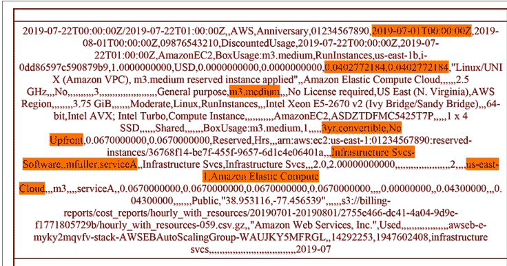

图 5-1. AWS CUR 账单数据的示例行

所有这些粒度为 FinOps 团队在实践建立过程中提供了巨大的力量。但粒度会带来复杂性，很快账单数据就会变得如此庞大，以至于无法用电子表格管理。任何实质性的云支出都会产生大量的费用：规模较大的云支出者每月可能有数十亿笔单独的费用行项目，每个项目附带数百列元细节。云原生程度越高，数据集越大：无服务器函数、临时实例使用、按秒计费数据等等，都为 FinOps 从业者带来了大数据问题。您必须求助于大数据分析技术来获得帮助。

然而，您不能简单地让数据分析师处理原始账单数据。用于管理传统 IT 支出的现有财务系统无法在不进行汇总的情况下处理数据量，也无法提供 FinOps 为创建反馈循环所需的接近实时速度的数据新鲜度。

每个云的粒度级别和细节不同，其维度和指标的术语也不同。每种基于承诺的折扣在应用方式上代表方式也不同。FinOps 团队需要具备技能来填补数据工程角色（第 3 章中描述）。

处理数据应该是决定是构建内部工具还是购买供应商平台时需要考虑的关键因素，这在第 8 章中进行了讨论。供应商抽象掉了随着您添加

云和服务，以及相关的數據质量控制。云本身在添加新服务或更改新的计费功能时也会频繁调整自己的数据。管理数据流和这些变化是管理 FinOps 工具的重要组成部分。

理解这种复杂性让你在未来能够做一些很酷的事情，比如在某些微小变化发生时进行自动异常检测。我们说微小是因为云效率往往会因“千刀万剐”而受损。想象一下，你的公司每月在云上花费 1,000,000 美元，然后一个团队留下了一个未使用的 50 个实例集群，每天花费 5,000 美元。鉴于这两个数字之间规模差异巨大，当你查看服务级汇总或月度汇总时，你可能甚至不会注意到这种变化，然而这笔小额费用很快就会累积到每月超过 150,000 美元——占总月支出 15%。你需要在这些小变化累积成大成本之前，利用机器学习对数据进行分析。幸运的是，云提供商通过数据的粒度为你提供了强大的能力，可以在小问题演变成超支的感染性创伤之前加以解决。

## 一个简单的支出公式

云账单的公式其实很简单：

```
Spend = Usage × Rate
```

使用量可能是资源使用的小时数（或秒数）。费率是为该资源的使用或所用存储类别支付的每小时（或每秒）金额。概念上来说，这很简单。改变其中任何一项，你的云账单就会上涨。两者都增加的话，账单会大幅上涨。

## 时间，为什么你要惩罚我？

在 90 年代，乐队 Hootie and the Blowfish 发行了一首名为“Time”的歌曲。他们唱道时间可以“教你关于明天以及你所有的痛苦和悲伤”。并且“明天只是另一天……我不相信时间”。

Hootie 在 FinOps 方面不太可能有效，因为云计费全都与时间有关。几乎每一项费用都基于时间。即使是固定费率的项目，也是按月或按年计费。更常见的是，你按计算的秒数、GB 月存储量，或查询完成所需的时间付费。这都与支出公式中的使用量部分相关：在一段时间内你使用了多少云资源。当然，也有例外。无服务器和数据传输不是基于时间而是基于用量。两者仍然遵循用量 × 费率的相同模型。

例如，720 GB 的数据传输可能按每 GB 0.02 美元的费率收费。或者 235,000 次函数请求按每次请求 0.001 美元收费。然而，这些例子仍然基于使用量。你使用了这个东西吗？如果是，就收费；如果没有，就不收费。这是云的变动支出模式与本地部署的固定支出模式的又一例证。


需要记住的一个重要云计费细微之处：只要资源处于开启状态，你就会被收费，无论资源是否被高效使用，或根本未被使用。你有责任确保资源得到有效使用并适当配置。

考虑云提供商如何对计算资源收费。费用基于资源运行的时间。虽然大多数主要提供商按秒计费计算，但让我们通过使用小时来简化这个例子。30 天的月份有 720 小时，31 天的月份有 744 小时（我们将在本章后面讨论二月）。

因此，如果你查看一个在整个一月都运行并按小时计费的资源的计算费用，你会看到该资源 744 小时的计算使用量记录。当然，它还将包括为这 744 小时计费的费率。所有 744 小时都可能按同一费率计费，但同样可能，例如，其中 200 小时应用了 SP 或 RI，而另外 544 小时没有。如果是这样，就会有两行数据。一行列出按即付费费率的 544 小时，另一行列出按 SP/RI 费率的 200 小时。同一资源，在不同时间产生不同成本，这是由于云提供商在计费数据中对基于承诺的折扣进行看似随机的应用所致。这种情况是常态，使得对流动的云计费费率进行规范化——并向业务解释——成为 FinOps 提供商持续的头痛问题。

## 微小部分的總和

所有这些微小费用都会汇总成每项服务或每月的总费用。但每一笔微小费用都有其自身的细微差别和属性，如果仔细检查，可以为你的使用情况提供丰富、有用的数据。记住，你被收取的是该事物在该期间开启的实际时间费用。不是是否被使用，而是是否开启。

我们经常这样解释：“不要对资源产生依恋。你买的不是离散的资源——你买的是在一段时间内对资源的按比例使用。” 在 90 年代中期，J.R. 在夏威夷的 W. M. Keck 天文台从事 IT 的第一份工作中，他使用的是以当地海滩命名的服务器：*Hapuna*、*Kiholo*、*Kaunaoa*、*Maumae*。但在云中，计算资源应被视为临时且可替换的。它们是牲畜，不是宠物。

正如我们稍后会进一步解释的那样，即使是 SPs/RIs/CUDs 等基于承诺的折扣计划也不会关注它们附加到哪台服务器上。它们只是附加到与特定相关属性匹配或提供最大节省机会的服务器上。当你将同样的思维方式应用于云计费时，你会意识到 *you're buying time, not things*。而且尽管对某些人来说这似乎显而易见，这个概念对于财务团队在开始核算和理解云账单时至关重要。

## 云计费数据的简史

完全披露：我们对云支出数据是彻头彻尾的极客。你可能会在 AWS re:Invent 或 Google Next 看到我们，怀旧地回忆过去十年中云计费文件的各种迭代以及每次迭代所解锁的能力。冒着陷入极客兔子洞的风险，这些迭代实际上与一家公司开始 FinOps 的典型旅程完美映射。每次迭代都反映了当时最先进的云支出者的成熟度。如果公司在当时没有跟上潮流，它们很可能现在正处于类似的旅程中。因此，从渐进式采用的角度来看，快速深入了解过去 10 多年 AWS 计费文件更新的情况非常有用。我们使用 AWS 来描述历史，因为他们是第一个提供此类计费数据的云提供商。

### 2008: Invoices

一切就此开始。在这里，你可以看到按月和按服务级别的账单，没有公司元数据（如标签），也没有了解变化或成本驱动因素的粒度。财务团队看到这个账单时不可避免地会问：“这个发票对吗？” 要回答这个问题，你需要查看计费数据的下一个迭代。

### 2010: Consolidated Billing

现在听起来可能很疯狂，但 AWS 在多年时间里不允许你将付款汇总到单个账户。云支出的早期先驱有时会有数十个不同的云账户，每个账户都有单独的账单，无法合并到一个账户下进行支付或合并。云蔓延成为一个严重问题：早期云采用者经常有违规的云支出账户仍在个人信用卡上支付，必须通过费用报告追踪下来。合并计费增加了 payer 和关联账户层级概念，使其能够在独立于安全或权限的情况下建立合成计费关系。这改变了游戏规则，不仅对报告目的有用，也使确定承诺水平变得更容易。

### 2012: CAR (Cost Allocation Report)

2012 年，AWS 用户希望开始回答诸如“好吧，我知道这个月花了 100,000 美元，但哪些产品或团队推动了这笔支出？”之类的问题。CAR 文件引入了为每个标签值和每个关联账户创建单独数据行的概念。当时这是一个大事——你终于可以分配支出。但这也很令人沮丧，因为它按月粒度报告支出，因此你无法确定支出何时开始或何时出现峰值。CAR 中也有未标记支出的月度汇总行，但无法看到它们由哪些资源组成。

### 2013: DBR (Detailed Billing Report)

DBR 引入了按服务计费的时间序列。不同于只能看到某个月某项服务花费多少，你可以看到该服务在该月何时产生费用。这让你开始了解团队在月中做出的弹性变化如何影响支出。但——剧透——DBR 缺少一个即将改变成本管理世界的关键数据。

### 2014: DBR-RT (Detailed Billing Report with Resources and Tags)

DBR-RT 是一个变革者。它为每个时间段内使用的每个资源引入了一行数据，每個标签键都有一个列。数据增长惊人：大型客户的 DBR 很少超过兆字节，但 DBR-RT 可能达到数百 GB 的 CSV（逗号分隔值）数据。对于一些大支出者，这可能意味着单个文件中有数十亿个逗号。该文件让你可以看到在特定时间段内具有特定标签的特定资源 ID 驱动了支出，以及该小时是否应用了 RI。突然之间，你可以用极高的精度定位变化。因此，早期 FinOps 实践者可以开始为优化提供更好的建议。

### 2017: CUR (Cost and Usage Report)

开发期间代号为“Origami”，CUR 文件是对计费架构的彻底重新思考。首次，AWS 从 CSV 转向更适合程序化摄取的 JavaScript Object Notation（JSON）格式。作为这一演进的一部分，某些数据，如费率，被拆分到单独的 JSON 文件中，使得构建自己的计费数据读取器变得更棘手，而许多人已为更简单的 DBR 格式这样做过。这没关系，因为 CUR 有一个小而强大的优势：它不仅能告诉你是否应用了 RI，还能告诉你在该小时应用了哪个 RI（或其一部分）。突然之间，你对 RI 的利用率有了更清晰的了解，以及它们如何为额外的采购和修改决策提供信息。自 2017 年以来，AWS 一直在迭代此文件格式，截至 2022 年底，它仍然是标准。


一旦了解这段简短的历史，就很容易看出它遵循了初创 FinOps 实践的相同渐进改进方法：

- 1. 你在向云服务提供商付款前，先检查按服务划分的总支出。（Invoices）
- 2. 然后你可以深入了解哪些团队或产品在推动该服务，以便进行成本展示或分摊。（CAR）
- 3. 然后你开始思考资源的使用时间。（DBR）
- 4. 对此不满意时，你意识到想要精确定位具体的资源费率应用，并找出成本分摊的缺口所在。（DBR-RT）
- 5. 随着被消费的云服务提供商产品选择日益增多，你寻求更细粒度的过滤以获取云使用中的具体细节。此外，你希望让 FinOps 工作更具程序化，并回答关于承诺（如 RIs）的投资回报率和价值的问题。（CUR）
- 6. 最后（或者至少目前如此，因为 FinOps 始终在演进），像 Amazon Billing Conductor 这样的服务使你能够调整费率、拆分账单，并为特定目的提供定制化账单数据。

这种演进也映射到 Cloudability 的发展历程，Cloudability 是最早的云成本平台之一。他们的平台在 2011 年只是一组脚本，登录 AWS（使用 root 凭证，因为 IAM——身份和访问管理——当时还不存在），抓取发票屏幕，解析出总支出明细，然后发送一封包含数字的简单每日邮件。至今，日常邮件功能仍是该平台的核心，推动着团队的反馈循环。但随着账单数据的日益复杂，所有 FinOps 认证平台（如 CloudHealth、Spot、CloudCheckr 等）都已适应并演进，功能与之匹配。

我们通过 AWS 账单数据的视角讲述了上述故事，仅仅是因为在撰写时它是成熟度最高的。但请放心，其他每个提供商都在经历（或已经历）类似的账单成熟度之旅。多云之旅不幸带来了更多复杂性。Azure 长期以来根据你与微软的合同类型支持不同的 API（尽管其中一些 API 自 2022 年底起已被弃用并整合），并且相同的信息并不总是通过每个 API 可用。截至 2022 年，Google Cloud 仍未通过同一机制为所有服务提供完全细粒度的资源级数据，但存在各种变通方法。但所有云提供商都在不断更新其成本和账单数据的提供方式，并进行修改以支持更多新服务、新计费结构和新定价模式。

## The Importance of Hourly Data

你可能会想知道为什么需要考虑小时级（或秒级）数据和资源级粒度。按标签的日级或周级粒度还不够吗？简单答案是否定的。一旦你的 FinOps 实践成熟，就更不可能是足够的。

小时级数据对于执行更高级别的 FinOps 功能（如基于承诺的折扣规划）是必需的。SP/RI/CUD 的购买基于在特定时期内运行的特定类型资源的数量，相对于不预留该资源的盈亏平衡点。如果按月汇总资源，你就得不到那个重要细节。要确定需要多少资源，你必须查看每个小时（或每秒）运行了多少资源，以及使用量的水线。

我们在这里不会详细说明（这个故事仍处于早期成熟阶段），但请记住，将来 AWS、GCP 和 Azure 等提供的细粒度可见性对于在一个资源可以存在并仅在几秒或几分钟内被计费的可变资源世界中访问至关重要。

## A Month Is Not a Month

想象一家公司在年初采用了新的成本优化举措。它从 1 月 1 日开始列出成本削减行动：“我们关闭了未使用的实例，对其他实例进行了 rightsizing，并购买了一些 Savings Plans。”第二个月，云账单下降了 10%。成功！

但等等。如果用二月份的天数除以一月份的天数，你会得到 90%。这可能显得痛苦地显而易见，但你甚至无法开始计算有多少次二月与其他月份之间的差异错误地让团队认为他们在有效降低成本。然后，不可避免地，在 3 月 31 日，成本环比上涨 10% 时会引发恐慌。

值得重申的是，*云计费全都与时间有关*。云计费不像许多财务团队习惯的那样使用固定的月份。它更细粒度，如果你想进行同类比较，你需要查看相同长度的时间，无论是 10 天还是 10 小时。

当你从将全年支出平均除以 12 的瀑布式摊销计划世界中走出来时，这是一个很大的转变。而旧习惯很难改变。我们实际上见过云挑战型财务部门批评正确计算的小时级摊销，认为其偏差了 10%，因为他们将摊销除以 12，而他们应该取每秒（或每小时）的摊销成本并乘以使用的小时数。这又是 FinOps 需要新思维的又一个例子。

## A Dollar Is Not a Dollar

在谈到同类比较时，请记住特定行中特定资源类型的费率可能与不同资源时间段中的相同资源类型不同。与你拥有或租赁的硬件不同，你可以在一段时间内为资源设定一致的费率，云费率可以根据云提供商是否应用了折扣而大幅变化。

此外，SP 或 RI 的提前预付款摊销可能会使方程式变得更加复杂，你需要决定是否将这些计入用户看到的费率。我们建议将其包含在内，因为这样显示的金额将更好地代表你以后分摊收取的金额。当然，这假设你已经在分配之旅中达到了该阶段。

如果你选择不包含摊销的预付款，你的团队可能会认为他们花费的比实际少，尤其是在 AWS 和 Azure 提供的预付 RI 的情况下。当这些不包含时，账单数据中已应用使用部分的行的费用最终为 $0.00——即使使用了你预先支付了费用的资源。你会让团队对成本降低感到高兴，但也会给他们带来错误的效率感。

所有云服务提供商还为某些服务提供所谓的免费套餐，有时作为促销，有时按月持续提供。对于大型云用户来说，这通常只是一小部分，但这又是费率差异可能导致混淆的另一种方式。每月获得免费使用优惠的工作负载往往没有一致性，这可能导致你的团队在月度成本中看到细微且令人困惑的变化。


请记住，费率和成本可以在团队对基础设施不做任何更改的情况下发生变化。

## Two Levers to Affect Your Bill

记住，云支出的简单公式给了我们两个影响云支出的基本杠杆：使用量和使用费率。

```
Spend = Usage × Rate
```

这将是决定如何优化以及组织中谁来执行优化行动的关键部分。让我们先看如何，然后再讨论谁。

第一个杠杆是减少使用量。这称为 *cost avoidance*，你可以通过终止空闲资源、对过大资源进行 rightsizing、在非高峰时段减少运行资源的数量，或在夜间和周末完全关闭来做到这一点。

第二个杠杆是为使用量支付更少的费用。这称为 *rate reduction*，你可以通过利用云计费结构来实现，例如 Savings Plans（AWS 或 Azure）、预留实例（AWS 或 Azure）和承诺使用折扣（GCP）。还有基于使用量的批量折扣（例如 GCP 的持续使用折扣）或云提供商为大规模支出者提供的定制定价计划。最后，一些公司还使用 spot 实例或抢占式实例，如果他们愿意在资源可能突然丢失的情况下进行工程设计，这可能很有用。不管你选择哪种方式，它们都会导致为使用量支付更少的费用。

## Who Should Avoid Costs and Who Should Reduce Rates?

关于优化任务中谁负责每个流程，一直存在争论。在与数百家做 FinOps 不佳的公司以及（数量更少）达到更成熟 FinOps 阶段的公司工作超过十年后，我们对此有明确的看法：

> 最成功的 FinOps 实践将使用更少（即避免成本）分散化，并将支付更少（即降低费率）集中化。

负责推动大部分云支出的分散决策者是直接做出基础设施选择的应用程序所有者本身。他们最有能力决定是否关闭事物、调整其大小或改变需求的形状。由于他们对工作负载需求的深入了解，他们可以查看利用率数据并确定看似空闲的实例是否需要保留或可以终止。在大型分布式组织中，基础设施决策无法有效集中化。给工程师/应用程序所有者提供数据和权力，让他们为业务目标做出正确的决策。

另一方面，这些应用程序所有者通常并不处于购买 RI 或 CUD 的最佳位置。更糟糕的是，他们有时误解了这些工作的财务机制，或不了解公司资本成本等重要相关概念。集中的 FinOps 团队可以查看整个云环境以寻找节省机会。甚至更好的是，他们可能拥有采购或财务分析技能，能够理解现金流分析的细微差别，并熟悉组织的业务需求和财务约束。第 16、17 和 18 章提供了对各种基于承诺的折扣的更深入分析以及有效使用它们的策略。


根据与提高预留/承诺覆盖率、减少未使用空闲以及利用批量折扣或议价定价相关的指标来衡量中央 FinOps 团队。


## 集中化费率降低

FinOps 原则之一是集中化团队推动 FinOps，而集中化费率降低是其关键责任领域之一。费率降低方案可能复杂难懂，且云服务提供商对其方案不断创新。在我们撰写本书第二版期间，Google Cloud 和 Microsoft Azure 分别宣布了全新的基于承诺的折扣计划，形式分别为 Flexible CUDs 和 Saving Plans。让每个分布式团队花时间学习每个新折扣计划的工作原理以及如何最好地跟踪、优化和运营它们的做法并不有效。

你们团队期望以降低费率运行的云资源单元不会全部来自一个团队。规模化企业运行多个产品和项目，需要数百到数千个云资源，将所有预留汇总到一个集中化监控方式中可提高共享覆盖率。

由于单个 SP 或 CUD 可应用于多个资源——在 AWS 的情况下，可跨多个账户——让各团队自行管理其费率降低计划往往会导致整体覆盖率下降、某一区域覆盖过度，最终导致已购买承诺的闲置容量。当由拥有整体需求视野的中央团队进行管理时，可实现最高水平的节省。正如我们在第 18 章关于基于承诺的折扣策略中将介绍的那样，在做出承诺时需要考虑的因素远不止资源类型。

例如，一个团队白天资源使用量很高，而另一个团队夜间资源使用量很高。根据其使用情况，让任一团队单独做出承诺可能都不合理。但总体而言，24 小时期间始终运行着一致的基础资源。中央团队识别出预留承诺的机会，从而为两个团队节省资源费率。用于可视化此行为的图像是两个相位偏移的正弦波——见图 5-2；一个下降时另一个上升，随着时间推移，该区域大部分被某些活动填满。

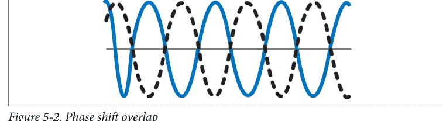

图 5-2. 相位偏移重叠

在 FinOps 成熟度的更高级阶段，保持折扣覆盖率上升和闲置容量下降需要持续管理。此外，初始采购可能很复杂，难以做到正确（我们见过单次错误承诺就浪费数百万美元）。FinOps 团队在为所有人优化覆盖率的同时降低浪费的可能性。

## 为何应将使用量降低去中心化

相反，另一项 FinOps 原则指出，“每个人都对其云使用负责。”随着费率降低现在被战略性集中，成本规避（使用量降低）成为贵组织各团队中推广的活动方法。在企业规模下，云成本可能由各个团队和支持贵企业运行的服务的各种工程师每天进行数百到数千次操作构成。它们是您创新机器的心脏。

为了让他们快速运转，请主动开始并为您的工程团队建立一个轻量级的教育计划。在架构设计期间倡导成本效率，并解释工程师可用于以精益方式部署云的方法，然后根据其工作负载需求增长其资源。一些示例包括有效使用扩展架构和抢占式实例、松耦合架构、无服务器或容器、在团队开始存储数据之前实施数据保留政策、在发布前嵌入变更的成本估算，以及在发布评审期间标记优化（拉取请求和/或变更评审会议），例如更新基础设施即代码中定义的旧一代实例的使用。

尽管去中心化团队通常最适合就基础设施变更做出决策，但中央 FinOps 团队为其提供优化数据和建议供其考虑的做法很常见。他们通过收集使用和利用率数据并提供更符合工作负载需求的资源替代方案的可视性来实现这一点。理想情况下，这些建议会定期推送给团队，或基于阈值警报（针对早期实践）推送，或通过 Jira 或 ServiceNow 等票务系统纳入开发人员冲刺（针对高级实践）。我们将在第 15 章中更详细地介绍这些建议的关键标准。

这种模式确保您的资源所有者——他们更了解资源的使用方式、依赖关系以及是否有任何业务原因导致更改会负面影响您的服务——在建议实施前有机会审查所有建议。

FinOps 实践者通过提供洞察和数据访问权限，使工程团队能够近乎实时地做出最佳技术决策。他们将节省潜力与支出影响作为成本指标引入，与工程团队已跟踪的其他指标并列。

## 结论

云计费很复杂。提供正确的数据粒度范围涉及工作和权衡。但正是这种复杂性赋予您大量权力，既可分析支出驱动因素，又可授权团队拥有其优化决策。即使您使用 FinOps 平台来自动化报告和洞察，您也需要了解云提供商数据的格式，以便从所见内容中得出正确结论。力求在组织内标准化一致的成本指标格式及其报告机制。这很可能是一个摊销费率，其中考虑了您与云提供商可能拥有的任何定制折扣、摊销预付款以及其收取的任何支持成本。如果没有这种标准化，您将会有很多混乱，因为您的团队会以不同的方式查看数字。

总结如下：

- 大多数情况下，计费数据是基于时间的，因此需要持续关注，以确保运行中的资源持续提供价值。
- 只有深入了解计费数据，才能对计费数据进行详细分析。学习原始数据以成为有效的 FinOps 实践者。
- 云账单中的细微变化会迅速累积，因此请使用自动异常检测和差异报告跟踪变化，以识别正在上升的趋势。
- 您账单的简单公式为 Spend = Usage × Rate。这为您优化账单提供了两个杠杆：使用更少以及为所使用的资源支付更少的费用。
- 将使用量降低（使用更少）去中心化，同时将费率降低（为所使用的资源支付更少）集中化。
- 中央团队更适合管理基于承诺的折扣，因为他们能够跨整个云环境进行查看，并且管理大量承诺组合的复杂性。
- 去中心化团队由中央团队提供使用优化数据和建议，从而获得授权，因为这些去中心化的应用所有者最适合做出基础设施变更决策。

我们通过介绍 FinOps、您为何需要它、它如何需要文化转变，以及最后云账单提供的洞察，奠定了基础。下一章介绍 FinOps 框架。我们将描述该框架是什么、如何使用它以及每个组件的结构。

## 采用 FinOps

FinOps 是一场无限游戏。我们的意思是，您永远不会真正完成对它的改进。并且您必须从某个地方开始。

> 在有限游戏中，如足球或国际象棋，玩家已知，规则固定，终点明确。胜者和败者很容易识别。在无限游戏中，如商业、政治或生活本身，玩家来来去去，规则可变，没有明确的终点。无限游戏中没有胜者或败者；只有领先和落后。
> 
> —Simon Sinek, *The Infinite Game* (Penguin UK, 2020)

我们从实践者社区听到的最常见问题之一是“如何让我的高管接受这一实践？”然后是“如何让组织在对其成功至关重要的大范围角色中采用这一实践？”

本章探讨了从公司技术和财务领导层获得适当组织支持的常见方法。如果没有这些， nascent FinOps 实践往往会陷入被动的中间成熟阶段，与组织中的其他优先事项抗争。本章还探讨了 *FinOps Driver* 的流程，即认识到实践需求并在内部倡导该实践的人。

图 6-1 概述了在帮助您在组织内建立实践和文化时需要了解的关键角色和需要完成的里程碑。


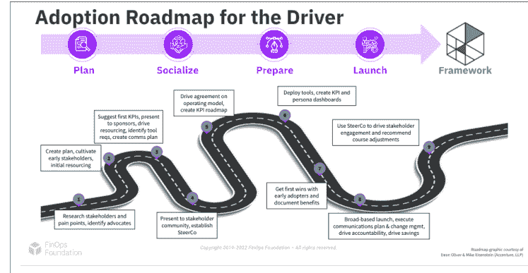

图 6-1. FinOps 采用路线图，原出处 Mike Eisenstein 和 Dean Oliver (Accenture, LLP)

## 坦白

在撰写本书第二版时，我的合著者 Mike Fuller 向我坦白：“回顾来看，我们 [Atlassian] 在撰写本书第一版时并没有认真对待 FinOps。” 是的，FinOps 是他负责的领域之一，他在管理 Atlassian 在大规模迁移和云增长期间的云支出时，花了多年时间研究和思考 FinOps 的模式，但这并不是他的全职工作。

事实上，在公司里，这也不是任何人的全职工作。公司层面没有关于 FinOps 成果的自上而下 C 级编码的公司目标。目标设定不一致，他们并没有积极投入优化和流程，而更多是专注于低垂果实。他知道他们需要做什么以及如何实现，但这 simply 不是公司的最高优先事项。而且这也没关系。公司正在进行知情忽视——有意决定将重点放在其他优先事项上，例如完成迁移和更快地交付产品。

起初，我的下巴掉了。我自 2014 年第一次见到 Mike 以来，一直在记录他关于云成本管理的先进思考，他以其安静而权威的方式，重置了我对诸如 RI 策略和数据源等多个核心领域的思考。

然而，越想越觉得，Mike 关于他自己（以及由此延伸到 Atlassian）进入 FinOps 成熟度的“坦白”，就像每个人一样。不可避免地，你一开始把 FinOps 作为一种轻量级实践——或早期成熟度实践——随着时间推移，随着云支出增长和公司目标一致，你会逐渐更认真地对待它。Mike 个人一直痴迷于 FinOps，但他有自己的本职工作（当时他在 Atlassian 的 CCoE 工作），他的公司（像大多数公司一样）花了一些时间才走到决定大力投资人员配置 FinOps 功能和角色以推广该实践的地步。他是典型的 FinOps 驱动者原型：它始于一个喧闹的个人，然后随着时间的推移，变成公司重点，具有广泛优先、由高管赞助的目标。

当我们深入探讨这一思考时，我们意识到通常存在几个实践成熟度层级。这在这一章开始时很重要，因为你向领导层提出的建议将非常不同，具体取决于公司处于哪个层级。在内部推广 FinOps 之前，你需要诚实地审视公司在 FinOps 之旅中的位置，这通常与其云采用之旅相关，以及它最积极优先考虑的成果。

FinOps 不是关于省钱，而是通过对云技术投资的数据驱动决策来赚钱。如果你最优先的事项是尽快摆脱数据中心，或利用云来转型技术并推动更多收入，那么你可能不会获得太多关注长尾优化的认可；你主要会得到加速迁移的支持。

尽管 Atlassian 正在实践知情忽视，但并不意味着他们什么都没做。这意味着他们选择性地投入他们认为关键的能力，而对其他能力保持被动。成本分配被视为问责的关键，并被积极追求，而基于承诺的折扣和 rightsizing 则更被动地进行。

不过，有一点 Mike 知道他需要将被动实践转变为积极管理的实践。

## 不同层级的不同高管推介

为了确保获得最大的成功，让我们再次转向第 1 章中讨论的 FinOps 成熟度模型。在早期阶段，你将有一个基于你希望实现的结果的特定推介。为了做到这一点，你必须评估你的组织真正处于何处。

在成熟度较低的阶段，你可能正在做一些与 FinOps 相邻的事情，例如审查支出或偶尔进行优化，但你并没有以生命周期的方式进行，也没有运行一个框架（如第 7 章中涵盖的 FinOps Foundation Framework）及其能力，或采用 playbook。

Mike 后来补充道：

我们当时并没有像今天这样以结构化的方式进行 FinOps。我们多年来一直以更临时的方式进行。在我们 FinOps 成熟度的中间阶段，我们开始为框架中的所有能力领域设定目标，并为这些能力设定目标和阈值，跟踪我们旨在改进的能力，衡量我们努力的结果，并对外报告。

### 起始推介

> 聪明人起初做的事，愚人最后才做。
> —沃伦·巴菲特

以下是你在推广 FinOps 初始采用时需要准备好答案的一些问题：

为什么要开始做 FinOps？

请参考本书的前几章，了解如何分享开始的理由。

对每个相关高管角色的好处是什么？

每个高管的关注点（和奖金）方式都不同。如果个别高管了解具体细节，这将帮助他们为支持该计划建立自己的案例。本章后面，我们将分解 CEO、CFO、CTO 等个别高管的挑战、动机和好处。

对业务的好处是什么，以云采用和组织将获得的结果为衡量标准？

请考虑 FinOps 框架的主要成果（第 7 章中涵盖）。同时仔细查看你的云采用，以确定成本分配、优化等好处之间的平衡。云采用目标规定了在铁三角上关注的重点，如第 26 章所讨论的。

FinOps 如何帮助解除通往安全、GreenOps 和可持续性等其他重要计划的道路？

我们开始看到 GreenOps 和 FinOps 团队之间存在强烈的重叠。它们共享一组共同的底层目标。将可持续性目标与 FinOps 挂钩可以帮助为请求提供资金；一石二鸟。参见第 19 章，了解可持续性与 FinOps 如何相交。

现有的财务框架为什么不能解决需求？

现有的 IT 财务框架通常与 FinOps 实践并行运行，通过解决业务中不同的一组需求。参见第 25 章，了解其他常见框架如何与 FinOps 一起（或不一起）工作。当你遇到那些熟悉传统 IT 框架而不习惯处理云规模下独特的大规模可变性和支出数据粒度的人时，回答这个问题很重要。

由于这是一个起始推介，你还不会有一个结构清晰的 FinOps 框架，明确列出组织内需要的不同能力。相反，你提出的是高层级的结果，回答诸如：你是否能够理解你的成本和使用情况，你是否能够识别优化机会等？

### 推进推介

以下是你在推广实践成熟度时需要包含的一些内容。

一个好的起点是衡量你的组织在各个 FinOps 能力方面的成功程度。这使你能够定义并提出下一步需要去哪里。推介的这一阶段侧重于你如何更重地投资于特定领域，并期望实现特定的成果。

表 6-1 中的每个能力都应有一个成功衡量标准和一组成果，这在第 7 章中有更详细的介绍。重点讲述如何实现你需要达到的成果以达到目标成功衡量标准。然后将这些成果与业务需要提供的要求联系起来，以实现它们，例如：

- 来自其他团队的时间承诺
- 需要额外花费的资金或预先支付的款项
- FinOps 团队本身或其他组织团队中增加的人头

*表 6-1. 现有实践中框架能力的简化成熟度评估*

| 领域 | 能力 | 初期 | 中期 | 高级 |
|---|---|---|---|---|
| 理解云使用情况和成本 | 成本分配 |  | 当前 | 增长 |
| 理解云使用情况和成本 | 管理共享成本 | 当前 | 增长 |  |
| 性能跟踪和基准测试 | 预测 |  | 构建 |  |
| 云费率优化 | 管理基于承诺的折扣 |  | 当前 | 增长 |
| 云使用优化 | 资源利用率和效率 |  |  | 构建 |
| 实时决策 | 衡量单位成本 | 构建 |  |  |
| 组织对齐 | FinOps 与其他框架的交叉 | 当前 |  | 增长 |


以下是您在对该实践进行额外投资时希望突出的能力成果示例：

### Cost allocation
成本分配
提高成本正确分配给团队的比例。

### Forecasting
预测
提高可靠性和可预测性等。

### Measuring unit costs
衡量单位成本
识别可以开始为一组产品衡量业务价值指标并将其关联回其报告以用于价值对话的团队。

### FinOps intersection with other frameworks
FinOps 与其他框架的交集
在组织内部提供管理其他财务实践的团队与 FinOps 之间的协调，减少工作重复，并提高云支出报告的一致性。

### Budget management
预算管理
提高同时保持在预测预算内以及“左移”主动预算管理的能力，使工程团队能够主动预测变更的成本影响，并在预计出现重大影响时提高预算负责人的意识。

State of FinOps 2022 数据显示，早期团队通常为 1–3 人，而成熟阶段的公司往往有 13 名以上专职人员帮助在组织中实现 FinOps。最新的调查数据可在 FinOps Foundation 网站上找到。

回到 Mike 的案例，改善成本削减是最初的推介重点。但在推进阶段，它已完全围绕工程效率展开。他试图回答“我们如何防止工程师陷入困境并提高发布的速度？”这个问题。他知道，改善工程成本效率将使他的技术领导者节省资金并为额外项目和人员配备提供资金：“现在给我们一些钱来改进我们的 FinOps 实践，以后您就能用更多的工程师做更多创新性的事情。”

超支会限制技术团队的速度。团队超支时，经常被告知要放缓功能开发，专注于通过清理浪费积压来降低成本。理想情况下，团队应从第一天起就领先于问题，并在推进过程中进行成本架构以防止放缓。这是一种经典的维护和 KTLO（keep the lights on）方法，而非陷入救火的困境。这使得工程工作量可预测且平稳，而不是在浪费过高时出现大量努力的峰值，分散他们对发布的注意力。这一概念通常是您推进实践推介的关键部分。

FinOps 可以为组织呈现大量待解决的问题。每个都会有所不同。完整的图景甚至可能影响企业决定投资的内容。表 6-2 显示了一些向不同角色展示的关注重点示例。

表 6-2. FinOps 可帮助解决不同角色的关注重点示例

| 角色 | 关注重点 |
|---|---|
| 业务领导者 | 利用云技术提升竞争力 |
| 工程 | 在提高成本效率和交付速度的同时创新 |
| 财务 | 准确理解、分配和预测成本 |

所有人都或多或少关心成本节约，但每个人的核心动机不同。今天，很少有公司从零 FinOps 开始；大多数公司已经在进行一定程度的 FinOps 活动。因此，您需要描绘出今天所处的位置、将要去往的方向以及这段漫长旅程的好处。

## Sample Headcount Plan for Advancing a FinOps Team
推进 FinOps 团队的示例人员配置计划

表 6-3 是作为向技术高管提出的推进 FinOps 推介的一部分的示例人员配置计划。它包括为关键领域增加的人员配备，例如用于摄取/规范化账单数据及相关数据源的数据工程师、用于审查数据并为组织准备报告的分析师、嵌入服务团队以提升其使用优化技能的成本工程师、连接各种 FinOps 服务并为组织提供模板的自动化工程师，以及管理 FinOps 团队本身的负责人。

表 6-3. 向 CTO 汇报的实践的示例招聘计划

| 财政年度 | 数据工程师 | 分析师 | 自动化工程师 | 团队负责人 | 所需资金 |
|---|---|---|---|---|---|
| FY22 | 2 | 1 | 1 | 1 |  |
| FY23 | 2 | 2 | 2 | 1 | +2 |
| FY24 | 3 | 3 | 2 | 2 | +3 |
| FY25 | 4 | 5 | 3 | 2 | +4 |

您的推进 FinOps 推介应包括在获得所需资源后预期会发生的结果。例如，组织需要 $X 百万美元的承诺以降低费率，三个新的招聘名额，以及来自另外三个团队（财务、工程和采购）的承诺，以建立业务价值模型。

## Stories from the Cloud—RJ Hazra
来自云端的故事—RJ Hazra

Equifax 的 SVP 和技术 CFO RJ Hazra 分享了他们自身采用之旅如何改变了应用团队对成本的关注重点：“他们主要忙于迁移工作负载，没有足够关注业务的最佳结果。我们通过将曾在成本优化的中央平台上工作的工程师嵌入到业务部门团队中取得了很多成功，这使我们的关注点转变为 FinOps 现在是每个人的责任。我们发布操作手册，我们构建架构图，您遵循我们设定的模式，我们据此评估您。如果他们不遵循，我们就会放慢他们的速度。”

## Pitching the Executive Sponsor
向执行赞助商推介

截至 2022 年，State of FinOps 数据显示，大多数 FinOps 团队向 CIO 或 CTO 等技术高管汇报。越来越多的人向技术 CFO 或相关混合角色汇报。您推介的第一部分是向 CTO（或您组织合适的 CxO）描绘今天所处的位置。这包括涵盖现有的报告可见性以及公司在 FinOps 框架关键能力方面的成熟度评估。我们建议从 FinOps Foundation 网站上提供的开源 FinOps 评估开始。

最重要的是，您需要描绘出在实施实践下一阶段后，公司文化和工作方式预期会发生的变化。

以下是您可以在推介中回答的一些问题：

- 工程师的日常工作如何改变？
- 组织需要引入哪些项目和仪式？
- 工程经理如何开始思考 FinOps？
- 组织如何确保拥有合适资源？
- 深入挖掘可见性优势，组织可以推动哪些单位经济和报告？

以下是一些开始建模特定场景的问题：

- 组织应计划以何种组合实现成本规避：更侧重于使用量减少还是费率降低？
- 如果组织有更多时间和人员来妥善维护它们，可以拥有多少个 SP 或 CUD？
- 如果能够更有效地管理承诺和资源利用率，过去一年可以节省多少？
- 您需要做出什么改变，以便一年后回顾时效率明显提高？
- 如果有全公司目标或更好的高管支持此类变革，组织可以实现多少更多使用量减少？

推介应涵盖这对公司真正意味着什么。它不仅仅是花费多少钱、需要多少人以及节省了多少美元。在 Atlassian，正如大多数公司一样，CTO 在进入 FinOps 将推动的节约和效率价值主张之前，重要的是要思考采用 FinOps 对工程团队（技术公司最重要的资产）的影响。

因此，在向 Atlassian CTO 提出推介之前，Mike 从相关团队获得了反馈。他采访了财务部门关于他们在支出分配和可变支出准确预测方面的痛点。他与工程服务负责人交谈，了解他们目前对成本的可见性程度，以及为了能够在异常发生时向领导解释发生了什么，他们需要什么。通过所有的对话，他研究了自己正在推介的中央 FinOps 团队如何提供帮助。

这些对话也开始为即将到来的变化做好团队准备：服务负责人将被期望知道自己的成本，并在支出发生变化时做好讨论准备。他还开始推广将数据置于工程师路径上的关键策略（有关此概念的详细信息，请参阅第 8 章）。他开始设定在推广更结构化的 FinOps 目标和实践后，各层级工程将做什么的期望。

在 Mike 的案例中，资金来自 CTO，因此对话围绕工程收益展开。向 CFO 推介时，重点应更多放在通过更清晰的分配、更准确的预测以及更低的预算目标差异来确保更好的成本报告，这些都可以通过更多投资得到改善。

## Playing to Your Audience
投其所好

在组织内部提议采用 FinOps 功能时，请向执行团队中的各种角色（工程领导、财务领导等）进行简报，以获得批准、认可并参与开展 FinOps 并实现其目标。

每个执行团队角色如下所述，包括其目标、关注点、关键信息和有用的 KPI。通过了解每个执行角色的动机，FinOps 倡导者将能够更有效地描述 FinOps 的价值，最小化获得一致性的时间和精力。


## 驱动者必须影响的关键角色

图 6-2 显示了 FinOps 团队和驱动者角色最初如何处于各个利益相关者之间，帮助翻译需求并建立桥梁，使他们能够更紧密地自主协作。

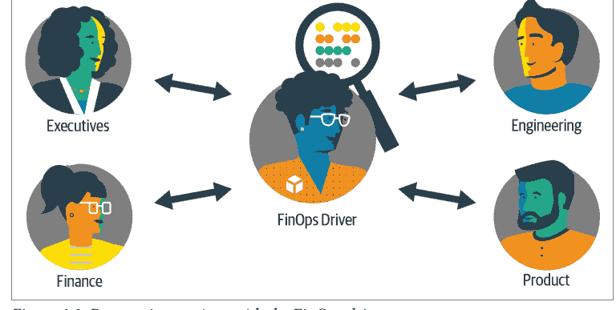

图 6-2. 与 FinOps 驱动者的角色交互

如需更全面地了解构建 FinOps 实践所涉及的各种角色和岗位，请参阅第 3 章中各个角色的动机。以下部分内容改编自 Adopting FinOps 开源项目。

## CEO 角色

对于 FinOps 实践而言，CEO 的目标是确保云投资与业务目标保持一致。示例请参见表 6-4。

表 6-4. 常见的 CEO 业务和 FinOps 目标

| 目标 | 痛点 | 关键指标 | FinOps 收益 |
|---|---|---|---|
| 年同比加速公司增长 | 不可预测、有时混乱的云支出 | 收入增长 | 管理风险 |
| 战略竞争优势 | 无法看到工程举措与业务目标之间的联系 | 毛利率 | 将工程决策与业务成果相连接 |
| 更快的上市时间 | 不确定公司云投资的回报 | COGS（销售成本） | 预测云支出如何随着业务增长而增长 |
| 以成本效益的方式交付创新、领先市场的解决方案 |  | 单位成本经济 | 指导组织做出良好的云投资 |

## CTO/CIO 角色

利用技术为业务提供市场和竞争优势。示例请参见表 6-5。

表 6-5. 常见的 CTO/CIO 和 FinOps 目标

| 目标 | 痛点 | 关键指标 | FinOps 收益 |
|---|---|---|---|
| 年同比加速公司增长 | 承受极大压力，要么证明云账单的合理性，要么降低云账单 | 收入增长 | 预测云支出如何随着业务增长而增长 |
| 战略竞争优势 | 支出缺乏约束机制 | 毛利率 | 推动组织做出良好的云投资 |
| 更快的上市时间 | 不满意的工程师 | COGS | 使工程组织能够获得更多自由，利用更新的云技术并更快地将解决方案推向市场 |
| 以成本效益的方式交付创新、领先市场的解决方案 | 业务连续性 可靠性 | 单位成本经济 新功能/产品上市时间 工程生产力 跟踪研发与生产支出 保持运营在预算内 |  |

## CFO 角色

提高成本报告和预测的准确性和可预测性。示例请参见表 6-6。

表 6-6. 常见的 CFO 和 FinOps 目标

| 目标 | 痛点 | 关键指标 | FinOps 收益 |
|---|---|---|---|
| 成本可见性、细化和准确性 | 不可预测、有时混乱的云支出 | 收入增长 | 对云成本承担更大的责任 |
| 单位成本/COGS 总体降低 | 不确定公司云投资的回报 | 毛利率 | 更依赖预算和预测模型 |
| 在增长期间管理成本，在平稳/下降期间进行不成比例的成本削减 | 成本波动和创新与预算周期不一致 | COGS 单位成本经济 可预测性 | 对公司净利润的直接影响 |

## 工程负责人角色

在提高交付速度的同时保持成本效益并推动创新。示例请参见表 6-7。

## 表 6-7. 常见的工程负责人目标

| 目标 | 痛点 | 关键指标 | FinOps 收益 |
|---|---|---|---|
| 推动对负责应用程序/服务的工程团队的问责 | 随着工作量不断增加，工程师不满意 | 按基础设施成本计算的收入 | 对云成本的可见性提高 |
| 通过识别异常和最佳实践，为工程团队提供指导，使其拥有成本效益的应用程序/服务 | 交付周期长 | 每个部署服务的成本和服务利用率 | 与云成本和单位经济的联系 |
| 与工程团队合作识别费率降低和可能的成本规避 | 无法预测对预算的影响 | 将 IT 成本向业务进行展示和回拨 | 对利用率承担更多责任 |
| 成本分摊 | 难以识别服务或应用程序所有权 |  | 鼓励采用稳健的架构原则以考虑效率 |
|  | 无法足够准确地预测开发新功能和产品所需的成本 |  |  |

## FinOps 采用路线图

我们提供了这份入门指南，帮助您构建演示文稿，向其他团队、同事和利益相关者介绍建立 FinOps 实践的好处。它包括准备步骤、按角色和角色划分的问责制和期望、详细的路线图等。

以下阶段基于 FinOps Foundation 的 Adopting FinOps 工作组的开源冲刺成果，其中包括 Mike Eisenstein（Accenture）、Idaliz Baez（RealOps.io）、Natalie Daley（HSBC）、Rejane Leite（Flexera）、Mike Bradbury（JunoCX）、Tracy Roesler（dbt Labs）、Bailey Caldwell（McKinsey）、Rich Gibbons（ITAM Review）、Erik Peterson（CloudZero）、Nick Grab（Ellix GmbH）、Anthony Johnson（Box）、Kim Wier（Target）、Melvin Brown II（美国政府）和 Mandy van Os（TechNative）的核心贡献。

## 阶段 1：在组织中规划 FinOps

正如本章开头所述，FinOps 是一个无限游戏。你永远不会真正完成。尽快开始并迈出小步，逐步成熟对业务最重要的能力至关重要。本阶段的目标是制定适合您组织的 FinOps 转型计划，该计划已根据您可用的资源和您认为最重要的目标进行了调整。

## 进行研究

在组织内部寻找合适的利益相关者。作为希望将 FinOps 引入组织的个人，您需要高层赞助以及培养的支持者来建立势头。您可以采取以下步骤：

- 调查可能的倡导者/champion/高管赞助人，并使用定制的 FinOps 介绍 deck 或有针对性的访谈问题与他们进行一对一对话，以确定采用策略。
- 在对话中调查组织正在经历的痛点，例如云成本破坏商业案例、对成本超支的普遍认知、云消费者缺乏成本可见性等。
- 在对话中调查受影响的群体、团队和个人。谁受痛点影响？

## 制定计划

描绘未来状态的图景。这应该吸引业务关注（由于云技术估值带来的业务加速、单位经济改善等）。您可以采取以下步骤：

- 确定工具需求。确定现有自有工具是否能满足计划的需求。
- 为 FinOps 职能确定组织归属。这可能在 CCoE、财务或 IT 中。取决于组织结构的复杂性，建立专门的 FinOps 团队可能需要分阶段进行。一些组织可能会（1）设立跨职能转型项目办公室并创建工作流/工作组，（2）在扩展的云业务办公室/CCoE 中设立 FinOps 职能，以及（3）发展为专门的云 FinOps 团队。
- 确定可以成为 evangelists 的候选早期采用团队。
- 确定用于衡量 FinOps 职能的 KPI，并确定衡量业务部门和应用团队等利益相关者参与度和绩效的方法。这些 KPI 是初步的，将在第 2 阶段演进，但拥有一个初始集合很重要。
- 准备将在第 2 阶段使用的沟通计划。

## 来自云端的故事——Jason Rhoades

Intuit 的 Jason Rhoades 分享了在早期交付重大、快速胜利以增加高管投资的重要性：

> 当然各地情况不同，但对我而言在 Intuit，实际的成果先于所有增量的 FinOps 投资。FinOps 作为一种理论可能很难让一些高管理解。或者你被困在 CTO 将其视为纯技术工作而 CFO 将其视为纯财务工作的局面。描绘这样的图景：“我们上个月通过新的 FinOps 预付努力节省了 $XM，还有 $YM 可以继续追回” 或 “我们追踪到了根本原因”

将一次云成本激增与某个团队采取的行动联系起来，并且本可以通过投入来预防它"——当你处于绿地环境时，这些已得到证明且相对容易实现的早期成果描绘出 FinOps 如何在长期内创造价值的更具体/更直观且高管能够理解的图景。领导层更有可能支持已经展现出可证明、可量化的成功的努力，而不是仅仅谈论潜力的努力。证明价值，你就会得到你寻求的支持。沟通计划不应过度聚焦于 FinOps 的细节，而应讲述 FinOps 能为业务做什么的故事。

### Gather support

召集已培养的支持者并解释采用 FinOps 的重要性：

- 突出当前状态、痛点和其他问题。
- 识别威胁并提供如果不采取行动可能发生的情景。
- 展示 FinOps 成熟后在组织中的样子。
- 审视应或可被利用的机会。
- 制定实施计划的路线图。
  - 获取执行赞助人的反馈并根据需要进行调整。
  - 包括初始团队规模、预算和初始化时间线。
  - 包括价值主张（例如，ROI，如设立 FinOps 职能的成本与持续合理的云超支之间的对比）。
- 向其他利益相关者、支持者和一组不熟悉该项目的人员试点展示，例如业务单元负责人。

### Perform initial resourcing

成功的 FinOps 需要划出具有相关技能集的专用资源：

- 请求赞助人支持，招募其他执行领导作为赞助人。
- 组成由真正的组织影响者和利益相关者组成的变革联盟。
- 获得人员编制的预算批准。
- 根据需求选择原生、第三方或自研工具。

## Stage 2: Socializing FinOps for Adoption in an Organization

FinOps 是一种文化变革，需要组织内众多不同团队和角色的认同。因此，旨在鼓励实践采用的沟通和反馈循环至关重要。本阶段的目标是将第一阶段创建的 FinOps 计划传达给所有相关利益相关者。下面的 FinOps 演讲稿有助于以清晰、易读且快速的方式传达这一点。

### Communicate value

关键利益相关者在组织内推广 FinOps 的方式：

- 传达变革的核心价值观。
- 分享你对未来组织样貌的简短总结。
- 分享高层路线图。
- FinOps Foundation 网站上提供的 *What Is FinOps* 演讲稿是此演讲的良好起点，但必须为你的组织定制，以涉及你的计划。

### Gather team feedback

与已确定的受影响团队（如财务负责人、产品负责人和首席工程师）进行 FinOps 交流，以：

- 提供对 FinOps 是什么的理解。
- 了解他们的问题并解释/教育 FinOps 如何帮助他们。
- 讨论拟议的 KPI 并根据交流反馈进行调整。
- 建立 FinOps 与关键合作伙伴（IT 领域；财务控制；应用团队）之间的互动模式。
- 在推广过程中确定 CCoE 和执行指导委员会的未来成员。

### Define initial FinOps model

你的模型应包括资源、运营模式、跨职能互动模式以及用于报告进展的相关 KPI：

- 将 FinOps 模型（*inform, optimize, and operate*）定制到组织中。
- 在现有角色或个人重叠的情况下，通过内部调动确定 FinOps 团队；通过招聘/外包填补剩余差距。
- 绘制 FinOps 在组织中的变革网络——赞助人、影响者、采用者。制定明确的培训和沟通策略，确保覆盖所有受影响资源。
- 创建轮辐式模型以在非常大的组织内扩展 FinOps，本章后面会详细介绍。
- KPI 路线图：确定第一批 KPI 和报告，并识别和规划下一代 KPI 和报告。

## Stage 3: Preparing the Organization for FinOps

一旦你已推广并为文化变革获得支持，现在就开始评估和参与业务的各个部分的工作。本阶段的目标是在你的组织中开始启动 FinOps 飞轮，以便你在 FinOps 框架的各个能力和领域中开始成熟。

### Assess FinOps readiness

对组织在关键能力方面的成熟度进行评估通常包括以下内容：

- 定义标签、元数据和组织分类法。
- 部署、配置并冒烟测试工具。
- 确定第一波 KPI。KPI/业务采用指标可在“采用期”内演进，以营造逐步 FinOps 成熟的心态，而非一次性推动完全成熟。这将允许成熟度较低的团队和执行领导不会被“吓退”并逐步进行。
- 定义用于警报和报告限制的使用和支出阈值。
- 定义并准备基于角色的自助服务仪表板。这些应显示重要指标，如第一波 KPI、成本分摊、预算异常、优化建议以及利益相关者感兴趣的其他视图。
- 准备包含单位成本计算的预测模型。此时，这很可能只是一个电子表格。

### Engage stakeholders

你现在准备好开始持续的节奏和流程以实施你的模型：

- 确定业务单元对承诺水平的意愿（企业折扣谈判的总成本、RI/SP/CUD 等）。
- 参与早期采用团队以获得优化成果（例如，关闭不再使用的测试环境或实例以显示实质性节省）。这些对于推广、推广和赢得后续采用非常重要。
- 获得一些实施 FinOps 的早期治理成果（例如，标签策略、租用转实时自动化等）。
- 开始定期会议的节奏。FinOps/CCoE 团队应定期与业务单元、应用团队、从业者和利益相关者沟通，以实施最佳实践并跟踪 KPI。

请记住，如果组织有多个业务单元采用联邦云运营模型运行，它们将具有不同的成熟度水平。变更管理必须考虑到这一点，并允许它们以不同的节奏采用。

恭喜，你已开始实践 FinOps！

## Type of Alignment to the Organization

我们通常看到三种类型的 FinOps 实践团队：集中式、分散式和轮辐式。

在集中式 FinOps 团队中，它们直接对齐 CIO、CFO 或 CTO 并作为业务的服务存在。它们可能是 CCoE 的一部分，也可能不是，如果组织没有的话。具有云支出的业务单元与这个专用的 FinOps 团队互动以协作开展 FinOps 活动，而专用的 FinOps 团队集中化能力——例如管理基于承诺的折扣——这些能力最受益于集中化。

Pros
权威、专业知识、规模经济

Cons
利益相关者众多，使能和教育是关键，说服需要执行层支持

在分散式 FinOps 团队中，它们对齐特定的业务单元并服务于该业务单元的最佳利益。每个具有显著云支出的业务单元（BU）在其组内都会有一名专职的 FinOps 人员，但没有一个总体中央团队在整个组织中推动最佳实践和可重复模式。

Pros
非常敏捷，嵌入工程团队

Cons
未最大化费率，工作重复，容易流失关键人才

我们通常在组织认识到 FinOps 需要发生但没有中央执行层支持来设立正式集中实践时看到分散团队。对于大多数组织而言，这将在实践开始时是一个过渡状态。


轮辐式团队允许兼具集中化和分散化。

### Pros
- 关键业务单元在轮辐中拥有专属嵌入式 FinOps 资源，中央枢纽
- FinOps 专注于最大化费率并支持更多轮辐

### Cons
- 团队需要在轮辐层面投入更多资金、培训并招聘合适的人才

富达投资拥有一个长期存在且定义明确的 FinOps 轮辐式模型，他们在 2022 年 FinOps X 大会上进行了讨论。中央团队负责管理承诺并汇总来自各个团队的预测等能力，但每个主要业务单元也都有由其各自业务单元资助的专属嵌入式 FinOps 专家。

## 全职、兼职、借用时间：关于资源的说明

您 FinOps 团队的资源最终应完全致力于 FinOps；然而，它们通常以虚线汇报并按时间百分比分配的方式开始。两种模式的结合也很常见：您有一名专职的 FinOps 负责人，他/她与财务或工程合作伙伴有虚线汇报关系。

在开始阶段，不要害怕考虑外部承包商或顾问来启动、加速，甚至运营您中央实践的一部分。招聘真正了解 FinOps 的优秀人才非常困难；有时您可用的顾问是最佳选择。FinOps 基金会有一份 FinOps 认证服务提供商的名单。

通常，一个非专职的虚拟 FinOps 团队可以让公司开始 FinOps。利用它来开始建立一些能力，例如了解云支出基础和识别最大的成本驱动因素的基础知识。当您在这一点上做得越来越好时，您的成功就成为争取专职资源资金的论据。从小开始，寻找成果，并广泛宣传它们。

正如 Mike 在 Atlassian 的发现，他们知道优化支出有价值，并且需要了解成本，但直到他能够展示影响可能有多大时，他才获得了扩大专职团队的认可。这基于基于真实案例的硬数据，而不是预测。FinOps 人头的美妙之处在于它通常能自负盈亏。很少您可以对高管说：“给我五个资源，我会把钱还给你。”

但如果您的提案被否决，您没有获得团队的资金会怎样？是时候审视企业做出这种选择的原因了。这可能是我们所说的深口袋综合征，即优先考虑不惜一切代价迁移，执行层希望团队不惜一切代价完成工作。在这种情况下，您可能需要开始实践 *informed ignoring*，直到企业准备好并开始向各个利益相关者提供可见性。不要试图强迫工程师进行成本优化。开始围绕成本分配建立肌肉，开始使用云原生工具探索数据，并弄清楚在没有专职团队的情况下可以开始哪些基本的第一项能力。

一些早期成果可能是开始探索承诺型折扣，如第 16 章所述，以实现一些快速的成本优化收益。这些折扣工具可以在很大程度上以对工程团队透明的方式进行，保持他们专注于更高优先级的任务。

## 从零设计一个复杂系统永远行不通

在构建您的提案之前，请考虑以下引言：

> 一个行之有效的复杂系统无一例外都是从一个行之有效的简单系统演化而来。从零设计出来的复杂系统永远行不通，也无法通过修补使其运行。你必须从一个简单的可行系统重新开始。
> —John Gall, Systemantics: How Systems Work and Especially How They Fail
> (Quadrangle, 1977)

如果您使计划过于复杂，则不太可能成功。您的 FinOps 采用计划应简单地概述企业开始或扩展 FinOps 的步骤以及开展该实践的好处。

保持简单。不要试图一口吃成胖子。选择最关键的部分并从那里开始。定义关键利益相关者将是谁，确定您已有的技能集以及需要填补的差距，定义可实现的目标，并开始制定成本分配策略。

您还必须说明在组织中实现真正的文化变革是一个可能需要数年的漫长过程。FinOps 需要分阶段成长并随着时间成熟，因为相邻团队和流程认识到有效管理云价值所需的变革。

就像人类的免疫系统一样，FinOps 实践并非一蹴而就。为了准备好应对挑战，它必须从一个通过经验学习模式、习惯和适当应对方式以适应不断变化的环境的基础系统开始。

## 结论

获得 FinOps 的组织采用需要周密的规划、对高管动机的理解，以及对组织运作方式的大量研究。

总结如下：
- 高级实践的提案应包括对当前实践的评估以及 FinOps 在您组织内的计划，其中包括将加速特定能力及其 resulting 成果的额外投资。
- 不要试图在 FinOps 实践的初始计划中好高骛远。从小开始，取得成果，并随着时间的推移迭代。
- 不同高管会对 FinOps 实践期望不同的成果；在向每位高管提案之前，请务必了解他们不同的动机。
- 您启动 FinOps 实践的提案应专注于可通过谨慎投资实现的水果。
- 请记住在所有阶段过度沟通并推广您的努力，以带上各个利益相关者。

记住，建立 FinOps 实践就是建立共识。您必须赢得人心，改变长期存在的流程。在下一章中，我们将深入 FinOps 框架，它将为您提供一个能力菜单，让您从任何起点将实践提升到下一个水平。

## FinOps 基金会框架

FinOps 基金会框架是一套不断发展的构建模块，使您能够构建与组织云成熟度和复杂性相匹配的 FinOps 实践。本章向您介绍框架是什么以及如何在 FinOps 实践中使用它。此外，本章解释了框架的结构，并说明了如何通过指南、评估和 playbook 等相关实施来调整它以满足您组织的 FinOps 需求。

将框架纳入您的实践可避免重复造轮子，并使您能够快速重新组合多年来以各种形式存在的已知构建模块。框架的某些部分与所有实践相关，例如成本分配（即元数据和层级）和建立 FinOps 文化，而某些部分仅与特定场景相关，如管理共享成本或 IT 资产管理集成。

该框架概述了原则、角色、成熟度特征和关键能力，以构建成功 FinOps 实践所需的活动和成功衡量标准。FinOps 基金会从业者社区、云服务提供商和合作伙伴成员都为 FinOps 框架做出了贡献。您可以将本书中的所有内容与框架联系起来。

每个采用云的组织都需要开发管理云成本的机制。框架通过与云成本管理最佳实践保持一致，为您的 FinOps 实践提供运营模型。

与其在成熟过程中发现新的未知陷阱，您可以使用框架来构建 FinOps 实践并保持对所有有助于您更早实现目标的 FinOps 领域的关注，同时意识到您当前未关注的元素。


框架还充当一种机制，促进贵组织内负责 FinOps 的所有人员之间更好地沟通。框架为 FinOps 评估等实施提供了基础，有助于评估并使关键利益相关者围绕对贵组织成熟度的共同评估达成一致。

## 您实践的运营模型

将框架视为您 FinOps 实践的运营模型。它并不是按特定顺序完成的特定任务清单，因为没有两个 FinOps 实践完全相同；相反，它是一份全面的活动清单，您可以根据需要将其用于实践中。

想象一下，您正在种植花园。每天您评估所见情况并决定哪项任务能提供最大价值。您可能会种植、修剪、浇水、施肥、覆盖等。有大量指南可以帮助您发现并培养作为园丁所需的技能清单。您的花园正在成长，并且需求不断变化。您不能仅靠覆盖就打造出世界上最好的花园。每天遵循相同的任务清单无法让您根据当时最有利于花园的情况调整优先级。您需要制定一个*运营模型*和反馈循环，使日常活动适应花园的需求，根据您拥有的植物、花园状况、所处的气候类型、季节性降雨量、土壤条件变化和其他变化因素来增加和成熟能力。

同样地，在您的 FinOps 实践中，没有一份简单的任务清单可以始终带来积极的结果。框架旨在帮助您了解能力清单以及这些能力在不同组织中实施的基本结构，并允许您在当时选择适合您组织的能力和实施细节。

## 框架模型

图 7-1 显示了 FinOps Foundation 框架主要组件的概述。本节简要介绍框架中的每个支持要素：原则、角色、成熟度以及阶段。然后下一节描述构成框架主要组件的域和能力。

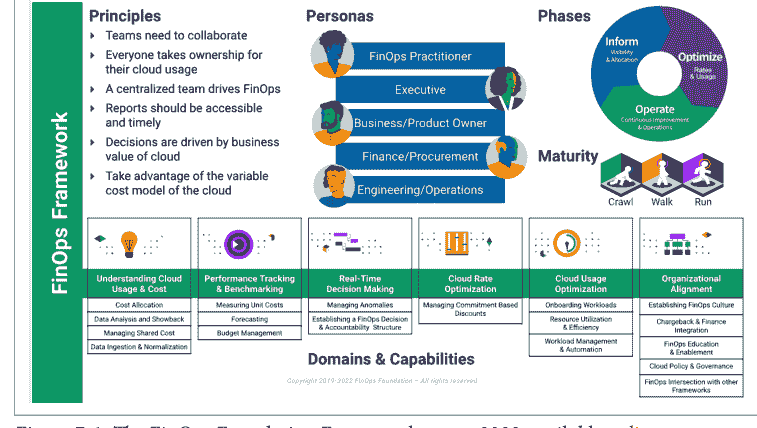

图 7-1. FinOps Foundation 框架海报 2022 在线可获取

## 原则

框架包含第 1 章中介绍的 FinOps 原则。您在 FinOps 实践中执行的所有活动都必须与原则保持一致。域、能力、角色和阶段都强化了它们所倡导的价值观。当您扩展 FinOps 框架并为组织定制其组件时，始终牢记原则，并在实践中保持与之的一致性。

## 角色

尽管 FinOps 实践者需要在框架的各个方面参与，但所有参与 FinOps 的角色也将从理解其结构中受益。业务领导者将有兴趣了解域成果以及应投资哪些领域以确保其问题得到解答并实现目标。工程团队需要了解他们每项任务如何为特定能力做出贡献，而框架则为他们的努力成果提供了背景。通过框架术语实现了 FinOps 的一致语言，并帮助每个角色了解他们需要扮演的角色。

## 成熟度

框架适用于所有实践，无论成熟度水平如何。随着成熟，您将随着时间的推移采用更多能力，然后在成功衡量指标上设定不断提高的目标。每项能力本身将处于不同的成熟阶段。

框架中的每项能力都有成熟度评估。您应力求熟悉计划立即着手的能力以及计划推迟开始的能力。能力清单并不是您应盲目遵循的死板清单。使能力成熟需要时间和持续迭代，因为您的组织正在成长以适应所需活动。目标并不是在每项能力上都达到先进的成熟度水平；而是在每项能力上达到适合您组织需求的成熟度水平。您应评估哪些域将帮助您实现预期成果，然后评估域内哪些能力需要改进。

共享成本是早期可能花费过多时间的常见能力示例。这些情况通常发生在单个云资源或服务被多个团队使用时。虽然您可以通过自己的数据分析和工具引入详细的共享模型，根据实时使用情况重新分配成本，但这种具体性并非总是必需的。尽管过去几年该领域的工具和最佳实践已大幅改进，但您应评估是否现在采用商定的固定百分比——例如根据商定百分比分摊部分共享成本——就已足够。简单的分配方案通常可以在早期满足业务需求，而无需增加更成熟和动态的共享成本能力的复杂性。

## 阶段

第 9 章介绍了 FinOps 生命周期和三个 FinOps 生命周期阶段：*告知*、*优化*和*运营*。这些阶段帮助您以一致的顺序组织每项能力的活动。它们提醒您始终以迭代、循环的方式工作，随着成熟度提升而进行增量改进。

## 域和能力

FinOps 框架利用一系列域和能力来实现 FinOps 原则中的概念。

高层域涵盖了业务所需的一组成果。域及其相关成果可能会随时间变化，因此我们建议在 FinOps Foundation 网站查看框架。表 7-1 显示了出版时域列表及其主要成果。

表 7-1. 框架域及其主要成果

| 域 | 主要成果 |
|---|---|
| 理解云使用情况和成本 | 推动问责制和透明度 |
| 绩效跟踪和基准测试 | 定义什么是好的 |
| 实时决策 | 能够实现基于数据的支出决策的快速反馈循环 |
| 云使用优化 | 确保高效使用云资源，同时减少浪费支出 |
| 云费率优化 | 使用各种基于承诺的折扣计划来减少您为消耗资源支付的费用 |
| 组织对齐 | 使您的云使用与组织目标和结构保持一致 |

这些成果可以帮助您回答组织提出的实际问题，例如：

- 此应用程序的最大成本驱动因素是什么？（理解云使用情况和成本）
- 如何减少对特定服务的支出？（使用优化、费率优化）
- 您对某类资源的使用情况随时间发生了怎样的变化？（绩效跟踪）

然后每个域都会确定一组能力，帮助您在努力实现所需成果时解决将面临的具体挑战。每项能力都描述了有助于该能力成功的所需数据、行动和指标。

## 域的结构

每个域的核心部分遵循标准结构：

### 定义

帮助您了解在 FinOps 实践中需要执行的高层活动，以实现您应期望的预期成果，以及该域旨在为您解决的主要问题。

### 能力

提供实现该域成果的能力清单。我们将在本章后面更详细地讨论能力。

### 供应商和服务提供商

一份提供解决方案以帮助您在该域内工作的工具和服务提供商清单。一些解决方案提供商专注于针对单一域的工具，具备深厚专业知识，而其他提供商则在多个域中提供整体解决方案。


## 培训与课程

FinOps Foundation 和认证培训合作伙伴提供的培训清单，帮助您和您的员工在本领域接受教育。

部分领域可能包含针对该领域的具体额外内容。

## 能力结构

每个能力代表支持其对应 FinOps 领域（们）的功能活动领域。每个能力的核心部分遵循标准结构。

### 定义

该定义概述了能力范围，有助于您了解哪个能力与特定目标或成果相符。

### 成熟度评估

成熟度评估提供了该能力在不同成熟阶段的示例，您可以用它来评估当前所处的位置以及下一步工作的重点。

### 评估视角

通过多种视角审视您的 FinOps 实践，您可以评估其相对于更广泛的组织以及其中特定目标群体的优势。正如 FinOps Foundation 的 Ben de Mora 所概述的那样，有五个视角可用于评估您的能力成熟度：

### 知识

您的目标群体是否理解该能力涉及的内容？这一概念及其机制、术语和流程的普及程度如何？

### 流程

您的目标群体能否描述在其情境中执行该能力的流程？请考虑此类流程的有效性、有效性和普及程度。

### 指标

该能力是否被衡量？您是否有证明随时间推移进展的方法？您如何获取这些测量数据，以及它们与业务成果的相关性如何？

### 采用

该能力在多大程度上被您的业务作为其核心和关键职能的一部分所采用和接受？请考虑该能力在整个组织中的普及程度和存在情况。

### 自动化

您的目标群体是否以可重复、一致、高效且节省人力的方式自动化该能力？

## 功能活动

功能活动是任务或流程，使各种角色能够通过 FinOps 生命周期阶段（本书后面会介绍）迭代地满足 FinOps 实践的需求。这些活动和程序服务于以下一项或多项：

### 使能

建立能力以帮助他人执行 FinOps 活动

### 教育/知识共享

教导他人如何执行 FinOps 活动

### 倡导

帮助他人理解该能力的重要性

### 可执行任务

创建并传达一项需要组织内某人采取行动的任务

### 提升 FinOps 成熟度

开发流程和工具，使 FinOps 在您的业务中更成功

随着 FinOps 成熟度的提高，活跃的 FinOps 实践中实施的功能活动数量也会增加。

## 成功衡量指标

每个能力都需要至少一个衡量其绩效并允许 FinOps 从业者设定目标的指标。这些指标及其相关目标衡量您在给定能力中的成功程度。随着实践的成熟，您将提高目标，从而能够设定并客观衡量短期目标。成功衡量指标还可以帮助您识别阻碍您实现目标的活动。

各种能力中成功衡量指标的一些示例包括：

### 成本分摊

可分配给其所有者的云支出百分比

### 预测偏差

预测支出与实际支出之间的差异百分比

### 资源利用率

由空闲或低效资源驱动的月度云支出百分比阈值

## 输入

有助于能力成功的输入包括外部数据源、报告、白皮书和培训。一些示例包括云采用框架、供应商优化建议以及业务政策/标准。此资源清单是进一步学习或开始收集设置功能活动所需信息的好方法。

## 使框架适应您的需求

由于不同组织具有不同的运营需求，这些需求塑造了其成功的路径，因此 FinOps 框架本身被有意设计为具有方向性，通过一系列 KPI 提供成功参数，通过在所需活动的背景下描述成熟度特征，以及通过描述每个 FinOps 角色的责任来实现。例如，公共部门或政府机构的预算和预测流程与私营公司大不相同。预计框架会根据您组织的运营需求进行调整和更新。

您使用的云服务提供商和供应商工具将进一步影响团队如何按照框架所述完成 FinOps 实践中的具体活动。推荐的方法是从 FinOps 框架开始，并修改功能活动以涵盖任何组织或行业特定的活动。示例包括变更管理工作流或采购审批流程。对于每个活动，将其分配给组织内的特定角色，向员工传授应遵循的流程，并倡导完成每个活动的重要性。

框架实施是由社区创建的资源，用于提供特定行业和供应商的成功方案。这些资源形式多样，包括操作指南、能力手册，甚至视频演示。框架实施由社区个人成员、社区工作组和合作伙伴成员贡献。实施的目标是提供在情境上相关的应对挑战的方法，以改进您的 FinOps 能力。实施可以描述如何使用特定工具、流程或改进的功能活动来针对单个能力、领域或整个 FinOps 框架。

## 来自云端的故事——FinOps 社区

2022 年初，美国政府各机构的代表聚集在一起，创建了首个政府手册，介绍如何在政府采购流程和规则的独特限制下进行 FinOps。近二十四个机构参与其中，包括陆军、联邦航空管理局、白宫、小企业管理局、住房和城市发展部、总务管理局以及内政部。他们由人事管理办公室（OPM）副首席信息官 Melvin Brown II 领导。

正如他们在其实施指南的第一版中所说：

> 该手册旨在建立在现有的 FinOps 框架之上，帮助联邦机构开始（或成熟）其云之旅。虽然每个机构都应根据其组织的当前状态和期望成果定制其 FinOps 实施，但本手册强调了 FinOps 框架中可能需要为公共部门用例稍作调整的领域。
> 
> 本手册将帮助指导联邦机构实现成功的云财务管理实践，使其能够获得近实时云支出可见性和执行层级细节报告带来的关键成果，从而使机构的云运营与战略目标保持一致。
> 
> 该手册分为三个阶段，旨在帮助您在机构中实施 FinOps，使您能够顺利过渡到在组织内运营 FinOps。
> 
> 在您开发自己的解决方案时，您可以将它们贡献回社区作为实施指南，帮助后来遇到类似情况的其他人。


实施指南是开发您 FinOps 实践的绝佳参考，您可以通过查看其他组织如何实施单个能力甚至整个框架来实现。如果您找不到符合您目标的示例，我们建议您加入 FinOps Foundation，利用那里的从业者社区。他们总是愿意回答问题、分享见解并展示对他们有效的方法。

## 与其他框架/模型的连接

其他财务模型和框架的存在，例如 IT 财务管理、技术业务管理（TBM）、IT 资产管理（ITAM）或 IT 服务管理（ITSM），也会影响实施哪些角色、具体流程和功能活动。许多成功的 FinOps 团队在其组织内与这些现有运营模型并行工作。There

在现有的运营模式运行良好的情况下，让 FinOps 重复或取代其中已有的能力价值不大。FinOps 可以填补这些不同运营模式在云财务管理方面的挑战，并将它们整合起来，把优势领域结合成一个整体系统。FinOps 框架具有与这些其他实践共享成果的特定能力。

为了让 FinOps 与其他运营模式/框架良好协同工作，你需要确定 FinOps 将负责的功能活动以及其他模式的功能活动。此外，你还需要跟踪在两者之间共享的信息，以保持它们之间的一致性。有关此信息的详细内容在第 25 章中介绍。

## Conclusion

FinOps 框架是宝贵的资源，不仅适用于刚开始 FinOps 实践的从业者，也适用于成熟的从业者。

To summarize:

- FinOps 框架是一套构建模块，可让你创建与组织在云中的成熟度相匹配的成功的 FinOps 实践。
- 采用框架中使用的术语将有助于在企业内部所有角色之间就 FinOps 使用共同语言。
- 框架使你能够评估自身的优势和劣势。
- 框架不仅适用于 FinOps 从业者，也适用于组织中的所有角色。
- 你应通过调整能力以适应组织的运作方式，将框架应用于自己的实践。

下一章将讨论构建构成 FinOps *用户界面* (UI) 的报告和仪表板的注意事项。
