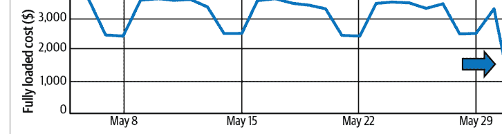
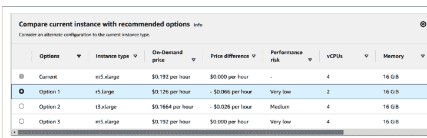

## The UI of FinOps

你的报告和仪表板为你的组织提供了 FinOps 的用户界面 (UI)。将报告视为你的 UI，你可以应用数十年来关于有效 UI 设计的研究。你应仔细审视这些报告作为 FinOps 实践的 *产品*。因此，它是用户与数据交互的界面。你在报告中呈现 FinOps 数据的方式会影响 FinOps 在组织中的推广成功。FinOps 产品应被视为生产工作负载：质量很重要，清晰度很重要，用户体验 (UX) 很重要。这些因素带来对数据的信任，从而使团队能够做出决策，并避免浪费时间来为数据的质量辩护。

制作包含漂亮图表和数据表格的报告很容易，但更难的是根据用户需要了解的内容向他们讲述故事，并使他们能够就需要采取什么行动做出决策。本章涵盖了一些重要概念，帮助你构建高质量的 FinOps 报告。我们将在本章剩余部分使用 *报告* 一词，但这些概念和建议同样适用于用于向用户交付 FinOps 数据的仪表板和商业智能系统。

## Build Versus Buy Versus Native

在思考作为 FinOps 实践一部分你将创建的报告时，首先考虑完成工作所需的工具和平台。正如你在第 5 章中所学到的，为了创建 FinOps 报告，你必须持续处理的数据量可能非常巨大，因此你很可能拥有整套工具箱。问题是你将使用哪种类型的工具。本章中的概念并非意味着你应该构建自己的 FinOps 报告平台。它们也并非旨在阻止你这样做。我们通常看到通往成功 FinOps 数据管理的多种工具路径：

- *原生工具* 如 AWS Cost Explorer、Google Cloud Cost Management 或 Azure Cost Management 在开始 FinOps 之旅时始终是起点。
- *软件即服务 (SaaS) 平台* 如 FinOps.org 上指定的 Certified FinOps Platforms 通常被采购以超越原生工具并加快相对于自行构建系统的价值实现时间。它们还充当你在多云计费数据不断变化的环境与你之间的关键抽象层。
- *先购买后增强* 是我们越来越常见的一个主题，其中大型云支出方会采用原生工具或平台的 API，并在其范围的边缘添加自定义功能，以及将数据集成进出它们。
- *自研工具* 是 2022 年 FinOps 状况数据中增长最快的细分市场；有时从零开始构建，但通常是在现有商业智能 (BI) 工具（如 Tableau 或 Looker）之上构建，或使用特定于云的解决方案（如 AWS Cost Intelligence Dashboards 或 Google 的 BigQuery Export）。

与许多事情一样，你采取的方法取决于公司的资源、文化和技能。我们知道一些成功的庞大 FinOps 实践完全依赖平台，也有一些完全依赖自研工具。大多数，如果不是所有组织，都将依赖于一套工具和方法，随着其成熟度的增长和云使用情况的变化而变化。没有唯一正确答案。

## When to Use Native Tooling

每个云提供商都提供自己的成本管理工具集。我们建议你始终从原生工具开始。它通常提供你在早期成熟阶段所需覆盖的核心功能。随着你的云支出和复杂性增加，很可能你需要比原生工具所能提供的更多功能。此时，讨论就变成是构建还是购买。不管你如何推进，原生工具仍然可以作为来自你平台数据的合理性检查，并且通常将是你与云服务提供商支持团队沟通的方式。及时了解原生工具的最新情况，并确保组织中的合适人员可以访问它们。

通常，原生工具分为两类。首先是专为成本管理而构建的工具，如 AWS Cost Explorer、Google Cloud Cost Management 和 Azure Cost Management。其次，随着你的成熟，还有 BI 工具——如 Google 的 Looker 和 AWS 的 QuickSight——云服务提供商提供的报告模板可让你通过工具更深入地自定义报告。

## When to Build

在 FinOpsPod 播客中，Target 的效率工程总监 Kim Wier 讲述了她的 CIO 将 Target 视为产品公司，因此大部分开发都在内部进行的故事：

> 我们需要在 Target 内部拥有知识。我们的 CIO 不希望将技术知识外包给其他公司。Target 的开发在很大程度上在内部进行。我们建立了软件工程文化，因此所有开发都在内部进行。

因此，Target 投资了一个强大的 FinOps 工程团队来管理数据管道和摄取，以及前端开发团队为各种角色（如工程师和领导层）开发自定义仪表板。

以下是人们选择自行构建报告层的一些常见原因：

- 对自己的数据进行控制
- 轻松集成内部数据（单位经济数据、分类数据、性能数据等）
- 根据特定公司需求定制功能
- SaaS 模式通常不具备所需合规性（例如 FedRAMP、SOC 2）
- 费用结构并不总是随价值而扩展
- 报告的灵活性
- 能够快速做出更改
- 公司内部具备执行复杂软件开发和数据分析的技术能力
- 组织愿意持续投资学习不断发展和扩展的云数据细节

## Stories from the Cloud—FinOps Community

这个来自 FinOps Foundation 成员 Slack 论坛的故事由 Avalara 的成本优化总监 Lindbergh Matillano 分享：

> 我遵循 People、Process 和 Tools 的理念。首先需要合适的人到位，其次是流程，然后才是工具。我经常看到组织在没有合适的人和流程到位之前就投资工具。这通常会导致工具利用不足或围绕工具设计的无效/低效流程。

我至少为四家公司启动了 FinOps 实践。当我进入一个组织时，我做的第一件事就是运行使用报告来回答以下问题：

- 过去三个月有多少人访问过该平台？
- 哪些报告被定期使用？
- 哪些功能正在被使用？

如果使用率较低，我会在评估平台投资回报率时深入探究导致这种低使用率的根本文化原因。

我经常发现利益相关者：

- 偏好原生工具（例如，Cost Explorer）
- 请求对标准报告进行修改，而这些修改超出了平台的能力范围
- 仅使用平台 10% 的功能（大多与报告相关）
- 希望了解平台自动化的代码，因此不允许自动修复，尤其是在生产实例中
- 尝试将平台定制以满足组织的特定需求通常需要定制或变通方案，从而增加工具成本。

对于自建或购买的平台，要想成功，它需要得到成本意识文化的支持，因为如果没有以成本和云价值为核心的 FinOps 文化关注，工具就会失败。

在某些情况下，购买平台可以节省开发时间和资源。但我认为让工程师参与构建解决方案有助于培养成本意识文化。

## 为什么要购买

相反，Equifax 全球技术首席财务官 RJ Hazra 选择购买平台，以便更快地转向关注 FinOps 的文化方面，同时也关注自动化工作：

> 我们使用采购的 FinOps 平台来生成可见性。但这还不够——我们需要能够快速对可见性采取行动。财务和工程部门需要比以往任何时候都更紧密地合作。CTO 优先考虑 FinOps 文化转型，并授权组织中的 SREs [Site Reliability Engineers] 帮助推动并说服其他工程师。我们需要工程师与工程师就使用优化进行沟通，而不是构建工具。我们需要弄清楚如何构建云提供商的承诺结构，因此我们也将采购/采购部门纳入了团队。

Couchbase 高级云 FinOps 经理 Michael Barba 分享了他对为什么要购买 FinOps 平台的观点：

很多公司可能没有内部工程资源来构建自研工具，或者即使有，这些人员在其他地方更有价值。对 Couchbase 来说，这意味着专注于构建我们销售的服务，而不是构建可以通过软件外包的内部报告。

以下是人们选择购买 SaaS 平台的一些常见原因：

- 快速实现价值：通常设置时 IAM 和云控制台工作量很少
- 简单的工具可创建映射支出的自定义分组
- 复杂的数学计算（如摊销的 RI 映射）已计算完毕
- 比原生工具提供的更详细的优化功能
- 可访问平台公司的主题专家
- 平台提供商可降低云数据和数据质量变化带来的风险

## 来自云端的故事——FinOps 社区

这个故事来自 FinOps Foundation 成员 Slack 论坛，由法国跨国制造公司 Saint-Gobain 的 Angel Alves 分享：

> 当我加入上一家公司时，他们已经在使用第三方工具。我尝试改回自建解决方案，但挑战在于资源不足。我可以替换类似的报告（单一厂商，无 Kubernetes），但我们的路线图包括采用另一家云提供商以及 Kubernetes。在投入精力构建支持该路线图的解决方案时，决定工程资源有其他优先事项，因此我们选择继续支付第三方平台费用，而将重点放在促进新云提供商和 Kubernetes 技术的采用上。

Slack 中的另一位人士也分享了他们对平台的看法：

> 对我们来说，简单来说就是我们没有资源/时间自己构建。使用第三方平台为我们节省了大量时间，并允许我们自动保持最新（新 AWS 服务、Kubernetes 支持等）。尽管有所改进，但原生工具目前还不够好，至少现在是这样。我们经常看到有人询问“如何做 XYZ”，而这些通常已经由我们使用的第三方工具提供。

我们鼓励你将本章中的概念视为透镜，以便使我们讨论的任何路径更加成功。FinOps 依赖于推动问责制和决策，这使其本质上成为从与同事的对话到你在报告中呈现的数据的 UX 挑战。

## 运营化报告

你的报告和仪表板必须以一致的方式呈现信息，具有高质量数据以及高度的审查和控制。你应该像工程团队对待其生产服务一样对待你的 FinOps 报告，具有控制、质量检查和严格审查。如果你的报告出现故障或开始呈现不正确甚至不一致的信息，那么组织内部的 FinOps 将受到不利影响。

## 数据质量

Mike 的同事 Diana Mileva 是 Atlassian 的云 FinOps 高级业务分析师，她在 FinOps X 2022 上就 FinOps 报告中的数据质量发表了演讲。Diana 解释了数据质量的重要性以及 FinOps 团队处理数据问题的方法。Diana 演讲中的关键内容包括数据延迟、数据问题、质量检查以及 FinOps 从业者面临的报告挑战。

> *当有人质疑我们的 FinOps 数据时，我们将其视为生产 bug 并开具 jira 票据进行调查。我们对整个数据集执行自动数据质量检查，并辅以 SLOs [service level objectives] 来衡量及时性和准确性。我们的目标是在用户之前检测到任何问题并主动通知他们，以便他们不会基于错误信息做出决策。*
> 
> —Diana Mileva，Atlassian 高级业务分析师

在本书印刷时，在大多数云中，使用云资源与其接收使用该资源的计费数据之间存在延迟。延迟通常为 24–48 小时。不幸的是，延迟并不一致，尤其是在月初和月末时可能会更长。你有时可能会收到最新可用计费数据期间的部分数据。其影响是 FinOps 报告可能会错误地显示在最近报告小时内成本下降，并且可能缺少最后一天或两天的数据——见图 8-1。

图 8-1. 由于数据交付延迟，最近几天云成本数据出现下降

一种常见做法是从报告中删除最近几天的数据以避免成本下降。虽然修剪可用数据对于使呈现的数据更一致非常有帮助，但它并不是万能药，无法消除对报告数据质量进行额外监控和警报的需求。

对于构建自己的报告的高级从业者，我们建议你在报告上显示两个日期，一个日期表示报告最后更新时间，另一个日期表示创建报告时可用数据的最新程度。这对于不显示按小时或按日细分且仅提供汇总数据的报告尤其重要。

云服务提供商在交付客户计费数据方面出现问题的情况屡见不鲜，导致在月末最终账单更正之前一段时间内数据不完整或不准确。这些数据问题经常导致问题——无论使用内部工具还是供应商提供的解决方案——在后处理中丰富云服务提供商计费数据。

为了检测计费数据问题，监控计费报告中数据质量非常重要。这使你能够在报告中呈现的数据出现问题时提醒员工。主动提醒员工有助于你保持对 FinOps 报告的信任。云服务提供商可以更改数据报告方式。虽然顶级云提供商今天提供了更多关于其报告结构的详细信息，并且经常发布有关即将发生更改的信息，但并非总是如此。我们见过云服务提供商修复计费数据中的不一致问题，这可能导致公司处理不一致数据的现有方法失效。

FinOps 报告基于查询构建，查询可能会错误处理特定事件。例如，年份变更，查询错误地处理日期滚动到下一年的情况，以及假设特定值存在的查询，这会意外过滤掉数据。验证查询不仅在你首次构建报告时很重要，而且在报告可用期间也很重要。这在采用他人创建的报告时尤其重要，无论是公司内部还是社区外部。了解这些报告底层使用的查询的局限性可以避免信息被误解或错误的情况。

如果你的用户发现报告中呈现的数据不正确或不一致，那么对报告的信任就会下降。这种信任的丧失可能导致工程师不作为，或出现大量未经授权的工具和报告，这些工具和报告通常与官方 FinOps 报告不一致，导致决策缺乏或基于错误数据做出决策。此外，不一致的报告会导致花费大量时间来调和差异并讨论正确性。

的数据。FinOps 团队提供统一的云成本数据用户界面的目的，是为工程团队节省自行梳理这些细节所需的时间和精力。当他们不信任报告时，不仅成本节约可能消失，而且宝贵的工程工时也会流失。

正如 Diana Mileva 在她 2022 年 FinOps X 演讲中所说，“数据质量的单个报告被视为需要迅速调查的生产事故，包括向报告者持续沟通以及对任何实际问题的事后分析。通过这一过程，我们不断改进数据的质量，同时也让利益相关者信任我们认真对待数据质量问题。”

防止不良数据进入报告很重要，但有时这可能无法完全避免，因此建立能够检测数据问题并主动提醒用户的流程，有助于维持对报告的信心。

## Perfect Is the Enemy of Good

数据质量并不意味着 100% 实时精确到微分钱。它意味着数据持续足够好，能够做出明智的决策。不可避免的是，由于上述一个或多个问题，你的报告中会出现一些错误或不准确之处。但 FinOps 团队的工作是采取措施——商业上合理的努力——以确保所呈现的数据一致、最新，并且具有足够的准确性来支持组织做出正确的决策。随着时间的推移，可以对可用信息的处理及时性、数据摄取和规范化流程、新增数据源以及查询优化进行调整。

> *Above all else show the data.*
> —Edward R. Tufte

## Report Tiering

你为团队构建以呈现数据的报告并非都同等有用或正式。有些报告是你依赖来代表官方分摊报告的，而另一些报告只是回答临时性问题。报告分层可以成为区分报告的有效方式。

Diana 继续分享：“内部我们将报告标记为受管或不受管。如果你想要临时构建的东西，我们会创建一个不受管报告并如此标记。于是会出现大量不受管且未保持更新的报告列表。例如，随着新的数据架构进入计费数据，查询可能需要更新，或者查询的编写方式仅针对当月。为了保持对报告的信任，请务必维护并标明哪些是受管报告，哪些是未维护的。”

成熟的 FinOps 实践可能会随着时间积累数百份 FinOps 报告，其中许多是在特定时间点创建的，以回答业务之前提出的问题。理想情况下，团队会持续策划一个更小且更集中的主要报告集合，代表其认为分布式团队应最关注的黄金标准。

## Stories from the Cloud—Jason Rhoades

Intuit 的开发经理 Jason Rhoades 分享道：

我们不到十份官方报告，可以回答所有适合以图形报告方式回答的问题。这些报告中的数据通过筛选器缩小到相关方感兴趣的云部分。

他继续指出，数据民主化是有帮助的，但有一些注意事项：

你不想成为对所有人封闭的孤岛；同时，开放也会带来风险，即数据使用者在构建其定制产品时会出现错误——甚至只是做出不同的决策——以至于你的 FinOps 团队被牵扯进来，不得不解释为什么 Team X 的定制报告中的数字与主流报告不同。

这确实是一个风险，但应权衡这些团队可能发现或证明核心团队未曾想到或没有周期自行开发的新视角或能力价值的可能性。实质上是众包 FinOps 创新。

当 FinOps 团队成为数据提供方时，应建立明确的责任边界，以限制在数据被误用或更确切地说是被消费团队误解时可能产生的责任。

随着报告集合的不断增长，用户将不清楚哪些报告重要、哪些是最新的，以及用户能否信任数据。通过明确标记你的报告，你可以引导用户了解各自的区别。

理想情况下，你应为报告应用分层或分类系统，从标记创建日期并标注为未维护的低层报告，一直到用户可以轻松识别的高层生产报告，表明它们维护良好、质量受监控，并且用户可以信任它们。

为特定目的在特定时间点回答特定问题的临时报告是 FinOps 流程的重要组成部分。然而，你应努力不断删除不再相关或不再提供价值的旧报告。这样做可以降低员工找到错误报告并据此做出决策的可能性。

给员工一个特定报告的链接，下周他们会回来索要另一个报告的链接。给员工提供一份更新的生产报告列表的链接，他们将永远受用。这显然是对一个与钓鱼相关的常见谚语的改编，但它在思考如何引导员工使用你提供的 FinOps 数据时非常有用。虽然直接引导他们到有助于当前情况的报告是有帮助的，但确保他们也知道未来如何找到你的报告，将减少 FinOps 团队的支持负担。

## Rolling Out Changes

随着时间的推移，你的报告需要发生变化：新数据将变得可用，而某些数据将变得无关紧要。下一节介绍通用报告，但有时你的报告可能需要拆分为两份。在未通知的情况下更改生产报告会影响你的 FinOps 实践，因为用户不会理解更改的原因、新数据代表什么，以及他们去哪里获取被移除的数据。

手动更改生产报告存在使报告处于损坏状态的风险，其结果是用户会认为报告不可信并今后避免使用数据。拥有生产报告的暂存副本允许你测试拟进行的更改，并为你在对生产报告进行更改前为用户准备文档提供位置。随着更改的实施，让用户参与其中将确保他们理解如何继续使用你的报告。

理想情况下，你的 FinOps 报告可以通过 API 配置，或使用某种文件上传进行保存和恢复。这使你能够将报告配置存储在配置管理系统或代码仓库中。保留报告的先前配置，以便在更改未按计划进行时能够快速将报告恢复到已知良好的状态。

## The Universal Report

随着报告数量的增长，实践者倾向于尝试将所有 FinOps 数据整合到我们所称的通用报告中——一份统御一切的报告。这份通用报告塞满了所有能容纳的数据，而不考虑其传达的信息或数据向用户呈现的清晰度。通用报告几乎总是难以阅读，这削弱了用户理解所传达信息的能力。这些报告通常对数据没有结构或组织，只是提供大量彼此之间没有关联的信息。

当数据点之间存在明确联系，并且有关于用户如何阅读和理解报告的故事时，合并报告是可以接受的。另一方面，你应审查你的报告并确定何时最好将报告拆分为两个或多个更清晰的报告，每个报告都更容易让用户理解。

设计新的 FinOps 报表时，尽量保持简洁。只包含必要的信息，并在实际可行的范围内尽可能进行汇总。你可能有数百列可添加的数据，但包含过多信息会使报表更难理解。或者，更好的做法是提供交互式报表，允许用户在需要时深入查看所需信息、添加更多上下文，或仅在个人需要时连接更多数据点。

当你构建交付给用户的报表与用户按需加载的报表时，这一点变得尤为重要。交付的报表会缺乏上下文，需要简短清晰地传达其信息。如果交付的报表复杂且信息过多，用户会将其存档以便有更多时间阅读，而事实上他们永远不会这样做。

> 杂乱和混乱是设计的失败，而非信息的属性。
> —爱德华·塔夫特

借助设置可提醒你变化的报表的能力，你可以创建监控意料之外情况的报表，例如你未使用的云产品产生的费用、未挂载的存储卷，或每日成本跳升超过设定百分比的情况。这些报表的通知功能意味着你无需每天检查其状态。相反，让报表来提醒你在需要阅读时通知你。

FinOps 报表最成功时，你识别出员工需要回答的常见问题并针对性地设计报表来回答这些问题。问问自己：“我用这份报表试图回答什么问题？”并确保报表实现了这一目标。同时，考虑员工使用报表所需了解的信息。例如，如果他们需要应用程序名称或成本中心编号，请确保引导用户先查看有助于获取这些信息的报表。

将你的报表想象成层蛋糕，最上层的报表使用所需信息最少，并仅提供足够的信息以便在下一层使用报表。随着用户向下移动报表层级，他们正在以更精细的粒度深入特定区域的更多细节。只有当用户需要额外细节来回答他们的问题时，才需要深入信息。

## 无障碍访问

让你的 FinOps 报表对所有员工都可访问至关重要。在构建报表时，请考虑你无法向所有用户解释报表。如果同事阅读报表时你必须在场，那么你在组织内扩展 FinOps 将会困难。

本节提供了 UI 中使用的一些常见设计指南，可帮助你的 FinOps 报表更实用。如果你的组织有专业的报表或 UI/UX 团队，他们可能还能为你提供已在使用的示例以进一步帮助。

多年来，信息设计领域涌现了许多优秀书籍。我们推荐你阅读其中一本：《Envisioning Information》（Graphics Press, 1990），作者 Edward Tufte，本章中多次引用了他的观点。

## 颜色

在起草本书第一版时，我们犯的一个错误是撰写了引用文中图表颜色的内容。结果书要以黑白印刷，图表现在变成各种灰度，而内容却写着诸如“红色线条对比蓝色”。这种颜色的去除使许多图表变得不清晰，我们不得不重新设计它们并重写引用。虽然无彩色视—仅以黑白视觉—并不常见，但在较大组织中拥有某种形式色盲的员工是很可能的。因此，你应旨在使用不仅仅是颜色来表示报表中的不同元素。与其只有红蓝两条线，不如一条实线一条虚线。与其使用纯色柱状图，不如选择一种带条纹、另一种带圆点的样式。如果无法更改图表格式，最好将一个包含多个堆叠项目的图表改为两个单独的图表。

## 视觉层次

在报表和仪表板中布局内容时，将相关项目放在一起。围绕相关内容设置视觉边框，并在间接关联的内容之间划清界限。考虑内容布局方式将使你的报表对受众更直观易读。

你应考虑报表上信息的视觉层次安排，其中汇总信息通常位于顶部或左侧，而更详细—或较不重要—的信息位于下方或右侧。

## 易用性和一致性

用户会迅速放弃难以交互且缓慢的报表和仪表板—这增加了在组织内实施 FinOps 的挑战。随着你构建报表和仪表板集合，力求保持性能和一致性，使员工更容易理解如何使用它们。

## 语言

第 4 章介绍了 FinOps 的语言。在讨论 FinOps 时在报表中使用相同的术语将保持一致性。不要在报表之间更改术语或使用不清晰的术语，导致用户询问你的本意。我们经常看到 FinOps 从业者在创建报表时使用术语 cost 存在不一致。正如我们在第 4 章提到的，这可能是未混合成本、摊销成本或完全加载成本中的任何一种。

## 颜色和视觉表示的一致性

需要使用除颜色之外的区分方式并不排除使用颜色。但应力求在颜色和视觉表示的使用上保持一致。当你在一个图表中将节省显示为绿色虚线，而在下一个图表中用实心蓝线表示节省时，读者不会清楚两者代表相同事物。更糟的是在不同项目间跨图表使用相同的颜色/线型，迫使用户仔细查阅每个图表的图例来确定是什么。同一报表内或 FinOps 报表套件中的不一致会让员工误读信息并随着时间侵蚀信任。

## 识别与回忆

当数据一起呈现时，用户更容易识别离散信息之间的联系。如果你呈现的信息引用了屏幕外或另一份报表中的数据，你就迫使员工回忆之前呈现的信息，导致他们滚动查看或在报表间切换以提醒自己数值。相关信息的分离会使读者更难将其联系起来。这种联系对于长报表或大型仪表板至关重要。你应尽量将相关项目放在一起，不要迫使用户回忆其他地方呈现的信息。如果你确实需要引用其他地方呈现的信息，应重复关键信息或协助将其链接回正确位置。

> 比较必须在视域范围内强制进行，这是一个在实践中偶尔被遗忘的基本要点。
>
> —爱德华·塔夫特

你可能会发现相同的三个顶部汇总框出现在你制作的许多不同仪表板上，因为某些汇总级信息始终作为起点相关，但随后在较低层级出现的表格或数字会因不同角色或业务目的而有所不同。

## 心理概念

《如何赢得朋友和影响他人》（Simon and Schuster）一书的作者戴尔·卡耐基说，“与人交往的成功取决于对他人观点的同情性理解。” FinOps 在很大程度上是关于在正确的时间以正确的方式提供正确的信息，以影响和鼓励他人的行为。

为易用性设计报表很重要，但考虑报表中包含的信息也会影响用户从中获得的内容。认知行为或认知心理学领域在过去 20 年里蓬勃发展，让我们越来越了解人类常见的偏见和行为，以及如何应用技术来利用（或缓解）这些偏见。

明确地说，这不是一章关于如何用认知行为科学 trick 人做事的，而是关于理解人们在阅读你的 FinOps 报表时因为他们是人而会有的一些偏见，以及如何围绕这些偏见设计或以决策者不会陷入众所周知的认知陷阱的方式呈现信息。

让我们看看如何将一些心理理论应用于使你的 FinOps 报表更有效。

## 锚定偏差

当某人对信息思考或解释出现错误时，*认知偏见*通常在起作用。*锚定偏差*，或*锚定效应*，是一种认知偏见，其中早期向用户呈现的信息会影响他们后来对其他信息的感知。摘自维基百科：

> *锚定效应*是一种认知偏见，其中个体的决策受特定参考点或“锚点”影响。例如，如果一辆车与更昂贵的车型（锚点）并列展示，个体更可能购买它。谈判中低于锚点的价格可能看起来合理，甚至对买家来说很便宜，即使这些价格仍相对高于汽车的实际市场价值。

你当地的零售商经常使用这种方法。每次你进入商店看到那台价格几乎不切实际的昂贵电视时，这就在你的脑海中锚定了什么是昂贵，因此你更可能购买的其他电视相比之下看起来都是超值优惠。

考虑一份向工程团队展示其服务成本的报告（见图 8-2）。在报告开头，你列出了整个组织中最昂贵的 10 项服务，这会让工程师以这些最昂贵服务的成本为锚点，并可能影响他们对自己服务的看法。

### 每周 FinOps 报告

| 服务名称 | 每周成本 |
|---|---|
| Application 1 | $10,000 |
| Application 2 | $8,000 |
| Application 3 | $7,500 |
| Application 4 | $6,300 |

### 团队 A - 服务成本

| 服务名称 | 每周成本 |
|---|---|
| Application 5 | $2,000 |
| Application 6 | $560 |
| Application 7 | $200 |
| Application 8 | $1,250 |

图 8-2. 示例每周 FinOps 报告，供团队展示

仅展示其服务的成本，而不包含其他团队的支出，将有助于避免这种偏差，并让你的团队更公平地评估其服务的成本。

尽管添加这些额外信息可能是出于提供信息的意图，但为了实现报告的预期效果，你应考虑所需的信息，并评估添加可能锚定用户的额外数据点的影响。

## 确认偏误

另一种认知偏误是确认偏误。用户从你的报告中寻找信息，并以支持其先前信念的方式进行解读。来自维基百科：

> 确认偏误是指以证实或支持个人先前信念或价值观的方式搜索、解释、偏好并回忆信息的倾向。人们在选择支持其观点的信息而忽略相反信息时，或在将模糊证据解释为支持其现有态度时会表现出这种偏误。

在不同报告中提供信息会让用户选择支持其思维的报告。一致性和识别可以帮助抵消确认偏误。

避免通用报告设计也能遏制确认偏误，因为它让每份报告或仪表板都聚焦于特定问题，而不是提供 10 或 20 个数据点让用户从中寻找一些好消息来关注。

例如，一份包含可能需要调整大小的 40,000 个计算资源并按应用团队分组的报告，几乎让任何人都能找到做得比自己差的人。另一份题为“Resources [Yourteam] Should Consider Rightsizing as Soon as Possible”，列出前 5 或 10 个可节省资金的资源，提供了一份无人能否认的清单。

## 冯·雷斯托夫效应

与人们如何回忆信息相关的另一种心理理论是冯·雷斯托夫效应，也称为分离效应。来自维基百科：“The Von Restorff effect, also known as the ‘isolation effect,’ predicts that when multiple homogeneous stimuli are presented, the stimulus that differs from the rest is more likely to be remembered.”

当呈现一组项目时，与其他项目不同的那个项目更有可能被记住。应用于你的 FinOps 报告时，最有可能被员工记住的是最大或最小的项目（见图 8-3 示例）。或者，如果你的某个图表使用独特的配色或样式，它在记忆中会比其他图表更突出。

| 服务名称 | 每周成本 | 与上周差异 |
|---|---|---|
| Application 8 | $1,250 | +1,000 |
| Application 6 | $560 | +$50 |
| Application 5 | $2,000 | +$15 |
| Application 7 | $200 | -$25 |

图 8-3. 包含每周差异的服务成本

如果你向工程师展示一份显示其服务成本的报告，并且只显示每项服务的当前每周支出（如图 8-2 所示），那么工程师会记住成本最高的服务。相反，如果你还包括每项服务环比增长的金额，你就可以影响工程师回忆增长最快的服务。利用这种效应，你可以引导工程师在阅读报告时朝着你想要实现的结果发展，即关注增长最多的项目。

## Hick’s Law

为了帮助员工做出决策，你的报告通常会呈现多个选项供其决定。希克定律是一个简单的概念，指出随着呈现的选项数量增加，决策时间也会增加。来自维基百科：

> 希克定律描述了由于可能的选择而导致一个人做出决策所需的时间：增加选择数量会使决策时间呈对数增长。希克-海曼定律评估选择反应实验中的认知信息容量。在希克-海曼定律中处理一定数量比特所需的时间被称为“信息获取率”。

FinOps 中的优化报告通常会包含一些供工程团队考虑的替代建议。你应力求只呈现最有可能被选中的最佳建议。

考虑一个具有多个选项的建议。

其中两个选项只会导致云成本略有降低，另一个则是对工程师而言的高风险变更。移除无效的项目可将工程师需要考虑的总项目数从五个减少到两个，很可能导致更快决策。在图 8-4 中，AWS Compute Optimizer 控制台限制了向用户展示的建议数量，并显示价格差异和性能风险以帮助工程师做出决策。保持建议数量最少还有额外好处，即减少工程师阅读所有选项所需的时间，并可提高生产力。

图 8-4. AWS Compute Optimizer 控制台，显示用于调整 EC2 实例大小的建议

希克定律及其对选择的隐含限制与 FinOps 基金会框架能力相契合：建立 FinOps 决策和问责结构。诸如将推荐何种优化（仅节省超过某一阈值的优化、仅针对这些类型资源的优化、仅针对已达到一定效率水平的团队的优化、仅针对低于最低效率阈值的资源的优化等）的政策决策，为最小化 FinOps 团队呈现的选项提供了模型，并提供了选择或排除某些选项的原因的透明度。

## 关于报告的视角

在评估你的 FinOps 报告集合的设计时，请考虑本节讨论的视角。它们将有助于确定报告的预期成果，并影响你需要包含的基本要素。

### 人物角色

与本章前面讨论的通用报告概念相反，请考虑何时最好拥有以人物角色为中心的报告，为组织内的特定角色提供所需细节，而不是试图制作一份能回答所有人物角色所有问题的单一报告。例如，将领导层报告——将具体细节汇总为 FinOps 在组织内表现的高层概述——与工程师用于跟踪其个人服务成本的报告区分开来。这使你能够构建更有针对性的报告，最有效地推动 FinOps 成果。至关重要的是，这些报告在指标定义和语言方面保持一致。如果你的某份报告显示某个指标偏离轨道，另一份报告应反映该指标的相关改进机会。

### 成熟度

随着你的 FinOps 实践成熟，可报告的信息量将迅速增长。随着你实施 FinOps 基金会框架的更多能力，你将增加需要跟踪和报告的更多成功衡量指标。进一步能力的增加也会增加员工需要执行的额外功能活动。依靠你的报告来了解何时需要完成任务，并衡量执行任务所带来的成果。

此外，随着你对云服务的采用增加，需要呈现的信息量也会增加。团队通常专注于核心云服务，例如计算、数据库和存储，但随着组织云成熟度的提高，

预计会看到团队使用的更长的云原生服务列表，例如函数即服务（FaaS）、机器学习（ML）或更高级别的应用服务。这些新增的服务将引入不同的计费结构。有些按时间计费，如每秒或每月；其他则按数量收费，甚至两者兼有。云账单中使用的服务越多，报告云成本的任务就越复杂。

## Multicloud

随着组织开始大量使用多个云服务提供商，您的 FinOps 团队可能会从单独的报告开始，尤其是如果您选择使用每个单独云服务提供商的计费工具。虽然主要云服务提供商使用的许多术语和概念在功能上相似，但在命名约定和服务分类方面存在差异，这可能会令人困惑，并且某些元素是特定云服务提供商独有的。关于云中标签和元数据结构差异的良好分析可在第 12 章找到。

将不同云的数据分开会迫使用户在各种环境之间回忆信息并自行关联相似概念。正如 Edward Tufte 所说，“比较必须在视域范围内强制执行。”

> 比较必须在视域范围内强制执行。

为了减少与多云报告相关的努力和困惑，最好将云数据合并到一致的报告中，在这些报告中，连接信息的复杂性已得到正确处理。为实现这一点，您可能需要超越原生工具，使用内部或外部供应商工具。

数据摄取和规范化是 FinOps Foundation Framework 的基础能力，用于实现其他能力。有效的 FinOps 实践需要访问定期流的详细使用、利用率和成本数据，这些数据可以分类和分析以推动决策。监控平台、安全平台和业务运营应用程序也可以提供数据，用于告知利用率、位置、价值和使用情况，通常在相似的量级和粒度水平上。随着数据复杂性和多样性的增加，数据摄取和规范化挑战也在增长。在确定如何处理您自己的数据时，请务必查看框架中与此必需能力一起提供的成功衡量标准。

## Putting Data in the Path of Each Persona

FinOps 数据对于最大化云支出价值是必需的，不幸的是，它通常隐藏在孤立的 FinOps 特定报告和工具中。当这些报告被遗弃在日常工作流程之外的仪表板中时，它们会被最需要它们的工程团队、业务领导者和财务团队所低估。为了抵消这一点，目标是*将数据置于*每个角色已建立的工作方式的路径中。

## Data in the Path of Finance

首先看到某种形式 FinOps 数据的角色通常是财务团队。这源于共同的兴趣，因为财务希望将云支出数据添加到其已建立的财务报告系统中。云支出首先与公司采购订单关联，以帮助将支出分配到正确的预算中。将 FinOps 数据纳入财务系统允许您现有的财务流程与汇总的云支出一起工作，并减少与财务团队的摩擦，这些团队拥有通常无法偏离的完善的报告和审计要求。

## Data in the Path of Leadership

领导层和执行报告也应包含 FinOps 数据，显示云支出数据与现有业务指标的关系。为了让业务领导者做出决策，请确保关于云支出、节省和机会的关键信息出现在他们习惯消化的其他数据中。将 FinOps 数据与其他业务数据分开会强化 FinOps somehow 与业务其他部分脱节的错误认知。正如我们在 *第26章* 中将要介绍的，您应在领导层报告中提供 *单位经济指标*，将云支出与业务指标结合起来，以展示云使用对业务的价值和影响，而不仅仅是成本。

## Data in the Path of Engineers

最后，但可能也是最重要的，我们强烈建议您努力将 FinOps 数据带入工程师的工作路径中。当您的工程师开始思考 FinOps 时，这不应是对他们完善的日常习惯的巨大偏离，即，您不希望他们远离做 DevOps 而花费时间 *做 FinOps*。理想情况下，它成为一个连贯流程中集成且必需的工作。

我们经常说，*成本只是另一个效率指标*。工程团队将拥有专注于大量关键指标的仪表板和仪式。这些仪表板将监控安全、性能和可靠性指标，以成功管理在云中运行的服务。目标是将关键 FinOps 数据添加到这些现有位置和系统中。将他们需要开始考虑云支出变化的数据——例如实际值与预测值以及降低成本的机会——引入到他们持续的冲刺计划中。孤立的 FinOps 数据和对话会造成认知负担和分心，这不可避免地导致仅在强制要求时才发生的被动成本工作。因此，工程师会将 FinOps 任务视为对他们工作的中断，而不是工作的一部分。

在开发生命周期的早期以及现有流程中引入 FinOps 数据，可以鼓励他们在设计新架构或改进代码的每一步都考虑成本。工程师需要为 FinOps 活动分配适当的时间，以实现业务在云效率方面的期望成果。

## Connecting FinOps to the Rest of the Business

> 倾听不仅仅是在对方说话时保持安静，直到你可以说出你想说的话。
> —Krista Tippett，记者

而不是重新发明轮子，很可能已经存在负责财务、执行和工程报告的团队，FinOps 团队可以与他们合作以整合自己的数据。这提供了教育这些角色了解 FinOps 并继续打破组织内部学科壁垒的机会。它还提供了一个重要的接触点来解决本章前面讨论的 UI 概念，确保语言一致且数据以鼓励行动的方式呈现。这些现有团队通常擅长使用 API 提取和处理复杂数据，使其成为可读且一致的报告。

Data in the Path 概念背后的想法并不是将整个 FinOps 世界塞入每个人报告的中间。只带来使 FinOps 所需的针对性对话和决策成为可能的关键信息，而不会中断当前仪式。当由此信息引发需要更深入报告和分析的问题时，那就是将员工连接到您 FinOps 工具库中可用的更详细报告的时候。

您的工作是确保每个团队都拥有真正理解云消耗数据的背景，并在面对数据时做出正确的假设，从而为业务带来正确的行动。无论原始数据与其他工作流程的集成程度如何，都只能从中获得有限的信息。

## Seek First to Understand

看到优化建议或某种效率评分数据时，可能会诱使人假设该基础设施的所有者没有考虑成本、忽视效率或只是恶意行为者。不要做假设，而是使用 FinOps 数据开启一次无指责的对话，先寻求理解决策，然后再尝试影响它们。

Kim Wier，Target 的效率工程总监，很好地运用了这一模式。她的中央 FinOps 使能团队会前往各个工程团队，请他们说明资源的高效使用应是什么样子。“询问他们希望如何查看效率指标很重要，”她说。“工程师希望在符合 Target 最佳利益的前提下，尽可能充分地利用其基础设施。”然后她可以提供与该特定团队业务目标相一致的相关 FinOps 数据。Kim 继续说道，“我们旨在根据平台合作伙伴认为对平台重要的内容输出建议。如果我们提出建议，而工程团队有充分理由无法执行，那么我们希望这种反馈循环能够重新纳入我们的建议中。”

## Stories from the Cloud—Jason Rhoades

FinOps 的 UI/UX 并非总是只读的。报告和仪表板中的信息通常从数据源流向终端用户，但终端用户也可以向系统反馈信息。

Intuit 的开发经理 Jason Rhoades 分享道：

> 对于 Intuit 来说，一个重大的演进步骤是超越报告的只读概念，引入涉及终端用户执行写入操作的 FinOps 相关工作流程。这些可能像进行审批工作流以将某些云浪费从报告中排除/隐藏一样简单。或者是两个业务单元组之间为新的交叉计费而签订的合同，这会影响报告的结构。或者是团队为预测和对账目的调整他们如何共同分配云资产。当我们开始超越简单的报告以实现此类功能时，我们发现可以更全面地解决更多问题。但这确实需要扩大中央 FinOps 团队并增加一些新的技能，以实现更具交互性和迭代性的报告能力。

这与 Noel Crowley 在 FinOpsPod 上从 Fidelity 描述的、由不成熟实践最常采用的 flawed 方法相悖：“通常发生的情况是，FinOps 团队从其原生或平台工具中获取优化建议并交给团队，试图让他们采取行动。接收这些建议的人随后会以各种理由反驳，称这种变更在业务上不合理，例如说‘是的，我可以进行 rightsizing，但我不这么做，因为 XYZ。’”相反，Kim 在 Target 的做法使她的工程合作伙伴能够引导她找到对其业务部分最有意义的解决方案，而不是试图对所有人强加一种无效的标准化方法。

## Conclusion

你创建的报告和仪表板是构建协作式 FinOps 实践最重要的工具之一。通过将报告视为 FinOps 的 UI，你可以使用常见的 UI 设计考量，使其更有效地传达正确的信息，从而促成积极行动。

总结如下：

- 将你的报告和仪表板视为生产环境，任何变更在部署前都需在暂存环境中进行测试。
- 报告和仪表板的质量可信度对 FinOps 成功至关重要。
- 报告的一致性可避免混淆或确认偏误。
- 考虑会影响报告查看方式的条件。
- 仔细选择在报告中呈现的信息，以最好地影响你想要的结果。
- 根据目标受众的视角设计报告。随着云之旅的推进，重新评估之前做出的设计决策。
- 为了使 FinOps 成为业务文化的一部分，将 FinOps 数据纳入工程师、财务和领导层使用的现有报告和仪式路径中。

本书第一部分到此结束。我们通过介绍 FinOps、你为什么需要它、它如何需要文化转变、云账单提供哪些洞察、FinOps 基金会框架以及最后 FinOps 的 UI 来奠定基础。第二部分进入有趣的部分：在你的组织内实施 FinOps 生命周期。
