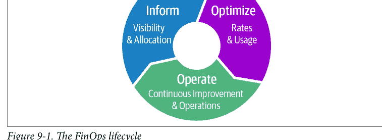
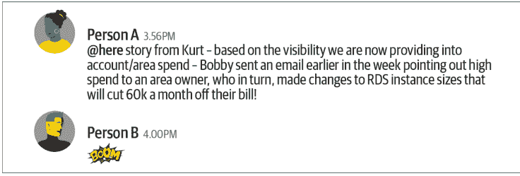

## The FinOps Lifecycle

回到第 1 章，我们讨论了 FinOps 的核心原则。这些原则非常有助于指导行动，而在第 7 章我们讨论了 FinOps 框架，它是基于这些原则构建的。本章涵盖 FinOps 生命周期中持续迭代的阶段，以及如何将其应用于 FinOps 的能力。这些原则自本书第一版以来变化不大。但我们看到许多不同的公司和组织开始在其基础上构建和迭代，使其成为自己的东西。就像 FinOps 框架一样，它是一组可根据组织相关需求以各种方式组装的构建模块，这些原则也是开源的基础，供你组装并为你的组织构建 FinOps 计划。

### The Six Principles of FinOps

再次说明，原则如下：

- 团队需要协作。
- 决策由云的业务价值驱动。
- 每个人都对其云使用负责。
- FinOps 报告应易于访问且及时。
- 一个中央团队推动 FinOps。
- 利用云的可变成本模式。

让我们看看每个原则在实际操作中如何体现及其现实影响，后面我们将深入探讨特定框架能力是如何设计来利用它们以实现特定结果的。

### #1: Teams Need to Collaborate

首先，FinOps 是一种文化变革，重点在于打破历史上从未紧密合作的团队之间的壁垒。当执行良好时，财务团队使用与云的速度和粒度相匹配的语言和报告，产品经理根据新功能带来的预期收入微调其应用扩展预测，而工程团队则将成本视为新的效率指标。

与此同时，FinOps 团队致力于持续改进商定的效率指标。他们帮助定义云使用的治理和参数，提供一定的控制，但首先关注确保创新和交付速度能够与成本效率并存地蓬勃发展。

将无责文化添加到这一原则中，使公司能够从错误中学习。去掉为成本超支寻找个人/团队归咎的需要，使事后分析可以专注于如何避免未来的超支，以及组织需要做出哪些改变来从此次事件中学习。

> *If a culture of finger pointing and shaming for “doing” the wrong thing prevails, people will not bring issues to light for fear of punishment.*
> —Betsy Beyer et al., Site Reliability Engineering (O’Reilly)

### #2: Decisions Are Driven by the Business Value of Cloud

首先思考云支出的业务价值，而非成本。将云视为成本中心很容易，尤其是在支出达到实质性水平时。云是价值创造者，但使用越多，成本越高。FinOps 的作用是帮助最大化该支出所创造的价值。不要专注于每月的成本，而应专注于每项业务指标的成本，并始终以业务价值为导向做出决策。

### #3: Everyone Takes Ownership of Their Cloud Usage

云成本基于云使用，这存在直接的相关性：如果你在用云，你就会产生成本，因此对云支出负责。通过将云支出问责制推向组织边缘，直至个人工程师及其团队，拥抱这一事实。并为他们提供信息和指导，使其能够为组织完成这项重要工作。

### #4: FinOps Reports Should Be Accessible and Timely

在按秒甚至微秒计费的计算资源、无限云存储、共享 Kubernetes 集群、自动化部署以及可能因外部控制触发器产生成本的服务的世界里，按月或按季度报告云支出是不够的。实时决策关乎获取

数据——例如支出变化或异常警报——应迅速传达给部署和管理云资源的人员。

如第 8 章所述，FinOps 数据应置于做出基础设施决策的人员的工作路径中，让他们在无需额外查找的情况下就能获得所需的信息。实时决策使这些人员能够建立快速反馈循环，从而持续改进支出模式、做出明智决策并提高效率。

坚持不懈地关注干净的数据以驱动决策。FinOps 决策应基于完全加载且分配正确的成本。成本应摊销以包含承诺计划中作为预付款的部分，并应反映公司为云资源支付的实际折扣费率。它们还应公平地计入共享成本并映射到企业的组织结构。没有这些对支出数据的调整，你的团队将基于错误的数据做出决策并阻碍价值创造。

## 5: A Centralized Team Drives FinOps

文化变革最好有旗手引领。中央 FinOps 职能通过教育、标准化和布道将最佳实践带入组织。这个中央团队是你找到能够通过倡导和教育改变文化的主题专家的地方。FinOps 团队通过更好的工具改进可用数据，并修改使组织能够进行 FinOps 的业务流程。通过集中化，你可以最大化费率优化工作的成果，这给予边缘团队自由来最大化使用优化的成果。请记住，最成功的公司将“使用更少”的责任下放，将“支付更少”的责任集中。

FinOps 从业者使用性能基准测试来提供组织表现如何的背景信息。云性能基准测试为公司提供其表现如何的客观证据。基准测试让团队知道他们是否花费正确，或者是否可以花得更少、花得不同或花得更好。公司应同时使用内部基准来确定各个团队在优化等关键领域的比较情况，以及基于行业标准的外部基准来将公司整体与其他类似公司进行比较。

## 6: Take Advantage of the Variable Cost Model of the Cloud

在云的去中心化世界中，容量规划从前瞻性的“为了满足需求你需要什么？”视角转变为实时的“在已使用资源的基础上如何保持在预算内？”视角。不要基于可能未来的需求来购买容量，而应基于实际使用数据来确定资源调整、批量折扣以及 RI/SP/CUD 的购买。由于你始终可以购买更多容量来满足需求，因此重点变为充分利用当前使用的服务和资源，并尽可能长时间地使用尽可能少的资源。

随着你的云实践成熟，力求利用随需求扩展的云原生服务以及诸如 spot instances 等可在需要时利用低成本资源的模式。

## The FinOps Lifecycle

现在我们已详细说明了核心原则，让我们探讨它们如何在三个不同阶段中实施：inform、optimize 和 operate（见图 9-1）。这些阶段并非线性——你应计划不断循环往复：

- 1. The *inform* phase gives you the visibility for allocation and for creating shared accountability by showing teams what they’re spending and why. This phase enables individuals who can now see the impact of their actions on the bill.
- 2. The *optimize* phase empowers your teams to identify and measure efficiency optimizations, like rightsizing, storage access frequency, or improving RI coverage. Goals are set upon the identified optimizations, which align with each team’s area of focus.
- 3. The *operate* phase defines and implements processes that achieve the goals of technology, finance, and business. Automation can be deployed to enable these processes to be performed in a reliable and repeatable manner.

Figure 9-1. The FinOps lifecycle

生命周期本质上是一个循环，永不完成。最成功的公司采取渐进改进的方法，每次循环都变得更好一些，通过重复和实践建立肌肉记忆。

在生命周期的每个阶段，你将根据云支出状态和 FinOps 实践采取行动并执行活动。第 7 章介绍了 FinOps Foundation Framework，该框架描述了 FinOps 运营模型的这些方面。我们用花园的比喻来描述这一点，你将根据花园当时的状态调整每天需要完成的任务——浇水、覆盖和除草。

inform 阶段是你查看 FinOps 花园状态的地方。optimize 阶段是你查看哪些能力具有可执行的操作以使 FinOps 花园更健康的地方。而 operate 阶段是你将在组织环境中执行这些操作以确保花园繁荣的地方。

一些能力非常适合生命周期的某个阶段，而其他能力可能在多个或所有阶段中使用。

让我们回顾每个阶段以及你在循环生命周期时将采取的一些行动。需要注意的是，你不会在每次循环中执行所有操作。第 1 章介绍了 Prius 效应，它将实时反馈循环转化为数据驱动的决策。同样，每次循环都应以最新数据为依据，专注于当时所需的最少且最重要的活动集合。

### Inform

inform 阶段是你开始了解成本及其驱动因素的地方。通过以接近实时的基础向团队提供成本可见性，你可以推动更好的行为。在 inform 阶段，你获得云支出的可见性，深入到细粒度的成本分配，并建立共同问责制。团队通过使用各种基准和报告了解他们在哪些服务上花费了多少钱以及为什么。首次，个人可以看到其行为对账单的影响。

Some of the activities in this phase include:

- *Map spending data to the business*
  在实施准确的成本分摊之前，你必须正确地将支出数据映射到按成本中心、应用程序和业务单元划分的组织层级。工程团队设置的标签和账户通常与财务团队需要的世界观不一致，也未包含高管所需的适当汇总。
- *Create showback (and other) reporting*
  为了将支出问责制推向组织的边缘，你必须通过回溯或类似的成本分摊模型向每个团队展示他们的支出。这种可见性是推动支出所有权并最终从中获得最大价值的基本构建块。

### Define budgets and forecasts

FinOps 团队应提供团队生成不同项目云使用量预测并为每个项目提出预算所需的数据。这些预算和预测应考虑云架构的所有方面，包括云原生服务、容器和相关成本。按预算管理团队让你知道何时需要介入提供优化或支出补救帮助。它还有助于就支出为何发生变化展开对话。

支出预测应针对每个团队、服务或工作负载基于完全加载的成本和正确分配的支出进行，并能够根据历史和成本基础等不同输入对预测变化进行建模。

### Define your account strategy

组织分发和使用 AWS 账户、Google Cloud 项目、Azure 订阅/资源组或其他层级分组的方式将对成本分配能力产生重大影响，而该能力是 inform 阶段的关键能力之一。通过以一致且逻辑的方式分发账户，使其可作为成本边界使用（如同用于安全、资源和其他技术目的一样），可以完成大量成本分配的繁重工作。

### Set tag strategy and compliance

你的元数据策略（标记和标签），将在后面更详细地介绍，既是一门艺术也是科学。即使拥有强大的账户层级，尽早就支持性标签策略达成一致以实现更细粒度也是至关重要的。如果没有这一点，标签定义就会留给大众（或被忽略），标签泛滥会迅速使任何标签都无法使用。

### Identify untagged (and untaggable) resources

有两种类型的组织：那些拥有未标记资源的人和那些自欺欺人认为自己没有的人。将未标记资源分配给团队或工作负载——并对不可标记的资源应用分配的元层——对于正确的成本分摊、可见性和后续优化至关重要。

### Allocate shared costs equitably

如支持和共享服务等共享成本应按适当比例分配给责任方。有几种方法可以做到这一点，包括平均分摊或根据支出或计算小时数等使用指标进行分配。将它们留在中央成本池中通常不太理想，因为团队 then 看不到其应用程序的真实成本。

## 动态计算自定义费率和摊销

准确的支出可见性要求公司考虑任何自定义谈判费率，应用来自 RIs/SPs/CUDs 的折扣，并应用来自 RIs/SPs/CUDs 的预付款摊销。这确保团队跟踪正确的支出数字，并且不会在财务团队的账单与日常支出报告不匹配时感到意外。

## 分析趋势和差异

识别支出驱动因素通常需要对时间段进行临时比较，并且能够从高层级（如成本中心）一直报告到资源（或容器、函数等）层面，以了解成本驱动因素。

## 创建记分卡

记分卡让 FinOps 团队衡量不同项目团队在优化成本、速度和质量方面的表现。它们是快速查找可改进领域的方式，应使用前面提到的完全加载且正确分配的成本来进行。

## 对标行业同行

在内部记分卡概念的基础上，更先进的 FinOps 团队将其基准测试扩展到与其他行业同行层级的支出数据进行比较，以使用一组规范化的支出特征来识别其相对效率。

## 识别异常

异常检测不仅仅是识别费用阈值——识别使用量的异常峰值也很重要。鉴于云服务提供商提供的可变收费服务种类急剧增加，监控支出任何偏差的异常检测有助于您找到可能需要快速补救的“大海捞针”。

## 优化

优化阶段识别对云的改进措施并为即将到来的运营阶段设定目标。成本规避和成本优化目标在此阶段发挥作用，其中成本规避是首要优先事项。

需要流程来设定和跟踪近实时业务决策，以使组织能够优化其云。我们还将研究云服务提供商提供的可帮助降低云成本的服务。此阶段包括以下活动：

### 分析 KPI 并设定目标

在优化阶段，您会查看 KPI 并设定逐步实现它们的目标。通过了解整体想要实现的目标，您可以设定中期步骤目标以逐步实现。这在优化阶段很有帮助，因为它有助于界定您发现的机会并记录下来，以便在后续运营阶段采取行动。

### 查找并报告未充分利用的服务

一旦团队可以看到其正确分配的支出和使用情况，他们就可以开始在所有主要的支出驱动因素（例如计算、数据库、存储或网络）中识别未使用的资源。您可以根据生成的建议衡量潜在节省，以消除未使用的东西、扩展周期性使用的东西、调整长期尺寸不合适的资源，或重新设计运行不佳的东西。

### 评估集中式基于承诺的折扣选项

作为成本削减措施，FinOps 团队可以评估现有 AWS/Azure RIs、AWS SPs 或 Google Cloud CUDs/灵活 CUDs 的指标，以确保已有的资源得到有效使用，然后寻找购买更多（或出售或修改现有资源）的机会。他们跟踪承诺和预留，分析整个企业范围内的投资组合，以核算和了解使用效率和成本规避实际效果，同时还能看到即将到期的情况。

## 运营

优化阶段设定改进目标，而运营阶段则建立实现这些目标的行动流程。此阶段还强调流程的持续改进。一旦自动化到位，管理层会退一步确保支出水平与公司目标保持一致。这是一个很好的时机，与其他 FinOps 团队成员讨论特定项目，以确定团队是否应做出一些更改。运营阶段进行的活动包括以下内容：

### 向利益相关者交付支出数据

创建第一章中讨论的 Prius 效应要求利益相关者定期了解他们与预算的跟踪情况。每日或每周的可见性为他们提供反馈循环，使他们能够为业务做出正确的决策。在运营阶段，您关注这些报告如何交付给利益相关者，建立生成报告并使其可用的流程和自动化。

### 进行文化变革以与目标保持一致

团队接受教育并获得授权，以理解、核算并与组织内其他团队合作以推动创新。财务团队获得授权成为大胆的变革推动者，从阻碍投资转向与业务/技术团队合作以鼓励创新。每个团队必须不断迭代地提高对云的理解并提升其报告效率。

### 调整实例和服务规模（或关闭它们）

在优化阶段，您可能会发现自己为不需要的更强大的计算资源付费。生成的建议在运营阶段得到执行。工程师审查建议，并在适当情况下进行调整——例如，切换到功能较弱、成本较低的实例；用更小的尺寸替换未使用的存储；或使用更符合访问需求的不同存储层级。成熟的 FinOps 团队会在所有主要的支出驱动因素上执行此操作。

### 为云使用定义治理和控制

请记住，云的主要价值是交付速度，推动更大的创新。与此同时，必须考虑成本，因此成熟的公司会不断评估他们就如何以及可以消费何种类型的云服务达成的共识性 guardrails，以确保不会阻碍创新和速度。控制过度，就会失去迁移到云的核心优势。

### 持续改进效率和创新

这些是不断迭代的流程，用于完善目标以推动更好的业务成果。我们称之为度量驱动的成本优化，如第 22 章所述。与使用优化行动的节奏（容易导致效率低下或人为忽视）不同，度量驱动的成本优化定义了带有目标阈值并受监控的关键指标，以推动未来的优化行动。

### 自动化资源优化

成熟的团队转向以编程方式检测错误大小资源所需的更改，并提供自动清理未充分利用资源的功能。

### 将建议集成到工作流中

成熟的团队不再要求应用程序所有者登录查看建议，而是开始将架构建议、调整规模建议、现代化机会以及其他改进机会推送到冲刺规划工具中。其中一些信息将是战术性的成本优化数据，但一些可能是战略性的，有助于团队了解如何通过架构或构建软件来建立成本效率，从而避免成本。

### 将分摊计费集成到内部系统

一旦分摊计费已实施并向团队提供可见性，成熟的 FinOps 团队随后会通过其应用程序编程接口（API）以编程方式将该数据集成到其相关的内部报告系统和财务管理工具中。

### 建立基于策略的标签清理和存储生命周期策略

成熟的团队开始通过诸如 tag-or-terminate 或 tag-on-deploy 之类的策略以编程方式清理标签。他们还实施基于策略的存储生命周期，以确保数据自动存储在最具成本效益的层级中。

## 注意事项

在生命周期之旅开始时，您应该在 FinOps 实践中审查一些关键注意事项。它们围绕 FinOps 的关键理念展开：清楚了解支出、创建全公司范围的运动、推动创新，并最终帮助业务实现目标。

您需要评估以下内容：

### 单位经济

一个重要步骤是将云支出与实际业务成果联系起来。如果您的业务正在增长并且您在云中扩展，花更多钱不一定是坏事。尤其是如果您知道为客户提供服务的成本并且您持续降低成本。将支出指标与业务指标联系起来是您 FinOps 之旅中的关键一步。

单位经济提供了一个清晰、通用的词汇表，以便组织各层级能够有意义地讨论云支出。管理层可以设定与成果挂钩的目标，而不是设定任意的支出目标。管理建议变为“不要担心总账单；只要确保您降低每次行程的成本”而不是更严格的“在云上花费更少”。

### 文化

运营阶段是评估 FinOps 文化被采纳程度的好时机。资源利用效率低下或 RI 覆盖不足等问题通常是由于沟通不畅和组织孤岛造成的。寻找团队主动设计高效使用云的云服务的迹象。评估员工是否完成了可用的 FinOps 培训，以及财务与工程之间的沟通是否顺畅。

### 交付速度

交付速度由成本与质量之间的权衡控制。管理层可能希望与 FinOps 团队成员讨论特定项目，以决定是否调整这两个杠杆，看看是否可以提高交付速度。

## 对业务的价值

再次，管理层可能希望评估云支出是否反映了项目对业务的价值。这是以 FinOps 团队成员讨论具体项目是否要继续按原样运营，还是可以做出一些改变的另一个机会。

## 从哪里开始？

你从提出启动 inform 阶段的问题开始。将 FinOps 生命周期想象成一个闭环赛道——你可以在任何一点切入，最终会再次循环回来。然而，我们建议你在进入 optimize 或 operate 之前先从 inform 开始。了解云环境中正在发生的事情，并做好艰难但重要的分配清理工作，以便在开始做出更改之前明确谁真正负责什么。

无论你在生命周期的哪个阶段，都应持续关注文化和治理。FinOps 的真正力量来自于将行动和工具与文化转变相结合，从而改变整个组织与云使用相关的关系。

无论你做什么，都不要试图一口吃成胖子。几年前，我们看到一家大型零售商试图通过一次采购将 RI 覆盖率从 0% 提升到 80%。该公司研究了其基础设施，咨询了工程团队，检查了操作系统，并进行了 $2 million 的采购。管理人员互相击掌庆祝自己的出色表现，然后在接下来的几周内回到工作岗位。下个月云账单明显更高，VP 愤怒不已。经审查，公司发现由于对 BYOL（“bring your own license”）模式如何应用缺乏了解，它购买了错误的 RIs 和错误的操作系统。同一家零售商现在已达到 80% 的覆盖率，但由于之前的灾难导致财务团队和业务部门变得畏手畏脚，提升他们水平花了多年的努力。慢慢来。就像任何事情一样，建立能力需要时间，但可以通过向先行者学习来加速。

## 你不必找到所有答案

在你开始告诉团队关闭此资源或缩小那个资源之前，你必须真正了解成本驱动因素是什么，并让团队看到其支出对业务的影响。

这将带来一些令人惊讶的自主结果。我们通过团队成员的一条 Slack 消息了解到一个很好的例子，其中一家制造公司仅通过向团队展示他们的支出情况就实现了六位数的年度节省（见 Figure 9-2）。

Figure 9-2. 关于成本可见性结果的真实对话

这个故事最好的部分是 FinOps 并未向团队提出任何建议。他们所做的一切只是照亮了团队的云使用情况。团队根据对基础设施成本的理解主动进行改进。这就是为什么你要将使用量减少的任务推给负责支出的团队。

## 结论

请记住，掌握 FinOps 生命周期是一种迭代方法，需要在大型企业中进行多年的教育和流程改进。

总结如下：

- FinOps 生命周期包含三个主要阶段，你会不断循环往复。
- 在生命周期的每次迭代中改进——不要试图一次做所有事情。
- 尽早、经常地让所有跨职能团队参与进来，以便他们能与你一起学习。
- 不断寻找改进流程的机会，但要快速在各阶段之间移动。
- 你能做的最关键的事情是为团队提供细粒度、实时的支出可见性。
- 在做任何其他事情之前，你需要完全加载和分配你的成本，考虑你的自定义费率，填补分配缺口，分摊共享成本，将支出重新映射到你的组织结构，并核算摊销。

这听起来可能工作量很大，但实际上入门过程很容易。接下来，我们将逐步完成生命周期的第一阶段，以便你开始解决需要回答的问题。

## Inform 阶段：你现在在哪里？

通过提问开始你的 FinOps 实践。这就是 inform 阶段的全部内容。当你找到这些问题的答案时，你就可以开始评估云的状态。在本章中，我们将查看一些你应该从中开始的问题，并对一些常见能力中“优秀”的样子有一个 aspirational glimpse。所有这些将帮助你在进入 optimize 阶段时知道该关注哪里。

正如我们所说，FinOps 不是线性过程；它是一个循环。第一阶段获得的可见性对于使你能够进入下一阶段至关重要。你将花费大部分时间在 inform 阶段。如果过快地跳到 optimize，很容易犯 costly 错误。正如木匠自建筑工艺开始以来一直提醒我们的，“measure twice, cut once。”测量为你提供信息，以便你可以做出更改，然后你将这些更改与运营指标进行衡量，等等。你将始终回到 inform，重新检查哪些行动对业务有益。

你应该尝试回答的第一个问题是：“What’s the total cloud spend, its forecast, and its growth rate?”如果这些数字对业务不重要，可能是在最基本的报告到位后考虑暂停的时候了。回顾第 2 章中介绍的有知忽略概念。

## 没有上下文的数据毫无意义

当然，找到数据是不够的。你必须对其进行解释。你的目标是自我教育。你需要与财务、工程和业务线（LoB）的同事开始对话，讨论你想要实现的目标。

为此，熟练的 FinOps 从业者会提出问题，为他们构建适当的分配结构做好准备，如第 11 章所述。请记住，你不是在试图一口吃成胖子。你希望确定在整个 FinOps 生命周期中会得到回答的问题。

这个过程也完善了我们在第 4 章中讨论的共同语言。它防止了对数据的信任缺失，以及当团队之间缺乏一致性时经常随之而来的指责。

> *在瓶颈之外任何地方做出的改进都是幻觉。*
> 
> —Gene Kim, The Phoenix Project

即使是最有经验的 FinOps 从业者——那些建立了多个成熟实践的人——在建立实践时也会遵循 FinOps 流程的逐步成熟。你的初始目标是取得一些轻松的胜利，收获低垂的果实，建立肌肉记忆，并获得信誉。想 DevOps，而不是 Waterfall。想 Gene Kim，而不是 Winston W. Royce。

## 先寻求理解

当你开始这一阶段时，你可能会立即发现一些浪费。想要冲出去修复它是可以理解且自然的。然而，首先要问，“Where is the waste coming from?”这将帮助你识别根本原因并防止下次再次发生。换句话说，你应该抵制直接在云环境中做出更改的诱惑，而应首先专注于回答问题。

确定需要提问的最有效方法之一是访谈组织中的各个利益相关者。当你了解他们关心什么时，你就可以利用这些知识来构建报告和分配结构所需的上下文。

以下是一些帮助你入门的问题：

- 你想报告什么？是成本中心、应用程序、产品、业务部门，还是其他东西？
- 大部分支出来自哪里，即来自哪些服务？
- 你要做 chargeback 吗？你要做 showback 吗？两者各有好处，但无论哪种方式都有助于推动问责。
- 如果你要集中管理费率，公共利益是优先事项，还是通过 chargeback 收回成本更重要？
- 看到支出趋势就足够了吗，还是你需要精确到分地进行费用分摊？趋势是开始时的目标；后来，细粒度分配变得重要。

- 如何应对成本中心的变化？起初，你可能使用电子表格或配置管理数据库（CMDB），但后来你将在 FinOps 平台中拥有一个分配数据的元层，以便根据组织不断变化的结构动态重新映射。
- 如何应对人员或应用程序在团队之间转移，或重新组合到不同的团队？他们切换之后，如何获取他们现在关心的信息，因为他们的数据切片会不同？
- 如何通知人们分配结构发生了变化？
- 你真正需要的标签是什么？起初可能只有三个，但后来可能有几十个。然而，如果你扩展到几十个，很可能标签太多，生命周期中的未来循环可能会让你根据优化阶段设定的更新目标来优化标签数量。
- 你是否会通过你的 CCoE 举办“lunch and learns”等活动，定期展示最佳实践并让大家感到兴奋？

随着你在 FinOps 循环中移动，你会回答更多问题。你高效吗？你需要经历这个循环才能知道。并且在经历几次循环后，你会意识到你实际上永远不会到达终点。你只是变得更好，你的问题也更深入：

- 哪些团队在推动成本？他们高效吗？你能将他们的成本与单位指标关联起来吗？
- 每个团队都有预算吗？你是否按这些预算管理团队？你能进行作业成本核算吗？
- 你的标签策略状态如何？查看已实施的标签以及它们报告的内容。查看覆盖缺口。考虑如何分配无法标记或共享的成本。
- 你将如何保持分配结构同步并保持最新？电子表格？与 CMDB 基于节奏的同步？FinOps 平台与 CMDB 之间的 API 集成？
- 承诺折扣策略是什么？有哪些基于承诺的折扣计划？它们的使用情况如何？如何优化？应该推出哪些新的？
- 然后……反复冲洗并重复。

你在每个阶段挑选低垂的果实，然后进入下一个阶段。然后你重新调整目标并再次循环。但你应该始终从成本可见性开始。然后在下一个周期，你设定基本预算，见 Chapter 13 讨论。下一个周期，你就开始管理它们。

每次你提出更难的问题时，都要确保其他团队与你同行。事实上，他们的教育 arguably 比 FinOps 从业者的技能更重要。成功的 FinOps 文化是一个共同工作的村庄，而不是一群试图快速推进一些 sweeping 变化的个人。

## 本阶段的组织工作

在支出数据分析之外，还有很多组织和文化工作需要做，以创建 FinOps 文化。在健康的 FinOps 实践的这个阶段，你还将关注：

- 让高管围绕目标以及云带来的工作模式变化达成一致
- 帮助工程师理解他们在影响业务方面的扩展角色，特别是将成本作为新的效率指标来考虑
- 确保团队具备合适的技能（FinOps.org has more detail）
- 与工程、财务、IT、架构团队、采购、产品团队、安全、ITAM 团队等同事建立桥梁，通过 FinOps day 等活动在内部推广 FinOps 工作，以帮助分享概念、影响和早期成果
- 与工程团队保持一致（并帮助减轻他们的工作负担），通过尽可能管理费率优化，同时确保他们拥有管理使用优化所需的数据

## 透明度与反馈循环

在 Chapter 1 中，我们探讨了 Prius Effect 以及实时可见性对你行为的影响。在电动车中，能量流动显示屏使你能够看到此刻所做的选择——过去可能是不自觉的——如何影响你使用的能量数量。同样，在 inform 阶段，你依赖不断到达的数据来驱动实时决策并建立问责制。

最近，我们被问到，“Is near-real-time data needed for everything in the cloud?” 我们考虑了这个问题，但想不出任何一份报告只需要每月查看一次的例子。云中变化太快，这与其说是计算机本身，不如说是推动云创新的行为。FinOps 成熟初期，报告每天或每周查看。随着 FinOps 成熟，它们按约定的节奏（或基于异常）查看，而在非常先进的 FinOps 实践中，它们在显示你设定的指标已越过阈值的警报后才查看。Chapter 22 digs into what that advanced stage scenario looks like.

在新 FinOps 从业者中，花费大量时间和/或金钱使数据比组织内部流程所需更实时，可能成为沮丧的来源。目标是频繁更新的云支出数据，但不要超出对组织有益的范围。再次，不要冒着在瓶颈处优化的风险试图煮沸大海。

本阶段的关键能力是检测云支出异常的能力。异常是指偏离典型值（average）、随时间变化的斜率（trend）或循环重复模式（seasonality）的支出。它们是俗话说的干草堆里的针，在大多数云账单的复杂性（和规模）中难以检测。但它们也可能真的累积起来。

## 来自云端的故事——FinOps 社区

一家跨国制药公司的远程工程团队在悉尼启动了三个 x1e.32xlarge 实例用于测试内存数据库。当时，这种尺寸的实例每小时成本略高于 $44。三个实例加起来每天花费超过 $3,000，或每月约 $98,000。这些数字看起来很大，直到你考虑到该团队的月度云账单超过 $3,500,000。因此，这一变化只会导致支出增加可怜的 2%，并且在高层报告中不易被察觉。

进一步掩盖这一支出异常的是，中央团队刚刚为另一批机器购买了 RIs，这笔交易实际上抵消了新 X1e 实例的支出差额。然而，由于 FinOps 团队拥有基于机器学习的异常检测，他们在同一天就发现了大型实例的使用情况，并能够立即讨论是否需要如此多的算力。毫不奇怪，结果证明不需要。

Granted，这是一个更成熟阶段公司的故事。较不成熟的 FinOps 实践通常从简单的每日支出可见性开始，向团队展示各自的支出。即使是这种程度的可见性也开始相应地影响他们的行为。

幸运的是，由于识别异常支出是如此关键的问题，所有云提供商和许多第三方工具和平台都为你提供了更轻松地发现异常的能力。要有效管理异常，你必须：

- 1. 拥有稳固的成本分配策略——将在下一章介绍。
- 2. 经常查看——或以编程方式分诊——异常报告。
- 3. 将异常分配给负责支出的适当团队。
- 4. 遵循调查和关闭异常工单的流程。

异常频繁地给组织造成巨额资金损失是多么不幸，如果他们只是关注异常警报或在检测到异常后知道该找谁谈，这些损失本可以大大减少。管理异常始于 inform 阶段。如果你没有查看异常报告，请停止阅读并去打开它，然后回来完成本章。这很重要。

## 基准测试团队绩效

使用基准测试团队绩效的记分卡是了解团队如何比较的最好方法。记分卡让你找到表现最差和支出最高的团队，并让你了解你在行业中的基准情况。

记分卡还应显示相对于核心效率指标的改进机会。它们应为高管提供整个业务（或其一部分）的视图，以便了解每个人的表现并能够深入到单个团队层面以获取可操作的数据。它们是 CxO’s 的最佳朋友和促成变革的最佳武器。记分卡应推动团队的努力，并在从事类似工作的不同团队之间统一体验。而且记分卡有助于团队相互竞争。

在之前的 FinOps Foundation call 中，Intuit 的 Dieter Matzion，现在在 Roku，分享了他的记分卡方法。关键项目包括：

- EC2 efficiency via a rightsizing score
- Rate commitment program coverage and efficiency
- Elasticity measure to determine how well teams were taking advantage of the ability of cloud to bring resources up and down, based on workload

除了为每个团队提供个人记分卡，跟踪他们在多个指标上的效率外，Dieter 还创建了一个高管级视图，按团队汇总分数。这种可见性将机会领域照亮了。并且它推动了改进，再次表明没有人想在最差违规者名单上。

Dieter's 演示录像，其中深入探讨了用于基准测试团队的具体指标，可在 FinOps Foundation 网站上获取。

## What Great Looks Like

正如所有学科一样，成为高绩效者没有捷径，因此请带着一丝抱负性的怀疑态度来看待以下卓越的衡量标准。组织的 FinOps 能力只能在数月数年的实践中发展。当然，你可以做一些事情来加快这一进程，但最终你需要投入学习和在组织内部成熟文化变革所需的时间。事实上，如果试图直接走向高绩效，会对业务造成损害。它不可避免地会导致错误，从而带来意外的成本。

表 10-1 显示了关键指标 across 的各种熟练程度。定量数据取自 Apptio Cloudability 在 2019 年的数据集中超过 90 亿美元的公共云支出，而定性数据则取自 451 Group 对数百名云消费者进行的调查。¹

表 10-1. 公共云中低、中、高绩效者的指标

| | 低绩效者 | 中绩效者 | 高绩效者 |
|---|---|---|---|
| 云支出可见性与分配 | 依赖供应商发票和人工核对 | >1 天才能获得部分可见性，且细粒度历史数据保留有限 | <1 小时或接近实时可见所有支出，且保留所有当前和历史数据 |
| 回溯或分摊 | 无法为团队提供云支出的准确核算 | 云支出根据资源估算使用量分配给团队 | 团队基于实际消耗了解其云支出份额 |
| 团队预算 | 团队没有预算 | 团队有预算 | 团队制定预算并跟踪支出与预算的对比 |
| 预留实例和约定使用折扣管理 | 0%–20% 的云服务通过预留购买 | 40%–50% 的云服务通过预留购买 | 80%–100% 的云服务通过预留购买 |
| 查找并移除未充分利用的服务 | 每隔几个月 | 每周 | 自动化且由策略驱动 |
| 单位经济 | 可能不使用 | 更偏向技术、基于团队的每计算小时成本等 | 更偏向业务的每客户成本等 |

高绩效者能够快速提出并回答有关其支出和预测的复杂问题，他们会对部署变化的情景进行假设分析，并了解这些变化对其单位经济的影响。由于云支出的细粒度可见性和分配，他们知道在哪里寻找优化运营指标的机会。或者他们可以识别信息中的差距，或创建自动化以帮助他们在信息阶段成熟。

这种高水平的能力使企业能够通过创新的速度变得更具竞争力，使管理层和团队更好地了解成本和 COGS，并能更深入地了解服务的定价。

1 451 Research,《云时代的成本管理：企业准备度威胁创新》（纽约：451 Group，2019），https://oreil.ly/71tao.

## Conclusion

FinOps 生命周期自然的静止状态是信息阶段。在这里，你了解云财务管理的当前状态，这将帮助你在下一阶段识别优化和运营改进的机会。

总结如下：

- 为了回答问题，建立围绕财务数据的上下文。
- 使用数据监控支出并规划优化和效率。
- FinOps 文化帮助跨学科的角色共同合作，回答关于使用量和成本的重要问题。
- 遵循 FinOps 成熟度模型很重要。每次经过信息阶段，随着成熟，你将能够回答关于你的云的更复杂的问题。

我们已经确定了问题，但如果没有将云支出细分为更细粒度的成本组的能力，关于整体支出的答案也只有那么有用。你需要一种方法来识别哪些成本属于哪个组，以便进行团队级报告、回溯、预算和预测。然后你就可以更有效地对团队进行基准测试并相互比较。这是下一章的主题，其中我们将介绍成本分配的概念。
