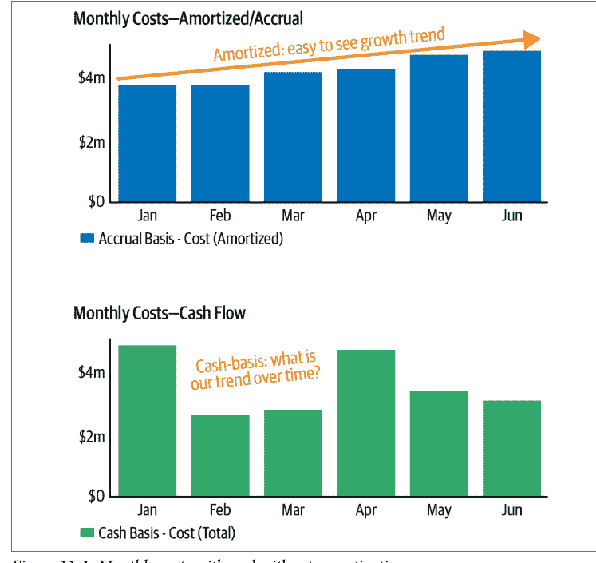
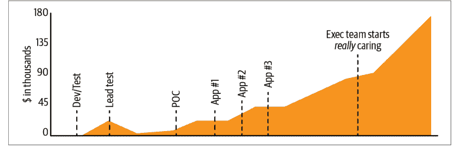
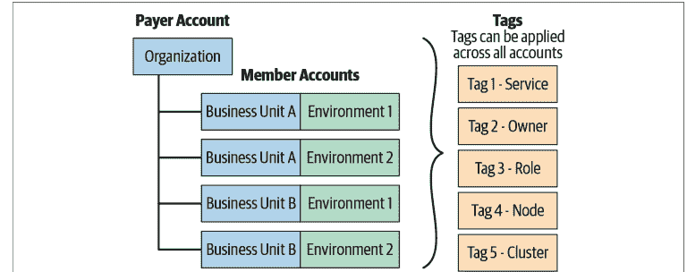
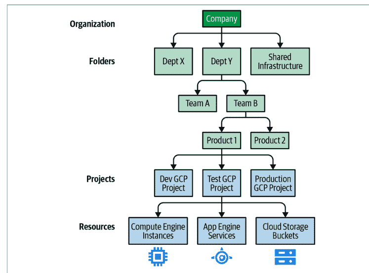
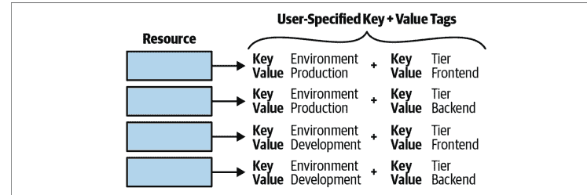

## Allocation: No Dollar Left Behind

本章是关于你在分配支出之前需要做出的战略决策。虽然成本分配是关于将云成本分配给组织内的正确业务单元，但向整个业务报告这些分配也会带来许多好处。

### Why Allocation Matters

不让任何一美元未分配、未指派或未标记的好处是巨大的。首先，你可以知道谁在花多少钱。你消除了典型的云成本讨论，这些讨论往往 abrupt 以“该资源不属于我”结束。但最有价值的是，你可以开始单独跟踪每个团队的预测增长（与整个公司的支出相比），并为团队设定预算，让他们知道自己相对于目标的表现如何，第 13 章将更详细地介绍这一点。

一旦你建立了这一点，你就会开始知道异常来自哪里，以及哪个业务领域和哪个工作负载导致了它们。知道资源在做什么，有助于我们通过考虑环境的特征和该团队的计划安排来智能地开始优化。它是生产还是开发？你希望在多大程度上突破各自 CPU 的界限？等等。与此同时，团队会收到与其支出相关的每日真实视图，而财务团队将在月底将其分摊给他们。

> 你应该朝着单位经济迈进，以便将预算责任交给团队。中央团队仍在进行分配，但你希望通过分摊和回溯将问责制推向边缘团队，使其成为他们的责任。中央团队定义如何高效使用云。
> —Michele Alessandrini, Head of Cloud Adoption and Governance at YNAP

分配使你能够回答第 10 章中提出的关于云支出的业务问题。事实上，成本分配是业务价值与云支出之间的重要联系。随着人们意识到自己的行为及其影响，这种意识会推动更精益的文化。而分摊和回溯创造了问责制。

我们希望很明显，信息阶段是优化阶段的必要前提。即使如此，我们也见过太多云新手，他们会一头扎进试图成本优化其云环境，同时忽视了解云中成本分配驱动因素的重要性与复杂性。坚实的层级账户策略和体面的标记策略是任何成本分配策略的关键要素。但仅仅建立这些还不足以解决分配问题，因为分配可能是一个移动目标。考虑一下未标记或无法标记的资源不断出现，共享成本必须核算，而且非常常见的是——就在拐角处——一次重组或报告方式的变化可能会破坏分配策略，尽管它构建得再仔细。

人们也会增加复杂性。不同的人会想要不同的东西。财务人员想知道支出流向何处，以及如何以有意义的方式将其追溯到 SKU 和产品。工程师关心可变消耗、单个服务成本，以及他们的日常行为如何影响账单。工程总监会关心汇总到全局视图的多个视图。专家可能需要显示不同资源类型使用情况或使用特定许可类型的资源的详细报告的报告。上下文就是一切。因此，在构建策略时，你会牢记所有不同的需求和观点，以创建适合所有这些不同角色的分配结构。

当然，我们也不要忘记业务指标。你的策略必须让团队能够将业务指标与其支出联系起来，从而实现单位经济并就支出对业务的价值进行对话。

### Amortization: It’s Accrual World

回顾第 4 章中介绍的匹配原则：它指出费用应在收到价值的期间记录，而不一定是在云提供商开具发票的期间。

这里需要考虑的会计原则是是否按现金制或权责发生制报告。前者意味着你在费用发生的期间报告支出，而后者则表示你在受益实现的期间报告支出。这适用于某些具有预付款的基于承诺的折扣等计费结构，其中初始费用的部分需要结转到承诺使用时。

This “carrying forward,” or amortization, is the equivalent of the hardware depreciation concept that many in the on-premises world are familiar with. But here it specifically applies to intangible assets. Without amortizing the up-front cost forward to when—and where—it was used, confusion and doubt are introduced around the real-time spend data. Operators are lulled into thinking they are spending less than they are, and there’s often an unhappy surprise later on when they receive a larger invoice from accounting, which has applied amortization before charging back.

In Figure 11-1, the cash basis reporting graph at the bottom shows how spending can look lumpy without amortization applied. The accrual basis graph at the top of the figure shows how spending trends become clearer once costs are amortized.

Figure 11-1. Monthly costs with and without amortization

图 11-1. 有摊销和无摊销的月度成本

Here’s how the amortization and the resulting savings are calculated in a simplified example:

以下是摊销及其 resulting 节省在简化示例中的计算方法：

- On-demand rate for a resource is $0.10 per hour.
- 资源按需费率为每小时 $0.10。
- A reservation costs $200 up front, and then $0.05 per hour when used.
- 预留 upfront 费用为 $200，使用时每小时 $0.05。
- The amortized rate is $200, divided by 365 days of 24 hours each, plus the $0.05 per hour rate.
- 摊销费率为 $200 除以 365 天每天 24 小时，再加上每小时 $0.05 的费率。

$$\frac{200}{(365 \times 24)} + (0.05) = $0.073$$

- The savings works out to be the on-demand hourly rate minus the amortized rate.
- 节省额为按需小时费率减去摊销费率。

$$0.10 - 0.073 = $0.027 per hour (27% savings)$$

A company might have hundreds, if not thousands, of commitment-based discounts at any given point in time. This makes it quite challenging to track all active commitments. Each commitment would typically have a unique schedule, with a certain start and end date. In the case of convertible AWS reservations, the RI could be modified to a set of new RIs, requiring the original fixed price to be divided properly among all new target RIs.

一家公司在任何给定时间可能有数百甚至数千个基于承诺的折扣。这使得跟踪所有活跃承诺变得相当具有挑战性。每个承诺通常都有独特的时间表，具有特定的开始和结束日期。在可转换 AWS 预留的情况下，RI 可以修改为一组新的 RI，需要将原始固定价格正确分摊到所有新的目标 RI 中。

There’s more detail coming on commitment-based discounts of all sorts in Chapter 17.

第 17 章将提供有关各种基于承诺折扣的更多细节。

It’s recommended that amortization is factored into all spend reporting data, including forecasting, chargeback, anomalies, and basically any other data that’s put in front of teams. If cost reporting and analytics do not match higher-level functions like forecasting and anomalies, data confusion can occur. And as we’ve stated a few times, the less data confusion, the better.

建议将摊销纳入所有支出报告数据中，包括预测、计费回溯、异常以及基本上提供给团队的任何其他数据。如果成本报告和分析与预测和异常等更高层级功能不匹配，就可能出现数据混淆。正如我们多次所述，数据混淆越少越好。

## Creating Goodwill and Auditability with Accounting

## 通过会计建立善意与可审计性

The additional benefits of having a good account hierarchy and a good tagging strategy go beyond full cost allocation and accountability to auditability. Using auditability as an added bonus of tags can generate a lot of support from the finance teams as you push forward an allocation strategy.

拥有良好的账户层级和良好的标签策略的额外好处超出了完整的成本分配和问责，延伸到可审计性。将可审计性作为标签的附加好处使用，可以在您推进分配策略时获得财务团队的大力支持。

> *A big part of accounting’s job is making sure that all of the money spent can be audited and tracked. The more resources are tagged correctly, the more auditable is your cloud spend.*
> 
> —Darek Gajewski, Principal Infrastructure Analyst at Ancestry

> *会计工作的重要部分是确保所有支出都可以被审计和追踪。资源标记得越正确，您的云支出就越可审计。*
> 
> —Darek Gajewski，Ancestry 的首席基础设施分析师

If that weren’t enough, a solid tagging strategy allows you to build more accurate forecasting models, simply because you're using data that's richer, more accurate, and more granular. Since another key role of accounting is to forecast future expenses, tagging goes a long way toward building trust and goodwill between operations and finance.

如果这还不够，坚实的标签策略使您能够构建更准确的预测模型，仅仅因为您使用的是更丰富、更准确、更细粒度的数据。由于会计的另一个关键角色是预测未来支出，标签在建立运营与财务之间的信任和善意方面发挥了重要作用。

All of this translates into less pushback, more willingness to move costs around, and, in general, teams that are better equipped to achieve a company’s goals.

所有这些转化为更少的阻力、更愿意调整成本，以及总体上更好地配备以实现公司目标的团队。

## The “Spend Panic” Tipping Point

## “支出恐慌”临界点

As is all too often the case, different teams running in cloud have little oversight until the spend gets to be high enough that it draws the attention of leadership. While there is often pushback against chargeback—and, to a certain degree initially, to showback—operating without showback/chargeback does not enable answers to the questions around who is spending what.

正如经常发生的情况一样，不同的云中运行的团队在支出高到引起领导层注意之前几乎没有监督。虽然通常会对计费回溯——以及在一定程度上最初对展示回溯——存在抵触，但没有展示回溯/计费回溯的运营无法回答谁在花多少钱的问题。

Figure 11-2 shows a sample journey into the cloud where cost management is not on the radar until spend draws executive attention.

图 11-2 显示了一个进入云的示例旅程，其中成本管理在支出引起高管注意之前不在雷达上。

The typical cloud maturity curve shows the point at which organizations start to pay attention to their cloud spend. The illustrative graph culminates in a very specific point: that moment when spending crosses an invisible threshold and the executive team starts to really care about it. For some organizations, that may be $1 million per month, while for others it may be $10 million per month. The number is different for each organization, but the output is the same. The tech organization is suddenly whiplashed into caring about—and seeking to optimize—cloud spend.

典型的云成熟度曲线显示了组织开始关注其云支出的时间点。说明性图表 culminates 在一个非常具体的点：支出跨越不可见阈值而执行团队开始真正关心它的那一刻。对于一些组织来说，这可能是每月 100 万美元，而对于其他组织来说可能是每月 1000 万美元。数字因组织而异，但结果相同。技术组织突然被鞭打到关心——并寻求优化——云支出。

Spend panic is often such a surprise that there is a halt or pause in cloud use. This can hurt the company overall in terms of making progress on business objectives, as well as throw the cloud teams into a panic.

支出恐慌往往令人如此惊讶，以至于云使用会暂停或停止。这可能会在实现业务目标方面损害公司整体，并使云团队陷入恐慌。

Figure 11-2. Spend growth with significant events

图 11-2. 具有重大事件的支出增长

During a FinOps Foundation call, Ally Anderson, a business operations manager and eight-year FinOps veteran, tells a similar story about her own organization. There have been three different times when there was a “spend panic” that resulted in a push for more accountability:

在一次 FinOps Foundation 通话中，业务运营经理兼八年 FinOps 资深人士 Ally Anderson 讲述了她自己组织中的类似故事。有三次不同的时间出现了“支出恐慌”，导致对问责制的推动：

The first one drove a need for questions being answered. This got finance onboard with the idea of showing teams what they were spending. The spending increased again, and drove a period of shameback. A light was shone on teams who were increasing their cloud costs. This brought in showback for a spell, until another threshold was crossed that resulted in another period of shameback in an attempt to try to get teams to reduce spend. It wasn’t until a third period of spending panic that the light bulb went off: the bill going up isn’t necessarily a bad thing if our business is growing.

第一次推动了需要回答问题的需求。这让财务部门接受了向团队展示他们支出想法的想法。支出再次增加，并导致了一段羞耻回溯期。那些增加云成本的团队被曝光。这带来了一段时间的展示回溯，直到另一个阈值被跨越，导致另一段羞耻回溯期，试图让团队减少支出。直到第三次支出恐慌，灯泡才亮起：如果我们的业务在增长，账单上涨不一定是坏事。

At that point, Ally and her organization began to reframe the question as: “Are we spending as efficiently as possible?” As she explains, “The conversation moved to ‘how do we optimize?’ instead of mandating a cost reduction target.”

在那时，Ally 和她的组织开始重新定义问题为：“我们是否以尽可能高效的方式支出？”正如她解释的那样，“对话转向了‘我们如何优化？’而不是强制要求成本削减目标。”

These conversations were possible because of the allocation strategy that had evolved through many years of maturing FinOps.

这些对话之所以成为可能，是因为分配策略在多年的 FinOps 成熟过程中不断演进。

Spend panic is going to happen. If you have an automated system in place to see your spend patterns, and an approximate date for which you predict spend will increase by too much, you are prepared for the inevitable executive scrutiny that will follow. Without defensible cost allocations, you are heading into an avoidable conflict with business leaders. You can protect yourself, and your sanity, with a scalable, easily updated allocation strategy.

支出恐慌将会发生。如果您有一个自动系统来查看支出模式，并且有一个大致的日期预测支出会增加过多，您就可以为随之而来的不可避免的高管审查做好准备。如果没有可辩护的成本分配，您将陷入与业务领导者之间可以避免的冲突。您可以用可扩展、易于更新的分配策略保护自己和您的理智。

## Spreading Out Shared Costs

## 分摊共享成本

Every organization has shared IT costs, and these span multiple business departments. As organizations increase their adoption of public cloud resources, it becomes increasingly difficult to assign shared cloud resources to specific business owners, to understand how to properly and fairly allocate costs, and to actually forecast future business unit budgets.

每个组织都有共享的 IT 成本，这些成本跨越多个业务部门。随着组织增加对公共云资源的采用，将共享云资源分配给特定业务负责人、了解如何适当和公平地分配成本以及实际预测未来业务部门预算变得越来越困难。

Support charges are a common example of this challenge. Cloud vendor support charges are generally applied at the parent account level. Some organizations choose to cover this charge with a Central IT/Cloud team’s budget, but that approach isn’t commonly used. More commonly, a Central IT/Cloud team is considered a supporting organization (being a cost center) and therefore needs to allocate its cost to its customers: business units or application owners.

支持费用是这一挑战的常见示例。云供应商支持费用通常在父账户级别应用。一些组织选择用中央 IT/云团队的预算来覆盖此费用，但这种方法并不常见。更常见的是，中央 IT/云团队被视为支持组织（作为成本中心），因此需要将其成本分配给其客户：业务部门或应用程序所有者。

Modern architecture has also introduced more shared costs with the rise of shared platforms. These platforms have multiple teams working with the same core resources, such as data lakes built in commonly shared S3 buckets or Kubernetes systems running on shared clusters. At first glance, chargeback and showback for these platforms can seem impossible, but the trick is proper tagging and splitting shared costs correctly.

现代架构随着共享平台的兴起也引入了更多共享成本。这些平台有多个团队使用相同的核心资源，例如构建在共同共享 S3 存储桶中的数据湖或在共享集群上运行的 Kubernetes 系统。乍一看，这些平台的计费回溯和展示回溯似乎不可能，但诀窍在于正确的标签和正确拆分共享成本。

There are typically three ways to split up shared costs like this:

通常有三种方法来拆分此类共享成本：

- *Proportional*
  Based on relative percentage of direct costs
- *Even split*
  Split total amount evenly across targets
- *Fixed*
  User-defined coefficient (the sum of coefficients needs to be 100%)

- *按比例*
  基于直接成本的相对百分比
- *平均分配*
  将总金额平均分配给目标
- *固定*
  用户定义系数（系数的总和需要为 100%）

Mature organizations tend to proportionally distribute shared costs among business units based on their direct charges. Let's consider an example. Table 11-1 shows how much each business unit of an organization consumed in a given month, and how the organization was charged $10,000 of enterprise support charge.

成熟的组织倾向于根据业务部门的直接费用按比例分配共享成本。让我们考虑一个示例。表 11-1 显示了组织中每个业务部门在一个月内的消耗量，以及组织被收取的 10,000 美元企业支持费用。

### Table 11-1. Cost allocation example with centralized support charge

### 表 11-1. 集中支持费用成本分配示例

| Business units | Cost | % of total (excluding enterprise support) |
|---|---|---|
| Sales operations | $50K | 50% |
| Engineering—QA | $30K | 30% |
| Engineering | $20K | 20% |
| Enterprise support charge | $10K |  |
| Total | $110K | 100% |

| 业务部门 | 成本 | 占总计百分比（不含企业支持） |
|---|---|---|
| 销售运营 | $50K | 50% |
| 工程—QA | $30K | 30% |
| 工程 | $20K | 20% |
| 企业支持费用 | $10K |  |
| 总计 | $110K | 100% |

Without sharing the enterprise support charge, you can see that:

不分摊企业支持费用，您可以看到：

- Sales operations will be accountable for a total of $50,000.
- 销售运营将负责总计 $50,000。
- Engineering—QA will be accountable for a total of $30,000.
- 工程—QA 将负责总计 $30,000。
- Engineering will be accountable for a total of $20,000.
- 工程将负责总计 $20,000。
- The $10,000 enterprise support charge isn't being distributed among teams and would need to be assigned to a central budget.
- $10,000 的企业支持费用未在团队之间分摊，需要分配给中央预算。

In Table 11-2, the proportional sharing mode, the enterprise support charge ($10,000) will be distributed among the business units based on the percentage of their raw spend.

在表 11-2 中，按比例共享模式下，企业支持费用（$10,000）将根据业务部门的原始支出百分比在业务部门之间分摊。

表 11-2. 含摊销支持费用的成本分配示例

| Business units | Allocation amount | Allocation percentage |
|---|---|---|
| Sales operations | $55K | 50% |
| Engineering—QA | $33K | 30% |
| Engineering | $22K | 20% |
| Total | $110K | 100% |

分享企业支持费用，你可以看到：

- 销售运营将承担总计 $55,000（$50,000 直接成本 + $5,000 支持费用分配）。
- 工程—质量保证将承担总计 $33,000（$30,000 直接成本 + $3,000 支持费用分配）。
- 工程将承担总计 $22,000（$20,000 直接成本 + $2,000 支持费用分配）。
- 企业支持费用已分配完毕，不会影响中央预算。

有关管理共享成本的更多信息，FinOps Foundation 网站上的开源 playbook 进一步扩展了这一主题。

## 费用回拨与费用展示

FinOps 社区中关于何时进行费用回拨或费用展示的讨论一直在进行。

这两种方法都推动问责制，但你需要关注它们之间的核心差异。费用回拨发生在实际发生的成本被分配回某个团队的预算或损益（P&L）时。费用展示发生在你向团队展示他们的支出时，但资金仍从中央预算内部分配。

我们见过关于如何理解差异的最佳方式来自 Barry Whittle 的一篇文章：

> 费用展示把账单留在桌上供分析；费用回拨留下同样的账单，但要求付款。
> —Barry Whittle，Apptio

实际上，选择两者之间的决定往往更多地取决于组织的会计要求，而非其成熟度。企业通常会因组织倾向于或不倾向于部门损益表而选择其中一种。例如，财务主管或 CFO 可能反对企业各部分之间的损益表概念，或者对业务的某些部分来说并不合理。在这些情况下，组织会倾向于费用展示，而不进行完整的费用回拨。经常需要对不同业务单元的成本进行单独核算，或企业在不同税务管辖权下运营的不同部分。这些类型的情况可能需要进行费用回拨。

但在过低的层级进行费用回拨也会带来其他困难。在云中，调整或抵免在会计期间结束后出现的情况很常见。事实上，所有使用情况都是事后报告的，因此需要定期估算期末成本并进行后续调整，这可能给一些财务和会计团队带来困难。愤怒的会计师不会成为好的 FinOps 合作伙伴。

## 来自云端的故事——Rob Martin

从费用展示过渡到费用回拨需要一些时间。FinOps Foundation 学习总监 Rob Martin（他曾在 AWS 云经济团队工作）分享了这个故事：

> 如果出于法律或税务原因没有迫切需要进行费用回拨，过渡可能需要数年时间。在我支持的一家大型公司中，达到真正的费用回拨花了三个财年。他们使用云的第一年非常具有探索性：他们大部分时间都在学习云的工作原理，尝试第一个应用程序，并建立对云预算与传统模式有何不同程度的理解。由于组织 IT 预算已经确定，且绝大多数 IT 仍在本地部署，因此第一年几乎没有进行预算或预测。在第二年，使用云的团队获得了更多灵活性，但仍受传统预算约束。FinOps 团队向每个应用团队提供费用展示，但他们的资金来自大型传统预算项目。在第三年，组织终于能够明确定义云团队如何在全年控制和灵活管理其预算，并且财务团队确信负责这些团队的损益所有者可以在会计系统中直接为其成本收费。预测支出的团队对这些预测充满信心，因为他们在此期间一直可以访问费用展示报告，并且建立了在成本实际计入其会计项目时取得成功的流程。

## 适合目的的模型组合

Ally Anderson 分享说，她的公司使用费用回拨和费用展示的组合。当是面向客户的 SaaS 工作负载时，公司在集中管理预算的同时进行费用展示支出。然后，对于某些 R&D 工作负载，他们会对特定团队的损益进行费用回拨。

Ally 确认在团队之间分配支出是复杂且持续进行的。她将每个团队的数十个不同的账户映射到业务需要报告的相关产品和成本中心。然而，在一次大规模重组后，她告诉我们，团队很少拆除云资源并在不同账户中重建以匹配新的组织结构。但这是在健康的 FinOps 实践中一个重要步骤。你必须将云资源的现有使用情况重新归因于适当的团队、投资组合、VP 或成本中心。

这是许多 FinOps 团队遇到的常见挑战。工程师标记资源的方式不一定与业务需要报告云支出的方式一致。而且支出通常需要重新映射以匹配拥有云支出的合法 *所有者* 的成本中心或产品。

## 账户、标记、账户组织层级

各大主要云服务提供商都有一系列元素，结合使用时可帮助你构建成功的云成本分配策略：

### 账户层级

工程师如何将基础设施放置到 AWS 账户、Google Cloud 项目和 Azure 订阅中构成了成本分配策略的第一层。单个账户可用于将一个环境或应用程序的成本与另一个环境或应用程序隔离。

### 账户命名

在组织云之旅的早期阶段经常被忽视的是拥有账户命名标准以记录账户用途的详细信息。目标是包含产品和将在账户内运行的环境等详细信息。一个示例名称可能是“productA-production-01”。FinOps 从业者应鼓励组织设立中央检查点以确保遵循此命名流程。所有账户请求都应通过中央流程进行。在 AWS 中，这将以关联账户或成本类别的形式出现。在 Google Cloud 中，这将以项目或文件夹的形式出现。在 Azure 中，这可能是订阅或资源组。

### 标记

大量使用标记和标签，尤其是在有多个应用程序或业务单元在内部运行的账户中。跟踪云资源部门或成本中心的标签键对 FinOps 尤其有帮助。标签有助于将账户内的支出划分为不同的组。要求对所有资源应用标签，使用不同程度的主动执行。然而，你应该知道并非所有支出都可标记，并非所有终端用户都合规。因此，仍经常有一大块未标记的支出作为数据卫生指标报告给管理层。

### 跨账户共享成本

FinOps 从业者面临的一个常见问题是如何在云世界中分配中央成本。你需要拆分和分摊诸如批量折扣、企业支持和 RI 预付款等成本。账户内部包括 Kubernetes 基础设施、网络成本、监控和日志系统等项目的共享成本也需要由 FinOps 处理。有关拆分共享成本方式的更多信息，请参阅 *FinOps.org* 上的开源 playbook。

回到 Ally 分享的故事，在早期使用多租户账户方法时，标记覆盖率并不理想，导致大部分支出未标记。因此 Ally 专注于随着时间的推移降低支出与未标记支出之比。在逐账户的基础上，负责特定产品的团队负责人已获得对构成这些产品的服务的细粒度视图。现在提供接近实时的报告，从而提高了对月度和季度支出的可见性。这有助于通过揭示它们来缩小分配差距。

遵循 FinOps 中的典型成熟度曲线，Ally 最初将云批量折扣、企业支持费用以及 RI 摊销等预付款排除在终端团队收到的报告之外。多年来，Ally 的 FinOps 实践已经成熟，她的团队已将越来越多的这些成本纳入其支出报告中。今天，她的团队可以看到正确调整后的价格。他们能够查看完全调整后的支出，其中包含摊销和准确的批量费率，从而更准确地了解实际成本。

## 费用展示模型在行动

费用展示的关键是将成本明确关联回去，以便团队知道他们花费了多少，向每个团队展示其实际支出与预测支出的对比，包括两者之间的差异以及与预算的比较。以每周、每月和每季度为基础提供费用展示报告，同时提供关于成本驱动因素和异常情况的更细粒度定期报告。

目标是让你的 CTO 与每个工程 VP 进行月度运营评审以展示其支出。当没有明显的差异时，这些会议往往相当简短。更大的差异会带来更集中的方法。FinOps 流程应尽早提醒 VP 他们将超出预算。

当差异出现时，迅速突出问题和导致差异的成本驱动因素，然后 VP 可以与团队合作实施修复，而无需等待月度运营评审。这是打破信息孤岛和实时决策制定的一个很好的例子。

## 成本回溯与展示考量

实现成本回溯/展示有多种方式，例如直接传递成本、收回额外收入以及覆盖管理成本：

### 回溯实际成本

这是最常见的方法，并推荐用于云优先的组织。无需维护第二套账本，每个人都围绕同一组数字和目标保持一致。成本回溯采用预付款的全额摊销，并应用自定义或折扣费率，且在 AWS 的情况下，使用未混合费率来显示团队在资源使用期间实际产生的成本。最成熟的组织还会拆分支持费用等共享成本。

### 集中承诺型折扣并保留部分节省

这种方法允许中央团队为自身提供资金，同时也与团队分享节省的好处。然而，团队可能会产生抵触，因为他们被要求放弃对 RI/SP/CUD 采购的控制，因此无法获得所有可能的节省。

### 集中谈判折扣并保留部分节省

与云服务提供商的定制谈判折扣通常随着您承诺支出的增加而增加。中央团队能够获得的规模经济使其能够获得最佳的费率，这是单个业务部门无法实现的。有时这些费率也高度保密，并且不希望在组织内广泛分享。出于所有这些原因，一些公司选择保留部分（或全部）谈判费率节省来资助中央团队的管理。虽然并不罕见，但这种做法违背了成熟 FinOps 从业者所重视的透明度。

关于采用哪种展示或回溯模型的选择，最好通过广泛讨论来做出，讨论内容包括贵组织希望如何向不同团队内部展示成本、对直接成本回溯的严格程度、希望 FinOps 团队具有多强的创业精神、现有的会计规则等。这是一场必须包括财务和会计团队的对话和讨论，并且最终必须在执行层做出决定，因为这些决策对公司的 P&L 有影响。

### 结论

分配策略因公司而异，但它是 FinOps 生命周期中的重要构建块。它使您能够专注于正确的领域，最终回答第 10 章提出的问题，即您在云上花费了多少钱以及谁在花费。

总结如下：

- FinOps 实践中的云支出通常以权责发生制为基础查看，其中包含摊销的预付款、折扣费率以及计入团队所见数据的共享成本。
- 努力将共享成本纳入模型，例如支持、摊销和未分配费用。
- 成本回溯和展示都能推动问责制。
- 展示或回溯模型也有助于改进标签和可审计性。
- 成本回溯是更高级的模型，但由于会计实践的原因，并不适合所有公司。通常最好先从展示开始，然后探索组织对转向成本回溯的支持。
- 在达到“支出恐慌”临界点之前建立模型，将有助于为高管解答支出驱动因素的问题。

现在我们已经介绍了分配的*为什么*，让我们来看*如何*做。在下一章中，我们将深入探讨在企业中实施标签和账户结构的特定策略和战术。

## 标签、标签和账户，哎呀！

在上一章中，我们讨论了成本分配对 FinOps 至关重要的原因。无论是通过标签、账户、文件夹还是标签（或更可能的是所有这些的组合）来实现，成本分配都是所有其他 FinOps 能力的构建块。

如果没有一致的分配策略，您最终会得到大量未分配的成本，无法将其拆分或识别负责的团队。如果他们无法轻松看到成本，每个人如何对他们的云支出负责（原则 3）？

分配云成本的主要机制是将使用情况划分为：

- AWS 账户、Google Cloud 项目、Azure 订阅或资源组，或云特定的元分组构造，如 AWS Organizations、Azure 管理组或 Google Cloud 文件夹。这些提供了最清晰且最易于强制执行的成本分配定义，但缺乏粒度灵活性。
- 类似资源级元数据的标签（AWS、Azure 或 Google Cloud）或标签（仅 Google Cloud）。这些提供了细粒度的资源级键/值对，为使用和计费数据提供更深入的上下文，但需要在运行时或之后进行清理工作。

在本章中，我们将介绍分配成本的核心机制以及它们各自如何促进成本分配，并描述我们在大规模实施中看到的成功策略。

云服务提供商对相似概念使用不同的术语：标签、标签、账户、订阅、项目等。这可以笼统地称为元数据，但为简单起见，本章中我们将层次结构称为账户，键/值对称为标签。因此，当我们说标签时，我们也指 Google Cloud 标签。当我们说账户时，我们也指 Google Cloud 项目和文件夹以及 Azure 订阅和资源组。

### 基于标签和层次结构的方法

根据环境规模的不同，详细的云成本和使用数据可能达到数百万甚至数十亿行/条。对于您当月消耗的每个资源，都会有关于资源运行位置、您使用量的多少以及您为使用支付的费率的详细信息。

最初缺少的全部细节是资源业务逻辑：谁拥有它，谁应该为其付费，资源属于哪个业务服务，以及许多其他未解答的问题。当然，不能期望云服务提供商在账单中添加这些细节；所有这些细节都是客户特定的。因此，您使用标签。标签允许您为特定资源分配业务上下文细节，然后分析这些信息以回答您公司特定的问题。

公司每个学科的人员——财务、运营、工程和管理——都可以从云使用数据中获得洞察。财务可能会使用数据将成本回溯/展示应用于正确的业务部门。运营可能会分解云支出以进行预算跟踪和容量规划。工程可能希望将开发成本与生产成本分开。而管理可以使用数据了解哪些业务活动在推动成本。每个人都使用它来过滤和汇总庞大的使用数据堆，缩小到他们希望采取行动的可管理数据集。

FinOps 成功的关键是尽早建立账户和标签策略并保持一致。为此，您需要跨团队可见性。幸运的是，根据您使用的云服务提供商，有各种工具可用。所有云厂商都提供可应用于资源的键/值对标签形式，以及资源运行的基于层次结构的账户组。

一些云服务提供商甚至提供解决方案，允许您对组进行分组并构建更深层次的基于层次结构的分配。Google Cloud 文件夹、AWS Organizations 和 Azure 管理组可以与单个资源的标签一起使用，甚至作为替代。AWS 提供了标记账户的能力，Google Cloud 允许对项目进行标记。基于层次结构的分配允许将账户分组为集群，这些集群本身也可以被标记。这种能力正被所有云服务提供商不断改进。

我们见过的最成功的 FinOps 从业者倾向于在分配策略中同时使用这两种方法——基于标签和基于层级的方法，但这样做并非必需。事实上，根据基础设施的复杂程度，你可能可以在没有标签/标签的情况下进行分配。或者你也可以不将使用量分离到各个账户中进行分配。但随着环境变得复杂，你很可能会同时使用两者。

在任何给定时间都要一致地应用它们，尽管随着你在云使用和 FinOps 成熟度方面的不断发展，你很可能会随着时间的推移改变策略。同时运行几种账户或标签策略模型是可以的，而且你不太可能让环境达到 100% 一致。这是可以的！

一般来说，如果你只想从一种策略开始，基于层级（accounts/subscriptions/folders）的方法最适合映射到一个（或几个）维度，例如公司的业务单元/部门/团队结构。账户结构是强制性的（所有资源必然且只能包含在一个账户中），它们粒度较粗（需要识别和分配的东西较少），它们更具个体意义（用户更容易识别账户名称而不是资源名称），并且它们很可能已经用于出于安全等技术原因隔离资源。

可以通过一段时间来增强标签策略，但仅从标签开始可能会有问题。一次又一次，我们看到仅使用标签的方法导致覆盖缺失，即使在为提高标签覆盖率付出巨大努力后，仍会出现大量未分配支出。我们发现，不仅开发团队 notoriously 难以确保所有资源都被标记（尤其是在云使用的早期阶段），而且云服务提供商通常有一小部分资源类型根本不支持标记。

如果没有每个人都坚持策略，成本将被错误分配。例如，如果你使用账户作为成本分配策略，并且有团队共享账户，成本可能会被分配给一个组而非另一个组。最大的灵活性和成功来自于采用同时涵盖账户和标签的方法。通过结合基于层级和基于标签的策略，你可以使用标签来处理精细的细节，同时使用基于层级的策略来捕获剩余的未分配成本。

有三种核心方法可以将成本分配数据添加到使用和计费数据中：

- *资源级标签*
  由工程师或云平台提供商直接应用于云资源。
- *账户/项目/订阅*
  由厂商提供并在账单中表示。

## 账单后数据构造

通过操作账单数据并使用第三方数据或分析工具或自行管理的数据处理来补充额外细节而实现。

## 开始制定你的策略

要在组织内部成功构建基于标签和/或基于层级的分配策略，你必须做到三件关键的事情。

### 沟通你的计划

在开始规划标签和账户策略之前，你需要确保每个人都参与其中。如果没有所有关键利益相关者，就有风险创建出不符合每个人需求的策略。你的目标是为整个公司创建最佳策略，而不仅仅是一两个团队。事实上，如果团队已经实施了自己的标签或账户布局策略，你必须首先对其进行审计，以了解哪些有效，哪些无效。

通常，当存在现有的工程主导策略时，它们没有财务重点。你的策略必须具有财务包容性，同时考虑到成本分配和未来成本优化的需求。

对于关键的财务拆分，最佳模式是拥有团队、服务、业务单元/成本中心和组织。这些划分用于按层级对成本和资源进行分组，以回答问题：团队与团队、服务与服务等等。一致性是强制性的。较不重要或更具团队特性的标签可以推荐但不强制执行。

### 保持简单

成本分配策略可能看起来令人不知所措，尤其是在基础设施复杂的情况下，因此保持初始策略简单很重要。我们建议从三到五个你想要了解成本的明显领域开始。当你利用标签进行成本分配时，你最初可能会关注业务单元、产品、所有者和角色的标签。然后你可以确保开发服务部署在与生产服务不同的账户中。你使用账户按环境隔离成本。即使这些小小的第一步也能在信息方面带来巨大回报。事实上，我们多次看到，对顶层成本分配的初步关注可以带来重大的可见性和优化成果。

在前进过程中保持简单也很重要。你的目标应尽可能使系统直观。有时当公司随着系统增长变得更精细和复杂时，其 FinOps 实践最终会形成几个大型账户，其中有大量团队在内部运行。之后试图辨别哪些成本属于哪个团队/服务/环境可能会很困难。

### 制定你的问题

由于分配策略的全部目的就是回答公司如何使用云的关键问题，因此在流程早期定义问题很重要。FinOps 应能够成功回答的一些常见问题是：

- 组织内哪个业务单元应承担此成本？
- 哪些成本中心正在推动你的成本上升（或下降）？
- 运营某个团队负责的产品需要多少成本？
- 你能否确定哪些成本是非生产且可以安全关闭的？

以这些问题作为起点，你可以确定账单文件中缺少哪些元素（参见第 5 章），然后利用这些信息来指导你的账户层级和标签策略。

## 比较三大厂商的分配选项

让我们比较三大云服务提供商，以了解你的分配策略如何受到其各种产品的影响（参见表 12-1）。

表 12-1. 云厂商分配选项比较

| | AWS | Google Cloud Platform | Microsoft Azure |
|---|---|---|---|
| 层级 | 账户（管理账户和成员账户） | 项目 | 订阅和资源组 |
| 元层级 | AWS Organizations | 文件夹 | 管理组、部门 |
| 键/值对 | 标签 | 标签和标签 | 标签 |
| 每个资源的标签数量 | 50（某些服务仅允许 10 个） | 64 | 50（某些服务仅允许 15 个） |
| 标签是否自动分配到你的详细账单数据 | 否—需要手动选择 | 是—存在一些限制 | 是—存在一些限制 |
| 标签限制 | 部分服务限制支持的字符 | 小写字母、数字字符、下划线和连字符 | 部分字符不支持 |
| 标签可应用于 | 大多数服务的资源（不断变化；请参阅 AWS 文档了解所有当前详情），账户（通过 AWS Organizations） | 大多数服务的资源、项目和文件夹 | 大多数服务的资源、Azure 资源组 |

从表 12-1 可以看出，细粒度的分配策略基于每个云服务提供商允许你在其平台上隔离资源的方式。每个云服务提供商都有一种标记方式（尽管 Google Cloud 提供用于策略定义的标签和用于分配的标签），但每个提供商对这些标签施加的限制存在差异。

一些提供商支持在账户或资源组级别进行标记。所有 Azure 资源都在资源组内创建，并且可以与资源组以及组内的单个资源关联标签。同样，AWS Organizations 允许将标签与特定账户关联。在云服务提供商的工具以及你自己的 FinOps 工具中，有各种使用和查看这些标签层级的方式。

本章后面我们将介绍你需要考虑的关于这些标签限制的注意事项，特别是在你当前使用多个云服务提供商（或未来可能使用）的情况下。重要的是要认识到，对于某些云服务提供商的标签，需要采取措施以确保标签值反映在账单数据中。

## 比较账户和文件夹与标签和标签

标签和账户各有优缺点。如我们所述，通常最好将它们一起使用，而不是二选一。标签高度灵活，但 100% 覆盖率可能难以实现，甚至不可能实现。而且，尽管基于账户分离的分配可以提供干净的回收费，但其报告选项有限。

账户是互斥的，而标签不是。账户应为你的主要索引，标签为次要。一种常见的最佳实践结构是使用账户拆分最重要的主要划分，然后使用标签深入这些账户以获得更精细的可见性。

在图 12-1 中，我们使用账户来分解单个产品及其各自的环境。这很重要，因为不同的产品或应用程序通常代表不同的成本中心或预算。单独的环境（开发、生产、暂存等）可能需要财务团队以不同的方式核算，因为有些是 COGS 费用，有些是研发费用。此外，各个团队可能希望将生产与开发支出分组在一起，以了解资金流向或应用不同的成本优化策略。

图 12-1. AWS 账户的通用成本分配策略

在某些公司中，标签被用作有限数量账户的主要分配方法。这在产品较少且对成本中心拆分要求不那么严格的公司中更为常见。标签优先的公司经常面临的挑战是在他们应用广泛的标签策略以覆盖尽可能多的资源时出现。到了报告时间，他们会剩下大量未标记的支出。此外，有些支出根本无法标记，或者可以标记但随后并未反映在账单数据中。鉴于这两种挑战，基于层次结构的账户策略通常能提供最清晰的计费回溯选项。

## 将账户和项目组织成组

三大云服务提供商都提供方法通过 AWS Organizations、Azure 管理组和 Google Cloud 文件夹将您的账户、项目和订阅组织成层次结构。

以下是根据 Google 对文件夹的文档说明分组工作原理的一个示例：

文件夹可以包含项目、其他文件夹或两者组合。组织可以使用文件夹在层次结构中将项目分组到组织节点下。例如，您的组织可能包含多个部门，每个部门都有自己的 Google Cloud 资源集。文件夹允许您按部门对这些资源进行分组。文件夹用于对具有共同 IAM 策略的资源进行分组。虽然文件夹可以包含多个文件夹或资源，但给定的文件夹或资源只能有一个父级。

在图 12-2 中，组织 Company 拥有代表两个部门 Dept X 和 Dept Y 的文件夹，以及一个用于可能对两个部门都通用的项目的 Shared Infrastructure 文件夹。在 Dept Y 下，他们已组织成两个团队，并在团队文件夹内进一步按产品组织。Product 1 的文件夹进一步包含三个项目，每个项目都有项目所需的资源。这为他们在合适的粒度级别分配 IAM 策略和组织策略提供了高度灵活性。

图 12-2. Google Cloud 内部的成本分配

公司创建包含其他文件夹或项目的的，这在图 12-2 中显示。这种结构被称为文件夹层次结构。退一步看，从组织到文件夹再到项目的进展被称为资源层次结构。

## 标签和标记：最灵活的分配选项

云服务提供商可能称呼它们不同，但从根本上说，标签和标记都提供以键/值对形式定义元数据的功能。这些标签随后与云账户中的资源关联。键就像电子表格上的列标题，而值是该列的行条目。

将键/值对想象成描述一堆衬衫。每件衬衫可能有一个标签键为 color，其标签值为 red、blue 或 green。如果您想找到红色和蓝色衬衫之间的成本差异，您可以使用颜色标签对成本进行分组并显示差异。

图 12-3 显示了一些使用 Environment 和 Tier 标签标记的云资源。这些标签提供了一种识别哪些资源来自生产环境与开发环境以及哪些资源支持服务的 前端 而非 后端 的方法。对云服务提供商而言，标签仅仅是没有语义含义的字符字符串。因为标签仅对客户有意义，所以只要符合字符集和长度等语法限制，您就可以让它们成为您想要的任何内容。对标签键及其适当/批准值的清晰规划将确保您不会最终得到不一致应用的标签，从而阻碍未来的成本分配工作。

图 12-3. 云资源的标签

## 使用标签进行计费

在云账单中体现标签数据允许您按多个标签维度对成本进行分组。按每个团队排列成本——或按不同环境分组，例如开发与生产成本——将使您能够将费用分配到业务的正确领域。

标签允许您识别云账单上哪些项目可归因于您业务的每个服务。除了按这些标签维度（团队/服务/环境）对成本进行分组外，您还可以监控每个组的云计费的显著变化——因此更快地解决意外成本。

一些云服务提供商需要您提前选择希望导出到账单数据的标签键。其他提供商会导出与您的资源关联的每个标签。

对于允许您挑选标签的平台（如 AWS），我们警告不要过度并添加数百个标签。账单文件中额外、不必要的数据会增加——本已庞大——的数据大小并使分析更困难。

## 尽早开始标记

当您开始构建 FinOps 实践时，推迟困难的挑战，例如让团队标记其资源，很诱人。许多公司要么没有标记标准，要么有标准但未对其团队执行。必须认识到标签不会追溯应用。您必须提前规划标记策略以确保全面报告。

例如，在 1 月 1 日创建资源而不直到 2 月 1 日才为其分配标签，会导致所有 1 月的账单数据未标记，因此可能未分配。此外，标记资源但直到稍后日期才在计费中激活标签会导致标签分配出现空白。以后，当您需要分析账单数据以进行成本分配和本章后面将讨论的成本优化策略时，您会发现账单数据不具备您需要的分配历史。

标记是确保您在 FinOps 实践的更高级阶段拥有丰富数据集的重要早期步骤。如果还没说够：不要推迟您的标记策略。

## 决定何时设定标记标准

实施标记标准的最佳时机是公司刚刚开始云之旅时。该标准应明确定义将应用于所有资源的标签键——以及标签可能包含的适当值。在工程师开始构建之前实施该标准并传达给他们将有助于确保良好的标签覆盖率并提供高质量数据。然而，许多公司已经构建了大型部署并且没有标记标准。别担心：现在应用标准并让工程师更新其资源并不为时已晚，只是需要一些工作。

人们抵制实施标记标准的情况并不少见，尤其是在已经部署了大量不符合新标记标准的资源时。获得领导层支持新标记标准的公司在整个组织中标签采用率更高。最初利用领导层授权——最终是文化变革——使标记成为 FinOps 团队乃至整个业务的必备要求，以鼓励广泛合规。

标签的价值 *确实* 超出了 FinOps 的范围，了解这些好处在企业试图实施标记标准时很有用。对于安全团队而言，标签可以识别受可能安全问题影响的资源所属的服务和团队。运营团队能够轻松确定资源出现问题通知时会受到影响的服务。组织中良好的标记策略将为许多不同利益相关者带来回报。

开始时标记标准考虑得越周全，未来需要修订的可能性就越小。如果您需要在团队刚刚完成之前策略的推广后返回要求他们更改一堆标签，您就不会交到朋友。

随着业务在云上扩展，它将产生数千甚至数百万个资源费用，每个资源都有自己的标签。更改标记策略意味着团队必须更新所有这些资源。由于标签通常由 Terraform、CloudFormation 和 Azure Resource Manager (ARM) 模板等自动化基础设施应用，对自动化标签的更新需要在代码中推出。公司经常发现许多资源无法更新，最终导致半实现的标准。

## 选择合适的标签数量

标记标准不应该强迫团队应用太多标签。对过多的标签要求只会引起对标准的抵制，从而导致不合规。始终牢记您需要回答的问题，并将您的标签策略与从账户层次结构中获得的数据相平衡。最好只要求核心元数据所需的标签。不要将所有标签定义为必需，而是定义可选标签，清楚地描述如果团队选择这样做应如何实施它们。

如果您不确定从何开始标记标准，以下是具有成功 FinOps 的公司实施的一些标签：

- 一个 *cost center/business unit* 标签，清楚地定义资源的成本应在组织内如何分配。
- 一个 *service/workload name* 标签，标识资源所属的业务服务，使组织能够区分团队运行的服务之间的成本。
- 一个 *resource owner* 标签，帮助识别负责该资源的个人/团队。

-   一个 *name* 标签，用于帮助识别资源，使用比云服务提供商给你的标识符更友好的标识符。
-   一个 *environment* 标签，用于帮助确定开发、测试/暂存和生产环境之间的成本差异。

我们建议使用账户层级结构来替代最重要的一个或两个标签——例如成本中心和环境——然后使用标签来跟踪剩余的三个到五个必须跟踪的分配。粗粒度的账户层级结构提供了对少数维度的便捷映射，而标签则提供了额外业务维度的更精细细节。

最成熟的 FinOps 实践使用标签将云资源连接到其他信息来源，例如配置管理数据库（CMDB）。这既能实现引用大量数据，也能实现更快速/更简单的流程，只需更新一次信息，而无需更正云资源上可能存在的数百万个标签。

## Working Within Tag/Label Restrictions

最好确保你计划的标签策略（所需键和值）可在你计划使用的所有云服务提供商之间通用。某些云服务提供商的服务允许几乎任何字符，而其他服务则更严格。标签的长度也可能有限制，并且服务对每个资源支持的标签数量有限制。

你应确保你打算使用的服务能与你的建议策略兼容。否则，你可能最终需要在某个时候更改标签，或者最终会出现多个分组，其值略有不同。

例如，你可能开始用 R&D 为资源打标签，但后来才发现某个特定服务不支持 & 字符。这会给你两个选择：回头将所有现有的 R&D 资源重新标记为类似 RandD 的名称，或最终在账单中同时出现 R&D 和 RandD 两个值，导致成本在两个分组之间分散。一些 FinOps 工具提供事后修复不一致标签的方法，允许你应用规则来调整资源在其报告中的分配方式，而无需更改原始云支出数据。

某些云服务提供商允许你为更多资源类型打标签，而其他提供商则不允许，这可能是负责标记资源的员工常见的抱怨。重要的是要认识到所有支持标记的资源带来的好处，并持续推动你的云服务提供商为其资源类型增加更多标签支持。

即使你无法为所有资源打标签，也应努力尽可能多地标记。向支持标记的资源应用标签有很多业务优势。无法标记的资源（如 CloudWatch 费用）是我们建议除了标签之外还使用某种层级分组的原因之一。这样你就可以尽可能多地分配未标记的成本。

## Maintaining Tag Hygiene

标签卫生是指你为确保标签系统（及其产生的数据）尽可能干净而采取的措施。如果没有适当的标签卫生，你可能会使用不准确的数据，进而影响决策的准确性。

一致性是标签卫生的关键。如果一个团队使用标签值 prod，而另一个团队使用 production，这些标签默认会在你的账单数据中作为单独的行项目分组。标签有时区分大小写，因此值 Enterprise 可能会与值 enterprise 分开报告。当人类创建标签时，常见会出现拼写错误、大小写差异和缩写。解决办法是通过自动化强制执行标签策略。诸如 Ansible、Terraform、Azure 资源管理器模板、Google Cloud Deployment Manager 和 AWS CloudFormation 之类的基础设施自动化可以帮助确保一致性并避免人为错误。

然而，即使在组织内部实施了最佳的自动化和部署实践，也不可避免地会出现一些资源在创建时缺少或标签无效的情况。这就是为什么有开源工具和第三方平台旨在在资源创建后不久将其删除或至少阻止的原因。这有助于限制账户内否则会产生的未分配/无法解释的成本数量。（我们将在 FinOps 生命周期中的运营阶段介绍自动化；参见第四部分。）

另一个有效的方法是将标签从父资源（如实例）复制到子资源（例如卷、快照、网络接口）。通过将标签复制到子资源，你可以获得更大的标签覆盖率，并确保资源使用相关的标签集进行标记。我们见过成功的标签策略，例如仅要求标记 Azure 资源组，而不标记资源本身，而其他策略则标记两个层级并实施业务逻辑以在特定情况下决定使用哪个值。

你甚至可以创建一些业务逻辑，将未标记的资源分配给默认成本中心。一个例子是为每个云账户应用默认成本中心。账户内的所有未标记成本随后将被分配给指定的默认成本中心。对于计费，你可以在资源本身通过更新标签来实现。或者你也可以在分析期间事后将此业务逻辑应用于账单文件。事后应用此逻辑的好处是，你可以在不进入账户并更新单个资源上的实际标签集的情况下更新业务逻辑。

若要探索可帮助进行成本分配、标签卫生以及对成本报告应用逻辑的工具，请查看 FinOps.org 上的 FinOps 认证平台。

## Reporting on Tag Performance

为了确定组织内部的标签实践效果，你应拥有识别标签错误应用位置的报告。我们建议你通过有标签分配的云支出金额与无标签分配的金额来衡量标签覆盖率。以这种方式衡量，生命周期很短、成本很低的项目会被报告为不如运行时间长、成本高的资源重要。请记住，并非所有云服务提供商内部的资源都可标记，因此设定 95% 的目标并制定流程来分配最后 5% 无法标记的资源更为现实。

报告使你能够跟进相关团队以更新其自动化——至少手动更正标签。通过随时间跟踪不符合标签标准的资源数量，你可以判断组织在应用标签标准方面是否有所改善。拥有一个人人可见的最差违规者名单也有助于推动更彻底的标签采用。

## Getting Teams to Implement Tags

我们经常听到的一个常见问题是，“关于如何让资源被标记，你有哪些最重要的建议？”我们再次请教 Ally Anderson，她的故事我们在上一章分享过。她与每个团队的工程联系人密切合作，并说，“如果有大量支出未被标记，我会通过报告让他们看到。”她发现，她越是持续地将数据呈现在团队负责人面前，标签就越容易被应用，仅仅通过建立实时数据反馈循环。她还得到了领导团队的支持。作为她的高管报告的一部分，Anderson 将未标记支出作为持续报告的核心部分，这鼓励高管推动自己的团队尽量减少未标记成本。

来自 Ancestry.com 的 Darek Gajewski 专注于“创建时标记”方法作为提高标签合规性的策略。由于云提供商不断增加更多支持，要求在启动基础设施之前设置某些标签，利用这一点可以极大地帮助提高标签覆盖率。

要将本章中的所有概念整合成一个真实生活案例，请收听 FinOpsPod 播客的第 6 集《Attribution, Tags & Labels . . . OH MY!》，该集讲述了 Jason Rhoades 的故事，介绍了 Intuit 如何在多年对标签、标签和账户结构的迭代中，启动、演进并成熟其归因策略。

## 结论

良好的 FinOps 实践应从精心设计的账户和标签策略开始。账户层级和标签为你的账单数据带来的额外元数据，将在今后的几乎所有报告和分析中发挥作用。

总结如下：

-   你的账户分配策略将为资源提供结构并帮助你归类成本。
-   让公司理解标签的重要性并致力于自动化标签，将使整个业务受益。
-   由你的标签和账户分配构建的成本可见性和成本问责制将有助于在组织内部建立精益文化。
-   标签和账户分配是 FinOps 生命周期优化阶段的常见要求。

首先制定成本分配策略——它将有助于几乎所有 FinOps 能力，尤其是我们在下一章中介绍的预测。
