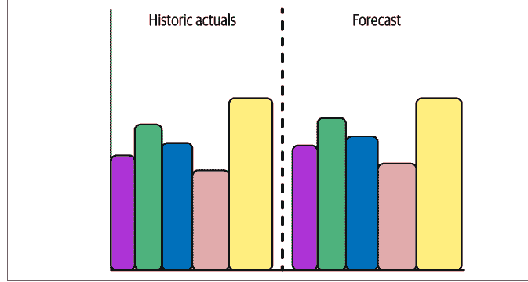
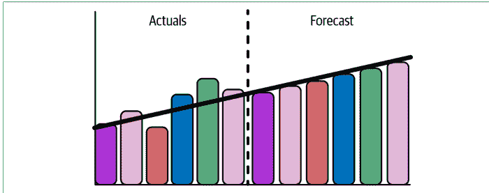
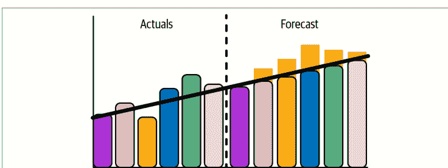
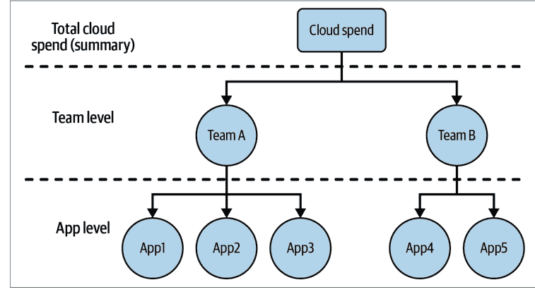
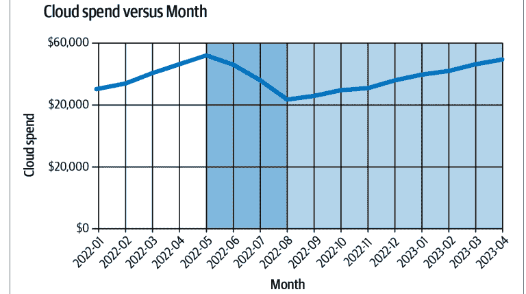
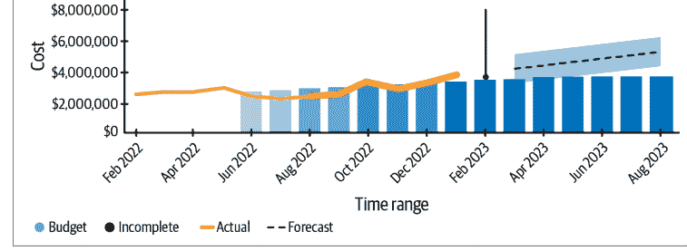

## 精准预测

*预测* 是预测未来支出的做法，通常基于历史支出趋势的组合和对未来计划的评估。其目的是了解未来云基础设施和应用生命周期变化可能如何影响预算，并帮助评估云投资决策。这也是 FinOps 中最难做对的事情之一。

预测之所以困难，是因为它需要在工程师、财务和采购之间交叉，财务承担财务报告责任，采购承担会计责任，两者都需要工程师和高级管理人员的协助来履行这些义务并了解基础设施的计划变更。这些利益相关团队之间的协作对于构建商定的预测模型和 KPI 至关重要，从而制定与业务目标一致的预算。当这些团队构建可靠且准确的云支出预测模型时，云成本预测将为投资和运营决策提供信息，以加速组织的增长。

在本章中，我们讨论预测，解释为什么预测如此困难，并介绍提高其准确性所需的关键概念。

传统的 IT 预测——在云之前——主要用于年度预算流程。对于数据中心设备，在进行系统增强或全新系统构建时，会提前计算总拥有成本（TCO）的预测。由于工程团队历史上并未参与或关心除为资本支出构建商业案例之外的 IT 支出预测，他们缺乏频繁预测以及与财务和业务协作的肌肉记忆。

在传统的数据中心部署中，已知固定成本占很大比例，因此预测不准确的影响可能有限。然而，当你转向云的变动成本模式时，固定成本与变动成本的比例被颠倒，变动成本更大，预测的不准确可能产生实质性影响。

云中的频繁预测比数据中心部署更重要，并需要更多人之间的互动。

## 云预测现状

云支出的预测即使对于高级从业者而言也可能是一个难以掌握的挑战领域。在最新的《FinOps 现状》调查中，它是第二常见的 FinOps 挑战，相当大一部分受访者——包括来自成熟实践的受访者——报告其预测准确性偏差超过 10%。当你的云账单达到每月数百万美元时，10% 的偏差会迅速累积。

与预测的偏差源于云成本的复杂性以及云资源的分布式消耗：当大量不同的人员和代码按需采购基础设施时，很难确定 6–12 个月后总计会是多少。这不仅仅是一个建模问题，也是一个人员和技术问题。

《FinOps 现状 2022》的受访者显示，与基准测试相比有所改善，表明与 2021 年调查的回复相比，预测变得更准确。最先进阶段的群体能够将预测控制在实际支出 5% 的偏差范围内，而较不先进阶段的群体报告的偏差为 20% 或以上。精准预测耗时且需要自动化以及掌握其他 FinOps 实践以提高效率。

高级阶段的受访者在刷新预测和相关云预算的周期上领先，尽管少数受访者以每周的频率生成预测，表明所有方面仍有很大改进空间。约 21% 的受访者报告每年进行预测，这令人惊讶，考虑到云基础设施在一年内变化的变异性和速度，这可能是预测准确性成为 FinOps 团队主要挑战之一的可能原因。

> 它注定会出错。接受它并从一个有根据的猜测开始，但要快！
> —Andrew Feig，JPMorgan Chase & Co. 的云工程管理总监

大量调查受访者表示他们不进行预测，导致他们在账单到达前盲目飞行，或者只是由于缺乏准确性而没有广泛传达他们的预测。

## 预测方法

让我们看看组织使用的预测方法。首先介绍这些基础知识很重要，因为你的组织可能对每种方法有不同的名称。明确各自的区别将有助于我们达成共同理解。

我们首先需要统一的第一组术语是生成预测本身的方法：

## 朴素预测

一种非常简单的方法，使用你之前的支出历史。朴素预测假设你下一个周期的云支出将与上一个周期相同。在图 13-1 中，预测是历史实际数据的直接复制。这种预测方法对于云支出来说过于基础，因为云支出可能根据需求、业务事件和人为选择而迅速变化。

图 13-1. 朴素预测假设你下一个周期的支出将与上一个周期镜像

## 基于趋势的预测

也称为单变量预测，这种方法仍然使用过去的云支出历史作为预测基础，但也引入了一些统计元素——例如线性回归——以利用过去预测的趋势来预测未来期间的支出。在图 13-2 中，云支出的历史趋势被用来预测未来期间。基于趋势的预测仅考虑你现有的历史支出，不引入未来期间可能发生变化的任何额外情景或业务驱动因素。

图 13-2. 基于趋势的预测

## 基于驱动因素的预测

也称为 *多元预测*，这种方法考虑其他业务指标来增强你的预测。将业务驱动因素与你的云支出联系起来可以提高预测的准确性，尤其是在该其他业务指标已以可接受的准确度进行预测时。这可以是手动调整预测的形式，也可以是向自动化预测算法提供多个输入数据源。在图 13-3 中，基于趋势的预测根据与之前云支出相比由于外部驱动因素而产生的额外预期支出进行了调整。一些例子包括：

-   营销举措带来的活动增加
-   由于新产品发布导致云使用量的变化
-   员工人数与研究与开发（R&D）云支出相比
-   销售额/月活跃用户与生产（COGS）云支出相比

图 13-3. 基于驱动因素的预测

## 预测模型

现在让我们考虑你可能用来生成预测的工具或模型。我们不会详细介绍生成预测的不同算法或机器学习模型。本章的目的是帮助你思考云预测的方式，并考虑在 FinOps 中处理云支出预测的技术。如果你对预测的具体内容感兴趣，有很多优秀的书籍涵盖了预测，例如 Rob J. Hyndman 和 George Athanasopoulos 合著的 *Forecasting: Principles and Practice*（OTexts，2021）。预测模型包括：

### 机器学习预测

这是一个经常被过度使用的术语，用来描述预测技术。有些人认为只有深度学习模型才是真正的机器学习预测；其他人则将统计和其他非深度学习模型也归入此类。无论你选择使用哪种模型，我们都建议你多方比较。不要害怕尝试另一种模型。你使用的第一个模型不太可能是最好的。此外，还应考虑根据历史数据评估多个模型，以查看哪些模型会更准确。

### 组合预测

这是一种将不同预测结合起来的方法，以使用多个模型实现更准确的预测。组合的一个简单方法是取多个模型结果的平均值。

### 静态预测

这种类型的预测在设定的周期开始时生成一次，例如 12 个月。在周期结束之前不会更新，届时将为下一个周期生成新的预测。这种类型的预测适用于非常可预测的支出。

### 滚动预测

这种类型的预测也在设定的周期开始时生成，例如 12 个月。然而，与静态预测不同，它会在周期期间频繁重新生成（每周、每月、每季度）。每次重新生成时，它都是为相同的时间长度创建的， effectively 在预测范围的末尾添加了更多数据。

## 云预测挑战

要生成更准确的预测，你必须首先解决一组常见挑战。你可能已经在处理其中一些项目，因为解决预测所需的技能与第 7 章中涵盖的 FinOps 基金会框架中的许多其他项目相关。取决于你的组织结构以及 FinOps 的成熟程度，其中一些挑战可能更容易解决。

### 手动与自动化预测

预测通常最初是组织内财务或 FinOps 团队的手工练习。该练习可能使用一种朴素的方法，即使用之前的支出数字然后根据工程反馈进行调整，或将历史数据移入电子表格并使用公式生成一些基于趋势的预测。随着云支出的增长，这种手动方法变得困难，准确性也经常下降。低支出团队的成本通常被归为一个组并作为一个整体进行预测，从而降低了预测的颗粒度。生成这些预测所需的精力意味着频率非常低——每月、每季度或更少。

能够执行基于趋势或基于驱动因素预测的自动化预测工具使预测能够经常生成。在 2022 年的 State of FinOps 调查中，据报道最先进的从业者每周甚至每天执行预测。成熟的 FinOps 文化将导致更多工程团队承担其支出的责任，从而使他们对预测更感兴趣。

### 不准确性

寻找能够考虑云支出季节性的模型/工具。你的云支出不太可能全年都相同。能够考虑云支出起伏的预测将带来更高的准确性。

一些模型受数据中异常值的影响更大；异常造成的短暂突然飙升会导致预测不准确。一些模型能很好地处理异常值，而其他模型则需要你进行手动调整来修复它们。

单一算法是不够的。一些预测算法在成本数据历史更长时效果更好，而其他算法能够使用有限的数据点。你可能会拥有具有长期数据历史的应用程序，但在引入新工作负载时，大多数预测算法都不会像预期那样有效。结合多种场景的算法集成方法是在历史可用性差异方面更有效的方式。

### 颗粒度

在总云支出层面进行预测无法让你弄清楚哪些云支出个体组导致了预测不准确。此外，你的财务团队可能需要更精细的预测颗粒度来满足其报告要求。相反，在非常详细的层级生成预测可能需要比合理所需更多的精力，尤其是在你有大量支出很少的分组时。

第 12 章介绍了标签和标记，没有这些，生成任何颗粒度的预测几乎是不可能的。基于标签和层级的方法允许你将云支出划分为相关的类别，如成本中心、应用程序或环境。在更精细的颗粒度层面进行预测可以让你确定预测与实际不匹配的地方，并让你专注于这些领域以改进。

在生成颗粒度预测时，预计预测与汇总预测是一致的。使用图 13-4 中的支出层级，如果你按应用程序生成预测，预计将它们加总后会等于你的总云支出预测。然而，如果你为总云支出生成汇总预测，同时也在应用程序层级等颗粒度上生成预测，那么由于预测算法的统计特性，将所有颗粒度预测加总起来可能不会等于独立生成的汇总预测的总和。预测之间的差异将由颗粒度预测在应用程序层级的小不准确性以及汇总预测缺乏细节所驱动。

图 13-4. 一个示例云支出层级

你可以通过将预测方法限制在一个颗粒度层级来创建一致的预测。以图 13-4 中的层级为例，大多数预测者使用的三种主要预测颗粒度方法如下：

### 自下而上

自下而上方法专注于最细粒度的云支出；我们的示例使用应用程序级支出。这种方法为每个应用程序创建单独的预测，然后汇总为更广泛的分类、团队，然后是总云支出。这种方法允许工程师和高管提供大量输入，从而提高颗粒度层级的准确性，并可能导致最准确的总支出预测。

### 自上而下

自上而下方法专注于使用历史支出趋势和未来项目信息为总云支出生成预测。然后该预测会根据历史比例与未来项目预期相匹配分配给多个团队和应用程序。这种方法在应用程序间支出分布变化不大或没有变化时最成功，但在支出分布存在大幅波动的情况下会变得高度不准确。

### 中间向外

生成一致预测的最后一种方法是中间向外。在图 13-4 示例中，这意味着在团队层级生成预测，然后汇总到总云支出层级并按比例分配到应用程序层级。

为对你的报告最重要的颗粒度层级生成预测。应用中间向外方法汇总预测，然后在需要时应用历史比例将预测扩展到更细粒度的层级。

## 预测频率

请记住云变化很快，变化越快你的预测就会越快过时。想象一下，你的工程师今天做出了一个决定，使其云支出每天增加 10 美元。在接下来的 12 个月里，这一决定将累计增加超过 3,500 美元的支出。现在想想你有多少工程师每天都在做 10 美元的决定，一年 365 天。今天的 12 个月静态预测到年底将完全过时。

State of FinOps 中最先进的从业者报告称他们每周更新预测，尽管每月或每季度仍然是大多数人的最常见节奏。对于预测准确性来说，这时间太长而无法有效。

当你使用滚动预测更频繁地重新计算预测时，你可以保持对云支出更准确的预期；此外，你可以使用这些信息来找到推动预测变化的因素。这会更容易

并且工程团队负责人查看过去一周的支出、发现与预期不符之处并纠正下周的预测，比按月或按季度进行要更快。

表13-1中的数据展示了五个应用的预测。该预测针对每个应用的月度支出，并每周生成。通过比较前后预测之间的差异，你可以轻松识别预测发生变化的地方，并发现App2是需要询问更多信息以更准确地了解预测变化的团队。

*表13-1. 周环比预测变化*

| 应用 | 月度预测（第1周） | 月度预测（第2周） | 差异 |
|---|---|---|---|
| App1 | $15,000 | $15,000 | $0 |
| App2 | $25,000 | $30,000 | +$5,000 |
| App3 | $10,000 | $9,000 | -$1,000 |
| App4 | $5,000 | $6,000 | +$1,000 |
| App5 | $30,000 | $30,000 | $0 |
| 合计 | $85,000 | $90,000 | $5,000 |

> *我们没有一个人比所有人加起来更聪明。*
> —Ken Blanchard

随着贵组织各地的工程师更接近成本差异的原因，他们识别成本驱动因素会更容易、更快。单个小的差异与总云支出相比可能微不足道，但对单个团队来说可能很重要，而许多小的差异累积起来可能达到实质性金额。为工程师提供细粒度的成本可见性和定期更新的预测，使您能够获得最大的收益。

## 沟通

我们经常谈论使企业能够基于云的价值做出决策，而在这里，你需要这些决策反馈到预测流程中，以便被正确捕获和估算。无论多少机器驱动的预测，都无法准确预测工程师为其基础设施制定的变更以及这些变更如何影响云支出。在上一节中，我们举例说明了工程师在云支出上做出的小决策如何累积起来使贵组织的云预测不准确。在生成预测时，必须有一个开放的沟通渠道来捕获工程师的这些计划。重要的是，你需要将预测视为不仅仅是内部财务工作。预测需要让所有FinOps角色参与，并利用每个角色的专业知识来创建最准确的预测。

## 未来项目

未来项目的[content]
并且工程团队负责人查看过去一周的支出、发现与预期不符之处并纠正下周的预测，比按月或按季度进行要更快。

表13-1中的数据展示了五个应用的预测。该预测针对每个应用的月度支出，并每周生成。通过比较前后预测之间的差异，你可以轻松识别预测发生变化的地方，并发现App2是需要询问更多信息以更准确地了解预测变化的团队。

*表13-1. 周环比预测变化*

| 应用 | 月度预测（第1周） | 月度预测（第2周） | 差异 |
|---|---|---|---|
| App1 | $15,000 | $15,000 | $0 |
| App2 | $25,000 | $30,000 | +$5,000 |
| App3 | $10,000 | $9,000 | -$1,000 |
| App4 | $5,000 | $6,000 | +$1,000 |
| App5 | $30,000 | $30,000 | $0 |
| 合计 | $85,000 | $90,000 | $5,000 |

> *我们没有一个人比所有人加起来更聪明。*
> —Ken Blanchard

随着贵组织各地的工程师更接近成本差异的原因，他们识别成本驱动因素会更容易、更快。单个小的差异与总云支出相比可能微不足道，但对单个团队来说可能很重要，而许多小的差异累积起来可能达到实质性金额。为工程师提供细粒度的成本可见性和定期更新的预测，使您能够获得最大的收益。

## 沟通

我们经常谈论使企业能够基于云的价值做出决策，而在这里，你需要这些决策反馈到预测流程中，以便被正确捕获和估算。无论多少机器驱动的预测，都无法准确预测工程师为其基础设施制定的变更以及这些变更如何影响云支出。在上一节中，我们举例说明了工程师在云支出上做出的小决策如何累积起来使贵组织的云预测不准确。在生成预测时，必须有一个开放的沟通渠道来捕获工程师的这些计划。重要的是，你需要将预测视为不仅仅是内部财务工作。预测需要让所有FinOps角色参与，并利用每个角色的专业知识来创建最准确的预测。

## 未来项目

未来项目的影响范围从对总云支出影响极小的成本决策，到可能大规模改变企业利用和支出云的方式的大型成本决策。例如，将大型应用从数据中心迁移到云中，或将应用部署到多个新区域以在更多地点提供产品，都是可能影响云支出预测的大规模业务变更。这些大规模决策一旦做出，通常会为实际支出增加净新云支出，这使得任何机器驱动的预测都无法预测未来的增长。建立协作流程，以便工程团队有明确的方式让FinOps团队参与估算未来项目的成本影响。这将确保额外支出可以手动输入以补充预测并提高其准确性。你可以在表13-2中看到应用的自动预测以及额外手动输入的项目成本，以创建完整的预测。

表13-2. 周环比预测变化

| 预测类型 | 应用 | 预测第1月 | 预测第2月 | 预测第3月 |
|---|---|---|---|---|
| 自动 | App1 | $15,000 | $16,000 | $17,000 |
|  | App2 | $25,000 | $30,000 | $35,000 |
|  | App3 | $10,000 | $8,000 | $6,000 |
|  | App4 | $5,000 | $5,000 | $5,000 |
|  | App5 | $30,000 | $40,000 | $50,000 |
| 手动 | Project A | $0 | $25,000 | $35,000 |
|  | Project B | $0 | $0 | $10,000 |
|  | 合计 | $85,000 | $124,000 | $158,000 |

需要谨慎的一项是工程师对未来项目额外云支出何时部署所做的估算。时间往往过于乐观，可能比最初预测的要晚得多。从工程师那里收集这些信息应是持续进行的，在项目落地之前不断更新预测，并随着最新预测的可用而逐步细化新支出的时间。

## 云端故事—Bharat Chadha

Bharat Chadha负责Freewheel的IT运营。他的预测之旅最初使用趋势预测，利用统计公式而未让工程师参与。他开始看到大差异，于是决定改为自下而上的方法，使用每月调查向账户负责人验证自动生成的预测。

通过使用业务驱动因素将收入与AWS成本的增长相关联，他能够调整云预算。他与CTO办公室合作获得支持，然后联系大约90名账户负责人每两周开会审查预测。出席率很高，他们专注于差异的主要驱动因素。账户负责人了解所使用的预测公式。他们已能实现82%–85%的预测准确率，这对财务部门来说足够，但随着时间的推移仍有改进空间。

他的经验教训：“看到趋势并将事件映射到特定月份确实很有帮助。你需要围绕标签进行良好的培训，例如在招聘工程师时，他们需要了解标签以及其重要性。文化很难改变；你需要在开始时设定期望。”

## 成本估算

预测未来部署的成本对于工程团队来说可能非常困难，尤其是在没有现有概念验证工作或供应商提供的应用部署计算的情况下。

所有主要云服务提供商提供的成本计算器有助于为新工作负载提供大致价值，但这些工具只能估算你手动输入到计算器中的项目的成本。由于云部署的复杂性和成本的细粒度，你的工程师很容易遗漏输入项目或低估操作新工作负载所需资源的大小/用量。

将设计相似的现有工作负载与引入的新工作负载进行比较可以帮助团队估算新工作负载的未来成本。让你的工程师比较引入的新工作负载的设计与现有工作负载，以确定是否有任何类似系统。在可能的情况下，使用现有工作负载将有助于识别使用成本计算器时可能遗漏的成本项目。如果没有现有系统，利用云的可变成本模型；让你的团队在测试环境中部署新工作负载并运行一小时左右。测试后，你就可以确定与工作负载测试运行相关的成本。

工程师在部署前最难估算的成本包括以下内容：

- 网络流量成本
  - 跨区域数据传输
  - 跨可用区传输
  - 如负载均衡器等单个资源处理的流量量
- 事件数量
  - 函数即服务执行
  - 队列中发送/接收的消息
  - 数据库查询数量
- 数据存储活动
  - 有多少数据可以迁移到访问频率较低的层级
  - 对各个对象的请求计数

在供应商和开源领域，我们开始看到像Infracost这样的新工具，它使你的工程团队能够在将更改推广到云平台之前看到其成本影响的估算。这种左移使你的团队能够检查其更改是否会对成本产生预期影响。

无论是在工程师部署新基础设施之前，还是在他们部署现有基础设施的更新之前，频繁更新预测并沟通项目工作意味着随着工程师推进其项目，你的预测将被细化。工程团队之间的协作使你能够在更新到来时捕获预测中正在发生什么变化的反馈。

## 成本优化对预测的影响

正如业务决策和新部署可以推动云支出增加一样，未来的云成本优化也可以大幅减少支出，也会使你的预测不准确。第三部分中的章节更详细地介绍了这些优化。现在，我们希望你理解，就像导致云支出增加的项目工作一样，你需要生成代表通过FinOps活动推动的云支出减少的预测效率计算，并将其从预测中减去。

在实施FinOps的早期阶段，随着你引入使用和费率优化，云支出可能会大幅减少。如果不在预测中预测这些减少，你可能会出现预测高于实际的情况。

当你引入FinOps优化时，运营成本的降低可能会掩盖云支出的自然增长率。随着这些优化趋于稳定，支出的正常增长率将恢复；调整预测时需要对此建模，以便初始减少不会导致未来低估。

一个例子说明了当未考虑时FinOps优化如何影响预测，可以在图13-5中看到。随着2022-05开始FinOps活动，你会看到云支出的快速减少。几个月后，在2022-09，自然

云支出的增长回升。如果在 2022-04 生成预测时未考虑引入 FinOps 的预期影响，预测就会过高。如果相反预测是在 2022-07 生成的，下行趋势会影响预测，并且会掩盖当时的成本削减之下的云支出自然增长；如果未将其考虑在内，预测就会过低。

图 13-5. 从 2022-05 开始实施 FinOps 活动时的示例云支出

## 来自云端的故事——Drew Lowe

Drew Lowe 领导 Hulu Disney 的 FinOps 采购团队，与 Anthony Logan 合作。起初他的团队没有来自高层的授权，这使他们能够专注于政策。财务规划与分析（FP&A）缺乏技术深度，而工程师则不关心云成本。Hulu 主要使用 AWS，部分工作负载在数据中心。Drew 的团队最终向 CFO 汇报。

预测在工程师为下一个预算周期申请 4.5 倍于上一年支出的费用时达到转折点。分散的工程团队在不了解底层成本的情况下对产品做出定价决策。公司的目标和关键结果（OKRs）以观众为先。虽然 Drew 能够将支出与收入联系起来，但他担心过度支出。

为所有工程师增加了一个关于预测准确性的关键 OKR。Drew 的团队从可靠的数据开始，确保他们可以信任这些数字。通过推动透明度，他能够建立需求驱动的预测，进而使他们能够优化支出。通过识别支出最高的团队并了解其工作负载，他的团队能够使大部分预测与预期保持一致。

Drew 使用混合预测模型，其中对主要服务使用基于业务驱动因素的预测，对长尾部分使用基于趋势的预测。这使他能够每月更新预测，平均偏差约为 2.5%，最坏情况约为 9% 的偏差。为此，Drew 决定按工作负载而非云库存单位（SKU）进行预测。然而，工程波动性具有挑战性，例如预测负载测试或新服务。对于新服务，Drew 使用 SWAG 估算来跟踪其路线图上的这些特殊项目。

Drew 的经验总结：“标签策略至关重要。与成本最高的工作负载密切合作效果非常好。首先与 CTO 和 CFO 建立关系，然后与工程负责人互动。”

## 预测与预算

预测和预算密不可分。我们很快会介绍预算生成的阶段，但重要的是要理解，使用预测来设定预算是使预算反映现实的主要因素之一。

如果你的趋势偏离了预测，你必须问自己：是否需要做出改变以使你重新与预测保持一致，还是需要更新预测？因此，你应该每天跟踪实际支出与预测的对比。云支出的图表应包含你的预测，以便确定是否需要采取任何行动（见图 13-6）。然后将信息分解到团队层面，这可以让你看到是否有任何团队的行动导致你偏离预测。可能存在业务原因（合规、性能等），这意味着你应该选择简单地调整预测。

图 13-6. 一张图表显示过去六个月的六个月预测、预计预算以及实际预算/使用情况

FinOps 社区普遍认为，云团队的预测应以滚动 3 至 12 个月为基准进行。Atlassian 以 3 个月为增量进行预测，但也会向前预测 3 年，以探索他们认为将处于的位置。我们合作过的一家大型媒体公司对此有变体：年度预测，分解为每月目标，每季度修订一次。

按季度或月度评估预测往往频率不够高。熟练的 FinOps 从业者会不断根据实时数据（有时是每日）评估差异，以查看哪些团队偏离了季度预测，然后迅速介入。这使他们能够在差异扩大之前提前应对。当实际值与预测不同，且决定维持支出增加时，该决定会在做出当天上报管理层。管理层与业务之间可以进行对话，以确定增加的支出产生的价值（如有）以及必要的补救措施。

这些持续的评估有助于企业在月度进展中做出更好的决策，同时显示支出最早可以向下弯曲的时间点。预算不应旨在阻止支出，而应提供识别支出偏离计划的工具——这，正如我们所记得的，使对话成为可能。

## 管理团队预算的重要性

很容易将预算视为具有严苛限制的限制性控制。然而，预算不必也不应限制创新。如我们之前提到的（值得重复！），FinOps 不是关于省钱——而是关于赚钱。在 FinOps 中，预算是关于将投资集中于推动创新，而不是阻止创新。

与工程团队就成本优化进行的初步对话通常并不富有成效。他们传统上不需要考虑成本，并且承受着不断交付更多、更快交付的压力。因此，他们可以理解地抵制花费宝贵的周期进行成本优化——这通常被视为别人的工作。

当 FinOps 从业者与架构团队坐下来审查成本发现时，从业者经常会遇到对建议的抵制，并且只有有时才会看到建议的更改得到实施。

然而，如果团队被赋予具体的成本目标或需要达成的目标，他们往往会达成。来自管理层的节流建议会受到热烈欢迎。开发团队积极参与，并主动询问在保持速度和质量的同时如何削减成本。资源优化配置会发生，因为团队有明确的目标。由领导力驱动的成本优化文化会将他们招募为盟友，并提供他们如何帮助业务的可见性。他们开始理解 FinOps 不是关于削减资源，而是关于实现以成本为意识的速度和创新。

对于许多科技独角兽公司来说，预算是一个忌讳的词。它是一种必要的恶，会分散他们试图在竞争激烈的增长市场中尽可能多地获取市场份额的注意力。他们沉浸在不断交付更大、更好的功能、引人入胜的内容或数据科学驱动的推荐的无休止军备竞赛中。存在一种毫无根据的假设，即预算会拖慢一切。

但对于大多数企业来说，预算是启动项目的必要步骤。在预算获批之前不会给予绿灯。云计算彻底改变了预算流程。过去靠采购订单的权力控制预算、防止支付超出计划的费用的日子已经一去不复返了。由于云支出的分布式和轻度治理特性，大多数组织——无论大小——都在公共云中难以准确预算。

像大多数事情一样，建立有效的预算是一个过程。以下是组织通常会经历的四种预算水平：

### 第 1 级：根本没有预算

在最近与一家知名科技独角兽的会议中，团队被问及他们如何为云支出定义预算。回答是摇头：“我们没有预算。我们不想限制工程师。”这家公司也意识到他们花费的比想要的多得多。该组织制定了未来三年云支出的计划，但由于该计划未下放到负责消耗云资源的各个团队，他们已经远远超过了他们与云服务提供商约定的支出。在这种情况下，他们完全忽视了预算，甚至没有进行知情忽视。

### 第 2 级：花去年的钱

一家知名零售商的预算流程很简单，就是试图保持在公司上一年支出的范围内——采用静态预测并用其设定预算。尽管表面上这似乎是一个不错的起点，但它并非基于对公司支出是否与其所做工作相符的分析。非常类似于政府支出，它创造了错误的激励，鼓励团队花光预算，以免明年被削减。

这种预算类型——“先止血”方法——实际上在遏制失控的云支出方面相当有效。但它不会带来节省，也不会产生与业务目标挂钩的有意义的云支出衡量标准。它类似于在旧的以资本支出为主的数据中心采购世界中进行预算的方式。你查看当时拥有的资源和剩余容量，但对实际使用效率没有任何了解。

## Level 3: 成本削减目标

成本削减目标会查看滚动预测中的预测支出，然后按规定金额进行削减。它们可以为团队提供正确的激励，但通常是任意的，且与任何具体的业务成果无关。一家在线杂货商的目标是减少整个组织的支出，并为每个团队设定了 20% 的成本削减目标。这一目标相对容易实现，因为这是团队被赋予的第一个优化目标。毕竟，“所衡量的就会得到改进。” 有些机器正在运行完全可以终止，未使用的存储闲置着，并且有很多机会来优化资源规模并购买预留实例。随着时间的推移，成本削减方法开始出现两个问题。首先，后期期间的节省通常不如开始时那样显著，导致对 FinOps 本身价值的质疑；其次，关注总支出可能会开始推动影响系统性能或其他方面价值的成本削减。

## Level 4: 单位经济绩效指标

在这里，公司开始将云支出与实际业务成果挂钩。如果你的业务正在增长并且在云中扩展，支出更多并不一定是坏事。尤其是当你知道服务客户的成本并持续将其降低时更是如此。正如你现在所知，将支出指标与业务指标挂钩是 FinOps 之旅中的关键一步，也是驱动因素预测的直接联系。任何人都可以看到单位成本是上升还是下降，但他们不知道原因，因此无法告诉你原因。要真正使分布式团队能够影响其支出，作业成本法是最后一步。我们将在第 26 章更详细地讨论这一点。

最终，重要的是所有掌控支出的人都了解他们在期间内相对于预算计划的跟踪情况。这让他们能及早知道如果情况不佳，需要进行哪些纠正措施才能达到目标。超支并不是唯一的问题：对于财务团队来说，支出不足同样糟糕，因为这意味着预算本可以用于更有用的地方。

> 我们持续努力改进的一件事是，随着获取更多信息，消除预测中的“占位符”。对于财务计划中几年后的估算，“占位符”是可以接受的，因为技术解决方案会有多个选项且尚未确定。随着工作负载得到更好定义，其预测也能够更明确，占位符应被评估并用置信度更高的估算替换。

> —Joshua Bauman, EA

为了最好地掌舵，工程领导层需要在计划 adherence 与竞争性优先事项之间为组织做出最佳权衡。这意味着明确传达关于权衡选项的战略优先级指导，以及它们预计如何影响预测的云支出数据。

请记住，你也可以在预算上实践“有根据的忽视”。虽然大多数团队预计支出接近预算，但某些团队可以允许更高的预算不确定性。对于开发新产品或从事新战略机会的团队，只要他们瞄准的项目目标得以实现，你可以允许他们在计划上稍有偏差。

## Conclusion

即使是最成熟的 FinOps 实践，准确预测也是一项挑战。无论你的方法如何，都应期望时间越近，准确性/具体性要求越高。下个季度应比两年后具有更高的置信度。你可以对预测云支出方式做出一些改变，以获得生成可靠预测的最佳机会。

To summarize:

总结：

- Don't use static forecasting; choose instead a rolling forecast model.
- 不要使用静态预测；改用滚动预测模型。
- Driver-based forecasting in conjunction with forecasts that can handle seasonality and anomalies give the best baseline forecast data.
- 驱动因素预测与能够处理季节性和异常值的预测相结合，可提供最佳的基础预测数据。
- Granular forecasts are important for FinOps, but you will need to maintain coherence to summary forecasts.
- 细粒度的预测对 FinOps 很重要，但你需要保持与汇总预测的一致性。
- Transitioning from traditional IT forecasting to cloud spend forecasting involves getting all personas active in the forecasting process.
- 从传统 IT 预测转向云支出预测涉及让所有角色积极参与预测流程。
- Augment the machine-generated forecasts with feedback from both engineering and FinOps teams. Not every data point is available in your historical data.
- 用工程团队和 FinOps 团队的反馈来补充机器生成的预测。并非所有数据点都可在历史数据中找到。
- Budgets should be driven by forecasts and communicated down to the engineering teams regularly, with guidance on trade-off expectations between budget adherence and hitting other business objectives.
- 预算应由预测驱动，并定期传达给工程团队，同时提供关于预算 adherence 与实现其他业务目标之间权衡期望的指导。

Now that you know what you expect to spend on cloud, let's dig into ways to optimize cloud spending in the next phase: *optimize*, the focus of Part III.

现在你知道了预计在云上的支出，让我们深入探讨在下一阶段优化云支出的方法：*优化*，这是第三部分的核心。
