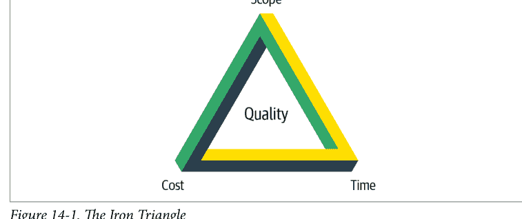
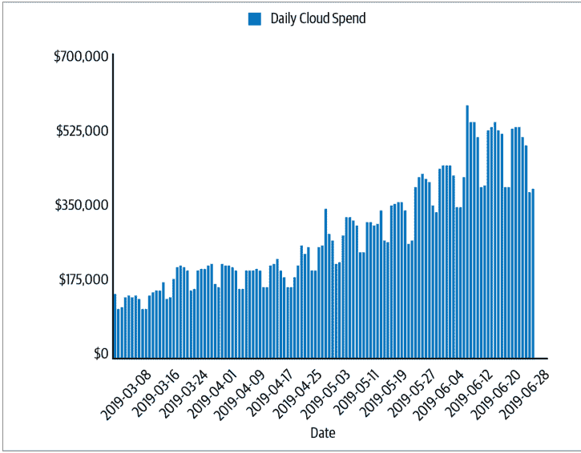
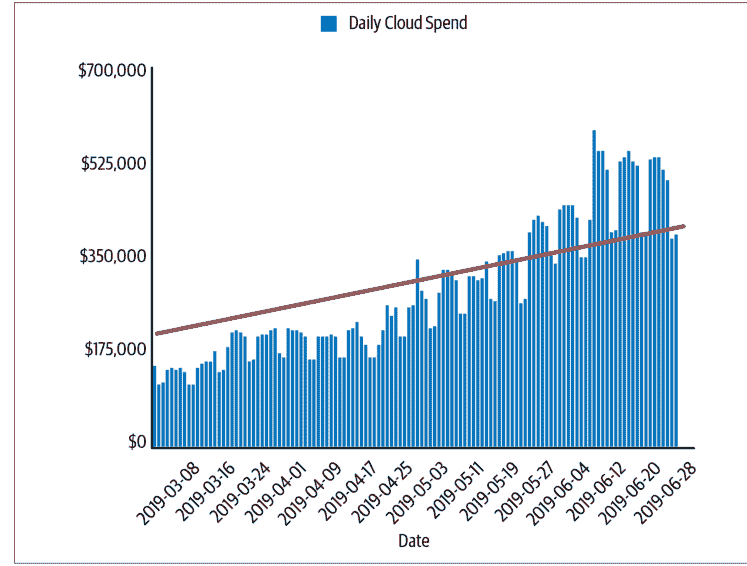

## Optimize Phase

## 优化阶段

在本部分，我们将介绍设置和跟踪目标以进行数据驱动决策从而优化组织云的流程。我们还将研究云服务提供商的折扣优惠和承诺策略，这些策略可以帮助降低云成本。

## Optimize Phase: Adjusting to Hit Goals

## 优化阶段：调整以实现目标

当你进入优化阶段时，你的重点转向近实时做出决策、识别异常并高效支出。你使用指标设定目标，以便组织了解其相对于既定期望的绩效如何。

在本章中，我们将扩展说明你为何需要目标、它们应在 FinOps 世界中如何实施以及如何设定它们。我们还将介绍成本优化的目标，这为优化阶段的其余部分奠定了基础。

## Why Do You Set Goals?

## 为什么要设定目标？

每一次进入云的旅程都讲述不同的故事。对于某些组织而言，所有服务部署到云的速度比成本更重要。对于其他组织而言，主要目标是放慢速度并确保整个过程中预算得到维持。其他组织可能已经在云中，并且发现自己花费的远超预期。他们理所当然地感到需要把事情控制住。

值得注意的是，大多数组织在团队层面同时进行着多个云故事。一些团队可能是云原生，旨在维持其成本。其他团队正在迁移或实施新项目，更关注交付时间而非花费的美元数。

通过在公司层面以及每个单独团队设定目标，你能够跟踪业务决策、设定期望，并识别云支出中哪些方面没有像你希望的那样运作。

## The First Goal Is Good Cost Allocation

## 第一个目标是良好的成本分摊

在设定进一步目标之前，你必须清楚了解当前状态。如果你实施清晰的标签和账户分离策略，随着在云中扩展资源，将更容易理解你所面对的情况以及如何最好地优化它。

每个组织都应按成本中心/业务单元跟踪支出。这不仅使每个团队能够了解其对整体云支出的影响，还允许企业确定哪些团队推动了任何成本变化。

我们已经介绍过如何实施清晰的成本分摊策略，以帮助按成本中心识别支出。这些成本分摊策略需要保持一致。如果不一致，试图确定其历史云支出的团队将无法区分其成本变化与分摊策略将更多或更少的整体云支出分配给他们的差异。

按团队分解成本有助于突出变化发生的时间。如果没有单个团队级别的报告，数据可能会具有误导性。例如，如果一个团队优化其云支出，而另一个团队以相似规模扩大其占用，则整体成本可能看起来持平。如果团队对基础设施进行更改，而跟踪成本指标的图表没有相应变化，那么你跟踪的就是错误的指标。

## Is Savings the Goal?

## 节省是目标吗？

正如我们多次提到的那样，因为它非常重要，节省并不总是目标。许多 FinOps 实践者起初专注于减少云账单的方法，这很好。但你必须始终记住，FinOps 是关于实现问责制、支出投资决策的所有权以及最终创新。在设定目标时，你应该问自己：我如何花费正确数量的金钱来为业务带来最大利益？我寻求的好处是什么？它们包括增加收入、更快项目交付、其他领域的成本效率，甚至只是更满意的客户吗？在这里多花钱能否在其他地方减少成本，例如劳动力？

一个组织可能需要在特定时间内搬出数据中心，错过该截止日期的成本远高于快速迁移到云的成本。或者在另一种情况下，企业可能需要在截止日期前交付功能，这需要使用 AWS Aurora 等托管服务，而不是自行运行 MySQL。Aurora 的成本高于内部运行，但它带来了消除耗时管理任务的好处，例如硬件配置、数据库设置、修补和备份，这改变了

TCO（总拥有成本）对比并让企业有更多时间投入迁移。

优化阶段是关于衡量你的支出与目标之间的差距，并确定现在可以做出的决策以及应安排在以后清理的行动。

为鼓励就目标应如何与节省成本与创新速度相平衡展开讨论，我们引入了铁三角。

## 铁三角：好、快、便宜

铁三角（或有人称之为“项目三角”），如图 14-1 所示，是项目管理约束的模型：速度、成本和质量。常见的表述是：“好、快、便宜——任选其二。” 它认为项目经理可以在确定项目完成方式时在约束之间进行权衡。一个约束的改变需要其他约束做出相应调整以补偿。

图 14-1. 铁三角

例如，如果增加预算或削减范围，迁移项目可以更快完成。同样，增加范围可能需要预算和进度的相应增加。在不调整进度或范围的情况下削减预算将导致质量下降。

铁三角是可视化云决策过程中发生的完美隐喻——好、快、便宜之间往往存在权衡。团队越是与三角形的某一端保持一致，就越少关注其他领域。但这并不是坏事。你希望团队做出有意的选择，朝某一轴的某一端努力，以支持其业务目标。

- *Good* 衡量服务的质量。给云中运行的服务分配更多资源可以提高可用性、灾难就绪能力、性能和可扩展性。
- *Fast* 衡量团队行动的速度。当你向客户推出最新更新或功能、快速将服务迁移到云中，或缩短新产品上市时间时，这种速度非常有价值。
- *Cheap* 衡量云支出金额。关注便宜（由于 COGS 限制或预算上限）将导致最低的云成本，但随之而来的是对质量和速度，即好与快的影响。

这种在现实世界中的体现反映在 Atlassian 近期的一项项目中。一个团队过度配置资源以收集额外的性能数据，正如预期那样，这提高了迁移速度。如果团队停下来调整资源以节省成本，整个项目就会被延迟。交付速度比潜在节省金额更重要。项目交付后，关注点从速度转移，团队开始积极审查部署以发现可能的节省。

我们必须强调，铁三角并非仅用于组织层面。它也必须延伸到团队层面。对于一个成本意识强的组织来说，有一个团队和/或服务以速度为重点运营是常见且有用的。虽然总体上组织试图在云中保持或增加节省，但节省的增加可以再投资于团队，以便更快地开发组织的下一个竞争优势。

## 通过 OKR 实现目标

OKR，即目标与关键结果，是一种定义和跟踪目标及其成果的框架。对于每个 OKR，都有一个需要实现的目标，以及一组称为关键结果的指标，用于衡量该目标的实现程度。OKR 通常的有效期为一个季度。

在一次 FinOps Foundation 的演讲中，前 Nationwide 云服务总监 Joe Daly 表示，“我们用 OKR 来明确目标并专注于结果，以提供清晰度、问责制和可衡量的成果。”

Daly 还明确指出，使用 OKR 最重要的是关注结果。当企业迁移到云时，随着团队努力快速吸收大量新知识，可能会产生大量混乱。对于多年来以另一种方式做事的团队来说，这可能非常令人望而生畏。

### OKR 重点领域 #1：可信度

当 Daly 在 Nationwide 的 FinOps 团队相对较新时，他提供了以下建议：“可信度可能是你在启动 FinOps 实践时最需要关注的领域。可信度等同于信任，如果你没有这种信任，你就会不断试图支撑你提供的服务。”

Daly 通过从终端用户一直到代码的透明度来支持他的可信度目标。其关键部分是定期支出更新（每日、每周、每月），粒度取决于每个利益相关者的需求。这些更新必须简单易懂。数字还必须与他们的会计师在月底向他们报告的内容相一致。

### OKR 重点领域 #2：可维护性

太多时候，新 FinOps 团队以不可维护的方式开展工作，例如不强制执行自动化标签。正如 Daly 所说，“有意义的数据需要由认为它有意义的人来管理。我们所做的是创建一个标签存储库，由应用产品经理和面向业务的人员维护，这样你就可以将所有应用数据和业务数据与资源关联起来，而无需依赖工程师，因为对他们来说数据没有那么有意义。”

他在该领域设定的关键结果的两个例子是能够将应用名称、应用所有者和业务组与每个资源关联起来，并自动化像计费回溯这样例行且耗时的任务。

### OKR 重点领域 #3：控制

这里的目标是在实现速度的同时建立控制。正如 Daly 所说，“我们将使用控制的责任推给应用/产品团队。”他们通过建立直接的计费回溯模型、分享知识并鼓励用户采用来实现这一点，同时确保实施政策以防止自动扩缩容的噩梦。

他在该领域设定的关键结果的一些例子是使标签合规率翻倍、为云和容器使用建立计费回溯，以及自动化合规政策。

团队有不同的动机来推动支出和节省。工程师完全合理地围绕更高性能、更高可用性和更快部署新功能设定目标。财务团队适当地关注支出、节省和支出效率。而业务领导者可预测地仍然关注整体业务绩效。在为 FinOps 设定目标时，你不能只是让这些团队各自设定目标。不仅不会实现业务的正确结果，而且还会增加团队之间的摩擦。

> *当工程和财务一起讨论时，你通常会得到一个对两个部门都有效的解决方案，而不是工程师只是在房间里想出一个仅适用于工程师的解决方案。同样，财务部门制定政策会让工程师的生活更困难。让人们共同合作制定更聚焦的 OKR 将为每个人带来更好的结果。*
> 
> —Joe Daly，前 Nationwide 云服务总监

业务领导者需要决定他们愿意花费多少，以及在速度利益下何时应放弃节省（甚至可能产生浪费）。但无论是尽快将 IT 从数据中心迁移出来，还是将新服务推向客户，都应始终有可追踪的支出预期。唯速度论只在支出没有增长到不可接受的程度之前有效。

与其等待云成本突破不舒服的阈值然后再努力应对，不如在项目进展过程中设定早期预期并跟踪云支出，这将有助于避免账单冲击。工程师随后将在商定的成本范围内获得更多自由。FinOps 团队可以帮助识别保持预算在轨的轻松获胜点，而财务和业务领导者能够重新评估预算和目标。

> *在 FinOps 认证从业者培训课程中，关于 FinOps 团队在优化阶段的角色的主题是帮助做出关于成本的重要决策，以保持支出在范围内（无论你试图多快），然后当理想的成本路径未被遵循时（由于速度或由于粗心、缺乏技能、追求更高质量等），能够识别出后期优化的地方。所以我们找到低垂的果实来清理，但我们也在流程早期注入一套重要的成本检查以进行治理。*
> 
> —Rob Martin，FinOps Foundation 学习总监

整个业务需要在为技术团队提供足够支持的同时保持支出在可接受范围内。最终，你正在构建通往 FinOps 极乐世界的道路，在那里单位经济学将使你能够确定从云支出中获得的业务价值量。

与其它组织的 FinOps 从业者讨论目标可以帮助你构建自己的目标。了解对他们重要的目标以及原因，可以帮助你确保设定正确的目标并与 FinOps 社区保持一致。

## 来自云端的故事——FinOps 社区

以下是 FinOps Foundation 迷你峰会电话会议中一位成员分享的一些示例目标：

我们今年有 $3m 的成本规避目标。我们计划通过将预留覆盖率提高到 80% 来实现。我们按预算区间分解预留覆盖率。随着我们继续购买预留实例，我们希望确保高

预留利用率。我们将预留利用率的目标设为 95%，并按预算分段进行跟踪。

我们对标记有 KPI，因为它对我们的优化工作至关重要。应用所有者标签对我们围绕适度配置的工作至关重要。我们还跟踪适度配置的选择退出情况。我们跟踪谁选择接受或退出我们向他们提供的建议。我们的目标是将选择退出适度配置建议的比例降至仅 25%。

此外，我们在两个方面跟踪云提供商预算：（1）对提供商的承诺和（2）每个预算分段内的预算进度。最后，我们跟踪通过适度配置和预留覆盖所能实现的总体节省机会，以及该数字随时间的变化情况。我们为全年设定了目标，即希望将总体节省机会降至多低。

## 目标线作为目标

目标不仅仅是一个单一数值——它们是随时间推移的趋势。如果你将目标设为每月 x 美元之类的单一数值，你必须等到月底才能看到进展情况。通过将该目标分解为每日数值，你可以在云支出图表上绘制目标线，从而实现接近实时的分析。目标线在以指标驱动的成本优化中至关重要，我们将在第 22 章后面介绍。

指标应始终具有目标线，以为数据提供更多上下文。目标线的设定位置将基于贵组织的云旅程、您在维持支出方面的积极程度，以及您认为为实现创新而多花钱的价值。

目前专注于铁三角“快速”角的组织可能会设定相当高的目标。超出目标仅具有信息性，并将导致预测上调。另一方面，谨慎的组织（专注于铁三角的“成本”角）会将目标设定得与其现有支出轨迹相当接近，而支出超出目标的情况将通过快速行动来恢复正轨。

如果你像图 14-2 那样随时间绘制支出图，可以确定一些基本信息：

- 你目前每天的支出在 40 万美元到 53 万美元之间。
- 总体而言，你的云支出正在增加。
- 上个月的支出增长速度比前几个月更陡峭。

但这些关于云支出的基本事实只是数据点。从图表中无法确定任何绩效或业务预期。

图 14-2。数月内的每日支出图

然而，如果像图 14-3 所示添加目标线，你可以确定更多信息：

- 你的支出在历史上一直低于目标。
- 上个月你超出了目标支出。
- 你在之前的几个月里没有修订目标。
- 如果当前趋势不变，本月你将再次超出目标。

添加目标线可以让你对图表中的数据点获得更多上下文。目标线并不总是需要是线性的；考虑一下先快速上升然后趋于平稳的目标，或延迟增长然后快速上升的目标。在可能的情况下，你应始终尝试在图表中包含目标线，以了解数据点对组织的影响。这与 FinOps 的语言相关，如第 4 章所述。

图 14-3。添加目标线后的数月内每日支出图

## 预算差异

通常，如果你的指标与目标存在显著差异，就存在问题。为了保持预算，团队应认真对待目标的突破，并在指标绩效发生变化时尽早做出反应。

虽然指标远低于目标时可能看似不重要，但你应始终努力将目标设定在预期水平。这将建立对所跟踪数字的信心，并确保所有细节都纳入目标设定阶段。

有时团队需要做出选择，而这些选择会影响其预算。考虑这样一种情况：某个团队在项目上落后了。他们的计划是部署较小的云资源以保持成本低，但为了让项目重新回到正轨，他们决定部署更大的资源并更快完成工作。这将导致短期内超出目标，但会带来将项目按时交付的业务利益。我们将此归类为预期异常。事先做出决定，超出计划预算以实现期望的业务成果。

*意外的异常*发生在团队部署资源时预期保持预算，然后发现支出呈超预算趋势时。意外的异常通常意味着需要做出改变：要么是已部署的内容，要么是为团队设定的目标。

例如，假设你产品中的新功能可能会增加客户与服务的互动，从而增加成本。如果成本的增加也提高了你的收入，那么在云支出中看到这种异常就是好事。（我们将在第 26 章讨论单位经济学，这是一种让你能够跟踪收入与成本的过程。）

你还必须能够跟踪可能不会直接导致云支出变化的异常。如果你的某个团队开始使用新的云服务产品，取代通常使用的产品，你可以通过显示按云服务产品划分成本的异常报告得知此事。对于在安全或合规原因下使用新服务前需要批准的公司而言，该报告中的异常可能非常重大。

跟踪你的成本优化可以让你识别优化绩效的意外变化，这可能表明 FinOps 战略的某些部分未被正确执行。优化报告中的异常使 FinOps 团队能够及早做出反应，以保持组织已习惯的节省。使用基于自动化、机器学习的异常检测是快速找到云堆栈中的那些“针”的关键。

## 使用更少与支付更少

当你知道实际支出与预期支出之间的差异时，下一个显而易见的问题是当支出超出预测时该怎么办。好吧，有两种方法可以降低你的云账单，为了更好地理解它们，让我们重新回顾云的计费方式。

我们在第 5 章介绍了云提供商如何向你收费。记住，云支出的基本公式是 *支出 = 使用量 × 费率*。要减少支出，你可以减少拥有的 *使用量*，或使用云服务提供商特定的产品来降低为资源支付的 *费率*。

你可以通过减少已配置资源的规模（例如，配置更小的虚拟机，减少虚拟 CPU [vCPU] 和内存）或在不需要时关闭/移除它们来减少使用量。你通常通过在一段时间内向云服务提供商承诺一定量的使用量来获得费率降低。作为回报，他们会降低你为这些资源支付的费率。

我们将在第 15 章和第 16 章介绍针对这两个杠杆——使用量减少和费率减少的策略和战术。

## 结论

FinOps 生命周期中的告知阶段帮助你了解事物 *是* 什么样的。当你进入优化阶段时，你会设定关于事物 *期望处于* 何种状态的目标。利用这些目标使业务能够专注于需要关注的事项。

总结如下：

- 优化阶段并不总是关于降低成本——而是关于高效支出。
- 目标为指标提供上下文，使人们不仅能了解事物现状，还能了解事物应有的状态。
- 早期检测到的异常可以迅速处理，避免账单意外。
- 你可以通过使用量减少或费率减少来降低成本。

在减少云支出时，了解实际需求非常重要。以牺牲创新或影响重要项目为代价来减少支出应始终避免。降低云成本很复杂，但我们将在接下来的几章中帮助你逐步分解。

