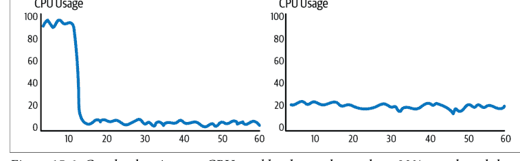
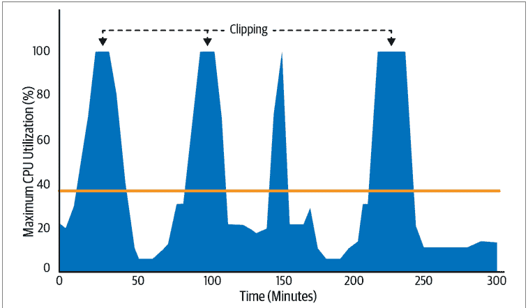
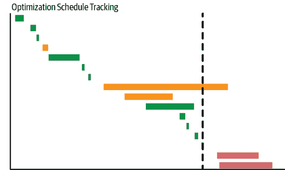
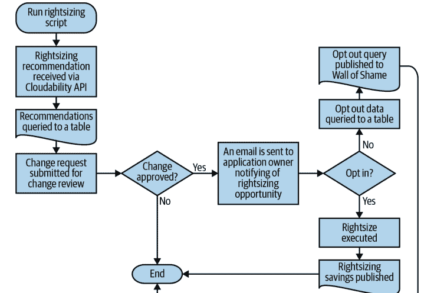

## 减少使用：使用优化

在本章中，我们讨论 FinOps 生命周期中最具挑战性的部分之一。使用量减少在文化层面实施需要大量努力和时间。如果你的目标是快速节省成本，你会发现购买基于承诺的折扣——我们在第 17 章中会介绍——是降低成本的更快途径。与购买预留实例不同，后者可以在无需任何工程操作的情况下带来显著的成本节约，使用量减少需要工程师将其优化工作纳入冲刺计划。这并不是说没有易于取得的成果——只是完成它需要付出更多努力。

云服务提供商向你推销“按需付费”的理念。然而，更准确的说法是，你为所配置的资源付费，无论是否使用。在本章中，我们将查看部署到你的云账户中的资源，这些资源要么未被使用，要么未被高效使用。

### 云消耗的冷酷现实

当你开始关注使用优化时，如果听到类似以下的对话，请不要感到惊讶：

**FinOps 实践者：** “嘿，看起来这里的这些资源没有被使用。你需要它们吗？”

**团队成员：** “哦，它们还在？我忘了！我现在就删除它们。”

此时，你可能会情不自禁地用沮丧的手拍额头。你会很快意识到，如果你早点进行这场对话，或许就能节省数月为该资源付费的开销。

但事情并非如此简单。当你在云端大规模运营时，可以几乎肯定会有一些未充分利用或被遗忘的资源。面对云中看似无限的资源选择，许多工程师倾向于选择更大的资源选项。做出这种选择可以避免他们在半夜被叫醒处理问题。

然而，很难知道哪些资源需要审查。正如我们提到的，这要求团队拥有正确的指标来了解其应用的需求。团队还必须了解资源按此方式配置和运行的任何业务原因。FinOps 在组织中如此有效，是因为它要求组织各方遵循一致的工作流程，并在将建议付诸实施时共同协作。

然而，当你开展使用量减少工作流程时，你可以在之前因资源过大而浪费金钱的地方实现节约，并防止浪费在未来积累到你的云使用中。我们将探讨什么是浪费、如何检测需要调查的资源、减少使用的方法、如何让团队实施变更，以及正确跟踪进展的方式。

大规模的使用量减少需要文化转变。它不是一次性修复，而是一个持续循环，即选择合适大小的资源并消除过度配置。使用量减少要求工程师像思考内存或带宽一样思考成本：作为另一个部署 KPI。他们很快就会看到，将成本视为效率指标进行思考是值得付出的努力。

将资源大小减半通常会节省 50% 的成本——或者在未使用资源（如未挂载的块存储卷或空闲实例）的情况下，节省 100% 的成本。云的可变、按需特性带来的好处之一是，你可以随时自由调整任何资源的规模——或完全停止使用。关于正确配置且持续使用的资源，通过费率降低选项还能进一步节省成本，我们将在第 17 章中介绍。

最初，使用量减少往往是追溯性的。团队会清理基础设施，以确保资源集得到充分利用。在更成熟的做法中，工程师在部署前架构评审中会主动考虑成本，并在最初选择云资源时积极考虑成本。后续阶段会带来对应用的重构，以使用更多云原生服务。

目标不是做出完美的决策。而是在给定上下文和数据的情况下做出尽可能好的决策，然后经常重新评估。合适大小的资源不会永远保持如此，因为代码和负载会随时间演变。

### 云端故事——Mike

在 Atlassian，Mike 自本书第一版以来看到了巨大转变：

四年前，FinOps 被视为占用工程师时间并通常阻碍他们的工作。该实践已成熟，更多地与工程本身集成，因为它已成为在云中交付软件的核心部分。FinOps 基金会也看到工程角色的成员在过去几年中大幅增长。在 FinOps 成为 established 术语之前，你会去找工程师说，“我们正在尝试做 FinOps 或成本优化”，而他们真的不知道那是什么意思。现在他们通常已经听说过这些术语，并理解你试图实现的目标。有效的 FinOps 团队作为合作伙伴而非局外人出现。FinOps 团队在软化语气方面做得更好，更倾向于与工程师协作，而不是仅仅指责浪费。

在 Atlassian 的 FinOps 培训中，我们做了一个练习，比较两种不同的模式。首先，我们以要求苛刻、归咎于人的方式进行对话（即“你做错了”）。 alternatively，我们带着无指责的数据出现，并询问数据为何显示未充分利用的原因进行讨论。这个练习强调，问题不仅仅是找到浪费，而是工作和协作，首先寻求理解。

### 浪费从何而来？

我们所称的 *浪费* 是指任何付费使用或付费使用的一部分，通过调整资源大小或减少资源数量以更好地满足应用需求本可以避免的。

当云资源首次部署时，其容量需求往往并不完全已知或被充分理解。在部署初期，这对几乎所有人都是如此。

这种不确定性导致团队过度配置容量以确保不会出现性能问题。初始部署时过度配置资源并不是坏事。云的优势在于它让你能够快速部署，然后在过程中进行调整。你想要避免的是部署资源后不对其过度配置进行监控。那时你会发现自己在长期内为资源支付了超出应有的费用。

随着团队忽视基于利用率指标维护资源，浪费会增长。持续监控资源是否过大至关重要。因为今天正确使用资源的服务，在部署更高效的服务代码后，明天可能会过度分配。甚至客户行为的变化也可能导致容量需求降低。

### 通过移除/迁移减少使用

研究表明，有两种类型的云团队：那些忘记了一些资源的人，以及那些撒谎说忘记了一些资源的人。换句话说，资源被遗忘并留在云账户中是非常常见的。当你在公司发现同样情况时，不要假设有恶意或粗心。工程工作有许多相互竞争的优先事项，而用于检测浪费的自动化工具并不总是被领导层优先考虑。换句话说，这对我们每个人都可能发生。

通过查找成本非常稳定且使用过时资源的区域来发现浪费。“陈旧且不变”不是云应有的运作方式。如果它长时间未被触碰地闲置，很可能可以进行优化。

仅仅告诉团队不要忘记资源并不能涵盖所有情况。资源可能是由未配置为在指示时删除的自动化创建的。或者资源是团队故意留到未指定的稍后日期，但随着优先事项转移，未采取后续行动。此外，一些资源可以在其父资源被删除时配置为保留，例如附加到服务器的卷，并且在删除某些资源时，云服务提供商可以自动创建数据快照，无论你是否需要它都会保留。

丢失或被遗忘的资源是团队最容易处理的资源类型。在这种情况下，减少使用可能只需删除资源即可，节省该资源 100% 的成本。

我们经常听到的另一个对话是关于需要在资源内保留数据的需求。通常，团队出于合规原因需要保留数据很长时间。

即使你出于此目的需要保留未使用的卷，也有办法减少支付费用。例如，云服务提供商提供多种存储层级，当你可以将其移至价格更低的“冷存储”资源（如 Azure Archive 或 AWS Glacier 存储）时，为数据支付更高价格存储服务的费用毫无意义。

考虑制定数据保留策略，明确团队需要保留哪些数据以及保留多长时间。一旦制定了保留策略，团队就可以自动将数据移至不同的存储服务，并在适当时删除。

## 通过调整规模降低使用量（Rightsizing）

要调整资源大小，您需要了解资源利用率的可见性。这种可见性必须包括 CPU 使用率、已使用的内存、网络吞吐量和磁盘利用率。

进行 Rightsizing 时，您不仅仅是在优化成本节约。您还需要确保不会影响团队运营的服务。团队在管理服务时的主要目标是确保服务本身不会耗尽所需的运行容量。因此，他们抵制调整资源大小的想法并不罕见，尤其是支持生产应用的资源。

如果团队必须停止手头的工作来调查调整资源大小，交付计划可能会受到实际影响。在决定团队是否应专注于调整资源大小以降低成本时，应考虑这些影响。通常只有少数高成本资源和大量会节省很少的小资源。我们建议设定一个截止点（最低节省金额），在此之下可以忽略 Rightsizing 建议。此阈值应经常审查，以确保其仍然合理。目标是确保花费在 Rightsizing 上的时间能为企业带来实质性节约。

为了防止在实施调整大小变更时对资源或自动化产生影响的担忧，了解 FinOps 团队在 Rightsizing 中发挥的作用非常重要。FinOps 是关于团队之间的协作，不应由 FinOps 从业者独立执行。这就是对话至关重要的原因，因为仅凭指标通常无法推断团队在确定资源大小时使用的方法。

中央 FinOps 团队负责运行资源使用的自动化分析，提供有关哪些资源似乎未充分利用的报告，并以编程方式提供替代的、更高效的配置。然后将建议提供给团队，以便他们调查资源，找出可能阻止调整大小以实现潜在成本节约的任何原因。工程组织必须理解，FinOps 团队并非有意引入性能风险，而是专注于在不提供业务价值的地方安全地减少容量。

必须提供多种能够适应资源上现有工作负载而不会影响工作负载性能的建议。多种建议使团队有机会在减少资源大小所涉及的风险与潜在节约之间取得平衡。原生、开源或第三方 FinOps 工具可以承担提供这些建议的重任，而工程团队可以使用应用性能监控工具进行进一步调查。

AWS 的产品经理 Rick Ochs 表示，确保 Rightsizing 建议具有高质量非常重要，这有助于工程团队避免花费数小时的验证工作来发现潜在风险，例如账户配额、附加限制或 CPU 速度差异。提供方向正确但过于简化的 Rightsizing 建议往往会导致工程团队花费更多时间拒绝建议，而非 Rightsizing 所能带来的收益。

通过使用高质量的 Rightsizing 建议——那些不仅使用 CPU 平均值，还包括 I/O、吞吐量、内存，并且不使用峰值或平均指标的建议——您可以降低所需的工作量并增加转化为实质性成本节约的建议数量。

每一条 Rightsizing 建议都是与某人进行讨论的机会。您必须充分了解对现有资源进行 Rightsizing 的总体工作量，并确保新应用从一开始就进行 Rightsizing。

## 来自云端的故事——Benjamin Coles

Benjamin Coles，Cupertino 的高级软件开发工程师，向他的工程合作伙伴提供了以下建议：

对于迁移而言，Lift-and-Shift 模式是一种快速而粗糙的方法，允许我们在不考虑需求的情况下尽可能多地将内容塞入云中。它本质上变成了推迟的技术债务；这是在我们不去检查是否可以进行调优的情况下把问题踢到路边的过程。

这不是理想的长期解决方案；如果我们有时间，我们会重构代码——我们会做对。在此期间，我们能做些什么小胜利来让迁移更易于承受？如果您为源实例（裸机或虚拟机 [VM]）开启了监控，请查看 CPU/内存并了解您的应用程序使用了多少。不要使用实例规格，您可以构建一个更接近实例性能要求的 EC2。

为什么这很重要？从传统意义上讲，当您使用本地实例时，您只需支付一次费用，然后再也不用考虑它。在这个新的云世界中，他们将每个子系统都细化到了 CPU 和内存的成本。在云中，您会被收取存储和网络 I/O 以及您注册的每项其他服务的费用，导致千刀万剐。即使您只关注实例成本，忽略所有相关的子成本，也有很多钱可以潜在节省。

例如，如果您有 100 个系统，每个系统为 16 核 128 GB RAM——相当于 c6g.4xlarge，价格为每小时 0.544 美元，或约每年 47.6 万美元。将实例大小减半将得到 c6g.2xlarge，价格为 0.272 美元，或每年运行费用 23.8 万美元。这种模式的优点是，您可以通过降低运营支出赢得财务团队的好感，甚至更好的是，如果您在触发重新部署时能再次做到这一点。

Benjamin 的故事尤其有意义，因为当我们在数据中心构建事物时，我们有意使基础设施过大，以便在它们服役的五到七年内工作负载能够增长。将物理硬件采购规模扩大被视为标准最佳实践，以避免因应用程序导致系统在硬件寿命中期就耗尽容量而不得不重新购买硬件的痛苦。这导致了物理数据中心硬件平均利用率非常低的个位数这一常见结果。如果我们通过完全匹配数据中心中的 CPU 和内存来进行 Lift-and-Shift，我们就在不知不觉中延续了这种过度配置。如果您无法立即查看利用率，一个替代方法是默认在云中选择稍小的规模，并在出现性能问题时解决这些问题。如果工程团队能够轻松识别性能问题但尚未看到成本，这种方法可以帮助提升迁移的成本效率。

## 常见的 Rightsizing 错误

Rightsizing 在初次考虑时很少像看起来那样简单明了。有大量细节需要考虑，许多常见错误会被云优化新手反复犯下。

### 依赖仅使用平均值或峰值的建议

在查看资源（例如服务器实例）上的现有工作负载时，至关重要的是确保您不仅仅查看指标的平均值和峰值。如果使用平均值或峰值，您可能会被误导。

考虑利用率的波动和峰值然后应用统计模型来枚举最佳匹配的资源大小并非易事。我们见过的大多数工具都只基于时间序列的利用率平均值使用某种经验法则，然后推荐最紧密匹配的资源类型。其他工具会对它们看到的任何峰值都推荐升级，无论原因如何。

例如，当您比较图 15-1 中的两个使用图时，两者的平均 CPU 统计数据在每小时内均为 20% 利用率。然而，使用平均 CPU 使用率指标，您无法判断 CPU 是否整整一个小时都保持在 20%（如右图所示），还是五分之一的时间接近最大 CPU，其余四分之五的时间接近最低（如左图所示）。将这些实例调整为 CPU 容量减半的服务器实例将影响左实例在 CPU 峰值使用期间的性能。无论您按天查看，还是按

每小时，甚至每分钟。平均值并不能完整说明实例上正在发生的情况。

*图 15-1。显示两种 CPU 工作负载的图表：一种有短暂的 90%+ 峰值，然后在剩余时间内保持在 <10%，而另一种则稳定在 20%*

仅使用利用率平均值可能导致两种结果。最常见的情况是，工程师意识到该建议完全不合理，成本节约举措随之结束。团队意识到他们浪费了大量时间，而他们的部署成本仍然高于应有水平。

另一种情况更糟。经验不足的工程师可能会照此执行建议的操作。在空闲时或甚至平均使用时，新资源配置可能仍然能正常运行。但当出现常规峰值或变化时，情况开始恶化。对资源的需求超出其承受能力。性能开始下降，甚至可能出现某种中断。任何潜在的成本节约都远不及对业务的风险。

> 将所有工作负载的大小调整为最大或峰值也可能是一个错误。在企业 VM 使用的典型月份中，这些工作负载上会发生各种活动：修补、维护、部署、备份等。虽然任何这些活动都可能导致 CPU 使用率飙升，但这并不意味着你应该立即升级，或信任总是将实例大小调整为覆盖峰值使用量的建议。即使是正常的 OS 重启也会使 CPU 利用率达到 100%。这就好比每次启动时 CPU 利用率达到 100% 就扔掉笔记本电脑并买一台更快的电脑。相反，使用一种能够从合理配置中剔除少量峰值的大小调整方法更为可取，其中由于修补、维护或其他行为导致的瞬时峰值不会驱动升级，而只有在一周内持续超过合理 1% 或 5% 时间的利用率才会驱动升级。理想情况下，使用利用百分位计算来考虑这一点的合理配置建议。想象一下，如果你使用的是仅以峰值使用量为依据的合理配置产品，然后发现了一个需要对整个公司实例群进行大范围补丁安装的重大安全漏洞。你的合理配置建议会错误地告诉你升级所有内容。
> 
> —Rick Ochs，AWS 的首席产品经理

## 未能在计算之外进行合理配置

每个人都喜欢首先将精力集中在计算成本节约上，但合理配置需要扩展到计算之外，以便解决更大的云成本问题。你可以在各方面看到利用率问题，但值得提及的两个特定领域是数据库服务器，例如 RDS（关系数据库服务）、托管 SQL、Azure 托管磁盘、Cloud SQL，以及存储，例如 EBS（弹性块存储）和 Google Cloud 持久盘。如果你不查看数据库和存储等非计算服务，你就会错失大量潜在的节约机会。

## 未解决资源“形状”问题

合理配置决策不应局限于单一计算族。每个云服务提供商都有多个专门的计算族，你应选择一个与工作负载资源形状相匹配的族。在 AWS 和 Azure 中，这些族以固定形状提供，具有一定数量的 CPU 核心、一定量的内存，以及快速网络等其他功能。例如，你的工作负载可能需要四个核心和 3 GB 内存，并且可能已迁移到云中运行在 AWS 上的 r6i.xlarge 实例上。这具有正确数量的核心，但内存却多得惊人。改为迁移到 c6i.xlarge 不仅可将成本降低一半以上，还能通过保持计算一致同时减少内存来使形状正确。Google Cloud 计算的购买方式允许你选择 CPU 和内存组合，而不是从大量预定义实例配置中挑选。你可能还会发现某些实例族具有更快的 CPU，这有时可以让你降低核心数量，或者，另一些则提供更慢的 CPU，价格更低。通过深思熟虑你可以选择的实例族，你可以在仅仅选择正确的 CPU 和内存数量之外实现额外的节约。

## 合理配置前未模拟性能

你的团队可能会担心削峰（在减少服务器资源时影响性能），这可能导致次优决策。但有了预测建议如何影响其基础设施的方法，他们就能做出更好的选择来优化云。在进行合理配置操作之前，你必须确保可视化每个选项的影响并考虑跨计算族的多个建议。这样，你就可以评估可能出现削峰的概率（参见图 15-2），并在与将实现的节约相比时将该风险考虑在内。没有这一步，你的风险就是过于保守（节约有限）或过于激进（性能受损/中断）。

图 15-2。基于平均值调整大小会导致削峰

## 因预留实例不确定性而犹豫

团队常说：“我不想进行合理配置，因为它可能会影响我的承诺覆盖范围并造成浪费。”曾经这是一个合理的担忧，需要谨慎。但现在不再如此。所有三大云服务提供商现在都有许多选项，可提供更大的灵活性，让你能够自信地进行合理配置。当使用具有灵活性的预留时，如果你的使用量减少工作受到影响，你可以调整预留。我们将在第 16 章和第 17 章中介绍这些灵活性概念。

## 超越计算：控制云成本的技巧

虽然计算资源在许多云账单中占云支出的绝大多数，但还有许多其他使用优化需要考虑，以涵盖可以优化的其他服务。在这里我们将看一些其他云服务关注领域的示例。

## 块存储

与云计算实例密切相关的是附加在其上的块存储设备。查看三大主要云服务提供商，块存储服务包括 AWS 的 Elastic Block Store（EBS）、Azure 托管磁盘和 Google Cloud 的 Persistent Disk。

### 清理孤立卷

块存储的主要特性是卷在计算实例停止后仍然存在。这对数据保留是有利的，但如果你为不再需要的存储付费则是不利的。未使用的卷称为未附加或孤立卷，如果你检查其状态，它们会被标记为可用。这些卷在没有附加计算实例的情况下无法接收任何流量，因此本身是无用的。节省开支的绝佳第一步就是将其删除。

一个选项就是直接终止未附加卷，但你只有在确信数据永远不需要时才应这样做。为了确定，你应该查看卷最后一次附加的时间。如果是几个月前，很可能你不再需要该卷。这对于非生产环境尤其如此。某些云服务提供商允许你在删除 Spot 计算实例时保留块存储可用，因此在采取行动之前，你应确保对这些数据没有数据保留需求。

有一个很好的故事，关于删除一个九年历史的未附加卷如何在 FinOpsPod 播客第 13 集的《FinOops: Lessons Learned the Hard Way》中造成生产问题。务必在 Spotify 或 Apple Music 上查看。

更谨慎的做法是先对卷进行快照，然后再终止它。快照始终比原始卷便宜。它们会丢弃空白空间、压缩数据，并存储在更便宜的存储层中，如 AWS 的 S3 或 Google Cloud 的 Cloud Storage。如果你确实需要恢复卷，可以从快照中恢复。

### 专注于零吞吐量或零 IOPS

清理完未附加卷后，你需要查找处于空闲状态的已附加卷。这些通常出现在相关实例已关闭且卷被遗忘时。要发现这些卷，你需要查看卷网络吞吐量和 IOPS（每秒输入/输出操作）。如果在过去 10 天内没有任何吞吐量或磁盘操作，该卷可能未被使用。

### 将块存储成本管理作为优先事项

对于块存储卷，你需要为两个关键属性付费：存储和性能。存储按存储的每 GB 计费，费率基于位置和卷类型。对于性能，越好越贵，无论是 IOPS 还是吞吐量。令人惊讶的是，在优化云支出时，卷经常被忽略。

## 减少高 IOPS 卷的数量

具有更高 IOPS 保证的卷（例如 AWS 预置 IOPS 卷或 Azure 高级磁盘）并不便宜，而且相对容易更改。利用历史指标定位未充分利用的磁盘，并让工程师在可能的情况下进行更改，可以大幅降低磁盘成本。

## 利用弹性卷

当您使用 AWS EBS 时，卷可以在使用中增加大小、调整性能或更改卷类型。这可以在应用程序 actively 向您的卷驱动 I/O 时完成。无需维护窗口或停机。有很大的成本节约优势，因为您不再需要过度配置存储。通常工程组织会更愿意接受无需停机的建议，因为他们不必处理变更票据、停机窗口，或如果想恢复大小更改而需要额外停机的风险。

## 对象存储

通常被称为无限存储，对象存储服务很可能是您数据主要存放的位置。对象存储服务包括 AWS 的 S3、Google Cloud 的 Cloud Storage 存储桶以及 Azure 的 Blob Storage。

## 实施数据保留策略

将数据存储到对象存储服务中的便捷性以及这些数据存储在理论上是无限的这一事实，使得工程师很容易永久存储数据。在数据中心，可用磁盘空间是一个限制，必须实施数据保留策略以避免存储无界增长。迁移到云中消除了提供存储容量的挑战，但不应消除对数据保留策略的需求。

## 选择与数据匹配的存储层级/类别

默认情况下，发送到对象存储服务的数据通常存储在标准/热存储类别中。标准存储通常是最昂贵的存储类别，但具有最高的可用性和耐久性。对数据进行分类并为数据类型选择合适的存储类别，可以在对象存储上为您节省大量费用。一些云服务提供商提供自动分类和数据类别选择，例如 AWS 的 Intelligent-Tiering。

## 网络

网络成本经常被忽视，可能由于网络流量不是像云计算实例或对象存储桶那样的命名资源。有几种方法可以优化网络成本，但其中许多需要与组织内部管理网络的团队进行紧密协作。

## 清理未使用的 IP 地址

可以从云服务提供商处分配固定 IP 地址；当这些地址与正在运行的计算实例未关联时，它们通常会产生按小时计费。除非有业务原因保留未使用的 IP 地址，否则删除它们可以减少部分网络支出。

## 优化网络路由

一些云服务提供商提供网络构件（如 AWS VPC 端点），可在不使用公共 IP 地址或通过网络地址转换（NAT）服务路由流量的情况下访问其服务 API。使用这些网络构件可以降低在应用程序与正在使用的云服务之间传输数据的成本。

## 通过重新设计减少使用量

最复杂的使用量减少方法是重新设计服务本身。让工程团队改变软件的部署方式、重写应用程序，甚至完全更换软件，可以帮助您利用云原生产品。

## 扩展

更改资源大小并不总是全部答案——资源在工作时间可能利用得非常好，但在工作时间之外则不然。当然，如果您将实例调整为更小，在工作时间它将被过度使用并可能导致性能问题。

团队可能能够将生产服务架构得更具云原生性，从而利用云的弹性。最常见的方法是在繁忙期间让服务水平扩展（即配置更多资源），然后在非高峰时段缩减规模。服务本身需要支持这种动态扩展，这可能需要重新设计应用程序代码。或者扩展可能完全不可行，尤其是在专有软件的情况下。

相较于单体应用程序，构建更具服务化、松耦合、模块化和无状态架构的应用程序的现代方法正在获得关注，这得益于其在云和容器环境中的支持，因此未来更多应用程序将具备扩展能力。

## 定时操作

团队经常在睡觉时仍让开发和测试环境运行。考虑一个地理上集中的开发团队，他们每周使用资源 40–50 小时，而剩余的 118+ 小时完全不使用。如果他们能够在周的大约 70% 时间内关闭开发资源，就能为组织创造巨大的节省。取决于分布式团队所在的位置，几乎总有 24 小时大家都应该在周末。通过允许工程团队将节省用于新项目或工程工作，激励他们在非工作时间关闭资源，可以帮助推动云支出方面的文化问责。

为团队提供在不需要时自动关闭资源的方式，是确保资源在非工作时间停止的最佳方法。我们将在 FinOps 生命周期中 operate 阶段的讨论中稍后介绍自动化。

## 对预留实例的影响

我们经常被问到：“那我的所有预留怎么办？”如果存在诸如 Savings Plans（SP）、Committed Use Discounts（CUD）或 Reserved Instances（RI）等承诺预留，那么使用变化导致预留利用不足的担忧始终存在。通常，您可以通过在承诺像 RI 或 CUD 这样的费率优化之前先进行使用优化来避免这个问题。

实施使用量减少可能需要一些时间，通常比最初预期的要长得多。几乎每天我们都会听到有人说：“我在清理完基础设施后再做承诺。”我们发现 10 次中有 9 次，清理工作比预期花费更长时间——通常是数月——在此期间他们最终以更高的按需费率为过大资源付费。

> Rightsizing 是一件非常私密且漫长的过程。工程师们为自己的基础设施操心不已。不能简单地说“嗯，它应该在更大或更小的实例上”。进行这些更改需要测试周期和真正的努力。因此，我们的做法是，如果我们能够集中 RIs 和承诺、做出良好投资并以低 RI 空置[浪费]数为目标，那么 rightsizing 最终会赶上来的。
> —Jason Fuller，HERE Technologies

优先级往往会发生变化，火灾也必须定期扑灭。您应该接受这些作为生活事实，并寻求一些基于承诺的折扣的即时覆盖，无论您认为浪费有多少。我们经常推荐的策略是从大约 20%–25% 的覆盖率这样的小规模开始，然后随着清理工作的进行缓慢增长。关于创建有效的承诺策略，将在第 18 章中有更多介绍。

除非您已承诺云使用的每一部分，否则使用优化仍然是可能的。展望未来，您在承诺费率优化之前应考虑组织可用的使用优化量。大多数云服务提供商允许一定程度地交换或更改承诺以匹配新的使用参数。通过一些规划，您可以避免被锁定在错误的承诺中，并在进行更改时通过修改费率优化来开始使用量减少工作。通过跨不同系列调整实例大小，您通常可以同时提高覆盖率并降低实例支出。您可以通过将更多实例装入已购买的 RI 和折扣中，以更优化的方式有效地“俄罗斯方块”化您的工作负载。调整大小并折扣工作负载（从而可能留下一些未使用的折扣容量）比因担心浪费折扣而忽略调整大小更具成本效益。

## 收益与投入

当您查看使用量减少建议时，必须将可能的节省与工程投入和对生产服务的风险进行权衡。如果调查和实施更改所需的时间超过节省的收益，最好忽略这些建议。理想情况下，您应过滤掉低价值和/或高风险的建议。

FinOps Foundation 的其中一位成员让其团队以工程小时数来衡量云支出。他们考虑预期节省金额相当于多少工程小时。如果他们只需花费 3 个工程小时就能节省 1,000 个工程小时，他们就会去做。如果只能节省 5 个工程小时，则吸引力就小得多。

以工程小时数思考节省可以帮助团队将产生的节省视为团队中潜在的新工程师。节省的工程小时越多，获得额外人员编制批准的可能性就越大。

我们不建议在未先调查更改影响的情况下进行更改。有时团队在不了解其影响的情况下执行更改——更糟的是，设置自动化强制调整资源大小。这可能导致服务的生产问题。

在投入时间执行减少使用量的变更之前，团队应评估回滚变更的可能性。如果您预计未来几周的工作负载会增加，而实施缩减规模所需的时间意味着您几乎立即之后又必须将其扩大，那么这就不是时间的良好投资。此外，您还必须考虑其他项目，评估通过这些变更所能实现的收益。如果您在调整实例规模后仅几天就推出新服务，而这些实例随后又被替换，那么这段时间本可以用于其他地方，以更好地造福业务。

虽然节省看起来可能很小，尤其与整个云成本相比时，但重要的是要记住节省会随时间累积。通过移除不必要的资源，您可以避免在之后的每个月账单中继续为该资源付费。

## 无服务器计算

*无服务器计算* 是一种模式，其中云提供商运行服务器并动态管理机器资源的分配。定价基于实际执行的活动，而非预先购买的容量单位。

这消除了本章前面讨论的许多未使用或未充分利用的问题。使用无服务器，您真正只为正在积极使用的资源付费。未使用的资源通常不容易闲置。相比在需要时启动新的服务器实例并部署软件，无服务器架构通常能够非常快速地准备好处理请求。

转向无服务器并非没有成本，也绝不是浪费问题的万灵药。FinOps Foundation 近期就如何预测和比较应用程序的无服务器成本与其当前计算密集型架构进行了健康的辩论。提出了几种出色的方法，最终讨论显示该实践仍在不断演进。

最终，构建任何向无服务器迁移计划的复杂性在于执行，与成本节省关系不大。建议从大型服务器实例迁移到许多并发的无服务器执行是毫无意义的，因为这样做相关的成本节省与实现所需的工程工作相比微不足道。对于大多数情况，担心无服务器的预测或优化意义不大，因为真正的成本不是云账单，而是应用程序的重构。简单来说：无服务器可能很便宜，但为无服务器进行重构并不便宜。因此，无服务器通常更适合全新项目，而非现有应用。

然而，有一个完全不同的视角可以评估无服务器：*总拥有成本*（TCO），即构建解决方案所需的工程团队成本，以及上市时间对服务成功和盈利能力的影响。请记住，无服务器允许您将大量责任委托给云提供商。DevOps 工程师通常处理的职责（服务器管理、扩展、配置、修补等）成为 AWS、Google Cloud 或 Azure 的责任，这让开发团队可以更专注于更快地交付差异化功能。

太过频繁——即使在这本书中——关注点都放在基础设施本身的成本上。但软件开发中最大的成本通常是人力。请在审视无服务器论点的双方时仔细考虑这一点。人力成本（例如薪资）在您考虑从单体应用迁移到无服务器时可能会抵消任何基础设施节省。回到收益与投入的对比，您应考虑将服务重新设计为无服务器的总体成本与潜在降低成本之间的权衡。

但当您构建新的全新无服务器服务时，人力成本节省可能非常值得。记住，无服务器既可以加快上市时间（通过避免重建现成可用的功能），又能大幅降低持续运营需求。这些优势使您能够将资源重新导向产品构建，而非服务器维护。

关于无服务器的整个讨论——与所有 FinOps 相关事物一样——应以 FinOps 的目标为基础：它不是关于省钱；而是关于赚钱。在您的云账单上，无服务器对于某些应用可能最终更昂贵，或对其他应用节省大量资金。您为实现这些节省而产生的真实成本将是人力成本，但您从无服务器获得的真正收益可能是更短的上市时间。而在竞争优势方面，机会成本超过了许多实际成本。

## 并非所有浪费都是浪费

如果您开始对拥有看起来过大资源的每个人大喊大叫，最终您的团队也会回喊。（当然，在进行 FinOps 时，您不必大喊，因为团队之间存在协作、信任和商定的流程。）成功的 FinOps 利用跨职能团队相互对话的价值。理解过度配置资源存在正当理由，可以改变您在适度配置周围使用的语言和语气。许多财务主管通过向高管提交一份过度配置资源清单，声称存在普遍且猖獗的浪费，从而与工程主管制造了紧张关系。

修复低效并非总是最重要的事情。解决浪费与其它一切事情的优先级排序需要由工程领导层设定。做出这些决定的人应基于对云环境和业务优先级的扎实信息和理解。节省机会必须以允许与竞争优先事项进行同等条件下比较的方式进行传达。

在系统性浪费是经过有意识决定的情况下，力求有一种方法将其过滤掉（理想情况下带有一定的时间限制，以便日后重新审视），以免它们制造噪音，掩盖真正可解决的机会。排除项目审查的过程也应有监督。

在您获得负责该资源的团队确认之前，您无法确定不存在过度配置的正当理由。重要的是，有人花费一些时间调查资源为何过大，并要么调整其规模，要么提供该资源按此规模配置的背景。这就是为什么要将使用量减少下放到负责每个应用程序的团队。虽然中央 FinOps 团队可以帮助提供适度配置的建议和最佳实践，但最终行动必须落在应用程序或服务所有者身上。

过度配置的一个正当理由是热/温灾难恢复。资源按规模配置以允许快速将生产流量转移到该资源上，满足团队服务的恢复时间目标。另一个可能适用于在故障情况下需要额外容量的服务。在正常日常运行期间，服务不需要额外的规模。然而，在故障情况下它需要它。

即使是完全优化的团队也可能感到惊讶。优化机会通常通过团队无法控制的外部因素出现。价格下降、性能提升、服务发布、架构变更或类似事件可能会触发优化或适度配置的需求。然而，团队几乎没有能力预见这些事件或为其计划。因此，由于外部因素导致的记分可能并不完全公平。

再次，FinOps 是关于团队之间的协作。在没有管理这些服务的团队的意见下调整资源规模，可能会导致服务问题以及未来的优化工作。

除非优先考虑应用的健康状况和性能而非节省成本，工程团队往往会对资源优化配置持怀疑态度。一旦以性能为导向的资源优化配置建议可以被信任并接受，你会看到其接受度开始上升。

你的使用优化工作流程应允许跟踪这些原因。你可以使用工单系统来定义此工作流程——并记录沟通和调查。工单系统还允许你随时间跟踪操作，并弄清你有哪些未完成的任务及其当前状态。

当存在超配资源的商业理由时，它就不再被归类为浪费。一旦拥有该资源的小组为资源配置提供了有效理由，最好有一个流程来标记该已调查的资源，将节省建议从你的跟踪中移除。

请记住，即使只是对最终未执行或无法执行的节省机会进行调查，也可能是 FinOps 团队与产品和应用团队协作的重要机会，以了解更多关于应用环境的信息，并建立信任。

## 成熟的使用优化

采用渐进式、增量改进策略是 FinOps 中的一个反复出现的主题，也适用于使用优化。你不应该试图一次性解决所有浪费的使用。你应该改为识别最有可能为组织节省资金的使用减少方法。而在早期阶段，这通常是空闲资源。

在这样做的同时，你会建立报告，向组织展示问题的规模和节省的潜力。然后你旨在优化列表上的前 10 项，并审查工程师工作效果的反馈。展示团队投入工作成果的反馈循环能够建立对流程的信任，并向组织表明持续努力是有益的。

从小处着手可降低对组织的风险，因为许多实现使用减少的策略都涉及更改资源和/或用于向客户提供服务的软件。减少同时进行的更改数量将降低这些更改可能严重影响业务的几率。

我们建议先从最低影响的建议开始，例如清理未使用的卷和 IP 地址。在非生产环境中测试资源优化配置建议，并让更广泛的组织习惯云通过其根据需求更改资源规模的能力所提供的可变使用优势。这种弹性为你的业务提供了巨大的好处，但前提是你的组织能够整合这种行为。执行块存储卷资源优化配置建议不需要停机且风险非常低，是进入资源优化配置世界的另一个绝佳切入点。记住 FinOps 原则 6，它提醒我们要*利用云的可变成本模式*。

## 高级工作流程：自动退出式资源优化配置

使用优化最困难的部分是让团队承担责任并执行所需的操作。仅靠建议并不会让你更高效——实施所需更改的工作流程和实践才是实现节省的地方。

## 云上的故事——FinOps 社区

以下是财富 500 强生物技术公司如何实施其高级优化工作流程的真实案例。FinOps 团队负责领导向云计算的完整迁移（AWS 和 Azure）以及云平台、FinOps 和本地计算服务及数据中心的全球责任。

该团队每两周召开一次会议，审查各种优化任务的状态，讨论障碍及如何补救，并为未来优化制定计划，例如未来资源优化配置、RI 购买、RI 转换等，这些计划安排在共享日历上，然后加载到其计划优化的进度跟踪器中。

图 15-3 显示了按负责人分配的优化任务，并根据进度进行颜色编码。

图 15-3. 优化任务的进度跟踪

公司的资源优化配置流程是完全自动化的。起初，其 FinOps 团队启动与 FinOps 平台 API 链接的资源优化配置脚本。然后将建议查询到表中，并为所有非生产实例提交变更请求以供变更审查。如果变更获批，将向其应用负责人发送电子邮件，通知他们有资源优化配置节省机会。

已开发并在组织内广播了一个自动化工作流程（见图 15-4），让每个人对流程充满信心。如果应用负责人选择加入资源优化配置，它将在广播中指定的日期和时间自动执行。一旦该资源优化配置建议被执行，他们就会发布与之相关的成本规避。如果团队选择退出，该数据也会被查询到表中以创建他们所称的退出墙。然后他们会尝试更好地了解人们为何可能选择退出该流程。

图 15-4. 自动资源优化配置工作流程

图 15-5 显示了应用负责人可能收到的电子邮件示例，当他们有资源优化配置候选实例时，其中包含实例信息、推荐更改和节省情况。

你好，
你的 AWS 实例已被确定为可能的资源优化配置候选。
实例 ID：i-09876543as
名称：dev-test-01
账户：1234-5678-9901
当前实例类型：c5.16xlarge
推荐实例类型：m5.xlarge
如果你不退出此更改，FinOps 团队将在 2009 年 9 月 23 日应用此资源优化配置建议。
资源优化配置流程如下：
- 停止实例
  - 更改实例类型
- 启动实例
如需退出，请访问以下链接：https://finops.internal.example.com/rightsizing/opt-out/?instanceID=i-09876543as

谢谢

图 15-5. 自动资源优化配置的示例电子邮件通知

将更改自动化到环境中是一种高级 FinOps 流程，建议用于成熟实践。至少，你应考虑跟踪你的建议并让团队手动实施所需的更改。

我们之前谈到过使用工单来跟踪资源优化配置建议，但它不仅仅是监控反馈。使用工单系统应能让你识别：
- 对建议的调查数量
- 调查中有多少最终产生节省，而有多少未采取行动
- 平均而言，你的建议在没有进展的情况下停留了多长时间
- 有多少团队正在积极执行你推荐的更改
- 建议反馈的类型，包括不进行资源优化配置的业务理由或技术理由

> 将工单驱动到团队并利用 JIRA，因为工程师就是这样进行规划的。所以如果你的优化在分配给团队 Y 的浪费工单类型 X 中，他们就必须为其规划或以惩罚的方式关闭它。
> ——Jason Fuller，HERE Technologies

分配给负责所有者的工单总是效果更好。将工单分配给团队成员通常会让他们对成本浪费更有责任感。

> 对正在运行的资源进行一次性自动更改或调整资源规模通常不是成功的模式。在使用基础设施即代码的组织中，正确的方法是实际更改代码并重新部署环境，而不是在运行时玩打地鼠游戏，这在没有代码更新的情况下重新部署后会恢复到低效配置。
> ——Jason Rhoades，Intuit

## 跟踪节省

与费率优化不同，你的云账单中没有详细信息显示你通过使用优化获得的折扣或节省。除非你有一个流程能够直接将实例规模的变化归因于你的使用减少工作，否则所有这些辛苦工作的好处将难以跟踪。

使用优化也被称为成本规避，因为在账单上节省的唯一迹象是缺乏费用。查看账单时，你可能会注意到使用量减少，并诱使你将其总计为使用优化工作带来的节省。然而，仅因你建议团队研究调整资源规模，并不意味着他们基于该建议进行了更改。或者，你可能会看到资源使用量增加，即使团队可能正在实施你推荐的资源优化配置更改。更不用说，任何使用量的减少都可能被其他项目的新资源使用所掩盖。因此，试图在云资源中显示单独的节省变得非常困难。

> 我的 FinOps 团队使用“迷你商业案例”来记录他们识别的所有节省机会。这些可以是某种工单，最好是小文档，甚至是共享电子表格上的行。我们记录每个机会，无论是资源优化配置选项、闲置资源、虚拟机现代化、许可证转换等。我们记录它们并随时间跟踪，以创建一个我们推荐的机会清单，然后理想情况下跟踪哪些被执行。这是 FinOps 团队跟踪和量化其活动并在全年证明成本规避主张的关键方式。
> ——Rob Martin，FinOps Foundation 学习总监

有些建议很容易跟踪其成本影响。例如，AWS r5 实例比 r3 实例便宜 45%。每天你运行 r3 而不采取行动，你就在浪费钱。然而，也有重要的技术原因可能阻止迁移到 r5 实例（例如，我们正在运行的 Amazon EMR [弹性 MapReduce] 版本的兼容性），因此除了机会价值之外，你还需要了解实施成本以及实施的技术障碍背景。

推荐的更改也可能有机会成本——例如需要正在从事其他项目的重要团队资源，或延迟将其他系统迁移到云。它们的后果可能使更改在财政上不可取。

当团队从外部收到优化建议时，可能会产生防御心理。我们鼓励 FinOps 团队将这些建议作为开启对话的机会。你应该就其合理性和服务使用情况提出问题，而不是将其作为商业案例来呈现。正式的商业案例似乎能提供清晰且建设性的指导，但它会给团队带来很大压力，要求其为过去的行动和选择辩护。这可能会让人感觉你是在攻击商业案例的前提或内容，而非该机会本身。这些就是导致团队未来不愿与 FinOps 团队合作的经历类型。

对于定期与各团队（或主要支出方）会面的 FinOps 团队而言，在每次会议中讨论推荐的优化措施是有效的。这样一来，它们可以在一次会议中被提出为潜在机会，团队可以调查哪些是可行/可取的，然后在当月与 FinOps 团队合作制定小型商业案例并安排活动。在后续会议中，他们可以汇报进展并报告团队的成本规避情况。这将节省（或未执行的原因）记录在 FinOps 账本和会议纪要中。它还为中央 FinOps 团队在评估承诺和折扣活动时提供信息。

跟踪使用优化工作的另一种方式是查看正在做出的建议。如果你将今天实施所有建议所能带来的总潜在节省相加，然后将其与过去某个时间点本可节省的金额进行比较，就能判断组织是变得更优化还是更不优化。采用这一总潜在节省数字，并计算其相对于同一资源类型总支出的百分比，可以得出潜在节省百分比。

例如，假设你对服务器实例的总潜在节省建议为 $10,000。如果目前你在服务器实例上的支出为 $100,000，那么你的潜在节省率为 10%。如果将节省建议和总支出相除（使用第 12 章中讨论的标签和账户分配策略），你就可以将一个团队与另一个团队进行比较。

计算潜在优化节省时，请考虑积极效果的持续时间。例如，如果你现在终止一个孤立对象，每月可节省 $1,000，你要把这 $1,000 计入多长时间？是本月剩余时间、季度还是全年？一种可能的答案是考虑“如果没有 FinOps 节约浪费计划，这件事本会持续多久”，并考虑修复时间与该时长之间的时间差。这些时间框架在不同类型的浪费和不同团队之间可能有所不同，因此没有一成不变的规则可循。

无论你如何决定计算节省并随时间跟踪，都要保持一致，记录你的假设并随时准备好。因为大多数 FinOps 从业者报告说，早晚 FinOps 团队的领导会来询问 FinOps 团队通过优化节省了多少钱，而且他们通常希望立即得到答案。

有效的 FinOps 从业者关注潜在节省百分比最高的团队。他们协助这些团队理解建议，解释在合适的情况下如何选择退出建议，并提供有关调整资源规模影响的专业知识。

对优化工作进行游戏化，特别是在处于稳定状态或维护模式的团队中，可以成为行为驱动的良好因素。根据公司的文化，可能可以使用“最差违规者”名单，利用被冠以最浪费者的想法来促使团队更认真地审视建议。但负面的浪费指标，或点名违规者的指标，可能不会被很好地接受。(Total Cost – Savings Opportunities) / Total Cost 公式是一个可以正面表述的百分比优化指标。如果你的构建是 100% 优化的，你的分数就是 100。如果不是，则分数更低。你可以随时间跟踪累积未优化成本，但你希望同时鼓励优化工作和优化架构。

影响积极行为的最佳方式之一是为每个组织提供一个节省累积图，汇总随时间采纳建议所实现的节省。由于节省可以累积，团队很快就会看到，他们越认真对待资源调整，节省图就会越累积，给他们带来每月令人印象深刻的类似冰球杆的增长轨迹。通过每月采纳 10 条建议，到六个月结束时，他们将获得 60 条资源调整建议的累积收益。虽然最初几个月可能看起来像线性增长曲线，但随着时间的推移，节省数字会随着倍增而变得令人印象深刻。

## Conclusion

使用优化通常比费率优化更困难，通常需要多个团队共同合作，确保正确的建议、调查和变更由正确的团队实施。通过使用优化可以实现的节省可能非常可观。

To summarize:
- 使用优化是指仅在工作负载需要运行时使用工作负载所需的资源。
- 对浪费的可见性可以促进组织内部更精益的文化，因为团队对浪费的影响变得更加意识到。
- 使用高质量的资源调整建议，以避免任何资源调整计划停滞或引起不必要的工程阻力。
- 以讨论和提问的方式而非强制命令的方式将优化选项带给工程团队，以便在掌握所有事实的情况下做出正确决策。
- 围绕使用优化的正式工作流程，特别是在结合自动化时，可以带来最佳结果。
- 使用优化是降低云成本最困难的过程，应谨慎实施，采用逐步改进的方法。
- 密切跟踪优化节省情况以展示 FinOps 工作的影响，并与团队定期协作调查机会，记住并非所有机会都可执行。

使用优化可能会因根据建议而被（重新）移除的已承诺使用量导致费率优化问题。在进行费率优化时，务必将使用优化考虑在内，以避免对将会变化的使用量做出承诺。

现在我们已经介绍了使用优化，接下来我们将进行费率优化，通过降低你为云资源支付的费率来进一步节省成本。
