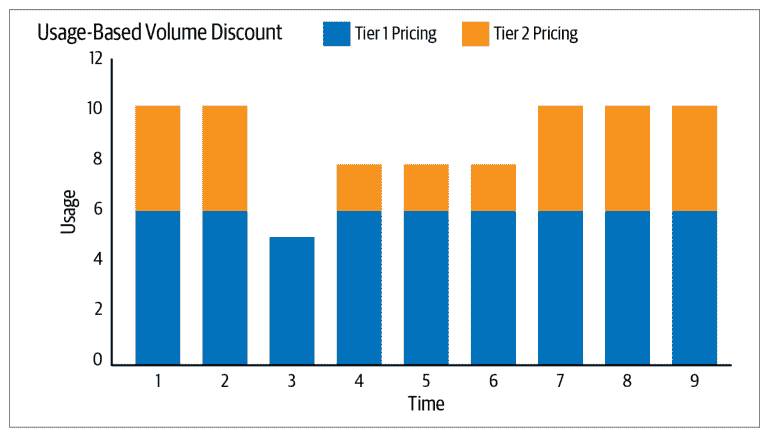
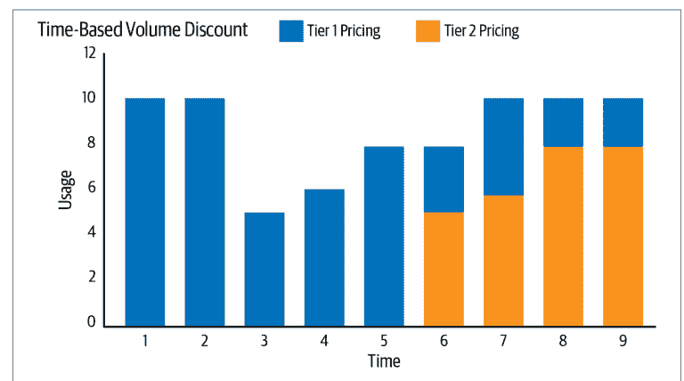

## Paying Less: Rate Optimization

在第 5 章中，你了解到你的 *Cloud Cost = Rates × Usage*。上一章介绍了如何管理等式中的 *usage* 部分——按需使用所需大小的资源，并且仅在需要时使用。本章及接下来的两章将聚焦于该等式的另一半，并介绍如何优化费率，为你继续使用的资源支付更少的费用。

这项工作主要由组织的集中式 FinOps 部门管理，该部门对组织的云使用情况有最高层面的视野，具备购买这些专业折扣所需的专业技能和知识，并负责管理业务各部门的云费率。

到目前为止，你应该知道，在支付云费用时，一美元并不等于一美元。凭借多种采购选项、按不同时间和用量计费、各种付款结构和承诺选项，以及每个云提供商的独特差异，客户拥有多种采购选项，每种选项都有其独特的财务影响。本章介绍了用于管理费率的定价选项的基础知识。Reservations、Savings Plans (SPs)、Reserved Instances (RIs)、Committed Use Discounts (CUDs)、和 Flexible CUDs 是调整许多服务费率的主要杠杆，但它们可能相当复杂，因此我们在第 17 章专门讨论这些内容。然后，在第 18 章中，我们将讨论你可以用来以整体方式整合所有费率优化工具的策略。

## Compute Pricing

费率优化和使用优化通常都始于查看计算使用情况——我们在云中运行的 AWS EC2 实例、Google Compute Engine、Azure 虚拟机、托管容器或无服务器使用所支付的费用。这有两个关键原因。首先，对于大多数客户，compute costs

是最大的单一成本类别，往往远远超过其他。其次，计算定价是云服务提供商最古老、最成熟的服务之一，并且在基于承诺获取费率折扣方面拥有最多的选择。

根据云服务提供商和使用资源的不同，云资源可以按多种方式定价。不同的云服务提供商对类似的定价方案也使用不同的术语。首先，让我们快速看看表 16-1 中的三大主要提供商。

表 16-1. 大三大云服务提供商预留选项比较

|  | AWS | Google | Azure |
|---|---|---|---|
| 公开价格 | 按需 | 按需 | 按使用付费 |
| 抢占式 | 抢占式 | 抢占式/可抢占 | 抢占式 VM |
| 持续使用折扣 | N/A | 持续使用折扣 (SUDs)^a | N/A |
| 预留 | RIs/SPs | CUDs/灵活 CUDs | 预留 VM 实例/SPs |
| 批量折扣 | 批量折扣 | 批量折扣 | 批量折扣 |

a SUDs 正在逐步淘汰新实例系列，因为客户更青睐 CUDs 的可预测性。

## 按需/按使用付费

当你请求一个普通资源并在不做任何预先承诺（如预留）的情况下运行它时，你将按标价收取费用，即按需/按使用付费费率。这通常是你为资源支付的最高价格。它也是最灵活的，因为你可以在任何时候停止使用而不会产生罚金。

## 抢占式资源使用

大多数云服务提供商都提供一种使用其云平台空闲容量运行资源的方式。使用抢占式定价，你通常会设定愿意为资源支付的最大价格，有时可能高于按需费率，但通常设定得要低得多。你将按该抢占式费率为抢占式资源付费，直到你的价格阈值被超过或没有可用的抢占式容量来满足你的请求为止，此时你将有短暂的时间停止使用资源，然后云服务提供商会收回资源。这些低费率之所以可能，是因为对本会闲置的云容量的机会性利用。

这种定价相对于按需费率可提供显著节省（最高达 91%！），通常是运行资源最便宜的方法。然而，资源可能在任何时候丢失的风险意味着在抢占式资源上运行的服务需要能够处理资源可用性降低的情况。抢占式资源常见的用途是可恢复或重启的批处理，如果丢失资源可以重新开始。

## 基于承诺的折扣

*基于承诺的折扣*是诸如预留、预留实例、节省计划、灵活 CUDs 或承诺使用折扣等费率折扣选项的一个很好的通用术语。一般来说，这些类型的折扣允许你向云服务提供商做出长期承诺，在一段时间内运行一定量的使用量（或在特定类型的云资源上花费一定金额）——例如计算、数据库、AI/ML（人工智能/机器学习）——有时在特定位置或具有特定参数。作为回报，云服务提供商会为该使用量或成本的设定金额提供正常按需费率的折扣。通常情况下，你的承诺越具体、承诺时间越长或预付费用越多，你的折扣就越大。如前所述，第 17 章将深入详细地介绍基于承诺的折扣。

## 存储定价

除了 Azure Storage 预留容量以降低存储费率外，所有主要云服务提供商都有一系列存储服务，提供不同级别的可用性、耐久性、性能和容量。一般来说，你的数据性能越好、耐久性越强、可用性越高，你支付的费用就越多。关键在于在价格、可用性和数据存储质量之间找到平衡。一般我们会将此视为使用优化，但在这种情况下，我们指的是你为不同存储层级支付的费率差异，而不是为了降低成本而减少存储量。

你应根据存储数据的访问模式优化存储层级。这可以在无需减少存储量的情况下节省大量开支。每个主要云提供商都提供各种且经常不断发展的存储层级选项可供选择，具体取决于你是否频繁或不频繁地访问数据。

考虑向客户提供服务的生产数据。这很可能需要存储在性能最强、高度可用的存储产品上。但该数据的备份可能不需要存储在同等的高成本产品上。随着备份的变老，它们不太可能在紧急情况下被需要，因此数据可以存储在性能最低、可用性低但仍具耐久性的存储层中。当你像这样移动数据时，就称为*数据生命周期管理。*

一些云服务提供商的存储产品可以为你管理数据的生命周期。在 AWS 的 S3 中，数据可以根据规则迁移到可用性较低的存储层。例如，1 个月后，S3 可以将数据移动到可用性较低的存储，12 个月后，它可以移动到一个非常便宜的“冷”存储产品 Glacier，该产品检索数据可能需要数小时。

你对数据分类并将其定位到不同服务产品中投入的精力越多，数据存储成本节省就越多。利用云服务的内置功能自动执行数据生命周期可以降低管理开销。当然，非常重要的是，你的数据必须存储在正确的服务产品中，具有你所需的可用性和耐久性。

## 批量/分层折扣

大多数云服务提供商针对其某些服务的内置定价计划会在使用量增加时降低成本。当你有大量使用量时，这些自动价格降低可以累积成可观的节省。一般来说，这些批量折扣要么基于使用量，要么基于时间。

批量折扣可能在区域级别应用，这意味着跨区域的使用量不会合并以获得折扣。考虑将云资源整合到更少数量的区域，以充分利用批量折扣。

批量折扣奖励大型云用户，确保在云服务提供商平台上增长对大型企业仍然有意义。为了在云平台上正确计算预计成本，你需要确定你获得的是哪种类型的批量折扣。在计算减少使用量带来的节省时，你必须了解适用于被减少使用量的定价层级。使用正确的定价层级的费率可以让你正确计算成本（和可能的节省）。

请记住，批量折扣通常适用于超过指定使用量的使用量；它们通常不会改变低于折扣层级的使用量所支付的费率。

## 基于使用量

当折扣基于总使用量而不是资源运行的时间长度时，我们称之为基于使用量的批量折扣。单小时内的使用量合并，然后对超过层级阈值的部分使用量应用费率折扣。

当你查看图 16-1，即基于使用量的批量折扣的实际应用时，定价层级在 y 轴（使用量）上运行。当使用量超过第 2 层阈值（在任何设定小时内）时，所有超出该阈值的用量都将按第 2 层定价收费。使用折扣每小时使用相同的计算方法应用。

图 16-1. 基于使用量的批量折扣图

免费层级是一种特殊的批量折扣，适用于少量云使用量。云服务提供商在其许多服务上提供这些免费层级，以使客户能够以较低成本尝试服务。一些免费层级优惠仅在短时间内可用，而其他则持续可用。对于拥有大型云环境的组织，免费层级产生的节省通常微不足道。

## 基于时间

当资源在运行特定时间后按较低费率收费时，我们称之为基于时间的批量折扣。这种折扣类型的良好示例是 Google Cloud 持续使用折扣（SUD），其中计算使用量运行时间越长，收费费率越低。然而，值得注意的是，Google Cloud SUDs 正在逐步淘汰。一些基于时间的折扣适用于特定资源，一旦资源被移除就停止适用，而其他则匹配资源使用类型，可随时间应用于多个资源。请注意，基于时间的批量折扣不会与其他同时运行的资源合并。例如，同时运行 100 个资源并不等同于一个资源运行 100 小时。

在图 16-2 中，你可以可视化基于时间的批量折扣的工作方式。在第一个小时，使用了 10 个资源，因此启动了 10 个单独的批量折扣计数器。假设成本在前五小时的使用按第 1 层定价收费，之后按第 2 层定价收费。与基于使用量的情况相比，重要的变化是批量折扣适用于 x 轴（时间），所以即使

虽然你在第一个小时内有 10 个资源，但它们都按 Tier 1 价格计费。随着每个小时的推移，10 个计时器会根据资源使用量的多少而启动和停止。

图 16-2. 基于时间的用量折扣图

对于全天运行的资源 1 ——在图中五小时后你将获得 Tier 2 价格。然而对于资源 6 ——由于它会随时间停止和启动 ——在图中需要八小时才能达到 Tier 2 定价。

## 谈判费率

在某些情况下，你可能能够与云服务提供商、云转售商或市场供应商谈判以获得更优惠的价格。

## 自定义定价

对于某些服务的较大用量级别，云厂商发布的定价页面建议你致电他们。在这些最高用量层级，云服务提供商可能愿意提供比公开提供的更好的价格。我们无法详细介绍这些交易，因为它们通常受保密协议约束。

当你已超出已发布的用量折扣层级时，务必尽早与你的云提供商开始对话，以确定是否存在更深折扣的机会，无论是在整个云账单、某个区域还是服务级别。

## 卖方私有优惠

当你在云中使用第三方软件时，必须签订许可协议，并且许可付款通常直接支付给该第三方。然后将许可应用于云服务器以运行软件。这导致你从云服务提供商处获得一笔用于运行软件资源的账单，以及从软件供应商处获得一笔单独的许可账单。随着 AWS、Google Cloud 和 Azure 市场等服务的创建，第三方厂商现在可以通过这些渠道提供其软件。许可费和资源费直接在客户的云提供商账单上支付，而云提供商随后将许可费支付给第三方厂商。

虽然市场减少了计算运行服务总成本的工作量，但你现在需按固定的公开费率支付许可成本。当你直接与第三方厂商组织许可时，你能够为组织谈判更优惠的费率。幸运的是，一些服务，例如 AWS Marketplace，现在允许厂商拥有卖方私有优惠。客户与第三方谈判许可费率，并通过私有链接为该客户专门创建自定义市场列表。当组织直接从市场使用这些服务时，他们为许可支付自定义费率，并保持直接来自云提供商的单一计费来源便利。

## BYOL 考量

一些云服务提供商允许你使用组织内可能已有的现有许可协议来降低云成本，这被称为 BYOL（“自带许可”）模式。一个例子是适用于 Windows Server 的 Azure Hybrid Benefit。拥有现有 Software Assurance 或订阅许可（例如企业协议订阅 [EAS]）、Server Cloud Enrollment（SCE）订阅或 Windows Server 许可上的 Open Value Subscription 的组织，能够在将服务器部署到 Azure 平台时重用许可。

识别重用现有许可的机会 ——尤其是在从数据中心迁移到云时 ——可避免不必要的许可成本，从而为组织节省大量资金。

将为非云购买的自有/永久许可或许可权用于云的用例极其复杂，并且通常受不断变化的规则和要求约束。如果你的组织使用大量许可软件或与打算在云中使用的其他软件厂商签订大量协议，我们强烈建议考虑 BYOL 的影响，并让具有采购或软件资产管理视角的专业人士参与，以就如何最有效地在权限范围内使用这些权利提供建议。

## 结论

通过改变服务性能、可用性和耐久性，云服务提供商能够以不同的费率提供类似的服务。有效的 FinOps 团队将此功能集中化，并让工程师专注于使用最适合其工作负载特征的服务产品。将使用优化和费率优化结合使用可以产生显著的节省。

总结如下：

- 费率优化是关于以更低的费率支付相同的资源。
- 计算定价可以通过使用 Spot、随着时间的推移承诺使用量、达到用量折扣级别、谈判折扣或应用你已拥有的许可来降低。
- 存储定价可以通过选择满足你需求的适当服务层级来降低。
- 对于大量使用，你能够谈判更优惠的费率，无论是直接与云服务提供商还是与第三方软件许可厂商。

重要的是要认识到，有多种方法可以降低你为相同的云资源支付的费率。接下来，我们将介绍最受欢迎的，也是 arguably 最复杂的费率降低机制：使用预留实例、节省计划、承诺使用折扣和灵活承诺使用折扣。
