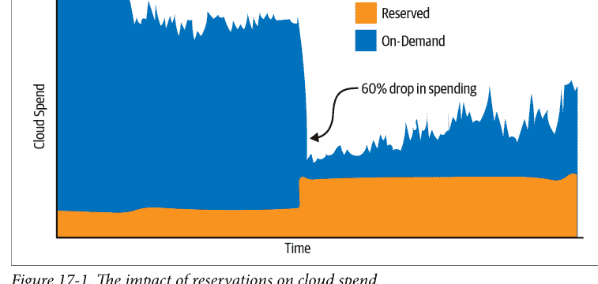
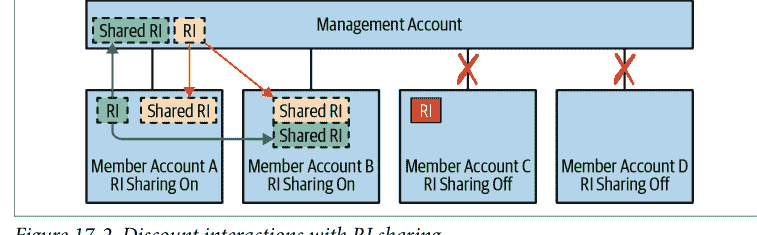
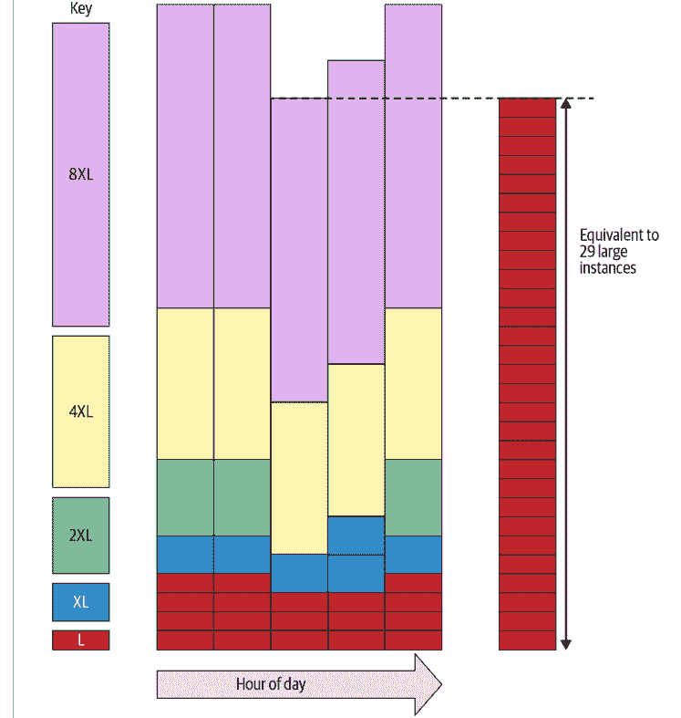
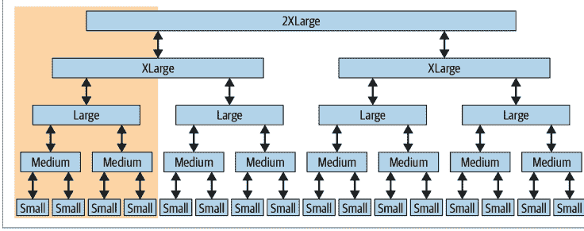
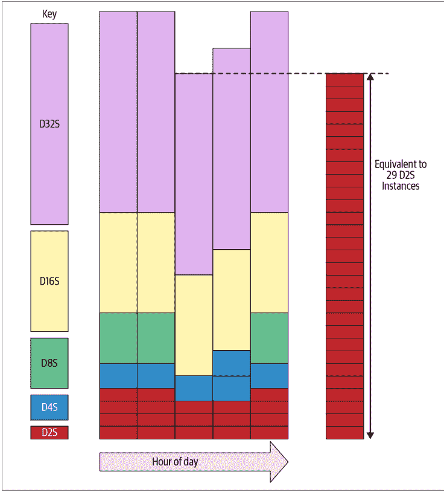
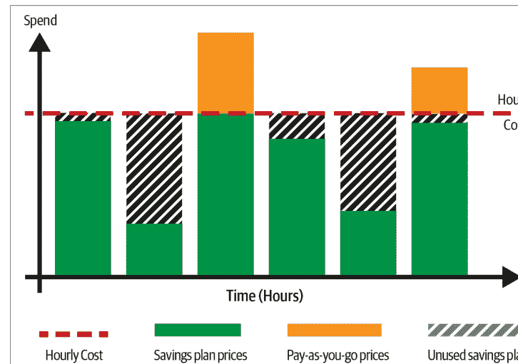
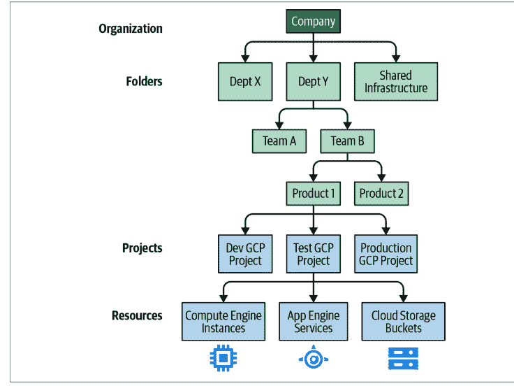
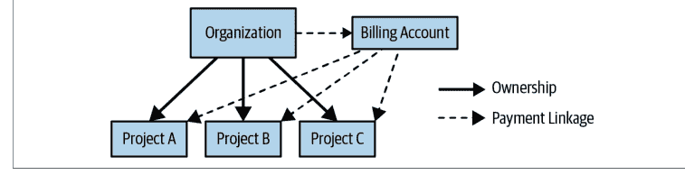

## 理解基于承诺的折扣

基于承诺的折扣是 FinOps 协作、数据驱动决策的完美示例。它们弥合了技术团队与财务团队之间的差距，需要难以实现的协调。然而，一旦达成协调，基于承诺的折扣可以带来显著的成本效率优势，表现为改进的云单位经济效益，让你以大幅折扣获得相同的计算能力。

本章是最有可能过时的章节之一 ——可能在本书上市之前就会过时 ——因为云提供商的服务总是在更新。我们建议将本章中的细节与你的云服务提供商当前提供的服务进行核对。尽管如此也不必担心：虽然多年来服务发生了很多变化，但围绕预留的核心最佳实践保持一致。

## 基于承诺的折扣简介

预留实例（RIs）、节省计划（SPs）、承诺使用折扣（CUDs）和灵活承诺使用折扣（Flexible CUDs），统称为基于承诺的折扣，是云服务提供商提供的最受欢迎和最重要的成本优化。这是因为基于承诺的折扣代表你在云中可以获得的最大百分比折扣，并且通常适用于账单中最大的云支出领域。

本章主要关注计算服务的基于承诺的折扣。其他云服务，包括数据库和 AI/ML，也有折扣优惠。计算成本通常是大多数组织支出的最大领域。对于这些其他折扣优惠，这里有些概念可以应用，但你应查阅云服务提供商的文档。

每个云服务提供商都有不同的优惠，其折扣提供有各自特定的规则。而且每个组织都可以根据其独特组织的实施模式和业务流程，以不同的方式利用各种基于承诺的折扣。

基于承诺的折扣很棒。你承诺在一定时间内使用特定类型的资源，并获得可观的折扣。想法似乎很简单。但正如你将看到的，存在许多细微差别需要学习。

几年前，在 AWS、Cloudability 和 Adobe 关于 RI 威力的网络研讨会上，Adobe 展示了图 17-1，表明该公司仅通过购买 RI 就将 EC2 支出削减了 60%。

图 17-1. 预留对云支出的影响

通过将约 10% 的资金从按需费率支付转移到支付折扣预留费率，Adobe 能够提高其整体预留覆盖率，并实现其计算资源总体成本大幅下降 60%。像 Adobe 这样的成功案例使得利用预留/承诺的决定变得显而易见。然而，对于许多组织而言，从零 RI 覆盖到良好覆盖的过程需要大量的组织教育和协调。

## Stories from the Cloud—J.R.

我曾与一家英国富时100指数零售商合作，该公司每月在AWS上的云支出达数百万英镑，但RI为零。他们知道即使购买少量RI也能节省大量资金。事实上，与其团队密切合作分析公司基础设施后，我发现他们在未来三年中可以节省数百万英镑。由于他们是零售商，利润率很薄，RI的购买可以帮助他们实现领导层要求的关键成本削减目标。

然而，尽管如此，他们仍花了整整九个月才购买第一批RI。发生了什么？为什么组织在激进的自上而下成本削减目标下，仍如此缓慢地采用这种显而易见的成本节约措施？答案是他们必须对组织中的许多利益相关者进行教育并使其达成一致，围绕购买RI的含义展开，并在过程中消除多年数据中心硬件采购期间形成的许多误解。

首先，他们必须让财务团队接受如何对RI进行财务核算。RI的预付款可能看起来像是资本支出（CapEx），财务部门应将其作为实物资产进行折旧，因为其预付款。然而，RI是运营支出（OpEx）的无形预付款，需要在其使用期间进行摊销。

接下来，他们必须让技术团队对承诺现有基础设施感到安心。云的优势在于你能够只使用所需资源，并根据工作负载的形状调整基础设施。然后你引入无服务器或容器化等新方法，以及在新的一套云服务上完全重构基础设施的承诺（或威胁）。改变基础设施的风险使团队不愿对其当前技术栈做出为期一年或三年的预留承诺。这些团队因其出于改善基础设施的 admirable 计划而拖延，导致预留购买多次延迟。

这类故事令人遗憾地很常见。随着公司实施首批预留，让所有团队达成一致可能需要很长时间，而节省机会的损失可能累积到数百万英镑。如果该零售商在那九个月的教育业务期间购买了一些RI，他们本可以实现显著节省——并避免数百万英镑不必要的按需支出。

## Commitment-Based Discount Basics

虽然各云服务提供商的具体产品不同，但三大厂商都为你提供了在设定期间内承诺特定资源使用量的简单能力。你的承诺确保了云服务提供商的持续业务，作为回报，他们会以更低的费率奖励你的使用量（费率优化）。折扣可能相当可观——在某些情况下高达80%。

在所有三大主要云提供商中，你实际上并没有预留特定的服务器实例或承诺特定的资源。请记住，你已经抛弃了数据中心命名服务器的概念。折扣由云服务提供商在计费时应用。事实上，预留本质上是一种计费构造。某些AWS RI可以在计费折扣之外提供一些容量预留功能——事实上，AWS Reserved Instances最初只提供容量预留，而非折扣。

基于承诺的折扣最常以非确定性的方式应用于单个资源。以AWS SP和Azure SP为例，它们会应用于节省最大的地方，但你无法选择具体应用于哪些资源。Google Cloud允许你选择如何归属折扣积分和费用。他们提供三个选项：Unattributed、Proportional Attribution、或Prioritized Attributions。选择合适的归属模型取决于你的组织是以集中还是分散的方式购买和管理CUD。

云服务提供商根据一套宽松的规则应用这些折扣，其去向的原因和位置细节相当不透明。除了在SP的情况下基于最高节省潜力进行优先排序外，提供商会将预留随机分配给购买该预留的账户、订阅或项目中的资源，然后任何剩余覆盖范围将流向其他账户、订阅或项目中的符合条件的资源（除非你告诉他们不要这样做）。随机应用折扣会带来许多策略和分摊考虑，我们将在第18章中讨论。对于提供资源级计费数据的云服务提供商，你可能看不到折扣直接应用于你的资源，或者至少不是你期望的资源。

这里一个类比可能有助于你更好地理解预留/承诺。假设某家特定餐厅推出一项优惠，你购买一本优惠券册。每张优惠券可在该特定餐厅兑换一顿餐。册子包含一个月每天一张的优惠券。当你在指定餐厅用餐时，你用优惠券支付餐费。选择去别处用餐意味着你放弃当天的优惠券，并在另一家店以全价支付餐费。

假设这本书的价格为$750，包含30张餐券，每张餐券可兑换一顿如果不使用优惠券需花费$50的餐食。算下来，那就是$25 per coupon for a $50 meal，saving you $25 a day。如果你每天都在这家餐厅用餐，你节省50%，如果你只在其中一半天数用餐，你就没有任何节省。如果你使用超过一半的优惠券，购买这本书更划算。

如果你将这个想法应用于RI，一旦你决定了想要预留的时间长度，你就可以从云服务提供商处购买预留（优惠券册），匹配特定资源类型和区域（特定地点的特定餐厅餐食）。此预留将允许你每小时（或每秒或毫秒）运行匹配的资源。如果你没有运行任何与预留匹配的资源，你将失去节省的机会。只要你在预留期限内有足够的资源使用量，你就能从折扣中受益——并节省资金。

这里的关键要点是：
- 你需要为基于承诺的折扣付费，无论它是否应用于资源。
- 预留需要花费金钱，但它们抵消了账户中资源的成本。
- 你不需要完全利用基于承诺的折扣就能节省资金。

基于承诺的折扣的具体购买选项以及它们可应用于哪些资源因云服务提供商而异。某些产品适用于非常特定的使用；其他产品适用范围广泛。

在整个基于承诺的折扣范围内，你可以选择许多选项：
- An amount of *usage hours* (Reservations, CUDs) or *hourly spend* (SPs/Flexible CUDs)
- Any of a variety of *compute* resources running anywhere
- A specific type of *compute* or one of a list of other resources
- With the right to convert to a different type of reservation or not
- Running in a particular region or location
- In a specific operating model (dedicated or shared)
- Of a specific size (or of a flexible size—instance size flexibility)
- Running a specific operating system or database type
- In a very specific availability zone
- For one or three years (or even five years, for some services)

一般来说，你的承诺越具体，折扣就越高。换句话说，如果你愿意放弃灵活性，就能实现更高的节省。随着时间的推移，云服务提供商引入了多层次的灵活性，我们在这里总体介绍，并在各提供商的章节中更详细地介绍。

## Compute Instance Size Flexibility

云服务提供商提供数百种不同的服务器实例类型或大小，通常按系列分组，你可以根据虚拟机（VM）或实例的名称区分出来。

各提供商实例类型的示例：

- *AWS 实例 m5.xlarge*：一个“m”系列实例，大小为“xlarge”，属于“第5代”
- *Azure 实例 standard_D2_v5*：一个“D”系列 VM，大小为“2”，属于“第5代”
- *Google Cloud 实例 n2-standard-128*：一个“N2”系列实例，大小为“standard”，配备“128 CPUs”

许多基于承诺的折扣都是为了匹配特定资源类型的用量参数而购买的。这意味着你可能需要做出数百项具体的承诺来覆盖你使用的各种实例大小，即使你广泛使用同一系列的实例。为了简化这一过程，云服务提供商在其部分预留上提供实例大小灵活性（ISF）。

在特定系列内，你可以从一系列服务器实例大小中选择（vCPU 和内存量不同），大小每增加一级，价格就成比例地更贵。例如，在 AWS 上，两个匹配的大型实例的价格与一个同类型超大实例相同（例如，两个 m5.large 实例的费用与一个 m5.xlarge 实例相同）。因此，两个购买的大型 RI 可以将其折扣应用于一个超大服务器实例，反之亦然。

这里唯一的例外在于软件许可费用：如果涉及软件许可费用，两个中等实例并不等同于一个大型实例。两个中等实例需要比一个大型实例多两倍的许可。因此，AWS 将 ISF 从带有许可软件的服务器中排除，而 Azure 在预留中会单独收取软件许可费用（仅对计算小时应用折扣）。请注意，当你将预留与 Azure Hybrid Benefit 搭配使用时，软件许可费用也会被抵消为零。

由于 Google Cloud 的计费方式，他们自然通过将同一机器系列内所有实例的 vCPU 和内存计数合并来实现 ISF。CUD 应用于合并后的总计，而不是针对单个独立实例。

ISF 对希望使用特定系列的计算或数据库服务但又希望随着工作负载需求变化而灵活调整所启动实例大小的工程团队非常有帮助。ISF 为这些团队提供了更大的灵活性，并大幅减轻了 FinOps 团队的工作量，因为无需采取任何操作即可将覆盖范围转移到不同的实例大小——这一过程是自动完成的。

## 转换和取消

一些基于承诺的折扣计划提供转换承诺或将其交换为其他类型的能力。AWS 可转换预留提供的折扣率低于不可交换的预留，但允许用户选择将预留交换为不同系列或不同大小（如果 ISF 不适用）。转换预留的能力降低了最终获得与资源使用不匹配的预留的风险。如果资源更新后不再匹配，你可以将其交换为匹配的预留。交换或转换预留的能力通常仅限于最初购买的区域。

请记住，将 RI 从一种类型转换为另一种类型需要 FinOps 团队进行分析和工作，因此在考虑你的选择时，请将此成本纳入整体考量。

需要在此指出的是，截至本文撰写时，AWS SP 提供的折扣与 AWS RI 相同，但内置了可转换性。例如，计算 SP 可覆盖多个区域和任何系列的计算实例，无需任何分析和转换即可修改，折扣与在一个区域、一种系列类型的可转换 RI 相同。SP 在 AWS 部分进一步讨论。

Azure 不提供可转换的 RI，但允许用户每年取消并交换一定金额的预留。有时这会产生费用，通常还要求新预留从交换时间重新开始计时。Azure SP 现已作为预留的替代方案提供，其功能与 AWS SP 类似，比 Azure RI 提供更大的灵活性。

Google Cloud 提供拆分或合并承诺的能力。拆分允许你跨项目或组织重新分配资源。合并承诺使以单一实体和一个到期日期管理折扣变得更容易。Google Cloud 现在还提供 Flexible CUDs，带来与 AWS 或 Azure 的 SP 类似的灵活性。

通常，你进行的转换必须在价值和持续时间上相等或更大。因此，如果你降低了对云服务提供商的使用量，就不能交换预留，如果这样做会导致整体承诺降低。

AWS 用户的另一个选择是能够在二级市场上出售剩余时间较长的某些类型预留。通常，这只能针对剩余寿命超过一半的标准或不可转换 RI 进行。

## 前三大厂商提供的用量承诺概述

表 17-1 显示了三大云服务提供商并比较了其产品。

表 17-1. 前三大云服务提供商的预留产品比较

|  | AWS | Google | Azure |
|---|---|---|---|
| 程序名称 | Reserved Instances/Savings Plans | Committed Use Discounts/ Flexible CUDs | Reservations/Savings Plans |
| 付款模式 | 全额预付，部分预付，无需预付（折扣率不同） | 无需预付 | 全额预付，按月付（价格相同） |
| 期限 | 一年或三年 | 一年或三年 | 一年、三年或五年 |
| 实例大小灵活性 | 是 | 不适用 | 是 |
| 转换或交换 | 标准：否，可转换：是 | 是，拆分和合并 | 是 |
| 可取消 | 否；不过，部分 RI 可通过市场出售 | 否 | 是，最高达年度价值限额 |
| 持续使用折扣 | 否 | 是ᵃ | 否 |

ᵃ SUDS 正在逐步淘汰新实例系列，因为客户更青睐 CUDs 的可预测性。

你可以看到三大云服务提供商的产品非常相似，期限长度和大小灵活性也相似。折扣产品之间的差异主要由其应用预留的具体方法和对折扣云资源的计费方式驱动。

## 亚马逊网络服务

AWS 于 2009 年率先提供 RI。因此，他们拥有迄今为止最复杂的预留计划。然而，这也意味着 AWS 是最灵活和可配置的。预留适用于 EC2 实例、RDS 数据库、Redshift 节点、ElastiCache 节点、OpenSearch 节点以及 DynamoDB 预留容量。

DynamoDB 预留容量与其他预留不同。对于 DynamoDB，你预留对该服务的一定数量的读取和写入。剩余的预留类型各有略微不同的功能，但共同点是它们都以一年或三年为期限购买。你可以为预留支付零预付款、部分预付款或全额预付款，每增加一次预付款，就能获得几个百分点的额外折扣。在购买 RI 时，你以 AWS 所称的租约形式购买一个或多个具有相同参数的预留。

你可以将使用部分预付或零预付模式为 RI 覆盖的资源支付的总金额与全额预付模式之间的差额视为 AWS 向你出借预付款所收取的利息。通过计算出来（它因每个资源的 RI 而异），你可以将此隐含利率与你的内部资本成本进行比较，看看是投资现金提前购买更好，还是接受较低的折扣并在前期支付更少（或不支付）更好。

RI 的命名令人困惑，因为你实际上并没有预留特定实例。预留也不能保证应用于特定资源。请记住，RI 更像是你购买并非确定性地应用于相关资源的优惠券。

RI 通常被认为是对资源成本应用的百分比折扣。然而，说 RI 具有固定费率，该费率在购买时比按需费率便宜一定金额也是正确的。虽然这听起来可能一样，但重要的是要理解，如果 AWS 降低按需费率，你现有的 RI 费率在一年或三年的期限内保持不变。

价格下降可能会影响你关于购买哪种 RI 配置的决定——我们将在本章后面讨论。值得注意的是，对 AWS 历史价格下降的分析显示，AWS 通常不会将按需费率降低到足以低于三年 RI 价格的程度。

### RI 提供什么？

AWS 预留有两个部分：费率降低优惠，以及在一种情况下，为特定可用区购买的资源类型的容量预留。大多数 RI 购买是为了获得费率降低。但一些公司也希望同时获得容量预留，确保它们在特定位置预留的特定类型资源数量在需要运行时可用。

多年来，随着 AWS 扩展其基础设施，容量预留已成为 RI 购买中越来越不重要的方面。然而，一些运行庞大、弹性基础设施的客户仍在优化容量。最近，AWS 和 Azure 推出了按需容量预留（ODCR），允许你单独于 RI 进行容量预留。Google Cloud 提供了一个类似的概念，称为 Compute Engine 区域资源，可为特定 VM 类型提供极高的容量获取保障。请注意，当你将按需容量预留与 AWS RI 结合使用时，设置 RI 为区域级至关重要，以便 RI 可以折扣容量预留。

## AWS 承诺模型

让我们更仔细地查看 AWS 提供的各种基于承诺的折扣形式。

我们将更详细地介绍 AWS 承诺的工作方式，因为许多相同的概念和模式也适用于其他云服务提供商，而目前亚马逊在这一领域拥有最成熟和复杂的体系。

## AWS 预留实例

您为特定区域中的特定资源类型购买 AWS RI。AWS 会在生成账单时根据这些标准将您购买的 RI 优惠券匹配到相关资源。

主要参数如下：

Region
您的资源位于何处（例如 US-West-2 或 EU-West-1）？

Scope
您的预留是按可用区还是按区域？如果按可用区，则将匹配特定可用区的用量（例如 US-West-2A）。如果按区域，则 RI 将适用于该区域内的任何可用区（例如 US-West-2A 或 US-West-2B）。请注意，只有按可用区的 RI 才会获得容量预留，但也可以购买按区域的 RI。

Availability zone
如果为按可用区的 RI，应适用于哪个具体的可用区（例如 US-West-2A）？

Instance characteristics
实例特征
Type
由实例族（例如 m5、c4、t3）和大小组成。实例大小因族而异，但通常具有值如 large、xlarge、2xlarge 等。
Tenancy
确定资源是共享还是专用。
Operating system
指定实例包含的操作系统和软件许可（Red Hat Enterprise Linux、Microsoft Windows 等）。

如果您的 RI 参数与您正在运行的用量不完全匹配，则 RI 不会应用折扣。因此，确保以正确的参数购买预留至关重要。

AWS 会以非确定性的方式将折扣应用于随机选择的资源，就像优惠券应用于相关资源一样。虽然 AWS 会从最小实例到最大实例进行应用，但目前没有办法确保折扣应用于特定资源而不是其他匹配的资源。

## 成员账户亲和性

客户影响 RI 应用方式的一种方法是使用成员账户亲和性。AWS Organizations 提供名为合并计费的功能，允许账户成为成员并将成本合并到单个管理账户中（以前称为 payer account）。在 AWS Organization 中只能有一个管理账户，且账户只能是某个 AWS Organization 的成员。当然，出于各种原因，您的企业中可能存在多个管理账户。

当您购买 RI 时，可以在管理账户或任何成员账户中进行此购买。RI 可以在同一 AWS Organization 内的账户之间共享其提供的折扣。然而，它们对所属的本地账户具有亲和性，这意味着在特定账户中购买的 RI 将首先提供给该账户中的资源。对于我们稍后讨论的 SP 也是同样的方式，但在本节中我们仅使用 RI 来描述账户亲和性的工作原理。

如果本地账户没有 RI 的匹配用量，则该预留将对同一 AWS Organization 中任何其他 AWS 账户的匹配用量应用折扣。

RI 共享可以按每个 AWS 账户禁用，但默认情况下是开启的。如果禁用 RI 共享，该账户内的任何 RI 都不会在账户外应用折扣，并且当 RI 与账户内的任何用量不匹配时，不会应用任何折扣，在 FinOps 中我们称之为空置或预留浪费。禁用共享有效地将 RI 固定到成员账户，如果出于预算目的必须不共享的话。考虑在禁用共享时可能会导致浪费，因为未使用时折扣不会共享给他人。这似乎没有意义，通常确实如此，但在资金仅授权用于特定目的的情况下可能需要，例如在政府机构中资金的使用受到严格限制。此外，同一 AWS Organization 中其他账户的 RI 不会对已禁用 RI 共享的任何账户应用折扣。

人们通常对 RI 共享的工作方式存在误解。为了确保您理解正确，请查看图 17-2 中的示例。

Figure 17-2. Discount interactions with RI sharing
图 17-2. RI 共享的折扣交互

Figure 17-2 shows a typical account structure: a management account with a handful of linked member accounts. You can see in the diagram there are three RI purchases: in the management account, in member account A, and in member account C. Account affinity will cause the RIs within the account to apply a discount to the local account first. If no usage matches the RI within the same account, then RIs may apply a discount to usage in another member account via RI sharing.
图 17-2 显示了一个典型的账户结构：一个管理账户和一些关联的成员账户。您可以在图中看到有三次 RI 购买：管理账户中、成员账户 A 中以及成员账户 C 中。账户亲和性会导致账户内的 RI 首先对本地账户应用折扣。如果同一账户内没有匹配的 RI 用量，则 RI 可通过 RI 共享对另一个成员账户的用量应用折扣。

In the example layout in Figure 17-2, the following may occur:
在图 17-2 的示例布局中，可能出现以下情况：

- RIs in the management account can apply to account A or B because they both have RI sharing enabled.
- 管理账户中的 RI 可以应用于账户 A 或 B，因为它们都启用了 RI 共享。
- Account A can benefit both from the RIs purchased within the account and from RIs in the management account but will have preference for the RIs within the account.
- 账户 A 既可以从账户内购买的 RI 中受益，也可以从管理账户的 RI 中受益，但会优先使用账户内的 RI。
- Account B can benefit from RIs from both account A and the management account.
- 账户 B 可以从账户 A 和管理账户的 RI 中受益。
- Because account C has RI sharing disabled, the RIs within that account will not apply a discount outside of account C and will go unused when no usage matches.
- 由于账户 C 已禁用 RI 共享，该账户内的 RI 不会在账户 C 外应用折扣，并且在没有匹配用量时会未被使用。
- Account D will not receive any RI discounts because it has RI sharing disabled and does not have any RIs purchased within the account.
- 账户 D 不会收到任何 RI 折扣，因为它已禁用 RI 共享并且账户内未购买任何 RI。

It’s worth taking a moment to reread this list. The majority of people we’ve met over the years commonly misunderstand some part of RIs, and this can lead to RIs not applying discounts where you expect them to. Knowing how to control where RIs apply and where they don’t allows you to choose the best strategy for where to buy reservations.
值得花点时间重新阅读此列表。我们多年来遇到的大多数人通常都会误解 RI 的某些部分，这可能导致 RI 未在您期望的地方应用折扣。了解如何控制 RI 应用的位置以及不应用的位置，可以让您选择最佳的购买预留策略。

## 标准与可转换 RI

当您从 AWS 购买 RI 时，可以作为单个租约的一部分同时购买多个 RI。标准预留实例 (SRI) 允许您在最初购买时设置参数。

对于 SRI，可以修改其中一些参数，例如可用区和范围（区域与可用区）。对于 Linux/UNIX RI，同一 RI 租约的一部分可以拆分和合并（例如，两个 medium 合并为一个 large）。然而，您无法修改许多其他参数，例如期限长度、操作系统、实例族（m5、c5）和租用类型（共享或专用）。一旦购买了标准 RI，您就承诺在 RI 期限（一年或三年）内运行与这些参数匹配的资源。

对于 EC2 实例，有一种更灵活的选择，即可转换预留实例 (CRI)。作为折扣百分比较低的回报，您可以在期限内将 RI 预留交换为不同的预留。交换仍有一些限制适用。

无论如何，您都不能减少对 AWS 的整体承诺。例如，如果交换导致承诺降低，您就不能用更便宜的 RI 预留替换昂贵的 RI 预留。在这种情况下，需要进行补差费用，使修改包含更多 RI 或更昂贵的参数。当 RI 交换导致费用增加时，AWS 将向您收取任何应付预付款的净差额。

有一个流程允许您拆分 CRI 预留，以便您可以转换单个 RI 租约内部分 RI 而不是全部。同样，也有流程可以将多个 CRI 预留合并在一起，允许您将它们全部修改为一个新的 CRI 预留。然而，在期限内无法修改 CRI 的某些参数：

- CRI leases are purchased for a particular region and cannot be exchanged for another region.
- CRI 租约是为特定区域购买的，不能交换到另一个区域。
- CRI leases are for EC2 instances only and cannot be converted to other services; for example, if you move your database from an EC2 instance into RDS, you cannot exchange your CRI for an RDS RI.
- CRI 租约仅适用于 EC2 实例，不能转换为其他服务；例如，如果您将数据库从 EC2 实例迁移到 RDS，则不能用 RDS RI 交换您的 CRI。
- The term for CRIs cannot change, except that when joining CRIs you can sometimes extend the term from one to three years.
- CRI 的期限不能更改，除非在合并 CRI 时有时可以将期限从一年延长到三年。

除了这些限制外，总体而言 CRI 对组织的风险要低得多。除非您可能在期限内减少 EC2 的总使用量，否则您可以在期限内更改 EC2 使用参数并交换您的 CRI 以匹配您的参数的预留。请记住，然而，分析

确定要进行哪些转换以及手动执行转换所需的工作量，仍然需要 FinOps 团队花费时间和精力。

EC2 预留实例 (RI) 还包含一项称为容量预留的功能。配置为区域 (zonal)（即它们适用于特定可用区中的资源）的 RI 将合同保证服务器容量。此容量仅对拥有该 RI 的同一 AWS 账户可用，并且仅适用于所选可用区中的特定资源配置。如果账户中存在未使用的 RI，并且收到向 AWS 请求与该预留匹配的 EC2 实例的请求，则可以保证容量的可用性。与 RI 折扣一样，您无法将容量预留分配给任何特定实例，因此该账户内运行的第一个匹配实例将消耗此容量预留。

设置为区域的 EC2 RI 将对该区域内任何可用区中的任何资源应用折扣，但不会提供任何容量预留。然而，区域 RI 可以与相关的 AWS 服务按需容量预留 (ODCR) 结合使用。ODCR 实例预留按即需费率计费，如同正在运行的 EC2 实例，但也可以由您拥有的 RI 覆盖，以在整个区域实现 RI 折扣并获得容量预留。

## 实例大小灵活性

EC2 RI 是根据特定实例大小（small、medium、large、xlarge 等）购买的。RI 将对与其大小匹配的资源应用折扣。然而，对于区域 Linux/UNIX RI，您可以受益于前面提到的功能，即实例大小灵活性 (ISF)。您当前拥有或计划购买的属性为 Linux、区域和共享租用的预留将自动成为 ISF RI。

ISF 允许 RI 对同一系列中的不同大小实例应用折扣（m5、c5、r4 等）。单个 large RI 可以对多个较小的实例应用折扣，而单个 small RI 可以对大型实例应用部分折扣。ISF 提供了更改实例大小而不失去 RI 应用的折扣的灵活性。由于您无需指定 RI 的确切大小即可覆盖所有不同大小的实例，因此可以将 RI 购买捆绑为参数的小变化。

图 17-3 说明了如何应用 ISF 的一种思路。每一列代表在给定一小时内运行的实例。对于 r5 和 c5 实例，large (L) 是最小的实例大小。如果您在此示例中以 100% 的 RI 利用率为目标，您将购买 29 个 large RI。可以将其视为以系列内的最小尺寸购买 LEGO 积木并将其组合以覆盖您实际运行的较大实例大小。这意味着您购买的 RI 只有一种大小，与您的整体使用情况非常匹配。如果实例大小波动但归一化使用量保持不变或总体增加，您的 RI 将保持完美利用。

### 图 17-3. 将 AWS 实例大小转换为具有大小灵活性的归一化大小

AWS 使用归一化因子来确定特定 RI 如何与 ISF 一起应用。使用它可以计算出特定大小实例具有多少归一化单位。RI 使用相同的归一化因子来确定每小时可以应用多少归一化单位的折扣。

表 17-2 中的归一化因子显示了如何在系列内在实例大小之间转换。例如，如果您拥有的 RI 为 2xlarge（16 个单位），该 RI 也可以应用于两个 xlarge（每个 8 个单位）或四个 large（每个 4 个单位）实例。您也可以使用 2xlarge（16 个单位）的 RI 应用于一个 xlarge（8 个单位）和两个 large（每个 4 个单位）实例。

## 表 17-2. AWS 预留的归一化因子

| 实例大小 | 归一化因子 | 实例大小 | 归一化因子 |
|---|---|---|---|
| nano | 0.25 | 6xlarge | 48 |
| micro | 0.5 | 8xlarge | 64 |
| small | 1 | 9xlarge | 72 |
| medium | 2 | 10xlarge | 80 |
| large | 4 | 12xlarge | 96 |
| xlarge | 8 | 16xlarge | 128 |
| 2xlarge | 16 | 18xlarge | 144 |
| 3xlarge | 24 | 24xlarge | 192 |
| 4xlarge | 32 | 32xlarge | 256 |

ISF RI 的计费取决于您运行的实例大小相对于您拥有的 RI 的大小。在图 17-4 中，您有四个 small 预留，可覆盖四个 small 实例。如果您没有使用 ISF 的 small 实例，预留将应用于两个 medium 实例。如果没有 medium 实例，您可以覆盖单个 large、半个 xlarge 或四分之一的 2xlarge 实例。较大实例可以由较小尺寸的 RI 覆盖，并且您将对该实例大小未覆盖的剩余单位按比例收取即需费用。

某些实例系列并非所有实例大小都有，因此，如果购买 ISF RI，只需查找系列中的最小实例大小即可。

图 17-4. 使用 ISF 应用预留

## AWS 节省计划

2019 年底，Amazon Web Services 宣布了 Savings Plans，最初提供对 EC2 实例、Lambda 和 Fargate（Amazon 专有容器服务的托管服务）的折扣。自首次发布以来，AWS 已增加一项额外的 SP 优惠，适用于 AWS 机器学习服务 SageMaker。机器学习 SP 的增加推动了 AWS 客户对 AWS 发布更多 SP 以覆盖其他服务（如数据库和存储）的需求。基于此客户需求，我们预计在本书出版后会宣布更多优惠。您在此处关于 RI 学到的很多内容同样适用于 SP。AWS 继续提供全额预付、部分预付和无预付付款以及一和三年期限的购买选项。

然而，SP 与 RI 之间最大的区别在于，虽然 RI 承诺针对的是资源单位（特定大小的 EC2 实例数量），SP 承诺是货币性的（客户承诺在折扣计算或其他涵盖服务上花费的金额）。

SP 提供三种计划类型：

### 计算 SP

广泛适用于 EC2、Lambda 和 Fargate 计算，提供与 CRIs 相当的节省。此计划类型比 CRI 应用范围更广——包括任何区域的计算资源——这将降低维护高计划利用率所需的工作量。这些通常与 CRIs 相同的节省率。

### EC2 实例 SP

适用于单个区域中单个系列的 EC2 使用，无论大小或其他配置。虽然此计划类型比计算 SP 更受限制，但它提供更高的折扣，比 SRI 限制更少，同时提供与 SRI 相同的折扣。

### 机器学习 SP

坚持 SP 的每小时成本模式，SageMaker 的机器学习 SP 使 AWS 客户能够承诺在 SageMaker 上花费，以换取 SageMaker 组件成本的降低费率，包括那些在以下方面的成本：
- Studio 和按需笔记本
- 处理
- Data Wrangler
- 训练
- 实时推理
- 批量转换

SP 将自动应用于任何 AWS 区域和实例计算系列中的 SageMaker 使用。

然而，RI 与 SP 之间存在一些主要区别：
- 与 RI 相比，折扣 EC2 实例的两种 SP 类型在应用折扣的计算方面提供更大的灵活性，无需考虑租用、操作系统、实例系列或实例大小。最重要的是，计算 SP 跨所有区域应用，这将显著提高可覆盖的使用量。
- 使用 RI，您购买与账户中实例匹配的预留数量。SP 以承诺的每小时支出购买。您承诺的支出金额为折扣后金额。例如，如果您运行每小时 100 美元的按需 EC2，而 SP 提供 50% 折扣，您需要购买每小时 50 美元的 SP。
- 与 RI 不同，SP 对 AWS Fargate 和 Lambda 使用提供折扣。这是 AWS 首个跨多个服务提供折扣的优惠。由于这些其他服务的折扣率差异很大，这也会影响您从 SP 获得的整体收益，下一章将更详细讨论。
- AWS SageMaker 没有等效的 RI 优惠。

AWS 将 SP 覆盖应用于为您提供最大折扣的资源，这很好，因为并非所有类型的计算或实例的折扣金额相同。这也意味着，随着覆盖范围的增加，您获得的折扣百分比的增幅会变小。

## 节省捆绑包

2021 年初，AWS 引入了一个名为 CloudFront Security Savings Bundle 的新概念。这是一种新型基于承诺的折扣，涵盖 CloudFront（AWS 的内容分发服务）的使用，并允许客户承诺在该服务上的每小时支出水平，以换取 CloudFront 服务 30% 的折扣以及用于 WAF（AWS 的 Web 应用程序防火墙服务）的积分。客户承诺折扣后的支出水平，因此这与 SP 非常相似，但免费 WAF 使用的捆绑使其成为一种不同类型的优惠，从而导致折扣有新的营销名称。

可能还有其他经常一起使用的服务，未来可能会获得类似的节省捆绑包。再次强调，AWS 的所有这些基于承诺的折扣仅是计费结构，因此它们使 AWS 能够以一种认可这些使用模式并奖励能够有效预测并承诺长期使用的客户的方式，通过折扣奖励常规承诺使用。

这是一个很好的理由，让你提升预测能力，并让工程团队参与提供其未来计划，以便 FinOps 团队能够在不过度采购的情况下获得最佳的费率优化覆盖范围。

## Microsoft Azure

Azure 同时提供预留和 SP 方案。

## Azure 预留

Azure 的预留选项在很大程度上遵循了 AWS 提供的基于承诺的折扣模式，但提供了额外的灵活性和可转换性或取消选项。

截至 2022 年底，Azure 预留适用于 27 种不同的服务和资源类型，覆盖范围非常广泛。服务包括 VMs；blob、磁盘和文件存储；数据库，如 SQL 和 Cosmos DB；分析服务，如 Azure Synapse Data Explorer；Azure App Service；Azure VMWare；Red Hat 和 SUSE Linux；等等。列表不断增长，因此请参阅 Azure 预留文档以获取最新列表。

一些服务，如 Azure Databricks，与其他预留相比使用预留容量略有不同。对于 Azure Databricks，你预留一定数量的 Databricks 单位（DBU），然后在整个期限内消耗。你不受严格的按小时承诺限制。

Azure 预留是为覆盖特定 Azure 区域（适用时）、SKU 或大小以及期限（一年、三年或五年）的使用而购买的。与某些 AWS 产品相比，Azure VM 预留对操作系统和可用区的要求没有那么具体。

Azure RI 可以在工作负载或应用程序需要更改时在任何区域和任何系列之间交换。请注意，计算预留在 2024 年 1 月之后将无法交换。如果需要交换计算预留的选项，请从节省计划开始。非计算预留将继续支持交换。根据剩余小时数提供按比例退款，可用于交换中作为新 RI 的部分。

Azure RI 交换目标的价值必须等于或大于源 RI。没有“top-up”的概念，但如果新预留的价值更大，则需要超出抵免金额的额外投资。此外，“exchange”也可以简单地是全额取消 RI 购买并支付费用。

目前，如果购买的容量不再需要，可以取消 Azure 预留以获得调整后的退款。细则确实说明取消需支付 12% 的提前终止费，且取消费用每年最高为 50,000 美元。

> 已宣布，2024 年 1 月之后将不再提供计算服务 Azure 预留的交换和退款；更灵活的 Azure SP 的引入有助于抵消这一变化。

存在容量优先权，但没有保证。这意味着当资源请求不足以满足资源请求时，有预留的用户将优先获得容量。然而，由于没有保证，如果 Azure 该特定资源类型无容量，请求仍可能被拒绝。

Azure RI 可以在企业协议计费账户（注册）、Microsoft 客户协议计费配置文件、管理组、订阅或资源组级别分配，因此你可以在组织、部门或应用程序级别管理 RI 使用情况。与其他云提供商产品相比，这让你对如何应用 RI 以及谁受益拥有更多控制权。如果目标是在整个组织中节省资金，则 RI 可以简单地分配到计费账户或计费配置文件级别。

如果某个业务部门只想为其自身使用购买预留，RI 可以分配给管理组、订阅或资源组，只有该组可以利用节省。这一功能的缺点是，未使用的 RI 不会供订阅外的机器使用，这可能导致比 AWS 更大的浪费，在 AWS 中，如果购买账户未使用，RI 会自动级联到其他成员账户。购买后，可以根据需要更改在注册或订阅级别对 RI 的指定。

Azure VM 预留仅覆盖计算成本，不包括软件许可费。由于按需（非预留）使用涵盖计算小时和软件许可费，预留使用在适用时会产生单独的软件许可费额外记录。请注意，通过使用 Azure Hybrid Benefit 根据运行的核心数量将本地许可证分配给 VM 或 SQL 实例，Windows Server、Red Hat Linux、SUSE Linux 和 SQL Server 许可费也可以获得额外节省。

Azure RI 适用于除 A 系列、A_v2 系列或 G 系列之外的所有 VM 系列，但在 VM 系列的所有区域中均不提供。请检查 Microsoft 的文档以验证你希望购买的 RI 是否适用于你的 VM。

Azure 预留可以采用预付或按月付款方式购买。预付付款选项的工作方式类似于 AWS 的 All upfront 选项，在开始时一次性支付整个期限的费用。按月付款在每月同一天处理，类似于 AWS 的 No upfront 选项；然而，与 AWS 不同的是，预付与否折扣百分比没有差异。

## 实例大小灵活性

Azure ISF 的工作方式几乎与 AWS 完全相同：只需将 Azure VM 的“size groups”替换为“instance families”，将“ratio unit”替换为“normalized unit”。

同一大小系列组内的实例无论预留大小如何都可以应用预留。较小的预留大小可以对较大的实例应用部分折扣，而较大的预留可以折扣多个较小的实例。每个大小系列组都有每个特定大小实例的比率表。同样，它的工作方式与 AWS 的标准化单位完全相同。使用这些比率单位，你可以确定需要多少单位来覆盖你的 VM 实例。

让我们看一个示例来帮助澄清其工作原理（见表 17-3）。

表 17-3. DSv3 系列实例的比率表

| 大小 | 比率单位 | 大小 | 比率单位 |
|---|---|---|---|
| Standard_D2s_v3 | 1 | Standard_D16s_v3 | 8 |
| Standard_D4s_v3 | 2 | Standard_D32s_v3 | 16 |
| Standard_D8s_v3 | 4 | Standard_D64s_v3 | 32 |

现在，如果你查看此特定大小系列在一段时间内 VM 实例的使用情况，你可以确定在此期间使用了多少比率单位（见图 17-5）。

图 17-5. 具有大小灵活性的 Azure 实例大小转换为标准化大小

从图 17-5 可以看出，你 100% 的时间都在使用 29 个比率单位的 VM 实例，并且基于此单位计数，你可以确定需要进行多少次预留。

## Azure 节省计划

Azure SP 以一段时间内的使用小时折扣形式运作。你通过在一年或三年期限内承诺计算服务的固定每小时成本来节省资金。Azure 宣传的节省幅度最高可达按需付费价格的 65%。折扣根据承诺期限（一或三年）而变化，而不是每小时支出承诺金额。

Azure SP 对你每小时支出的影响取决于该小时内的支出金额以及你所做的承诺。图 17-6 位于 Azure SP 文档页面上，演示了计划在特定情况下如何应用：

### 小时 1

使用量与节省计划金额完全匹配，从而使所有使用量都获得折扣价。

### 小时 2

使用量低于承诺金额，未使用的节省计划将在折扣使用量之上收取。意味着你支付承诺的每小时费率。

### 小时 3

使用量超过承诺金额。最高承诺金额的使用量享受折扣，超过承诺金额的使用量按按需付费价格收取。

图 17-6. 显示欠用和超用小时的 SP（来源：Azure 文档）

每小时，您的计算使用量在达到承诺额度之前都会享受折扣；超出部分的使用按即用即付费率计价。

SP 承诺对 Microsoft Customer Agreement 和 Microsoft Partner Agreement 客户以美元计价，对 Enterprise Agreement 客户以当地货币计价。

可以用一个或多个活跃预留来兑换新的 SP。当您为 SP 执行预留兑换时，预留将被取消，未使用预留权益的按比例计算的剩余价值将转换为 SP 的等效小时承诺。SP 的价值不能低于剩余价值；不过，您可以增加其价值以满足需求。

购买 SP 后，折扣会自动应用于匹配的资源。与预留一样，SP 提供账单折扣，不会影响资源的运行状态。

您可以预付或按月支付 SP。无论是预付还是按月支付，SP 的成本相同；选择按月支付时不会收取额外费用。

Azure SP 涵盖来自计算服务的使用，例如 VM、专用主机、容器实例、Azure Premium Functions 和 Azure App Services。

## Google Cloud
Google Cloud 提供 Committed Use Discounts（CUDs），这是一种 Google Cloud 计费机制，以承诺使用量换取深度折扣，以及 Flexible CUDs，我们将在本章后面讨论。

## Google Committed Use Discounts
根据 Google Cloud 的说法，CUDs 提供一年或三年期限的合约，对于大多数（包括自定义）机器类型可享受高达 57% 的折扣，对于内存优化型机器可享受高达 70% 的折扣。

CUDs 在购买和消费方式上提供多种灵活性。首先，CUDs 不限于账户中任何特定的计算实例或形状，而是应用于整个月内特定区域中特定资源类型的总体合格累计使用量。CUDs 可应用于不同 VM 形状、操作系统和租用类型之间的累计资源。此外，一种名为 Flexible CUDs 的新服务甚至允许承诺跨多个 VM 系列和区域延伸。CUDs 也适用于区域内所有区域中的资源，这允许灵活的跨区域部署模型，同时利用 CUDs 提供的节省。承诺针对特定区域和特定项目。如果您在账户中启用 CUD 共享，它们也可以在计费账户中的项目之间共享。回顾第 12 章，项目将所有 Google Cloud 资源组织成逻辑分组。与其他提供商不同，区域内的区域分配不是一个因素。

## Paying for Cores, Not Hours, in Google
这可能看起来显而易见，但 Google Cloud 不按 VM 实例小时计费这一事实与其他云厂商相比是一个显著差异，并且有许多影响。Google 中的 VM 产品称为 Google Compute Engine（GCE），其 SKU 针对 CPU 核心、RAM 和本地磁盘进行单独定价。这无疑源于您可以创建完全自定义的机器，CPU 核心与内存的比例完全由您决定。以下是一些影响：

- 当 Google 在账单数据中公开资源级信息时，您应预期实例每小时对应不同部分会有多行记录。这将提供汇总到实例级成本的能力。
- 购买 CUDs 时，您 specifically 对 CPU 核心或内存（但不包括本地存储）做出承诺。由于购买是按您选择的比例（在一定范围内）进行的，很有可能无法覆盖相同数量的基础实例。例如，可能覆盖五个实例的 CPU 核心，但仅覆盖四个实例的内存。因此，CUD 规划应针对核心与内存分别独立进行。

这种明确的划分使容器资源和成本分配变得更简单，因为底层组件已经拆分。相比之下，当底层成本是 VM 实例（如 AWS 的情况）时，则需要特殊的计算来拆分成本。

## Google Billing and Sharing CUDs
让我们看看 CUD 计费和应用如何在 Google 的组织、文件夹和项目概念中工作。图 17-7 显示了层级结构。

这与 AWS 的管理账户结构概念相似。一旦您在账户上启用了 CUD 共享，计费账户就可以在所有连接的项目之间共享 CUD。这意味着 CUDs 既提供应用于各种机器类型的灵活性，也提供应用于多个项目的灵活性。

图 17-7. Google 项目和文件夹层级结构

与 AWS 不同，AWS 中 RIs 会自动在多个关联账户之间共享，而 CUDs 只有在您为计费账户启用该功能后才会共享。这让您可以选择对账户最重要的内容：更清晰的成本分摊或最大程度减少浪费。如果您想从特定项目分配资金来做出承诺，关闭 CUD 共享将提供比 AWS 处理 RIs 方式更清晰的成本分摊选项。然而，打开 CUD 共享可能会减少浪费，因为未使用的承诺将在多个项目之间共享。

CUDs 让您可以选择最适合您组织的共享模型。对于拥有大量项目的组织，打开共享功能可以让您利用整个组织的规模经济效益。

## Google Billing Account and Ownership
两种类型的关系管理计费账户、组织和项目之间的交互：所有权和付款关联。

图 17-8 显示了项目的所有权和付款关联关系。所有权是指从主组织继承的身份和访问管理（IAM）权限。付款关联定义了哪个计费账户为给定项目付款。在图中，组织拥有项目 A、B 和 C 的所有权，计费账户负责支付这三个项目产生的费用。

图 17-8. Google 计费账户和所有权

## Applying Google CUDs in a Project
CUDs 不能用于覆盖短期使用高峰。如果您购买了 50 个 vCPU 的 CUDs，您不能在半个月内运行 100 个 vCPU 并获得全部折扣。重温优惠券类比，单张优惠券不能同时应用于多个资源。

CUDs 是针对特定实例系列购买的，一种类型的 CUD 不能应用于其他资源使用类型。如果您购买 N2（通用型）CUDs，它们不会对 M1（内存优化型）实例提供折扣，反之亦然。

您以一年或三年期限购买 CUDs，默认情况下不会自动续订。如果您希望承诺自动续订，必须手动在每个承诺上启用自动续订设置。CUDs 应用于 vCPU 和内存使用量的总和。4 个 vCPU 的承诺可以对更多 vCPU 的实例应用部分折扣。例如，使用 16 个 vCPU 运行的实例将以 CUD 价格获得 4 个 vCPU，其余 12 个 vCPU 按正常价格计费。

最后，值得注意的是，CUDs 按非常特定的顺序分配给最昂贵的机器类型：

- 1. 自定义机器类型
- 2. 单租户节点组
- 3. 预定义机器类型

这确保了在应用时获得最佳可能的折扣。

## Google Flexible Committed Use Discounts
在 2022 年底创建本书第二版的最后阶段，Google Cloud 发布了一种名为 Flexible Committed Use Discounts 的新承诺服务

(灵活 CUD)。你在本文中关于 CUDs 学到的大量内容同样适用于灵活 CUD。

与 AWS SP 类似，面向 GCE 的灵活 CUD 是一种基于支出的承诺，可在承诺在为期一年或三年的期限内达到 GCE 的特定每小时支出水平以换取大幅折扣。

灵活 CUD 在标准 CUD 已提供的灵活性基础上增加了两个维度。与标准 CUD 一样，你可以更改实例使用的大小和区域。首先，灵活 CUD 还允许你在大多数通用型和计算优化型实例系列之间更改实例系列。其次，它们允许你更改虚拟机运行的区域。

灵活 CUD 非常适合具有可预测云支出需求的客户，或需要灵活性来承诺云支出但又不想受限于单个区域或单个机器类型的客户。灵活 CUD 使你能够将云投资财务决策与特定工作负载的虚拟机选择解耦。

客户承诺在为期一年或三年的期限内保持一致的支出水平，按等效按需支出的每小时美元计。在此基础上，他们可对承诺覆盖的适用用量享受折扣费率。

你可以从任何账单账号购买 CUD，并且折扣可应用于该账单账号支付的项目中的任何符合条件的用量。虽然本章中的许多 CUD 技术将有助于你评估灵活 CUD 决策，但目前还为时过早，无法形成灵活 CUD 的具体最佳实践。请继续关注 FinOps Foundation 的 Google 相关论坛，以跟上同行从业者关于最新最佳实践的讨论。

## 结论

RIs、SPs、CUDs 和灵活 CUD 是云用户可用的最复杂的优化措施。通过运营成功的预留计划，可以获得可观的折扣。

总结如下：

- 三大主要云服务提供商均提供以换取大幅折扣的承诺能力。各家在功能、工作方式和提供的折扣方面存在差异。
- 要充分利用预留的好处，你需要了解所有功能，包括大小灵活性以及购买后可以应用哪些修改。
- 鉴于所有这些复杂性，如果集中管理 RIs、SPs 和 CUDs，将获得最佳效果，以便团队专注于减少使用量，而不必担心费率。

- 对工程和财务等各种利益相关者团队进行教育是过程中的重要一步，因为 RIs 经常被误解。
- 由于 RIs、SPs、CUDs、灵活 CUDs 以及其他折扣都是以承诺为交换，因此对未来希望覆盖的资源类型的清晰准确的持续使用预测至关重要。这需要工程团队与 FinOps 团队之间保持良好的工作关系。

现在你了解了预留的工作原理，我们将继续讨论在组织内部正确且最优地实施预留的策略和注意事项。
