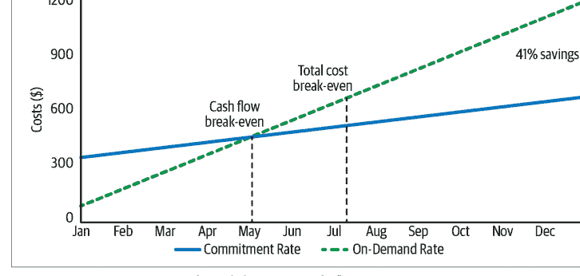
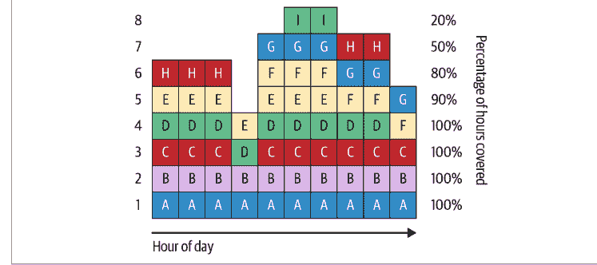
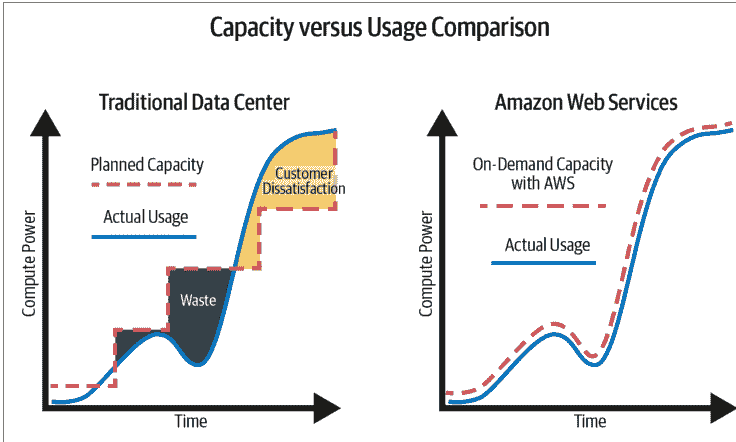
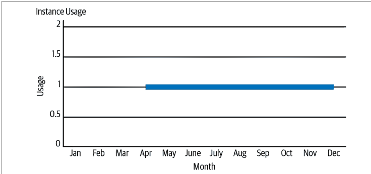

## 构建基于承诺的折扣策略

现在你已经理解了前两章所述的基于承诺折扣的基础知识，是时候提出一些艰难但重要的问题了：

- 你应该承诺多少？
- 你应该承诺什么？
- 何时承诺？
- 流程中应涉及谁？
- 如何知道你的承诺是否得到充分利用？
- 如何知道何时重新购买？
- 谁来支付？
- 如何在承诺期内分配成本和节省？

不幸的是，没有确定的答案——只有在特定时间对公司而言正确的答案。随着你沿着 FinOps 成熟度曲线发展，随着云提供商更新其不断变化的承诺模式，以及随着公司现金储备的变化，这些答案可能会发生很大变化。

## 常见错误

我们在公司使用基于承诺的折扣计划时看到许多错误。按任意顺序排列如下：

- 过度推迟做出承诺
- 做出过于保守的承诺
- 基于唯一实例数量而不是水线进行承诺（本章后面会介绍）
- 购买后未管理承诺
- 购买错误类型的承诺

几乎每个人在早期策略的某个部分都会出错。这没关系。这是早期成熟阶段。你可以把它想象成学习骑自行车或编写第一段代码——这是一个学习过程，可能需要几次尝试才能做对。

> *失败很糟糕但能提供教训。发现有效的举措总是伴随着发现无效举措的发现。*
> 
> —Bob Sutton, 斯坦福大学管理科学教授

## 构建基于承诺的折扣策略的步骤

构建你的首个承诺策略有六个关键步骤：

- 1. 学习每个计划的基础知识。
- 2. 了解你对云服务提供商的承诺程度。
- 3. 建立可重复的基于承诺的折扣流程。
- 4. 定期且频繁地购买。
- 5. 衡量并迭代。
- 6. 适当分配预付承诺成本。

本节将依次介绍每个步骤。

## 第 1 步：学习每个计划的基础知识

好消息！多亏了第 17 章，你对用于折扣计算的常见工具，如预留实例 (RIs)/节省计划 (SPs) 和承诺使用折扣 (CUDs)/灵活 CUD 的基础知识已经基本掌握。

然而，我们没有介绍几个概念。第一个是承诺计划的盈亏平衡点。如果你只记住本节的一件事，永远不要忘记这一点：

你不需要使用 1 年承诺整整 12 个月就能省钱。

是的，你承诺在该期间支付费用，但你不需要在承诺期的每个小时都实际使用承诺，购买才在财务上合理。

三年承诺即使对最忠诚的云用户来说也可能显得可怕。在某种程度上，它违背了你喜欢云的一切：即时、可扩展、按需使用。但对云提供商的一年或三年承诺可以节省大量资金，并彻底改变云在你有利的经济性。

1 年承诺可能在短短 4–6 个月内达到盈亏平衡，3 年承诺可能在 9–12 个月内达到盈亏平衡。在组织内分享这些盈亏平衡点的数据可以帮助缓解对所选云的承诺的担忧。让我们分解承诺盈亏平衡点的各个组成部分。

## 承诺盈亏平衡点的组成部分

图 18-1 显示了在为期一年的期限内，资源的累计成本，按需费率和承诺费率均有体现。在示例中，承诺 upfront 成本超过 300 美元，这就是为什么承诺线从 300 美元以上开始的原因。如果你使用的是无预付承诺，那么它将从按需线以下开始。如果使用的是全额预付承诺，则将以预付成本的价值绘制为一条水平线。

图 18-1. 基于承诺的折扣现金流

现金流盈亏平衡点是承诺成本与按需费率使用成本相同之日。有些人出于明显原因称现金流盈亏平衡点为交叉点。在现金流盈亏平衡点，你不再为承诺支付自付费用。然而，你仍将继续支付承诺的持续（按小时）成本。如果你停止在现金流盈亏平衡点的使用，与按需费率相比，你将损失金钱。

总承诺成本盈亏平衡点是指资源使用的按需成本超过承诺总成本的位置。这是真正的盈亏平衡点，因为你可以停止运行任何与承诺匹配的使用，而不会比未承诺折扣计划时更糟。你支付的按需金额与承诺金额相同。盈亏平衡点之后，你将从承诺中实现节省。

按需线与总成本盈亏平衡点之间的差异是承诺带来的节省（或损失）。必须理解的是，使用此图表时，无论你是在整个 12 个月内运行一个与承诺匹配的资源，还是在此期间运行许多不同的匹配资源，都无关紧要。

如果你将所有适用承诺折扣的使用量加起来，然后可以将承诺的总成本与按需费率下相同使用量应支付的金额进行比较。此比较将为你提供何时达到盈亏平衡点以及已实现节省金额的指示。

大多数情况下，规划良好的基于承诺的折扣计划将比你预期的更早达到盈亏平衡。就你的策略而言，真正的挑战通常不在于先买什么，而更多在于让组织就如何购买承诺达成一致。

## 承诺水线

在继续该流程之前，还有一个我们在上一章未介绍的基础概念：承诺水线。正如你所知，你不会为特定实例购买承诺，也无法确定承诺折扣将应用于何处。承诺会非确定性地应用于符合你所选基于承诺折扣标准的资源。

如果你成功利用了云的弹性，你在一天/一周/一个月内的资源使用量会有所不同——在安静时段较少，在繁忙时段更多。

图 18-2 显示了随时间变化的资源使用情况。该图中的单位不如概念重要。对于 AWS RIs，单位可能是与我们考虑购买的 RI 类型匹配的实例的单个运行实例小时数。对于

SPs，其单位可能是已应用折扣的美元，或我们每小时花费的资金。但它们都是针对我们正在考虑的承诺的可互换承诺单位。

### 图 18-2. 承诺利用率

如果您购买了四个承诺单位，每个承诺的利用率将为 100%；第五个承诺的利用率为 90%；第六个承诺为 80%；以此类推。如果承诺为您节省 25%，那么与按需成本相比节省费用，您需要将承诺利用率保持在 75% 以上。

知道这一点后，如果您承诺七个承诺，您为第七个承诺支付的费用将高于按需费率，因此超过六个承诺的任何使用都无法得到覆盖。

在第 2 行以上的行中，一个承诺可以应用于不同的资源。此外，这些资源可能来自您云环境中的不同账户。正是因为资源的共享——以及随之而来的规模经济——使得集中化承诺购买成为 FinOps 最佳实践的核心原则。如果您仅从团队层面推动承诺采购，您可能会得到错误的承诺数量。我们发现，最好将费率优化与团队的日常工作分离，以便他们能够专注于优化资源利用率。

因为这张水线图仅适用于可能被我们正在考虑的承诺覆盖的事物，而且因为资源使用可能由多种承诺覆盖（例如 SRI、Compute SP、EC2 SP 等），我们的流程（在大多数情况下还有我们的自动化推荐工具）将查看一致使用的许多变化以及将为我们带来最大节省的覆盖率，并向 FinOps 团队提供其需要非常仔细考虑的选项。如今手工进行这种水线分析的情况很少见，但了解这种分析是如何进行的很重要，这样您才能平衡来自工具、供应商和团队的不同建议。

采购的新角色是成为战略采购部门，确保您的公司通过承诺和谈判价格获得所消耗资源的最佳可能费率。

## 第 2 步：了解您对云服务提供商的承诺程度

无论您使用哪家云服务提供商，承诺的目标都是尽可能节省开支。在制定承诺策略之前，有几件事需要考虑。您公司的概况会影响承诺策略。您还需要考虑您对云服务提供商的整体承诺程度、可能需要在采购决策中考虑的谈判费率、付款流程、对成本分摊的影响，以及任何预付款的整体资本可用性。

当您与云服务提供商创建承诺时，可能存在预付费用和按小时费用。将整个期限内的所有费用合并后，您将得到总承诺成本——即您承诺在云服务提供商处花费的金额。

三大云服务提供商都允许您承诺一年或三年的承诺，期限越长节省越多。要在这两个选项之间做出决定，您需要考虑您对云服务提供商的承诺程度。在此期间您减少使用的可能性有多大？

假设您预测在未来 12 个月内，您不太可能离开当前的云服务提供商，但对未来三年的承诺却没那么有信心。在这种情况下，您不应承诺三年期的基于承诺的折扣计划。如果您在完整的三年期限结束前停止，您将无法实现额外的节省。

## 第 3 步：建立可重复的基于承诺的折扣流程

构建承诺策略的第二步是建立一个您可以定期反复运行的流程，以便尽可能快速地做出正确的采购决策。为什么这很重要？因为云计算一切都关乎即时采购。您只在需要时启动资源。同样，您也应该在需要时购买承诺：不要太早，也不要太晚。

业务审批流程也可能导致承诺按不频繁的计划进行。如果业务流程需要数周才能获得批准，那么每月进行承诺就会很麻烦。这正是 FinOps 可以通过建立新的承诺执行流程来使业务受益的地方，因为改进流程可以为业务节省更多成本。

为此，您需要知道谁将参与流程，在承诺之前需要考虑哪些决策标准，以及签署流程是什么样。考虑将其写入公司政策，概述谁负责、审批如何进行，以及理想情况下针对设定承诺采购金额的预先批准流程。对政策设定边界，以便在影响承诺决策过程的重大事件（如新产品公告——例如新的 SP 方案）后重新评估。

我们看到成功的公司会为 FinOps 团队分配季度承诺预算，只有当整体承诺超过该预算时才需要额外审批。利用预测来预测预期需要的额外承诺和现有承诺到期情况，您应该能够为财务团队提供未来 12 个月承诺的预期支出。在大多数情况下，减少审批流程中涉及的人员数量和文书工作量会加快承诺频率。我们将在第 22 章更详细地讨论基于指标的成本优化，在那里我们将看到拥有预先批准的支出金额如何导致自动化的承诺采购。

您在云中的基础设施应该是灵活的：实例类型快速变化、迁移、弹性、使用高峰等等。您应该通过快速调整承诺以匹配这些变化来支持这些变化。您可能需要每月购买以跟上变化的速度，并且您几乎肯定会更频繁地对您的投资组合进行交换、修改和调整。

因此，您的 FinOps 团队负责承诺流程。他们需要深入了解承诺的工作方式（参见第 17 章），并对正在运行他们做出承诺的资源的团队的动机和未来计划保持敏感（参见第 3 章）。他们需要与财务、技术和执行团队进行沟通，以推动承诺落地。

为什么应该集中管理承诺？简单的答案是集中管理可以为您的公司节省 10%–40% 的云账单。更细致的答案是，当每个团队单独决定购买什么时，决定何时以及购买多少承诺的工作效率会更低。任何团队都很难在一天中的每个小时、持续一年或三年足够稳定地使用每种资源，以购买其所有资源的覆盖。波动或不一致的使用将无法得到覆盖，并以按需费率花费公司成本。如果将组织中每个团队的那一点按需空闲加起来，结果会导致效率降低 10%–40%。

此外，承诺采购通常由专注于高效运行资源的科技或运营团队执行得并不好。而且您不一定希望他们花费宝贵的时间去了解云服务提供商的基于承诺的折扣计划的细节。请记住，您希望建立职责分工，即 FinOps 团队执行 *费率优化*，而业务线团队执行 *使用优化*。

中央 FinOps 职能可以查看整个组织的所有使用情况，并且可以通过不仅查看一个团队的水线使用情况，还查看所有团队的使用情况来最好地实现覆盖最大化。正如您在上一章所学，承诺优惠可以在账户、订阅或项目之间流动，因此您希望拥有对组织整体支出最佳可见性的人来负责。

如果您有采购承诺的决策策略，并且您的中央 FinOps 团队根据从工程或业务线团队获得的使用水线和计划的未来资源使用情况做出这些采购，那么您的下一个决定通常是您购买的承诺购买或附加在何处。

您在第 17 章学到，您可以在账户层级的不同级别购买承诺，以便它们以不同的方式应用于资源。例如，如果您运行的是 AWS 管理账户，并链接了三个成员账户，您可以选择在管理账户中购买承诺，或在其中一个成员账户中购买。

如果您假设管理账户中没有重要资源（这是一个很好的政策），那么在该账户内购买承诺将立即使其流向其他三个账户的资源，随机应用于这些其他账户中最小的（在基于 ISF 的 RI 的情况下）或折扣最高的（在 SP 的情况下）资源。

另一个选择是在其中一个拥有大量资源的成员账户内购买承诺。由于覆盖方式，AWS RI 或 SP 首先会应用于该账户内 *全部* 符合条件的资源，然后才开始应用于其他账户中的其他资源。如果您例如有一个生产账户，预计其资源运行最稳定，并且希望该生产账户中的所有资源首先得到覆盖，您可能会在该账户中购买承诺。或者您可能有一个团队已支付承诺的预付费用，并且希望其资源首先得到覆盖。

这里需要考虑的一个注意事项专门涉及 SPs。因为 SPs 唯一地适用于不同类型的服务（EC2、Fargate、Lambda），并且这些服务的折扣差异很大（EC2 高达 75%，Lambda 为 17%），您应注意，如果您在同时拥有 EC2 和

Lambda 资源，该承诺将首先覆盖该账户中 *所有* 符合条件的用量。因此，你可能会发现你的 SP 在流向其他账户之前，已经覆盖了大量 Lambda 无服务器用量，而在这些账户中节省的比例会高得多（从而带来更多的货币节省）。

所以你在何处购买承诺的策略应考虑这一点。

我们看到一些更先进的客户采用了这种方法，一些提供承诺管理 *作为服务* 的供应商也在使用，即所谓的 *侧车* 账户：专门的成员账户，其中 *仅* 包含承诺，完全没有用量。在专门指定的账户中购买承诺消除了 FinOps 团队访问管理账户的需求（再次强调，限制访问总是件好事），并使客户能够在组织单元之间移动承诺，从而使其在不同时间以不同的方式适用。

这对于托管服务提供商或通过并购经常买卖业务部分的公司来说尤其有价值。作为一种方法。如果基于承诺的折扣附加到正在出售的系统的账户上，那么随着这些账户被移至其新环境中的新管理账户，包含承诺的 sidecar 账户就可以简单地在组织中重新定位。如果承诺是在这些账户中购买的，它们就会随资源一起转移。

承诺可以全部购买在一个 sidecar 账户中，也可以购买在多个账户中，以帮助影响覆盖范围可能适用的位置。并非每个组织都需要获得这种程度的控制，但如果你需要，这可以成为你整体承诺策略的一个重要方面。

## 第 4 步：定期且频繁地购买

云是为即时采购而设计的。你不应该以数据中心的方式运行基础设施或采购容量（即购买承诺）。

多年前，AWS 在其主页上展示过类似图 18-3 的图表。左边的图表显示了在数据中心和硬件世界中购买容量的方式，充满了限制和硬件的长时间交货期。右边的图表显示了在云中运行基础设施的理想方式：你只需在需要时启动它。购买承诺也是如此。

图 18-3. AWS 曾在其网站上托管的图表

## 第 5 步：衡量并迭代

我们听过许多公司错误购买承诺的可怕故事。为了降低这种常见错误的风险，请确保你的初始购买量很小。你应仔细设定带阈值的指标。这些可以从简单的衡量开始，例如应通过折扣覆盖的云支出百分比中有多少被折扣计划覆盖。相反，你应跟踪现有承诺的浪费（或空置）量，以确保它们得到最大程度的使用。有关管理承诺时使用的指标的更多信息，我们将在第 22 章介绍以指标驱动的成本优化。

过度购买承诺或错误购买的一个常见原因是推荐购买何种类型承诺的工具！承诺推荐，如 FinOps 工具和平台（来自云提供商或第三方）执行的任何自动化流程，主要基于对你过去用量的专家分析。在你的未来用量与过去用量完全相同的情况下（不太可能），这些预测可以非常准确。然而，你可以根据可变的时间段回溯来生成推荐。

一位贡献者告诉我们购买大量 AWS 预留实例以覆盖大量按需成本的故事。该购买立即开始产生可衡量的差异，业务也支持通过在仅两周后进行另一次增量的 RI 购买来增加覆盖范围。然而，用于生成推荐的工具的回溯期为 30 天，因此它基于有新 RI 覆盖的两周和没有覆盖的两周生成推荐，这导致它在第二次购买时推荐了过多的 RI 购买。

购买承诺是关于风险管理；你做出的承诺越多，未被充分利用的风险就越大。你的预测能力越好——参见第 13 章——你就越能放心地安全地做出更大的承诺。

在购买承诺时有很多需要考虑的因素，因此请花时间分析购买的影响，并确保每一步向更高覆盖率的增量步骤。随着你对流程的经验和信心的增长，你可以增加购买的频率和规模。

## 第 6 步：适当分配预付承诺成本

第 4 章介绍了配比原则，即费用应在收到价值的期间记录。在 AWS 中，当承诺预付时，即使部分预付，它也会在较长期间（一年或三年）内对你的用量应用折扣，你需要将预付款分摊到期限内。将预付款分摊称为摊销。在 AWS 中，你可以选择全额、部分或不预付。你预付越多，承诺的折扣越高。在 Azure 中，你可以选择预付或按月支付，价格没有区别。而在 Google Cloud 中，你按月支付，因此无需跟踪摊销。

是否预付需要考虑两个主要因素：

### 会计

首先是其对你的会计流程的影响。第 17 章强调，承诺折扣将随机应用于你的云用量。如果你需要将预付款的一部分分配给一个团队，另一部分分配给另一个团队，你将需要准确跟踪承诺折扣应用的位置，然后相应地进行摊销。

### 颗粒度

你不能简单地将承诺分成相等的月度部分。并非所有承诺都从月初的第一小时开始，二月比三月短 10%，因此摊销需要更精细的方法。

我们将在本章后面介绍谁为承诺买单。

虽然承诺可以省钱，但它们可能需要可用现金来支付预付费用。对于一些组织来说，这不是问题，而对于其他组织来说，这会阻碍业务活动。一些组织需要在特定时间段内花钱，例如在财政年度结束前必须消耗预算时。

在资金可用时，我们看到经验丰富的 FinOps 从业者会考虑加权平均资本成本（WACC）和现金的净现值（NPV）。这些计算决定将业务资本应用于预付承诺是否比其他可能的投资更具投资价值。虽然不预付会有较低的折扣，但在业务的其他地方投资一些资金可能会带来更好的财务结果。

把 AWS 对无预付和部分预付购买选项收取的溢价视为相当于供应商借出非预付部分购买款项的利息费用，并把该利息费用视为按年利率计算。我们称之为无预付或部分预付购买选项的隐含利率。

云资源消费者是否应选择全额预付或其他付款选项，取决于消费者的 WACC 是否低于或高于服务提供商为推迟承诺付款而收取的隐含利率。

消费者的 WACC（有时称为内部资本成本）是云消费者财务资本的成本，以公司债务的利息成本和公司股权资本的成本形式体现。确定哪个成本更大的过程涉及分别计算全额预付和无预付情景下购买现金流的净现值。

该过程始于确定消费者的 WACC。大多数企业在财务部门为此类决策使用标准 WACC，通常你可以将该数字视为已知。

如果使用 Excel 的目标求解等技术计算出的折扣率超过客户的 WACC，客户应购买全额预付承诺。如果该数字低于消费者的 WACC，则无预付承诺购买选项的隐含利率对消费者来说将比 AWS 的全额预付选项更便宜。

购买的承诺组合会改变每次购买的此推定利率，因此可以针对每次购买决策进行，或可以针对代表性购买进行，以帮助客户制定购买无预付、部分预付或全额预付预留实例或储蓄计划的政策，并仅偶尔重新审视。请注意，这仅适用于 AWS 承诺，因为它们是唯一在预付时折扣可变的承诺。

## 如何管理承诺策略

为了减少各团队自行管理其承诺的需求，FinOps 团队提供每个团队资源所适用的折扣以及整体节省情况的可见性非常重要。如果没有这种可见性，团队会倾向于自行承诺其用量以获得节省。在采用集中式承诺折扣模式时，让分布式团队购买承诺是危险的，因为你很可能会过度承诺。

集中式承诺折扣模式并不一定会阻止个人团队提供意见。FinOps 团队应记录运营团队计划实施的路线图项目，特别是这些变更会影响云上使用量的情况。当承诺可以转换或交换时，需要的个人团队意见较少，因为 FinOps 团队可以在需要时转换承诺。如果承诺无法修改，则应给拥有被覆盖资源使用量的个人团队机会对所做的承诺发表评论。让负责团队了解承诺及其对使用量的含义，可确保他们在未来规划任何资源使用量变更时都会考虑该承诺。

## 适时购买承诺

我们听到了许多关于企业应如何安排承诺折扣购买时间的意见。了解过早承诺与过晚承诺的影响非常重要。如果你过早承诺，你将为承诺付费而账户上没有任何折扣适用。如果你承诺的用量超过实际需要，你可能需要为整个期限（一年或三年）支付承诺费用而没有任何节省。然而，如果你等待太久，你将按即用即付费率支付使用量，并错失本可通过更早承诺获得的节省。

为了帮助你更好地理解，图 18-4 显示了云账单中的某些资源使用量。如果你在一月份购买一年期承诺，你将为承诺支付三个月费用而得不到折扣，浪费了承诺的 25%（3 个月 / 12 个月）。当使用量从四月开始时，你将立即为此使用量获得折扣费率直至年底。如果该承诺节省的金额不超过 25%，那么你年底支付的费用将超过根本不做承诺时的费用。

图 18-4. 资源使用量从四月开始并持续九个月

反之，如果你等到九月才做承诺，你将按全额即用即付费率支付五个月，错失本可实现的节省。

我们将在第 22 章介绍一种更成熟的仅在需要时进行承诺的模式。大多数公司起初按固定时间表进行承诺，例如每年、每季度或每月。当有固定时间表时，企业会倾向于过度承诺以在每个周期内获得最大节省。

例如，一家每年做承诺的公司可能会承诺比所需多 30% 的承诺。其想法是随着一年的进展，云支出会增加，多余的承诺将立即开始适用折扣。然而，在年初，公司为这些未适用折扣的额外承诺支付了过高费用。如前例所示，这些承诺永远不会应用的折扣超过未使用承诺成本的风险存在。

通过提高购买承诺的频率，你可以减少按全额即用即付费率收费的时间，同时消除过度承诺的诱惑。然而，以更高速度进行承诺也有一些障碍。分析你拥有的和需要的承诺数量所需的时间可能会降低进行承诺的频率。如果你的云服务提供商有内置服务来推荐应承诺的内容，这是一个很好的起点。随着 FinOps 团队的成熟，使用第三方工具和你自己构建的分析将有助于提高建议的质量并加快分析过程。

## 何时进行优化配置规模与承诺

你在第 15 章看到了优化配置规模如何影响基于承诺的折扣计划。因此，许多人认为最好的方法是先进行优化配置规模再承诺。尽管这种方法听起来正确，但并不总是合适的。它不可避免地会导致因不必要的即用即付支出而损失节省机会。

使用优化和优化配置规模很困难，且需要很长时间才能减少债务并开始主动进行。它需要工程团队参与、接受成本教育并认同做出改变。这不会一蹴而就。团队通常专注于交付功能，无法立即投入使用优化。通常需要六个月或更长时间才能转变为工程师将成本视为效率指标的文化。在此期间，如果你不做任何承诺，你将不必要地长时间按即用即付付费。而且，当优化配置规模发生时，通常是渐进过程而非一次性大变革，因为工程师开始将其优化融入持续流程中。

因此，将优化配置规模和承诺都视为优化整体支出的方式。这些概念似乎相互对立，但仅在整体上如此。对能产生最大影响的项目（并且你知道有可用的工程资源及时完成工作）进行少量优化配置规模，并对最稳定使用的资源进行少量承诺购买，然后反复进行，会产生一种棘轮效应，使业务逐步走向更好的成本优化。

FinOps 实践不成熟时，企业犯的最大错误之一是等待使用优化完成后再做任何承诺。记住，你会多次经历 FinOps 生命周期，每次都进行最关键的优化。我们不应该争论何时优化配置规模与承诺。几乎总是由公司目标驱动的费率优化与使用优化之间的平衡。

虽然我们主张集中管理承诺规划，但对正确资源的优化应分散进行并不断改进。最有效的 FinOps 实践更注重确保事情首先得到优化，而不是事后被动修复。将成本纳入你的工程流程。提前考虑资源的大小。然而，无论你做得多好，工作负载生命周期中总会有资源过大时。它今天可能合适，但五次部署后你变得更高效。你升级了库，现在它只使用一半内存。

没有“我们永远不需要优化配置规模；我们一开始就做对了”这种说法。这是迭代、演进等。

在使用减少的早期阶段，你可能在清理未附加的存储卷，或关闭开发或暂存账户中 100% 空闲的机器。费率降低的早期阶段可能是购买你的首批 10% 覆盖率（如果你使用 AWS，甚至可能是无预付费的预留实例）。在每个方面获得成熟度和复杂性都需要跨职能、跨团队协作和大量教育。

最好的路径是为两者设定保守目标并从一开始就启动并行流程。你的整个云计算支出中不太可能有很大比例被浪费从而可以调整大小。因此，你很可能可以安全地用基于承诺的折扣覆盖 50% 的基础设施，特别是如果你的云使用量因迁移或新应用而随时间增长。

起步时，你应设定一个较小的承诺覆盖目标，也许是 25%–30%，并承诺部分云资源，从而及早实现节省。随着你减少浪费，你新购买的承诺将适用于剩余使用量的更大比例。请记住，像实例大小灵活性（ISF）、AWS 的可转换 RIs 以及 Azure 取消 RIs 的能力等计划，即使在你已承诺后仍能为优化基础设施使用提供空间。

由于你能够衡量账户中未使用承诺的数量，你可以重新评估覆盖目标并理想地随时间增加。成熟的 FinOps 实践会让你建立定期购买承诺的节奏，而工程团队则定期清理未使用资源并对使用不足的资源进行优化配置规模。先进的实践将进入以指标驱动的成本优化（第 22 章）。

## 区域方法

许多基于承诺的折扣计划不适用于全球，意味着它们仅适用于同一区域（在某些情况下，同一可用区）。此外，它们仅适用于与第 17 章所述相同属性匹配的资源。考虑到这一点，基于承诺的折扣通常不会在低使用区域购买。在低使用区域的承诺存在未覆盖的风险，因此会给企业带来成本而不是节省。同样，针对旧一代实例类型的基于承诺的折扣也有类似风险。

当团队在低使用区域构建基础设施和/或使用被认为风险过高而无法承诺的实例类型时，他们将得不到任何折扣。HERE Technologies 的高级 DevOps 经理 Dave Van Hoven 提出了一种方法来提高对不覆盖特定使用类型和/或位置的这些决策的可见性，从而使工程师能够就如何构建做出明智决策。

区域方法是在内部向业务发布信息，说明哪些位置和实例类型将被中央 FinOps 团队的承诺采购自动纳入考虑（允许区域），以及哪些位置和实例类型如果不向 FinOps 团队询问就不会被承诺覆盖（受限区域）。

## 允许区域

允许区域是工程师最容易的区域。选择使用更新且常见的实例类型进行构建，然后部署到公司内更广泛采用的业务支持区域，使工程师能够在日常考虑中忽略基于承诺的折扣计划。该允许区域有助于推动工程决策进入业务最希望支持的领域。

## 受限区域

受限区域要求工程师要么自行管理其承诺，要么与 FinOps 密切合作购买专用承诺。工程团队基础设施的任何变更都将始终要求他们考虑已做出的额外承诺，因为不太可能修改承诺以供另一团队使用。受限区域需要额外的工作，因此对工程团队来说吸引力下降。

## 阻止区域

该概念的一个小延伸是阻止区域，它明确说明组织不批准购买的位置和类型的承诺。这可用于划定工程师不应构建基础设施的区域。

区域方法使集中式承诺实践的工作方式更清晰。它向团队展示承诺不会自动适用于他们的区域，并定义了对模糊使用情况应用承诺的过程。应提供报告以突出显示不仅由集中式 FinOps 承诺流程（在允许区域中）而且由受限区域产生的效率和节省。

使用更灵活的承诺选项（如 SP 或 Flexible CUDs）来覆盖使用较少的区域中的资源，使 FinOps 团队能够覆盖在没有定期 RI 覆盖的区域中的杂项使用。这种承诺类型的混合类似于购买不同类型的投资以对冲各种风险敞口。在这种情况下，通过提供在任何区域都适用的更灵活（尽管折扣较少）的覆盖，可以减轻团队在较少使用的区域远离 RI 覆盖的风险。

## 谁为承诺买单？

批准 FinOps 团队 *购买* 基于承诺的折扣并不一定意味着他们将 *支付* 承诺费用。承诺的成本有两个主要组成部分：任何预付费用和按小时费用。一些基于承诺的折扣仅包含其中之一：*All upfront* 和 *No upfront* 承诺。

对于任何预付付款，成本应被 *amortized*，即应用于它最终为其提供折扣的资源每小时的成本，因为承诺会应用于您的云账单。承诺的任何未使用容量（在 FinOps 中我们称之为 *vacancy*）然后直接计入您的账单，并从初始预付费用中保持未摊销。该空置成本通常出现在您购买承诺的账户、订阅或项目中。

一旦在月底正确摊销成本，您将得到以下内容：

- 剩余预付费用在未来月份摊销的预付费用应计
- 当月发生的摊销云资源成本（成本通过标签、标签和账户分配）
- 未使用承诺的未摊销成本在计费数据中集中收取

当批准 FinOps 团队在承诺采购上花费时，他们会向预付费用应计增加资金。就月度成本而言，这不是业务费用。在会计中，使用公认会计原则的配比原则时，业务预付费用被记录为资产，并在您将成本摊销到云成本时转为费用。因此，FinOps 团队不会将承诺采购的预算报告为业务费用。

请与您的会计团队核实他们如何处理承诺的预付费用，并使报告与此保持一致。

当成本摊销到您的云资源时，您可以根据成本分配策略，使用标签、标签和账户将其摊销包含在回溯报告中。您可以将承诺成本归因于您的回溯/分摊成本分配流程，并像处理所有其他云成本一样处理它们。

对于未使用的承诺，费用是集中计费的（计入购买承诺的账户），并且需要一个流程来适当分配它们。以下是我们见过的用于处理此未使用承诺成本的四种策略：

### 基于账户的归属

如果承诺是在团队拥有的账户内购买——靠近其打算应用折扣的使用情况——则可以根据购买承诺的账户分配未使用的承诺成本。费用分配给拥有该账户的每个团队。

### 混合摊销

将未使用的承诺成本添加到摊销率中，实际上会将未使用成本混合到每个人为该承诺覆盖的资源支付的费率中。我们所指的不是我们在第 4 章中讨论的 AWS 计费数据概念中的混合费率。这会使未覆盖的资源保持在正常的按需费率。承诺适用于哪些确切资源的差异意味着有时资源会获得折扣，而有时不会。这种折扣分配的差异会使跟踪团队成本变得更难以理解，因为由于团队本身无法控制的费率优化差异，可能会导致周期性成本出现差异。管理层和财务部门对此的认识至关重要，以便这些部门不会无理地批评工程团队因云提供商应用承诺覆盖方式而造成的这种差异。我们建议在执行回溯/分摊时使用资源混合费率，因为尽管存在这种差异，它反映了实际折扣的应用方式，并且将与云提供商工具的成本报告相匹配。

### 资源混合费率

在这里，您通过混合账单中资源费率的总成本为承诺创建一个新费率。再次强调，这与您在 AWS 计费数据中看到的 AWS 混合费率不同。相反，这个概念采用所有与承诺匹配的使用量（按需和折扣），应用预付摊销和未使用承诺金额，然后在所有使用量上创建一个新费率。这意味着使用该类型使用量的每个人都将获得相同的费率，无论计费数据中是否应用了承诺。这本质上为每个资源类型创建了公司自己的平均费率——介于按需价和折扣价之间——该费率会随着承诺覆盖范围的变化而变化。它避免了在承诺适用的任何地方出现随机的赢家和输家。然而，以所有人都易于理解的方式制作这种报告模型是一项大量工作，并且它会在混合费率报告与用户在云提供商原生工具中看到的任何成本信息之间产生细微差异。

### 节省资金池

与您的财务团队一起建立一个流程，将节省集中起来，所有报告、预算和预测均使用按需费率。工程团队无需考虑其使用量的正确 CUD 费率，承诺对使用量的不可预测应用也不再是问题。所有节省均集中报告给 FinOps 团队，从中扣除未使用的承诺成本。该节省金额作为反向预算运作，FinOps 团队预期有一定的节省金额，绩效根据其实现正确节省金额的接近程度来衡量。然后将此中央节省资金池以更可控和适当的方式分配给业务。这种方法效果很好，因为它可以消除覆盖方式的差异，并允许工程团队完全专注于使用优化。然而，这意味着工程师查看的是按需成本，而财务和产品团队可能需要查看混合摊销成本指标来正确计算实际产品利润。这也可能隐藏重要的支出方面，这可能会使工程团队能够更专注于优化那些未被承诺覆盖或无法被承诺覆盖的资源，因为他们无法看到哪些内容被覆盖和折扣。

您对承诺成本分配的方法将取决于您的业务流程，并且随着 FinOps 实践的成熟可能会随时间而变化。与云成本管理的许多方面一样，查看成本的方法多种多样，其中一些方法对某些团队和角色利益相关者来说似乎不公平、不公平、变化太大或极具惩罚性。但通过创建透明地代表您成本的方法，并让所有角色利益相关者参与成本分配结构的制定，您可以设定期望，即使某件事对一个团队来说似乎不公平，每个人都认识到它似乎是这样，并且可以在其回应中进行补偿或考虑这一点。

## 策略提示

在构建基于承诺的折扣策略时，您可能会发现以下提示有用：

### 首先建立可见性

我们一次又一次听到的故事大致如下：“我购买了承诺，但我的账单却上涨了。” 通常承诺是为遏制云成本增长而购买的，并且首先在组织内部云的增长阶段实施。很可能云增长大于承诺能够带来的节省，而如果没有关于承诺节省多少的任何可见性，您所拥有的只是不断增加的云支出。

### 了解承诺的工作原理

从第 17 章您应该已经了解到基于承诺的折扣计划有多么复杂。人们在购买承诺时最常见的错误是不正确地理解它们，然后购买错误的承诺类型，或在错误的地方购买它们

locations. 当承诺与您预期的使用情况不匹配时，可能导致成本大幅增加。

## Get help

FinOps 从业者并非通过单枪匹马完成一切来证明自己。FinOps Foundation 中最成功的从业者都会使用某种外部帮助。FinOps Foundation 本身就是一个可供您协助的外部资源。

通过向同行学习、参加培训课程、获得认证以及利用云服务提供商的支持渠道，您可以确保基于承诺的折扣计划最有可能成功。如果承诺对您的组织来说是新的，您应考虑使用经验丰富的顾问来启动。

请记住，如果您向云厂商支付支持费用，您也在为您的技术客户经理或 TAM 的时间付费。一些客户从未主动向其 TAM 寻求帮助，但承诺采购是让 TAM 验证的绝佳事项。事实上，让所有能验证承诺采购的人都参与进来是有价值的，因为人越多越好，而在采购前向每个人解释您的决策可以起到澄清作用。我们认识的几乎每位从业者都有因错误购买承诺而产生的故事，因此请特别在这一领域寻求帮助。

## Avoid going from zero to hero

当您的实践成熟度还处于早期阶段时，我们建议只购买一个承诺。这使您能够通过低风险的采购来确认自己的知识。您可以在进行更大规模采购之前验证自己是否避免了所有常见错误。试图从“zero to hero”往往会导致失败。您可以考虑我们之前讨论过的区域方法，识别出可从承诺中受益的最低风险使用情况，然后逐步增加采购量。这是一种建立对策略信心的绝佳方式，并且它使承诺的续期错开，从而在承诺到期时也能让您更逐步地调整承诺。

但您不应拖延。虽然我们建议从慢开始，但完全不开始是一个重大且常见的错误。通过不进行任何采购来避免错误会导致持续的过度支出。再次强调，找到并购买一些低风险的承诺，然后在开始看到这些节省的同时继续学习并完善您的报告流程。

当您刚开始时，我们建议将承诺目标设得较低。考虑在允许的区域内实现 25%–30% 的承诺覆盖率。随着信心的增长，相应上调目标。我们看到组织普遍期望的覆盖率是 90% 的承诺覆盖率。

## Consider the overall impact

承诺将在云账单上以某种随机方式应用。因此，如果您已有成本报告并且团队密切跟踪支出，承诺采购可能会导致支出在一处下降而另一处未下降时产生混淆。沟通承诺的采购情况，并不断迭代企业使用的报告以准确反映其节省带来的影响，是避免混淆的关键。

我们认为这些提示是最重要的需要注意的事项；然而，为了获得最大支持，请与行业内的同行联系，使用经验丰富的承包商，并利用 FinOps 平台指导您进入基于承诺的折扣采购的第一步。

## Conclusion

管理承诺的 FinOps 策略因组织而异。但有一些常见做法能带来高效且管理良好的承诺组合。由 FinOps 团队进行集中管理是最重要的之一。

总结如下：

-   您应利用构建策略时可获得的所有帮助，避免单打独斗。
-   您必须了解承诺的工作原理，并在进行承诺采购前花时间建立可见性。
-   您不应延迟购买承诺。首先购买低风险承诺，然后在流程上加以改进以提高覆盖率。
-   沟通对整个组织都很重要，以避免对谁在做什么以及如何准确查看成本产生混淆。
-   您可能会使用各种类型和配置的承诺来实现整体承诺目标。
-   从小开始，随着成熟度的提高、对策略信心的增强以及看到每项承诺的影响，逐步增加影响力。

正确实施的基于承诺的折扣策略将随着 FinOps 而发展和成熟，为组织节省大量资金。理想情况下，指标应用于所有 FinOps 流程中。

在下一章中，我们将探讨可持续性以及 FinOps 如何推动一种名为 *GreenOps* 的新兴实践的增长。
