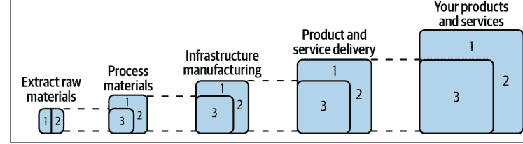
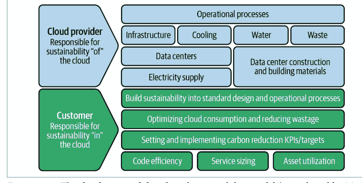

## Sustainability: FinOps Partnering with GreenOps

可持续性：FinOps 与 GreenOps 合作

在过去几年里，围绕云消耗的可持续性关注度和认知度大幅提升，云提供商和各地的云团队突然开始谈论衡量和减少其云碳足迹。

可持续性作为一门学科有三大支柱：环境、社会和经济。本章的重点将放在与云数据中心排放相关的环境支柱上。

我们将在本章后面介绍这对 FinOps 从业者为何重要，但首先考虑一下您的组织为何应该关心。组织对数字服务的碳足迹的更深入关注是由来自多个重要内部和外部利益相关者的压力驱动的：

-   投资者和股东正推动首席执行官和董事会成员对其整体排放负责，这是由 ESG（环境、社会和治理）举措以及公开报告的可持续性指标的影响所驱动的。
-   政府正在收紧环境报告要求和法规，因此绿色漂洗（虚假声称或宣传公司比实际更环保）的空间更小，行动的重点更大。
-   客户越来越多地基于道德原因做出购买决策，包括他们考虑的公司的可持续性实践。
-   员工要求自己的公司更具可持续性。员工在选择下一个就业地点时非常重视潜在雇主如何应对可持续性。

这些压力的结合成功地提高了董事会内部对可持续性的关注度，增加了对可持续性目标和/或净零期限的关注，同时更加注重问责制、透明度以及可衡量改进的交付。

> *没有什么比影响他们奖金的事情更能激励 C-suite。 这意味着预算和时间等关键资源正被用于专注于可持续性。*
> 
> —Posetiv Cloud 的 Mark Butcher 在 FinOpsPod 播客第 8 集：FinOpsPod Voicemail: GreenOps 中说

那么可持续性在云世界中为何重要？因为云服务产生的碳足迹规模巨大。直到最近，IT 服务的碳足迹一直被 ESG 专业人士忽视，他们的关注点在业务的其他领域，尤其是与更直接污染的业务领域相比，IT 和云消耗被视为无关紧要。

但随着云服务的增长，行业和媒体对数据中心的碳足迹变得更加直言不讳，关注点在于为看似 insatiable 的数据存储和计算需求提供多少电力和水。随着越来越多的公司关闭自己的小型数据中心并向云端集中，这种转变现在发生是有道理的。将许多小型设施的工作负载聚合到云提供商运营的庞大综合体中，使得云提供商实施的整体效率的微小提升也能产生更显著的影响，就像解决公用事业规模发电厂的排放比在单个工厂发电厂或备用发电机上做改变影响更大一样。

据报道，构成云的数据中心消耗了全球总能源的 1%–4%，预计这一数字在十年内将增长至高达 10%，超过航空等其他市场领域。此外，它们是水的大量消耗者，这会以水蒸气的形式产生排放。“典型的数据中心每天使用约 3–5 百万加仑的水，与 30,000–50,000 人的城市用水量相同，”德克萨斯理工大学水资源中心教授兼主任 Venkatesh Uddameri 在 2021 年 NBC News 采访中表示。

根据 2022 年 Time 文章，“Google 认为其用水是专有商业机密，甚至禁止公众官员披露公司的消耗量。但信息已经泄露，有时是通过与当地公用事业和保护团体之间的法律斗争。仅在 2019 年，Google 就申请或获得了超过 2.3

根据网上公布的公开记录和法律文件，三个不同州的数据中心耗水量达数十亿加仑。”

随着企业远离自有数据中心，推动云消费激增，可持续性措施也需要跟上。

## 云碳排放是什么？

为了管理和减少你的数字碳足迹，所有相关人员都需要对碳排放是什么以及如何衡量有一个共同的理解。可持续性领域使用了许多特定领域的术语，其中大部分本书不会涉及。如果你正在寻找这些术语的列表及其含义的解释，可以在 FinOps Foundation 网站上找到。重要的是，本章你需要了解温室气体是什么以及碳报告中常见的计量单位：

### 温室气体

温室气体是大气中吸收并重新发射热量的气体。一般来说，大气中这些气体的含量越多，地球就会变得越热。温室气体包括二氧化碳（CO₂）、水蒸气、甲烷（CH₄）、一氧化二氮（N₂O）、臭氧等。

### CO₂e

常常与二氧化碳（CO₂）的表示法混淆，CO₂e 是二氧化碳当量，它将所有温室气体作为一个标准化指标来包含。每种气体的全球变暖潜能值被用来将测量值转换为对环境产生等同 CO₂ 影响的量。CO₂e 为你提供了一个指标来代表所有气体综合的影响。

你可能会以多种方式看到 CO₂e 的写法，例如：CO₂eq、CO₂-e、二氧化碳当量，或 CDE。

### 净零

用于描述一种结果，即组织的活动产生的总排放量已通过减少碳排放的项目得到抵消。排放应由组织减少、测量，然后再进行抵消。你可以在 Science Based Targets 网站上阅读更多关于净零的信息。

组织所负责的总碳排放被细分为三个类别，即范围 1、2 和 3。三个范围是按公司在其自身运营及其更广泛价值链（即供应商和客户）中产生的不同类型排放进行分组的方式。名称来源于《温室气体核算体系》，它是全球使用最广泛的温室气体核算标准。

编制涵盖所有范围的完整温室气体排放清单使公司能够了解其整个价值链的排放情况，并将工作重点放在最大的减排机会上。做到这一点非常重要，因为 IT 行业在一定程度上存在只关注电力作为碳排放主要来源的过失，而忽视了来自三个范围排放的整体情况。

## 范围 1、2 和 3 排放

从本质上讲，范围 1 和 2 是公司拥有或控制的排放，而范围 3 排放是公司活动的结果，但发生在公司不拥有或不控制的来源。

### 范围 1 排放
来自组织直接拥有或控制的来源的排放——例如，在本地数据中心发电机中燃烧柴油。

### 范围 2 排放
组织在购买和使用的能源被生产时间接造成的排放。例如，对于本地数据中心，为数据中心供电的电力产生的排放就属于此类。

### 范围 3 排放
排放并非由公司本身产生，也不是其拥有或控制的资产活动的结果，而是由其间接负责的实体产生的，来自公司价值链的上游和下游排放。一个例子是当你购买、使用和处置供应商的产品时。范围 3 排放包括范围 1 和 2 边界之外的所有来源。范围 3 是你的云服务提供商 100% 排放被归类的所在。

云服务提供商谈论他们自己的范围 1、2 和 3 排放，容易让人对排放类别感到困惑。然而，为了简化，从云的角度（或任何外包服务）来看，提供商的范围 1、2 和 3 排放 100% 相加构成了你针对该提供商的范围 3 总量。可以把它想象成套娃，如图 19-1 所示。

图 19-1. 随着价值链向上移动，不同范围排放如何堆叠并汇入范围 3 排放的可视化

## 云服务提供商环保吗？

可以从两个角度来看这个问题。一方面，云服务提供商本质上倾向于尽可能高效地运营，仅仅因为对他们来说效率等于最大利润，这本身并无问题。平均而言，云服务提供商的数据中心在各方面都优于几乎任何本地同类设施，使用最新最好的技术来控制电力和水等宝贵资源的使用。

大多数云服务提供商在可行时使用可再生能源，但这不足以对其整体排放产生重大影响。云服务提供商使用可再生能源本身并不意味着他们是绿色或净零。

另一方面，许多云服务提供商主要关注范围 1 和 2。范围 1 和 2 相关排放的问题在于它们只是总排放的一小部分。考虑到大得多的范围 3 排放，情况看起来完全不同，范围 3 通常远大于范围 1 和 2。微软 2021 年白皮书“A New Approach for Scope 3 Emissions Transparency”报告称，其 2020 年 1600 万吨排放中，1200 万吨为范围 3。

直到云服务提供商开始提供关于所有三个范围碳排放更清晰、更全面的报告，很难真正回答云有多绿的问题。

主要云服务提供商在报告排放方面采取不同的方法，且成熟度各不相同。到目前为止，云可持续性报告的发展似乎走上了与第 5 章云计费数据简史中云计费数据相同的道路。它始于非常汇总、更新不频繁的报告，正向更细粒度、更新更频繁、更易访问的数据集发展。希望获取真正可持续性测量和优化所需的数据集不会花费类似数量的年数。

不幸的是，主要云服务提供商关于其碳排放的当前报告含糊不清，缺乏一致的方法论和完整性。例如，在本版发行时，AWS 和 Google 在该领域的报告仅涵盖其范围 1 和 2 排放，忽略了范围 3。这使得 Azure 成为唯一在所有三个范围报告碳排放的提供商，所有提供商都大量使用平均值和不同年代的碳数据。

如果你阅读主要云服务提供商最新的媒体发布，你会被原谅假设测量你的云碳足迹是一个已解决的问题，因为前三大云服务提供商现在提供某种形式的碳报告。虽然这是朝着正确方向迈出的一步，但仍有许多问题需要解决，才能理解你的云足迹的可持续性。

## 访问

虽然顶级云服务提供商已发布可持续性工具和/或碳使用报告，但许多其他云服务提供商要么没有提供可持续性数据能力，要么要求其云消费者支付合同费用以进行某一时间点的审计。可持续性数据的更新频率从手动（按需）到每月不等。数据本身以 PDF 报告、通过云平台 Web 界面访问的自定义仪表板，或在有限情况下用于你自己的分析报告的 API 数据形式提供。

可用数据和访问方法的缺乏标准化限制了第三方供应商平台提供的可持续性能力。开源领域的一个选择是名为 Cloud Carbon Footprint 的应用程序。Cloud Carbon Footprint 使用你的云服务提供商的计费数据和由你的云服务提供商提供的可持续性数据。根据收集的数据，为你的云使用生成碳足迹估算。这是对报告问题的创新方法，并提供有趣的可视化，但它依赖于可用数据的有效性和成熟度以及计算方法，包括云服务提供商提供的数据。

## 完整性

你在尝试了解云服务提供商提供的可持续性数据的完整性时会遇到困难。理解数据的困难大多源于云服务提供商用于计算碳足迹的方法。之前提到过缺少范围 3，但云服务提供商提供的并非所有服务都包含在其报告中，且计算中应用了大量平均值。平均值的挑战在于它可能为不同地区、数据中心或单个产品提供误导性的碳足迹。例如，低碳实例可能看起来

与相对低效、老旧的替代实例具有相同的足迹。一些云服务提供商目前建议将云支出作为碳影响的直接代理，这是不准确的——成本更高并不总是意味着排放更多。

为了建立对所提供数据的信任，云服务提供商需要涵盖所有云服务，在计算方法和涵盖气体方面更加公开透明，并减少对平均值的依赖。

## Granularity

云提供商提供的大多数数据都汇总到国家或地理区域，使得基于可持续性在不同云区域之间部署云服务的决策变得不可能。目前没有任何云提供商提供真正准确的云资源级别的碳数据，而是将数据汇总为每个云提供商服务的总碳排放量。没有资源级别的数据，就无法确定哪种资源类型比其他类型更高效。例如，在一个区域内无法识别出某个具体位置是否更可持续或碳效率更高，也无法在区域或位置之间以任何准确度比较实例或服务。

目前，云服务提供商不提供像云成本计算器那样的排放计算器。如果没有主动计算工作负载预期排放的方法，贵组织了解影响的唯一方式就是部署服务，然后等待更新的碳报告。

> 不要让完美成为进步的敌人。虽然今天云服务提供商提供的可持续性数据仍有大量改进空间，但等待所有正确的数据只会阻止贵组织培养优化所需的文化和技能，并基于云部署的可持续性做出决策。

## Partnering with Engineers on Sustainability

一种新兴趋势是相关但不同的实践——GreenOps。GreenOps 的目标是建立一种让工程师参与其云可持续性的实践。GreenOps 用于描述组织推动其云部署以及数据中心、基础设施平台和软件开发等其他 IT 领域可持续性提升的实践。

AWS 对其 Well-Architected Framework 的最新扩展引入了可持续性支柱，其中概述了可持续性的共同责任模型。受此启发，图 19-2 被创建以帮助解释两个关键领域之间的划分：云的可持续性和云中的可持续性，前者是提供商（即 Microsoft、Google 或 Amazon）的责任，后者则完全落在消费者身上。

图 19-2. 云可持续性共同责任模型（由 Mark Butcher 贡献）

云中的可持续性是可持续云战略的关键组成部分，通常与 FinOps 原则直接一致。最简单地说，它反映了将可持续性作为非功能性需求（NFR）并将其嵌入整个 IT 组织的需求，使可持续性成为与可访问性、安全、性能、成本和可用性等其他领域并列的关键考量。

在云中部署资源时可能并非总能做出最可持续的决策，但重要的是可持续性成为至少被考虑的关键标准，并且决策得到记录。正如我们在第 1 章讨论的，Prius 效应帮助你在了解使用信息的情况下做出优化的良好决策，并允许你在合理时明确花费或使用更多资源。

## FinOps and GreenOps Better Together?

在许多方面，可持续性需要在 FinOps 中已做的工作上增加一个指标。目标是以与引入成本相同的方式，将环境影响添加到贵组织做出的决策中。这并不是说 FinOps 从业者就是新的 GreenOps 从业者，而是将成本数据纳入决策过程的大部分工作都需要对 GreenOps 的碳数据重复进行。

> 一个设计用于成本优化的精心编排的 FinOps 战略也将扩展 GreenOps。反之亦然；GreenOps 战略可以积极影响工作负载效率，从而带来成本节约。
> 
> —Bindu Sharma，Guidewire FinOps 高级经理，来自其 FinOps X 2022 演讲

想象一下，当贵组织考虑在哪个区域构建灾难恢复环境时发生的决策过程。从工程师的角度来看，他们会考虑延迟、恢复点目标和恢复时间目标。工程指标考虑的是灾难发生时对客户的影响。FinOps 引入了在不同区域运营的成本，以便企业做出考虑财务状况的决策，而现在 GreenOps 带来了所考虑区域的环境影响和碳成本，以帮助说明该决策如何影响组织的可持续性目标。

FinOps 在所有努力将成本数据纳入工程决策路径的方式中，GreenOps 需要对可持续性数据做同样的事情。与其让实施 GreenOps 的团队去摸索与谁合作以及如何对这些现有系统和流程实施所需变更，不如考虑与 FinOps 团队合作，共享知识并可能协助部署可持续性数据。

让 FinOps 帮助 GreenOps 在贵组织中建立起来是互利的。许多员工非常关心环境，可持续性数据可以成为推动 FinOps 优化行动所需的激励因素——在第 3 章中有所介绍——从而推动行动。

> 建立当前足迹的基准。记录您所做的任何假设并说明任何差距。考虑成立一个可持续性指导小组，帮助推动问责文化，围绕各团队行动如何影响组织的碳排放。一旦有了基线，您就可以开始评估潜在的碳节约机会。评估碳浪费的热点并建立补救文化，制定路线图开始做出改变。
> 
> —Mark Butcher，Posetiv Cloud 创始人，FinOps X 2022

通常，可持续性会给公司带来额外成本，但有了成熟的 FinOps 实践，就可以在减少云支出同时减少云碳足迹。FinOps 和 GreenOps 世界之间存在明显的契合点，即通过减少不必要或未优化资源的用量来消除云浪费。随着云原生和第三方 SaaS FinOps 平台的不断进步，您可以轻易发现未充分利用的 EC2 实例。例如，更难看到的是 EC2 的部署方式不可持续。FinOps 可以与 GreenOps 协同工作，优化使用云的流程和实践，而不仅仅是优化云中的资源。在部署工作负载时，选择区域或资源类型时，在成本、性能、安全等其他关键标准之外考虑可持续性非常重要。这可能需要查阅云提供商之外的信息来源，例如来自 Electricity Maps 等来源的碳强度指标，您可以在其中找到接近实时的碳强度数据点。

至少，FinOps 团队可以帮助 GreenOps 团队建立起来并更好地与各种组织利益相关者建立联系，并可以共享现有的分类法、标记和报告结构。正如 FinOps 团队曾寻求帮助将报告集成到任何现有的 ITAM、软件资产管理（SAM）、安全或 TBM 团队中，现在它可以回馈这些帮助来推进 GreenOps。要开始与 GreenOps 团队协作，请参阅第 25 章，其中提供了与相关技术框架协作的一套指导原则。

## GreenOps Remediations

从 FinOps 角度来看，在寻求成本节约时有一些众所周知的切入点，对 GreenOps 来说也是如此。以下列表并非详尽无遗，但对于任何希望确保其服务既具有成本效益又可持续的 FinOps 专业人士来说，是一个良好的起点：

-  oversized 计算实例
- 遗留运行的孤立实例
- 运行在老旧、低效实例上的服务
- 尺寸不正确的微服务
- 未终止的计算实例或仍在运行的开发环境
- 存储快照过度保留
- 数据存储在错误的存储层级
- 运行在错误区域/可用区中的服务

现在，显然还有很多，这份列表只是冰山一角，但关键的第一步是评估当前状况，并基于实际指标为优化服务建立一些合理的时限 KPI。您还可以与工程团队合作优化代码，做出很多努力。这样做可以带来显著的益处，但显然需要大量的思考、规划和工程时间。自动化——在第 22 章中讨论——可以帮助管理这些浪费领域，不仅有利于 FinOps，也有利于 GreenOps。

## 避免 FinOps 与 GreenOps 背道而驰

并非所有 FinOps 能力都与 GreenOps 的目标保持一致，实际上其中一些甚至会积极地与 GreenOps 的目标相悖。例如，费率优化，通过承诺云资源来节省成本，这并不能帮助减少碳排放。成本和可持续性可能会朝着不同的方向发展。针对未充分利用资源的费率降低承诺会提高云成本效率，但也可能限制你减少云使用量的能力，进而限制减少碳排放的影响。你可能节省了资金，但对未使用资源的费率优化可能会鼓励你保留这些资源而不是将其关闭。这可能会阻止你减少那些你可能并不真正需要的云资源上的碳排放。

在比较运行云服务的区域时，成本并不总是与可持续性相匹配。表 19-1 显示了单个 e2-highcpu-32 计算资源在不同 Google Cloud 区域运行的比较。数据来源于 Google Cloud 定价页面和 Google Cloud 碳能源页面。仅基于价格比较表 19-1 中的区域，爱荷华州、南卡罗来纳州、哥伦布和俄勒冈州每月均为 $578，价格相等。当你同时考虑可持续性和成本时，区域选择对爱荷华州和俄勒冈州更为有利，而南卡罗来纳州的绿色能源使用量最低。该表还突出了使用全国平均值的弊端：绿色能源使用平均为 54% 时，九个区域中有五个的绿色能源使用量实际上低于 54%。

表 19-1. Google Cloud 中单个 e2-highcpu-32 实例的价格和所用绿色能源比较

| 区域 | 位置 | % 绿色能源 | 每月价格 |
|---|---|---|---|
| us-central1 | Iowa | 97% | $578 |
| us-east1 | South Carolina | 25% | $578 |
| us-east4 | Northern Virginia | 64% | $651 |
| us-east5 | Columbus | 64% | $578 |
| us-south1 | Dallas | 40% | $682 |
| us-west1 | Oregon | 88% | $578 |
| us-west2 | Los Angeles | 53% | $694 |
| us-west3 | Salt Lake City | 31% | $694 |
| us-west4 | Las Vegas | 21% | $651 |
| 平均 |  | 54% | $631 |

从全球角度来看，这种比较变得更加明显。截至撰写时，挪威电力碳强度为每千瓦时 31g CO₂e，而美国弗吉尼亚州北部为 620g，相差 2,000%。

基于纯粹财务影响来决定运行服务的区域可能会对 GreenOps 的可持续性目标产生负面影响。在做出可持续性权衡时，力求就成本与可持续性的平衡达成共同协议。对齐各方将使他们与工程团队一起工作，避免冲突。

## 结论

本章简要介绍了可持续性实践如 GreenOps 如何与 FinOps 相交。随着全球对可持续性的关注日益增长，我们相信 FinOps 与专注于云可持续性的团队之间的对齐将变得至关重要，而这两个学科之间的对齐将实现同时考虑支出金额和排放量的效率。

总结如下：

- 可持续性已成为组织非常重要的议题，由政府、客户和员工等多个利益相关方推动。
- 云比传统的本地平台更环保，但如果没有所有必需的数据，就无法确定其真正的可持续性程度。
- 现有的 FinOps 实践在组织内部处于有利位置，可以通过利用类似的补救步骤、报告模式和跨职能对齐来帮助 GreenOps 成功。
- 可持续性数据的粒度将使 FinOps 能够帮助团队对其云部署做出更可持续的选择。
- 接受当前可用数据的局限性并立即行动；避免在开始产生积极影响前等待完美。
- 可持续性为 FinOps 从业者提供了在组织内更广泛参与的机会，并可作为 FinOps 补救措施的额外杠杆。
- 在 FinOps 讨论中将可持续性作为与成本并列的指标。
- 在与 DevOps/工程等其他团队的对话中使用可持续性，以帮助推动效率和优化的文化。

至此，本书的优化阶段结束。此时，你应该知道组织可用的优化措施，并应为希望实现的目标设定目标。第四部分将继续 FinOps 生命周期中的运行阶段，在那里你将建立实现目标所需的流程。
