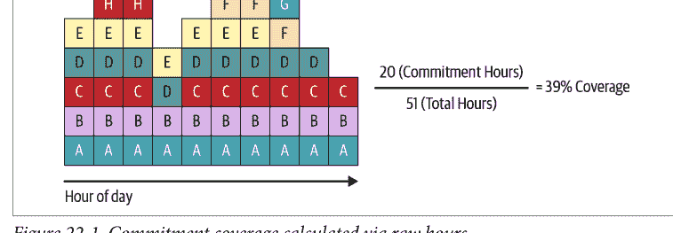
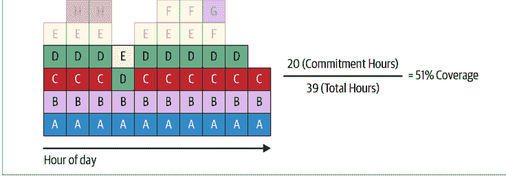
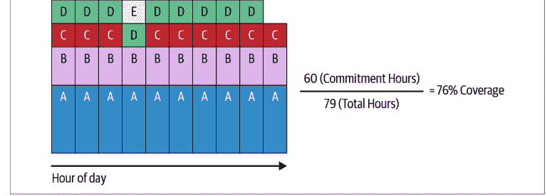
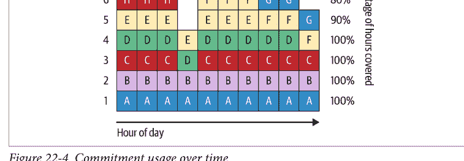
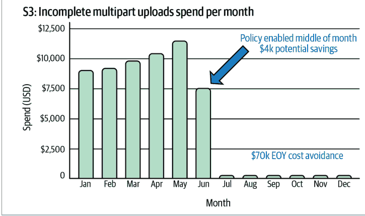

## 基于指标的成本优化

*基于指标的成本优化*（MDCO）是衡量潜在优化并使用目标和目标线触发操作流程以执行它们的驱动因素。当你购买承诺时，你处于操作阶段。有了 MDCO，你可以使用指标阈值来精确确定何时采取这些行动。

MDCO 也可以被描述为“懒人式云成本管理方法”。MDCO 的主要规则是：不要做任何事。也就是说，在你拥有衡量行动影响的指标之前，不要做任何事。如果你进行优化但没有指标来告诉你它们对支出的影响是积极还是消极，那么你就没有做 MDCO。

到本章结束时，你将知道如何正确使用指标来驱动你的成本优化。

### 核心原则

有几个核心原则定义了 MDCO 实践：

- *自动化测量*
- 由计算机执行测量，而不是人类。
- 
- *目标*
- 没有目标的指标只是漂亮的图表。
- 
- *可实现的目标*
- 你需要正确理解数据以确定现实的结果。
- 
- *数据驱动*
- 行动不是驱动你的数据：数据驱动你采取行动。

我们将在本章中解释这些原则的每一个。

### 自动化测量

加载账单数据、生成报告和生成优化建议都是应由自动化或通过 FinOps 平台完成的任务。当云服务提供商提供大量账单数据时，所有这些活动都需要自动启动。让 FinOps 从业者尝试运行临时数据处理和报告生成会减慢 MDCO 的速度，并导致对异常的响应缓慢。

可重复且可靠的数据处理让你能够专注于手头的真正任务：省钱。然后你可以花时间完善所遵循的流程，并深入了解成本优化计划以及它们如何在数据/指标中体现。

### 目标

对于 MDCO，目标线至关重要。我们在第 14 章中写过目标线如何为图表提供更多上下文。我们一直坚信，没有目标线的图表是不完整的。没有它，你只能确定图表本身的基本信息，而不能确定图表对组织的意义。目标线创建了一个阈值，可据此得出警报和操作的触发点。

人类很难理解非常大数字的规模，这就是为什么上下文目标如此重要。为了抵消这一点，Hans Rosling 的书《Factfulness》（Flatiron Books, 2020）中的一个提示被 Spotify 的 Anders Hagman 在最近一次 FinOps Foundation 月度峰会上引用。在书中，Rosling 告诉读者“每当有人给你一个大数字时，就要求另一个数字”以便进行比较。在 MDCO 中，要使你的指标提供价值，你需要一个可供衡量的目标。

### 可实现的目标

在成本优化计划中，有多个指标需要监控。正确跟踪每个指标可实现你的成本优化运营策略。每个单独的优化对实现的节省会产生不同的影响，因此不应将所有优化视为相同。在合并指标时，应根据优化的节省潜力对数据进行标准化。

最常见的测量不准确的指标之一，也是可以帮助你理解 MDCO 中可实现目标的指标之一，是承诺覆盖率。

有多种衡量成本优化绩效的方法，每种方法都代表了对效率的一种特定视角。取决于所使用的方法，100% 的优化可能无法实现。对于 MDCO，需要完全可实现度量来确定执行操作的最佳时机。

让我们通过承诺覆盖率来更详细地解释这一点。

## Commitment coverage

承诺覆盖率是衡量有多少使用量按即用即付费率计费、与按折扣费率计费的指标。通常，组织会设定一个目标覆盖率——常见的是 90%。让我们比较各种方法。

在传统模型中，你通过统计拥有的所有承诺小时数，然后用该数字除以该期间运行的总小时数来衡量覆盖率（见图 22-1）。

图 22-1. 通过原始小时数计算的承诺覆盖率

即使图 22-1 中衡量覆盖率的方式是正确的，这可能也不是正确的做法。随着弹性基础设施的出现，资源频繁出现和消失，有些小时不应由承诺覆盖，因为在该时间段内使用量不足以证明其合理性。理想情况下，你不应包含所有低于盈亏平衡阈值的用量，低于该阈值承诺的成本会高于节省的费用。通过剔除这些不可覆盖的小时，你可以衡量可覆盖小时的覆盖率（见图 22-2）。

图 22-2. 通过可覆盖小时数计算的承诺覆盖率

如果你剔除图表峰值中不应被覆盖的不可覆盖小时（图 22-2 中标记为 H、F、G 和 E 的那些），你就能更清晰地了解真实的覆盖百分比。A 和 B 由承诺覆盖，剩余由资源 C、D 和 E 覆盖的小时仍按即用即付费率计费。购买额外的两个承诺可提供 100% 覆盖率，且这两个额外承诺将节省费用。

到目前为止，你一直把图表中的单元格当作同一事物：B 与 A 相同，与 C 相同。但实际上，每个单元格（或小时或秒）可能是完全不同规模的使用量。标记为 A 的使用量每小时可能超过 $1，而 B 可能每小时仅 $0.25。这样每个承诺的节省金额就会大不相同。主要是为了节省而购买承诺，因此当它们差异如此之大时，将其作为一致的块来衡量会产生误导性结果。目标是弄清楚你的覆盖率中有多少实际上在产生节省。

通过用承诺覆盖小时单元格将其转换为可能的节省额，可以清楚地显示承诺对云账单的影响。根据每种使用类型的相对节省额调整图表，你会得到一个截然不同的图景（见图 22-3）。

图 22-3. 通过加权可覆盖小时数计算的承诺覆盖率

图 22-3 显示你实际上已接近 76% 的可实现节省。图 22-1 中的原始评估显示你处于非常低覆盖率的情况。但新的加权位置也剔除了不应实际承诺的小时，显示你的状况其实并不算糟糕。

关键要点是，承诺不同的资源会实现不同金额的节省。并非所有使用量都可覆盖，因此将所有使用量都纳入承诺覆盖率会导致更难以设定目标的指标。然而，通过以可实现覆盖率为思路，你可以更准确地确定如何以及在何处进行改进。

## Savings metrics that make sense for all

汇总所有应被承诺项目的节省额，可得出总潜在节省的概念。例如，假设图 22-3 中的所有单元格在用承诺覆盖后每年可节省 $102,000（总潜在节省）。因此，$102,000 的 76% 是当前已实现的节省额（已实现节省），剩余 24% 未覆盖且仍按即用即付费率计费（未实现潜在节省）。

这与 FinOps 的语言相呼应。当你从讨论使用小时数和承诺覆盖率转向“你目前已实现 $102,000 总潜在节省的 76%”这样的对话时，这能让组织中的每个人都了解你目前的状况和可以去向。此外，它消除了对基于承诺折扣复杂性的深入理解需求，并促进组织内部的沟通。你已创建了一个共同的词汇以实现相互理解。

## Combining metrics

要确定承诺的绩效指标，你需衡量在特定时间段内承诺被使用与未被使用的比例。这称为你的承诺利用率。在单个承诺层面，你按时间进行监控，衡量承诺对资源使用应用折扣的小时数（或秒数）与承诺无使用可折扣的小时数（或秒数）的比例。

然而，如果你将承诺利用率汇总以显示一个整体绩效指标，表现不佳的单个承诺可能会被掩盖。相反，你应衡量单个承诺，并在其单独表现不佳时发出警报。让我们在图 22-4 中看一个例子。

图 22-4. 随时间推移的承诺使用情况

你使用图 22-4 中的使用情况来确定你的承诺利用率，基于拥有七个承诺。你可以看到前四个承诺的利用率为 100%。第五个承诺的利用率为 90%，第六个为 80%，最后一个仅为 50%。

如果你只是将利用率平均（100% + 100% + 100% + 100% + 90% + 80% + 50%）/ 7，你会得到 88.5% 的利用率。表面上 88% 的整体利用率看起来相当不错，不会引起担忧。如果你的目标利用率为 80%，MDCO 会反映无需更改。但请记住：有一个单个承诺的利用率仅为 50%，这值得你的关注和可能的调整。

## Data Driven

多年来，团队一直使用指标来运营其服务，监控服务性能、资源使用率和请求率等项目作为早期预警系统，当阈值被超过或事件被触发且需要相应调整时提醒团队。

在没有指标的情况下运营 FinOps 优化，无法真正识别优化是否达到目标。事实上，没有指标你甚至无法设定目标。跟踪的指标建立在我们在第 9 章讨论的反馈循环之上。指标帮助你识别未优化或表现不佳的地方，以便进行改进。换句话说，指标帮助你衡量成本优化节省了多少。

将 MDCO 应用于 FinOps 使你能够衡量成本优化的预期成果。当指标显示某项更改未成功时，你可以将其作为早期预警，表明该更改需要进一步调整，或完全回滚。

在 FinOpsPod 第 11 集，Box.com 的 TJ Johnson 解释了 FinOps 中大多数可视化如何帮助你回答四个主要问题，这些问题与 MDCO 方法非常契合，尽管他使用了略有不同的术语：

- *到目前为止我做得怎么样？* 衡量你目前所处的位置。
- *我如何变得更好？* 识别你可以进行的优化并帮助你选择想要处理的领域。
- *我真的变得更好了吗？* 衡量你随时间的改善情况，形成一组关键动量指标（KMI），帮助你监控你是否随时间变得更好或更差。
- *我是否达到了目标？* 提供有关你何时完成先前设定的目标的反馈。

回答这四个问题的度量体现了 DevOps 思维，其中不断有数据流入，为应用团队、财务团队和业务的决策提供支持。收听该集节目，了解他在 Box.com 是如何做到的完整故事。

## Metric-Driven Versus Cadence-Driven Processes

在第 18 章，我们讨论了围绕基于承诺折扣的策略。大多数公司在开始使用承诺时，会按计划（每月、每季度甚至每年）购买其承诺。我们称之为节奏驱动或计划驱动的成本优化。

如果您以缓慢的周期购买，最终会产生大量未覆盖的使用量。图 22-5 显示了随时间变化的使用情况，深灰色部分显示了您拥有的承诺覆盖率。可以从图表中看出，承诺的购买是在相对固定的周期内进行的，而在这几次购买之间，资源使用量持续增长。通过更频繁地购买承诺，您可以实现更大的节省。

图 22-5. 执行不频繁时的承诺覆盖率

图 22-6 显示了一个更频繁的承诺购买计划。频率并不总是随时间保持一致，但由此产生的承诺覆盖率紧密跟随资源使用量的增长。

图 22-6. 执行频繁时的承诺覆盖率

基于计划的成本优化对于入门来说是可以的，但继续缓慢地进行购买会让节省的机会流失。然而，过于频繁地查看承诺会导致时间浪费，因此您需要在两者之间取得平衡。

通过使用设定目标的指标，您可以快速确定何时未达到目标。

指标会在需要时触发警报以执行优化。MDCO 可用于所有可用的优化措施。正确衡量指标至关重要，以便在正确的时间触发优化。设定可实现的目标也很重要。

## 设定目标

对于某些指标，例如承诺覆盖率，我们建议首先设定一个保守的目标，然后逐步提高到 80% 等较高的目标。然而，对于利用率来说，设定较低的目标是没有意义的。将“从低开始”的模式应用于承诺利用率最终会花费比节省更多的成本。

> Stories from the Cloud—Mike
> 
> 在 Atlassian，我的团队旨在将承诺的利用率达到 90%，以获得尽可能多的节省。当单个承诺的利用率降至 90% 以下时，会触发计算机创建工单，通知我需要进行更改。此时，对受影响承诺的修改或交换会使利用率水平回升。此过程展示了正确衡量并采取行动的指标如何促进数据驱动的决策。

让我们看看如何将指标应用于使用量减少方法。删除未使用的资源和调整资源大小以适应未充分利用的资源也能产生节省。按成本百分比计算的总潜在节省被称为浪费百分比。每月花费 100,000 美元且潜在节省为 5,000 美元的团队将被认为浪费率为 5%。相比之下，每月花费 10,000 美元且节省潜力为 2,000 美元的团队浪费率为 20%。以这种方式衡量时，团队可以进行比较，并且可以为浪费设定通用目标。当浪费超过设定额度时，您可以专注于减少它。

## 采取行动

我们提到 MDCO 涵盖了 FinOps 生命周期中的全部三个阶段。我们已展示如何使用这些数据来建立可见性、衡量潜在优化措施并根据这些数字设定目标，所有这些都是告知和优化阶段的任务，但我们仍将本章放在书籍的运营阶段部分。这是因为 MDCO 的成功取决于您在设置 MDCO 的报告和警报后以及这些警报触发时所采取的行动，需要您对优化绩效所需的变更做出响应。

如前所述，如果没有明确定义的流程和工作流，您不太可能实现组织的 FinOps 目标。重要的是要明确谁负责处理 MDCO 警报，购买新承诺等事项的正确审批流程是什么，以及修改和/或交换现有承诺的正确操作顺序是什么。

在组织内部建立预先批准的承诺购买计划。给予 FinOps 团队根据需要购买承诺的自由——每月最高可达一定金额——可以减少承诺覆盖率警报与购买更多承诺以弥补短缺之间的滞后时间。改进流程有助于减少采取行动的延迟。

主动和被动之间存在微妙的平衡。什么应该是被动的？什么应该是主动的？不要像基于节奏的成本优化那样对时间做出反应；应利用 MDCO 的能力对成本数据做出反应。利用这些数据更快地做出反应。诸如预测之类的功能可以帮助您在阈值被跨越之前预测何时会出现，从而使您能够主动应对。通过确保这种主动的数据驱动预测，您将能够快速应对可能对云账单产生巨大影响的现实成本情况。

## 将一切整合起来

MDCO 让您确信指标会在需要时触发您进行调整。它使您从对日历上的任意计划（例如每月 RI 管理）做出反应，转变为对数据变化做出反应。但不要即兴做出反应；应为指标超出范围时将要执行的职能活动制定计划，例如购买额外的 RI 承诺。并确保计划好谁将执行哪些操作。

前 Pearson 云 FinOps 总监 Ashley Hromatko 提出了这个示例——见表 22-1——说明她如何使用 MDCO（结合 FinOps Foundation 的 Finops Assessment 中的评估透镜）来定义谁将确定成本威胁所需的变更的明确流程，并通过自动化完成循环以在环境中执行变更，从而实现了显著的成本节省。

表 22-1. 为管理多部分上传而实施的策略变更和自动化流程

| 阶段 | 视角 | 流程 | 操作 |
|---|---|---|---|
| Inform | Knowledge | Awareness of impact for change | 800+ AWS accounts and no lifecycle rule configured for S3 incomplete multipart uploads |
| Inform | Process | Who will make decisions | Spending 11K per month on incomplete multipart uploads, no single account is exceeding more than 1K |
| Optimize | Metrics | Baseline KPIs for success | FinOps submit policy to Cloud Governance board for review, vote to move to implement |
| Optimize | Adoption | How will implementation be communicated | Decision made for remediation after 14 days and ability to opt-out |
| Operate | Automation | Offload repetitive tasks to tooling | Cloud Custodian policy created by Cloud Management engineering team |

结果是一个流程，该流程将生命周期策略附加到所有 S3 存储桶，并在 14 天后自动删除未完成的多部分上传。正如图 22-7 所示，该策略在下个月带来了显著的自动化成本节省。

图 22-7. 实施多部分上传策略后的支出下降

## 结论

以指标驱动的成本优化涵盖了 FinOps 生命周期中的全部三个阶段，可见性和目标推动着成本优化流程。自动化在提供可重复且一致的流程方面发挥着重要作用。

总结如下：

- 所有成本优化都由指标驱动，所有指标都需要可实现的目标。
- 计算机应执行重复的数据分析，并在指标偏离目标时发出警报。
- 所有正在进行的变更都应反映在指标中。最终节省应增加，成本优化效率应保持高位。
- MDCO 的关键在于准确知道执行优化流程的最佳时机。

就在我们认为自己已经掌控了这个 FinOps 世界时，工程师们通过容器化在云之上引入了一个全新的世界。接下来，我们将探讨使用容器进行集群化的影响，以及如何利用现有的 FinOps 知识来解决由此产生的新问题。

