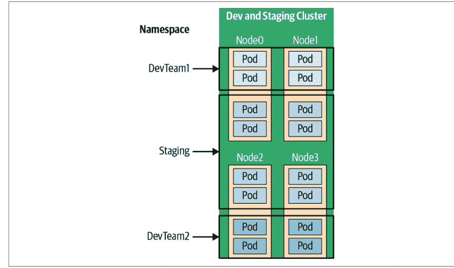
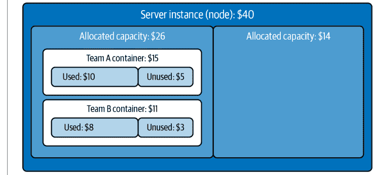

## 容器世界的 FinOps

为了支持微服务架构的采用，容器获得了流行。过去几年里，组织运行的容器环境数量迅速增加。管理单个运行中的容器实例相当简单，但在众多服务器实例上运行数百、数千甚至数万个容器就变得困难了。因此出现了像 Kubernetes 这样的编排解决方案，使 DevOps 团队能够维护配置并编排容器舰队的部署和管理。

由于容器和容器编排器正成为许多团队的热门选择，了解这些容器化工作负载对 FinOps 实践的根本影响至关重要。

影响 FinOps 最重要的原因是大多数容器环境都是复杂的共享环境。像容器这样的共享资源——运行在共享的云计算实例上——会导致成本分配、成本可见性和资源优化方面的挑战。在容器化世界中，传统的 FinOps 成本分配方式与仅使用虚拟机 (VM) 时不同。你不能简单地将资源的成本分配到标签或标记上，因为每个云或本地资源可能都在运行不断变化的多个容器集合，每个容器支持不同的应用程序。它们也可能连接到组织内不同的成本中心。不过不用担心。在本章中，我们将探讨可以让你在容器世界中成功运营 FinOps 实践的变更和调整。

## 容器 101

让我们快速回顾一下容器基础知识，供不熟悉容器的人使用。这也有助于在整章中建立对这些组件的共同理解。

容器，简单来说，就是打包软件的一种方式。所有需求和设置都烘焙到可部署的镜像中。像 Kubernetes 这样的容器编排工具帮助工程师以可管理、可维护的方式将容器部署到服务器上。

本章中我们将使用以下几个关键术语：

*镜像*
一个包含需要运行的软件的容器快照。

*容器*
容器镜像的一个实例；你可以在同一时间运行同一镜像的多个副本。

*服务器实例/节点*
服务器（例如，EC2 实例、VM、物理服务器）。

*Pod*
这是 Kubernetes 的概念。Pod 包含至少一个容器，但也可以包含一组容器，并将它们视为可在集群上调度和扩展的单个资源块。

*容器编排*
编排器管理服务器实例集群，并维护容器/Pod 的生命周期。容器编排器的一部分是调度器，它将容器/Pod 调度到服务器实例上运行。示例包括 Kubernetes 或 AWS Elastic Container Service (ECS)。

*集群*
由容器编排管理的服务器实例组。

*命名空间*
另一个 Kubernetes 概念，命名空间是在单个集群内隔离资源组的一种机制，其中 Pod/容器可以与其它命名空间分开部署。

Kubernetes 集群（见图 23-1）由多个节点（服务器实例）组成，这些节点在 Pod 内运行容器。每个 Pod 可以由不同数量的容器组成。节点本身支持用于隔离 Pod 组的命名空间。

图 23-1. Kubernetes 集群的基本视图

## 向容器编排的迁移

工程师出于可用性、可靠性、可扩展性和易于管理等多种原因决定转向容器。请记住，FinOps 的目标是确保你为业务做最好的决策，在成本和技术需求之间持续平衡。成本并不是迁移到容器的唯一驱动因素，但能够在容器模型和 VM 模型中核算应用程序成本（包括双方的所有相关成本和影响）是有助于为业务提供的信息。

当你从大量单独的云服务器实例转向像 Kubernetes 这样的集群编排解决方案时，通常会得到数量更少但更大的服务器。通过将多个容器工作负载打包到这些更大的服务器中（也称为装箱），你可以通过在同一节点上隔离运行许多容器来实现更好的资源利用率，从而获得效率。

一个类比可能有助于你理解这个概念：集群中的每个服务器实例就像一场俄罗斯方块游戏。容器是形状和大小各异的方块，而容器编排器试图将尽可能多的这些“方块”（容器）放置到服务器中。

Kubernetes 等平台允许你设置不同的资源保证，从而允许你在服务器实例上打包更多容器，我们将在本章后面更深入地介绍这一点。

当在单个服务器实例上运行多个容器时，你会失去对每个容器单独成本的可见性，因为云服务提供商只会提供底层服务器实例使用情况的计费数据。当服务器实例运行多个容器时，你需要更多信息来划分使用成本。

换句话说，每个由多个工作负载共享的云资源都需要有补充数据，以便显示每个工作负载使用了多少云资源。容器并不平等地消耗服务器。一些容器可以配置为使用比其他容器更多的服务器实例资源。一些容器运行数周或数月。但研究表明，大多数容器通常运行时间很短，平均不到 12 小时，有些可能只运行几秒钟。由于不同大小的容器以不同的速率进出，不频繁地拍摄集群使用情况的快照无法提供你所需的详细成本分配的足够采样。跟踪所有容器进出的详细数据将帮助你确定单个服务器成本如何分摊，以及服务 A 的容器与服务 B 的容器各自使用了服务器的多少资源。你将在第 357 页的“容器比例”中看到这些数据是什么样子的。

然而，收集这些数据的困难之一就是其庞大的数据量。云计费数据文件已经非常庞大，但你可能拥有的容器数量是 VM 的数倍，而且每个容器可能在资源之间多次迁移，每次迁移都会产生一条新的数据行。这是一个困难的挑战，如果你希望以详细和精细的方式解决它，就需要一些专门的工具。

FinOps 从业者需要为团队准备应对共享资源对成本可见性和成本分配流程的影响。清楚了解在容器世界中保持成功的 FinOps 实践所需的条件至关重要，并确保 DevOps 团队实施这些条件。

## 容器 FinOps 生命周期

当你审视容器化给 FinOps 带来的挑战——成本可见性、成本回溯/分摊和成本优化——你很快就会意识到你遇到了与迁移到云时相同的困难。容器代表了在云虚拟化之上又一层虚拟化，也称为容器化。虽然这可能感觉像是倒退，但请记住，你已经积累了解决这些挑战所需的所有知识、流程和实践。你只需要将方法建立在最初如何解决云问题的基础上。

因此，你可以将容器化 FinOps 挑战划分为与更广泛的云 FinOps 相同的 inform、optimize 和 operate 生命周期。

## 容器告知阶段

你的首要关注点应该是生成报告，使你能够确定团队运营的集群上各个容器的成本。换句话说，你需要建立对容器支出的可见性。

## 成本分配

你将被云服务提供商为构成集群的每个服务器实例收费。当容器部署到集群中时，它们会消耗集群的部分资源容量，例如 CPU、内存和存储。即使容器内的进程没有消耗为该容器预配的所有资源，在某些情况下它会阻止其他容器使用该容量，因此你必须为此付费。这就像你向云服务提供商预配服务器一样。无论你是否使用，你都必须为该服务器资源付费。来自服务和发往服务的网络流量成本本身就是一个挑战，也应包含在内。分配给单个节点或服务器实例的网络成本可能支持多个容器，相关成本需要按每个容器的使用情况进行拆分。网络成为一种需要公平分配模型的共享成本，理想情况下是通过评估每个容器的实际网络流量量并根据这些量分配网络成本。

要分配在集群上运行的容器的单独成本，你需要某种方法来确定单个容器消耗了底层服务器的多少资源。我们将在下一节更详细地介绍这一点。

你还需要考虑运行集群的卫星成本。管理节点、用于跟踪集群状态的数据存储、软件许可、备份和灾难恢复成本都是你成本分配策略的一部分。这些间接成本都是运行集群的一部分，必须在成本分配策略中予以考虑。

## 容器比例

管理集群的最大问题是你共享底层资源，因此仅凭云账单无法获得分配的完整可见性。请记住，云服务提供商只能观察 VM 超级管理程序提供的指标，而不能观察操作系统或进程，除非你使用他们的托管服务。这种可见性缺失意味着提供商无法跟踪你的容器以及它们使用了服务器的多少资源。因此，对于你的 FinOps 团队来说，要进行分摊

为了将底层服务器的成本分摊到正确的团队和服务，需要运行容器集群的团队报告每个服务器实例上运行的容器。通过记录每个容器使用各服务器的比例，可以丰富你的云计费数据。

## 自定义容器比例

测量底层云服务器实例被每个容器消耗的比例是一个复杂的过程。但你可以先从使用的 vCPU 和内存量开始。

表 23-1 给出了一个示例，帮助你理解这些数据。

在表中，有一个服务器实例拥有四个 vCPU 和 8 GB 内存，成本为每小时 1 美元。该服务器是集群的一部分，在特定的一小时内运行容器 1–4。

表 23-1. 服务器实例上的示例容器分配

| 服务器ID | 容器 ID | 服务标签 | vCPU | 内存 (GB) | 时间 (分钟) | 比例 |
|---|---|---|---|---|---|---|
| i-123456 | 1 | A | 1 | 2 | 60 | 25% |
| i-123456 | 2 | A | 1 | 2 | 60 | 25% |
| i-123456 | 3 | B | 0.5 | 1 | 60 | 12.5% |
| i-123456 | 4 | C | 1 | 2 | 15 | 6.25% |

比例计算在查看容器 1 和 2 时看起来相当简单。它们在整个计费小时内使用了四分之一的 vCPU 和内存，因此你分摊四分之一的服务器成本。由于这两个容器都运行在同一服务（A）上，你将 50% 的服务器成本分配给服务 A。

容器 3 看起来也有类似的情况。然而，这次它使用的服务器资源更少。

当你查看容器 4 时，你会看到它使用了服务器实例的 25%，但这次只有一小时中的 15 分钟（25%）。当你将时间乘入时，其比例数据会降低：0.25 × 0.25 = 6.25%。

在某些情况下，指标的比例与底层服务器并不完全对称，这在计算比例时会造成问题。我们见过解决此问题的两种主要方法：

### 最具影响力的指标

如果容器使用的 vCPU 比内存多，则使用该比率来计算比例。

### 加权指标

先对指标（vCPU、内存等）进行加权，然后再用它们来计算比例。

虽然我们建议从 vCPU 和内存开始，但它们并不是确定容器比例时唯一可能重要的指标。你可能需要考虑其他指标，例如本地磁盘使用量、GPU 和网络带宽。根据调度到集群的工作负载类型，最相关的整体指标权重可能因集群而异。还需要注意的是，在 Kubernetes 中，请求的资源和消耗的资源之间存在差异。通常 Pod 使用的资源少于其请求，但相反的情况也可能发生。在测量使用比例时，我们建议你使用工作负载请求的资源和消耗的资源两者中的较大值。

即使你按上述方式分配集群的成本，仍然可能出现未分配的容量成本。运行中的容器不太可能在所有时间都 100% 使用或请求集群，这会留下未分配也未被使用的剩余容量。

图 23-2 显示了一个每小时成本为 40 美元的单个服务器实例。在此节点上运行着两个容器。团队 A 和团队 B 分别被分配 15 美元和 11 美元的成本，尽管它们容器内的一部分请求容量未使用，可被视为浪费。服务器实例上仍有 14 美元的空闲节点容量（可分配容量）需要分配到某个人的预算中。

图 23-2. 服务器实例/节点上的未分配容量

我们尚未看到分配多余、可分配节点容量的标准方法。一个选择是让管理服务器实例的团队自行承担成本；另一个选择是根据容器各自对整个节点的使用比例，按公平方式将可分配节点容量的成本分摊给节点内的所有容器。

预留容量是软限制，如果节点内仍有额外的可分配容量，Pod 能够超出其设定的限制。因此，Pod 消耗的容量可能超过其预留容量的 100%。这意味着在使用的期间，Pod 在整个节点成本中的份额会增加，未预留的节点容量剩余未使用的部分会更少。

这就留下了一个问题：谁应该为多余的容量付费：管理集群的团队，还是拥有在服务器实例上运行的工作负载的团队？

在与成功分配容器成本的组织共事后，我们确定了在存在未分配成本时分配这些成本的两种主要策略：

## 将空闲成本分配给中央团队（推荐选项）

由于你需要一种分配策略来确保集群成本能够 100% 分配，一些组织会将这些多余容量成本分配给运行集群的团队。这些团队拥有集群成本的预算和预测，因此通过将多余容量成本映射到他们身上，你可以激励该团队优化容器调度、在工作负载允许的情况下减小集群规模，并将集群浪费降至最低，从而减少这些多余容量成本。

> 运行和维护集群的团队可以在集群/节点级别看到可分配成本的可视性。在大多数情况下，通过部署的服务/Pod 的实际使用取决于实际用户设定的资源请求，例如为所有人运行平台服务的平台团队以及各自应用程序的开发团队。平台团队最适合调整集群规模、切换到其他实例类型，或设置集群自动扩缩器，通过更好地调整集群规模来总体降低可分配成本，从而提高集群资源的利用效率。
> 
> —David Sterz，Mindcurv，容器成本分配工作组负责人

## 将空闲成本分摊给使用集群的团队（替代选项）

第二种策略是将多余容量成本分摊给在集群上运行容器的团队。你使用分配容器成本时使用的相同比例数据来确定分配的内容和位置。

这种方法避免了为多余容量成本设立中央兜底预算的需要。

在决定分配多余容量成本的方法之前，我们建议你同时与运行集群的团队和消费集群的团队沟通，以便就如何进行达成一致。

## Google Cloud 中的容器比例

当你使用自定义机器类型时，Google Cloud 会分别对 vCPU 和内存收费，因此如果这些是你用于容器成本分配的指标，就不需要确定容器消耗的底层服务器的比例。如果你只记录分配给在集群上运行的每个容器的 vCPU 和内存，就可以使用正常的 Google Cloud 价格表为每个容器分配费用。你的总集群成本将表示为整体的 vCPU 和内存费用。当你从这些值中减去记录的容器成本时，剩下的就是未使用的集群成本。

然而，当你使用预定义机器类型时，你将需要为每个容器记录自定义比例数据，如前所述。

## 标签、Label 和命名空间

与服务器实例一样，没有任何标识符的容器使得从外部难以确定其用途。实际上，你可能会最终拥有数百甚至数千个小型容器。拥有标签/标注策略将使你能够对使用情况进行分类。请记住，你以与原生云相同的 FinOps 模式处理容器，我们希望你现在已经习惯了。因此，你的标准云标签策略能够很好地应用于容器也就不足为奇了。

在容器世界中，你可以为容器打标签/标注。这些标签构成了你用于分配成本的标识。命名空间允许你在单个集群内对资源进行分组。为团队或特定服务创建命名空间，可以创建粗粒度的成本分配组。

容器或 Pod 本身在启动时也可以被标注，提供更细粒度的成本分配机制（如果需要），尽管查看这些标签并据此分摊成本的能力是通过云计费数据之外的工具实现的。

## 容器优化阶段

与 inform 阶段类似，容器世界中的优化阶段是对为云平台构建的原始 FinOps 实践的直接改编。

乍一看，似乎容器化解决了合理配置问题。毕竟，在同一台服务器实例上运行更多事物看起来更具成本效益。但正如你迄今所见，衡量是否从集群中获得节省是一项复杂任务。

我们听过 FinOps 从业者说，“现在你已迁移到容器，就不需要再进行合理配置了。” 或“空闲资源不再是问题。” 虽然这些说法有些真实成分，但并不能说明全部情况。让我们看看你的 FinOps 实践需要如何演进才能取得成功。

## 集群部署

如果你将所有容器都在一个集群内运行，可能无法针对不同环境优化集群。将开发容器运行在 spot 实例上，或运行在离开发者更近的区域，在它们运行在专用开发集群时更容易实现。此外，如果将此开发集群运行在与生产环境分离的开发账户中会更有帮助。

另一种选择是运行多个集群，但运行过多的集群难以管理且不具成本效益。每个集群都会带来管理开销，既包括云资源也包括人员时间需求。此外，当工作负载分散在多个集群上时，最大化集群利用率会更困难。容器分散在集群之间越多，容器填满运行中的服务器的机会就越小，这意味着利用率更低。

在这里找到平衡与我们之前讨论的云资源账户平衡同样重要。与管理和使用集群的团队协同工作，是在组织内找到小型特定领域集群与大型通用集群之间最佳平衡点的最佳方法。

## 容器使用优化

现在我们将逐步调整 FinOps 生命周期更广泛的优化阶段中讨论的使用优化。

优化容器存在共享责任模型：运行集群的集中团队负责集群的规模，包括水平/垂直合理配置和工作负载放置，而在集群内运行容器的团队则负责设置并使用适当数量的请求或保证容量。

## 集中化集群的合理配置

本节中的优化责任通常落在管理集群和服务器实例的集中团队身上。

如果你发现集群不具成本效益，最可能的原因是调度不佳和集群资源利用不足。所有运行中的容器停止后仍在运行的集群实例，或大型集群实例上仅运行一个或几个容器，都意味着该实例大部分未被利用——导致每个集群的成本更高，需要进行合理配置。

在容器世界中，你的中央集群管理团队需要应用多种策略进行合理配置：

## 水平合理配置

这指的是你将容器打包到服务器实例上的程度。打包越紧密，在给定时间点需要运行的服务器实例就越少。当操作正确时，你的集群可以根据所需实例数量进行扩展，同时通过避免运行不需要的服务器实例实现成本节约。容器编排器应寻找重新定位容器的机会，以提高服务器实例的利用率，同时释放可在负载下降时——使用自动扩缩容——从集群中移除的服务器实例。随时间跟踪未使用的集群容量量，可让你衡量调度引擎的变化。如果随后更新/调整调度器，使其能够将容器打包到更少的服务器实例上，你就可以衡量效率的提升。

## 垂直合理配置

这指的是更改服务器实例的大小。虽然你应期望容器编排器将容器尽可能打包到最少的服务器上，但还需考虑其他因素。为了高可用性，一些容器应在不同的底层服务器实例上运行。如果这导致服务器实例利用不足，调整服务器实例以使用更少的 vCPU 和内存将降低成本。

## 工作负载匹配

如果你的容器工作负载与 vCPU 与内存比率不匹配（例如使用更多内存而非 vCPU），那么当服务器 vCPU 空闲时，容器就没有内存可用。当你的数据告诉你服务器的 vCPU 与内存平衡与容器工作负载不匹配时，你可以运行更匹配的服务器实例类型（例如每 vCPU 内存更多的实例），以降低的小时费率运行，从而降低成本。可以在集群中使用多种服务器配置的混合，并将工作负载分配给最匹配容器工作负载的服务器。

## 容器/ Pod 的去中心化合理配置

在 Pod 内运行容器的团队负责正确调整其从集群请求的容量大小。

即使在已高效装箱的容器中，单独调度到集群上的容器仍可能处于非活动状态。正如你现在所知，容器会消耗集群资源的一部分，因此如果容器大于所需，其成本效益会更低。

而不是跟踪服务器利用率指标以查找空闲服务器实例，团队现在需要跟踪容器利用率指标以识别未使用的容器实例。再次，解决空闲服务器实例所使用的类似概念也适用于容器。

如 Kubernetes 之类的集群编排解决方案允许你请求对已调度容器进行的不同资源类别分配，称为服务质量（QoS）类别。每个 QoS 类别都带来不同的容量分配模型并影响相关的成本分配：

### 保证资源分配

对于关键服务容器，你可能会使用保证资源分配，以确保 Pod 在任何时候都有固定数量的 vCPU 和内存可用。你可以将保证资源分配视为预留容量。容器的大小和形状不会改变。当设置为高而实际使用量低时，此类别对容器空闲成本的潜在影响最大。

### 可突发资源分配

尖峰工作负载可以通过仅在需要时访问更多资源而受益，让 Pod 在底层服务器实例上有容量时使用比最初请求更多的资源。可突发资源分配更类似于某些云服务提供商提供的可突发服务器实例（可突发性能实例如 AWS 的 T3 或 Google Cloud 的 F4），它们提供基础性能水平，但在需要时允许 Pod 突发。虽然这是一种易于开始的方式，在资源请求低但无限制的情况下更具成本效益，但也可能导致尖峰不可预测的资源消耗，从而损害其他工作负载或因资源缺乏而导致服务性能下降。

### 最佳努力资源分配

此外，开发/测试容器可以使用最佳努力资源分配，这允许 Pod 在有剩余容量时运行，但在没有容量时停止。此类别类似于 Google Cloud 中的可抢占 VM 或 AWS 中的 spot 实例。从纯粹的成本效益角度来看，该类别是最好的，因为它没有空闲成本；然而，绝对没有任何保证资源会在任何时候可用，且应谨慎仅用于生产系统上的特定工作负载。

当容器编排器将具有不同资源分配保证的 Pod 混合分配到每个服务器实例时，你会获得更高的服务器实例利用率。你可以为固定资源 Pod 分配基础资源量，同时分配一些可能使用剩余服务器资源的突发 Pod，以及一些使用任何可用剩余容量的最佳努力 Pod。

## 服务器实例费率优化

除非你使用的是无服务器集群——我们接下来会探讨——你的集群由常规云服务器实例组成。

如果你的集群运行大量最佳努力或可重启 Pod，则可以选择使用 spot 实例运行集群的一部分。Spot 实例让你能够利用来自云服务提供商的可能巨大的节省。但在集群内部运行它们需要你考虑增加的风险，即你的服务器实例——以及它们运行的 Pod——可能在几乎没有通知的情况下被云服务提供商停止。

这些服务器实例可以像任何其他实例一样被请求。仅仅因为你运行 Kubernetes 等集群编排软件并不意味着你应该将集群排除在正常的预留/承诺计划之外。我们经常看到容器化导致云服务器实例更稳定。容器可以来来去去，而不会改变你的云服务器整体。这可以意味着更简单的预留规划和整体更好的预留利用率。预留始终运行的实例可以带来超过 50% 的节省，正如我们在第 17 章讨论的那样。

## 容器运营阶段

当你在本書这一部分经历更广泛的 FinOps 运营阶段时，你应考虑在云资源级别执行的许多操作中有多少可以应用于容器世界。按业务时间安排开发容器开启和关闭、查找并移除空闲容器、通过强制执行维护容器标签/标签等，只是你可以在更广泛的 FinOps 运营阶段中得出的逐一对应关系中的一些。

## 无服务器容器

由云服务提供商提供的无服务器容器，例如 AWS 的 Fargate，为您围绕容器的 FinOps 策略增添了有趣的变化。对于自管理的集群，您需要考虑运行更多集群的成本影响。每个集群的管理计算节点都存在额外的成本和维护要求，这可能导致工程团队选择在集中式账户中使用更少的集群。

由于集群管理层由云服务提供商管理，并且计算节点对您来说是抽象的，因此集中化工作负载的需求减少了。在无服务器世界中，跟踪调度程序的效率以及衡量容器在集群实例上的打包程度并不是问题。这一责任已转移给云服务提供商。然而，监控过度配置的容器仍然是必需的，因为当今的无服务器容器产品仅允许某些 vCPU 和内存组合。

成本分配由云服务提供商为您完成，因为每个容器任务都由云服务提供商直接计费。这是因为他们现在可以看到服务器上运行的容器。因此，按比例分配成本和划分共享资源的问题被消除了。当容器在您账户内的服务器实例上运行时，删除容器会在集群上腾出空间，但除非完全从集群中删除计算节点，否则成本不会降低。对于无服务器容器，当它们被删除时，您就停止被收费。

这听起来像是好消息，但正如 FinOps 中的一切一样，存在多重考虑因素。例如，让云服务提供商管理集群意味着您的团队可以调整的配置项更少，这可能会使您无法为工作负载优化集群。

## 结论

容器的问题与您最初迁移到云时面临的问题相似，因此您可以使用现有的 FinOps 实践来解决这些问题。

总结如下：

- 容器化并不会让您避免 FinOps，因为 FinOps 原则仍然适用，并且管理成本的需求对于容器化应用同样重要。
- 除非您使用的是云服务管理的容器化平台，否则您需要收集有关运行容器如何使用服务器的补充数据。
- 跟踪容器消耗的服务器实例比例并将该信息与您的云账单配对，可实现真正的成本分配。
- 容器化并不一定意味着高效：需要监控服务器使用情况并执行 rightsizing 和调度优化。
- 无服务器编排降低了成本分配的 FinOps 开销，但带来了成本大幅增加的高风险。

下一章将深入探讨与工程团队建立合作伙伴关系的过程。
