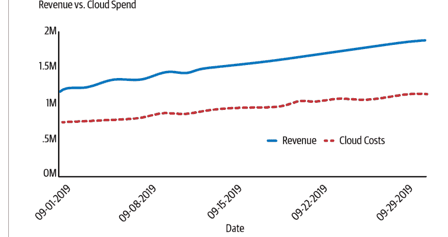
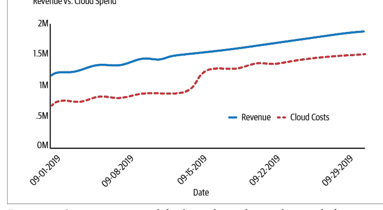
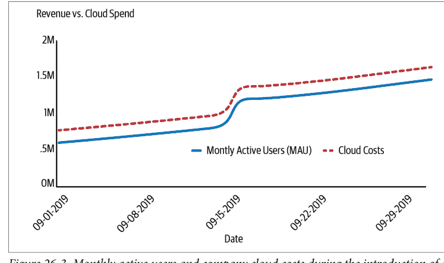
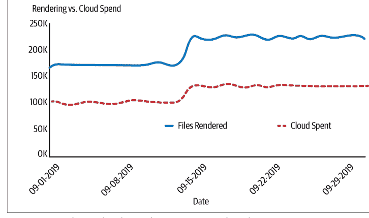
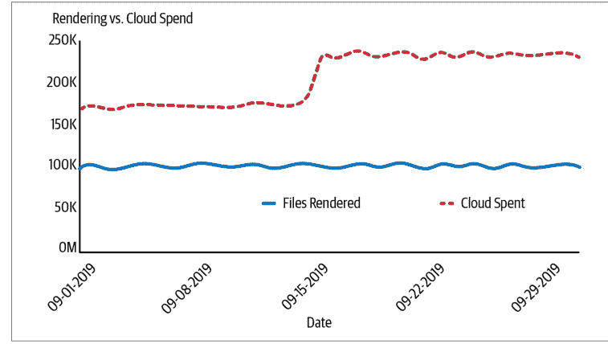

## FinOps Nirvana: Data-Driven Decision Making

FinOps 涅槃阶段是指支出责任完全下放给工程团队，他们每天做出高效选择——不仅仅是在有指令时——在领导层的支持下，领导层已将成本与其它关键软件性能指标并列视为一等公民。

目标是让你的组织能够基于业务价值对云支出做出持续的数据驱动决策。谁来做这些决策？

- *架构师*，在设计基础设施时
- *工程师*，在编写代码和部署服务时
- *财务和采购团队*，在向云提供商做出承诺时
- *领导层*，在推动技术战略时

这是一项持续的协作工作，只有在发生 FinOps 文化转型时才能完全实现。

迄今为止你所做的一切使你能够到达这里。你已分配支出、设定优化目标并实施程序以帮助团队实现这些目标。你持续践行 FinOps 生命周期，每次都完善分配策略、设定指标阈值，并提供对云使用情况日益精细的可见性。

但仍存在差距。每次账单上涨时，关于支出是好是坏的争论就会重新展开，即支出水平是否适合你试图实现业务成果。账单上涨是因为业务增长吗？是因为云迁移加速吗？还是因为低效的使用模式重新渗入团队习惯而导致上涨？给出一个明确的答案非常困难，尤其是让高管们信服的答案。

在本章中，你将开始将支出与业务价值联系起来，主要通过将单位指标应用于云成本分组来实现。这些指标帮助你识别允许一定支出以获取额外业务价值的价值、设定成本绩效目标，以及也许最重要的是，能够向高管证明工程团队做出的决策正在推动业务价值。

## Unit Economics and Metrics

单位经济学的简单定义是与特定业务模式相关的直接收入或成本，具体以每单位为基础表示。对于面向客户的应用程序，该单位可能是用户或客户订阅；对于电子商务平台，可能是交易；对于航空公司，可能是座位英里数。

基于 FinOps 基金会单位经济学同行工作组的成果，一个更长的单位经济学定义正在形成：

Cloud Unit Economics is a system of profit maximization based on objective measurements of how well your organization is performing against not only its FinOps goals but as a business in the market. Cloud Unit Economics achieves these noble goals by leveraging the measurement of marginal cost (a.k.a., unit cost metrics) specific to the development and delivery of cloud-based software and marginal revenue (a.k.a., unit revenue metrics).

There is not a single metric that the whole organization should follow. You must aim to do unit economics at multiple levels across the organization, with many different inputs and granularities. You can do high-level unit economics with metrics like cloud cost per customer, but you can also do unit economics at an application level by doing things like cost per transaction, or even do unit economics on an individual service level like compute cost per execution of a microservice.

## 单位经济学不一定与收入有关

We heard after the first edition of this book that some people thought that there needed to be a universal unit economic metric, a single north star metric for your organization to follow. This was not the intention then, nor is it the reality now. There isn’t a single north star metric, but rather a constellation of stars that together form a map allowing you to safely navigate the turbulent seas of your cloud adoption journey in pursuit of calmer shores.

我们在本书第一版出版后听说，有些人认为需要一个通用的单位经济指标，即组织应遵循的单一北极星指标。当时并非如此意图，现在也并非现实。并没有单一的北极星指标，而是一组星群，共同构成一张地图，让您能够安全地航行于云采用之旅的动荡海域，追求更平静的彼岸。

Don’t be discouraged if you’re unable to get to a top-line revenue metric related to cloud spend. Many organizations cannot, either because of the type of business they are in or because of their maturity. Unit economic metrics should function at multiple levels like a nesting doll. If you’re a portfolio manager, you might have operational activity–based unit economics for each of your applications, or you might have them for a whole business unit, or as the lead on an application you might have a set of measures that tell you how much it costs for your application to take an action that isn’t possible to tie back to revenue. Each may be very different and none may tell the complete picture of cloud value, but together they provide direction and can help you (and your executives) begin to trend your progress toward maximizing the value you are getting from cloud.

如果您无法获得与云支出相关的顶层收入指标，请不要气馁。许多组织也无法做到，要么是因为其业务类型，要么是因为其成熟度。单位经济指标应像俄罗斯套娃一样在多层级发挥作用。如果您是投资组合经理，您可能为每个应用拥有基于运营活动的单位经济学，或为整个业务单元拥有，或作为应用负责人，您可能有一组衡量指标，告诉您应用执行某项无法关联到收入的动作的成本是多少。每项可能大不相同，也都无法完整呈现云价值的全貌，但合在一起可以提供方向，并帮助您（以及您的高管）开始追踪向最大化云价值所取得的进展。

The important thing that unit economic metrics do is unlock the ability to talk about your cost in comparison to some value or business goal. They don’t need to be a panacea that aligns each dollar of spend to each dollar of revenue. They can happen at any level and with nearly any operational business metric, however specific or minute. They enable value maximization decisions based on objective measures of how well your organization’s cloud usage is performing.

单位经济指标最重要的作用是解锁将成本与某种价值或业务目标进行比较的能力。它们不需要成为一种万灵药，将每一美元支出与每一美元收入对齐。它们可以在任何层级发生，并与几乎任何运营业务指标相关，无论多么具体或细微。它们基于对组织云使用表现的客观衡量来支持价值最大化决策。

## 计算单位经济指标

In every cloud unit economics calculation, there is a numerator and denominator. You’re taking something (generally an activity or output metric) and dividing it by something else (generally a portion of cloud spend) to come up with a unit metric value.

在每一次云单位经济学计算中，都有分子和分母。您取某样东西（通常是活动或产出指标）除以另一样东西（通常是云支出的某一部分）来得出单位指标值。

The numerator is a cloud measurement of spend that quantifies the choices made by architecture and engineering teams. The denominator is either an engineering value measurement or financial value measurement or business value measurement that gives that spend important context. The outcome of that calculation is the cloud unit economics value measurement that you’re going to use to manage some part of your business, or to give insight into what changes you could consider making.

分子是对支出的云度量，量化了架构和工程团队所做的选择。分母是工程价值度量、财务价值度量或业务价值度量，为该支出提供重要背景。该计算的结果是您将用来管理业务某部分或提供可考虑变更洞察的云单位经济学价值度量。

Somewhere in the organization, some form of unit economics is already taking place. It may not be in your team or business unit. That’s one of the first things that Anthony “TJ” Johnson, Cloud Business Manager from Box, Inc., recommends: to search for allies who are managing to unit economic metrics already. Typically it’s someone in finance who may already be providing related data to a business unit owner measuring how well they’re utilizing a technology investment. That becomes a potential measurement for you to include cloud information infrastructure, especially if you are a cloud-first or a cloud native organization and you’re focused on that as a path for your future. Find the unit metric dashboard that the team is using, find out who makes that dashboard, and go talk to them about incorporating cloud spend data.

在组织中的某个地方，已经在进行某种形式的单位经济学。它可能不在您的团队或业务单元中。Box, Inc. 的云业务经理 Anthony “TJ” Johnson 推荐的第一件事之一就是：寻找已经按单位经济指标管理的盟友。通常是财务部门的人员，他们可能已经向业务单元负责人提供相关数据，用于衡量其技术投资的利用情况。这就成为您纳入云信息基础设施的潜在度量，特别是在您是云优先或云原生组织并将其作为未来发展路径时。找到团队正在使用的单位指标仪表板，弄清谁制作了该仪表板，并与他们讨论纳入云支出数据。

Finding the correct unit to measure your business is a fine art, and it’s something you’ll likely change or update over time. Organizations with complex structures and many product offerings will often have many different unit economic metrics, each one relevant to a specific product, application, or service.

找到衡量业务的正确单位是一门精细的艺术，并且您很可能会随着时间的推移而更改或更新它。结构复杂且产品众多组织的单位经济指标往往很多，每一个都与特定的产品、应用或服务相关。

On Episode 11 of FinOpsPod, Anthony “TJ” Johnson, Cloud Business Manager from Box, Inc., shared how he looks at maturity as it relates to unit economics. Listen to his approach to maturing unit cost integration and budgeting, ultimately focusing on a cost-to-serve approach.

在 FinOpsPod 第 11 集，Box, Inc. 的云业务经理 Anthony “TJ” Johnson 分享了他如何从单位经济学的角度看待成熟度。收听他关于单位成本整合和预算成熟的方法，最终聚焦于服务成本方法。

## 花钱可以，浪费不行

Cast your mind back to the inform phase of the FinOps lifecycle. This phase focuses on surfacing cloud costs to build awareness and accountability for spending. Through this visibility into cloud spend, you’re able to determine trends and build forecasts for future costs. When cloud costs exceed your planned budgets, the next obvious step is to begin investigating the increase and explain what is happening. In the same way that other metrics give context to cost optimizations within the metric-driven cost optimizations of Chapter 22, a unit metric provides the critical business context to changes in cloud spend.

请回想 FinOps 生命周期中的告知阶段。该阶段侧重于揭示云成本，以建立支出意识和问责制。通过对云支出的可见性，您能够确定趋势并为未来成本制定预测。当云成本超过计划预算时，下一步显而易见的是开始调查增长原因并解释发生了什么。就像其他指标为第 22 章中的指标驱动成本优化中的成本优化提供背景一样，单位指标为云支出的变化提供了关键的业务背景。

We sometimes see SaaS products start by using business revenue generated from products—run within the cloud—as a simple starting point. By dividing total cloud costs by the revenue generated, you’re able to determine if growth in cloud spending is increasing profits for the organization—and is therefore good spend.

我们有时看到 SaaS 产品从使用在云中运行的产品产生的业务收入开始，作为简单的起点。通过将总云成本除以产生的收入，您能够判断云支出的增长是否在增加组织的利润——因此是良好的支出。

By calculating cloud spend for total revenue, you can attach growth in cloud spending to your overall business growth. When these are in line, it makes sense that cloud spend isn’t wasted. When cloud spend is growing faster than the business, there may be cause for concern.

通过计算总收入的云支出，您可以将云支出的增长与整体业务增长联系起来。当两者保持一致时，云支出未被浪费是合理的。当云支出增长快于业务时，可能存在担忧原因。

Ideally, the metric you use for unit economics should have low volatility, where decisions in one part of the business do not affect the metrics used by others. Let’s take a look at an example.

理想情况下，您用于单位经济学的指标应具有低波动性，即业务某一部分的决策不会影响他人使用的指标。让我们看一个例子。

In Figure 26-1, your company is tracking total organization revenue over cloud spend. As long as these lines more or less remain consistent, your unit economics appear to be in order.

在图 26-1 中，您的公司正在跟踪总组织收入与云支出的关系。只要这些线条基本保持一致，您的单位经济学看起来就正常。

Figure 26-1. Company with stable revenue and cloud costs

图 26-1. 收入和云成本稳定的公司

In Figure 26-2, your business introduces a free tier to your cloud offering, allowing customers to sign up and use your service for free. The expectation is these free customers will eventually sign up for your paid offering and therefore increase overall revenue. However, when you introduce this new free offering, your cloud spend increases with no direct impact to revenue. Your unit economics have been affected.

在图 26-2 中，您的业务在云产品中引入了免费层，允许客户免费注册和使用您的服务。预期这些免费客户最终会注册付费产品，从而增加整体收入。然而，当您推出这一新免费产品时，您的云支出增加，但对收入没有直接影响。您的单位经济学受到了影响。

If your engineering teams are using this metric to gauge how well their infrastructure costs align with the business value, this has a negative effect. Of course, you could just tell your engineering teams to expect this change and continue on—that is, until six months from now when your marketing team runs an advertising operation to drive up adoption for your free tier and your unit metric is affected.

如果您的工程团队使用此指标来衡量其基础设施成本与业务价值的契合度，这会产生负面影响。当然，您可以只是告诉工程团队预期这一变化并继续下去——也就是说，直到六个月后，当您的营销团队开展广告活动以推动免费层采用时，您的单位指标受到影响。

Figure 26-2. Company revenue and cloud costs during the introduction of a free-tier offering

图 26-2. 推出免费层产品期间的公司收入和云成本

In Figure 26-3, you decide to measure cloud spend against monthly active users (MAU). As you increase your active users, your cloud spend is likely to increase as well. With the introduction of the free tier, both active users and cloud spend increase together and your metric remains consistent overall. In this case, if a future marketing campaign drives more customers, it would have a similar effect to the graph and remain consistent for engineering teams. They can see that an increase in active users increased cloud spend. In this metric, the business value (active users) is measured against the cloud spend.

在图 26-3 中，您决定将云支出与月活跃用户（MAU）进行衡量。随着活跃用户增加，您的云支出也可能增加。随着免费层的引入，活跃用户和云支出一起增加，您的指标总体保持一致。在这种情况下，如果未来的营销活动带来更多客户，它将对图表产生类似影响，并对工程团队保持一致。他们可以看到活跃用户增加导致云支出增加。在此指标中，业务价值（活跃用户）与云支出进行衡量。

Figure 26-3. Monthly active users and company cloud costs during the introduction of a free-tier offering
图 26-3. 推出免费套餐期间的月活跃用户数和公司云成本

Changing from corporate revenue to a unit like MAU, pages served, or API calls made will provide better context.
从企业收入改为 MAU、服务页面数或 API 调用次数等单位指标将提供更好的上下文。

Changes in the price charged to customers won’t change the unit metric value when you’re using a unit that’s not directly tied to the revenue of the organization.
当使用与组织收入没有直接关联的单位指标时，客户收费价格的变化不会改变单位指标值。

When you use these metrics, measuring the amount of business throughput created by the cloud platform—especially in relation to cloud spend—becomes the key element in making business decisions around cloud cost efficiency.
使用这些指标时，衡量云平台创造的业务吞吐量——尤其是相对于云支出——成为在云成本效率方面做出业务决策的关键要素。

Both of these unit economic metrics are useful for different purposes.
这两种单位经济指标对于不同的目的都很有用。

Figure 26-2 indicates the organization has some work to do in effecting conversion from free tier to paid—not something the engineering team is responsible for—while Figure 26-3 gives us information about how well the engineering team is controlling costs.
图 26-2 表明组织在将免费套餐转换为付费套餐方面还有一些工作要做——这不是工程团队负责的——而图 26-3 为我们提供了有关工程团队控制成本效果的信息。

These are both important for the business but highlight different decisions that need to be made by various parties influencing and relying on cloud spend.
这两者对业务都很重要，但突出了由影响和依赖云支出的各方需要做出的不同决策。

## Activity-Based Costing
## 基于活动的成本核算

You’re probably thinking: “Well, that sounds fine, but my business isn’t so simple that I can align cloud spend to revenue.”
你可能在想：“听起来不错，但我的业务没那么简单，无法将云支出与收入对齐。”

What type of unit metrics should you provide if your business model or structure makes tying revenue to cloud challenging or impossible?
如果你的业务模式或结构使得将收入与云关联变得困难或不可能，你应该提供什么类型的单位指标？

This is where another form of unit metrics called activity-based costing aims to look at the units of nonmonetary outputs that a set of cloud spend is creating.
这就是另一种称为基于活动成本核算的单位指标形式旨在查看一组云支出所创造的非货币产出单位的地方。

Look at what tasks each specific application or service is performing.
查看每个特定应用程序或服务正在执行哪些任务。

Is the application servicing API calls, is it returning a certain unit of data, or is it moving something from one place to another?
该应用程序是否在提供 API 调用，是否返回特定单位的数据，或是否在将某物从一个地方移动到另一个地方？

These measures are often even more effective than revenue in enabling data-driven decisions by the long tail of teams and applications in the cloud.
这些衡量指标通常比收入更有效地使云中长尾团队和应用程序能够做出数据驱动的决策。

Advanced practitioners will look at what it costs to perform specific tasks related to the underlying functions of the infrastructure.
高级从业者会查看执行与基础设施底层功能相关的特定任务的成本。

They budget with an understanding of the machine hours involved to accomplish the task: the cost per file created, cost per render, etc.
他们在预算时了解完成任务所涉及的机器小时数：每个文件创建的成本、每个渲染的成本等。

In Figure 26-4, you're tracking the number of files being rendered by your service and the cloud costs involved in supporting it. As render jobs increase, so do the cloud costs.
在图 26-4 中，你正在跟踪服务渲染的文件数量以及支持它所涉及的云成本。随着渲染作业的增加，云成本也在增加。

Figure 26-4. Files rendered over the costs, increased rendering
图 26-4. 渲染文件与成本，渲染量增加

In Figure 26-5, you're tracking the costs of rendering files. The cloud costs increase mid-month, but the number of rendered jobs does not.
在图 26-5 中，你正在跟踪渲染文件的成本。云成本在月中增加，但渲染作业的数量并未增加。

This highlights that something has changed. You're now paying more to render a file than you were at the start of the month.
这突出显示了一些变化。你现在渲染一个文件的费用比月初更高。

This could be due to more resources being used or reservations no longer being applied to your cloud resources.
这可能是由于使用了更多资源或预留不再应用于你的云资源。

Figure 26-5. Files rendered over the costs, increased cost
图 26-5. 渲染文件与成本，成本增加

As we discussed in Chapter 5, the cloud bill is driven by the confluence of the usage multiplied by the rate.
正如我们在第 5 章中所讨论的，云账单由使用量乘以费率的汇合驱动。

So when you're over budget, you can determine whether it's about your resource usage or changes to your commitment-based discounts.
因此，当你超出预算时，你可以确定这是关于你的资源使用情况还是基于承诺的折扣的变化。

When you're doing activity-based costing, you're actively managing those cost drivers.
当你进行基于活动的成本核算时，你正在积极管理这些成本驱动因素。

## Coming Back to the Iron Triangle
## 回到铁三角

One of the best ways to enable your organization to make decisions is by using the Iron Triangle (i.e., balancing between good, fast, and cheap) discussed in Chapter 14 to frame these decisions.
使组织能够做出决策的最佳方式之一是使用第 14 章中讨论的铁三角（即在好、快、便宜之间取得平衡）来为这些决策提供框架。

Unit metrics provide teams the data they need to measure how infrastructure changes will impact costs.
单位指标为团队提供他们需要的数据来衡量基础设施变化将如何影响成本。

Conversations between technical operations teams and finance become less about the technical details of the change and more about the impact they will have, freeing up engineers to focus on working within the unit metric-enabled financial constraints agreed with the business teams, as discussed in Chapter 26.
技术运营团队与财务之间的对话不再关注变更的技术细节，而更多关注其影响，释放工程师专注于在与业务团队商定的、由单位指标支持的财务约束范围内工作，正如第 26 章所讨论的。

This allows the business to make decisions that weigh the benefits of the change against the expected impact to the unit metrics, such as whether increasing the cost per active user by 2% might boost application performance by 10%, which could have positive business outcomes that make the additional investment worthwhile.
这使企业能够做出权衡变更收益与对单位指标预期影响的决策，例如，将每个活跃用户的成本提高 2% 是否可能将应用程序性能提升 10%，这可能带来积极的业务成果，使额外投资物有所值。

We hear of some FinOps practitioners choosing not to implement unit metrics or delaying them due to their complexity.
我们听说一些 FinOps 从业者因其复杂性而选择不实施单位指标或推迟实施。

Ultimately, the nirvana state of FinOps is for your organization to be making decisions on the value of the cloud spend, no matter what method you use to measure value and compare it to costs: deciding when to spend more in order to have a positive impact on the value you get from your cloud environment, and when to reduce cost is more appropriate.
最终，FinOps 的极乐状态是你的组织能够根据云支出的价值做出决策，无论你使用什么方法来衡量价值并将其与成本进行比较：决定何时增加支出以对从云环境中获得的价值产生积极影响，以及何时减少成本更为合适。

When you apply unit metrics to the optimize phase of the FinOps lifecycle, your goal setting matures from using only operational metrics, like hitting 90% commitment-based discount coverage, to using revenue-impacting goals like reducing cost per subscriber by 25%.
当你将单位指标应用于 FinOps 生命周期中的优化阶段时，你的目标设定将从仅使用运营指标（如达到 90% 的基于承诺的折扣覆盖率）成熟为使用影响收入的目标，如将每个订阅者的成本降低 25%。

The former could help the business, but it can also be a distraction from what’s really important.
前者可以帮助企业，但也可能分散对真正重要的事情的注意力。

## What’s Missing from the Equation?
## 方程中缺少什么？

So far, you’ve been using cloud spend as the numerator; however, you will likely need to incorporate a number of other costs into the TCO.
到目前为止，你一直将云支出用作分子；然而，你可能需要将许多其他成本纳入 TCO。

After all, infrastructure costs often pale in comparison to labor costs.¹
毕竟，基础设施成本通常与劳动力成本相比相形见绌。¹

Unit metrics are most helpful when you have all the relevant cost data, including things like labor costs.
当你拥有所有相关的成本数据（包括劳动力成本等）时，单位指标最有帮助。

The successful FinOps stories we’ve shared so far focus purely on cloud costs.
我们迄今为止分享的成功的 FinOps 案例纯粹关注云成本。

Dividing the cloud spend alone by a unit provides limited context to the real cost per unit.
仅将云支出除以一个单位为每个单位的实际成本提供了有限的上下文。

In reality, a business has many other costs contributing to the total cost of generating revenue.
实际上，企业有许多其他成本有助于产生收入的总成本。

In Chapter 15, we discussed refactoring services into a serverless architectural model.
在第 15 章中，我们讨论了将服务重构为无服务器架构模型。

When deciding to rearchitect services, you should weigh the infrastructure charges and potential savings against the labor costs for refactoring.
在决定重新架构服务时，你应该权衡基础设施费用和潜在节省与重构的劳动力成本。

Also, once a service is running in a serverless architecture, the cost of the service can become less about the cost of the cloud resources being charged and more about the operational costs of labor.
此外，一旦服务在无服务器架构中运行，服务的成本可能不再是所收取的云资源的成本，而是更多地关于劳动力的运营成本。

Of course, you could extend FinOps itself to track costs from outside the cloud bill, like costs of the equipment still running in your data center or the added costs of software licensing.
当然，你可以扩展 FinOps 本身来跟踪云账单之外的成本，例如仍在数据中心运行的设备的成本或软件许可的额外成本。

However, in our opinion, it makes better sense for FinOps to work alongside existing financial models as we discussed in Chapter 25.
然而，我们认为 FinOps 与我们第 25 章中讨论的现有财务模型一起工作更有意义。

Working with these other frameworks, you can enrich the unit metrics you use to make decisions with the total cost, instead of one that includes only cloud spend.
与这些其他框架一起工作，你可以用总成本丰富你用来做决策的单位指标，而不是仅包括云支出的指标。

Using the FinOps maturity model as a guide, here are typical phases of bringing in noncloud costs to the unit economics denominator as laid out in the Introduction to Cloud Unit Economics paper from a recent FinOps Foundation working group:
以 FinOps 成熟度模型作为指南，以下是根据 FinOps 基金会最近一个工作组发布的《云单位经济学导论》论文中概述的，将非云成本引入单位经济分母的典型阶段：

1 Matt Asay, “Labor Costs Can Make Up 50% of Public Cloud Migration, Is It Worth It?” TechRepublic, May 9, 2016, https://oreil.ly/76m57.
1 Matt Asay，《劳动力成本可能占公共云迁移的 50%，值得吗？》TechRepublic，2016 年 5 月 9 日，https://oreil.ly/76m57.

### Step 1: Cloud Costs Only
### 第 1 步：仅云成本

Depending on the complexity of the application, this may also be done in multiple phases, where some cloud costs are handled initially as “direct” and others “shared.”
根据应用程序的复杂性，这也可能分多个阶段进行，其中一些云成本最初被处理为“直接”成本，其他为“共享”成本。

### Step 2: Cloud + SaaS + Licensing Costs
### 第 2 步：云 + SaaS + 许可成本

This could include things like Datadog, ServiceNow, or PagerDuty, or BYOL (“bring your own license”) like Windows or SQL Server, which are run on cloud infrastructure.
这可能包括 Datadog、ServiceNow 或 PagerDuty 等，或 BYOL（“自带许可”）如 Windows 或 SQL Server，这些都在云基础设施上运行。

Once you start bringing in SaaS tools or licenses, you may need to work with the team responsible for that product to understand the KPIs they care about and how they quantify time spent, such as the SAM or ITAM team.
一旦你开始引入 SaaS 工具或许可，你可能需要与负责该产品的团队合作，以了解他们关心的 KPI 以及他们如何量化花费的时间，例如 SAM 或 ITAM 团队。

### Step 3: Cloud + SaaS + Human Capital + Hybrid Costs
### 第 3 步：云 + SaaS + 人力资本 + 混合成本

This is bringing in costs like labor or even on-premises costs that support a particular product or service.
这是引入支持特定产品或服务的成本，如劳动力甚至本地成本。

The run phase is typically when a firm starts collecting more than one metric for various parts of a complex system getting more granular over time.
运行阶段通常是企业开始为复杂系统的各个部分收集多个指标并随着时间的推移变得更精细的时候。

When you begin including noncloud costs in your FinOps unit economics, such as labor and noncloud technology investments, you’re not managing simply cloud costs anymore; you’re managing the larger business.
当你开始在 FinOps 单位经济中纳入非云成本（如劳动力和非云技术投资）时，你不再仅仅管理云成本；你在管理更大的业务。

When the FinOps culture allows all your groups across the organization to collaboratively look at all of your cost data, compared to the value that your organization is providing or deriving from it, and make good decisions, that’s the nirvana state of unit economic data-driven cloud value decision making.
当 FinOps 文化允许组织中的所有团队共同查看所有成本数据，与组织提供的或从中获得的价值进行比较并做出良好决策时，那就是单位经济数据驱动的云价值决策制定的极乐状态。

It’s not something FinOps can do alone.
这不是 FinOps 单独可以做到的。

Cloud is increasingly becoming the driver of digital value in every organization of the future, so it is something that cannot be done without FinOps.
云正在日益成为未来每个组织数字价值的驱动力，因此这是无法在没有 FinOps 的情况下完成的事情。

## When Have You Won at FinOps?
## 何时在 FinOps 中取得胜利？

We want to highlight that there is no finish line when it comes to FinOps.
我们想强调的是，FinOps 没有终点线。

We can’t offer you the point beyond which you have no more to learn and nothing more to do.
我们无法为你提供一个点，超过该点你就不再有东西可学，也没有更多事情可做。

Practices continue to evolve, and cloud service providers constantly release updates to their offerings and related billing data.
实践不断发展，云服务提供商不断发布其产品和相关计费数据的更新。

In short, as long as cloud is evolving and changing, so will FinOps.
简而言之，只要云在不断发展和变化，FinOps 也会如此。

Companies implementing FinOps today—especially those early in their cloud journey—will derive the most value from their cloud investments by avoiding the bill shock moments and related innovation slowdown.
今天实施 FinOps 的公司——尤其是那些处于云之旅早期的公司——将通过避免账单冲击时刻和相关的创新放缓，从其云投资中获得最大价值。

FinOps in these organizations won’t be seen as a single role or small team that does FinOps; instead, all related personas inside the organization (from engineering to finance to procurement and business) will understand their role to play in the whole company doing FinOps.
在这些组织中，FinOps 不会被视为执行 FinOps 的单一角色或小型团队；相反，组织内部的所有相关角色（从工程到财务到采购和业务）将理解他们在整个公司执行 FinOps 中的作用。

## 当 FinOps 文化运行良好时：
-   集中式的 FinOps 团队获得充分资助，以解决 FinOps 的集中职能活动，减少各团队的重复工作，并引导公司沿着不断提升的 FinOps 成熟度发展。
-   所有团队在定期节奏中相互有效沟通，使用自动化、通用平台和共同的术语。
-   云服务的持续更新、新服务推出，以及根据所创造价值定期创建和删除系统，在所有学科中都被从容应对。

## 对于工程师和产品负责人：
-   架构由工程师从一开始就以成本为考量而创建。
-   工程师将成本作为一级指标，不仅在构建决策中使用，也作为其核心 KPI 中的持续指标来优先安排开发工作。
-   FinOps 认证和成熟度指标成为其工作要求、培训计划和激励计划的一部分。
-   所有可扩展、弹性或依赖云服务的事项都迁移到云端。
-   产品团队在产品定价和其他决策中考虑并定期查看成本。
-   工程部门拥有完全面向云的开发平台，具有集成管道和 DevOps 方法。它仅通过自动化部署资源，并拥有完全标记的环境，采用与业务成果相一致的预算挂钩的一致账户和标签策略。

## 对于财务：
-   财务已转向敏捷的预测和预算流程，在所有工程团队的赋能下，这些团队对其自身的预测和预算负责。
-   之前用于数据中心的资产的开销被核销并消除。
-   财务对运营分配要求提供持续输入，例如将现有会计结构叠加到应用程序上的标签前提条件，并提供敏捷预测和预算所需的数据导出访问权限。

## 对于领导层：
-   管理层已完全接受基于云的运营模式。
-   FinOps 只是管理层期望组织有效使用云的方式之一。向 FinOps 团队推销的日子已经一去不复返了。
-   领导者对技术投资的回报有清晰的可见性，对预测支出中的常规波动有清晰的把握，并有响应迅速的路径来为未来投资提供战略指导。

随着 FinOps 在组织内部成熟，FinOps 发生的边界已不清晰。组织各地的每个人都以自己的方式为云使用所产生的价值成功做出贡献。

在理想世界中，FinOps 只是自然发生；每个人贡献出实现从云中获得最大价值目标所需的精确努力，且完美对齐。但我们知道，如果没有人协调这些努力，在组织内部实现这一目标的可能性很低。最初，FinOps 从业者受雇于教育并建立流程，以实现和集中管理在组织内部单一节点运营更佳的 FinOps 元素。随着 FinOps 的流程和教育在组织内成熟，工程团队在浪费产生前就会考虑云浪费的可能性，财务团队与工程团队保持积极沟通，云支出的期望趋于一致，FinOps 从业者为保持 FinOps 成功运行所需的时间和精力减少。

将 FinOps 从业者想象成辐射 FinOps 温暖的加热器。随着从业者在组织内产生积极影响，他们提供温暖，以激励周围的人做好 FinOps。这些其他角色在为 FinOps 做出贡献时也变得活跃，并温暖他们周围的人。最终，整个组织都温暖起来，FinOps 从业者需要提供的热量减少。

问题随之而来，如果我们拿走 FinOps 能量的原始来源——FinOps 从业者——FinOps 是否仍会在组织内保持活跃？

## 结论

你现在应该理解，你一路建立的 FinOps 流程如何使你能够开始衡量云支出与其带来的业务价值。你利用业务价值来设定优化目标，并使用指标来跟踪云成本的真正驱动因素。

## 总结：
-   FinOps 的极乐阶段是达到组织基于业务价值对云支出做出持续、数据驱动决策的地步。
-   谁做出这些决策？架构师在设计基础设施时，工程师在编写代码和部署服务时，财务和采购团队在向云提供商做出承诺时，以及领导者在推动技术战略时。
-   这是一项持续的协作努力，只有在发生 FinOps 文化转型时才能实现。
-   你的单位经济指标衡量云支出的业务价值并指导与其相关的持续决策。
-   结构复杂且产品多样化的组织通常会有多个单位指标，每个指标都与特定的产品线、应用程序或服务相关。
-   决策不再关注云的成本，而是基于云支出为组织带来的收益。

在最后一章，我们将以讨论 FinOps 背后的引擎结束：*你*。
