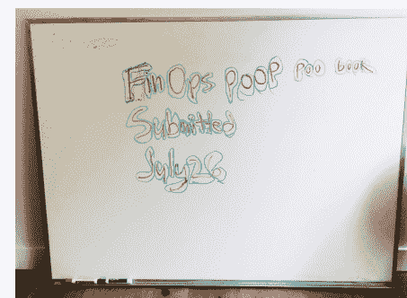

## 你是秘诀所在

借用《功夫熊猫》电影的话，FinOps 的秘诀在于 FinOps 并没有秘诀。成功的秘诀是你。也是你组织中影响云支出的每一个人。

剧透警告：在电影中，主角 Po（一只可爱笨拙的大熊猫）旨在成为一名伟大的战士。他收到一卷神秘的卷轴，据说能为阅读者解锁无限力量。然而，当他最终打开它时，卷轴似乎是空白的，内部只有反射表面。沮丧之下，Po 放弃了并回到他作为面条汤小贩的枯燥生活。Po 问他的父亲家族著名汤的秘诀是什么。他的父亲做出惊人的揭示：汤没有秘诀——秘诀是制作它的人。这是对 FinOps 的完美隐喻。我们无法告诉你如何成为 FinOps 战士，但我们可以告诉你，如果你致力于学习、协作和改进，你的实践——以及你的职业生涯——将会蓬勃发展。

如果你读到这里，你可能已经相当深入地走在 FinOps 工作或与其并行的工作道路上，或者正在认真考虑该领域的职业。截至 2022 年，60% 的企业已实施某种程度的 FinOps 实践，但大多数尚未组建完整的团队，另外 40% 将迅速扩充人员。因为如果你在规模上使用云，你就需要做 FinOps。

但问题在于：FinOps 需要人，而市场上根本没有足够的 FinOps 从业者来满足需求。是的，你可以——也应该——随着时间的推移尝试自动化尽可能多的重复性任务，但要发展、培训、推广和建立实践，需要一个 FinOps 团队来传播最佳实践、标准和模式。随着其发展，实践需要深思熟虑的高管来推动自上而下的文化变革，深思熟虑的工程领导者开始将成本整合到团队的工作流程中，深思熟虑的财务领导者采用更敏捷的流程以更成功地与工程对应方合作，以及每个人都认识到赢得云价值游戏需要团队合作。

## 行动呼吁

面临 FinOps 行业的最大挑战——可以说，云行业也是如此——是熟练 FinOps 从业者短缺。但他们不能一夜之间产生。像任何学科一样，成为 FinOps 精通需要数年时间，阅读本书不会神奇地让你达到——但这是一个很好的开始。

> *The best time to plant a tree was 20 years ago. The second best time is now.*
> —Chinese proverb

我们对你的挑战是双重的。从这里继续前进并致力于学习。但也要开始为更大的社区做出贡献。第一部分帮助你和你的组织，而第二部分帮助每个人，这反过来也帮助你，因为一涨潮就浮起所有船。

行业需要其从业者变得更加标准化、更加严谨，分享更多最佳实践，进行开源代码贡献，为培训做出贡献并鼓励他人参与，毫不松懈地专注于提升内部团队技能，并寻找机会为职业道路带来新鲜面孔。

FinOps Foundation 为实践相关的各种角色提供培训，但这还不够。最终，我们需要共同努力，将云价值学习基础嵌入大学课程、代码学校，甚至高中计算机科学课程。会有 FinOps 学士学位吗？也许不会，但我们相信在未来几年内，应在相关学位中增加专门的大学模块。

你在近 450 页中阅读的概念必须开始进入常规教育项目，不仅是计算机科学相关学科，还包括会计、工商管理、金融、管理、项目管理以及最终成为 FinOps 实践关键利益相关者的相关学位。从这些项目毕业并进入依赖云的企业工作的学生——而世界上几乎每个企业都依赖云——将直接或间接参与 FinOps 实践。

会计、金融和计算机科学都有规范，允许这些领域的经验丰富的从业者快速融入不同公司的类似角色。这些相同的规范和原则，即 FinOps Foundation 多年来讨论的大部分内容——并在本书记载——必须向前推进，以帮助每个人更成功。

## 如何提供帮助：
-   阅读在 *FinOps.org* 上发展的开源实践演进典范。
-   找出你可以填补的空白：这能提高整体水平，同时也能提升你职业生涯的可见度。
-   参加 FinOps 培训并反馈它还需要涵盖哪些内容或需要存在哪些新培训。
-   加入一个工作组，与同行一起协作定义最佳实践。
-   旁听——或主动在——FinOps 活动上发言。虚拟峰会、本地聚会和更大规模的线下活动一直在不断举行。
-   通过在相关行业活动和出版物中引入 FinOps 概念来传播。

需要更多想法？请参阅 FinOps Foundation 入门页面，了解根据成熟度阶段回馈社区的最新方式。你最初可能只以仅旁听模式开始，但随着时间的推移可以参与工作组，甚至有志于领导其中一个，直接塑造行业未来。

公有云及其可变成本模式的采用肯定会继续增长。FinOps 必须与之同步发展，使组织能够在不支付因使用不当而可能产生的巨大罚金的情况下，享受使用云带来的好处。你是充满活力且不断成长的社区的一员，该社区将使数字转型的承诺成为世界各地许多人的现实，我们迫不及待想看看你下一步会做什么。

我们期待在社区中见到你，在那里我们可以共同庆祝、共同奋斗、共同学习，并一起构建 FinOps。

## 后记：优先事项（来自 J.R.）

在提交本书第一版初稿的截止日期十天后，我八岁的双胞胎儿子之一去世了。在他最后三个周末中的两个，我独自待在家庭办公室编辑，而我的妻子和孩子们则去俄勒冈海岸等地冒险。

2019 年 7 月 26 日星期五，Mike 和我完成了那个截止日期。我感到自豪。我在家的白板上写下“FinOps 书于 7 月 26 日提交”来纪念这一日期。我在 LinkedIn 上发布了它已提交的消息。Mike 也在里程碑上发帖，他也花了无数个晚上和周末离开家人来写这本书。

第二天，星期六早上，我本应该和孩子们玩耍。但在数月的写作之后，在我全职以上的日间工作之上，我又回到家庭办公室处理邮件。我的双胞胎 Wiley 和 Oliver 在我打字时顽皮地走进来。当我没有足够关注他们时，Wiley 修改了上述白板文字，使其读起来像这样：

一周多一点后，Wiley 在睡梦中去世。伴随着痛苦和悲伤的是对与他共度的、因更不重要的事情而失去的时间的极度懊悔。我写了一篇关于他生平和去世——以及它对我的影响的长文。我相信它之所以走红，是因为它传达了珍惜和优先安排你所拥有的时间的讯息。我邀请你阅读它。

虽然这本书旨在帮助你的 FinOps 实践，但不要让即将到期的承诺或规模调整冲刺阻止你在周五晚上回家，全身心地陪伴家人。即使该承诺购买能为你的公司节省 10 万美元。这也不值得失去的时间。周一再做。如果你的老板不喜欢，就联系 FinOps Foundation 团体找另一份工作。那是一个既有专家又有好人的社区。

你的团队不太可能一夜之间取得长期影响。找到良好的工作生活平衡。即使你的团队在周末对一切进行规模调整，这也只是一次性努力。如果没有建立全公司范围的文化、流程和实践来支持 FinOps，这些一次性降本项目将是短暂的。用于工作的周末最终会在时间的沙滩上被冲刷掉。

最后，FinOps 将会演进。它不仅随着云服务提供商不断创新而变化，也随着更多 FinOps 从业者分享他们的故事而变化。这本书不是定义 FinOps 的终点——它真的只是开始。如果你想为下一步做出贡献，请加入 FinOps Foundation，成为故事的一部分。
