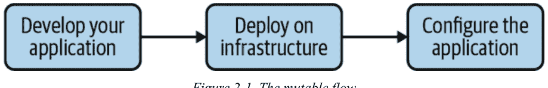
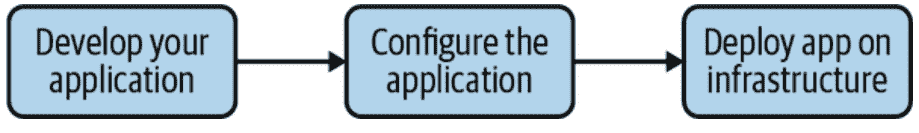
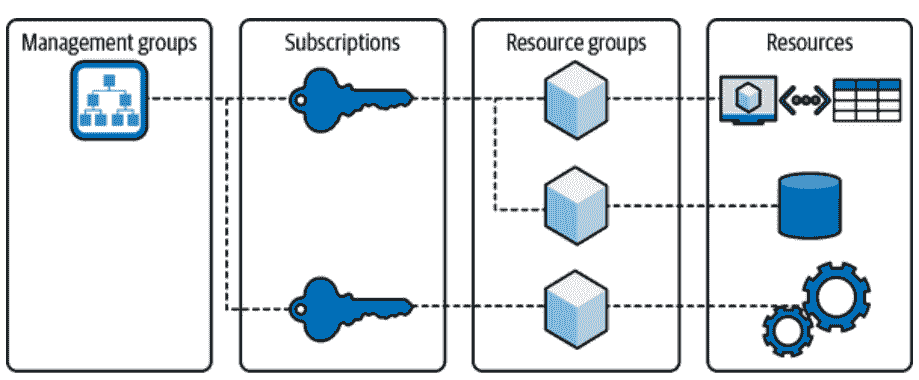
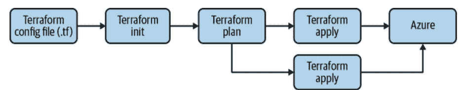
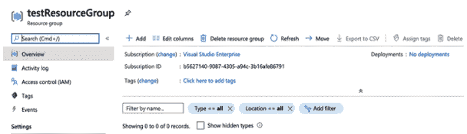
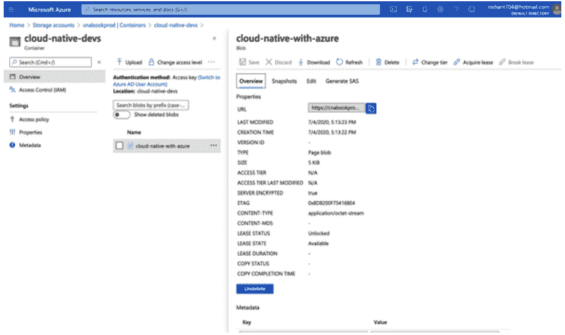
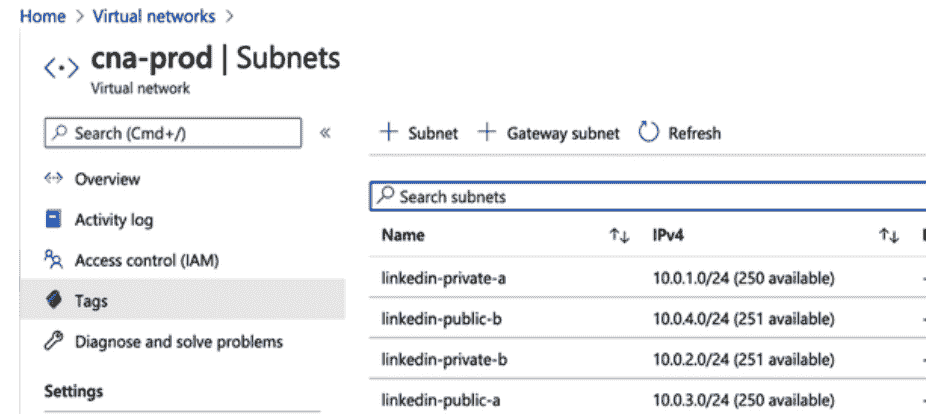
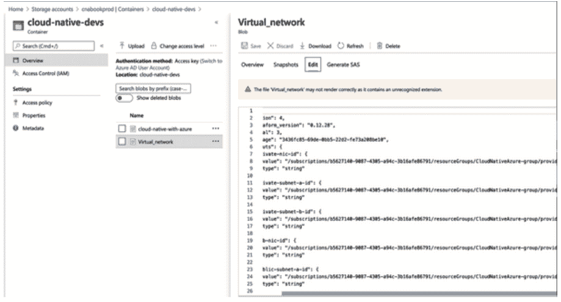
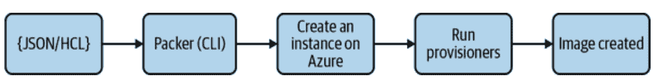
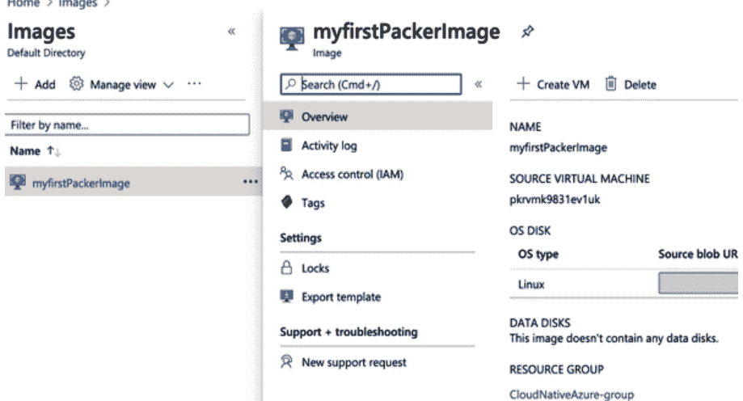

## 第 2 章。基础设施即代码：设置网关

### 早期发布读者须知

通过 Early Release 电子书，你可以在作者撰写时就获得书籍的最早版本——未经编辑的原始内容，以便你能在这些标题正式发布前很久就利用这些技术。

这将是最终书籍的第 2 章。请注意，GitHub 仓库将在稍后激活。

如果你对如何改进本书的内容和/或示例有任何意见，或者如果本章中发现缺少材料，请联系编辑 rfernando@oreilly.com。

云凭借其丰富的解决方案组合，从轻松的网络到“行星级”计算，正成为大多数组织无论规模大小的事实上的家园。大部分云提供商的生态系统现在比以往任何时候都更大，包括简单的虚拟机、复杂的托管集群，甚至高度复杂的<|message|> 基础设施。例如，Microsoft Azure 为终端用户提供各种构建精良的服务。这些解决方案建立在天生具有弹性的基础设施之上，并具有明确的服务级别协议（SLA）¹，以满足从小型初创企业到大型企业的各种客户需求。

虽然云计算的动态特性对组织来说是福音，但在组织成长过程中维护云环境中的服务可能具有挑战性。随着你利用越来越多的基于云的服务来支持不断增长的业务需求，你很快就会意识到，你不能再通过每次想要执行新操作时简单地点击进入 Web 控制台来维护你的应用程序和底层基础设施。云的演进设计建立在硬件和虚拟化基础设施的先前世代之上，并具有可编程的控制平面，以 API 层形式提供灵活性。这些 API 被基础设施即代码（IaC）工具利用，使云从业者能够轻松维护其环境。

当你想从头开始构建生产级基础设施时，你必须开始像对待代码一样对待你的基础设施定义。手动配置和扩展基础设施不仅繁琐且耗时；它也是一个容易出错的过程——你无法以相同的信心水平两次构建相同的基础设施。当你将基础设施视为代码时，你也继承了软件工程原则，如版本控制、可测试性、自动化和开发速度，作为 DevOps 战略的一部分。IaC 确保你的基础设施可以以一致且可重复的方式构建。随着越来越多的软件开发团队采用敏捷方法论，他们现在需要更频繁、更快速地将功能和解决方案移入云中。因此，基础设施已与应用程序紧密相连，团队需要通过无缝流程管理应用程序和基础设施。此外，团队需要更频繁地迭代并重复部署新功能和底层基础设施。实现 IaC 的一种快速方法是使用云提供商提供的预写模板，这些模板说明了如何创建基础设施。Azure 原生支持 Azure 资源管理器（ARM）模板，用于定义和创建基础设施资源，直接阐明了 IaC 哲学。这种云与 IaC 的结合使组织能够更快、更高效地引入更改。

本章为开发对 IaC 和 Azure 的丰富理解奠定了基础。首先，我们将介绍 IaC 概念及其在构建云原生基础设施中的重要性。然后我们将介绍 Microsoft Azure，这是我们将在整本书中使用的云提供商。

接下来，我们将深入探讨 Terraform 作为实现 IaC 的工具。我们还将介绍 Packer，这主要是一个用于构建机器映像的工具，以及 Ansible，以便在构建云原生应用程序时向你介绍配置管理。最后，在结束本章之前，我们将简要介绍 Azure DevOps。让我们开始吧。

### 基础设施即代码及其在云原生世界中的重要性

在过去，当 IT 团队想要为应用程序部署采购新硬件时，他们首先必须发起硬件采购请求，这需要几天甚至几周的时间完成。即使硬件最终在本地交付，应用程序才能在上面部署之前，还需要几天时间才能使其处于工作状态。如今，随着 DevOps 和云的兴起，这些缓慢的过程已经消失。发布周期变得更短，满足业务需求的速度也加快了。

然而，即使引入了云，管理基础设施仍然是一个问题。虽然物理服务器被虚拟服务器取代，复杂基础设施的管理成为云厂商的责任，但增长和扩展基础设施仍然是一项困难且容易出错的任务。工程团队需要在继续维护旧基础设施的同时，不断构建新的基础设施和软件堆栈。为了缓解与这些任务相关的单调和疲劳，基于云的系统的构建和管理变得自动化，从而产生了一个强大的基础设施和应用程序环境。

最终，随着代码被改编为配置计算、网络和存储层，基础设施即代码的好处变得显而易见。这导致了在云环境中采用 IaC 的运动。

*基础设施即代码* 是将你的基础设施视为可编程指令的哲学。就像你签入源代码控制文件一样，你也会签入你的基础设施定义。将基础设施视为代码提供了众多优势，包括以下内容：

- 能够签入你的基础设施定义版本，并在出现问题时回滚到特定版本
- 幂等性，使你能够以最小的努力重现完全相同的<|message|> 基础设施
- 跨堆栈的标准化的日志记录、监控和故障排除
- 减少工程团队中的单点故障（即只有一名工程师知道如何构建特定类型的系统）
- 提高开发人员生产力（站点可靠性工程师 [SRE] 和/或 DevOps 工程师可以专注于编写开发人员可以用来构建测试环境的代码）
- 最少的手动交互，从而导致更不易出错的基础设施
- 显著减少故障的平均恢复时间（MTTR）
- 甚至在基础设施创建之前就能测试你的基础设施

有了 IaC 的好处，很明显此类工具在现代云原生环境中发挥着重要作用，在这些环境中，应用程序必须即时更改。更改可以是微小的，例如添加新的配置标签，也可以是重大的，例如添加新集群以跟上容量需求。可靠的 IaC 策略有助于开发人员轻松管理这些更改，而不会损害软件开发过程的速度。一旦 IaC 嵌入到你的基础设施构建流程的核心，它还有助于构建反脆弱的基础设施。


### 反脆弱基础设施

反脆弱基础设施是指能够承受压力并展现出弹性和韧性的系统。反脆弱旨在构建能够应对不可预测和不规则事件的基础设施，同时变得更加强大。

当今的云原生应用程序被视为处于运动中的应用程序，因为其底层基础设施也在不断变化和升级。云使你能够将基础设施视为短暂的实体而非永久的实体。云原生方法提倡构建可替换的基础设施，而不是修复损坏的基础设施。由于云原生方法将应用程序与基础设施解耦，它使工程师能够自信地对基础设施进行更改，同时知道他们可以轻松地回滚并继续前进。

### 云原生基础设施哲学

在构建云原生基础设施时，始终将底层基础设施视为短暂的实体，而非长期维护的系统。这意味着如果一台服务器宕机，将其杀掉并立即启动一台新服务器会很容易，而不是尝试修复它。

从单体架构向微服务的转变也帮助 IaC 获得了发展势头，确保现代应用程序能够遵循“十二要素应用”方法论，该方法论允许在独立于应用程序开发的情况下做出基础设施决策。IaC 在构建云原生基础设施时带来的另一个重要优势是，它能够实现不可变基础设施；也就是说，一旦基础设施部署完成，就无法更改或配置。在典型的可变应用程序部署场景中，应用程序被开发，然后部署到底层基础设施上，最后在底层基础设施上进行配置（图 2-1）。此过程引入了配置漂移，导致基础设施开始偏离初始状态。相比之下，不可变基础设施专注于每次推送新更改时重新部署基础设施和应用程序，从而使基础设施紧密保持在其精确状态。不变性是通过在预烘焙（例如机器映像）状态下开发和配置应用程序然后再部署它来实现的（图 2-2）。



图 2-1. 可变流程



图 2-2. 不可变流程

构建不可变基础设施的主要优势是：

- 可预测的基础设施/系统，而非被动的基础设施/系统
- 部署现在具有原子性
- 对基础设施有更多控制，从而带来更好的遥测

现在我们已经讨论了 IaC 及其在构建云原生基础设施时的价值，让我们来看看如何在云原生基础设施中使用 Microsoft Azure。

### 开始使用 Azure 并设置环境

Microsoft Azure 是一家在全球拥有数十个区域的云服务提供商。Azure 允许你通过手动和自动化的方式快速创建和部署基础设施，正如我们在本书中将要讨论的那样。作为 PaaS（平台即服务），Azure 为开发者社区提供了大量灵活性以进行创新、创建和部署应用程序。我们选择 Azure 作为我们的云环境，是因为其速度、灵活性、安全、灾难恢复以及简单的学习曲线。

在本节中，我们将解释 Azure 周围的基本概念以及如何创建 Azure 账户。

### Azure 基础知识和准备你的 Azure 环境

在开始使用 Azure 之前，了解其一些基本构件非常重要。理解这些概念将有助于在未来做出政策决策：

Tenant

Azure 租户是组织在 Azure Active Directory（AAD）中的表示。你可能已经熟悉传统的 Active Directory（AD）服务。当组织在 Microsoft 创建账户时，将会创建一个 AAD 实例。

所有 AAD 实例彼此完全隔离，所有身份（用户或服务账户）也是如此。如果你已有现有的 Microsoft 租户（例如 Office 365），你可以将其用于你的 Azure 部署。你也可以通过 Azure 门户创建自己的 AAD 租户。记得在租户上启用多因素身份验证（MFA）。

Subscriptions

Azure 订阅本质上是资源的计费容器。你也可以在订阅级别设置特定的 Azure 策略。

Management groups

Azure 管理组提供了一种组织和管理订阅的方式。你可以使用管理组对管理组内的所有资源（包括订阅）应用策略/治理。管理组内的所有订阅默认会继承管理组策略。

### Resource groups

资源组是容纳 Azure 解决方案相关资源的容器。资源组包括你希望作为一组管理的资源。你根据对组织最有意义的方式决定哪些资源属于资源组。此外，资源可以位于与资源组不同的区域中。

### Regions

Azure 区域包含两个或多个可用区。可用区是地理区域内的物理隔离数据中心。

图 2-3 描述了这些基本构件如何相互关联。



图 2-3. Azure 基本构件

### 创建 Azure 账户

你可以通过导航到 https://azure.microsoft.com 并使用免费计划来创建 Azure 账户。你需要使用 Microsoft 账户登录；Hotmail、Outlook 或 Office 365 账户均可使用，尽管我们强烈建议同时使用 MFA。按照 Azure 网站上的说明创建你的账户。要继续，请点击右上角的“我的账户”链接或直接前往 Microsoft Azure 门户：https://portal.azure.com。

现在让我们讨论如何使用 Azure CLI。

### 安装 Azure CLI

Azure CLI 是一组可用于创建和管理 Azure 资源的命令。你可以在 Azure 门户的网页浏览器中使用 CLI，或从 https://docs.microsoft.com/en-us/cli/azure/install-azure-cli 下载适当版本在本地机器上安装。例如，在 macOS 上，你可以使用命令 brew install azure-cli 安装 Azure CLI。

你可以使用 az 命令按如下方式通过门户与 Azure 交互：

```
$ az account show
{
  "environmentName": "AzureCloud",
  "id": "b5627140-9189-4305-a94c-3b199afe86791",
  "isDefault": true,
  "name": "Visual Studio Enterprise",
  "state": "Enabled",
  "tenantId": "baeb0498-d28a-41cd-a20d-d9409814a06k",
  "user": {
    "name": "cloudnative@xyz.com",
    "type": "user"
  }
}
```

你甚至可以使用 Azure CLI 以声明式的方式脚本化你的云基础设施。这些脚本可以在 PowerShell 或 Bash 中执行。虽然 Azure 脚本对于创建、拆除和重新部署基础设施等任务效果良好，但由于 Azure CLI 命令缺乏幂等性，更新现有环境等任务并不直接。

除了 Azure 之外，还有其他工具可用于创建和管理云环境。我们接下来将查看其中一些更突出的工具。

### prominents IaC 工具

如前所述，可以使用额外的工具通过遵循 IaC 方法来构建云原生基础设施。在这里，我们将重点介绍三种更受欢迎的开源工具，可与各种云提供商一起使用：

- Terraform，一种基于 CLI 的 IaC 工具
- Packer，用于构建机器映像的 CLI 工具
- Ansible，一种配置管理工具

你也可以在持续集成/持续部署（CI/CD）设置中使用所有这些工具；在这种情况下，只要你编写了


new configuration it can be continuously integrated into your deployment pipeline.

### Terraform

Terraform 是 HashiCorp 的开源 IaC 工具，使用 Go 编程语言编写。单词 *terraform* 的意思是把一个星球的环境改造得与地球大气层非常相似，以至于人类物种能够在上面生存。当你把云服务提供商看作需要被改造为可管理的基础设施的环境时，这种类比就成立了，这样可以帮助你的应用程序充分利用云并发挥其真正潜力。

Terraform 帮助你以安全高效的方式在云中构建、更改和版本化基础设施。它使用声明式语法，这意味着你只需要告诉它*什么*你想要构建，而不是*如何*构建它。Terraform 的一个主要优势是它支持一种易于理解的领域特定语言（DSL），称为 HashiCorp 语言（HCL），相对容易被人类解读。或者，你也可以使用 JSON 来实现相同的目的。此外，Terraform 是云无关的，因此支持多个云提供商，这使得学习变得非常容易，因为你不必为不同的云提供商再次学习语言（HCL/JSON）。在本节中，我们将讨论如何利用 Terraform 按照 IaC 哲学在 Azure 上构建基础设施。

为了让你理解 Terraform 的工作原理，首先我们必须回顾一些基本术语：

#### Providers

Terraform 中的 provider 通常（但不总是）是一个云提供商。provider 的职责是公开资源（例如云资源）并解释 API。Terraform 支持的一些 provider 有 Azure、Amazon Web Services（AWS）、Google Cloud Platform（GCP）和 PagerDuty。

#### Plan

当你使用命令 `terraform plan` 创建基础设施时，Terraform 会为你创建一个执行计划，该计划基于你通过 Terraform 配置（.tf）文件编写的代码。执行计划包括 Terraform 将采取的构建所请求基础设施的步骤。

#### Apply

当你对 Terraform 创建的计划感到满意时，你可以使用 `terraform apply` 命令来创建基础设施，最终达到期望状态（如果没有冲突或错误）。

#### State

Terraform 需要一种方式来存储基础设施的状态，以便它可以管理它。状态存储在基于文本的 *state files* 中，这些文件保存了你的云资源与配置之间的映射。一般来说，Terraform 可以以两种方式存储基础设施的状态：本地保存在初始化它的系统上，或远程存储。推荐远程存储状态的方法，因为它可以备份你的基础设施状态，并且更多工程师可以一起构建基础设施，因为现在有一个单一事实来源，使得了解基础设施的当前状态成为可能。状态文件不应检入 Git 仓库，因为它可能包含机密信息；你可以使用 Azure blob storage 代替。Terraform 默认也支持状态文件的锁定。

#### Module

terraform module 是一组一起使用的资源。模块通过抽象一次配置并多次使用的资源来帮助创建可重用的基础设施。使用模块的主要优势之一是它们允许你重用代码，该代码以后可以在团队之间跨各种项目共享。

#### Backend

backend 描述了状态将如何加载。它是你状态文件最终将被存储的位置。你可以使用本地文件存储或 Azure blob storage 用于此目的。

Figure 2-4 显示了 provider 和 resource 块。provider 块提及 Azure 资源管理器的版本，而两个 resource 块创建 Azure 资源组和虚拟网络。

```
provider "azurerm" {
  version = "2.0.0"
  features {}
}

resource "azurerm_resource_group" "example" {
  name     = "dummy-resource-group"
  location = "West Europe"
}

resource "azurerm_virtual_network" "example" {
  name                 = "example-network"
  resource_group_name  = azurerm_resource_group.example.name
  location             = azurerm_resource_group.example.location
  address_space        = ["10.0.0.0/16"]
}
```

Figure 2-4. A simple Terraform file depicting resource creation and the Azure provider

现在我们已经介绍了 Terraform 的基础知识，让我们看看它们如何结合起来在 Azure 中配置云原生基础设施。Figure 2-5 描述了总体工作流程。



Figure 2-5. Terraform workflow

要开始使用 Terraform，请遵循以下步骤：

- 使用 `terraform init` 命令初始化 Terraform。如果你没有初始化目录，就无法运行 `plan` 和 `apply`。
- 在你成功初始化 Terraform 后，使用 `terraform plan` 命令创建执行计划或进行试运行。
- 当你对计划的输出感到满意时，使用 `terraform apply` 命令创建你的基础设施。

根据你使用的 provider，基础设施将在相应的云提供商环境中进行配置（在我们的例子中，是 Microsoft Azure）。如果你想销毁你的基础设施，你可以简单地发出 `terraform destroy` 命令，这将删除与当前目录相对应的基础设施。使用 Terraform 删除基础设施时务必极其小心。

> **WARNING**
> 
> 使用 Terraform 删除基础设施时务必极其小心。一旦基础设施被删除，状态文件将使用更新后的值进行更新。在删除基础设施之前，请目视检查 `terraform destroy` 的输出，以免意外删除重要信息。

现在你对工作流程和操作细节有了大致的了解，让我们更深入地实践 Terraform。

#### Installing Terraform

要将 Terraform 安装到你的机器上，⁴ 首先你必须为你的操作系统找到适当的二进制包（https://www.terraform.io/downloads.html）。如果你使用 Azure Cloud Shell，Terraform 的最新版本默认会存在。截至本文撰写时，Terraform 的当前版本是 0.12.28。要找到适当的二进制包：

```
##### For Linux-based systems:
$ wget
https://releases.hashicorp.com/terraform/0.12.28/terraform_0.12.28_linux_amd64.zip

##### For macOS-based systems:
$ wget
https://releases.hashicorp.com/terraform/0.12.28/terraform_0.12.28_darwin_amd64.zip
```

一旦你获取了 ZIP 文件，解压二进制文件并将单个二进制文件移动到 /usr/local/bin。你可以通过从 shell 使用 Terraform 的帮助来验证 Terraform 是否已安装：

```
$ ~ terraform --version
Terraform v0.12.28
$ ~ terraform --help
Usage: terraform [-version] [-help] <command> [args]
```

可用的执行命令列在下面。
最常用、最有用的命令首先显示，其次是较不常见或更高级的命令。如果你刚开始使用 Terraform，请坚持使用常用命令。对于其他命令，请在使用前阅读帮助和文档。

- Common commands:
  - apply                Builds or changes infrastructure
  - console              Interactive console for Terraform
  - interpolations
  - destroy              Destroy Terraform-managed infrastructure
  - env                  Workspace management
  - fmt                  Rewrites config files to canonical format
  - get                  Download and install modules for the configuration
  - graph                Create a visual graph of Terraform resources
  - import               Import existing infrastructure into Terraform
  - init                 Initialize a Terraform working directory
  - login                Obtain and save credentials for a remote host
  - logout               Remove locally-stored credentials for a remote host
  - output               Read an output from a state file
  - plan                 Generate and show an execution plan
  - providers            Prints a tree of the providers used in the configuration
  - refresh              Update local state file against real resources
  - show                 Inspect Terraform state or plan
  - taint                Manually mark a resource for recreation
  - untaint              Manually unmark a resource as tainted
  - validate             Validates the Terraform files
  - version              Prints the Terraform version
  - workspace            Workspace management


All other commands:
  0.12upgrade      Rewrites pre-0.12 module source code for v0.12
  debug            Debug output management (experimental)
  force-unlock     Manually unlock the terraform state
  push             Obsolete command for Terraform Enterprise
legacy (v1)
  state            Advanced state management
$ ~

### Setting up Terraform access to a Microsoft Azure account

Now that you have set up your Azure account and set up Terraform locally, you can configure Terraform to access your Azure account:

- Click the Cloud Shell icon at the top-right corner in your Azure portal account and then click “Create storage.” This will create a new storage account for you, which will take a few minutes.
- After selecting Cloud Shell, you can choose either Bash or PowerShell. You can also change the shell later if you want. Throughout this book, we will be using the Bash shell. Once setup has completed, you will be presented with the following:

```
Requesting a Cloud Shell.Succeeded.
Connecting terminal...

Welcome to Azure Cloud Shell

Type "az" to use Azure CLI
Type "help" to learn about Cloud Shell

nishant@Azure:~$
```

- Now you must get a list of subscription ID and tenant ID values. To do this, run the following command in Cloud Shell to list all Azure account names, subscription IDs, and tenant IDs:

```
nishant@Azure:~$ az account list --query "[].{name:name, subscriptionId:id, tenantId:tenantId}"
```

```
[{
  "name": "Visual Studio Enterprise",
  "subscriptionId": "b1234567-89017-6135-v94s-3v16ifk86912",
  "tenantId": "ba0198-d28a-41ck-a2od-d8419714a098"
}]
nishant@Azure:~$
```

- Note the subscriptionId value from the returned JSON output. Then, while still in Cloud Shell, replace the subscriptionId with the following command:

```
nishant@Azure:~$ az account set --subscription="b1234567-89017-6135-v94s-3v16ifk86912"
```

The preceding command should execute without any return output.

- Create a service principal for use with Terraform using the following command on Cloud Shell:

```
nishant@Azure:~$ az ad sp create-for-rbac --role="Contributor" --scopes="/subscriptions/b1234567-89017-6135-v94s-3v16ifk86912"
```

```
Creating a role assignment under the scope of "/subscriptions/b1234567-89017-6135-v94s-3v16ifk86912"
  Retrying role assignment creation: 1/36
{
  "appId": "b0b88757-6ab2-3v41-1234-23ss224vd41e",
```

```
"displayName": "azure-cli-2020-07-03-18-24-17",
"name": "http://azure-cli-2020-07-03-18-24-17",
"password": "aH2cK.asfbbashfbjafsADNknvsaklvQQ",
"tenant": "ba0198-d28a-41ck-a2od-d8419714a098"
}
nishant@Azure:~$
```

This command returns the appId, displayName, name, password, and tenant.

- Use the following data to configure Terraform environment variables on the local machine:

```
ARM_SUBSCRIPTION_ID=<subscription>
ARM_CLIENT_ID=<appId>
ARM_CLIENT_SECRET=<password>
ARM_TENANT_ID=<tenant>
```

- In your .bash_profile (or, if you prefer, envvar.sh), replace the variables in the preceding code as follows:

```
#!/bin/sh
echo "Setting environment variables for Terraform"
export ARM_SUBSCRIPTION_ID=b1234567-89017-6135-v94s-3v16ifk86912
export ARM_CLIENT_ID=b0b88757-6ab2-3v41-1234-23ss224vd41e
export
ARM_CLIENT_SECRET=aH2cK.asfbbashfbjafsADNknvsaklvQQ
export ARM_TENANT_ID=ba0198-d28a-41ck-a2od-d8419714a098

### Not needed for public, required for usgovernment, german, china
export ARM_ENVIRONMENT=public
```

- Do a `source .bash_profile` on your terminal to read and execute commands from the file to the current shell environment.

Now you can use Cloud Shell to interact with Azure resources or, if you prefer, use the Azure CLI on your local machine to interact with Azure.

At this point, you need to log in to Azure using the command line, which will redirect you to the browser to authenticate yourself. After successful authentication, you will be able to log in:

```
$ ~ az login
You have logged in. Now let us find all the subscriptions to which you have access...
[
  {
    "cloudName": "AzureCloud",
    "id": "b1234567-89017-6135-v94s-3v16ifk86912",
    "isDefault": true,
    "name": "Visual Studio Enterprise",
    "state": "Enabled",
    "tenantId": "ba0198-d28a-41ck-a2od-d8419714a098",
    "user": {
      "name": "nishant7@hotmail.com",
      "type": "user"
    }
  }
]
```

Now that you have successfully logged in and authenticated with Azure, you can check the ~/.azure directory, which contains the authentication and authorization information:

```
$ ls -al
total 44
drwrxr-xr-x 1 nsingh nsingh  270 Apr 13 21:13 .
drwrxr-xr-x 1 nsingh nsingh  624 Apr 13 21:13 ..
-rw------ 1 nsingh nsingh 7842 Apr 13 21:13 accessTokens.json
-rw-r--r-- 1 nsingh nsingh    5 Apr 13 21:13 az.json
-rw-r--r-- 1 nsingh nsingh    5 Apr 13 21:13 az.sess
-rw-r--r-- 1 nsingh nsingh  420 Apr 13 21:21 azureProfile.json
-rw-r--r-- 1 nsingh nsingh   66 Apr 13 21:21 clouds.config
-rw-r--r-- 1 nsingh nsingh 5053 Apr 13 21:13 commandIndex.json
drwrxr-xr-x 1 nsingh nsingh  318 Apr 13 21:21 commands
```

```
-rw------ 1 nsingh nsingh 51 Apr 13 21:13 config
drwrxr-xr-x 1 nsingh nsingh 26 Apr 13 21:13 logs
drwrxr-xr-x 1 nsingh nsingh 10 Apr 13 21:13 telemetry
-rw-r--r-- 1 nsingh nsingh 16 Apr 13 21:13 telemetry.txt
-rw-r--r-- 1 nsingh nsingh 211 Apr 13 21:13 versionCheck.json
```

### Basic usage and infrastructure setup with Terraform

Now that you have successfully set up Terraform to communicate with Azure, you can build some basic infrastructure. As you work your way through these steps, you will be able to connect the dots and use Terraform effectively.

All the Terraform code related to this chapter is available in the book’s GitHub repository (https://bit.ly/3GRlnx7), which you can clone onto your local machine.

Go to the Test directory, and you will find a file named test.tf. Example 2-1 shows the contents of this file. In this example, we are using a local state file to store the current state of the infrastructure.

#### Example 2-1. The test.tf file

```
provider "azurerm" {
}
resource "azurerm_resource_group" "rg" {
  name = "testResourceGroup"
  location = "westus"
}
```

The code will create a resource group named testResourceGroup in westus.

To run this file, follow these steps:

- Run terraform init to initialize Terraform and download the azurerm provider:

```
$ Test git:(master) terraform init
```

```
Initializing the backend...
```

Initializing provider plugins...
- Checking for available provider plugins...
- Downloading plugin for provider "azurerm" (hashicorp/azurerm) 2.17.0...

The following providers do not have any version constraints in configuration,
so the latest version was installed.

To prevent automatic upgrades to new major versions that may contain breaking
changes, it is recommended to add version = "..."
constraints to the
corresponding provider blocks in configuration, with the
constraint strings
suggested below.

* provider.azurerm: version = "~> 2.17"

Terraform has been successfully initialized!

You may now begin working with Terraform. Try running
"terraform plan" to see
any changes that are required for your infrastructure.
All Terraform commands
should now work.

If you ever set or change modules or backend
configuration for Terraform,
rerun this command to reinitialize your working
directory. If you forget, other
commands will detect it and remind you to do so if
necessary.

- After successful initialization, run `terraform plan`:

```
$ Test git:(master) X terraform plan
Refreshing Terraform state in-memory prior to plan...
The refreshed state will be used to calculate this plan,
but will not be
persisted to local or remote state storage.

------------------------------------------------------------
----------------

An execution plan has been generated and is shown below.
Resource actions are indicated with the following
symbols:
  + create
Terraform will perform the following actions:

  # azurerm_resource_group.rg will be created
  + resource "azurerm_resource_group" "rg" {
      + id       = (known after apply)
      + location = "westus"
      + name     = "testResourceGroup"
    }

Plan: 1 to add, 0 to change, 0 to destroy.
------------------------------------------------------------
----------------

Note: You didn't specify an "-out" parameter to save this
plan, so Terraform
can't guarantee that exactly these actions will be
performed if
"terraform apply" is subsequently run.
```


+   - 如前面的输出所示，我们正在尝试创建一个名为 testResourceGroup 的资源组。现在你可以通过发出 `terraform apply` 来最终创建资源。请记住你需要明确输入 `yes` 才能继续：

```
$ Test git:(master) X terraform apply
```

```
An execution plan has been generated and is shown below.
Resource actions are indicated with the following symbols:
  + create

Terraform will perform the following actions:

  # azurerm_resource_group.rg will be created
  + resource "azurerm_resource_group" "rg" {
      + id       = (known after apply)
      + location = "westus"
      + name     = "testResourceGroup"
  }

Plan: 1 to add, 0 to change, 0 to destroy.

Do you want to perform these actions?
  Terraform will perform the actions described above.
  Only 'yes' will be accepted to approve.

  Enter a value: yes

azurerm_resource_group.rg: Creating...
azurerm_resource_group.rg: Creation complete after 3s
[id=/subscriptions/b5627140-9087-4305-a94c-3b16afe86791/resourceGroups/testResourceGroup]
```

```
Apply complete! Resources: 1 added, 0 changed, 0 destroyed.
$ Test git:(master) X
```

这应该会创建一个资源组，如图 2-6 所示。你可以通过检查 Azure 门户来验证它。



图 2-6. 使用 Terraform 创建一个简单的资源组

你也可以从 CLI 查看它。请注意 Shell 操作不是区域特定的。你可以看到跨多个位置的资源。使用以下命令列出资源组：

```
$ az group list --output table
Name                    Location    Status
-----------------------  ----------  ---------
testResourceGroup       westus      Succeeded
```

在你的 Test 目录中，你可能会注意到在资源组预配后创建的一个名为 terraform.tfstate 的文件。这是保存基础设施当前状态的状态文件。

### 使用 Terraform 探索 Azure 基础设施

现在我们已经用 Terraform 创建了基本的基础设施，让我们深入挖掘并创建额外的基础设施。

在示例 2-1 中，我们向你展示了如何将状态存储在本地。虽然这不是推荐的过程，但对于像资源组创建示例（test.tf）这样的基本使用来说已经足够。最好使用远程存储，如 Azure blob 存储，它为你的基础设施配置提供持久性和安全性。

> WARNING
> 
> Terraform 状态是事实来源，应始终存储在 Consul 或 Amazon DynamoDB Azure 存储等后端中，因为这将安全地存储你的基础设施状态以及用于更轻松管理或在灾难情况下回滚的版本控制。状态不应签入 Git 版本控制系统，因为 Git 包含机密。

在下面的小节中，我们将在 Azure 账户中创建 blob 存储来存储我们所有的基础设施状态。我们还将遵循“不要重复自己”（DRY）原则，确保我们利用 Terraform 的模块。我们将讲解虚拟网络和虚拟机的创建。你可以在仓库 https://bit.ly/2ZSVSze 中找到模块。

### 创建 Azure blob 存储

要创建 Azure blob 存储，你需要使用以下模块：https://bit.ly/3bM6jCx。

现在，按照“使用 Terraform 进行基本使用和基础设施设置”部分中概述的步骤部署存储账户。一旦你发出 `terraform plan` 命令，你将看到大量关于计划的信息与模块交织在一起。你还会注意到模块（例如 Storage_accounts）是抽象的，而资源文件看起来像这样：

```
module "CloudNativeAzure-strg-backend" {
  source = "../Modules/Services/Storage_accounts"
  resource-grp-name = "CloudNativeAzure-group"
  storage-account-name = "cnabookprod"
  azure-dc = "westus"
  storage-account-tier = "Standard"
  storage-replication-type = "LRS"
  storage-container-name = "cloud-native-devs"
  storage-container-access = "private"
}
```

```
blob-name = "cloud-native-with-azure"
}
```

这展示了将可重复的基础设施抽象到模块后面的强大功能。一旦你使用 `terraform apply`，程序将运行，几分钟后你将看到一个名为 cnabookprod 的存储账户和一个名为 cloud-native-with-azure 的 blob：

```
. 
. 
module.CloudNativeAzure-strg-
backend.azurerm_storage_container.generic-container: Creation
complete after 3s
[id=https://cnabookprod.blob.core.windows.net/cloud-native-devs]
module.CloudNativeAzure-strg-
backend.azurerm_storage_blob.generic-blob: Creating...
module.CloudNativeAzure-strg-
backend.azurerm_storage_blob.generic-blob: Creation complete
after 4s [id=https://cnabookprod.blob.core.windows.net/cloud-
native-devs/cloud-native-with-azure]
Apply complete! Resources: 4 added, 0 changed, 0 destroyed.
Outputs:
Blob-ID = https://cnabookprod.blob.core.windows.net/cloud-native-
devs/cloud-native-
with-azure
Blob-URL = https://cnabookprod.blob.core.windows.net/cloud-
native-devs/cloud-
native-with-azure
Primary-Access-Key =
Bfc9g/piV3XkJbGosJkjsjn13iLHevR3y1cuPyM8giGT4J0vXeAKAKvjsduTI1GZ4
5ALACLAWPAXA==
```

图 2-7 显示了 Azure 存储账户和 blob。



图 2-7. Azure 存储账户和 blob

请注意上一步中 `terraform apply` 操作的输出并复制主访问密钥的值。你需要在本地机器上的同一个 .bash_profile 中更新主密钥的值，如下所示：

```
#!/bin/sh
echo "Setting environment variables for Terraform"
export ARM_SUBSCRIPTION_ID=b1234567-89017-6135-v94s-3v16ifk86912
export ARM_CLIENT_ID=b0b88757-6ab2-3v41-1234-23ss224vd41e
export ARM_CLIENT_SECRET=aH2cK.asfbbashfbjafsADNknvsaklvQQ
export ARM_TENANT_ID=ba0198-d28a-41ck-a2od-d8419714a098

### Not needed for public, required for usgovernment, german, china
export ARM_ENVIRONMENT=public
export
ARM_ACCESS_KEY=Bfc9g/piV3XkJbGosJkjsjn13iLHevR3y1cuPyM8giGT4J0vXeAKAKvjsduTI1GZ45ALACLAWPAXA==
```

现在我们可以安全地创建进一步的基础设施并将基础设施的状态存储在 blob 存储中。

### 创建 Azure 虚拟网络和实例。

现在我们将按照 https://bit.ly/3bHE342 中的 Terraform 配置在 Azure 上创建一个虚拟网络。

我们还将解释虚拟网络模块的语法流程，这将让你更好地理解代码的简洁性。

仔细查看目录 /Modules/Services/Virtual_network 中的 Virtual_network 模块，你会看到虚拟网络创建的逐步过程：

- 使用 azurerm_network_security_group 创建网络安全组。
- 添加安全规则并将其附加到步骤 1 中的安全组。
- 创建 DDOSprotection 计划。
- 创建虚拟网络。
- 在虚拟网络内创建四个不同的子网。
- 创建网络接口并将其附加到子网（私有）。
- 创建公共 IP。
- 通过将公共 IP 附加到它来创建公共子网。

Terraform 的最终应用结果如下所示：

```
Apply complete! Resources: 12 added, 0 changed, 0 destroyed.
Releasing state lock. This may take a few moments...
Outputs:

private-nic-id = /subscriptions/b5627140-9087-4305-a94c-3b16afe86791/resourceGroups/CloudNativeAzure-group/providers/Microsoft.Network/networkInterfaces/private-nic
private-subnet-a-id = /subscriptions/b5627140-9087-4305-a94c-3b16afe86791/resourceGroups/CloudNativeAzure-group/providers/Microsoft.Network/virtualNetworks/cna-prod/subnets/linkedin-private-a
private-subnet-b-id = /subscriptions/b5627140-9087-4305-a94c-3b16afe86791/resourceGroups/CloudNativeAzure-group/providers/Microsoft.Network/virtualNetworks/cna-prod/subnets/linkedin-private-b
```

```
pub-nic-id = /subscriptions/b5627140-9087-4305-a94c-3b16afe86791/resourceGroups/CloudNativeAzure-group/providers/Microsoft.Network/networkInterfaces/public-nic
public-subnet-a-id = /subscriptions/b5627140-9087-4305-a94c-3b16afe86791/resourceGroups/CloudNativeAzure-group/providers/Microsoft.Network/virtualNetworks/cna-prod/subnets/linkedin-public-a
public-subnet-b-id = /subscriptions/b5627140-9087-4305-a94c-3b16afe86791/resourceGroups/CloudNativeAzure-group/providers/Microsoft.Network/virtualNetworks/cna-prod/subnets/linkedin-private-b
vpc-id = /subscriptions/b5627140-9087-4305-a94c-3b16afe86791/resourceGroups/CloudNativeAzure-group/providers/Microsoft.Network/virtualNetworks/cna-prod
```

在图 2-8 中，你可以看到虚拟网络正在 Azure 门户中创建。



图 2-8. 虚拟网络创建

如图所示 2-9，Terraform 已将虚拟网络的状态存储在我们之前创建的 blob 存储账户上。




Figure 2-9. Virtual network state uploaded by Terraform on storage account

同样地，你可以按照前面的步骤，使用位于 https://bit.ly/3bQjTEV 的 Terraform 模块在其中一个子网内启动一台虚拟机。

> WARNING
> 
> 在完成本示例中的资源创建后，请确保使用 `terraform destroy` 命令在每个资源目录中销毁它们，以防你的 Azure 账户已启用计费。

### Terraform and ARM templates

在进入下一节之前，让我们先看看 Azure 原生为实现基础设施即代码提供的功能。如前所述，Azure 使用 ARM 模板来实现面向 Azure 工作负载的基础设施即代码。ARM 模板以 JSON⁶ 文件的形式提供，该文件定义了项目的基础设施和配置。该文件使用与 Terraform 类似的声明式语法，让你声明所需的基础设施配置。除了声明式语法之外，ARM 模板还继承了幂等性；也就是说，你可以多次部署相同的模板并获得相同类型的资源且处于相同状态。资源管理器负责将 ARM 模板转换为 REST API 操作。例如，如果你部署以下 ARM 模板：

```
"resources": [
  {
    "type": "Microsoft.Storage/storageAccounts",
    "apiVersion": "2019-04-01",
    "name": "teststorageaccount",
    "location": "eastus",
    "sku": {
      "name": "Standard_LRS"
    },
    "kind": "StorageV2",
    "properties": {}
  }
]
```

资源管理器会将 JSON 转换为 REST API 操作，并将其发送到 Microsoft.Storage 资源提供程序，如下所示：

```
PUT
https://management.azure.com/subscriptions/{subscriptionId}/resourceGroups/{resourceGroupName}/providers/Microsoft.Storage/storageAccounts/teststorageaccount?api-version=2019-04-01
REQUEST BODY
{
  "location": "eastus",
  "sku": {
    "name": "Standard_LRS"
  },
  "kind": "StorageV2",
  "properties": {}
}
```

你也可以使用 Terraform 通过 AzureRM 提供程序的资源 azurerm_resource_group_template_deployment 来部署 ARM 模板。

### Packer

在本章开头，我们介绍了 *immutable infrastructure* 这一术语，它代表了云原生应用程序的配置和部署方式的转变。用于构建预烘焙⁷ 机器镜像的最广泛使用的工具之一是 Packer。机器镜像主要是预先安装/配置了所有配置、元数据、工件和相关文件的计算资源。Packer（https://www.packer.io）是 HashiCorp 的一个开源工具，用于根据定义好的配置创建机器镜像。它自动化了整个机器镜像创建过程，从而提高了基础设施部署的速度。就像 Terraform 用于构建基础设施一样，Packer 通过将所有必要的软件、二进制文件等烘焙到机器镜像中来协助构建机器镜像。

此外，由于机器镜像构建之前所有软件都已安装并配置好，Packer 有助于提高基础设施的整体稳定性。它还支持不同的云提供商，最终可在多个平台上创建相同的机器镜像。让我们深入了解一下 Packer 如何在 Azure 中用于构建镜像。

#### Installing Packer

要开始使用 Packer，请下载适用于你本地机器⁸ 的 Packer 二进制文件（https://www.packer.io/downloads.html）。解压二进制文件并将其移动到 `/usr/local/bin`。这样即可在你的机器上设置 Packer；你可以通过在 shell 上运行 `packer --help` 来验证：

```
$ ~ packer --help
Usage: packer [--version] [--help] <command> [<args>]

Available commands are:
    build          build image(s) from template
    console        creates a console for testing variable
interpolation
    fix            fixes templates from old versions of packer
    inspect        see components of a template
```

```
validate    check that a template is valid
version     Prints the Packer version
```

#### Building a Linux image on Azure

Packer 使用一个定义机器镜像的配置文件。该配置文件称为 packer template，并以 JSON 编写。模板包含 builders 和 provisioners。Builders 通过读取配置和身份验证密钥为平台创建机器镜像。Provisioners 负责在镜像变为不可变之前在其上安装和配置软件。Figure 2-10 描述了 Packer 镜像创建过程。



Figure 2-10. Image creation process using Packer

你可以在 https://bit.ly/3GRgswf 找到与 Packer 机器镜像创建相关的代码。要运行此代码，首先必须使用 example.json 文件中的身份验证详细信息更新代码。你可以从 bash_profile 文件中使用 Azure 账户的身份验证详细信息。

运行的输出应如下所示：

```
$ 1.2.2.2 git:(master) X packer build example.json
azure-arm: output will be in this color.

==> azure-arm: Running builder ...
==> azure-arm: Getting tokens using client secret
==> azure-arm: Getting tokens using client secret
    azure-arm: Creating Azure Resource Manager (ARM) client ...
==> azure-arm: WARNING: Zone resiliency may not be supported in East US, checkout the docs at https://docs.microsoft.com/en-us/azure/availability-zones/
==> azure-arm: Creating resource group ...
==> azure-arm:   -> ResourceGroupName : 'pkr-Resource-Group-k9831evluk'
==> azure-arm:   -> Location          : 'East US'
==> azure-arm:
.
.
```

```
==> azure-arm:
Build 'azure-arm' finished.

==> Builds finished. The artifacts of successful builds are:
--> azure-arm: Azure.ResourceManagement.VMImage:

OSType: Linux
ManagedImageResourceGroupName: CloudNativeAzure-group
ManagedImageName: myfirstPackerImage
ManagedImageId: /subscriptions/b1234567-89017-6135-v94s-3v16ifk86912/resourceGroups/CloudNativeAzure-group/providers/Microsoft.Compute/images/myfirstPackerImage
ManagedImageLocation: East US
```

Figure 2-11 显示了我们在 Azure 门户中创建的镜像。你可以通过使用该镜像启动虚拟机来验证镜像中已烘焙了 Nginx Web 服务器和 HAProxy 负载均衡器及代理服务器。



Figure 2-11. Machine image creation with Packer

现在你已经了解了 Packer 作为镜像构建工具的作用，让我们来看一下 Ansible，它在复杂云原生环境的管理中是一个巨大的补充。

### Ansible

Ansible 是一个简单的配置管理工具，允许你配置、配置和管理服务器。Ansible 使管理未在其上运行预安装代理的服务器变得非常容易，尽管你也可以将 Ansible 配置为基于代理的系统。此外，在使用 Terraform 创建基础设施并使用 Packer 烘焙机器镜像后，你也可以利用 Ansible 作为工具。

Ansible 的基本概念如下：

*Playbooks*

Ansible playbooks 是需要在实例上执行的任务或 *plays* 的列表。一个简单的例子是：

- 添加 Nginx 仓库。
- 安装 Nginx。
- 创建根目录。

这个有序列表可以转换为 Ansible playbook 如下：

```
---
- hosts: local
  vars:
    - docroot: /var/www/serversforhackers.com/public
  tasks:
    - name: Add Nginx Repository
      apt_repository: repo='ppa:nginx/stable' state=present
    - name: Install Nginx
```

```
apt: pkg=nginx state=installed update_cache=true

- name: Create Web Root
  file: dest=/etc/nginx
    mode=775
    state=directory
    owner=www-data
    group=www-data
  notify:
    - Reload Nginx
```

#### Control node

这通常是你将执行 Ansible playbook 的节点。这可以是安装了 Ansible 的任何节点。要运行 Ansible playbook，你可以在终端中执行以下命令：

```
ansible-playbook -vi path_to_host_inventory_file playbook.yaml
```

#### Managed nodes

你想要管理的节点或主机被称为托管节点。这些节点通常是远程服务器。Ansible 最好的地方在于，你无需在远程实例上安装代理即可管理它们。你只需要主机上正在监听的 Secure Shell（SSH）守护进程以及已安装的 Python。Ansible 创建 SSH 连接以执行 playbooks。


### 库存文件

库存文件保存着 Ansible 管理的所有主机的列表。库存通常包含 IP 地址、主机名、用于连接远程机器的 SSH 用户名和密钥。以下是库存的示例：

```
mail.example.com

[webservers]
foo.example.com
bar.example.com

[dbservers]
one.example.com
two.example.com
three.example.com

[midtierrservers]
10.0.1.2
10.2.3.4
```

由于 Ansible 不需要太多开销并且是用 YAML 编写的，因此它作为一个很好的后配置工具。我们将在本书中不时使用 Ansible 来配置服务的一部分。

在结束本章之前，让我们快速了解一下 Azure DevOps，它帮助我们以自动化方式将所有这些工具结合起来创建 CI/CD 管道。

### Azure DevOps 和基础设施即代码

Azure 提供 *Azure DevOps*，它为开发和部署应用程序提供端到端的 DevOps 工具链，并且主要是一个用于部署 CI/CD 管道的托管服务。你也可以将 Terraform、Ansible 和 Packer 一起使用，并为你的项目构建多阶段管道。Azure DevOps 包含许多服务，其中包括 *Azure Pipeline*，主要用于构建、测试和部署 CI/CD 管道。我们不会深入探讨 Azure DevOps，因为它超出了本书的范围，但你可以在官方文档中阅读有关设置 Azure DevOps 的更多信息。⁹

### 总结

在本章中，我们介绍了使用 Azure 构建现代云原生环境的基石。你创建了一个 Azure 账户，这将在后续章节中派上用场，因为你将更深入地了解云原生技术。你还了解了 Terraform、Packer 和 Ansible：这三种有用的云原生编排器，将帮助你部署和管理云基础设施。Terraform 是一种云无关的工具，用于从头开始开发基础设施即代码，Packer 用于创建机器映像以开发不可变构件，而 Ansible 是一种配置管理工具。

有了对 Azure 和相关技术的这种基本理解，我们可以进入下一章，在那里我们将讨论容器、容器注册表以及将你的应用程序容器化。

3 MFA 为登录过程增加了一层保护。在访问账户或应用时，用户需要提供额外的身份验证，例如扫描指纹或输入发送到其手机的代码。

4 Azure Cloud Shell 随附最新版本的 Cloud Shell。有关如何在 Cloud Shell 上开始使用 Terraform 的信息，请访问 https://docs.microsoft.com/en-us/azure/developer/terraform/get-started-cloud-shell。

5 Azure 服务主体是为应用程序、托管服务和自动化工具创建的身份，用于访问 Azure 资源。此访问权限受分配给服务主体的角色限制，让你控制可以访问哪些资源以及访问级别。

6 Azure 默认使用 JSON（JavaScript Object Notation）编写 ARM 模板。Azure 还提供了一种名为 Bicep 的领域特定语言，它也使用声明性语法来部署 Azure 资源。你可以使用 Bicep 代替 JSON，因为它降低了复杂性并改善了整体开发/管理体验。

7 Prebaked 是一个术语，用来指在机器映像上预安装软件，以便稍后用于启动更多实例或容器。

8 Packer 默认在 Azure Cloud Shell 上可用。

9 https://azure.microsoft.com/en-in/services/devops
