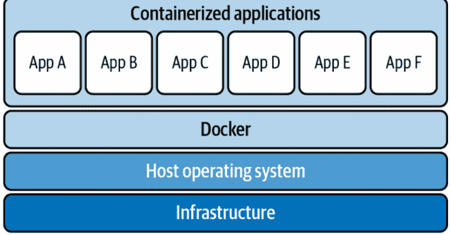
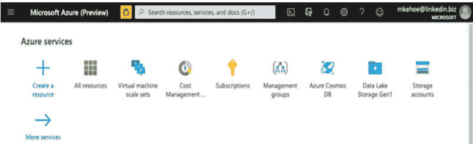
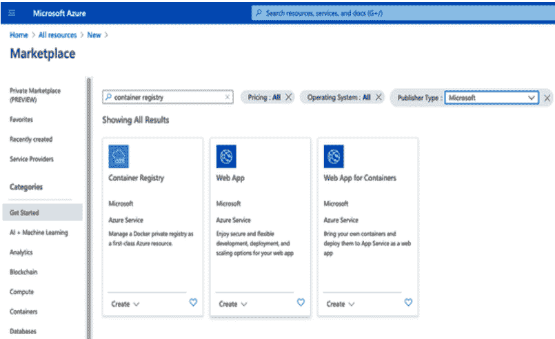
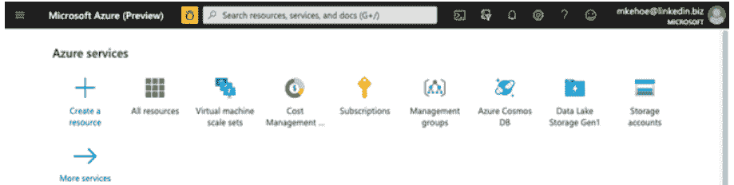
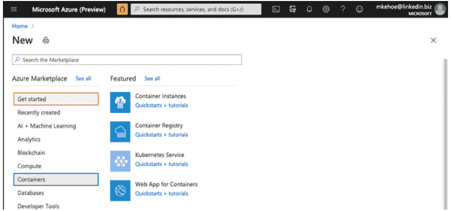

## 第 3 章. 容器化你的应用程序：不仅仅是盒子

## 早期发布读者的说明

使用 Early Release 电子书，你可以在官方发布这些标题之前很久就利用这些技术——作者在写作时提供的原始未编辑内容。

这将是最终书籍的第 3 章。请注意，GitHub 仓库将在稍后激活。

如果你对如何改进本书的内容和/或示例有任何评论，或者如果你注意到本章中缺少材料，请联系编辑 rfernando@oreilly.com。

在过去几年中，容器变得越来越受欢迎。它们不仅提供低开销、高安全性和高可移植性，而且还遵循诸如不可变性、临时性和自动扩展等最佳实践云原则。

在本章中，我们将解释容器是什么并讨论流行的容器化平台。此外，我们将超越一般的行业炒作并解释为什么你可能想要使用容器。我们还将重点介绍它们的一些好处，特别是在云方面。

### 为什么使用容器？

容器运行在主机操作系统之上，通常使用 Docker（我们将在本章后面讨论）或 Kubernetes（见图 3-1）等软件进行编排。容器最重要的好处之一是

它们提供了类似虚拟机的隔离，但无需为每个容器运行主机操作系统实例的开销。在规模上，这可以节省大量的系统资源。



图 3-1. 容器操作系统范式

### 隔离

容器通过管理员配置的灵活方式通过多种方法提供隔离。容器可以通过以下方式进行隔离：

### 系统资源

隔离是通过 CPU、内存和磁盘 cgroups 实现的。

### 命名空间

隔离是通过为每个容器允许单独的命名空间来实现的。

### POSIX 限制

使用此方法进行隔离允许你在容器上设置 rlimits。

这些机制允许你安全地一起运行大量工作负载，而不必担心资源竞争或一个系统干扰另一个系统。如果你有一个了解工作负载的容器编排器，你可以有效地利用主机机器上的所有资源，而不会出现性能下降（称为 *bin packing*）。在规模上做好这一点，可以在提高基础设施效率时创造显著的成本节约。

## 安全

在容器隔离功能的基础上，OCI 容器运行时规范（本章后面会讨论）提供了一系列与运行时安全相关的功能，确保如果容器内的应用程序被攻破，横向移动到整个网络的风险会显著降低。其中一些功能包括：

- *Linux capabilities*

这些减少了容器对内核 API 的访问。

- *用户/组属性*

这些设置容器的用户和组属性，然后可以限制对文件系统资源的访问。

- *设备*

这些控制容器可以访问哪些设备。

- *SELinux 标签*

与其他 Linux 系统组件（文件、进程、管道）一样，SELinux 标签可以应用于容器。

- *Sysctl*

这为容器添加（有限的）额外控制。

这些运行时安全功能层提供了一种确定性、受管理的部署应用程序的方式，显著降低了对主机基础设施和邻近应用程序的风险。在容器生态系统中，还有一套构件安全范式，我们将在本章后面介绍。

请注意，如果你想通过编排机制（Puppet/Chef 等）应用系统策略，在每个应用程序的基础上实现它要困难得多，而不是直接使用容器提供的功能。

### 打包和部署

正如我们将在本书后面讨论的，容器镜像的标准化和这些镜像的可移植性非常有用。相对直接地，你可以将在桌面上运行的容器部署到生产环境，而无需显著的操作开销或执行额外的配置和管理步骤。Docker 的座右铭是“Build, ship, and run”，这突出了容器化为软件开发生命周期带来的桌面到生产的理念。

此外，鉴于我们将在本章后面讨论的 OCI 镜像规范，只要你的容器注册表可用，你就可以确信部署系统将成功运行而不会出现问题。

### 基本容器原语

你可能会惊讶地知道，容器并不是 Linux 中的一等概念。事实上，直到 2017 年 OCI 规范的创建，才对容器有了正式定义（我们将在本章后面谈论规范）。一个基本的容器通常由以下原语组成：

- Cgroups
- Namespaces


+   - 写入时复制 (CoW)
+   - Seccomp-BPF

Linux 容器是 FreeBSD jail、Solaris zone 和虚拟机等类似技术的自然演进。在许多方面，容器将这些技术的优点结合在了一起。

由于容器不是一个原始概念，因此有许多容器软件平台可用。我们将在本章后面探索它们。现在，让我们逐一介绍每个基本容器原语。

### Cgroups

控制组（cgroup）是 Linux 的一个原语，提供限制 cgroup 内一组程序可以访问/分配的资源的能力。这提供了防止“嘈杂邻居”问题的保护。以下是 cgroup 提供的控制列表：

*CPU*

CPU 子系统控制允许你为 cgroup 分配一定量的 CPU 时间（`cpuacct`）或一定数量的核心（`cpuset`），以确保一个进程不会耗尽物理机上的所有 CPU 资源。

*Memory*

内存子系统允许你报告并为 cgroup 中的内存使用量设置限制。这适用于用户内存和交换内存。

*Blkio*

blkio（发音为 block-i-o）控制器子系统提供了一种机制，用于限制 cgroup 对块设备的输入/输出操作每秒（IOPS）或带宽（bps）。

### PID

PID（进程标识符）控制器设置可以在 cgroup 中运行的最大进程数。

### Devices

仅适用于 cgroups v1，此控制允许管理员为 cgroup 在主机机器上可以访问的设备设置允许/拒绝列表。

### Network

网络分类器（net_cls）cgroup 提供了一个接口，用于为网络数据包标记类标识符（classid）。

网络优先级（net_prio）cgroup 提供了一个接口，用于动态设置各种应用程序生成的网络流量的优先级。

在很大程度上，网络控制功能在更新的 Linux 内核版本中更适合由 eBPF 提供。

### Namespaces

命名空间是 Linux 中的一个功能，允许你限制非计算资源，以便一组进程看到一组资源，而另一组进程看到另一组资源。截至本文撰写时，Linux 包含以下命名空间类型：

#### Mount (mnt)

控制容器可用的文件系统挂载。这意味着不同挂载命名空间中的进程会看到不同的目录层次结构视图。

#### PID (pid)

为容器提供独立编号的 PID 集合。这意味着在拥有自己的 PID 命名空间的容器内的第一个进程将具有 PID 为 1。PID 1 的任何后代都将像常规 Unix 系统一样运行。

#### Network (net)

一个非常有用的功能，允许你虚拟化网络基础设施。每个命名空间将拥有私有的一组 IP 地址以及自己的路由表、套接字列表、连接跟踪表、防火墙和其他网络相关资源。

#### Interprocess communication (ipc)

将进程与 Linux 进程间通信（IPC）隔离。示例包括管道和信号。

#### Unix Time Sharing (uts)

允许单个系统对不同进程显示不同的主机名和域名。

#### User ID (user)

类似于 PID 命名空间；允许你在容器内拥有提升的权限但不影响整体系统。用户命名空间在命名空间之间提供用户标识隔离。用户命名空间包含一个映射表，将用户 ID 从容器的视角转换为系统的视角。这允许，例如，root 用户在容器中具有用户 ID 0，但在系统进行所有权检查时被视为用户 ID 1,400,000。

#### Control group (cgroup)

隐藏进程所属的控制组的身份（这与 cgroup 原语不同）。

#### Time (time)

允许进程以类似于 UTS 命名空间的方式看到不同的系统时间。

### Copy on Write

写入时复制（CoW）是一种内存管理技术，仅在资源被修改（或写入）时才复制内存。这种技术减少了所需的内存量。

### Capabilities

Linux 能力允许管理员更严格地控制进程或 cgroup 在主机系统上的能力。你可以在 capabilities(7) 手册页中找到能力列表。例如，如果你想在端口 80 上运行 Web 服务器，你只需要给 cgroup/进程 CAP_NET_BIND_SERVICE 能力。如果 Web 服务器被攻破，攻击者的行为将被限制，因为该进程没有系统权限执行其他管理命令。

### Seccomp-BPF

Seccomp（SECure COMputing）对于在系统间创建绝对限制非常有用。Seccomp-BPF 允许按应用程序进行细粒度控制。Seccomp-BPF 提供按线程粒度（在严格模式下）。它在 3.5 版本（2012 年）被添加到内核中。

Seccomp-BPF 允许 Berkeley Packet Filter（BPF）程序（在内核空间运行的程序）过滤系统调用（及其参数），并在 Seccomp-BPF 程序退出后返回应发生什么的值。

### Components of Running a Container

正如我们在本章前面讨论的那样，容器不是 Linux 中的一等概念（没有 Linux 容器原语），这使得它们有点难以定义——也就是说，过去很难使容器具有可移植性。尽管如此，要运行容器，需要在容器构造与操作系统软件（或主机软件）之间存在某种定义的接口。

在本节中，我们将讨论容器软件的细节，包括容器运行时（运行容器的软件）、容器平台和容器编排器。

首先，让我们快速查看容器生态系统中的抽象层（图 3-2）。


图 3-2. 容器抽象的层

在本节中，我们将从上到下遍历这些抽象层，看看我们如何从整齐编排的容器工作到使容器运行成为可能的低级 Linux 概念。

### Container Orchestrators

在最顶层的抽象层是容器编排器，它们执行管理容器生态系统的自动扩展、实例替换和监控的魔术，这使得容器作为一个概念如此有吸引力。正如我们在第 4 章和第 5 章中讨论的那样，Kubernetes 是 Cloud Native Computing Foundation（CNCF）的毕业调度与编排平台。

容器编排器通常提供以下功能：

- 根据实例负载自动扩展集群实例
- 实例的配置和部署
- 基础监控功能
- 服务发现

其他 CNCF 容器编排器包括：

- Azure Kubernetes Service (AKS)
- Azure Service Fabric
- Amazon Elastic Container Service (ECS)
- Docker Swarm
- Apache Mesos
- HashiCorp Nomad

好的容器编排器使构建和维护计算集群变得简单。截至本文撰写时，容器编排器没有标准配置。

### Container Software

容器守护进程位于编排器之下，提供执行守护进程的软件。根据你使用的编排器，这可能对你来说是透明的。本质上，容器守护进程管理容器运行时的生命周期。在许多情况下，这可能简单到启动或停止容器，也可能复杂到与 Cilium 等插件交互（我们将在第 8 章讨论）。

常见的容器软件平台包括：

- Docker
- Mesos agent (Mesos)
- Kubelet (Kubernetes)
- LXD (LXC)
- Rkt

正如我们将在本章后面讨论的那样，Docker 允许你获取一个镜像然后创建它的容器实例，本质上为用户提供了一个非编排操作的用户界面。Mesos 代理或 kubelet 有所不同，因为它们由 CLI 或 REST API 驱动。

### Container Runtimes

容器运行时提供运行容器实例的接口。行业范围内，有两个标准的接口类别：

- Container runtime (runtime-spec)
- Image specification (image-spec)

容器运行时指定容器的配置（例如，能力、挂载和网络配置）。镜像规范包含有关镜像的文件系统布局和内容的<|message|>。

虽然每个容器守护进程或编排器都有自己的配置规范，但容器运行时是一个在镜像上具有标准化标准化的领域。

三个最突出的容器运行时是：

- Containerd
- CRI-O
- Docker (直到 Kubernetes v1.2)

### Containerd


Containerd 是一个符合 OCI 的容器运行时，被 Docker 使用。Containerd 在使容器运行的所有 Linux 系统调用与配置容器的标准 OCI 配置之间充当抽象层。Containerd 具有事件子系统，允许其他系统（如 etcd）订阅系统更改并相应地采取行动。值得注意的是，containerd 同时支持 OCI 和 Docker 镜像格式。What is containerd? 是一篇提供进一步信息的优秀博文。

### CRI-O

CRI-O 是 Kubernetes 容器运行时接口（CRI）的一种实现，使 OCI 兼容的运行时成为可能。它被认为是用 Docker 和 containerd 的轻量级替代方案。CRI-O 还支持运行 Kata Containers（由 VMware 创建的类似虚拟机的容器）并且可以扩展到任何其他符合 OCI 的运行时。这使其成为多种用例的有吸引力的运行时。

### Docker

不要将其与完整的 Docker 平台混淆，Docker 实际上包含一个运行时引擎，其本质上就是 containerd。Kubernetes 直到 Kubernetes v1.20 版本才支持 Docker 作为容器运行时。

### Containers

容器实例是根据容器规范定义的软件的部署和运行。容器运行由一系列设置和限制所包含的定义软件（通常由镜像提供）。

### Operating System

操作系统是最底层的构造，我们的容器运行在其上。在大多数容器运行时中，内核在所有容器实例之间共享。

### Open Container Initiative (OCI) Specification

如前所述，容器在开始时并不是一个定义良好的概念。Open Container Initiative（OCI）成立于 2015 年，以规范上述的运行时和镜像规范。

容器的运行时配置在 config.json 文件中指定，该文件由容器运行时用来配置容器的运行参数。使用符合 OCI 的容器允许在多个容器编排器（例如 Docker 和 rkt）上运行相同的容器镜像/配置而无需进行任何修改。

### OCI Image Specification

OCI 镜像规范概述了容器各层的定义方式。镜像的一些属性包括：

- Author
- Architecture and operating system
- User/group to run the container as
- Ports that are exposed outside the container
- Environment variables
- Entry points and commands
- Working directory
- Image labels

以下是一个容器镜像的示例：

```
{
  "created": "2021-01-31T22:22:56.015925234Z",
  "author": "Michael Kehoe <michaelk@example.com>",
  "architecture": "x86_64",
  "os": "linux",
  "config": {
```

```
"User": "alice",
"ExposedPorts": {
    "5000/tcp": {}
},
"Env": [
"PATH=/usr/local/sbin:/usr/local/bin:/usr/sbin:/usr/bin:/sbin:/bin",
    ],
"Entrypoint": [
    "/usr/bin/python"
],
"Cmd": [
    "app.py"
],
"Volumes": {
    "/var/job-result-data": {},
    "/var/log/my-app-logs": {}
},
"WorkingDir": "/app",
"Labels": {
    "com.example.project.git.url":
"https://example.com/project.git",
    "com.example.project.git.commit":
"45a939b2999782a3f005621a8d0f29aa387e1d6b"
    }
},
"rootfs": {
    "diff_ids": [
"sha256:c6f988f4874bb0add23a778f753c65efe992244e148a1d2ec2a8b664fb66bbd1",
"sha256:5f70bf18a086007016e948b04aed3b82103a36bea41755b6cddfaf10ace3c6ef"
    ],
    "type": "layers"
},
"history": [
    {
        "created": "2021-01-31T22:22:54.690851953Z",
        "created_by": "/bin/sh -c #(nop) ADD file:a3bc1e842b69636f9df5256c49c5374fb4eef1e281fe3f282c65fb853ee171c5 in /"
    },
    {
        "created": "2021-01-31T22:22:55.613815829Z",
        "created_by": "/bin/sh -c #(nop) CMD [\"sh\\\"]",
```

```
"empty_layer": true
}
]
}
```

### OCI Runtime Specification

在高层面上，运行时配置规范提供了对以下容器属性的控制：

- Default filesystems
- Namespaces
- User ID and group ID mappings
- Devices
- Control group configuration
- Sysctl
- Seccomp
- Rootfs mount
- Masked and read-only paths
- Mount SELinux labels
- Hook commands
- Other specialized attributes (e.g., personality, unified, and Intel RDT)

OCI 规范还涵盖了容器状态的定义方式以及容器的生命周期。

容器的状态可以通过状态函数（在 containerd 中，以及 runc）查询并返回以下属性：

```
{
    "ociVersion": "0.2.0",
```

```
"id": "oci-container1",
"status": "running",
"pid": 4422,
"bundle": "/containers/redis",
"annotations": {
    "myKey": "myValue"
}
}
```

OCI 容器的生命周期将所有运行时规范整合在一起，包括运行时规范如何与镜像规范交互。它定义了容器如何启动和配置，以及它如何与镜像的启动/停止钩子交互。

### Docker

Docker 提供了一种平台即服务（PaaS），使用户能够以简化和标准化的方式在桌面上运行容器化应用程序。Docker 运行符合 OCI 的镜像，并且通常是部署代码到生产环境之前测试代码部署的一种手段。此外，Docker 桌面软件的广泛可用性为开发人员提供了一种轻松的机制来测试其代码的打包和部署，这使其成为开发人员有吸引力的系统。

### Building Your First Docker Image

Docker 镜像本身是非 OCI 合规镜像（其结构与 OCI 规范不同），可在 Docker 上以及支持 Docker 运行时（containerd）的系统上运行。Docker 镜像的美妙之处在于其创建的快速和简单。每个容器镜像都由 Dockerfile 定义。该文件由用于构建镜像、运行应用程序、将其暴露给网络并执行健康检查的属性和命令组成。它定义了哪些依赖项和文件被复制到容器镜像中，以及启动容器内应用程序要执行哪些命令。使用简单的（命令式）类似 shell 脚本的格式（逐条运行命令）构建 Docker 镜像的方法被那些处理痛苦的包管理或在 RPM 或 DEB（或 tarball）中捆绑应用程序的开发人员所青睐。

Docker 提供了完整的配置参考，可帮助您构建自己的容器。

### BUILDING YOUR OWN CONTAINER

理解容器如何工作的一个好方法是构建自己的基本容器。我们建议尝试 rubber-docker 工作坊。它逐步介绍了容器的基本组件并展示了它们是如何实现的。

虽然 Dockerfile 允许复杂的设置，但创建镜像只需几行代码就异常简单。在以下示例中，我们将运行一个 Python Flask Web 应用程序并暴露端口 5000。

- 创建一个 requirements.txt 文件：

```
Flask >2.0.0
```

- 创建一个 app.py 文件：

```
from Flask import flask

app = Flask(__name__)

@app.route('/')
def index():
    return "Hello, World"
```

- 创建你的 Dockerfile，名为 Dockerfile：

```
1. FROM ubuntu:18.04
2. COPY . /app
```

```
3. WORKDIR /app
4. RUN pip3 install -r requirements.txt
5. ENTRYPOINT ["python3"]
6. CMD ["app.py"]
7. EXPOSE 5000
```

- 在第 1 行，我们采用一个基础镜像。在本例中，我们将使用 Docker Hub 仓库中的 Ubuntu 18.04。
- 在第 2 行，我们将当前目录复制到名为 *app* 的新镜像目录中。
- 在第 3 行，我们将当前工作目录设置为 */app*。
- 在第 4 行，我们使用 `pip` 安装应用程序定义的依赖项。
- 在第 5 行，我们将入口点应用程序设置为 `python3`（这是 Docker/Python 的最佳实践）。
- 在第 6 行，我们通过运行 *app.py* 启动应用程序。
- 在第 7 行，我们将端口 5000 服务暴露到容器外部。

总体而言，此容器镜像复制我们的应用程序，然后安装应用程序的依赖项，启动自身，并允许在端口 5000（默认 Flask 端口）上进行网络连接。

为了允许用户或其他应用程序访问你的容器，Dockerfile 包含一个 `EXPOSE` 指令，允许容器网络栈在运行时监听指定端口。我们将在第 8 章讨论网络连接。


#### NOTE

Dockerfile 在技术上是容器运行时和镜像规范的混合体，因为它既提供了关于镜像内容的语义，也提供了其运行方式（即 CPU 或内存 cgroup 限制）。

一旦你创建了 Dockerfile，你就可以使用 docker build 命令构建容器镜像。这通常使用当前文件路径（例如 docker build）完成，但你也可以使用 URL（例如 docker build https://github.com/abcd/docker-example）。你可以在文档中找到关于如何使用 docker build 的完整参考。

你应该为镜像创建一个标签，以便在将来构建镜像时能够快速轻松地引用它。你可以通过在构建时添加 --tag 选项来实现：

```
docker build --tag example-flask-container
```

当你运行 docker build 时，你会看到类似以下的输出：

```
[internal] load build definition from Dockerfile
=> transferring dockerfile: 203B
[internal] load .dockerignore
=> transferring context: 2B
[internal] load metadata for docker.io/library/ubuntu:18.04
[1/6] FROM docker.io/library/ubuntu:18.04
[internal] load build context
=> transferring context: 953B
CACHED [2/6] WORKDIR /app
[3/6] COPY requirements.txt requirements.txt
[4/6] RUN pip3 install -r requirements.txt
[5/6] COPY . .
[6/6] CMD [ "python3", "app.py"]
exporting to image
=> exporting layers
=> writing image
sha256:8cae92a8fbd6d091ce687b71b31252056944b09760438905b726625831
```
```
564c4c
=> naming to docker.io/library/example-flask-container
```

### Best Practices While Using Docker

十二要素应用追踪了 Docker 化和云原生应用的许多特征。这意味着应用程序应该能够在不造成问题的情况下进行部署、启动、停止和销毁。虽然我们将在本书后面讨论容器存储解决方案，但你应该尽可能避免持久化数据，除非你是从持久卷读取数据或使用云原生数据服务（有关更多信息，请参阅第 9 章）。

你还应遵循以下最佳实践：

- 利用 docker build 选项。这些选项允许你自定义 Docker 镜像以添加诸如 cgroup 控制、标签、网络配置等功能。
- 利用 .dockerignore 文件。与 .gitignore 类似，.dockerignore 将确保某些文件或文件夹不会包含在镜像构建中。
- 为减少复杂性、依赖项、文件大小和构建时间，避免安装额外的或不必要的软件包。
- 使用多阶段构建。如果你需要安装依赖项来编译应用程序，你可以在镜像的构建过程中执行此操作，但只将输出复制到容器镜像中。这可以减少镜像构建的大小。

你可以在 Docker 网站上找到有关 Dockerfile 最佳实践的更多信息。

### Other Container Platforms

虽然 Docker 平台和 OCI 镜像仍然是行业领导者，但仍然有许多其他容器解决方案可用。

#### Kata Containers

Kata Containers 是符合 OCI 的容器，旨在增强安全性。Kata Containers 具有以下轻量级容器功能：

- Cgroups
- Namespaces
- Capability filters
- Seccomp filtering
- Mandatory access control

Kata Containers 也具有一些虚拟机概念，特别是每个容器一个独立的访客内核和更好的硬件隔离。`kata-runtime` 进程控制 OCI 合规容器的实例化。最大的区别是每个容器都有一个独立的访客内核，而不是容器实例之间共享内核。

#### LXC and LXD

LXC（Linux Containers）是最早发布的容器机制之一。LXC 主要使用内核的 cgroup 和 namespace 能力以及一套标准的库 API 来控制容器。

LXD 是容器管理软件和工具，有助于编排 LXC API。LXD 守护进程通过 Unix 套接字/网络提供 REST API，允许你使用提供的命令行工具或构建自己的工具。

由于缺乏开发和部署工具，LXC 和 LXD 的生态系统更偏向于运行基础设施而不是应用程序开发。

### Container Registries

构建容器镜像后，你需要地方来存储和提供它们。这些被称为 *container registries*。由于其易于部署的机制以及内置的复制机制，容器注册表变得越来越受欢迎，这些机制取代了 DEB 和 RPM 软件包仓库所需的具有挑战性的 rsync 设置。

部署容器时，容器部署系统会将镜像从注册表下载到主机机器。基本上，容器注册表充当高度可用的容器镜像文件服务器（带一些保护）。所有常见的容器化平台都允许你配置公共或私有仓库作为容器镜像的来源。

虽然这些职责听起来相当平常，但容器注册表的许多被忽视的功能是安全容器部署的重要组成部分。此类功能包括：

- *Image replication*
  将镜像复制到其他容器注册表（全球）
- *Authentication*
  仅允许授权用户访问注册表及其内容
- *Role-based access control*
  限制谁可以修改注册表中的镜像和数据
- *Vulnerability scanning*
  检查镜像是否存在已知漏洞
- *Garbage collection*
  定期删除旧镜像
- *Auditing*
  为信息安全目的提供有关容器注册表更改的可信信息

当前云原生产品包括（请参阅 CNCF 景观了解更多）：

- Harbor
- Dragonfly
- Alibaba Container Registry
- Amazon Elastic Container Registry (Amazon ECR)
- Azure Registry
- Docker Registry
- Google Container Registry
- IBM Cloud Container Registry
- JFrog Artifactory
- Kraken
- Portus
- Quay

其中许多系统与特定厂商绑定。然而，Harbor 是最受欢迎的开源容器注册表系统之一，因此我们将进一步探索它。

### Securely Storing Images with Harbor

Harbor 是首屈一指的开源云原生容器注册表平台。创建于 2016 年，Harbor 存储容器镜像并提供签名和安全扫描功能。此外，Harbor 还支持高可用性和复制功能以及一系列安全功能，包括用户管理、基于角色的访问控制和活动审计。

Harbor 的美妙之处在于它即使是开源的也提供顶级功能，这使其成为一个很棒的平台。

### Installing Harbor

当你使用 Harbor 时，它本质上成为构建和部署管道的关键组件。你应该在满足以下推荐规格的主机上运行它：

- 四核 CPU
- 8 GB 内存
- 最小 160 GB 磁盘
- Ubuntu 18.04/CentOS7 或更高版本

> NOTE
> 你需要评估磁盘 SKU 或配置的性能以匹配你期望的性能。Harbor 本质上是一个文件服务器，磁盘的性能将显著影响你的构建和部署时间。

Harbor 支持多种安装方法，包括 Kubernetes 和 Helm。由于我们尚未探索 Kubernetes，因此我们将手动安装 Harbor。

Harbor 有两种发行版（或安装类型）：在线安装程序和离线安装程序。在线安装程序体积较小，依赖于互联网连接从 Docker Hub（直接从互联网）下载完整镜像。离线安装程序体积较大，不需要互联网连接。如果你的安全态势是限制性的，离线安装程序可能是一个更好的选择。

Harbor 的发行版列在 GitHub 上。


### 验证安装程序

建议您验证下载包的完整性。您需要打开到端口 TCP/11371 的出站互联网访问权限以访问 GPG 密钥服务器。要验证安装程序：

- 1. 下载对应您安装程序版本的 *.asc 文件。
- 2. 获取 Harbor 发行版的公钥：gpg --keyserver. hkps://keyserver.ubuntu.com --receive-keys 644FF454C0B4115C。
- 3. 通过运行 gpg -v -keyserver hkps://keyserver.ubuntu.com -verify <asc-filename> 来验证包。

您应该在前一个命令的输出中看到 gpg: Good signature from "Harbor-sign (The key for signing Harbor build)。

### 为安装配置 Harbor

在配置 Harbor 之前，您应该通过您自己的证书颁发机构 (CA) 或通过公共 CA 如 Let’s Encrypt 安装 Secure Sockets Layer (SSL) 证书以启用 HTTPS。有关如何执行此操作的更多信息可以在 Harbor 文档中找到。

Harbor 的所有安装参数都定义在一个名为 harbor.yml 的文件中。此文件中定义的参数在首次使用 Harbor 或通过 install.sh 文件重新配置时进行配置。有关所有配置选项的详细信息可以在 GitHub 上找到。为了开始，我们将使用以下必需参数：

```
hostname: container-registry.example.com

http:
```

```
### port for http, default is 80. If https enabled, this port
will redirect to https port
  port: 80

https:
  port: 443
  certificate: /your/certificate/path
  private_key: /your/private/key/path

harbor_admin_password: Harbor12345

### DB configuration
database:
  password: root123
  max_idle_conns: 50
  max_open_conns: 100

### The default data volume
data_volume: /data

clair:
  updaters_interval: 12

jobservice:
  max_job_workers: 10

notification:
  webhook_job_max_retry: 10

chart:
  absolute_url: disabled

log:
  level: info
  local:
    rotate_count: 50
    rotate_size: 200M
    location: /var/log/harbor

proxy:
  http_proxy:
  https_proxy:
  no_proxy:
127.0.0.1,localhost,.local,.internal,log,db,redis,nginx,core,portal,postgresql,jobservice,registry,registryctl,clair
```

### 构建 Packer 镜像

利用我们来自第 2 章的知识，我们将构建一个 Packer 镜像来部署 Harbor。您可以使用以下 *harbor.json* 文件：

```
{
  "builders": [{
    "type": "azure-arm",
    "client_id": "<place-your-client_id-here>",
    "client_secret": "<place-your-client_secret-here>",
    "tenant_id": "<place-your-tenant-id-here>",
    "subscription_id": "<place-your-subscription-here>",
    "managed_image_resource_group_name": "CloudNativeAzure-group",
    "managed_image_name": "harborImage",
    "os_type": "Linux",
    "image_publisher": "Canonical",
    "image_offer": "UbuntuServer",
    "image_sku": "16.04-LTS",
    "azure_tags": {
      "env": "Production",
      "task": "Image deployment"
    },
    "location": "East US",
    "vm_size": "Standard_DS1_v2"
  }],
  "provisioners": [{
    "execute_command": "chmod +x {{ .Path }}; {{ .Vars }} sudo -E sh '{{ .Path }}'",
    "inline": [
      "apt-get update",
      "apt-get upgrade -y",
      "/usr/sbin/waagent -force -deprovision+user && export HISTSIZE=0 && sync"
    ],
    "inline_shebang": "/bin/sh -x",
    "type": "shell"
  },
  {
  {
    "type": "shell",
    "inline": [
      "wget
```

```
https://github.com/goharbor/harbor/releases/download/v2.1.3/harbor-online-installer-v2.1.3.tgz -O /tmp/harbor-online-installer-v2.1.3.tgz",
    "tar -xvf /tmp/harbor-online-installer-v2.1.3.tgz"
  ]
},
{
    "type": "file",
    "source": "{{template_dir}}/harbor.yml",
    "destination": "/tmp/harbor"
  },
  {
    "type": "shell",
    "inline": [
      "sudo chmod 0777 /tmp/harbor/install.sh",
      "sudo  /tmp/harbor/install.sh"
    ]
  }
]
}
```

当您运行 `packer build harbor.json` 时，您的镜像将带 Harbor 安装并配置构建。如果您使用 HTTPS（您应该使用），您将需要修改 Packer 文件以包含复制证书和私钥文件。

### 使用 Azure 容器注册表安全存储镜像

Azure 提供了自己的容器注册表，称为 Azure Container Registry。由于注册表由 Azure 提供，初始设置和持续维护要求比运行 Harbor 等软件时要少得多。

### 安装 Azure 容器注册表

部署容器实例异常简单。

- - 登录到 Azure 门户并点击“创建资源”，如图 3-3 所示。



图 3-3. Azure 门户主页

- - 在搜索栏中搜索“container registry”，并点击来自 Microsoft 的 Container Registry 提供（见图 3-4）。



图 3-4. 搜索 Azure 容器注册表

您将看到一个表单，用于填写有关您将创建的注册表的基本信息（图 3-5）。

### 创建容器注册表

Home > All resources > New > Marketplace > Container Registry >

Basics Networking Encryption Tags Review + create

Azure Container Registry 允许您构建、存储和管理容器镜像和工件在私有注册表中，用于所有类型的容器部署。使用 Azure 容器注册表与您现有的容器开发和部署管道一起使用。使用 Azure Container Registry Tasks 在 Azure 上按需构建容器镜像，或自动化由源代码更新、容器基础镜像更新或计时器触发的构建。了解更多

### 项目详细信息

Subscription *

Visual Studio Enterprise

Resource group *

(New) rg-container-registry

Create new

### 实例详细信息

Registry name *

cloudnativeinfra.azurecr.io

Location *

East US 2

Availability zones

Enabled

Availability zones are enabled on premium registries and in regions that support availability zones. Learn more

SKU *

Standard

Review + create < Previous Next: Networking >

图 3-5. 创建容器注册表的第一页

- - 提供容器注册表以下基本详细信息：

#### Subscription

选择您想要部署到的订阅。

#### Resource group

您可以使用现有资源组或创建新的。在这种情况下，我们将创建一个名为 rg-container-registry 的新资源组。

### Registry name

这将配置用于访问注册表的 URL。我们将使用 *cloudnativeinfra.azurecr.io*。这是全局唯一的，因此您需要选择自己的并确保不会收到错误消息提示它已被占用。

#### Region

选择您的区域。我们将在 East US 2 区域部署。

### SKU

有三个层级。您可以在 Container Registry 定价页面找到比较。我们将使用 Standard 层级。

- - 选择您的 Networking 配置（图 3-6）。由于我们使用 Standard 层级，我们无法在此处进行任何配置更改。因此，将创建的容器注册表可通过互联网访问，而不仅仅是在我们的 Azure 网络内。

### 创建容器注册表

Home > All resources > New >

Basics   Networking   Encryption   Tags   Review + create

### Network connectivity

您可以公开通过公共 IP 地址连接到此注册表，或使用私有端点私有连接。了解更多

Connectivity method
Public endpoint (all networks)
Private endpoint

Private endpoint connection is only available for Premium SKU.

Review + create   < Previous   Next: Encryption >

图 3-6. 容器注册表网络配置

- - 选择您的 Encryption 配置（图 3-7）。Standard 层级为存储数据提供静态加密，而 Premium 层级允许用户设置自己的加密密钥。

### 创建容器注册表

Home > All resources > New >

Basics Networking Encryption Tags Review + create

Azure Container Registry 服务加密保护您的数据在静态时。Azure Container Registry 在推送到注册表时加密您的镜像和其他工件，并在拉取时自动解密。了解更多

Customer-Managed Key Enabled Disabled

Customer-Managed Key is only available for Premium SKU.

图 3-7. 容器网络注册表加密

- - 点击“Review + create”以创建您的容器注册表。这应该在不到两分钟内部署完成。

### 私有端点

私有端点是 Azure 的一个概念，允许云资源通过 RFC1918 地址空间而不是公共 IP 可用。这意味着您的资源仅通过本地连接的网络可用，而不通过互联网。

如果您想通过 Terraform 部署您的容器注册表，以下代码将允许您这样做：

```
resource "azurerm_resource_group" "rg" {
  name = "example-resources" location = "West Europe"
}
```

```
resource "azurerm_container_registry" "acr" {
  name = "containerRegistry1"
  resource_group_name = azurerm_resource_group.rg.name
```


```
location = azurerm_resource_group.rg.location
sku = "Premium"

identity {
    type = "UserAssigned"
    identity_ids = [
azurerm_user_assigned_identity.example.id ]
}

encryption {
    enabled = true
    key_vault_key_id = data.azurerm_key_vault_key.example.id
    identity_client_id =
azurerm_user_assigned_identity.example.client_id
}
}

resource "azurerm_user_assigned_identity" "example" {
    resource_group_name = azurerm_resource_group.example.name
    location = azurerm_resource_group.example.location
    name = "registry-uai"
}

data "azurerm_key_vault_key" "example" {
    name = "super-secret"
    key_vault_id = data.azurerm_key_vault.existing.id
}
```

### 在注册表中存储 Docker 镜像

正如我们之前讨论过的，你需要能够可靠地存储和提供容器镜像。一旦你构建了自定义镜像，就需要将其推送到注册表。此外，正如我们之前讨论过的，存储镜像的选项有很多，包括 Docker Registry 以及各个云提供商的容器注册表，例如 Azure Container Registry。在本例中，我们将使用本章前面创建的 Harbor 注册表。

首先我们将登录到注册表：

```
$ docker login <harbor_address>
```

例如：

```
$ docker login https://myharborinstallation.com
```

现在我们将为镜像打标签：

```
docker tag example-flask-container <harbor_address>/demo/example-flask-container
```

然后我们将其推送：

```
docker push <harbor_address>/demo/example-flask-container
```

完成后，Harbor 将能够将我们的镜像提供给任何正在下载它的容器软件。

### 在 Azure 上运行 Docker

在 Azure 中，运行 Docker 容器镜像有两种方式：使用 Azure Container Instances 或运行安装了 Docker 的自己的虚拟机。在本节中，我们将演示这两种方法。

#### Azure Container Instances

Azure Container Instances (ACI) 允许你在无需管理底层基础设施的情况下快速在 Azure 中启动容器实例。这提供了一种类似 Docker 的服务，但位于公有云中。ACI 允许部署来自 Azure Container Registry 的镜像，或来自私有或公共存储库的 Docker 镜像。

ACI 还允许这些实例根据容器镜像的使用情况放置在私有或公共网络中。

ACI 的一些附加功能包括：

- 无需配置 OCI 运行时规范
- 能够将环境变量传递给容器
- 基础防火墙管理
- 受管理的容器重启策略

简单来说，ACI 是在 Azure 中开始运行容器的最简单方法！ACI 还使你能够在不创建完全独立的环境的情况下测试新的容器镜像。

在运行 Azure ACI 时需要注意一些重要注意事项：

- 任何单个容器实例的限制为四核/16 GB。
- ACI 的 CPU 和内存设置将覆盖你对容器镜像应用的任何运行时设置。

#### 部署 Azure Container Instance

部署 Azure 容器实例非常简单。首先，登录到 Azure 门户，然后点击“创建资源”，如图 3-8 所示。



图 3-8. Azure 门户主页

点击左侧的 Containers，你会看到容器相关产品的列表，见图 3-9。点击 Container Instances 链接。



图 3-9. 搜索容器产品

你将看到一个用于填写容器实例基本信息的表单，如图 3-10 所示。

#### Create container instance

Basics Networking Advanced Tags Review + create

Azure Container Instances (ACI) allows you to quickly and easily run containers on Azure without managing servers or having to learn new tools. ACI offers per-second billing to minimize the cost of running containers on the cloud.

Learn more about Azure Container Instances

##### Project details

Select the subscription to manage deployed resources and costs. Use resource groups like folders to organize and manage all your resources.

Subscription *

Visual Studio Enterprise

Resource group *

Create new

##### Container details

Container name *

Region *

(US) East US

Image source *

Quickstart images

Azure Container Registry

Docker Hub or other registry

Image *

mcr.microsoft.com/azuredocs/aci-helloworld:latest (Linux)

Size *

1 vcpu, 1.5 GiB memory, 0 gpus

Change size

Review + create

< Previous

Next : Networking >

图 3-10. Azure 容器实例的基础配置

填写以下字段：

#### Subscription

选择你要部署到的订阅。

#### Resource group

你可以使用现有资源组或创建一个新的。在本例中，我们将创建一个名为 rg-aci-test 的新资源组。

#### Container name

为你的容器实例命名。我们将把它命名为 `aci-demo`。

#### Region

选择你的区域。我们将在 East US 区域部署。

#### Image source

这里选择你的容器镜像。你有三个选项：

- 使用 Azure 提供的演示 quickstart 镜像。
- 使用已上传到 Azure Container Registry 的镜像。
- 使用上传到 Docker Hub 或其他注册表的镜像。如果你已部署 Harbor，可以在此配置。在本例中，我们将选择 Nginx quickstart 镜像（*mcr.microsoft.com/oss/nginx/nginx:19.15-alpine*）。

#### Size

在这里选择你想要的虚拟机类型。请记住，虚拟机越大，运行成本越高。在本例中，我们将运行“1 vcpu, 1.5GiB memory, 0 gpus”的配置。这意味着我们有一个虚拟核心、1 GB 内存和没有显卡。

配置完成后，点击 Next: Networking 按钮来配置网络，如图 3-11 所示。

#### Create container instance

Basics Networking Advanced Tags Review + create

Choose between three networking options for your container instance:

- 'Public' will create a public IP address for your container instance.
- 'Private' will allow you to choose a new or existing virtual network for your container instance. This is not yet available for Windows containers.
- 'None' will not create either a public IP or virtual network. You will still be able to access your container logs using the command line.

Networking type Public Private None

DNS name label  aci-demo .eastus.azurecontainer.io

Ports

| Ports | Ports protocol |
| 80 | TCP |

Review + create < Previous Next : Advanced >

图 3-11. Azure 容器实例的网络配置

在本演示中，我们将为容器实例分配一个公共 IP 地址，以便从互联网访问，然后为 IP 地址分配一个 DNS 名称 aci-demo.eastus.azurecontainer.io（你需要使用一个唯一名称）。我们还可以选择使 TCP 或 UDP 端口从容器外部可用。由于我们使用的是 Nginx 容器，端口 80 已自动打开。你也可以创建虚拟网络（或使用现有网络）以及子网，如果你使用私有 IP 地址。

如果点击 Next: Advanced 按钮，你会看到可以应用的其他设置，用于处理故障策略和环境变量。对于此实例，我们不会做任何更改，如图 3-12 所示。

#### Create container instance

Basics Networking Advanced Tags Review + create

Configure additional container properties and variables.

Restart policy

On failure

Environment variables

Mark as secure Key Value

No

Command override

[ ]

Example: ["/bin/bash", "-c", "echo hello; sleep 100000"]

Review + create < Previous Next : Tags >

图 3-12. Azure 容器实例的高级配置

最后，点击“Review + create”，容器镜像将被创建。部署一个 quickstart 镜像大约需要两分钟。

一旦容器部署完成，你就可以在互联网浏览器中访问容器的 DNS 名称，并看到“Welcome to nginx!”横幅，见图 3-13。通过 Azure 门户，你还可以获得对实例的控制台连接。

### Welcome to nginx!

If you see this page, the nginx web server is successfully installed and working. Further configuration is required.

For online documentation and support please refer to nginx.org. Commercial support is available at nginx.com.

Thank you for using nginx.

图 3-13. Nginx 默认欢迎页面

你可以在 Microsoft 文档中找到有关部署 ACI 的更多信息。


### 运行 Docker 容器引擎

如果你想要更精细地控制容器环境，运行自己的 Docker 容器引擎（CE）也是一个选择。这需要权衡你必须管理 Docker 运行所在的底层虚拟机。

- 在 Azure 虚拟机上安装 Docker CE：

Centos/Red Hat:

```
$ sudo yum install -y yum-utils
```

```
$ sudo yum-config-manager \
  --add-repo \
  https://download.docker.com/linux/centos/docker-ce.repo
```

```
$ sudo yum install docker-ce docker-ce-cli containerd.io
```

Debian/Ubuntu:

```
$ sudo add-apt-repository \
  "deb [arch=amd64]
https://download.docker.com/linux/ubuntu \
  $(lsb_release -cs) \
  stable"
```

```
$ sudo apt-get update
```

```
$ sudo apt-get install docker-ce docker-ce-cli
containerd.io
```

另一种选择可能是通过 Packer 镜像安装 Docker CE。以下是一个 Packer 配置示例：

```
{
  "builders": [ {
```

```
"type": "azure-arm",
"client_id": "<place-your-client_id-here>",
"client_secret": "<place-your-client_secret-here>",
"tenant_id": "<place-your-tenant-id-here>",
"subscription_id": "<place-your-subscription-here>",
"managed_image_resource_group_name": "CloudNativeAzure-group",
"managed_image_name": "DockerCEngine",
"os_type": "Linux",
"image_publisher": "Canonical",
"image_offer": "UbuntuServer",
"image_sku": "16.04-LTS",
"azure_tags": {
"env": "Production",
"task": "Image deployment"
},
"location": "East US",
"vm_size": "Standard_DS1_v2"
}],
"provisioners": [{
"execute_command": "chmod +x {{ .Path }}; {{ .Vars }} sudo -E sh '{{ .Path }}'",
"inline": [
"apt-get update",
"apt-get upgrade -y",
"/usr/sbin/waagent -force -deprovision+user && export HISTSIZE=0 && sync"
],
"inline_shebang": "/bin/sh -x",
"type": "shell"
},
```

```
{
    "type": "shell",
    "inline": [
        "sudo apt-get remove docker docker-engine",
        "sudo apt-get install apt-transport-https ca-certificates curl software-properties-common",
        "curl -fsSL https://download.docker.com/linux/ubuntu/gpg | sudo apt-key add - sudo apt-key fingerprint 0EBFCD88",
        "sudo add-apt-repository \"deb [arch=amd64] https://download.docker.com/linux/ubuntu $(lsb_release -cs) stable\"",
        "sudo apt-get update",
        "sudo apt-get -y upgrade",
        "sudo apt-get install -y docker-ce",
        "sudo groupadd docker",
        "sudo usermod -aG docker ubuntu",
        "sudo systemctl enable docker"
    ]
}]
```

- Docker CE 运行后，通过运行以下命令启动你的容器：

  $ docker run -d <container-name>

- 使用我们之前示例中的 Flask，你可以通过运行以下命令启动容器：

  $ docker run -d -p 5000:5000 http://myharborinstallation.com/demo/example-flask-container

- 如果你运行 `curl localhost:5000/`，你将看到返回 “Hello, world”。

### 摘要

在本章中，我们简要讨论了构成容器生态系统的抽象层。随着容器生态系统现在牢牢围绕 OCI 规范和 Kubernetes 展开，它蓬勃发展，我们看到大量基于 OCI 标准构建的安全和网络产品。在第 8 章中，我们将探索另一个容器标准，容器网络接口（CNI），并[content]

### 运行 Docker 容器引擎

如果你想要更精细地控制容器环境，运行自己的 Docker 容器引擎（CE）也是一个选择。这需要权衡你必须管理 Docker 运行所在的底层虚拟机。

- 在 Azure 虚拟机上安装 Docker CE：

Centos/Red Hat:

```
$ sudo yum install -y yum-utils
```

```
$ sudo yum-config-manager \
  --add-repo \
  https://download.docker.com/linux/centos/docker-ce.repo
```

```
$ sudo yum install docker-ce docker-ce-cli containerd.io
```

Debian/Ubuntu:

```
$ sudo add-apt-repository \
  "deb [arch=amd64]
https://download.docker.com/linux/ubuntu \
  $(lsb_release -cs) \
  stable"
```

```
$ sudo apt-get update
```

```
$ sudo apt-get install docker-ce docker-ce-cli
containerd.io
```

另一种选择可能是通过 Packer 镜像安装 Docker CE。以下是一个 Packer 配置示例：

```
{
  "builders": [ {
```

```
"type": "azure-arm",
"client_id": "<place-your-client_id-here>",
"client_secret": "<place-your-client_secret-here>",
"tenant_id": "<place-your-tenant-id-here>",
"subscription_id": "<place-your-subscription-here>",
"managed_image_resource_group_name": "CloudNativeAzure-group",
"managed_image_name": "DockerCEngine",
"os_type": "Linux",
"image_publisher": "Canonical",
"image_offer": "UbuntuServer",
"image_sku": "16.04-LTS",
"azure_tags": {
"env": "Production",
"task": "Image deployment"
},
"location": "East US",
"vm_size": "Standard_DS1_v2"
}],
"provisioners": [{
"execute_command": "chmod +x {{ .Path }}; {{ .Vars }} sudo -E sh '{{ .Path }}'",
"inline": [
"apt-get update",
"apt-get upgrade -y",
"/usr/sbin/waagent -force -deprovision+user && export HISTSIZE=0 && sync"
],
"inline_shebang": "/bin/sh -x",
"type": "shell"
},
```

```
{
    "type": "shell",
    "inline": [
        "sudo apt-get remove docker docker-engine",
        "sudo apt-get install apt-transport-https ca-certificates curl software-properties-common",
        "curl -fsSL https://download.docker.com/linux/ubuntu/gpg | sudo apt-key add - sudo apt-key fingerprint 0EBFCD88",
        "sudo add-apt-repository \"deb [arch=amd64] https://download.docker.com/linux/ubuntu $(lsb_release -cs) stable\"",
        "sudo apt-get update",
        "sudo apt-get -y upgrade",
        "sudo apt-get install -y docker-ce",
        "sudo groupadd docker",
        "sudo usermod -aG docker ubuntu",
        "sudo systemctl enable docker"
    ]
}]
```

- Docker CE 运行后，通过运行以下命令启动你的容器：

  $ docker run -d <container-name>

- 使用我们之前示例中的 Flask，你可以通过运行以下命令启动容器：

  $ docker run -d -p 5000:5000 http://myharborinstallation.com/demo/example-flask-container

- 如果你运行 `curl localhost:5000/`，你将看到返回 “Hello, world”。

### 摘要

在本章中，我们简要讨论了构成容器生态系统的抽象层。随着容器生态系统现在牢牢围绕 OCI 规范和 Kubernetes 展开，它蓬勃发展，我们看到大量基于 OCI 标准构建的安全和网络产品。在第 8 章中，我们将探索另一个容器标准，容器网络接口（CNI），并查看如何将其用于你的容器网络设置。
