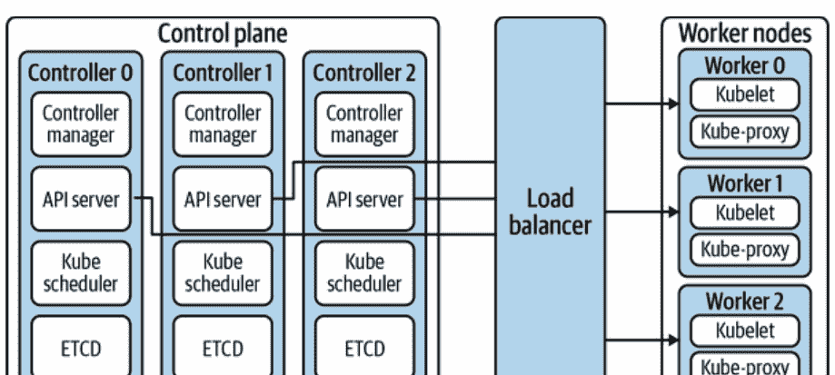
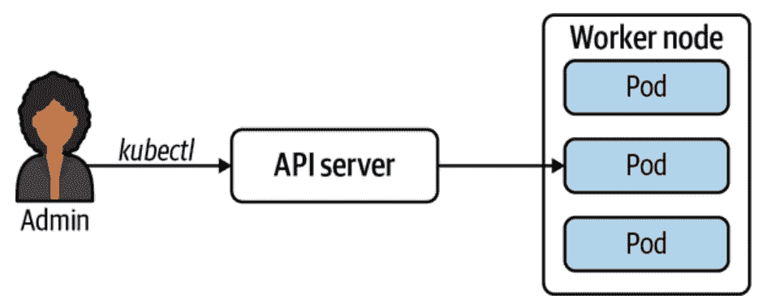
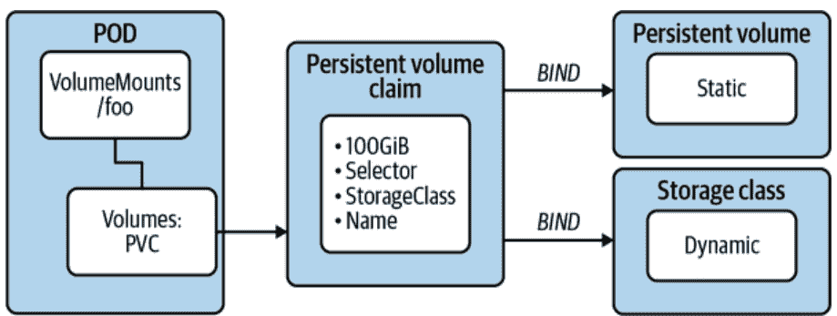
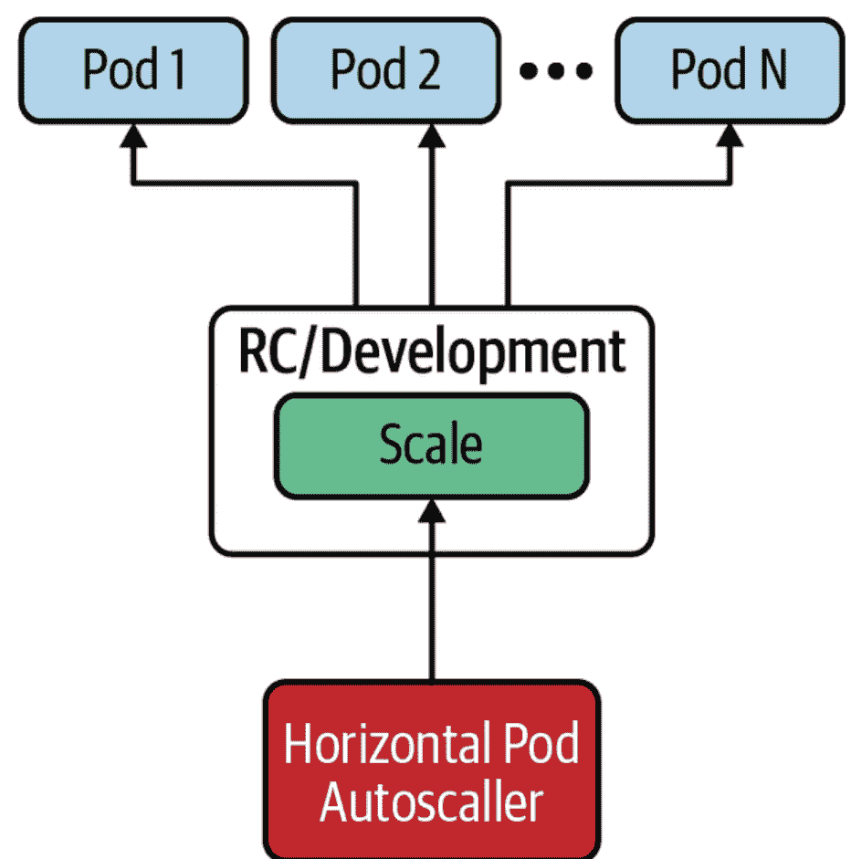
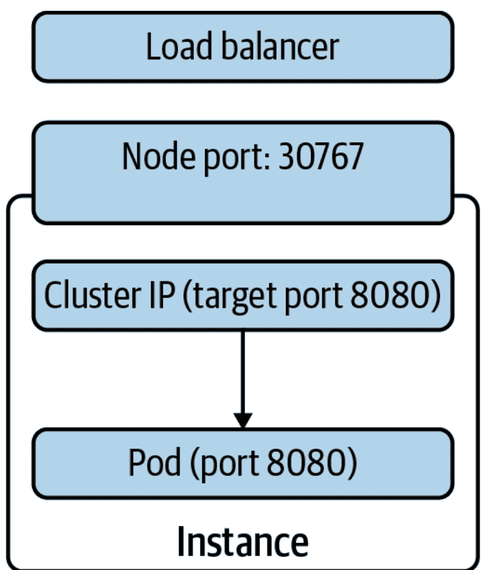
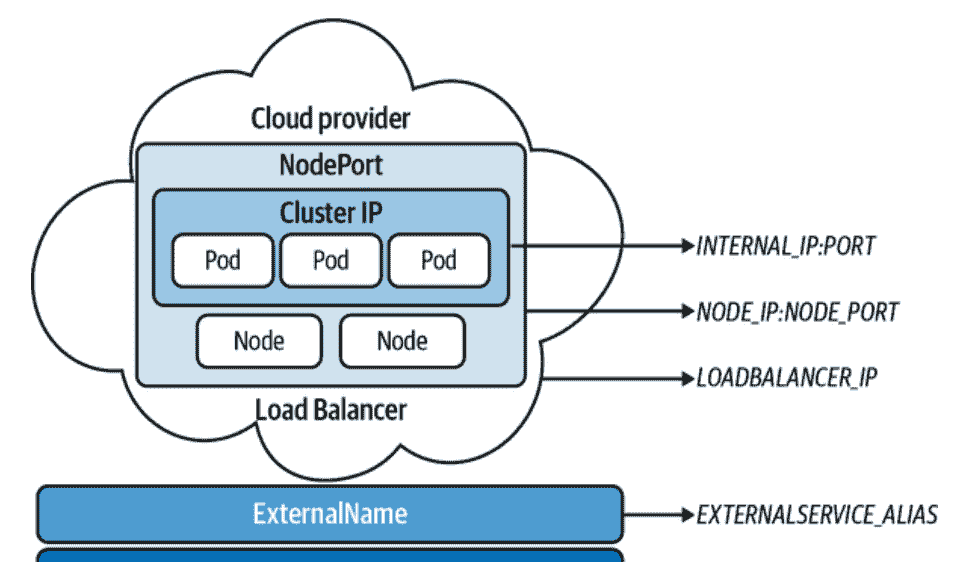
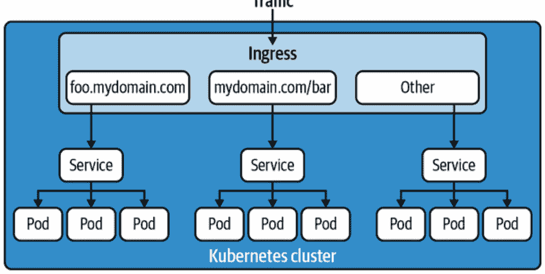

## 第 4 章. Kubernetes：伟大的编排器

### 早期发布读者须知

使用 Early Release 电子书，你可以在这些标题的正式发布之前很久就利用这些技术——作者在写作时提供的原始未编辑内容，以便你可以在这些技术正式发布之前利用它们。

这将是最终书籍的第 4 章。请注意 GitHub 仓库将在稍后激活。

如果你对如何改进本书的内容和/或示例有任何评论，或者如果你注意到本章中缺少材料，请联系编辑 rfernando@oreilly.com。

随着单体应用程序被分解为微服务，容器成为了这些微服务的事实上的容器。微服务是一种云原生架构方法，其中单个应用程序由许多更小、松耦合且独立的可部署组件或服务组成。容器确保软件在不同环境之间移动时正确运行。通过容器，微服务与其他微服务协同工作，形成一个完全功能的应用。

虽然将单体应用程序分解为更小的服务解决了其中一个问题，但它在管理和维护应用程序方面造成了更大的问题，没有显著的停机时间，各种微服务的网络化，分布式存储等等。容器通过将应用程序解耦为快速移动、代码库更小的形式来帮助，专注于功能开发。然而，虽然这种解耦在最初很干净、很容易，因为要管理的容器较少，但随着应用程序中的微服务数量增加，调试、更新甚至安全地将容器化微服务部署到堆栈中而不破坏任何东西或造成停机变得几乎不可能。

容器化应用程序是创建具有零停机时间的自愈环境的第一步，但这种做法需要进一步发展，尤其是在云原生环境中的软件开发和交付方面。这导致了诸如 Mesos、Docker Swarm、Nomad 和 Kubernetes 等调度和编排引擎的开发。在本章和下一章中，我们将重点关注 Kubernetes，因为它成熟且在行业中被广泛采用。

Google 于 2014 年向世界介绍了 Kubernetes，在花费近十年完善和学习其内部集群管理系统 Borg 之后。简单来说，Kubernetes 是一个开源容器编排系统。容器编排一词主要是指在动态环境如云中管理容器的完整生命周期，在云中，机器（服务器）根据需要随时出现和消失。容器编排器自动化并管理各种任务，例如配置和部署、调度、资源分配、扩展、负载均衡以及监控容器健康。2015 年，Google 将 Kubernetes 捐赠给了 Cloud Native Computing Foundation（CNCF）。

Kubernetes（又名 K8S）是云原生解决方案中最广泛采用的部分之一，因为它负责容器化应用程序的部署、可扩展性和维护。Kubernetes 帮助站点可靠性工程师（SRE）和 DevOps 工程师以弹性运行其云工作负载，同时负责跨集群多个容器上应用程序的扩展和故障转移。

### 为什么 Kubernetes 被称为 K8S？

Kubernetes 源自希腊语，意为船的舵手或领航员。Kubernetes 也被称为 K8S。这个数字名词是通过用 8 替换 K 和 S 之间的八个字母“ubernete”而得出的。

以下是 Kubernetes 开箱即提供的一些关键功能：

### 自愈

Kubernetes 最突出的功能之一是当容器崩溃时启动新容器的过程。

### 服务发现

在云原生环境中，容器从一个主机移动到另一个主机。弄清楚如何连接到在容器中运行的服务/应用程序的过程被称为服务发现。Kubernetes 使用 DNS 或容器的 IP 地址自动公开容器。

### 负载均衡

为了保持部署的应用程序处于稳定状态，Kubernetes 会自动负载均衡并分发传入流量。

### 自动部署

Kubernetes 基于声明式语法，这意味着你不必担心如何部署应用程序。相反，你只需说明需要部署什么，Kubernetes 就会处理它。

### 装箱

为了最大限度地利用计算资源，Kubernetes 会自动将容器部署到最佳主机上，而不会浪费或损害其他容器的整体可用性。


在本章中，我们将深入探讨 Kubernetes 的主要组件及其底层概念。虽然本章并不旨在全面教授 Kubernetes，因为已经有大量书籍¹ 详细涵盖了该主题，但我们希望建立坚实的基础。这种实践方法将帮助你更好地理解整体环境的细节。让我们从讨论 Kubernetes 集群的工作原理开始。

### Kubernetes 组件

Kubernetes 集群包含两种类型的节点组件：

*Control plane*

这是 Kubernetes 集群的治理组件。它确保一些重要服务（例如，调度、启动新的 Pods²）始终运行。控制平面节点的核心目的是确保集群始终处于健康且正确的状态。

*Worker nodes*

这些是运行在你的 Kubernetes 集群上托管所有容器的计算实例，用于运行你的工作负载。

图 4-1 描述了 Kubernetes 的高层组件。线条表示连接，例如 worker 节点接受连接与负载均衡器通信，后者分发流量。



图 4-1. Kubernetes 组件

现在让我们详细查看每个组件。

### Control Plane

控制平面主要负责对 Kubernetes 集群做出全局决策，例如检测集群状态、在节点上调度 Pods 以及管理 Pods 的生命周期。Kubernetes 控制平面有多个组件，我们将在以下小节中描述。

#### kube-apiserver (API server)

API 服务器是 Kubernetes 控制平面的前端，也是唯一可以直接访问整个 Kubernetes 集群的组件。如你在图 4-1 中所见，API 服务器充当 worker 节点与控制器节点之间所有交互的中心点。Kubernetes 集群中运行的服务使用 API 服务器相互通信。你可以运行多个 API 服务器实例，因为它设计为可水平扩展。

#### Kube scheduler

Kube scheduler 负责确定哪个 worker 节点将运行一个 Pod（或基本工作单元；我们将在本章后面更详细地解释 Pods）。Kube scheduler 与 API 服务器通信，后者确定哪些 worker 节点可用于以最佳方式运行调度的 Pod。调度器查找尚未分配到节点的刚创建的 Pods，然后找到可行的节点作为潜在候选者，并根据不同因素（如节点资源容量和硬件要求）对每个节点进行评分，以确保做出正确的调度决策。得分最高的节点将被选来运行 Pod。调度器还通过一个称为绑定 的过程将此决策通知 API 服务器。

#### Kube controller manager

Kubernetes 具有一个核心内置功能，可在集群中实现自愈能力。该功能称为 Kube controller manager，它作为守护进程运行。控制器管理器执行一个称为 reconciliation loop 的控制循环，这是一个非终止循环，负责以下工作：

- 确定节点是否已宕机，如果是，则采取行动。这由 Node controller 完成。
- 维护正确的 Pod 数量。这由 Replication controller 完成。
- 连接端点对象（即 services 和 Pods）。这由 Endpoint controller 完成。
- 确保为新命名空间创建默认帐户和端点。这由 Service Account 和 Token controllers 完成。

reconciliation loop 是 Kubernetes 自愈能力的驱动力。Kubernetes 通过在循环中连续运行以下步骤来确定集群及其对象状态：

- 获取用户声明的状态（期望状态）。
- 观察集群的状态。
- 比较观察到的状态和期望状态以找出差异。
- 根据观察到的状态采取行动。

#### Etcd

Kubernetes 使用 etcd 作为数据存储。Etcd 是一个键值存储，负责持久化所有 Kubernetes 对象。它最初由 CoreOS 团队创建，现在由 CNCF 管理。它通常以高可用性设置启动，并且 etcd 节点托管在单独的实例上。

### Worker Nodes

Kubernetes 集群包含一组称为 worker nodes 的工作机器，它们运行容器化应用程序。控制平面管理集群中的 worker 节点和 Pods。一些组件在所有 Kubernetes worker 节点上运行；它们在以下小节中讨论。

#### Kubelet

Kubelet 是在每个节点上运行的守护进程代理，确保 Pod 中的容器始终处于运行状态且健康。Kubelet 向 API 服务器报告 worker 节点上当前可用的资源（CPU、内存、磁盘），以便 API 服务器可以使用控制器管理器观察 Pods 的状态。由于 kubelet 是在 worker 节点上运行的代理，因此 worker 节点处理基本维护任务，例如在需要时重启容器并持续进行健康检查。

#### Kube-proxy

Kube-proxy 是在每个节点上运行的网络组件。Kube-proxy 监视集群中的所有 Kubernetes services³，并确保当对特定服务发出请求时，它会被路由到特定的虚拟 IP 端点。Kube-proxy 负责为服务实现一种虚拟 IP。

现在你已经掌握了 Kubernetes 组件的基础知识，让我们再深入挖掘，学习更多关于 Kubernetes API 服务器的知识。

### Kubernetes API Server Objects

API 服务器负责 Kubernetes 集群内部和外部的所有通信，并公开 RESTful HTTP API。API 服务器在根本层面上允许你查询和操作 Kubernetes 对象。简单来说，Kubernetes 对象是有状态的实体，表示集群的整体状态（图 4-2）。要开始使用这些对象，我们需要了解每个对象的 fundamentals。



图 4-2. API 服务器与集群对象的交互

#### Pods

在 Kubernetes 中，Pods 是最小的基本原子单元。Pod 是一组一个或多个容器，被部署在 worker 节点上。Kubernetes 负责管理 Pod 内运行的容器。Pod 内的容器始终最终位于同一个 worker 节点上，并且紧密耦合。由于 Pod 内的容器是共置的，它们在同一上下文中运行（即它们共享网络和存储）。这种共享上下文是 Linux 命名空间、cgroups 以及我们在第 3 章中解释的任何其他维护隔离方面的特征。Pods 也会获得唯一的 IP 地址。

在典型场景中，Pod 内运行单个容器，但在某些情况下，多个容器需要在 Pod 中协同工作。这种后一种设置通常称为 sidecar container。运行 sidecar container 最常见的例子之一是为你的应用程序运行一个日志容器，该容器会将日志发送到外部存储，例如 ELK（Elasticsearch、Logstash 和 Kibana）服务器，以防应用程序 Pod 崩溃或 Pod 被删除。Pods 也很智能，即如果容器中的进程死亡，Kubernetes 会根据应用程序级别定义的健康检查立即重启它。

Pods 的另一个特征是它们允许通过 ReplicaSets 实现的水平扩展复制。这意味着如果你希望你的应用程序水平扩展，你应该使用 ReplicaSets 创建更多 Pods。

Pods 也是短暂的，这意味着如果一个 Pod 被杀死，它将被移动并在不同的主机上重启。这也是通过使用 ReplicaSets 实现的。

### ReplicaSets

可靠性是 Kubernetes 的主要特征，并且由于没有人会运行单个 Pod 实例，因此冗余变得很重要。ReplicaSet 是一个 Kubernetes 对象，可确保稳定的一组副本 Pods 正在运行以维护自愈集群。所有这些都是通过 reconciliation loop 实现的，该循环在后台持续运行以观察 Kubernetes 集群的整体状态。ReplicaSets 使用 reconciliation loop 并确保如果任何 Pod 崩溃或重启，将启动一个新的 Pod 以维持期望的复制状态。一般来说，你不应直接处理 ReplicaSets，而应使用 Deployment 对象，后者可确保对你的应用程序进行零停机更新，并以声明式方法管理操作 Kubernetes。


### Deployments

Kubernetes 主要是一个以声明式语法为中心的编排器。这意味着为了推出新功能，你需要告诉 Kubernetes 你需要做什么，而 Kubernetes 则负责以安全的方式[content]

### Deployments

Kubernetes 主要是一个以声明式语法为中心的编排器。这意味着为了推出新功能，你需要告诉 Kubernetes 你需要做什么，而 Kubernetes 则负责以安全的方式来执行该操作。Kubernetes 提供的一个对象是为了使应用程序新版本发布更顺畅，那就是 `Deployment`。如果你手动去更新 Pod，你需要重启 Pod，这会造成停机。虽然 ReplicaSet 知道如何维护期望数量的 Pod，但它不会执行零停机升级。这里就是 `Deployment` 对象发挥作用的地方，因为它通过在新更新的 Pod 推出之前始终保持预定义数量的 Pod 处于活动状态，从而以零停机的方式将更改滚动到 Pod。

### Services

要公开在 Pod 内部运行的应用程序，Kubernetes 提供了一个名为 `Service` 的对象。由于 Kubernetes 是一个非常动态的系统，有必要确保应用程序正在与正确的后端通信。Pod 是 Kubernetes 世界中短暂的进程，因为它们经常被创建或销毁。Pod 与唯一的 IP 地址耦合，这意味着如果你仅依赖 Pod 的 IP 地址，当 Pod 死亡时你很可能会得到一个损坏的服务，因为 Pod 在重启后会获得不同的 IP 地址，即使你正在运行 ReplicaSet。`Service` 对象通过定义一组逻辑 Pod 以及访问它们的策略来提供抽象。每个服务都获得一个稳定的 IP 地址和一个可用于访问 Pod 的 DNS 名称。你可以声明性地定义面向你的 Pod 的服务，并使用 `Label-Selector` 来访问服务。

### Namespaces

由于在生产级环境中部署了多个团队和项目，因此有必要组织 Kubernetes 对象。从简单的角度来看，*namespaces* 是通过逻辑分区分隔的虚拟集群；也就是说，你可以根据逻辑分区对资源（如部署、Pod 等）进行分组。有些人喜欢把命名空间看作是用于分隔名称的目录。集群中每个对象的名称在其特定类型的资源中是唯一的，同样每个对象都有一个 UID，该 UID 在整个集群中是唯一的。
命名空间还允许你通过设置 *resource quotas* 来在多个用户之间划分集群资源。

### Labels and Selectors

当你开始使用 Kubernetes 并创建对象时，你会意识到需要识别或标记你的 Kubernetes 资源，以便将它们分组为逻辑实体。Kubernetes 提供 *labels* 来为对象标识元数据，这很容易让你对资源进行分组和操作。标签是键值对，可以直接附加到 Pod、命名空间、守护进程集等对象上。你可以随时添加标签并按需修改它们。为了查找或识别你的 Kubernetes 资源，你可以使用 *label selectors* 来查询标签。例如，一种应用程序层类型的标签可以是：

```
"tier" : "frontend", "tier" : "backend", "tier" : "midtier"
```

### Annotations

*Annotations* 也是键值对，但与用于标识对象的标签不同，注释用于保存对象本身的非标识信息。例如，构建、发布或镜像信息，如时间戳、发布 ID、Git 分支、PR 号码、镜像哈希和注册表地址可以记录在注释中。

### Ingress Controller

为了让你的服务从互联网接收流量，你需要将 HTTP 和 HTTPS 端点从外部暴露到在 Pod 上运行的 Kubernetes 服务。*ingress* 允许你通过提供具有 Secure Sockets Layer/Transport Layer Security (SSL/TLS) 终止的负载均衡以及基于名称的虚拟主机，将在集群内部运行的服务暴露给外部世界。为了支持 ingress，你应该首先选择一个 *ingress controller*，它类似于反向代理，用于接受 HTTP 和 HTTPS 的传入连接。

### StatefulSets

要在 Kubernetes 上管理和扩展你的有状态工作负载，你需要确保 Pod 是稳定的（即稳定的网络和稳定的存储）。*StatefulSets* 确保 Pod 的排序并保持其唯一性（不像 ReplicaSets）。StatefulSet 是一个控制器，可帮助你部署一组在重启和重新调度时保持弹性的 Pod。StatefulSet 中的每个 Pod 都有唯一的命名约定，其序数值从 0 开始，并且与之关联一个稳定的网络 ID（不像 ReplicaSet，其命名约定是随机的）。

### DaemonSets

在常规环境中，我们在主机上运行许多守护进程服务和代理，包括日志代理和监控代理。Kubernetes 允许你通过使用 *DaemonSets* 在集群中的一组节点上运行 Pod 的副本来安装此类代理。就像 ReplicaSets 一样，DaemonSets 是长期运行的进程，可确保期望状态和观察状态保持一致。删除 DaemonSet 也会删除它之前创建的 Pod。

### Jobs

Kubernetes 世界中的 Jobs 是短暂的实体，可以是小型任务，例如运行独立脚本。Jobs 最终会创建 Pod。Jobs 运行直到成功终止，这是控制作业的 Pod 与在终止时将不断重启和重新调度的常规 Pod 之间的主要区别。如果 Job Pod 在完成前失败，控制器将根据模板创建一个新的 Pod。

#### NOTE

本章是 Kubernetes 的速成课程，仅触及容器编排的表面。还有其他资源可以帮助你了解更多关于 Kubernetes 的信息。我们推荐以下一些资源：

- *Managing Kubernetes* by Brendan Burns and Craig Tracey (O’Reilly, 2018)
- *Kubernetes: Up and Running, 2nd Edition* by Brendan Burns, Joe Beda, and Kelsey Hightower (O’Reilly 2019)
- “Introduction to Kubernetes,” a free course from LinuxFoundationX: https://www.edx.org/course/introduction-to-kubernetes
- *Cloud Native DevOps with Kubernetes* by John Arundel and Justin Domingus (O’Reilly, 2019)

现在我们已经介绍了 Kubernetes 世界中的一些基本术语，让我们来看看管理集群的运营细节。

### Observe, Operate, and Manage Kubernetes Clusters with kubectl

与容器编排器交互的常见方式之一是使用命令行工具或图形工具。在 Kubernetes 中你可以用这两种方式与集群交互，但首选方式是命令行。Kubernetes 提供 kubectl 作为 CLI。Kubectl 被广泛用于管理集群。你可以将 kubectl 视为各种 Kubernetes 功能的瑞士军刀，它使你能够部署和管理应用程序。如果你是 Kubernetes 集群的管理员，你将大量使用 kubectl 命令来管理集群。Kubectl 提供各种命令，包括：

- 声明性性质的资源配置命令
- 用于获取工作负载信息的调试命令
- 用于操作和与 Pod 交互的调试命令
- 通用的集群管理命令

在本节中，我们将通过使用 kubectl 帮助管理 Kubernetes 集群、Pod 和其他对象，深入探索 Kubernetes，重点关注基本集群命令。

### General Cluster Information and Commands

与 Kubernetes 集群交互的第一步是学习如何深入了解你将要工作的集群、基础设施和 Kubernetes 组件。要查看在你的集群中运行工作负载的工作节点，请发出以下 kubectl 命令：

```
$ ~ kubectl get nodes
NAME      STATUS   ROLES     AGE   VERSION
worker0   Ready    <none>    11d   v1.17.3
worker1   Ready    <none>    11d   v1.17.3
worker2   Ready    <none>    11d   v1.17.3
```

这将列出你的节点资源及其状态，以及版本信息。你可以通过在 get nodes 命令中使用 -o wide 标志来获得更多信息，如下所示：

```
$ ~ kubectl get nodes -o wide
NAME      STATUS   ROLES     AGE   VERSION   INTERNAL-IP   EXTERNAL-IP   OS-IMAGE          KERNEL-VERSION     CONTAINER-RUNTIME
worker0   Ready    <none>    11d   v1.17.3   10.240.0.20   <none>        Ubuntu 16.04.7 LTS   4.15.0-1092-azure   containerd://1.3.2
worker1   Ready    <none>    11d   v1.17.3   10.240.0.21   <none>        Ubuntu 16.04.7 LTS   4.15.0-1092-azure   containerd://1.3.2
worker2   Ready    <none>    11d   v1.17.3   10.240.0.22   <none>        Ubuntu 16.04.7 LTS   4.15.0-1092-azure   containerd://1.3.2
```

要获取有关特定资源或工作节点的更多详细信息，你可以使用 describe 命令，如下所示：


```
~ kubectl describe nodes worker0
```

`kubectl describe` 命令是一个非常有用的调试命令。你可以用它来获取 Pod 和其他资源方面的深入信息。

`get` 命令可用于获取有关 Pod、服务、复制控制器等的信息。例如，要获取所有 Pod 的信息，可以运行：

```
$ ~ kubectl get pods
NAME                 READY   STATUS             RESTARTS   AGE
busybox-56d8458597-xpjcg   0/1     ContainerCreating   0          1m
```

要获取集群中所有命名空间的列表，可以按如下方式使用 `get`：

```
$ ~ kubectl get namespace
NAME                     STATUS    AGE
default                  Active    12d
kube-node-lease          Active    12d
kube-public              Active    12d
kube-system              Active    12d
kubernetes-dashboard     Active    46h
```

默认情况下，kubectl 与 `default` 命名空间交互。要使用不同的命名空间，可以传递 `--namespace` 标志来引用命名空间中的对象：

```
$ ~ kubectl get pods --namespace=default
NAME                 READY   STATUS    RESTARTS   AGE
busybox-56d8458597-xpjcg   1/1     Running   0          47h
```

```
$ ~ kubectl get pods --namespace=kube-public
No resources found in kube-public namespace.
```

```
$ ~ kubectl get pods --namespace=kubernetes-dashboard
NAME                 READY   STATUS    RESTARTS   AGE
dashboard-metrics-scraper-779f5454cb-gq82q  1/1  Running  0  2m
kubernetes-dashboard-857bb4c778-qxsnj  1/1  Running  0  46h
```

要查看整体集群详细信息，可以按如下方式使用 cluster-info：

```
$ ~ kubectl cluster-info
Kubernetes master is running at https://40.70.3.6:6443
CoreDNS is running at
https://40.70.3.6:6443/api/v1/namespaces/kube-system/services/kube-dns:dns/proxy
```

cluster-info 命令可获取控制平面所在的 API 负载均衡器的详细信息，以及其他组件。

在 Kubernetes 中，要与特定集群保持连接，你使用上下文。上下文有助于将访问参数分组在同一名称下。每个上下文包含一个 Kubernetes 集群、一个用户和一个命名空间。当前上下文是当前对 kubectl 来说默认的集群，所有 kubectl 发出的命令都针对该集群运行。你可以按如下方式查看当前上下文：

```
$ ~ kubectl config current-context
cloud-native-azure
```

要更改默认命名空间，可以使用一个上下文，该上下文已注册到环境中 kubectl 的 kubeconfig 文件。kubeconfig 文件是实际告诉 kubectl 如何找到 Kubernetes 集群然后根据已配置的密钥进行身份验证的文件。该文件通常存储在主目录下的 .kube/ 中。要创建并使用具有不同命名空间作为默认值的新的上下文，可以执行以下操作：

```
$ ~ kubectl config set-context test --namespace=mystuff
Context "test" created.
$ ~ kubectl config use-context test
Switched to context "test"
```

确保你确实拥有该上下文（即 *test* Kubernetes 集群），否则你将无法真正使用它。

标签，如我们之前提到的，用于组织你的对象。例如，如果你想用一个名为 `production` 的值给 `busybox` Pod 加标签，可以按如下方式操作，其中 `environment` 是标签名：

```
$ ~ kubectl label pods busybox-56d8458597-xpjcg environment=production
pod/busybox-56d8458597-xpjcg labeled
```

有时，你可能想知道 Pod 出了什么问题并尝试调试问题。要查看 Pod 的日志，可以在 Pod 名称上运行 `logs` 命令：

```
$ ~ kubectl get pods
NAME                          READY   STATUS             RESTARTS   AGE
busybox-56d8458597-xpjcg      0/1     ContainerCreating  0          2d
$ ~ kubectl logs busybox-56d8458597-xpjcg
Error from server (BadRequest): container "busybox" in pod "busybox-56d8458597-xpjcg" is waiting to start: ContainerCreating
```

有时 Pod 内可能运行多个容器。要在其中选择容器，可以传递 `-c` 标志。

### Managing Pods

正如我们之前讨论的，Pod 是 Kubernetes 中最小的可部署构件。作为最终用户或管理员，你直接处理 Pod 而不是容器。容器由 Kubernetes 内部处理，此逻辑被抽象化。还应记住，Pod 内的所有容器都放置在同一节点上。Pod 也有定义明确的生命周期，其状态从 *Pending* 移动到 *Running* 再到 *Succeeded* 或 *Failed。*

创建 Pod 的一种方式是使用 kubectl run 命令，如下所示：

```
kubectl run <name of pod> --image=<name of the image from registry>
```

kubectl run 命令从容器仓库拉取公共镜像并创建 Pod。例如，你可以按如下方式运行 hazelcast 镜像，并同时公开容器的端口：

```
$ ~ kubectl run hazelcast --image=hazelcast/hazelcast --port=5701
deployment.apps/hazelcast created
```

**NOTE**
在生产环境中，你绝不应运行或创建 Pod，因为这些 Pod 不直接由 Kubernetes 管理，在出现故障时不会被重启或重新调度。你应使用 Deployment 作为操作 Pod 的首选方式。

kubectl run 命令功能丰富，你可以控制许多 Pod 行为。例如，如果你希望在前台运行 Pod（即 Pod 内具有交互式终端），并且不希望在崩溃时重启它，可以执行以下操作：

```
$ ~ kubectl run -i -t busybox --image=busybox --restart=Never
If you don't see a command prompt, try pressing enter.
/ #
```

此命令将直接将你登录到容器中。由于你以交互模式运行 Pod，因此你可以查看 busybox 的状态从 Running 更改为 Completed，如下所示：

```
$ ~ kubectl get pods
NAME        READY   STATUS    RESTARTS   AGE
busybox     1/1     Running   0          52s
```

```
$ ~ kubectl get pods
NAME            READY   STATUS      RESTARTS   AGE
busybox         0/1     Completed   0          61s
```

在 Kubernetes 中创建 Pod 的另一种方式是使用 Pod 清单中的声明式语法。Pod 清单应与你的应用程序代码同等重要，可以使用 YAML 或 JSON 编写。你可以按如下方式为运行 Nginx Pod 创建 Pod 清单：

```
apiVersion: v1
kind: pod
metadata:
  name: nginx
spec:
  containers:
    - image: nginx
      name: nginx
      ports:
        - containerPort: 80
          name: http
```

Pod 清单信息，例如 kind、spec 和其他信息，会发送到 Kubernetes API 服务器以执行操作。你可以将 Pod 清单保存为 YAML 扩展名并使用 apply，如下所示：

```
$ kubectl apply -f nginx_pod.yaml
pod/nginx created
$ kubectl get pods
NAME            READY   STATUS    RESTARTS   AGE
nginx           1/1     Running   0          7s
```

当你运行 kubectl apply 时，Pod 清单会被发送到 Kubernetes API 服务器，后者会立即将 Pod 调度到集群中的健康节点上运行。Pod 由 kubelet 守护进程监控，如果 Pod 崩溃，它会被重新调度到另一个健康节点上运行。

让我们继续，看看如何在 Kubernetes 中的服务上实现健康检查。

### Health checks

Kubernetes 提供了三种类型的 HTTP 健康检查，称为 *probes*，用于确保应用程序确实存活且运行良好：liveness probes、readiness probes 和 startup probes。

#### Liveness probe

此探针负责确保应用程序实际上是健康且完全功能的。部署后，你的应用程序可能需要几秒钟才能准备就绪，因此你可以配置此探针以检查应用程序中的某个端点。例如，在以下 Pod 清单中，已使用 liveness probe 对端口 80 上的 / 路径执行 `httpGet` 操作。`initialDelaySeconds` 设置为 2，这意味着在该时间段过去之前不会命中端点 /。此外，我们将超时设置为 1 秒，失败阈值设置为 3 次连续探针失败。`periodSeconds` 定义了 Kubernetes 调用 Pod 的频率。在本例中为 15 秒。

```
apiVersion: v1
kind: Pod
metadata:
  name: mytest-pod
spec:
  containers:
  - image: test_image
    imagePullPolicy: IfNotPresent
    name: mytest-container
    command: ['sh', '-c', 'echo Container 1 is Running ; sleep 3600']
    ports:
    - name: liveness-port
      containerPort: 80
      hostPort: 8080
    livenessProbe:
      httpGet:
        path: /
        port: 80
      initialDelaySeconds: 2
      timeoutSeconds: 1
```


periodSeconds: 15
failureThreshold: 3

### Readiness probe

Readiness probe 的职责是识别容器何时准备好为用户请求提供服务。Readiness probe 通过在过早将未就绪 Pod 的端点添加到负载均衡器之前阻止其加入，帮助 Kubernetes。Readiness probe 可以与 Pod 清单中的 liveness probe 块同时配置，如下所示：

```
containers:
  - name: test_image
    image: test_image
    command: ["/bin/sh"]
    args: ['sh', '-c', 'echo Container 1 is Running ; sleep 3600']
    readinessProbe:
      httpGet:
        path: /
        port: 80
      initialDelaySeconds: 5
      periodSeconds: 5
```

### Startup probe

有时应用程序在首次初始化时需要额外的启动时间。在这种情况下，可以设置一个 startup probe，使用 HTTP 或 TCP 检查，其 failureThreshold * periodSeconds 足够长以覆盖最坏情况下的启动时间：

```
startupProbe:
  httpGet:
    path: /healthapi
    port: liveness-port
  failureThreshold: 30
  periodSeconds: 10
```

### Resource limits

当你处理 Pods 时，可以指定应用程序所需的资源。Pod 运行最基本的一些资源需求

是 CPU 和内存。虽然 Kubernetes 可以处理更多类型的资源，但我们在这里保持简单，只讨论 CPU 和内存。

你可以在 Pod 清单中声明两个参数：*request* 和 *limit*。在 request 块中，你告诉 Kubernetes 应用程序运行所需的最小资源要求，而在 limit 块中，你告诉 Kubernetes 最大阈值。如果你的应用程序超过 limit 块中的阈值，它将被终止或重启，Pod 将被大部分驱逐。例如，在下面的 Pod 清单中，我们为 CPU 设置了 500m⁴ 的最大限制和 206Mi⁵ 的最大内存限制，这意味着如果这些值被超过，Pod 将被驱逐并在其他节点上重新调度：

```
apiVersion: v1
kind: Pod
metadata:
  name: nginx
spec:
  containers:
    - image: nginx
      name: nginx
      ports:
        - containerPort: 80
          name: http
  resources:
    requests:
      cpu: "100m"
      memory: "108Mi"
    limits:
      cpu: "500m"
      memory: "206Mi"
```

### Volumes

一些应用程序需要数据永久存储，但由于 Pods 是短暂的实体，并且经常在运行中重启或被杀死，与 Pod 关联的所有数据也可能被销毁。*Volumes* 通过 Azure 中的存储磁盘抽象层解决了这个问题。Volume 是一种在整个应用程序生命周期中跨 Pods 存储、检索和持久化数据的方式。如果你的应用程序是有状态的，你需要使用 volume 来持久化你的数据。Azure 提供了 *Azure Disk* 和 *Azure Files* 来创建提供此功能的数据卷。

### *Persistent Volume Claim (PVC)*

PVC 在 Pod 和存储之间充当抽象层。在 Kubernetes 中，Pod 借助 PVC 挂载卷，而 PVC 与底层资源通信。需要注意的一点是，PVC 让你能够使用抽象的底层存储资源；也就是说，它让你声明一块预先配置好的存储。PVC 定义磁盘大小和磁盘类型，然后将真实存储挂载到 Pod；此绑定过程可以是静态的，如持久卷 PV，也可以是动态的，如 `Storage class`。例如，在下面的清单中，我们声明了一个存储为 `1Gi` 的 `PersistentVolumeClaim`：

```
apiVersion: v1
kind: PersistentVolumeClaim
metadata:
  name: persistent-volume-claim-app1
spec:
  accessModes:
    - ReadWriteMany
  resources:
    requests:
      storage: 1Gi
  storageClassName: azurefilestorage
```

### *Persistent volume—static*

集群管理员，通常是 SRE 或 DevOps 团队，可以手动创建预定义数量的持久卷，然后集群用户可以根据需要使用。持久卷是静态配置方法。例如，在下面的清单中，我们创建了一个存储容量为 `2Gi` 的 `PersistentVolume`：

```
apiVersion: v1
kind: PersistentVolume
metadata:
  name: static-persistent-volume-app1
```

```
labels:
  storage: azurefile
spec:
  capacity:
    storage: 2Gi
  accessModes:
  - ReadWriteMany
  storageClassName: azurefilestorage
  azureFile:
    secretName: static-persistence-secret
    shareName: user-app1
    readOnly: false
```

### Storage class—dynamic

Storage classes 是为 PVC 动态配置的卷（即允许按需创建存储卷）。Storage classes 基本上为集群管理员提供了一种描述可以提供的存储类别的方法。每个 storage class 都有一个 provisioner，用于确定用于配置持久卷的卷插件。

在 Azure 中，有两种 provisioner 决定将使用哪种存储：AzureFile 和 AzureDisk。

AzureFile 可以与 ReadWriteMany 访问模式一起使用：

```
apiVersion: storage.k8s.io/v1
kind: StorageClass
metadata:
  name: azurefile
provisioner: kubernetes.io/azure-file
parameters:
  skuName: Standard_LRS
  location: eastus
  storageAccount: azure_storage_account_name
```

AzureDisk 只能与 ReadWriteOnce 访问模式一起使用：

```
apiVersion: storage.k8s.io/v1
kind: StorageClass
metadata:
  name: slow
provisioner: kubernetes.io/azure-disk
```

```
parameters:
    storageaccounttype: Standard_LRS
    kind: Shared
```

Figure 4-3 展示了 Kubernetes 提供的各种存储对象之间的逻辑关系。



Figure 4-3. Pods、PVC、PV 和 Storage class 之间的关系

最后，你可以使用 kubectl delete pod 按如下方式删除 Pod：

```
$ ~ kubectl delete pod nginx
pod "nginx" deleted
```

你应该确保在删除 Pod 时，它实际上不是由 Deployment 控制的，因为如果是这样，它会重新出现。例如：

```
$ ~ kubectl get pods
NAME                READY   STATUS    RESTARTS   AGE
hazelcast-84bb5bb976-vrk97   1/1     Running   2          2d7h
nginx-76df748b9-rdbqq        1/1     Running   2          2d7h
$ ~ kubectl delete pod hazelcast-84bb5bb976-vrk97
pod "hazelcast-84bb5bb976-vrk97" deleted
$ ~ kubectl get pods
NAME                READY   STATUS    RESTARTS   AGE
hazelcast-84bb5bb976-rpcfh   1/1     Running   0          13s
nginx-76df748b9-rdbqq        1/1     Running   2          2d7h
```

它启动新 Pod 的原因是 Kubernetes 观察到集群中的状态被扰动，其中期望状态和观察状态不匹配，因此 reconciliation loop 启动以平衡 Pods。这可能是因为 Pod 实际上是通过 Deployment 部署的，并且会有相关的 ReplicaSets。因此，为了删除 Pod，你需要删除 Deployment，这反过来会自动删除 Pod。这如下所示：

```
$ ~ kubectl get deployments --all-namespaces
NAMESPACE              NAME                 READY   UP-TO-DATE   AVAILABLE   AGE
default                hazelcast            1/1     1            1           2d21h
default                nginx                1/1     1            1           2d21h
kube-system            coredns              2/2     2            2           3d7h
$ ~ kubectl delete -n default deployment hazelcast
deployment.apps "hazelcast" deleted
$ ~ kubectl get pods
NAME                                 READY   STATUS        RESTARTS   AGE
hazelcast-84bb5bb976-rpcfh          0/1     Terminating   0          21m
nginx-76df748b9-rdbqq               1/1     Running       2          2d7h
```

### Kubernetes in Production

现在我们已经介绍了 Pods 的基础知识、Kubernetes 概念以及 Kubernetes 集群的工作方式，让我们看看如何在 Kubernetes 集群中实际将 Pods 结合起来并达到生产就绪。在本节中，我们将看到上一节中讨论的概念如何使生产工作负载受益，以及应用程序如何部署到 Kubernetes。

### ReplicaSets

正如我们所讨论的，ReplicaSets 通过维护稳定的 Pod 数量，在基础设施层面实现了 Kubernetes 的自愈能力。在基础设施层面发生故障时（即节点


which hold the Pods), the ReplicaSet will reschedule the Pods to a different, healthy node. A ReplicaSet includes the following:

#### Selector

ReplicaSets uses Pod labels to find and list the Pods running in the cluster to create replicas in case of a failure.

#### Number of replicas to create

This specifies how many Pods should be created.

#### Template

This specifies the associated data of new Pods that a ReplicaSet should create to meet the desired number of Pods.

In actual production use cases, you will need a ReplicaSet to maintain a stable set of running Pods by introducing redundancy. But you don’t have to deal with the ReplicaSet directly, since it’s an abstraction layer. Instead, you should use Deployments, which offer a much better way to deploy and manage Pods. A ReplicaSet looks like this:

```
apiVersion: apps/v1
kind: ReplicaSet
metadata:
  name: myapp-cnf-replicaset
  labels:
    app: cnfbook
spec:
  replicas: 3
  selector:
    matchLabels:
      app: cnfbook
  template:
    metadata:
      labels:
        app: cnfbook
    spec:
      containers:
      - name: nginx
```

```
image: nginx
ports:
  - containerPort: 80
```

To create the ReplicaSet from the preceding configuration, save the manifest as nginx_Replicaset.yaml and apply it. This will create a ReplicaSet and three Pods, shown as follows:

```
$ kubectl apply -f nginx_Replicaset.yaml
replicaset.apps/myapp-cnf-replicaset created
```

```
$ kubectl get rs
NAME                    DESIRED   CURRENT   READY   AGE
myapp-cnf-replicaset    3         3         3       6s
```

```
$ kubectl get pods
NAME                                 READY   STATUS    RESTARTS   AGE
myapp-cnf-replicaset-drwp9           1/1     Running   0          11s
myapp-cnf-replicaset-pgwj8           1/1     Running   0          11s
myapp-cnf-replicaset-wqkl1           1/1     Running   0          11s
```

### Deployments

In production environments, one of the key things that are constant is change. You will keep updating/changing the applications in your production environment at a very rapid pace, since the most common task you will be doing in production is rolling out new features of your application. Kubernetes offers the Deployment object as a standard for doing rolling updates, and provides a seamless experience to the cluster administrator as well as end users. This means you can push updates to your applications without taking down your applications, since Deployment ensures that only a certain number of Pods are down while they are being updated. These are known as zero downtime deployments. By default, deployments ensure that at least 75% of the desired number of Pods are up. Deployments are the reliable, safe, and current way to roll out new versions of applications with zero downtime in Kubernetes.

You can create a deployment as follows:

```
apiVersion: apps/v1
kind: Deployment
metadata:
  name: nginx-deployment
  labels:
    app: nginx
spec:
  replicas: 3
  selector:
    matchLabels:
      app: nginx
  template:
    metadata:
      labels:
        app: nginx
    spec:
      containers:
      - name: nginx
        image: nginx
        ports:
        - containerPort: 80
```

To apply the preceding configuration, save it in a file named nginx_Deployment.yaml and then use kubectl apply as follows:

```
$ kubectl apply -f nginx_Deployment.yaml
deployment.apps/nginx-deployment created
```

Interestingly, the deployment handles ReplicaSets as well, since we declared that we would need three replicas for the deployment Pod. We can check this as follows:

```
$ kubectl get deployment
NAME              READY   UP-TO-DATE   AVAILABLE   AGE
nginx-deployment   3/3     3            3           18s
$ kubectl get rs
NAME                           DESIRED   CURRENT   READY   AGE
nginx-deployment-d46f5678b     3         3         3       29s
$ kubectl get pods
NAME                                    READY   STATUS    RESTARTS   AGE
nginx-deployment-d46f5678b-dpc7p        1/1     Running   0          36s
nginx-deployment-d46f5678b-kdjxv        1/1     Running   0
```

So, from the manifest file, we created three replicas in the .spec.replicas file, and for the Deployment object to find the Pods being managed by nginx-deployment, we make use of the spec.selector field. The Pods are labeled using the template field via metadata.labels.

Now let’s roll out a new version of Nginx. Say we want to pin the version of Nginx to 1.14.2. We just need to edit the deployment manifest by editing the file; that is, changing the version and then saving the manifest file, as follows:

```
$ kubectl edit deployment.v1.apps/nginx-deployment
deployment.apps/nginx-deployment edited
```

This will update the Deployment object, and you can check it as follows:

```
$ kubectl rollout status deployment.v1.apps/nginx-deployment
Waiting for deployment "nginx-deployment" rollout to finish: 1
out of 3 new replicas have been updated...
Waiting for deployment "nginx-deployment" rollout to finish: 1
out of 3 new replicas have been updated...
Waiting for deployment "nginx-deployment" rollout to finish: 2
out of 3 new replicas have been updated...
Waiting for deployment "nginx-deployment" rollout to finish: 2
out of 3 new replicas have been updated...
Waiting for deployment "nginx-deployment" rollout to finish: 2
out of 3 new replicas have been updated...
Waiting for deployment "nginx-deployment" rollout to finish: 2
old replicas are pending termination...
Waiting for deployment "nginx-deployment" rollout to finish: 1
old replicas are pending termination...
Waiting for deployment "nginx-deployment" rollout to finish: 1
old replicas are pending termination...
deployment "nginx-deployment" successfully rolled out
```

The Deployment object ensures that a certain number of Pods are always available and serving while the older Pods are updated. As we already mentioned, by default, no more than 25% of Pods are unavailable while an

update is being performed. Deployment ensures a max surge percentage of 25%, which ensures that only a certain number of Pods are created over the desired number of Pods. So, from the `rollout status`, you can clearly see that at least two Pods are available at all times while rolling out a change. You can get the details for your deployment again by using `kubectl describe deployment`.

> **NOTE**
> 
> We directly issued a deployment command using `kubectl edit`, but the preferred approach is to always update the actual manifest file and then apply `kubectl`. This also helps you keep your deployment manifests in version control. You can use the `--record` or `set` command to update as well.

### Horizontal Pod Autoscaler

Kubernetes supports dynamic scaling through the use of the Horizontal Pod Autoscaler (HPA), where the Pods are scaled horizontally; that is, you can create *n* number of Pods based on observed metrics for your Pod if, for example, you want to increase or decrease the number of Pods dynamically based on the CPU metric being observed. The HPA works via a control loop which, at an interval of 15 seconds by default, checks the resource utilization specified against the metrics (see Figure 4-4).



Figure 4-4. Horizontal Pod Autoscaler at work

It is important to note that to use the HPA, we need metrics-server,⁶ which collects metrics from kubelets and exposes them in the Kubernetes API server through the metrics API for use by the HPA. We first create an autoscaler using kubectl autoscale for our deployment, as follows:

```
$ ~ kubectl autoscale deployment nginx-deployment --cpu-percent=50 --min=3 --max=10
horizontalpodautoscaler.autoscaling/nginx-deployment autoscaled
```

The preceding kubectl command will create an HPA that will ensure that no fewer than three and no more than 10 Pods are used in our nginx-deployment. The HPA will increase or decrease the number of replicas to maintain an average CPU utilization across all Pods of no more than 50%.

You can view your HPA using the following:

```
$ ~ kubectl get hpa
NAME                 REFERENCE                         TARGETS   MINPODS   MAXPODS   REPLICAS   AGE
nginx-deployment     Deployment/nginx-deployment       0%/50%    3         10        3          6m59s
```

We can add the scaling factor on which we can create the autoscaler with the help of an HPA manifest YAML file that is tied to the deployment.

### Service

As we mentioned earlier, the Kubernetes environment is a very dynamic system where Pods are created, destroyed, and moved at a varying pace. This dynamic environment also opens a door to a well-known problem: finding the replica Pods where an application is residing, since multiple Pods are running for a deployment. Pods also need a way to find the other Pods in order to communicate. Kubernetes offers the Service object as an abstraction for a single point of entry to the group of Pods. The Service object has an IP address, a DNS name, and a port that never changes as long as the object exists. Formally known as service discovery, this feature basically helps other Pods/services reach other services in Kubernetes without dealing with the underlying complexity. We will discuss the cloud native service discovery approach in more detail in Chapter 6.

To use a service, you can use the service manifest YAML. Suppose you have a simple “hello world” application already running as a deployment. One default technique to expose this service is to specify the service type as ClusterIP. This service will be exposed on the cluster’s internal IP and will only be reachable from within the cluster, as follows:


```
---
apiVersion: v1
kind: Service
metadata:
  name: hello-world-service
spec:
  type: ClusterIP
  selector:
    app: hello-world
  ports:
  - port: 8080
    targetPort: 8080
```

端口表示服务可用的端口，而 targetPort 是服务将被转发到的实际容器端口。在此例中，我们将 hello-world 应用的 8080 端口在 Pod IP 上暴露到了 targetPort 8080：

```
$ kubectl get svc
NAME                 TYPE        CLUSTER-IP     EXTERNAL-IP
PORT(S)              AGE
hello-world-service  ClusterIP   10.32.0.40     <none>
8080/TCP             6s
```

显示的 IP 地址是集群 IP，而不是实际的机器 IP 地址。如果你在 worker 节点上通过 SSH 登录，可以通过简单执行如下 curl 来检查服务是否已在 8080 端口暴露：

```
ubuntu@worker0:~$ curl http://10.32.0.40:8080
Hello World
```

如果你尝试从集群外部访问此 IP 地址（即除 worker 之外的任何其他节点），你将无法连接到它。因此，你可以使用 NodePort，它会在每个节点的 IP 上以定义的端口暴露服务，如下所示：

```
---
apiVersion: v1
kind: Service
metadata:
  name: hello-world-node-service
spec:
  type: NodePort
  selector:
    app: hello-world
  ports:
  - port: 8080
    targetPort: 8080
    nodePort: 30767
```

在服务清单中，我们将 Pod 端口 8080 映射到了 NodePort（即物理实例端口）30767。这样，你可以直接暴露 IP 或放置你选择的负载均衡器。现在执行 get svc，你可以看到端口的映射如下：

```
$ kubectl get svc
NAME                 TYPE       CLUSTER-IP     EXTERNAL-IP
PORT(S)              AGE
hello-world-node-service   NodePort   10.32.0.208    <none>
8080:30767/TCP   8s
hello-world-service        ClusterIP  10.32.0.40     <none>
8080/TCP         41m
```

现在我们可以在节点的 30767 端口访问服务：

```
ubuntu@controller0:~$ curl http://10.240.0.21:30767
Hello World
```

curl 命令中的 IP 是 worker 节点的物理 IP 地址（不是集群 IP），而被暴露的端口是 30767。你甚至可以直接访问节点的公网 IP 的 30767 端口。图 4-5 展示了集群 IP、节点端口和负载均衡器之间的关系。



图 4-5. Kubernetes 节点中的集群 IP、节点端口和负载均衡器

其他类型的 Service 包括 LoadBalancer 和 ExternalName。LoadBalancer 使用云提供商的负载均衡器将 Service 对外暴露。NodePort 和 ClusterIP Service 会自动创建，外部负载均衡器会路由到它们，而 ExternalName 将服务映射到 DNS 名称，如 my.redisdb.internal.com。在图 4-6 中，你可以看到不同服务类型之间的关系。



图 4-6. 云环境中的外部服务和 LoadBalancer

### Ingress

Service 对象有助于在集群内部和外部暴露应用程序，但在生产系统中，我们无法为使用 NodePort 部署的所有服务不断开放新的唯一端口，也无法每次将服务类型选择为 LoadBalancer 时都创建一个新的负载均衡器。有时我们需要部署基于 HTTP 的服务并执行 SSL 卸载，而 Service 对象在这些情况下并不能真正帮助我们。在 Kubernetes 中，HTTP 负载均衡（或正式的第 7 层负载均衡）由 Ingress 对象执行。

要使用 Ingress，我们首先需要配置一个 ingress controller。7 我们将配置 Azure Kubernetes Service (AKS) Application Gateway ingress controller 以更好地理解它并观察其行为，但总的来说，了解它的最简单方法之一是查看以下内容：

```
apiVersion: networking.k8s.io/v1
kind: Ingress
metadata:
  name: ingress-wildcard-host
spec:
  rules:
  - host: "foo.bar.com"
    http:
      paths:
      - pathType: Prefix
        path: "/bar"
        backend:
          service:
            name: hello-world-node-service
            port:
              number: 8080
  - host: "*.foo.com"
    http:
      paths:
      - pathType: Prefix
        path: "/foo"
        backend:
          service:
            name: service2
            port:
              number: 80
```

在 ingress 清单中，我们创建了两条规则，并将 *foo.bar.com* 作为主机映射到一个子域 /bar，该子域路由到我们之前的服务 `hello-world-node-service`。

同样，我们可以为一个域名定义多个路径并将它们路由到其他服务。Ingress 的配置方式有很多种，可以根据你的需求进行配置，可能从单个域名路由到多个服务，或多个域名路由到多个域名（参见图 4-7）。



图 4-7. 具有多个路径的域的 Ingress

最后，你可以通过创建 Secret 对象并在 ingress spec 中使用该 secret 来指定 TLS 支持，如下所示：

```
apiVersion: v1
kind: Secret
metadata:
  name: my_tls_secret
  namespace: default
data:
  tls.crt: base64 encoded cert
  tls.key: base64 encoded key
type: kubernetes.io/tls
```

你可以通过指定 Base64 编码的 TLS 证书和密钥来保护 ingress。当你在 ingress 清单中引用此 secret 时，它将如下所示：

```
apiVersion: networking.k8s.io/v1
kind: Ingress
metadata:
  name: tls-example-ingress
spec:
  tls:
  - hosts:
    - https.mywebsite.example.come
secretName: my_tls_secret
rules:
- host: https.mywebsite.example.come
  http:
    paths:
    - path: /
      pathType: Prefix
      backend:
        service:
          name: service1
          port:
            number: 80
```

Ingress controller 处理许多功能和复杂性，而 Azure 网关 ingress controller 处理了其中很多；例如，利用 Azure 原生的第 7 层应用网关负载均衡器将你的服务暴露到互联网。我们将在第 5 章介绍 AKS 时更详细地讨论这一点。

### DaemonSet

正如我们之前讨论的，DaemonSets 通常用于在 Kubernetes 集群中的多个节点上运行代理。代理在由 Pod 抽象的容器内运行。大多数时候，SRE 和 DevOps 工程师更喜欢在每个节点上运行日志代理或监控代理以获取应用遥测和事件。默认情况下，DaemonSet 会在每个节点上创建 Pod 的副本，尽管这也可以使用节点选择器进行限制。ReplicaSets 和 DaemonSets 之间有很多相似之处，但它们之间的关键区别在于 DaemonSets 要求在所有节点上运行单个代理（即 Pod）应用程序。

运行日志容器的其中一种方式是使用 DaemonSet 在每个节点上部署 Pod。Fluentd 是一个开源日志解决方案，广泛用于从系统收集日志。以下示例展示了使用 DaemonSet 部署 Fluentd 的一种方法：

```
apiVersion: apps/v1
kind: DaemonSet
metadata:
name: fluentd-elasticsearch
namespace: kube-system
labels:
  central-log-k8s: fluentd-logging
spec:
  selector:
    matchLabels:
      name: fluentd-elasticsearch
  template:
    metadata:
      labels:
        name: fluentd-elasticsearch
    spec:
      tolerations:
      - key: node-role.kubernetes.io/master
        effect: NoSchedule
      containers:
      - name: fluentd-elasticsearch
        image: quay.io/fluentd_elasticsearch/fluentd:v2.5.2
        resources:
          limits:
            memory: 200Mi
          requests:
            cpu: 100m
            memory: 200Mi
        volumeMounts:
        - name: varlog
          mountPath: /var/log
        - name: varlibdockercontainers
          mountPath: /var/lib/docker/containers
          readOnly: true
      terminationGracePeriodSeconds: 30
      volumes:
      - name: varlog
        hostPath:
          path: /var/log
      - name: varlibdockercontainers
        hostPath:
          path: /var/lib/docker/containers
```

在前面的 DaemonSet 配置中，我们创建了一个 DaemonSet，它将在每个节点上部署 Fluentd 容器。我们还创建了一个容忍，该容忍不会将 Fluentd 节点调度到 master（控制平面）节点上。


#### NOTE

Kubernetes 提供了名为 *taints* 和 *tolerations* 的调度功能。

- Kubernetes 中的 Taints 允许节点排斥一组 Pod（即，如果你希望某些节点不调度某些类型的 Pod）。
- Tolerations 应用于 Pod，并允许（但不要求）Pod 调度到具有匹配 taints 的节点上。

Taints 和 tolerations 协同工作以确保 Pod 不会被调度到不合适的节点上。一个或多个 taints 会应用到节点上；这表示该节点不应接受任何不能容忍这些 taints 的 Pod。

你可以按如下方式检查为每个 worker 节点自动创建的 Pod：

```
$ kubectl apply -f fluentd.yaml
daemonset.apps/fluentd-elasticsearch created
```

```
$ kubectl get ds --all-namespaces
NAMESPACE      NAME                   DESIRED   CURRENT   READY   UP-TO-DATE   AVAILABLE   NODE SELECTOR   AGE
kube-system    fluentd-elasticsearch  3         3         3       3            <none>       5m12s
```

```
$ kubectl get pods --namespace=kube-system -o wide
NAME                              READY   STATUS    RESTARTS   AGE
IP           NODE      NOMINATED NODE   READINESS GATES
fluentd-elasticsearch-5jxg7      1/1     Running   1          45m
10.200.1.53   worker1   <none>           <none>
fluentd-elasticsearch-c5s4c      1/1     Running   1          45m
10.200.2.32   worker2   <none>           <none>
fluentd-elasticsearch-r4pqz      1/1     Running   1          45m
10.200.0.43   worker0   <none>           <none>
```

### Jobs

有时我们需要运行一个小脚本直到它成功终止。Kubernetes 允许你使用 Job 对象来实现这一点。Job 对象创建并管理 Pod，这些 Pod 会运行直到成功完成，并且与普通 Pod 不同，一旦给定任务完成，这些由 Job 创建的 Pod 不会被重启。你可以使用一个 Job YAML 来描述一个简单的 Job，如下所示：

```
apiVersion: batch/v1
kind: Job
metadata:
  name: examplejob
spec:
  template:
    metadata:
      name: examplejob
    spec:
      containers:
      - name: examplejob
        image: busybox
        command: ["echo", "Cloud Native with Azure"]
      restartPolicy: Never
```

这里我们创建了一个 Job 来打印一个 shell 命令。要创建 Job，你可以保存上述 YAML 并使用 kubectl apply 应用它。一旦你应用了 job 清单，Kubernetes 将创建该 job 并立即运行它。你可以使用 kubectl describe 检查 job 的状态，如下所示：

```
$ kubectl apply -f job.yaml
job.batch/examplejob created
$ kubectl get jobs
NAME         COMPLETIONS   DURATION   AGE
examplejob   1/1           3s         9s
$ kubectl describe job examplejob
Name:         examplejob
Namespace:    default
Selector:     controller-uid=f6887706-85ef-4752-8911-79cc7ab33886
Labels:       controller-uid=f6887706-85ef-4752-8911-79cc7ab33886
              job-name=examplejob
Annotations:  kubectl.kubernetes.io/last-applied-configuration:
{"apiVersion":"batch/v1","kind":"Job","metadata":{"annotations":{},"name":"examplejob","namespace":"default"},"spec":{"template":
{"metadat...
Parallelism:  1
```

```
Completions:      1
Start Time:       Mon, 07 Sep 2020 01:08:53 +0530
Completed At:     Mon, 07 Sep 2020 01:08:56 +0530
Duration:         3s
Pods Statuses:    0 Running / 1 Succeeded / 0 Failed
Pod Template:
  Labels:   controller-uid=f6887706-85ef-4752-8911-79cc7ab33886
            job-name=examplejob
  Containers:
    examplejob:
      Image:        busybox
      Port:         <none>
      Host Port:    <none>
      Command:
        echo
        Cloud Native with Azure
      Environment:  <none>
      Mounts:       <none>
      Volumes:      <none>
Events:
  Type    Reason           Age   From            Message
  ----    ------           ----  ----            -------
  Normal  SuccessfulCreate  61s   job-controller  Created pod: examplejob-mcqzc
  Normal  Completed         58s   job-controller  Job completed
```

### Summary

Kubernetes 是一个强大的平台，它建立在 Google 在大规模容器化应用中获得的十年的经验之上。Kubernetes 基本上促成了 Cloud Native Computing Foundation 的诞生，并且是其下毕业的第一个项目。这导致了微服务生态系统在支持和更高采用云原生环境方面的整体简化。在本章中，我们查看了使 Kubernetes 能够大规模运行的各种组件和概念。本章还为即将到来的章节奠定了基础，在这些章节中我们将利用 Kubernetes 平台来服务生产级的云原生应用。

鉴于管理 Kubernetes 集群的底层复杂性，在第 5 章中我们将研究如何创建和使用此类集群。我们还将研究 Azure Kubernetes Service，以及更多内容。

1 *Managing Kubernetes* 由 Brendan Burns 和 Craig Tracey 编写（O’Reilly, 2019）；*Kubernetes in Action* 由 Marko Luksa 编写（Manning, 2018）。

2 Pod 是你可以在 Kubernetes 中创建和管理的最小可部署计算单元。

3 在 Kubernetes 中，服务是一种使你的 Pod 能够在 Kubernetes 集群内部被发现的方式。

4 允许分数请求。例如，一个 CPU 可以拆分为两个 0.5。表达式 0.1 等价于 100m。

5 Limit 和 request 以字节为单位测量。内存可以用纯整数或使用后缀 E、P、T、G、M、K，或其 2 的幂等价物 Ei、Pi、Ti、Gi、Mi、Ki 的定点数表示。

6 你可以从 https://github.com/kubernetes-sigs/metrics-server 安装 metric-server。

7 对于 `Ingress` 资源正常工作，集群必须运行 ingress controller。与作为 `kube-controller-manager` 二进制文件一部分运行的其他类型的控制器不同，ingress controller 并不会随集群自动启动。有不同类型的 ingress controller；例如，Azure 提供了 AKS Application Gateway Ingress Controller 用于配置 Azure Application Gateway。
