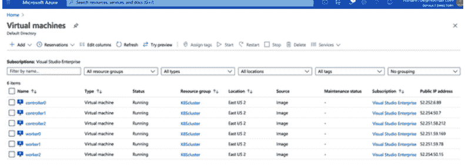
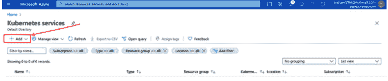
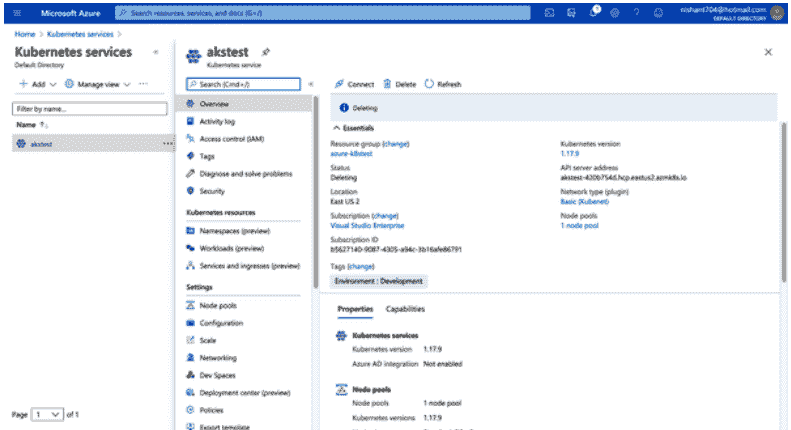
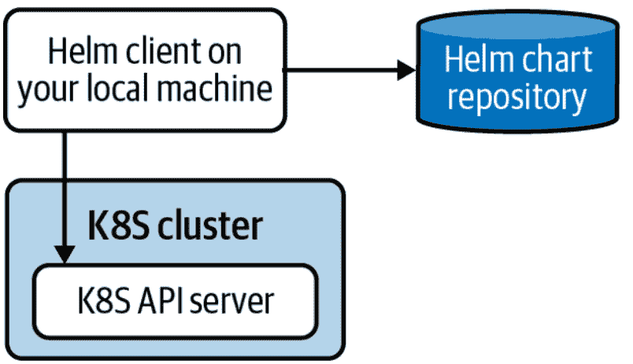

## Chapter 5. Creating a Kubernetes Cluster in Azure

### A NOTE FOR EARLY RELEASE READERS

对于早期发布读者的一则说明

使用 Early Release 电子书，你可以在这些书籍的官方发布之前很久就利用这些技术——作者在撰写时提供的原始未编辑内容，以便你能尽早利用这些技术。

这将是最终书籍的第 5 章。请注意，GitHub 仓库将在稍后激活。

如果你对如何改进本书的内容和/或示例有任何评论，或者如果你注意到本章中缺少材料，请联系编辑 rfernando@oreilly.com。

现在你已经了解了 Kubernetes 集群在底层的工作原理，是时候检验这些知识并实际构建和使用一个 Kubernetes 集群了。有多个工具可用于在生产环境中以高可用性创建和运行 Kubernetes 集群。其中一些更常见的工具是 kops、kubeadm、Kubespray 和 Rancher。这些工具在构建集群方面有预写的剧本，可以与一系列技术组合无缝地在生产环境中运行。

在本章中，我们将不使用预构建的工具。相反，我们将采取更动手的方式来构建一个你可以在生产环境中使用的集群。

### Creating a Kubernetes Cluster from Scratch

在本节中，我们将使用 Ansible、Terraform 和 Packer 从头构建一个 Kubernetes 集群。我们将向你展示如何手动构建集群，以便你更好地了解集群的各个组件。虽然这不是构建或运行生产级 Kubernetes 集群的首选方式，但它将为你提供良好的基础知识。

开始之前，你需要克隆本书的 GitHub（https://bit.ly/3kccjZZ）并打开 Chapter5 文件夹。本章假设你已经按照第 2 章中的步骤设置了 Azure 账户，并且你已经通过 Terraform、Packer 和 Ansible playbooks 尝试过创建基础设施。

我们按如下方式安排了 Chapter5 Git 仓库中的代码：


$ Chapter5 git:(master)
. 
|-- AKS - Azure Kubernetes Service Cluster
|-- Ansible-Playbooks - Ansible playbooks for creating k8s cluster
|-- Deployments
|-- K8S_Packer_Image - Machine images for worker and controller
|-- Kubernetes_Cluster- Terraform initialization directory for k8s
|-- README.md
|-- terraform_modules - Terraform modules for k8s cluster

In this section, we will only use K8S_Packer_Image, Ansible-Playbooks, Kubernetes_Cluster, and terraform_modules.

### Creating the Resource Group

The first step is to create a resource group for all the infrastructure components so that we can group them together. To do this, go to the Chapter5/Kubernetes_Cluster/A-Resource_Group directory and execute the following command:

```
$ terraform init
```

After initializing, run the following to create a resource group:

```
$terraform apply

An execution plan has been generated and is shown below.
Resource actions are indicated with the following symbols:
  + create

Terraform will perform the following actions:

  # module.CNA-Terraform-Resource-Grp.azurerm_resource_group.generic-resource-gp will be created
  + resource "azurerm_resource_group" "generic-resource-gp" {
      + id       = (known after apply)
      + location = "eastus2"
      + name     = "K8Scluster"
      + tags     = {
          + "cluster"    = "k8s-experiments"
          + "environment" = "dev"
        }
    }

Plan: 1 to add, 0 to change, 0 to destroy.

Do you want to perform these actions?
  Terraform will perform the actions described above.
  Only 'yes' will be accepted to approve.

Enter a value: yes
```

To continue, enter yes. This will create a resource group named K8Scluster in the eastus2 region of Azure.

### Creating the Machine Images for the Worker and Controller Machines

The second step is to create the Packer images of the controller and worker instance images. In the Chapter5/K8S_Packer_Image directory, update both controller.json and worker.json with the Azure credentials for client_id, client_secret, tenant_id, and subscription_id. Now run the packer commands as follows:

```
$ packer build worker.json
==> Builds finished. The artifacts of successful builds are:
--> azure-arm: Azure.ResourceManagement.VMImage:

OSType: Linux
ManagedImageResourceGroupName: K8Scluster
ManagedImageName: k8s_worker
ManagedImageId: /subscriptions/b5624140-9087-4311-a94a-3b16a2e84792/resourceGroups/K8Scluster/providers/Microsoft.Compute/images/k8s_worker
ManagedImageLocation: eastus2
```

```
$ packer build controller.json
==> Builds finished. The artifacts of successful builds are:
--> azure-arm: Azure.ResourceManagement.VMImage:

OSType: Linux
ManagedImageResourceGroupName: K8Scluster
ManagedImageName: k8s_controller
ManagedImageId: /subscriptions/b5624140-9087-4311-a04b-3b16a2e84792/resourceGroups/K8Scluster/providers/Microsoft.Compute/images/k8s_controller
ManagedImageLocation: eastus2
```

Note the ManagedImageId, which we will be using later in the chapter.

### Creating a Storage Account Backend

Next, we will create the storage account to store all the infrastructure mapping to be used by Terraform. Again, we will first initialize the repo with terraform init in Kubernetes_Cluster/B-Storage_Account_backend and then apply the command as follows:

```
$ terraform apply
.
.
Apply complete! Resources: 3 added, 0 changed, 0 destroyed.
```

Outputs:

```
Blob-ID = https://cnabookprod.blob.core.windows.net/k8s-cluster-dev/test
Blob-URL = https://cnabookprod.blob.core.windows.net/k8s-cluster-dev/test
Primary-Access-Key =
ymMDE1pUQgtuxh1AOJyUv1vfXnmjAeJEH12XvMmQ38AZp1O8Z0Xk4Hrw4N/d8yovb8FQ5VzqtREH94g
zPCzAWCA==
```

This will create a storage account with the name cnabookprod. Update your bash_profile with a Primary-Access-Key value using the variable name ARM_ACCESS_KEY:

```
export
ARM_ACCESS_KEY=ymMDE1pUQgtuxh1AOJyUv1vfXnmjAeJEH12XvMmQ38AZp1O8Z0Xk4Hrw4N/d8yov
b8FQ5VzqtREH94gzPCzAWCA==
```

### Creating an Azure Virtual Network

The next step is to create the virtual network where we will be hosting our Kubernetes cluster. Go to the Chapter5/Kubernetes_Cluster/C-Virtual_Network directory and again initialize Terraform using terraform init. Once initialized, apply the following configuration to create an Azure virtual network:

```
$ terraform apply
.
.
.
Apply complete! Resources: 6 added, 0 changed, 0 destroyed.
Releasing state lock. This may take a few moments...
Outputs:

subnet_id = /subscriptions/b5624140-9087-4311-a04b-
3b16a2e84792/resourceGroups/K8Scluster/providers/Microsoft.Network/virtualNetworks/cna-k8s-vnet/subnets/cna-k8s-subnet
vnet_id = /subscriptions/b5624140-9087-4311-a04b-
3b16a2e84792/resourceGroups/K8Scluster/providers/Microsoft.Network/virtualNetworks/cna-k8s-vnet
```

This will create a virtual network with a CIDR of 10.240.0.0/24 that is named cna-k8s-vnet.

### Creating Public IPs for the Load Balancer

Now we’ll create public IPs for the load balancer along with all the worker and control plane nodes. Once we have created the public IPs for all the resources, we will create the load balancer for the control plane nodes to expose the API server to remote clients.

To create the public IPs, go to the Chapter5/Kubernetes_Cluster/D-K8S_PublicIP directory and initialize Terraform using terraform init. The code will be organized as follows:

```
module "K8S-API-Server-Public-IP" {
    source = "../../terraform_modules/Azure_PublicIP"
    name_of_ip = "k8s_master_lb"
    resource-grp-name = "K8Scluster"
    azure-dc = "eastus2"
    env = "dev"
    type-of-cluster = "k8s-experiments"
}

module "Worker0" {
    source = "../../terraform_modules/Azure_PublicIP"
    name_of_ip = "Worker0"
    resource-grp-name = "K8Scluster"
    azure-dc = "eastus2"
    env = "dev"
    type-of-cluster = "k8s-experiments"
}
module "Worker1" {
    source = "../../terraform_modules/Azure_PublicIP"
    name_of_ip = "Worker1"
    resource-grp-name = "K8Scluster"
    azure-dc = "eastus2"
    env = "dev"
    type-of-cluster = "k8s-experiments"
}
module "Worker2" {
    source = "../../terraform_modules/Azure_PublicIP"
    name_of_ip = "Worker2"
    resource-grp-name = "K8Scluster"
    azure-dc = "eastus2"
    env = "dev"
    type-of-cluster = "k8s-experiments"
}

module "Controller0" {
    source = "../../terraform_modules/Azure_PublicIP"
    name_of_ip = "Controller0"
    resource-grp-name = "K8Scluster"
    azure-dc = "eastus2"
    env = "dev"
    type-of-cluster = "k8s-experiments"
}
module "Controller1" {
    source = "../../terraform_modules/Azure_PublicIP"
    name_of_ip = "Controller1"
    resource-grp-name = "K8Scluster"
    azure-dc = "eastus2"
    env = "dev"
    type-of-cluster = "k8s-experiments"
}
module "Controller2" {
    source = "../../terraform_modules/Azure_PublicIP"
    name_of_ip = "Controller2"
    resource-grp-name = "K8Scluster"
    azure-dc = "eastus2"
    env = "dev"
    type-of-cluster = "k8s-experiments"
}
```

Once Terraform is initialized, you can apply the configuration using terraform apply as follows, which will create the public IPs:

```
$ terraform apply
.
.
Apply complete! Resources: 7 added, 0 changed, 0 destroyed.
Releasing state lock. This may take a few moments...
Outputs:
Controller0_IP = 52.252.6.89
Controller0_IP_ID = /subscriptions/b5624140-9087-4311-a04b-3b16a2e84792/resourceGroups/K8Scluster/providers/Microsoft.Network/publicIPAddresses/Controller0
Controller1_IP = 52.254.50.7
Controller1_IP_ID = /subscriptions/b5624140-9087-4311-a04b-3b16a2e84792/resourceGroups/K8Scluster/providers/Microsoft.Network/publicIPAddresses/Controller1
Controller2_IP = 52.251.58.212
Controller2_IP_ID = /subscriptions/b5624140-9087-4311-a04b-3b16a2e84792/resourceGroups/K8Scluster/providers/Microsoft.Network/publicIPAddresses/Controller2
PublicIP_ID = /subscriptions/b5624140-9087-4311-a04b-3b16a2e84792/resourceGroups/K8Scluster/providers/Microsoft.Network/publicIPAddresses/k8s_master_lb
Public_IP = 52.254.73.23
Worker0_IP = 52.251.59.169
Worker0_IP_ID = /subscriptions/b5624140-9087-4311-a04b-3b16a2e84792/resourceGroups/K8Scluster/providers/Microsoft.Network/publicIPAddresses/Worker0
Worker1_IP = 52.251.59.78
Worker1_IP_ID = /subscriptions/b5624140-9087-4311-a04b-3b16a2e84792/resourceGroups/K8Scluster/providers/Microsoft.Network/publicIPAddresses/Worker1
Worker2_IP = 52.254.50.15
Worker2_IP_ID = /subscriptions/b5624140-9087-4311-a04b-3b16a2e84792/resourceGroups/K8Scluster/providers/Microsoft.Network/publicIPAddresses/Worker2
```

The preceding code will create seven public IPs: six for the node instances (worker and controller) and one for the load balancer. Now we can create the load balancer and attach the load balancer IP to it by going to the Chapter5/Kubernetes_Cluster/E-K8S-API-Public-loadbalancer directory and initializing Terraform. Then we can again use terraform apply as follows:

```
$ terraform apply
.
.
```


Apply complete! Resources: 4 added, 0 changed, 0 destroyed.
Releasing state lock. This may take a few moments...

Outputs:

lb_backend_pool = /subscriptions/b5624140-9087-4311-a04b-3b16a2e84792/resourceGroups/K8Scluster/providers/Microsoft.Network/loadBalancers/k8s_master_lb/backendAddressPools/k8s-control-plane
load_balancer_frontend_id = /subscriptions/b5624140-9087-4311-a04b-3b16a2e84792/resourceGroups/K8Scluster/providers/Microsoft.Network/loadBalancers/k8s_master_lb/frontendIPConfigurations/K8S-frontend-config
load_balancer_id = /subscriptions/b5624140-9087-4311-a04b-3b16a2e84792/resourceGroups/K8Scluster/providers/Microsoft.Network/loadBalancers/k8s_master_lb
load_balancer_private_ip =
load_balancer_public_ip = /subscriptions/b5624140-9087-4311-a04b-3b16a2e84792/resourceGroups/K8Scluster/providers/Microsoft.Network/publicIPAddresses/k8s_master_lb

This step will create a load balancer and apply the load balancer rules that we predefined in the Terraform config file.

### Creating Worker and Controller Instances

At this point, we’re ready to create the instance nodes which will constitute our Kubernetes cluster. We will be creating a six-node cluster in which three nodes will be worker nodes that will run the actual workload (Pods, etc.) and three will be part of the control plane.

Before we do this, we need to update the main.tf file in the /Chapter5/Kubernetes_Cluster/F-K8S-Nodes/main.tf directory with the image ID for the worker node and controller node. Also, we need to update the path for the location of the Secure Shell (SSH) key that will be used to ssh onto the machines:

```
module "master" {
    source = "../../terraform_modules/Azure_VMs-Master"
    azure-dc = "eastus2"
    resource-grp-name = "K8Scluster"
    private_ip_addresses = ["10.240.0.10", "10.240.0.11", "10.240.0.12"]
    vm_prefix = "controller"
    username = "ubuntu"
    public_ip_address_id =
    [data.terraform_remote_state.k8s_public_ip.outputs.Controller0_IP_ID,data.terraform_remote_state.k8s_public_ip.outputs.Controller1_IP_ID,data.terraform_remote_state.k8s_public_ip.outputs.Controller2_IP_ID]
    vm_size = "Standard_D1_v2"
    env = "dev"
    type-of-cluster = "k8s-experments"
    vm_count = 3
    subnet_id = data.terraform_remote_state.k8s_vnet.outputs.subnet_id
    image_id = "/subscriptions/b5624140-9087-4311-a04b-3b16a2e84792/resourceGroups/K8Scluster/providers/Microsoft.Compute/images/k8s_c"
```

```
ontroller"
  ssh_key = "${file("/Users/nissingh/TESTING/SSH_KEYS/id_rsa.pub")}"
  lb_backend_pool =
  data.terraform_remote_state.k8s_loadbalancer.outputs.lb_backend_pool
}
```

In the preceding configuration (*main.tf*), the image ID was updated for the controller (master) node along with the path to the SSH key. Now you can generate an SSH key pair using the `ssh-keygen` command for `ssh_key`. Similarly, you can update the worker config file and then initialize Terraform as before. Once the initialization is done, you can use `terraform apply` to create the worker and controller instances:

```
$ terraform apply
.
.
.
Apply complete! Resources: 17 added, 0 changed, 0 destroyed.
Releasing state lock. This may take a few moments...

Outputs:

master_machine_id = [
  [
    "/subscriptions/b5624140-9087-4311-a04b-3b16a2e84792/resourceGroups/K8Scluster/providers/Microsoft.Compute/virtualMachines/controller0",
    "/subscriptions/b5624140-9087-4311-a04b-3b16a2e84792/resourceGroups/K8Scluster/providers/Microsoft.Compute/virtualMachines/controller1",
    "/subscriptions/b5624140-9087-4311-a04b-3b16a2e84792/resourceGroups/K8Scluster/providers/Microsoft.Compute/virtualMachines/controller2",
  ],
]
master_machine_name = [
  [
    "controller0",
    "controller1",
    "controller2",
  ],
]
master_machine_private_ips = [
  [
    "10.240.0.10",
    "10.240.0.11",
    "10.240.0.12",
  ],
]
worker_machine_id = [
  [
    "/subscriptions/b5624140-9087-4311-a04b-3b16a2e84792/resourceGroups/K8Scluster/providers/Microsoft.Compute/virtualMachines/worker0",
```

```
"/subscriptions/b5624140-9087-4311-a04b-3b16a2e84792/resourceGroups/K8Scluster/providers/Microsoft.Compute/virtualMachines/worker1",
"/subscriptions/b5624140-9087-4311-a04b-3b16a2e84792/resourceGroups/K8Scluster/providers/Microsoft.Compute/virtualMachines/worker2",
],
]
worker_machine_name = [
[
"worker0",
"worker1",
"worker2",
],
]
worker_machine_private_ips = [
[
"10.240.0.20",
"10.240.0.21",
"10.240.0.22",
],
]
```

Once the terraform apply is complete, you will see that the nodes have been provisioned for your Kubernetes cluster (see Figure 5-1).



Figure 5-1. Worker and controller nodes up and running

### Using Ansible to Deploy and Configure the Kubernetes Controller Nodes

With the infrastructure running, it’s time to configure the cluster, since currently we just have the bare skeleton prepared. To deploy and configure Kubernetes to work on the node, we will use Ansible playbooks.

First, update the host file in Chapter5/Ansible-Playbooks/hosts with the IP addresses of the worker and controller instances, along with the SSH username and the path of the SSH private key that was generated with ssh-keygen:

```
[controllers]
inventory_hostname=controller0 ansible_host=52.252.6.89
inventory_hostname=controller1 ansible_host=52.254.50.7
inventory_hostname=controller2 ansible_host=52.251.58.212

[workers]
inventory_hostname=worker0 ansible_host=52.251.59.169
inventory_hostname=worker1 ansible_host=52.251.59.78
inventory_hostname=worker2 ansible_host=52.254.50.15

[all:vars]
ansible_user = ubuntu
ansible_ssh_private_key_file = /Users/SSH_KEYS/id_rsa
```

Once the hosts file is updated, we need to update the groupvars (located in the all file in the Chapter5/Ansible-Playbooks/group_vars directory) with the loadbalancer_public_ip and the encryption key. Since Kubernetes stores a variety of data, including cluster state, application configurations, and secrets, we need to encrypt this data at rest. Kubernetes supports the ability to encrypt cluster data at rest.

To create an encryption key, you can simply issue the following command on your terminal and paste the generated secret in the group_vars/all file as follows:

```
$ head -c 32 /dev/urandom | base64
Uvivn+4ONy9yqRf0ynRV0psEE7WsfyvYnM7VNakiNeA=
```

You will also need to update the load balancer IP. The final group_vars should look like this:

```
---
#Change loadbalancer_public_ip
loadbalancer_public_ip : 52.254.73.23
controller_private_ips_list : 10.240.0.10,10.240.0.11,10.240.0.12
### Keep k8s_internal_virtual_ip as it is
k8s_internal_virtual_ip: 10.32.0.1
k8s_cluster_cidr: "10.200.0.0/16"
k8s_cluster_name: "cloud-native-azure"
### Generate your own encryption_key : "head -c 32 /dev/urandom | base64"
encryption_key: Uvivn+4ONy9yqRf0ynRV0psEE7WsfyvYnM7VNakiNeA=
#ETC config below for systemd file, place private ip's. No need to change
controller_0_ip: 10.240.0.10
controller_1_ip: 10.240.0.11
controller_2_ip: 10.240.0.12
```

Once we are done updating the files, we need to install the client-side tools on the local system; mainly kubectl, cfssl, and cfssljson. CFSSL is Cloudflare’s public key infrastructure/Transport Layer Security (PKI/TLS) toolkit for signing, verifying, and bundling the TLS certificates in general. We will be using this toolkit to generate the TLS certificate for the Kubernetes nodes.

You can install the cfssl and cfssljson programs on macOS as follows:

```
$ brew install cfssl
```

On Linux, you can do the following:

```
$ wget -q --show-progress --https-only --timestamping \
https://github.com/cloudflare/cfssl/releases/download/v1.4.1/cfssl_1.4.1_linux_amd64 \
https://github.com/cloudflare/cfssl/releases/download/v1.4.1/cfssljson_1.4.1_linux_amd64
$ chmod +x cfssl_1.4.1_linux_amd64 cfssljson_1.4.1_linux_amd64
$ sudo mv cfssl_1.4.1_linux_amd64 /usr/local/bin/cfssl
$ sudo mv cfssljson_1.4.1_linux_amd64 /usr/local/bin/cfssljson
```

Run the cfssl version command to make sure it installed correctly:

```
$ cfssl version
Version: dev
Runtime: go1.14
```

To install the kubectl binary on OS X, we can do the following:

```
$ curl -LO "https://storage.googleapis.com/kubernetes-release/release/$(curl -s https://storage.googleapis.com/kubernetes-release/release/stable.txt)/bin/darwin/amd64/kubectl"
$ chmod +x ./kubectl
$ sudo mv ./kubectl /usr/local/bin/kubectl
```

Here is the command for installing on Linux:

```
$ curl -LO https://storage.googleapis.com/kubernetes-release/release/`curl -s https://storage.googleapis.com/kubernetes-release/release/stable.txt`/bin/linux/amd64/kubectl
$ chmod +x ./kubectl
$ sudo mv ./kubectl /usr/local/bin/kubectl
```

You can verify that the kubectl client is working correctly by running the following:

```
$ kubectl version --client
Client Version: version.Info{Major:"1", Minor:"17", GitVersion:"v1.17.3", GitCommit:"06ad960bfd03b39c8310aaf92dle7c12ce618213", GitTreeState:"clean", BuildDate:"2020-02-11T18:14:22Z", GoVersion:"go1.13.6", Compiler:"gc", Platform:"darwin/amd64"}
```

Now we are ready to build our controller nodes with Ansible. Move into the Ansible playbook directory (Chapter5/Ansible-Playbooks) and run the following command:


```
$ ansible-playbook -vi hosts controllers.yaml
```

这条命令执行需要一些时间；完成后，你应该会看到以下输出：

```
PLAY RECAP
********************************************************************************
********************************************************************************
********************************************************************************
inventory_hostname=controller0 : ok=43    changed=39    unreachable=0    failed=0
skipped=4    rescued=0    ignored=0
inventory_hostname=controller1 : ok=22    changed=19    unreachable=0    failed=0
skipped=7    rescued=0    ignored=0
inventory_hostname=controller2 : ok=22    changed=19    unreachable=0    failed=0
skipped=7    rescued=0    ignored=0
```

至此，控制节点[content]

```
$ ansible-playbook -vi hosts controllers.yaml
```

这条命令执行需要一些时间；完成后，你应该会看到以下输出：

```
PLAY RECAP
********************************************************************************
********************************************************************************
********************************************************************************
inventory_hostname=controller0 : ok=43    changed=39    unreachable=0    failed=0
skipped=4    rescued=0    ignored=0
inventory_hostname=controller1 : ok=22    changed=19    unreachable=0    failed=0
skipped=7    rescued=0    ignored=0
inventory_hostname=controller2 : ok=22    changed=19    unreachable=0    failed=0
skipped=7    rescued=0    ignored=0
```

这完成了控制节点的设置。本质上，通过 *controllers.yaml* playbook 我们已经完成了 etcd 和控制节点的引导。Ansible playbook 包含逐步的指令，自解释性强，用于为集群引导控制节点。我们强烈建议你按照 playbook 中的 plays 执行路径，以了解其中的细枝末节。

### 使用 Ansible 部署和配置 Kubernetes 工作节点

控制节点部署完成后，我们可以使用 *workers.yaml* 文件部署工作节点：

```
$ansible-playbook -vi hosts workers.yaml
.
.
.
PLAY RECAP
********************************************************************************
********************************************************************************
********************************************************************************
inventory_hostname=worker0 : ok=31    changed=29    unreachable=0    failed=0
skipped=20    rescued=0    ignored=0
inventory_hostname=worker1 : ok=23    changed=21    unreachable=0    failed=0
skipped=23    rescued=0    ignored=0
inventory_hostname=worker2 : ok=23    changed=21    unreachable=0    failed=0
skipped=23    rescued=0    ignored=0
```

这将使用必要的 Kubernetes 二进制文件部署并配置工作节点。

### 设置 Pod 网络和路由

我们仍需为集群设置 Pod 网络和路由。为此，我们首先需要通过进入 Chapter5/Kubernetes_Cluster/G-K8S-PodsNetwork 目录并运行 terraform init 来设置 Pod 之间的网络：

```
$ terraform init
```

在该目录初始化 Terraform 后，我们可以运行 terraform apply：

```
$ terraform apply
.
.
Apply complete! Resources: 2 added, 0 changed, 0 destroyed.

Outputs:

route_table_id = /subscriptions/b5624140-9087-4311-a04b-3b16a2e84792/resourceGroups/K8Scluster/providers/Microsoft.Network/routeTables/k8s-pod-router
```

这在 Azure 中设置了 Pod 路由表。现在我们终于可以通过进入最终目录 Chapter5/Kubernetes_Cluster/H-k8S_Route-creation 并像之前一样初始化 Terraform 来创建路由。初始化后，我们可以运行 terraform apply：

```
$ terraform apply
.
.
Plan: 3 to add, 0 to change, 0 to destroy.

Do you want to perform these actions?
Terraform will perform the actions described above.
Only 'yes' will be accepted to approve.

Enter a value: yes

module.route0.azurerm_route.generic-routes: Creating...
module.route1.azurerm_route.generic-routes: Creating...
module.route0.azurerm_route.generic-routes: Creation complete after 4s
[id=/subscriptions/b5624140-9087-4311-a04b-3b16a2e84792/resourceGroups/K8Scluster/providers/Microsoft.Network/routeTables/k8s-pod-router/routes/k8s-pod-router0]
module.route2.azurerm_route.generic-routes: Creating...
module.route1.azurerm_route.generic-routes: Creation complete after 5s
[id=/subscriptions/b5624140-9087-4311-a04b-3b16a2e84792/resourceGroups/K8Scluster/providers/Microsoft.Network/routeTables/k8s-pod-router/routes/k8s-pod-router1]
module.route2.azurerm_route.generic-routes: Creation complete after 4s
[id=/subscriptions/b5624140-9087-4311-a04b-3b16a2e84792/resourceGroups/K8Scluster/providers/Microsoft.Network/routeTables/k8s-pod-router/routes/k8s-pod-router2]

Apply complete! Resources: 3 added, 0 changed, 0 destroyed.
```

这完成了 Kubernetes 集群网络的设置。

### 生成 kubeconfig 文件以实现远程访问和集群验证

最后，我们需要下载刚刚创建的集群的 kubeconfig 文件并测试集群设置是否成功。返回到 Ansible 目录 Chapter5/Ansible-Playbooks，并执行以下操作：

```
$ ansible-playbook -vi hosts remote_access_k8s.yaml
.
.
.

PLAY RECAP
********************************************************************************
********************************************************************************
********************************************************************************

inventory_hostname=controller0 : ok=6    changed=5    unreachable=0    failed=0
skipped=0    rescued=0    ignored=0
inventory_hostname=controller1 : ok=1    changed=0    unreachable=0    failed=0
skipped=0    rescued=0    ignored=0
inventory_hostname=controller2 : ok=1    changed=0    unreachable=0    failed=0
skipped=0    rescued=0    ignored=0
```

这将下载 kubeconfig 文件并将其存储在本地，以便你访问和与集群交互。可以通过在本地机器上执行以下命令来检查是否可以做到：

```
$ kubectl get nodes
NAME      STATUS   ROLES     AGE   VERSION
worker0   Ready    <none>    27m   v1.17.3
worker1   Ready    <none>    27m   v1.17.3
worker2   Ready    <none>    27m   v1.17.3
```

输出将列出你的集群的工作节点。你现在可以使用此集群来实验和探索本章中涵盖的功能。当然，这不是生产就绪的集群，但它确实让你了解如何从头开始构建、运行和维护 Kubernetes 集群。

现在你已经知道如何以困难的方式（半自动化）做到这一点，让我们来看看在 Azure 中运行生产 Kubernetes 集群的首选、无[content]

```
$ ansible-playbook -vi hosts controllers.yaml
```

这条命令执行需要一些时间；完成后，你应该会看到以下输出：

```
PLAY RECAP
********************************************************************************
********************************************************************************
********************************************************************************
inventory_hostname=controller0 : ok=43    changed=39    unreachable=0    failed=0
skipped=4    rescued=0    ignored=0
inventory_hostname=controller1 : ok=22    changed=19    unreachable=0    failed=0
skipped=7    rescued=0    ignored=0
inventory_hostname=controller2 : ok=22    changed=19    unreachable=0    failed=0
skipped=7    rescued=0    ignored=0
```

这完成了控制节点的设置。本质上，通过 *controllers.yaml* playbook 我们已经完成了 etcd 和控制节点的引导。Ansible playbook 包含逐步的指令，自解释性强，用于为集群引导控制节点。我们强烈建议你按照 playbook 中的 plays 执行路径，以了解其中的细枝末节。

### 使用 Ansible 部署和配置 Kubernetes 工作节点

控制节点部署完成后，我们可以使用 *workers.yaml* 文件部署工作节点：

```
$ansible-playbook -vi hosts workers.yaml
.
.
.
PLAY RECAP
********************************************************************************
********************************************************************************
********************************************************************************
inventory_hostname=worker0 : ok=31    changed=29    unreachable=0    failed=0
skipped=20    rescued=0    ignored=0
inventory_hostname=worker1 : ok=23    changed=21    unreachable=0    failed=0
skipped=23    rescued=0    ignored=0
inventory_hostname=worker2 : ok=23    changed=21    unreachable=0    failed=0
skipped=23    rescued=0    ignored=0
```

这将使用必要的 Kubernetes 二进制文件部署并配置工作节点。

### 设置 Pod 网络和路由

我们仍需为集群设置 Pod 网络和路由。为此，我们首先需要通过进入 Chapter5/Kubernetes_Cluster/G-K8S-PodsNetwork 目录并运行 terraform init 来设置 Pod 之间的网络：

```
$ terraform init
```

在该目录初始化 Terraform 后，我们可以运行 terraform apply：

```
$ terraform apply
.
.
Apply complete! Resources: 2 added, 0 changed, 0 destroyed.

Outputs:

route_table_id = /subscriptions/b5624140-9087-4311-a04b-3b16a2e84792/resourceGroups/K8Scluster/providers/Microsoft.Network/routeTables/k8s-pod-router
```

这在 Azure 中设置了 Pod 路由表。现在我们终于可以通过进入最终目录 Chapter5/Kubernetes_Cluster/H-k8S_Route-creation 并像之前一样初始化 Terraform 来创建路由。初始化后，我们可以运行 terraform apply：

```
$ terraform apply
.
.
Plan: 3 to add, 0 to change, 0 to destroy.

Do you want to perform these actions?
Terraform will perform the actions described above.
Only 'yes' will be accepted to approve.

Enter a value: yes

module.route0.azurerm_route.generic-routes: Creating...
module.route1.azurerm_route.generic-routes: Creating...
module.route0.azurerm_route.generic-routes: Creation complete after 4s
[id=/subscriptions/b5624140-9087-4311-a04b-3b16a2e84792/resourceGroups/K8Scluster/providers/Microsoft.Network/routeTables/k8s-pod-router/routes/k8s-pod-router0]
module.route2.azurerm_route.generic-routes: Creating...
module.route1.azurerm_route.generic-routes: Creation complete after 5s
[id=/subscriptions/b5624140-9087-4311-a04b-3b16a2e84792/resourceGroups/K8Scluster/providers/Microsoft.Network/routeTables/k8s-pod-router/routes/k8s-pod-router1]
module.route2.azurerm_route.generic-routes: Creation complete after 4s
[id=/subscriptions/b5624140-9087-4311-a04b-3b16a2e84792/resourceGroups/K8Scluster/providers/Microsoft.Network/routeTables/k8s-pod-router/routes/k8s-pod-router2]

Apply complete! Resources: 3 added, 0 changed, 0 destroyed.
```

这完成了 Kubernetes 集群网络的设置。

### 生成 kubeconfig 文件以实现远程访问和集群验证

最后，我们需要下载刚刚创建的集群的 kubeconfig 文件并测试集群设置是否成功。返回到 Ansible 目录 Chapter5/Ansible-Playbooks，并执行以下操作：

```
$ ansible-playbook -vi hosts remote_access_k8s.yaml
.
.
.

PLAY RECAP
********************************************************************************
********************************************************************************
********************************************************************************

inventory_hostname=controller0 : ok=6    changed=5    unreachable=0    failed=0
skipped=0    rescued=0    ignored=0
inventory_hostname=controller1 : ok=1    changed=0    unreachable=0    failed=0
skipped=0    rescued=0    ignored=0
inventory_hostname=controller2 : ok=1    changed=0    unreachable=0    failed=0
skipped=0    rescued=0    ignored=0
```

这将下载 kubeconfig 文件并将其存储在本地，以便你访问和与集群交互。可以通过在本地机器上执行以下命令来检查是否可以做到：

```
$ kubectl get nodes
NAME      STATUS   ROLES     AGE   VERSION
worker0   Ready    <none>    27m   v1.17.3
worker1   Ready    <none>    27m   v1.17.3
worker2   Ready    <none>    27m   v1.17.3
```

输出将列出你的集群的工作节点。你现在可以使用此集群来实验和探索本章中涵盖的功能。当然，这不是生产就绪的集群，但它确实让你了解如何从头开始构建、运行和维护 Kubernetes 集群。

现在你已经知道如何以困难的方式（半自动化）做到这一点，让我们来看看在 Azure 中运行生产 Kubernetes 集群的首选、无缝的方式。

### Azure Kubernetes Service

如你所见，管理和维护 Kubernetes 集群的过程很复杂。从运营角度来看，它不仅仅是运行集群；还涉及安全性、性能、日志记录、升级集群、应用补丁等等。为了减少这种繁琐工作，Azure 提供了名为 *Azure Kubernetes Service* 或 *AKS* 的托管解决方案。

AKS 使在 Azure 中部署和管理 Kubernetes 集群变得轻而易举。Azure 托管的 Kubernetes 解决方案消除了大量 Kubernetes 管理流程，你只需管理自己的应用程序即可。AKS 具有以下优势，包括：

- 集群的健康监控完全由 Azure 管理。
- 底层节点的维护任务由 Azure 负责。
- 控制平面由 Azure 管理和维护，而你作为用户只需管理代理节点。
- AKS 让你能够集成 Azure Active Directory 和 Kubernetes RBAC API 以实现安全和访问控制。
- 应用程序和集群的所有日志都存储在 Azure Log Analytics 工作区中。
- 相对于从头开始设置 Kubernetes 集群并处理底层资源权限，水平 Pod 自动扩缩器（HPA）和集群自动扩缩器使用起来非常顺畅。
- AKS 对存储卷提供无缝支持。

现在你了解了 AKS 的优势，让我们创建一个 AKS 集群。有两种简单的方法可以做到这一点：使用 Azure 门户（手动方法）或使用 Terraform（自动化方法）。

你可以通过 Azure 控制台导航并点击添加按钮（图 5-2）然后按照出现的说明开始部署 AKS 集群。



图 5-2. 点击添加按钮创建 AKS 集群

或者，在 Terraform 中，你可以进入仓库 /cloud_native_azure/Chapter5/AKS 的 AKS 目录并执行以下命令：

```
$ terraform apply
```


点击 Apply，几分钟后你应该就能拥有一个运行中的三节点 Kubernetes 集群（图 5-3）。



图 5-3. 通过 Terraform 创建的 AKS 集群

要下载 kubeconfig 文件，你可以使用本地系统的 Azure CLI 命令来获取托管 Kubernetes 集群的访问凭据，如下所示：

```
az aks get-credentials --resource-group azure-k8stest --name akstest --file config
```

你的 kubeconfig 将以 config 的名称下载；将其移动到 .kube 文件夹。现在你就可以像使用那种“硬核”方式创建的集群一样使用此集群：

```
$ ~ kubectl get nodes
NAME                              STATUS   ROLES    AGE   VERSION
aks-agentpool-42554519-vmss000000 Ready    agent    29m   v1.17.9
aks-agentpool-42554519-vmss000001 Ready    agent    29m   v1.17.9
aks-agentpool-42554519-vmss000002 Ready    agent    29m   v1.17.9
```

虽然此时你几乎可以创建任何资源并部署应用程序，但显然这不是一个生产级集群。网上有大量资源¹可以指导你创建生产级集群。

有了这些知识，我们就可以继续学习 Helm，Helm 主要作为一种工具来简化 Kubernetes 应用程序的安装和管理。

### 使用 Helm 部署应用程序和服务：Kubernetes 的包管理器

到目前为止，你可能已经很清楚，对于 Kubernetes 来说，有太多事情需要处理。即使你可以使用 Microsoft AKS 这样的托管服务，随着需求的扩展，维护部署和 ReplicaSets 也很困难。

Helm 是 Kubernetes 的包管理器，允许你获取、部署和管理应用程序。基本上，Helm 处理了维护包含 Pod、ReplicaSets、Services、RBAC 设置等信息的冗长 YAML 文件的痛苦。Helm 还提供回滚、发布历史信息和集成测试钩子，这使得在 Kubernetes 集群上管理应用程序的完整生命周期变得非常容易。

在本书中，我们使用的是 Helm 的稳定版本 v3.3.1。旧版本（即 v2）曾经使用部署在 Kubernetes 集群上的服务器端组件 Tiller。Tiller 由于用户权限更宽泛和管理开销而存在潜在的安全风险，这最初导致 Helm 在用户社区中采用率较低。随着 RBAC API 的引入，Helm 现在仅包含客户端二进制文件，Tiller 已被完全移除。图 5-4 描述了 Helm 包管理器的基本工作原理。



图 5-4. Helm chart 仓库和客户端交互

### Helm 基础

Helm 客户端作为命令行实用程序安装给终端用户使用。客户端的主要职责是协助图表开发并管理仓库和发布。Helm 由以下组件组成：

#### Chart

Charts 是 Helm 管理的 Kubernetes 包。Charts 包含在 Kubernetes 中创建应用程序所需的所有信息，包括在 Kubernetes 集群中运行应用程序或服务所需的资源定义。

#### Repository

这是存储所有 Helm charts 的数据库。

#### Config

这是可以合并到打包的 chart 中以创建可发布对象的配置。

#### Release

发布是跟踪 Helm 在 Kubernetes 集群上安装的所有应用程序的一种方式。单个 chart 可以多次安装，每次新的安装都会创建一个新的发布。

### 安装和管理 Helm

你可以从其官方仓库 https://github.com/helm/helm/releases 下载适用于你机器的最新 Helm 客户端版本。

安装 Helm 后，我们需要添加一个 chart 仓库，以便从那里下载包。Google 提供了 Kubernetes charts 仓库，可以按如下方式添加：

```
$helm repo add stable https://kubernetes-charts.storage.googleapis.com/
```

从一个相对简单的角度来看，Helm 从中央仓库拉取 charts 或包，然后在 Kubernetes 集群上安装/发布它们。

### 搜索 Helm 仓库

你可以使用 helm search 命令以两种不同的方式搜索 Helm 仓库。第一种方式是搜索你本地添加的仓库（就像我们在上一步中添加 stable 仓库时那样）：

```
$ helm search repo stable
NAME                          CHART VERSION   APP VERSION
      DESCRIPTION
stable/acs-engine-autoscaler   2.2.2           2.1.1
      DEPRECATED Scales worker nodes within agent pools
stable/aerospike               0.3.3           v4.5.0.5
      A Helm chart for Aerospike in Kubernetes
stable/airflow                 7.6.0           1.10.10
      Airflow is a platform to programmatically autho...
```

```
stable/ambassador              5.3.2      0.86.1
DEPRECATED A Helm chart for Datawire Ambassador
stable/anchore-engine          1.6.9      0.7.2
Anchore container analysis and policy evaluatio...
stable/apm-server              2.1.5      7.0.0
The server receives data from the Elastic APM a...
stable/ark                     4.2.2      0.10.2
DEPRECATED A Helm
.
.
.
```

此搜索在你机器上的本地数据上执行。

搜索 Helm 仓库的另一种方式是通过搜索 Helm Hub。Helm Hub 由多个可用的公共仓库组成，因此如果你在本地仓库中找不到 chart，你始终可以在 Hub 中查找。在下面，我们搜索了所有“kafka”图表：

```
$ ~ helm search hub kafka
URL                                        CHART VERSION   APP VERSION     DESCRIPTION
https://hub.helm.sh/charts/kafkaesque/imagepuller   1.0.0           1.0
Pull container images to your nodes so that the...
https://hub.helm.sh/charts/kafkaesque/pulsar        1.0.26          1.0
Apache Pulsar Helm chart for Kubernetes
https://hub.helm.sh/charts/kafkaesque/pulsar-mo...  0.1.5           1.0
A Helm chart for the Pulsar Monitor application
https://hub.helm.sh/charts/kafkaesque/teleport      1.0.0
Teleport Community
https://hub.helm.sh/charts/bitnami/kafka            11.8.4          2.6.0
Apache Kafka is a distributed streaming platform.
https://hub.helm.sh/charts/stable/kafka-manager     2.3.1           1.3.3.22
A tool for managing Apache Kafka.
https://hub.helm.sh/charts/touk/hermes              0.3.1           1.5.2
A Helm chart for Kubernetes of Hermes, a reliab...
```

### 在 Kubernetes 上安装 Helm chart

要安装 chart，你可以按如下方式运行 helm install 命令：

```
$ ~ helm install my-first-server stable/tomcat
NAME: my-first-server
LAST DEPLOYED: Thu Sep 10 00:04:17 2020
NAMESPACE: default
STATUS: deployed
REVISION: 1
TEST SUITE: None
NOTES:
1. Get the application URL by running these commands:
    NOTE: It may take a few minutes for the LoadBalancer IP to be available.
    You can watch the status of by running 'kubectl get svc -w my-first-server-tomcat'
    export SERVICE_IP=$(kubectl get svc --namespace default my-first-server-
```

```
tomcat -o jsonpath='{ .status.loadBalancer.ingress[0].hostname }'
    echo http://$$SERVICE_IP:
```

这里我们尝试部署一个 Tomcat 服务器，我们选择的发布名称是 *my-first-server*。使用 kubectl，你可以检查为 Tomcat chart 创建的资源：

```
$ ~ kubectl get svc --namespace default my-first-server-tomcat
NAME                         TYPE           CLUSTER-IP     EXTERNAL-IP   PORT(S)
AGE
my-first-server-tomcat       LoadBalancer   10.32.0.3      <pending>     80:31495/TCP
56s
```

### 修改默认 chart 值

有时你可能希望在实际安装 chart 之前对其进行自定义。要更改默认 chart 的值，首先你需要使用 helm show values 查看值：

```
$ helm show values stable/tomcat
### Default values for the chart.
### This is a YAML-formatted file.
### Declare variables to be passed into your templates.
replicaCount: 1

image:
  webarchive:
    repository: ananwaresystems/webarchive
    tag: "1.0"
  tomcat:
  .
  .
resources: {}
### limits:
### cpu: 100m
### memory: 256Mi
### requests:
### cpu: 100m
### memory: 256Mi

nodeSelector: {}

tolerations: []

affinity: {}
```

要更改值，你可以使用 --values 参数或 --set 参数。使用前者的优点是你可以指定一个 YAML 文件，在安装 chart 时传递它。这会覆盖 chart 值。例如，在前面的 chart 中，如果我们想更改默认值，我们可以创建如下 YAML 文件并将其保存为 *custom_vals.yaml*：


```
limits:
    cpu: 200m
    memory: 256Mi
requests:
    cpu: 100m
    memory: 256Mi
```

要安装更改后的值，可以执行以下操作：

```
$ helm install --values custom_vals.yaml new-v2-install stable/tomcat
```

在下一节中，我们将讨论如何在 Helm 中管理发行版。

### 管理 Helm 发行版

在 Helm 的术语中，发行版是指在 Kubernetes 集群中运行的图表实例。同一集群中可以多次安装同一个图表，每次安装时都会创建一个新的发行版。本节将展示如何管理 Helm 发行版。

### 检查发行版

要查找发行版状态，可以使用 helm status，它会提供诸如修订号和上次部署时间等详细信息：

```
$ helm status my-first-server
NAME: my-first-server
LAST DEPLOYED: Thu Sep 10 00:04:17 2020
NAMESPACE: default
STATUS: deployed
REVISION: 1
TEST SUITE: None
NOTES:
1. Get the application URL by running these commands:
    NOTE: It may take a few minutes for the LoadBalancer IP to be available.
    You can watch the status of by running 'kubectl get svc -w my-first-server-tomcat'
    export SERVICE_IP=$(kubectl get svc --namespace default my-first-server-tomcat -o jsonpath='{.status.loadBalancer.ingress[0].hostname}')
    echo http://$SERVICE_IP:
$ ~ helm show values stable/tomcat
### Default values for the chart.
### This is a YAML-formatted file.
### Declare variables to be passed into your templates.
replicaCount: 1
```

### 升级发行版

当新版本发布或你进行了配置更改时，可以使用 helm upgrade 来升级已安装的图表：

```
$ helm upgrade --values new_vals.yaml new-v2-install stable/tomcat
```

这将使用相同的图表 stable/tomcat 升级 new-v2-install，但你可以在 new_vals.yaml 文件中更新新值。

### 回滚发行版

如果需要回滚已部署的图表（发行版），可以简单地使用以下 helm rollback 选项：

```
$ ~ helm rollback my-first-server 1
Rollback was a success! Happy Helming!
$ ~
```

在这里，我们将 my-first-server 回滚到版本 1。

### 卸载发行版

要永久从集群中删除发行版，可以使用 helm uninstall：

```
$ ~ helm uninstall my-first-server
release "my-first-server" uninstalled
```

### 为你的应用程序创建图表

要为你的应用程序创建图表，请遵循 Helm 提供的默认打包格式。你可以使用图表来部署简单的 Pod 或包含 HTTP 服务器、数据库等的完整 Web 应用程序堆栈。图表包含目录中的一组文件。目录结构如下，其中顶级目录的名称（本例中为 nginx）是图表的名称：

```
~ nginx/
    Chart.yaml
    LICENSE
    README.md
    values.yaml
    values.schema.json
    charts/
    crds/
    templates/
```

在目录中，Helm 要求文件具有相同的结构和名称，因为 Helm 为其保留了这些名称。目录中的每个项目都有特定的用途：

- Chart.yaml 以 YAML 格式包含有关图表的所有信息。
- LICENSE 是一个可选的纯文本文件，其中包含图表的许可证。
- README.md 是一个人类可读的自述文件。
- values.yaml 包含图表的所有默认配置值。
- values.schema.json 是一个可选的 JSON 模式文件，对 values.yaml 施加结构。
- charts/ 包含当前图表所依赖的所有依赖图表。
- crds/ 包含自定义资源定义。
- templates/ 是存放模板的目录，这些模板可以与值结合生成 Kubernetes 清单文件。

Chart.yaml 文件是创建图表所必需的，它包含以下字段：

```
apiVersion: The chart API version (required)
name: The name of the chart (required)
version: A SemVer 2 version (required)
kubeVersion: A SemVer range of compatible Kubernetes versions (optional)
description: A single-sentence description of this project (optional)
type: The type of the chart (optional)
keywords:
  - A list of keywords about this project (optional)
home: The URL of this projects home page (optional)
sources:
  - A list of URLs to source code for this project (optional)
dependencies: # A list of the chart requirements (optional)
  - name: The name of the chart (nginx)
    version: The version of the chart ("1.2.3")
    repository: The repository URL ("https://example.com/charts") or alias ("@repo-name")
    condition (optional) A yaml path that resolves to a boolean, used for enabling/disabling charts (e.g. subchart1.enabled )
    tags: # (optional)
      - Tags can be used to group charts for enabling/disabling together
    enabled: (optional) Enabled bool determines if chart should be loaded
    import-values: # (optional)
      - ImportValues holds the mapping of source values to the parent key to be imported. Each item can be a string or pair of child/parent sublist items.
    alias: (optional) Alias to be used for the chart. Useful when you have to add the same chart multiple times
maintainers: # (optional)
  - name: The maintainers name (required for each maintainer)
    email: The maintainers email (optional for each maintainer)
    url: A URL for the maintainer (optional for each maintainer)
icon: A URL to an SVG or PNG image to be used as an icon (optional).
appVersion: The version of the app that this contains (optional). This needn't be SemVer.
deprecated: Whether this chart is deprecated (optional, boolean)
annotations:
  example: A list of annotations keyed by name (optional).
```

### 使用 Helm 创建和管理图表

你可以手动在图表目录中创建每个文件，也可以使用 Helm 为你创建蓝图，如下所示：

```
$ helm create examplechart
Creating examplechart
```

然后你可以编辑图表目录中的文件并将其打包成图表归档：

```
$ helm package examplechart
Archived examplechart.1.-.tgz
```

打包图表后，你可以使用 helm install 将其用于创建发行版。

### 总结

在本章中，你学习了如何创建 Kubernetes 集群，既可以从头开始手动使用 Azure 创建，也可以作为托管服务使用 Azure AKS。我们还探讨了 Helm，它充当 Kubernetes 包管理器，帮助你使用单个模板创建和管理应用程序。

在继续之前，我们想强调 Kubernetes 单独管理起来很困难（尤其是在生产环境中），它绝对不是解决云原生环境中管理应用程序所有痛苦的灵丹妙药。鉴于管理 Kubernetes 集群的底层复杂性，很明显，像 AKS 这样的方法是管理在 Kubernetes 集群上运行的服务更好的方式。使用 AKS，你不必担心底层基础设施或生态系统的各个组成部分，因为大多数关键点，例如 Kubernetes 集群的高可用性和冗余，都已得到处理。

话虽如此，让我们现在继续进入第 6 章，该章涉及在分布式系统中构建可观测性并帮助你的云原生应用程序变得更可靠。
