## 第 6 章. 可观测性：追踪面包屑

## 早期发布读者的说明

使用 Early Release 电子书，你可以在这些书籍的官方发布之前很久就利用这些技术——在作者撰写时获得书籍的最原始和未编辑内容。

这将是最终书籍的第 6 章。请注意，GitHub 仓库将在稍后激活。

如果你对如何改进本书的内容和/或示例有任何评论，或者如果在本章中发现缺少材料，请联系编辑 rfernando@oreilly.com。

云原生系统的快速发展带来了基础设施配置、基础设施部署和软件管理方面的复杂性。应用程序被设计得更具弹性，这需要更深入地了解云环境的基础设施，包括故障模式和瓶颈。由于当今应用程序中众多新的活动部件和设计变化，对应用程序堆栈的可见性变得更加关键。

在本章中，我们将介绍可观测性的概念并解释为什么它在当今的云原生世界中是必要的。你将了解可观测性的三大支柱——日志、指标和追踪——并深入了解它们如何协同工作以创建可观测系统。我们还将介绍各种知名云原生工具，这些工具可用于创建可观测系统，并演示可观测性是监控的超集。最后，我们将展示如何利用 Azure 作为云


平台用于在您的应用程序、底层基础设施和网络栈中获得可观测性。

### 可观测性简介

首先要理解可观测性这个词本身。可观测性一词源于数学中的控制理论世界，该理论主要致力于利用来自系统本身的反馈，通过控制器来控制*动态系统*的方法。在控制理论中，可观测性是指从外部输出的知识中测量系统内部状态的能力。相对于软件工程而言，可观测性意味着从其输出中了解应用程序的*确切*状态。通过设计使您的应用程序和基础设施具有可观测性，您本质上将能够追踪问题发生的*原因*以及*如何*修复它。使系统可观测的根本目标是使工程师能够清晰地看到问题，从其原因到其影响。

在当今的云原生基础设施中，可观测性变得更加相关，因为在快速变化的分布式环境中，软件和系统最终可能会失败。微服务、容器和无服务器计算的兴起导致了由相互连接的服务组成的复杂网络，它们彼此之间执行大量调用。当这些相互交织的服务网络行为异常时，在避免对业务造成干扰的同时找到问题的根本原因几乎是不可能的。快速定位复杂服务底层环境中的问题变得至关重要，这样业务就不会受到影响。可观测性通过让您询问系统的问题并快速获得答案来解决这个问题。

在讨论可观测性如何协助现代分布式环境之前，让我们先看看构成可观测系统的要素，并讨论该术语背后的原理以及将可观测性构建到系统中的理念背后的哲学。

### 可观测性：不仅仅是三大支柱

可观测性背后的基本思想是通过有意义的洞察更好地了解应用程序。随着应用程序变得更加短暂和分布式，定义可观测系统的指导原则变得至关重要。云从业者已将*日志*、*指标*和*追踪*定义为构建现代可观测系统的三大主要垂直领域，或支柱。让我们快速了解一下这些支柱以及它们为何重要。

#### 指标

指标代表在时间间隔内测量的数值数据。指标通常通过在主机上运行代理定期将数据发送到中央数据存储来收集，然后聚合数据以在仪表板上表示。然后指标用于构建警报系统，因为指标存储在时间序列数据库中。指标的一个例子是每秒查询数（qps）。

#### 日志

日志代表系统中发生的事件（应用程序和基础设施）。日志包含内部状态和事件的详细信息。通常，它们以结构化格式写入并存储在应用程序系统中，可以轻松解析。良好的日志架构是获取系统中大部分信息的最基本工具，也是软件开发人员最常使用的第一个调试工具。以下是简单的 Apache 服务器访问日志示例：

```
10.185.248.71 - - [09/Jan/2015:19:12:06 +0000] 808840 "GET
/inventoryService/inventory/purchaseItem?
userId=20253471&itemId=23434300 HTTP/1.1" 500 17 "-" "Apache-
HttpClient/4.2.6 (java 1.5)"
```

#### 追踪

最后但并非最不重要，追踪是学习单个事件在分布式系统中行为的现代解决方案。追踪可帮助您识别堆栈每一层所进行的处理量（即延迟）。在微服务和分布式系统的世界中，追踪

通过创建服务之间相关分布式调用的可视化，为事件提供有价值的洞察。

图 6-1 展示了简单的追踪。

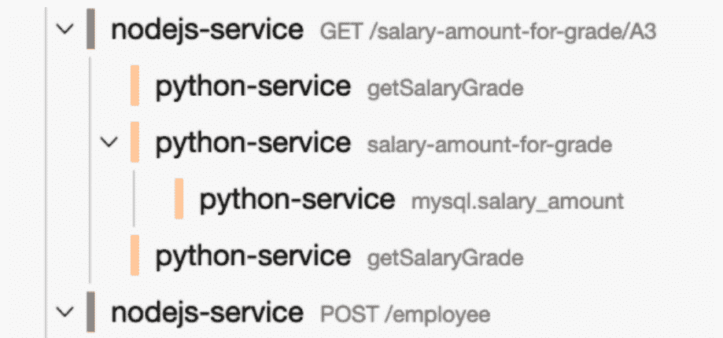

图 6-1. 显示追踪的示例应用程序

仅仅因为您构建了包含日志、指标和追踪的系统并不意味着系统就是可观测的。然而。所有三个支柱都有其优缺点，我们将在本章的其余部分讨论，单独来看，它们只是起点，因为它们使您能够深入研究问题，但它们并不能直接解决您公司的用例或业务需求。为了利用这些支柱，您必须将它们一起使用，并结合影响您业务的因素。如果您将指标数据与日志和追踪分开收集，您很容易失去上下文，最终只能孤立地观察单个底层系统。相对于统一方法而言的可观测性意味着收集并保留底层上下文及其全部丰富性和维度。

### 可观测性：监控的超集

监控主要专注于被动收集系统的事件、日志和指标。您通常会监控一个关键服务，您认为它可能会出错，因为您之前曾遇到过该服务的错误，或者您了解该服务的故障模式。监控采取主动方法，通过帮助您进行警报和容量规划，而可观测性采取更具反应性的方法，通过让您更仔细地检查应用程序堆栈，查看出了什么问题以及为什么会出错。

让我们看一个例子。想象一下，您公司的一名开发人员在尝试为旗舰应用程序添加新功能时修改了关键代码路径。不幸的是，他不小心引入了一个错误，这导致了停机。在这种情况下，您的监控系统将能够清楚地显示来自服务的错误率增加，但无法进一步深入研究。然而，将可观测性嵌入到您的堆栈中可以帮助您快速深入到问题中——比如 Redis 集群的问题——然后追踪可以直接引导您找到根本原因。

重要的是要重申，在这种情况下，您的监控系统没有任何问题。它们正在做它们被设计来做的事情——告诉您何时出现问题。可观测性是帮助您弄清楚出了什么问题。

同样重要的是要注意，可观测性并不是监控的替代方案。相反，它是监控的超集，因为它提供了服务的整体概览以及对分布式系统中各种事件的细粒度洞察。此外，在分布式云环境中，多个服务运行并相互交互，如果系统没有被仪器化以暴露正确的故障使其浮现出来，找到故障的任务变得极其痛苦。可观测性通过在请求穿过服务时精确定位问题链来处理此类场景。

### 可观测性驱动开发

正如我们所讨论的，云原生应用程序主要是分布式和基于微服务的，这使得它们在维护和管理方面本质上很复杂。任何运行生产级应用程序的人也意识到，当应用程序开始表现异常时，几乎不可能弄清楚哪个特定的移动部件是异常行为的根本原因。有时故障会通过传统的日志记录和监控设置被捕获，这可以在应用程序堆栈的复杂性下为您指明正确的方向。但随着服务的演进，您无法确定应用程序或其底层基础设施的所有故障模式。

可观测性驱动开发是为了解决在生产环境中寻找未知问题而做出的努力，它鼓励在软件开发生命周期的早期阶段添加可观测性方面。此外，它提倡在软件设计阶段对应用程序代码进行仪器化，以便以后更容易在同一位置而不是多个位置添加仪器化。它还旨在弥合开发人员和运维人员之间的差距，让开发人员拥有代码并在生产环境中轻松调试。工程团队不仅能够在生产中及早诊断故障和错误，而且还有助于这些团队衡量和分析运营和业务绩效。

在以下各节中，我们将研究现代云原生基础设施和应用程序可以通过哪些方式变得可观测。我们将深入研究三大支柱中的每一个，并了解在云原生环境中构建系统的首选方式，从指标开始。

### 在云原生世界中使用 Prometheus 监控指标

正如我们在第 4 章中所讨论的，Kubernetes 极大地改变了现代应用程序的创建和部署方式。微服务和面向服务的架构已经改变了云原生环境的格局，因为功能添加和部署的速度已经加快。随着向这些现代架构的转变，传统的监控方法无法跟上此类架构的当前步伐，这些架构围绕着短暂的基础设施、多个


区域和可用区，有时甚至跨越云。所有这些新增的复杂层也为新的和未见过的故障模式打开了大门，而传统的监控方法根本无法跟上。

为了应对监控现代云原生应用和基础设施的问题，我们需要重新审视可观测性的核心支柱之一：指标。正如我们所讨论的，指标是提供有关应用程序状态的海量信息的关键领域之一。谈到完全理解你的云原生应用时，传统的指标集往往达不到要求，需要收集自定义指标集以更好地衡量应用程序的整体性能和健康状况。此类指标通常配置为由应用程序本身发出，因此它们提供更精确的信息。这正是 Prometheus 大放异彩的地方。

Prometheus 是一个开源的监控和报警系统，最初由 SoundCloud 构建，后来被云原生计算基金会（CNCF）收录为继 Kubernetes 之后的第二个项目。它主要为现代云原生应用设计，特别专注于指标领域。随着 Kubernetes 的出现，Prometheus 已成为监控暴露大量自定义指标的新云原生应用的事实标准方式之一。与监控领域的其前身相比，Prometheus 也更轻量，因为它采用基于拉取的导出器模型，基本上从应用程序和基础设施中抓取数据。

### Prometheus 组件和架构

Prometheus 主要是在大规模运行的基于容器的应用监控方面构建的。现代云原生应用暴露出需要收集的各种数据，以及底层移动部件的复杂性，而 Prometheus 正是从零开始构建来应对这种动态环境。为了支持云原生应用的新时代，Prometheus 生态系统由以下五个主要组件组成：

#### Prometheus server

负责抓取指标并将它们存储在时间序列数据库中。

#### Client libraries

用于为应用程序代码进行[content]

区域和可用区，有时甚至跨越云。所有这些新增的复杂层也为新的和未见过的故障模式打开了大门，而传统的监控方法根本无法跟上。

为了应对监控现代云原生应用和基础设施的问题，我们需要重新审视可观测性的核心支柱之一：指标。正如我们所讨论的，指标是提供有关应用程序状态的海量信息的关键领域之一。谈到完全理解你的云原生应用时，传统的指标集往往达不到要求，需要收集自定义指标集以更好地衡量应用程序的整体性能和健康状况。此类指标通常配置为由应用程序本身发出，因此它们提供更精确的信息。这正是 Prometheus 大放异彩的地方。

Prometheus 是一个开源的监控和报警系统，最初由 SoundCloud 构建，后来被云原生计算基金会（CNCF）收录为继 Kubernetes 之后的第二个项目。它主要为现代云原生应用设计，特别专注于指标领域。随着 Kubernetes 的出现，Prometheus 已成为监控暴露大量自定义指标的新云原生应用的事实标准方式之一。与监控领域的其前身相比，Prometheus 也更轻量，因为它采用基于拉取的导出器模型，基本上从应用程序和基础设施中抓取数据。

### Prometheus 组件和架构

Prometheus 主要是在大规模运行的基于容器的应用监控方面构建的。现代云原生应用暴露出需要收集的各种数据，以及底层移动部件的复杂性，而 Prometheus 正是从零开始构建来应对这种动态环境。为了支持云原生应用的新时代，Prometheus 生态系统由以下五个主要组件组成：

#### Prometheus server

负责抓取指标并将它们存储在时间序列数据库中。

#### Client libraries

用于为应用程序代码进行仪器化并将提取的指标数据发送到 Prometheus 服务器。客户端库有多种语言可用，包括 C#、Python、Java 和 Ruby。

#### Pushgateway

用于支持短生命周期任务。

#### Exporters

在无法直接进行仪器化的应用程序旁边运行，例如 HAProxy 和 statsd，以提取可按所需格式发送到 Prometheus 服务器的指标。

#### Alertmanager

接收来自 Prometheus 服务器的告警并高效地向上冒泡通知。Alertmanager 以多种一致且有效的方式执行此操作：
- 它对相似类型的告警进行分组，以便在大型中断期间发送的告警更少。
- 它可以限制发送到接收系统的通知。
- 如果相关的告警已经触发，它允许对选定的告警抑制通知。
- 它可以将告警发送到多个系统，例如 OpsGenie 和 PagerDuty 等。

图 6-2 显示了 Prometheus 架构中这些主要组件的概况。

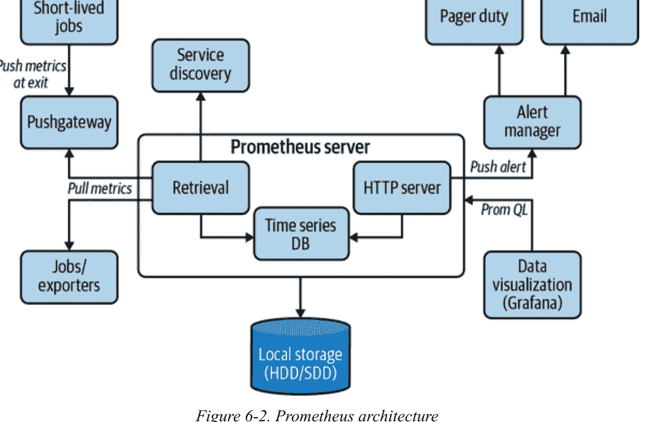

图 6-2. Prometheus 架构

Prometheus 将所有数据存储为 *time series*；即属于同一指标和同一组标记维度的带时间戳的值流。每个时间序列由其 *metric name* 和一个可选的键值对 *labels* 唯一标识。此外，客户端库提供基本四核指标类型：Counter、Gauge、Histogram 和 Summary。我们将在本章后面讨论这四种类型，并提供仪器化示例。

### JOBS AND INSTANCES

在 Prometheus 术语中，可以抓取的端点称为 *instance*，它通常对应于单个进程。具有相同目的的一组实例——例如为可扩展性或可靠性而复制的进程——称为 *job*。

以下是具有四个复制实例的 API 服务器作业示例：

```
job: api-server
instance 1: 1.2.3.4:5670
instance 2: 1.2.3.4:5671
instance 3: 5.6.7.8:5670
instance 4: 5.6.7.8:5671
```

让我们安装并配置 Prometheus 以了解 Prometheus 生态系统周围的一些额外关键概念。

### Installing and Configuring Prometheus

要本地安装和运行 Prometheus，首先需要从 https://prometheus.io/download 下载适用于你的平台的正确版本。在撰写本文时，Prometheus 的最新版本是 2.23。下载 tarball 后，进入目录并使用以下命令解压：

```
$ tar xvfz prometheus-2.23.0.darwin-amd64.tar.gz
$ cd prometheus-2.23.0.darwin-amd64
```

进入 Prometheus 目录后，你可以使用 Prometheus 目录中的 *prometheus.yaml* 文件配置 Prometheus 抓取其自己的 HTTP 端点。默认文件已包含 Prometheus 服务器运行的本地主机上的 TCP 端口 9090。你可以通过执行以下命令运行 Prometheus：

```
$ ./prometheus
level=info ts=2020-11-29T06:51:43.519Z caller=head.go:659
component=tsdb msg="On-disk memory mappable chunks replay
completed" duration=7.944µs
level=info ts=2020-11-29T06:51:43.519Z caller=head.go:665
component=tsdb msg="Replaying WAL, this may take a while"
level=info ts=2020-11-29T06:51:43.520Z caller=head.go:717
component=tsdb msg="WAL segment loaded" segment=0 maxSegment=0
level=info ts=2020-11-29T06:51:43.520Z caller=head.go:722
component=tsdb msg="WAL replay completed"
checkpoint_replay_duration=93.857µs wal_replay_duration=695.77µs
total_replay_duration=812.641µs
level=info ts=2020-11-29T06:51:43.521Z caller=main.go:742
fs_type=19
level=info ts=2020-11-29T06:51:43.521Z caller=main.go:745
msg="TSDB started"
level=info ts=2020-11-29T06:51:43.521Z caller=main.go:871
msg="Loading configuration file" filename=prometheus.yml
level=info ts=2020-11-29T06:51:43.712Z caller=main.go:902
msg="Completed loading of configuration file"
filename=prometheus.yml totalDuration=190.710981ms
remote_storage=6.638µs web_handler=591ns query_engine=807ns
scrape=189.731297ms scrape_sd=42.312µs notify=322.934µs
notify_sd=20.022µs rules=3.538µs
level=info ts=2020-11-29T06:51:43.712Z caller=main.go:694
msg="Server is ready to receive web requests."
```

你可以在浏览器上访问 http://localhost:9090 上的 Prometheus UI，并查看 Prometheus 服务器在 http://localhost:9090/metrics 上为其自身提供的各种指标。

现在你可以使用 *Expression browser* 基本上运行查询或编写 PromQL¹ 表达式。

> **NOTE**
> 
> PromQL 是 Prometheus 的功能性查询语言，可让你实时选择和聚合时间序列数据。数据可以在 Prometheus UI 上以表格或图表格式可视化。

要使用 Expression browser，使用从 localhost:9090/metrics 暴露的任何指标，例如

```
prometheus_http_requests_total (which is a counter for all
```

对 Prometheus 服务器的所有 HTTP 请求）。然后点击 Graph 选项卡并在 Expression 控制台中输入该指标，如图 6-3 所示。

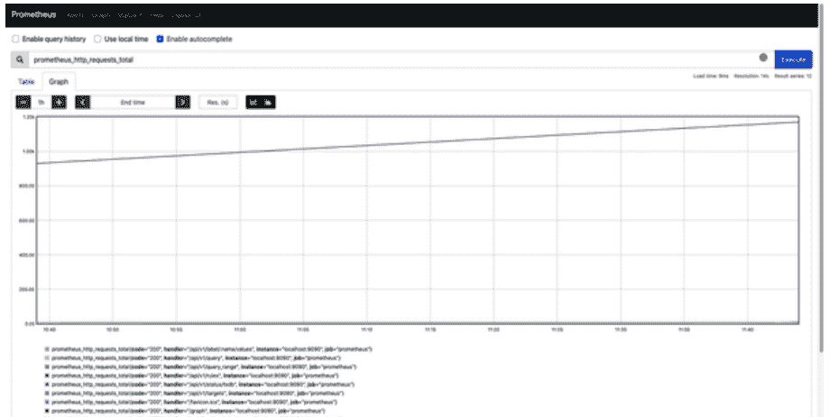

图 6-3. prometheus_http_requests_total 的 Expression browser 结果

查询语言非常广泛，支持对指标进行许多函数和操作。例如，如果你想统计指标 prometheus_target_interval_length_seconds 返回的时间序列数量，你可以在 Expression browser 中发出以下命令：

```
count(prometheus_target_interval_length_seconds)
```

同样，如果你想了解某个指标每秒的增长速度，可以在 Expression browser 中使用 rate：

```
rate(prometheus_tsdb_head_samples_appended_total[1m])
```

### node_exporter

node_exporter 暴露了一系列主机级指标，例如 CPU、内存、磁盘空间、I/O 和网络带宽，以及各种内核级指标。你可以从以下位置下载 node-exporter：


https://prometheus.io/download. 一旦你下载并解压了 tarball，就可以在不做任何更改的情况下直接运行二进制文件：

```
$ cd node_exporter-1.0.1.darwin-amd64
$ ./node_exporter
level=info ts=2020-12-01T13:20:29.510Z
caller=node_exporter.go:177 msg="Starting node_exporter"
version="(version=1.0.1, branch=HEAD,
revision=3715be6ae899f2a9b9dbfd9c39f3e09a7bd4559f)"
level=info ts=2020-12-01T13:20:29.510Z
caller=node_exporter.go:178 msg="Build context" build_context="
(go=go1.14.4, user=root@4c8e5c628328, date=20200616-12:52:07)"
level=info ts=2020-12-01T13:20:29.511Z
caller=node_exporter.go:105 msg="Enabled collectors"
level=info ts=2020-12-01T13:20:29.511Z
caller=node_exporter.go:112 collector=bootime
level=info ts=2020-12-01T13:20:29.511Z
caller=node_exporter.go:112 collector=cpu
level=info ts=2020-12-01T13:20:29.511Z
caller=node_exporter.go:112 collector=diskstats
level=info ts=2020-12-01T13:20:29.511Z
caller=node_exporter.go:112 collector=filesystem
level=info ts=2020-12-01T13:20:29.511Z
caller=node_exporter.go:112 collector=loadavg
level=info ts=2020-12-01T13:20:29.511Z
caller=node_exporter.go:112 collector=meminfo
level=info ts=2020-12-01T13:20:29.511Z
caller=node_exporter.go:112 collector=netdev
level=info ts=2020-12-01T13:20:29.511Z
caller=node_exporter.go:112 collector=textfile
level=info ts=2020-12-01T13:20:29.511Z
caller=node_exporter.go:112 collector=time
level=info ts=2020-12-01T13:20:29.511Z
caller=node_exporter.go:112 collector=uname
level=info ts=2020-12-01T13:20:29.511Z
caller=node_exporter.go:191 msg="Listening on" address=:9100
level=info ts=2020-12-01T13:20:29.511Z caller=tls_config.go:170
msg="TLS is disabled and it cannot be enabled on the fly."
http2=false
```

node_exporter 默认在 http://localhost:9100 上运行。prometheus.yml 中的 scrape_configs 文件需要更新一些信息，以便它可以通过抓取数据来监控 node_exporter：

```
scrape_configs:
  - job_name: node
    static_configs:
    - targets:
      - localhost:9100
```

一旦你重启 Prometheus 以应用新的更改，Prometheus 将有两个端点目标来抓取指标数据。你也可以检查 http://localhost:9090/targets 端点。现在，假设你需要找出每个 CPU 花在不同类型工作上的秒数（即 user、system、iowait 等）；为此，你可以在表达式浏览器中使用 irate 函数运行以下查询：

```
irate(node_cpu_seconds_total{job="node"}[5m])
```

job="node" 是匹配的标签，用于过滤指标。现在让我们看看应用程序的 instrumentation 如何与 Prometheus 协同工作。

### Instrumentation of Applications

要监控自定义服务，我们需要添加 instrumentation，这涉及将 tracing 库添加到应用程序代码中，以便我们可以实现 Prometheus 指标类型。在本节中，我们将看看如何借助客户端库来实现这一点，你可以使用这些客户端库来为你的应用程序代码进行 instrumentation。客户端库主要让你能够使用应用程序上的 HTTP 端点定义和公开内部指标，并且当 Prometheus 抓取你的应用程序实例时，客户端库会向其发送当前的指标状态。我们将使用 Python 作为首选的 instrumentation 库，不过在 https://prometheus.io/docs/instrumenting/clientlibs 上还有更多客户端库实现。

第一步是使用 pip 在你的主机上安装客户端库，如下所示：

```
$ pip install prometheus_client
```

基于我们之前提到的四种指标类型，你主要可以通过四种不同的方式来为代码进行 instrumentation。我们将在以下各节中讨论它们。

#### Counters

顾名思义，计数器主要用于计数会增加的值，并且在应用程序重启时可以重置为零。例如，当向 Python HTTP 服务器发送 GET 请求时，以下代码会将计数器值增加 1：

```
import http.server
from prometheus_client import Counter, start_http_server

http_requests = Counter('my_app_http_request','Description: Num
of HTTP request')

class SampleServer(http.server.BaseHTTPRequestHandler):
    def do_GET(self):
        http_requests.inc()
        self.send_response(200)
        self.end_headers()
        self.wfile.write(b"Simple Counter Example")

if __name__ == "__main__":
    start_http_server(5555)
    server = http.server.HTTPServer(('localhost', 5551),
SampleServer)
    server.serve_forever()
```

你可以在终端中以 `python counter.py` 运行此代码块，它将启动一个简单的 HTTP 服务器。我们使用 start_http_server 作为指标将被抓取的端点。你可以在 http://localhost:5555 上访问指标。要将这些指标摄入 Prometheus，你需要在 prometheus.yml 文件中再次配置 scrape_configs 文件，如下所示：

```
scrape_configs:
  - job_name: 'prometheus'
    static_configs:
    - targets: ['localhost:9090']
```

```
- job_name: node
  static_configs:
  - targets:
    - localhost:9100
- job_name: my_application
  static_configs:
  - targets:
    - localhost:5555
```

一旦你重启 Prometheus，你将能够通过表达式浏览器使用 PromQL 表达式 `rate(my_app_http_request_total[1m])` 访问该指标。每次你访问应用程序 URL http://localhost:5551 时，计数器都会增加。图 6-4 显示了传入 HTTP 请求的增加速率。

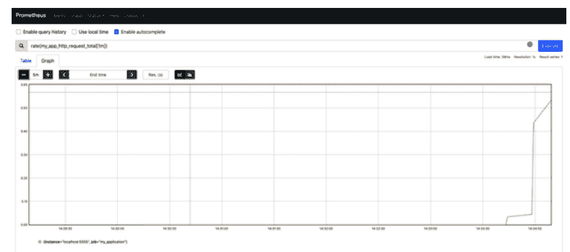

图 6-4. 仪器化应用程序的计数器指标

正如你所见，使用计数器对代码进行 instrumentation 非常容易。你也可以使用计数器来计数代码中的异常和错误，甚至可以为计数器设置自定义值而不是每次增加一。

#### Gauges

Gauge 主要表示实体的当前状态，可以上升也可以下降。Gauge 可用于几种不同的场景：例如，

假设你需要知道活动线程数或队列中的项目数，或者你想知道缓存中的项目数。

Gauge 使用三种主要方法：inc、dec 和 set。以下示例展示了如何独立使用这三种方法来跟踪你感兴趣的指标：

```
from prometheus_client import Gauge
sample_gauge_1 = Gauge('my_increment_example_requests',
'Description of increment gauge')
sample_gauge_2 = Gauge('my_decrement_example_requests',
'Description of decrement gauge')
sample_gauge_3 = Gauge('my_set_example_requests', 'Description of set gauge')

sample_gauge_1.inc()      # This will increment by 1
sample_gauge_2.dec(10)    # This will decrement by given value of 10
sample_gauge_3.set(48)    # This will set to the given value of 48
```

在前面的代码中，inc() 方法会将 'my_increment_example_requests' 的值增加 1，将 'my_decrement_example_requests' 的值减少 10，并将 'my_set_example_requests' 的值设置为 48。

### Summary

Summary 通常跟踪请求持续时间或响应大小。它通常用于查找事件的大小和数量。它使用 observe 方法，该方法接受事件的大小。例如，在以下代码中，我们试图找出请求完成所需的时间：

```
import http.server
import time
from prometheus_client import Summary, start_http_server

LATENCY = Summary('latency_in_seconds','Time for a request')

class SampleServer(http.server.BaseHTTPRequestHandler):
    def do_GET(self):
        start_time = time.time()
```

```
self.send_response(200)
self.end_headers()
self.wfile.write(b"My application with a Summary metric")
LATENCY.observe(time.time() - start_time)

if __name__ == "__main__":
    start_http_server(5555)
    server = http.server.HTTPServer(('localhost', 5551), SampleServer)
    server.serve_forever()
```

要运行前面的代码，你可以按照我们在“Counter”第 XX 页中采用的方法进行操作。http://localhost:5555/metrics 上的指标端点将有两个时间序列：
latency_in_seconds_count 和 latency_in_seconds_sum。
前者表示所做的 observe 调用次数，后者是传递给 observe 的值的总和。如果将这两个指标的速率相除——
rate(latency_in_seconds_count[1m])/rate(latency_in_seconds_sum[1m])——
你将得到过去一分钟的平均延迟。

#### Histograms

直方图帮助你在桶中跟踪事件的大小和数量，同时允许你聚合计算分位数。直方图可用于衡量特定 HTTP 请求调用的请求持续时间。

直方图的代码 instrumentation 也使用 observe 方法，你可以将其与时间结合起来跟踪延迟，如我们之前的示例所示。以下代码将 10 秒添加为请求延迟：

```
from prometheus_client import Histogram
req_latency = Histogram('request_latency_seconds', 'Description of histogram')
req_latency.observe(10)    # Observe 10 (seconds in this case)
```

Instrumentation 通常在服务级别或服务中使用的客户端库上应用。需要注意的是


即使 Prometheus 在处理多个指标时效率很高，也存在可以/应该添加的仪器化级别的限制。²

现在你已经了解了代码仪器化是如何工作的，以及主机如何被添加到 Prometheus 并被抓取，让我们看看如何在生产环境中将主机添加到 Prometheus 以便被抓取。

### 查找主机

Prometheus 使用 prometheus.yml 文件中 scrape_configs 下的 static_configs 文件来查找要抓取的主机目标。云环境本质上非常动态，尤其是在容器化环境中，变化相当频繁。在这种环境中，手动将主机添加到 prometheus.yml 文件并不能很好地扩展。Prometheus 通过支持多种来源，包括 Kubernetes、Azure 和自定义服务发现平台，提供多种方式来处理这种情况。服务发现是在分布式云环境中查找所有正在运行服务的简单方法。我们将在第 7 章详细讨论服务发现。在这里，我们将看看在生产环境中可以找到哪些主机供 Prometheus 抓取的几种方法。

### 使用 Ansible

如果主机正在运行 node exporter，那么最简单的方法之一就是通过库存主机静态更新 prometheus.yml 文件。基本上，每次添加一台机器时，你还应该有将其添加到 prometheus.yml 配置文件的配置。以下是使用 Ansible 更新 prometheus.yml 的片段：

```
scrape_configs:
  - job_name: {{ hostname }}
    static_configs:
      - targets:
        - {{ hostname }}:9100
```

你也可以在 Ansible 库存中的任何组下循环主机并直接添加它们。

### 使用文件

你还可以提供可以直接从 YAML 或 JSON 文件读取的目标列表，而无需任何网络开销。这又是另一种静态服务发现方法，Prometheus 可以直接从静态文件读取主机——例如，如果你有一个 *inventory.json* 文件：

```
[
  {
    "targets": [
      "192.168.101.11:9100"
    ],
    "labels": {
      "job": "node",
      "Team": "dev"
    }
  },
  {
    "targets": [
      "192.168.101.155:9200"
    ],
    "labels": {
      "job": "node",
      "Team": "sre"
    }
  }
]
```

现在你可以使用 `file_sd_configs` 在 `scrap_configs` 下更新 *prometheus.yml* 如下：

```
scrape_configs:
  - job_name: file
    file_sd_configs:
      - files:
        - 'inventory.json'
```

你可以在 http://localhost:9090/service-discovery 找到正在被抓取的目标。

### 使用 azure_sd_config

Prometheus 允许开箱即用地支持抓取 Azure 虚拟机。Azure 服务发现 SD 配置允许你从 Azure 虚拟机检索抓取目标。你可以通过在 *prometheus.yml* 文件中设置 Azure 凭据来使用 Azure 服务发现，如下所示：

```
- job_name: 'azure-nodes'
  azure_sd_configs:
    - subscription_id: '$SUBSCRIPTION_ID'
      tenant_id: '$TENANT_ID'
      client_id: '$CLIENT_ID'
      client_secret: '$CLIENT_SECRET'
      port: 9100
  relabel_configs:
    - source_labels: [__meta_azure_machine_tag_cloudnative]
      regex: true.*
      action: keep
    - source_labels: [__meta_azure_machine_name]
      target_label: web_instance
    - source_labels: [__meta_azure_machine_tag_public_ip]
      regex: (.*)
      replacement: ${1}:9100
      target_label: __address__
```

在此配置中，我们还使用了 *relabeling*，它在目标被抓取之前动态重写目标的标签集。Relabeling 有助于操作指标以保持存储干净，不会被不需要的数据污染。多个 relabeling 会按配置文件中出现的顺序应用于每个目标的标签集。

让我们更仔细地看看前面 *relabel_configs* 的关键部分：

```
__meta_azure_machine_tag_cloudnative
```

Prometheus 会查看所有 Azure 虚拟机实例，如果实例有一个名为 `cloudnative` 的标签，则保留该服务。

基本上，这告诉 Prometheus：“如果在 Azure 账户中找到任何虚拟机，其标签为 `cloudnative: true`，则抓取它；否则，忽略它。

```
__meta_azure_machine_name
```

在这里，Prometheus 查找 machine_name 然后将其放入 web_instance 标签中。

```
__meta_azure_machine_tag_public_ip
```

在这里，Prometheus 将 :9100 附加到公共 IP。它还替换 __address__ 标签的内容。

一旦你运行了一些 Azure 虚拟机，你可以在 http://localhost:9090/service-discovery 找到发现的目标以及从虚拟机中提取的元数据。

现在我们已经了解了 Prometheus 中传统服务发现的工作原理，让我们看看 Prometheus 如何与 Kubernetes 协同工作，并在云原生应用中缩小监控差距。

### Prometheus on Kubernetes

Kubernetes 服务发现支持已内置到 Prometheus 中，开箱即用，允许从 Kubernetes REST API 检索抓取目标。要使用此功能，Prometheus 必须已在 Kubernetes 集群内部运行。你可以使用 Helm charts 在 AKS 集群上轻松配置和部署 Prometheus。

可以在 Kubernetes 集群中配置五种类型的角色来发现目标：node、service、Pod、endpoints 和 ingress。让我们更仔细地看看这些服务发现角色。

### The node role

node 角色会发现 Kubernetes 集群中的所有节点。由于 kubelet 在 Kubernetes 集群中的每个节点上运行，node 角色会发现集群中的目标节点，其地址默认为 kubelet 的 HTTP

端口。你可以使用以下 Prometheus scrape_configs 命令抓取 kubelet 节点：

```
scrape_configs:
  - job_name: 'kubelet'
    kubernetes_sd_configs:
      - role: node
    scheme: https
    tls_config:
      ca_file: ca.crt
```

在前面的 *prometheus.yml* 配置中，标签被提供为 `kubelet`，角色被提供为 `node`。我们使用 scheme `HTTPS`，因为 kubelet /metrics 仅通过 HTTPS 提供，这也需要传输层安全 TLS 证书。

### The service role

*service* 角色主要帮助你监控不透明系统以检查所有服务是否都在响应。service 角色为每个服务的每个服务端口找到一个目标。你可以按如下方式抓取服务对象：

```
scrape_configs:
  - job_name: prometheus-pushgateway
    kubernetes_sd_configs:
      - role: service
```

### The Pod role

*Pod* 角色负责发现集群中运行的所有 Pod 并将其中运行的容器作为目标公开。它还返回与 Pod 相关的所有元数据。你可以按如下方式抓取 Pod：

```
scrape_configs:
  - job_name: 'pods'
    kubernetes_sd_configs:
      - role: pod
```

### The endpoints role

*endpoints* 角色从 Kubernetes 集群中的服务端点查找目标。对于每个端点地址，每个端口都会发现一个目标。你可以按如下方式抓取端点：

```
scrape_configs:
  - job_name: 'k8apiserver'
    kubernetes_sd_configs:
      - role: endpoints
    scheme: https
    tls_config:
      ca_file: cert.crt
```

### The ingress role

最后，*ingress* 角色为每个 ingress 的每个路径发现一个目标。此角色也是执行 ingress 不透明监控的一种方式。你可以按如下方式抓取 ingress：

```
scrape_configs:
  - job_name: 'gateway'
    kubernetes_sd_configs:
      - role: ingress
    scheme: https
    tls_config:
      ca_file: cert.crt
```

在深入介绍指标之后，让我们看看云原生应用中日志是如何实现的。

### Logging in the Cloud Native World

日志是任何环境中的关键信息。它们主要由工程师在排除问题或深入了解系统时使用。但日志记录通常很复杂。复杂性源于各种日志消费方式、数据格式差异，以及确保负责存储日志的底层应用程序也能随着日志数量增长而良好扩展的需求。在云原生分布式环境中，日志记录变得更加重要。


不仅这些环境拥有众多活动部件，而且它们也更加复杂，因为现在系统是分布式且临时的，如 Kubernetes Pod。这意味着日志需要被传输出去并集中存储，以便日后查看。

为了解决云原生环境中大规模日志记录的问题，我们需要一种可以轻松部署到环境中并无缝集成的解决方案。这就是 Fluentd 登场的时刻。

### 使用 Fluentd 进行日志记录

Fluentd 是 CNCF 的一个开源项目，可以收集、解析、转换和分析日志。Fluentd 基本上通过将数据结构化为 JSON（见图 6-5）充当统一的日志层。这反过来有助于它在多个来源和目的地之间收集、过滤、缓冲和输出日志。

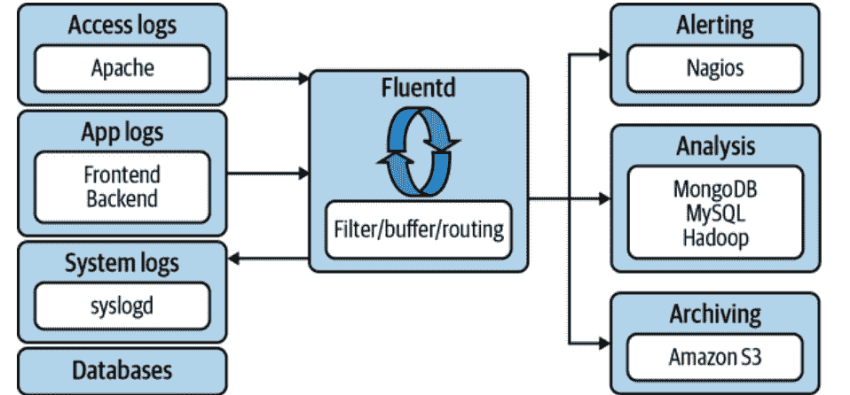

图 6-5. Fluentd 作为日志层

Fluentd 用 CRuby 编写，CRuby 是 Ruby 编程语言的 C 实现，内存占用小，仅为 30 到 40 MB，并且每个核心每秒处理大约 13K 个事件。让我们来看看 Fluentd 的一些核心概念，以及它如何用于在云原生环境中启用日志记录。

首先，根据你的操作系统发行版，从官方 Fluentd 网站安装代理：https://docs.fluentd.org/installation。

#### NOTE

官方稳定的 Fluentd 分发包称为 td-agent。它确保稳定性，并附带了原始作者 Treasure Data Inc 推荐的预配置设置。

下载并为你的发行版安装 td-agent 后，确保它正在运行。例如，在 macOS 上你可以通过 launchctl 来实现：

```
$ ~ sudo launchctl load /Library/LaunchDaemons/td-agent.plist
Password:
$
```

你可以通过以下位置的日志确认代理是否正在运行：

```
$ ~ tail -f /var/log/td-agent/td-agent.log
2020-12-17 22:57:46 +0530 [info]: adding match pattern="td.*.*" type="tdlog"
2020-12-17 22:57:46 +0530 [warn]: #0 [output_td] secondary type should be same with primary one primary="Fluent::Plugin::TreasureDataLogOutput" secondary="Fluent::Plugin::FileOutput"
2020-12-17 22:57:46 +0530 [info]: adding match pattern="debug.**" type="stdout"
2020-12-17 22:57:46 +0530 [info]: adding source type="forward"
2020-12-17 22:57:46 +0530 [info]: adding source type="http"
2020-12-17 22:57:46 +0530 [info]: adding source type="debug_agent"
2020-12-17 22:57:46 +0530 [info]: #0 starting fluentd worker pid=96320 ppid=95841 worker=0
2020-12-17 22:57:47 +0530 [info]: #0 [input_debug_agent] listening dRuby uri="druby://127.0.0.1:24230" object="Fluent::Engine"
2020-12-17 22:57:47 +0530 [info]: #0 [input_forward] listening port port=24224 bind="0.0.0.0"
```

```
2020-12-17 22:57:47 +0530 [info]: #0 fluentd worker is now
running worker=0
```

Fluentd 最好通过其配置文件来理解。你可以在 /etc/td-agent/td-agent.conf 找到 Fluentd 的默认配置文件。配置文件包含许多指令，如以下小节所述。

### source 指令（所有数据的摄入位置）

source 指令确定需要启用的数据输入源（即数据需要从何处摄入）。source 指令将事件提交到 Fluentd 路由系统。默认情况下，Fluentd 提供两个标准输入插件。http 插件提供 HTTP 端点以监听传入的 HTTP 消息；forward 插件提供 TCP 端点以接受 TCP 数据包：

```
<source>
@type forward
port 24224
</source>
```

```
<source>
@type http
port 9999
bind 0.0.0.0
</source>
```

前面的定义指定了两个源：在第一个源中，我们从 TCP 端口 24224 接收事件，在第二个源中，我们有一个 HTTP 服务器监听 TCP 端口 9999。

source 提交给 Fluentd 路由引擎的事件包含三个实体：tag、time 和 record。例如，在以下日志输出中：

```
2020-12-16 15:38:27 +0900 test.root: {"action":"logout","user":3}
```

2020-12-16 15:38:27 +0900 是时间，由输入插件指定，必须采用 Unix 时间格式；test.root 是标签（根据 Fluentd，强烈建议标签采用小写且由数字和下划线混合组成）；而 {"action":"logout","user":3} 是一个 JSON 对象。

输入插件负责从外部源检索事件日志。通常，输入插件会创建一个线程、一个套接字和一个监听套接字。输入插件不仅限于 http 和 forward。以下是一些额外的插件：

#### in_syslog

用于通过 Syslog 协议在 UDP 或 TCP 上检索日志事件。Fluentd 在端口 5140 上创建一个套接字；然后，你只需设置你的 syslog 守护进程在该套接字上发送日志事件即可：

```
<source>
  @type syslog
  port 5140
  bind 0.0.0.0
  tag system
</source>
```

#### in_tail

允许 Fluentd 读取日志文件的尾部，就像 Unix tail -f 命令一样：

```
<source>
  @type tail
  path /var/log/httpd-access.log
  pos_file /var/log/td-agent/httpd-access.log.pos
```

```
tag apache.access
<parse>
    @type apache2
</parse>
</source>
```

Fluentd 提供额外的输入插件，例如 in_unix 用于从 Unix 域套接字检索记录，以及 in_exec 用于执行外部程序并提取事件日志。你甚至可以编写自己的自定义输入插件。

### match 指令（对输入数据做什么）

match 指令通过查找具有匹配标签的事件来确定输出目的地。Fluentd 的标准输出插件包括 file 和 forward。match 指令必须包含一个匹配模式和一个 @type 参数，该参数定义要使用的输出插件。一旦具有标签的事件与模式匹配，它将被发送到输出目的地。以下是 match 指令的示例用法：

```
<match mywebapp.access>
    @type file
    path /var/log/mywebapp/access
</match>
```

在前面的配置中，我们匹配标记为 mywebapp.access 的事件，并将它们存储在文件 /var/log/mywebapp/access 中。

除了 file 和 forward 之外，你还可以拥有其他类型的输出插件，它们基本上决定了你想要将数据写入的位置。例如，out_elasticsearch 是一个输出插件，将记录写入 Elasticsearch 集群端点。你首先需要使用以下命令安装插件：

```
fluent-gem install fluent-plugin-elasticsearch
```

然后你可以使用以下配置将输出数据发送到 Elasticsearch 端点：

```
<match my.logs>
  @type elasticsearch
  host 192.168.23.13
  port 9200
  logstash_format true
</match>
```

同样，你可以使用 out_copy 将事件复制到多个输出，使用 out_kafka2 将记录发送到 Kafka 集群，使用 out_mongo 将记录写入 MongoDB 数据库，以及使用 stdout 将事件简单地写入标准输出。

### filter 指令（事件处理管道）

filter 指令就像一条规则，根据条件通过或拒绝事件。filter 的语法与 match 相同，但 filter 可以链接到处理管道。你可以按如下方式添加 filter：

```
<source>
  @type http
  port 9999
  bind 0.0.0.0
</source>
```

```
<filter test.session>
  @type grep
  <exclude>
    key action
    pattern ^logout_session$
  </exclude>
</filter>
```

```
<match test.session>
  @type stdout
</match>
```

在前面的配置中，一旦数据被源化，它会经过 filter 部分然后是 match 部分。filter 将根据其类型和规则接受或拒绝事件。在这里我们丢弃了 logout_session 操作，并在 filter 中使用类型 grep 来排除 action 键具有 logout 字符串的任何消息。

以下是一些额外的 filter 插件：

filter_record_transformer

用于更改传入的事件流。你可以使用以下配置示例用于 record_transformer：

```
<filter myweb.access>
    @type record_transformer
    <record>
        host_param "#{Socket.gethostname}"
    </record>
</filter>
```

在前面的配置中，record_transformer 将向日志事件添加 host_param 字段。

filter_geoip

使用 MaxMind GeoIP 数据库向日志添加地理位置信息。

filter_stdout

将事件打印到标准输出，主要用于调试目的。


### system directive（设置系统范围配置）

你可以使用 system directive 设置各种系统范围的配置。system directive 中可用的配置选项包括：

- log_level
- suppress_repeated_stacktrace
- emit_error_log_interval
- suppress_config_dump
- without_source
- process_name

你可以使用如下方式使用系统配置：

```
<system>
  process_name my_app
  log_level error
  without_source
</system>
```

这里我们首先将 supervisor 和 worker 进程名称设置为 my_app，然后将默认日志级别设置为 error。我们还指示 Fluentd 在没有任何输入插件的情况下启动。

### label directive（用于输出分组和路由）

标签主要通过允许路由部分不遵循配置文件中自上而下的解析顺序来解决维护和管理配置文件的问题。你也可以将标签视为 go-to 语句。以下是使用标签的简单配置示例：

```
<source>
  @type http
  bind 0.0.0.0
port 9999
@label @MYCLUE
</source>

<filter test.session>
    @type grep
    <exclude>
        key action
        pattern ^login$
    </exclude>
</filter>

<label @MYCLUE>
    <filter test.session>
        @type grep
        <exclude>
            key action
            pattern ^logout$
        </exclude>
    </filter>

    <match test.session>
        @type stdout
    </match>
</label>
```

在前面的配置中，source 下的 @label 参数是向 @MYCLUE 标签部分的重定向。控制流将跳过 login 的 filter 定义，并直接移动到 @MYCLUE 标签。

### @include directive（导入配置文件）

使用 @include directive，你可以从单独的目录导入配置文件。@include directive 支持如下的常规文件路径、glob 模式和 HTTP URL 规范：

```
### absolute path
@include /path/to/config.conf

### if using a relative path, the directive will use
### the dirname of this config file to expand the path
@include extra.conf

### glob match pattern
@include config.d/*.conf

### http
@include http://example.com/fluent.conf
```

在继续之前，让我们快速了解一下如何运行 agent 来查看日志。要运行如下的简单配置：

```
<source>
  @type http
  port 9999
  bind 0.0.0.0
</source>

<filter myapp.test>
  @type grep
  <exclude>
    key action
    pattern ^logout$
  </exclude>
</filter>

<match myapp.test>
  @type stdout
</match>
```

你需要将前面的配置替换到默认位置 /etc/td-agent/td-agent.conf。你现在可以在 macOS 上按如下方式重新加载 td-agent：

```
$ sudo launchctl load /Library/LaunchDaemons/td-agent.plist
#check logs
$ tail -f /var/log/td-agent/td-agent.log
2020-12-21 12:21:57 +0530 [info]: parsing config file is succeeded path="/etc/td-agent/td-agent.conf"
2020-12-21 12:21:58 +0530 [info]: using configuration file:
<ROOT>
  <source>
    @type http
    port 9999
    bind "0.0.0.0"
  </source>
  <filter myapp.test>
    <exclude>
        key "action"
        pattern ^logout$
    </exclude>
</filter>
<match myapp.test>
    @type stdout
</match>
</ROOT>
2020-12-21 12:21:58 +0530 [info]: starting fluentd-1.0.2
pid=43215 ruby="2.4.2"
2020-12-21 12:21:58 +0530 [info]: spawn command to main:
cmdline=["/opt/td-agent/embedded/bin/ruby", "-Eascii-8bit:ascii-8bit", "/opt/td-agent/usr/sbin/td-agent", "--log", "/var/log/td-agent/td-agent.log", "--use-v1-config", "--under-supervisor"]
2020-12-21 12:21:58 +0530 [info]: gem 'fluent-plugin-elasticsearch' version '2.4.0'
2020-12-21 12:21:58 +0530 [info]: gem 'fluent-plugin-kafka' version '0.6.5'
2020-12-21 12:21:58 +0530 [info]: gem 'fluent-plugin-rewrite-tag-filter' version '2.0.1'
2020-12-21 12:21:58 +0530 [info]: gem 'fluent-plugin-s3' version '1.1.0'
2020-12-21 12:21:58 +0530 [info]: gem 'fluent-plugin-td' version '1.0.0'
2020-12-21 12:21:58 +0530 [info]: gem 'fluent-plugin-td-monitoring' version '0.2.3'
2020-12-21 12:21:58 +0530 [info]: gem 'fluent-plugin-webhdfs' version '1.2.2'
2020-12-21 12:21:58 +0530 [info]: gem 'fluentd' version '1.0.2'
2020-12-21 12:21:58 +0530 [info]: adding filter
pattern="myapp.test" type="grep"
2020-12-21 12:21:58 +0530 [info]: adding match
pattern="myapp.test" type="stdout"
2020-12-21 12:21:58 +0530 [info]: adding source type="http"
2020-12-21 12:21:58 +0530 [info]: #0 starting fluentd worker
pid=43221 ppid=43215 worker=0
2020-12-21 12:21:58 +0530 [info]: #0 fluentd worker is now running worker=0
```

现在你可以运行以下 curl 命令来模拟不同的操作：

```
$ curl -i -X POST -d 'json={"action":"login","user":2}' http://localhost:9999/myapp.test
```

```
HTTP/1.1 200 OK
Content-Type: text/plain
Connection: Keep-Alive
Content-Length: 0
```

由于我们当前传递的 action 为 `login`，我们可以检查日志位置以验证它们是否已打印：

```
2020-12-21 12:31:31.529967000 +0530 myapp.test:
{"action":"login","user":2}
```

如果你尝试在以下 curl 命令中发布 action 为 `logout`，它将根据我们指定的 filter 规则被丢弃，你将无法看到任何日志被打印：

```
$ curl -i -X POST -d 'json={"action":"logout","user":2}' http://localhost:9999/myapp.test
HTTP/1.1 200 OK
Content-Type: text/plain
Connection: Keep-Alive
Content-Length: 0
```

现在你了解了 Fluentd 的工作原理，让我们来研究如何在云原生环境中集成它并在像 Kubernetes 这样的容器编排器上部署它。

### Fluentd on Kubernetes

默认情况下，在 Kubernetes 中，容器中的日志会写入标准输出和标准错误流。这是 Kubernetes 开箱即用的基本 I/O 日志记录。容器引擎将流重定向到 Kubernetes 中配置的日志驱动程序，以将日志以 JSON 格式写入文件。作为用户，如果你想查看日志，可以使用 `kubectl logs` 命令。然而，这种方法的问题非常明显：如果容器崩溃，或者 Pod 被驱逐，或者节点本身死亡，你将无法再访问应用程序日志。因此，日志应该具有独立于容器、Pod 和节点的存储。这种概念正式被称为 *cluster-level logging*，它需要一个单独的后端来存储、分析和查询日志。虽然 Kubernetes 本身并不提供集群级日志记录的解决方案，但我们可以将 Fluentd 与 Elasticsearch 等存储解决方案结合起来构建一个可扩展的解决方案。

在继续介绍在 Kubernetes 上部署 Fluentd 的首选方式之前，让我们先看看集群级日志记录可以通过哪些不同方法实现，以及它们的优缺点。基本上构建集群级日志记录解决方案有两种方式：

- 在每个应用程序 Pod 中使用一个 sidecar 容器。
- 使用在每个节点上运行的节点级日志代理。

让我们更详细地了解一下这两种解决方案。

### Sidecar container approach

通常，在 Kubernetes 中你会在 Pod 中运行应用程序，如第 5 章所述。在 sidecar 方法中，你可以在应用程序 Pod 内创建一个或多个 sidecar 容器。sidecar 容器方法可以用两种不同的方式使用：

- 你可以使用 sidecar 容器将应用程序日志流式传输到容器的自己的 stdout。
- 你可以在 sidecar 容器中运行一个日志代理，该代理基本上从应用程序容器中获取日志并将其发送到日志后端。

sidecar 容器方法有一些优点：

- 你可以通过拥有两个 sidecar 容器来流式传输特定日志文件到不同的日志流，从而将以不同日志格式产生的应用程序日志发送出去（结构化或非结构化）。
- Sidecar 容器可以从文件、套接字或 journald 读取日志，并且每个 sidecar 容器会将日志打印到 stdout 和 stderr


streams.

- Sidecar 容器也可以用来轮换应用程序本身无法轮换的日志文件。

运行 sidecar 容器也有一些缺点：

- 在将日志写入文件然后再流式传输到 stdout 的场景中，磁盘 I/O 可能显著增加。

- 由于运行应用程序的 Pod 不止一个，因此您还需要在每个 Pod 中部署多个 sidecar 容器。

### Node-level logging agent approach

另一种处理 Kubernetes 中日志的方法是在 Kubernetes 集群的每个节点上部署一个日志代理。代理可以作为容器运行到守护进程，该守护进程可以访问应用程序 Pod 产生的所有日志。事实上，这也是运行 Fluentd 代理的首选方式。

Kubernetes DaemonSet 用于实现这种策略，其中每个节点都可以运行一个 Fluentd 日志代理 Pod 的副本。Fluentd 官方提供了一个具有正确规则的 DaemonSet，可部署在 Kubernetes 集群上。您可以通过从官方 Fluentd 仓库克隆来获取 DaemonSet 的副本：

```
$ git clone https://github.com/fluent/fluentd-kubernetes-daemonset
```

在使用上述 DaemonSet 之前，您需要一个 Kubernetes 集群。如果您已经运行了 Azure Kubernetes 集群（例如 Azure Kubernetes Service [AKS]），您可以开始部署用于存储日志文件的日志后端。Elasticsearch 是可用于存储生成的日志的日志后端之一。您可以使用 Helm 在 Kubernetes 上按如下方式部署 Elasticsearch：

```
$ helm repo add elastic https://helm.elastic.co
$ helm install elasticsearch elastic/elasticsearch
```

您可以使用端口转发来检查 Elasticsearch 集群是否已成功部署：

```
$ kubectl port-forward svc/elasticsearch-master 9200
Forwarding from 127.0.0.1:9200 -> 9200
Forwarding from [::1]:9200 -> 9200
Handling connection for 9200
Handling connection for 9200
```

Elasticsearch 应可在 http://localhost:9200 上使用。要部署 Fluentd DaemonSet，您首先需要在 fluentd-daemonset-elasticsearch-rbac.yaml 文件中修改以下环境变量：

- FLUENT_ELASTICSEARCH_HOST（Elasticsearch 端点）
- FLUENT_ELASTICSEARCH_PORT（Elasticsearch 端口，通常为 9200）

在您使用 Elasticsearch 详细信息更新 YAML 文件后，您可以通过移动到 GitHub 仓库并按如下方式应用 DaemonSet 来在 AKS 上部署 Fluentd DaemonSet：

```
$ kubectl apply -f fluentd-daemonset-elasticsearch-rbac.yaml
```

这将在 Kubernetes 集群上部署 Fluentd DaemonSet，并且每个节点现在将至少运行一个 Fluentd Pod，该 Pod 将把您的日志转发到 Elasticsearch：

```
$ ~ kubectl get pods --namespace=kube-system -o wide
NAME                          READY   STATUS    RESTARTS   AGE
IP             NODE                                      NOMINATED NODE   READINESS GATES
fluentd-6pttr                  1/1     Running   2          3h37m   10.240.0.27   aks-agentpool-25245360-vmss000000   <none>
fluentd-9fj59                  1/1     Running   1          3h37m   10.240.0.147  aks-agentpool-25245360-vmss000001   <none>
<none>
fluentd-dh7pn                    1/1     Running   1
139m    10.240.1.84    aks-agentpool-25245360-vmss000003    <none>
<none>
fluentd-g5cnv                    1/1     Running   2
3h37m    10.240.1.25    aks-agentpool-25245360-vmss000002    <none>
<none>
fluentd-mzw2j                    1/1     Running   2
139m    10.240.2.0    aks-agentpool-25245360-vmss000004    <none>
<none>
fluentd-z52r2                    1/1     Running   2
139m    10.240.2.143    aks-agentpool-25245360-vmss000005    <none>
<none>
kube-proxy-56bv2                 1/1     Running   0
139m    10.240.2.47    aks-agentpool-25245360-vmss000005    <none>
<none>
```

您还需要查看这些日志，您可以通过使用 Kibana 来实现。³ 您可以使用 Helm 类似地部署 Kibana 并按如下方式本地端口转发：

```
$ helm repo add elastic https://helm.elastic.co
$ helm install kibana elastic/kibana
$ kubectl port-forward deployment/kibana-kibana 5601
Forwarding from 127.0.0.1:5601 -> 5601
Forwarding from [::1]:5601 -> 5601
```

Kibana（图 6-6）现在应在您的 http://localhost:5601 上启动并运行。

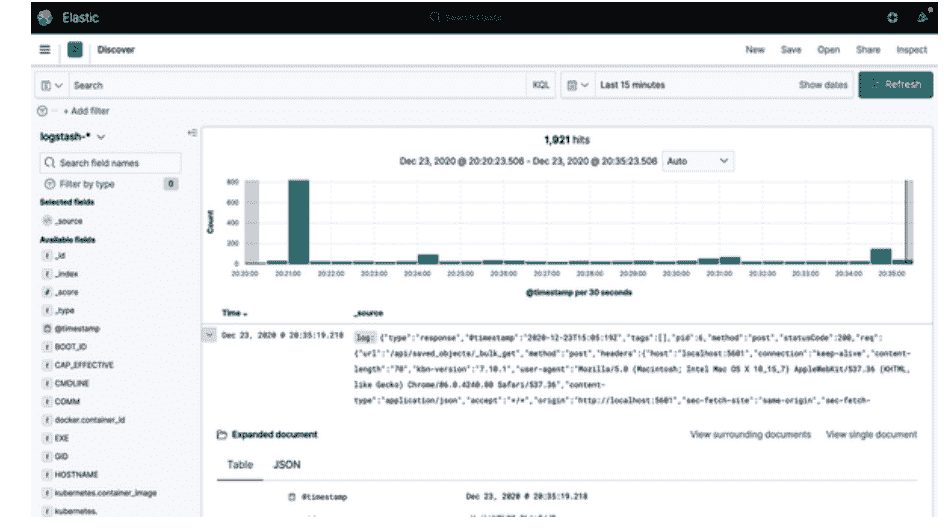

图 6-6. 使用 Kibana 展示日志

另一个新的日志聚合工具是 Grafana Labs 的 Loki⁴。Loki 高效地记录特定的日志标签而不是整个日志流，并且可以轻松地与 Fluentd 集成。我们不会深入探讨这个主题，因为它超出了本书的范围。

现在您了解了云原生环境中日志的工作原理，让我们通过讨论分布式追踪来结束本章。

### Distributed Tracing in the Cloud Native World

分布式追踪是为现代云原生应用程序提供和构建可观测性的关键支柱之一。分布式追踪使您能够跟踪请求在分布式系统中流经多个服务时的流程，并发出元数据信息，例如每个服务花费的时间以及对其他服务端点的底层调用详细信息。此元数据可以稍后重新组装，以提供应用程序在运行时行为的更完整图景，这可以帮助您解决诸如精确定位应用程序延迟问题和定位瓶颈等问题。

分布式追踪回答重要问题，例如：

- 服务中的瓶颈是什么？
- 在分布式系统的每个阶段/服务中花费了多少时间？
- 上游和下游服务是什么，一个请求触及了哪些端点？

为了更好地理解分布式追踪的基础知识，请查看图 6-7 所示的简单 Web 应用程序。

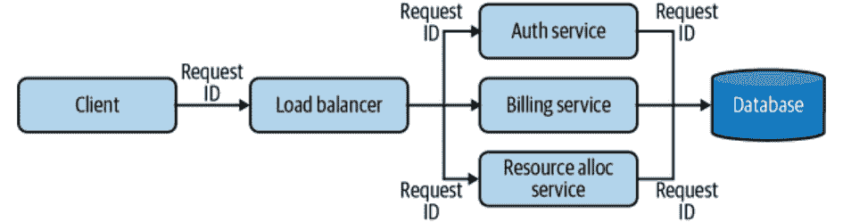

图 6-7. 一个简单的 Web 应用程序展示请求通过各个服务层传播

参考图 6-7，假设您有一个示例服务，该服务根据用户的计划在云上配置一些资源。执行的正常流程始于客户端向负载均衡器发出请求，负载均衡器与身份验证服务和计费服务通信，并通过对资源分配服务进行最终调用来为客户端分配资源。在图 6-8 中，您可以看到在流程中传播的唯一请求 ID，这有助于稍后拼接跟踪。

该事务流程可以使用甘特图可视化（见图 6-8）。

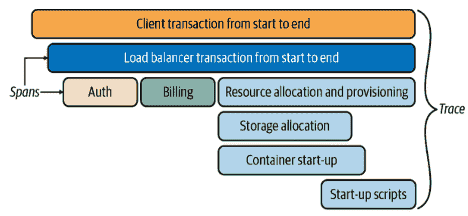

图 6-8. 简单 Web 应用程序中的 Span 和 Trace

### Tracing: Key Concepts

图 6-8 中的甘特图总结了分布式追踪系统的以下重要关键概念。

#### Spans

Span 代表单个操作调用，是分布式追踪的主要构建块，表示分布式系统中完成的工作单元。Span 包含对其他 Span 的引用，这使得多个 Span 可以组装成一个完整的 Trace。例如，在图 6-8 中，Span“负载均衡器从开始到结束的交易”包括其他 Span，例如负载均衡器与身份验证服务交互或负载均衡器与计费服务交互。

Span 以父子关系的形式创建，其中每个 Span 都有一个子 Span，除了根和起始服务（图 6-9）。

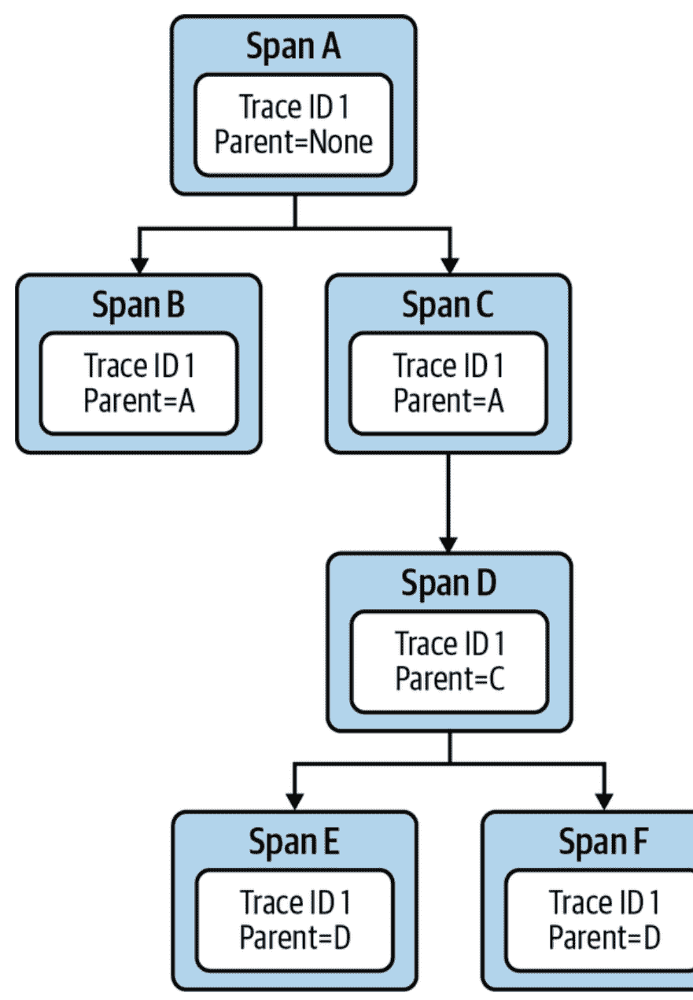

图 6-9. Span 的解剖结构

#### Traces

Trace 代表请求在遍历过程中触及的所有服务的完整旅程。单个完整的 Trace 通常由请求对应的多个 Span 组成。例如，客户端从开始到结束的完整交易由多个 Span 组成。

#### Context propagation

每次服务向下游服务发出请求时，都会将全局请求执行标识符作为元数据传递，该标识符对每个请求都是唯一的。此全局请求执行标识符稍后用于通过基于请求标识符对记录进行分组来重建请求的完整执行。将执行标识符作为请求元数据传递的过程称为 *分布式上下文传播*。

在 Span 之间传播的元数据还包括 Trace ID 和 Span ID 以及另外两个详细信息：标签和日志。*标签* 是可以添加到 Span 以提供额外信息（如错误代码和主机详细信息）的键值对。*日志* 也是键值对，捕获 Span 特定的日志消息并有助于调试。

#### Sampling

在内存中收集所有数据然后发送到追踪后端会对网络、应用程序延迟和成本产生严重影响。为了避免这个问题，追踪系统实现了采样。采样是从收集和存储所有追踪数据中仅收集和存储追踪数据的一个子集，以避免存储成本和性能开销的过程。有各种类型的采样方法，主要分为基于头部或基于尾部的采样。例如，如果您想每分钟收集 x 个 Trace，您可以使用一种称为 *速率限制* 的采样类型。同样，如果您想在某种类型的错误变得突出时采样 Trace，您可以使用 *上下文敏感采样*。

### General Tracing System Architecture and Trace Assembly


要实现云原生环境中的追踪系统，可以利用已有的开源库（我们将在下一节进一步讨论），这些库可以帮助你在不重复造轮子的情况下为应用程序进行 instrumentation。一般来说，大多数追踪系统都有一个简单的架构，如图 6-10 所示。

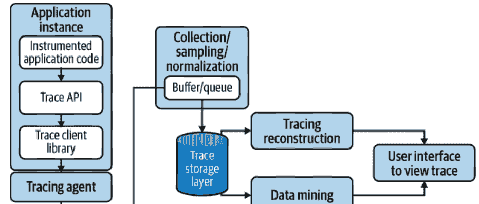

图 6-10. 通用的分布式追踪系统架构

要使用分布式追踪，首先需要使用客户端库对应用程序代码进行 instrumentation。客户端库有多种语言可用，包括 Java、Go 和 Python。该库将数据发送到代理，该代理通常位于同一实例或主机上。代理负责将追踪数据转发到后端（例如，通过异步缓冲层转发到存储层）。之后，追踪数据将被重建并显示给用户界面。追踪数据还可用于使用数据挖掘技术进行进一步的分析和聚合。

追踪是通过查看请求中的以下内容来组装的：

#### 入站请求 span

当请求进入服务时，追踪系统会检查请求是否附带了追踪头。如果没有附带追踪头，则会创建根 span；否则，需要创建子 span。

#### 出站请求 span

如果请求从一个服务发出到另一个服务，首先会创建 span，并且接收服务会按入站请求 span 中所述继续追踪。

你可以在云环境中以多种方式实现分布式追踪。我们将在下一节中查看其中的一些方法。

### 追踪标准、工具和代码 Instrumentation

多年来，分布式追踪已经发展并成为云原生世界中分析应用程序和监控应用程序的标准方式。2016 年，OpenTracing 成为 CNCF 项目，其唯一目标是为分布式追踪提供厂商无关的规范。在此期间，Google 正在开发一个名为 OpenCensus 的开源社区项目，后来由 Microsoft 主导。

OpenTracing 和 OpenCensus 是两个竞争的框架；它们的架构不同，但基本上解决了相同的问题。两种标准的存在导致了对支持和贡献的不确定性，这导致了行业内缺乏广泛采用。2019 年 5 月，CNCF 宣布将 OpenTracing 和 OpenCensus 合并为一个名为 OpenTelemetry 的单一标准。OpenTelemetry 结合了之前标准的优点，并得到社区的支持。在本节中，我们将了解如何使用 OpenTracing 和 OpenTelemetry 对基本应用程序代码进行 instrumentation。

今天最流行和实用的两个追踪工具是 Zipkin 和 Jaeger。Zipkin 是由 Google 的 Dapper 追踪基础设施开发的第一个追踪系统。⁵ Jaeger 由 Uber 开发并得到 CNCF 支持。Jaeger 实现了 OpenTracing 规范，其首选部署方式是 Kubernetes。我们将讨论限制在 Jaeger。

Jaeger 密切遵循追踪系统的通用架构，它由三个主要组件组成：收集器、查询服务和 UI。它在每个主机上部署一个代理，该代理基本上聚合追踪数据并将其发送到收集器（缓冲服务）。追踪数据然后可以存储在数据库中，最好是 Elasticsearch 或 Cassandra。

让我们现在看看一些可以用来用不同的追踪标准和 Jaeger 对代码进行 instrumentation 的简单方法。

例如，我们可以使用 Python Jaeger 客户端：

```
$ pip install jaeger-client
```

从那里，我们可以在一个单一的 Docker 镜像中运行所有 Jaeger 组件：

```
$ docker run -d -p6831:6831/udp -p16686:16686 jaegertracing/all-in-one:latest
```

我们可以使用 docker ps 检查 Docker 容器：

```
$ ~ docker ps -a
CONTAINER ID   IMAGE                     COMMAND                  CREATED          STATUS            PORTS                                                                 NAMES
874b2a03ebaa   jaegertracing/all-in-one:latest   "/go/bin/all-in-one-..."   About a minute ago   Up About a minute   5775/udp, 5778/tcp, 14250/tcp, 6832/udp, 14268/tcp, 0.0.0.0:6831->6831/udp, 0.0.0.0:16686->16686/tcp   jolly_mclean
```

你可以通过 http://localhost:16686 本地访问 Jaeger UI。

现在让我们讨论如何借助 OpenTracing 对简单应用程序代码进行 instrumentation。在以下示例中，我们有一个电影预订程序，它有一些方法负责检查电影是否可用。如果可用，它会预订票：

```
import sys
import time
import logging
import random
from jaeger_client import Config
from opentracing_instrumentation.request_context import
get_current_span, span_in_context

def initialize_tracer(service):
    logging.getLogger('').handlers = []
    logging.basicConfig(format='%(message)s',
level=logging.DEBUG)
    config = Config(
        config={
            'sampler': {
                'type': 'const',
                'param': 1,
            },
            'logging': True,
        },
        service_name=service,
    )
    return config.initialize_tracer()

def booking_manager(movie):
    with tracer.start_span('booking') as span:
        span.set_tag('Movie', movie)
        with span_in_context(span):
            get_cinema_details = check_movie(movie)
            get_showtime_details =
check_movie_showtime(get_cinema_details)
            book_movie_now(get_showtime_details)

def check_movie(movie):
    with tracer.start_span('CheckCinema',
child_of=get_current_span()) as span:
        with span_in_context(span):
            num = random.randint(1,30)
            time.sleep(num)
            cinema_details = "Cinema Details"
            flags = ['false', 'true', 'false']
            random_flag = random.choice(flags)
            span.set_tag('error', random_flag)
            span.log_kv({'event': 'CheckCinema' , 'value':
cinema_details })
            return cinema_details

def check_movie_showtime( cinema_details ):
```

```
with tracer.start_span('CheckShowtime',
child_of=get_current_span()) as span:
    with span_in_context(span):
        num = random.randint(1,30)
        time.sleep(num)
        showtime_details = "Showtime Details"
        flags = ['false', 'true', 'false']
        random_flag = random.choice(flags)
        span.set_tag('error', random_flag)
        span.log_kv({'event': 'CheckCinema' , 'value':
showtime_details })
        return showtime_details

def book_movie_now(showtime_details):
    with tracer.start_span('BookShow',
child_of=get_current_span()) as span:
        with span_in_context(span):
            num = random.randint(1,30)
            time.sleep(num)
            Ticket_details = "Ticket Details"
            flags = ['false', 'true', 'false']
            random_flag = random.choice(flags)
            span.set_tag('error', random_flag)
            span.log_kv({'event': 'CheckCinema' , 'value':
showtime_details })

assert len(sys.argv) == 2
tracer = initialize_tracer('movie_booking')
movie = sys.argv[1]
booking_manager(movie)
time.sleep(2)
tracer.close()
```

在前面的代码中，我们首先使用 initialize_tracer 方法初始化 tracer，该方法设置日志记录和采样的配置。代码中需要注意的另一点是我们如何使用 tracer 实例通过 start_span 启动新的 span，并使用 child_of 启动根 span 的新的子 span。例如，根 span 在 booking_manager 方法中生成，其余方法（例如 check_movie_showtime 和 check_movie）主要是根 span 的子 span。

我们还在方法中设置了标签和日志。例如：

```
-> span.set_tag('error', random_flag)

-> span.log_kv({'event': 'CheckCinema' , 'value':
showtime_details })
```

你现在可以在 Python 控制台中简单地运行此程序，通过传递一个虚构的电影标题作为参数，如下所示：

```
$ python jaeger_opentracing.py godfather
Initializing Jaeger Tracer with UDP reporter
Using sampler ConstSampler(True)
opentracing.tracer initialized to <jaeger_client.tracer.Tracer object at 0x10eeae410>[app_name=movie_booking]
Reporting span
f99b147b abd58321:5ca566beb40e89b0:931be7dc309045fd:1
movie_booking.CheckCinema
Reporting span
f99b147b abd58321:1ad5d00d2acbd02:931be7dc309045fd:1
movie_booking.CheckShowtime
Reporting span
f99b147b abd58321:f36b9959f34f61dc:931be7dc309045fd:1
movie_booking.BookShow
Reporting span f99b147b abd58321:931be7dc309045fd:0:1
movie_booking.booking
```

你现在可以访问 Jaeger UI 并在服务的下拉菜单中查找 movie_booking，然后你可以点击 Find Traces 按钮并看到追踪出现，如图 6-11 所示。


图 6-11. 电影预订服务的追踪

你可以看到图 6-11 中的四个 span，其中 movie_booking 是根 span，其余的是子 span。由于这是一个示例程序，为演示目的我们随机生成了一些错误并将其冒泡。在生产环境中，这些错误将


indicate problems that are occurring in the environment (e.g., Redis timing out due to an I/O issue).

We can also instrument our code using OpenTelemetry, since OpenTracing is now being phased out. First we would need to install the OpenTelemetry API and SDK:

```
pip install opentelemetry-api
pip install opentelemetry-sdk
```

To see how OpenTelemetry works, take a look at the following Python code:

```
from opentelemetry import trace
from opentelemetry.exporter import jaeger
from opentelemetry.sdk.trace import TracerProvider
from opentelemetry.sdk.trace.export import BatchExportSpanProcessor

trace.set_tracer_provider(TracerProvider())

jaeger_exporter = jaeger.JaegerSpanExporter(
    service_name="my-helloworld-service",
    agent_host_name="localhost",
    agent_port=6831,
)

trace.get_tracer_provider().add_span_processor(
    BatchExportSpanProcessor(jaeger_exporter)
)

tracer = trace.get_tracer(__name__)

with tracer.start_as_current_span("foo"):
    with tracer.start_as_current_span("bar"):
        with tracer.start_as_current_span("tango"):
            print("Hello world from Opentelemetry! Happy Tracing")
```

The preceding code is a simple “hello world”-style Python script that uses OpenTelemetry. Note how we are using the Jaeger exporter to tell us the location of the Jaeger agent.

You need Python3 to run the preceding script:

```
$ python3 opentelemetry_simple.py
Hello world from Opentelemetry! Happy Tracing
```

You can view the spans being populated on the UI again at the same Jaeger endpoint (http://localhost:16686) under the my-helloworld-service service.

You can similarly instrument any code depending on your application language. For example, you can instrument a Python Flask application as follows:

```
import flask
import requests

from opentelemetry import trace
from opentelemetry.exporter import jaeger
from opentelemetry.instrumentation.flask import FlaskInstrumentor
from opentelemetry.instrumentation.requests import RequestsInstrumentor
from opentelemetry.sdk.trace import TracerProvider
from opentelemetry.sdk.trace.export import (
    ConsoleSpanExporter,
    SimpleExportSpanProcessor,
)

trace.set_tracer_provider(TracerProvider())

jaeger_exporter = jaeger.JaegerSpanExporter(
    service_name="flask_app_example",
    agent_host_name="localhost",
    agent_port=6831,
)

trace.get_tracer_provider().add_span_processor(
    SimpleExportSpanProcessor(jaeger_exporter)
)

app = flask.Flask(__name__)
FlaskInstrumentor().instrument_app(app)
RequestsInstrumentor().instrument()
```

```
@app.route("/")
def hello():
    tracer = trace.get_tracer(__name__)
    with tracer.start_as_current_span("example-request"):
        requests.get("http://www.example.com")
    return "hello"

app.run(debug=True, port=5000)
```

You can run the preceding script as follows, and hit http://localhost:5000 to generate traces in the Jaeger UI:

```
$ python3 opentelemetry_flask.py
* Serving Flask app "opentelemetry_flask" (lazy loading)
* Environment: production
  WARNING: This is a development server. Do not use it in a production deployment.
  Use a production WSGI server instead.
* Debug mode: on
* Running on http://127.0.0.1:5000/ (Press CTRL+C to quit)
* Restarting with stat
* Debugger is active!
* Debugger PIN: 156-661-048
127.0.0.1 - - [30/Dec/2020 20:54:37] "GET / HTTP/1.1" 200 -
127.0.0.1 - - [30/Dec/2020 20:54:37] "GET /favicon.ico HTTP/1.1" 404 -
```

These are a few ways you can use distributed tracing in your cloud native environments to make them observable. Apart from the approaches mentioned here, service meshes such as Istio also provide a sidecar implementation architecture to perform distributed tracing. We will introduce service meshes in Chapter 7. For more information on distributed tracing, please refer to *Mastering Distributed Tracing* by Yuki Shkuro (Packt, 2019).

Now let’s discuss what Azure has to offer in the monitoring space.

### Azure Monitor

In addition to the previously mentioned tailor-made solutions for building observable systems, Microsoft Azure also offers Azure Monitor, an off-the-shelf solution that can help you monitor an application and infrastructure running in the cloud and in on-premises environments. Azure Monitor primarily uses metrics and logs to find out how your application is performing and proactively identifies potential issues affecting them along with any resource dependency.

Azure Monitor has various features which can help you detect a variety of issues in your application and infrastructure, as listed here and depicted in Figure 6-12:

#### Application insights

You can detect and diagnose issues across applications and dependencies by monitoring the availability, performance, and usage of your web apps hosted in the cloud or on premises.

#### Azure Monitor for containers and virtual machines

You can monitor the performance of your containers running on AKS as well as the virtual machine hosting them.

#### Log analytics and log queries

You can use Azure Monitor logs based on Azure Data Explorer to query logs.

#### Workbooks and dashboards

You can create flexible visualizations using workbooks and dashboards for data analysis, which will allow you to tap into multiple data resources across Azure.

#### Azure Monitor metrics

You can use Azure Monitor metrics to collect numerical data from your infrastructure and application.

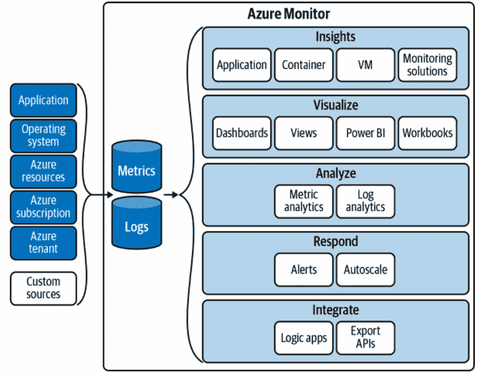

Figure 6-12. Azure Monitor

Azure Monitor also allows you to consume distributed trace data. There are primarily two ways to do this. The first is by using the transaction diagnostics view, which is similar to a call stack with a time dimension added in. The transaction diagnostics view provides visibility into one single transaction/request, and is helpful for finding the root cause of reliability issues and performance bottlenecks on a per-request basis. The second way is by using the application map view, which aggregates many transactions to show a topological view of how the systems interact, and what the average performance and error rates are.

Furthermore, you can integrate Azure Monitor with other systems and build a custom observability platform that uses your monitoring data.

### Summary

In this chapter, we presented observability as a growing need in the cloud native environment. We introduced observability and how it complements monitoring along with how observability-driven development is the new true north for gaining insights into your application and cloud infrastructure. We discussed the three pillars of observability and introduced the preferred ways of logging, monitoring, and tracing modern distributed systems over Azure. Lastly, we looked briefly at how Azure offers its built-in solutions to perform some similar tasks with Azure Monitor. With this knowledge under your belt, you can now confidently build observable systems in cloud native environments and build observability into your application.

In the next chapter, we will look at how service mesh and service discovery assist in cloud native environments.

- 1 You can read more about PromQL at https://prometheus.io/docs/prometheus/latest/querying/basics.
- 2 The Prometheus team has compiled best practices on the use of instrumentation at https://prometheus.io/docs/practices/instrumentation/#counter-vs-gauge-summary-vs-histogram.
- 3 Kibana is an open source UI that is generally used to visualize data (logs). More information is available at https://www.elastic.co/kibana.
- 4 More information on Loki is available at https://grafana.com/blog/2020/05/12/an-only-slightly-technical-introduction-to-loki-the-prometheus-inspired-open-source-logging-system.
- 5 https://research.google/pubs/pub36356
