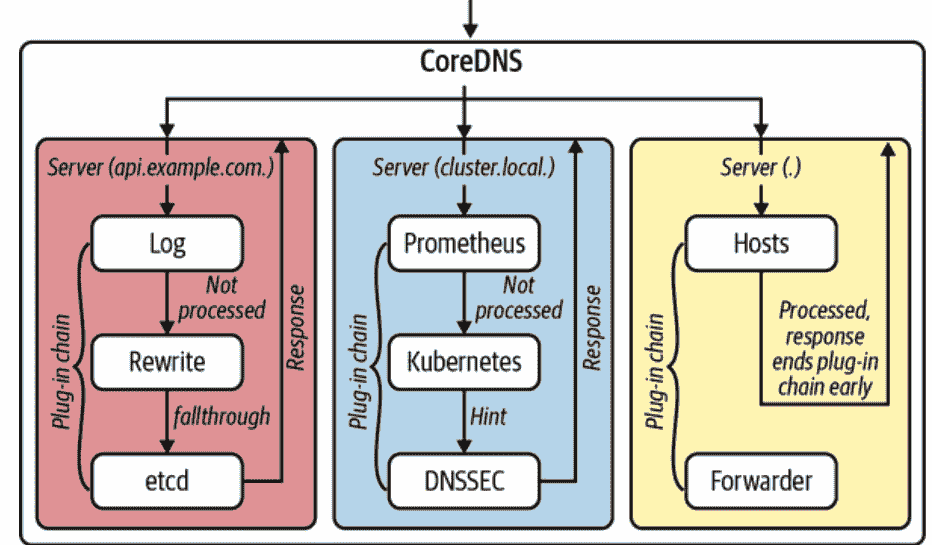
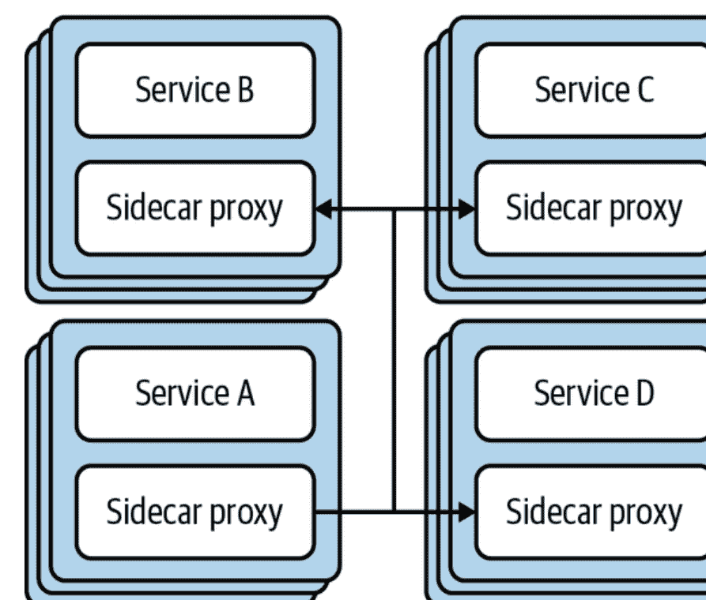
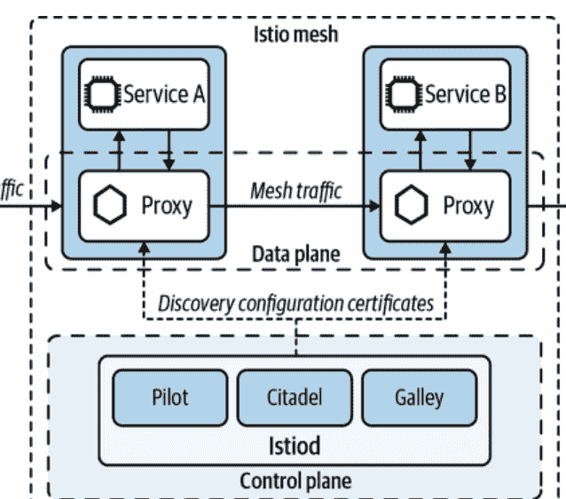
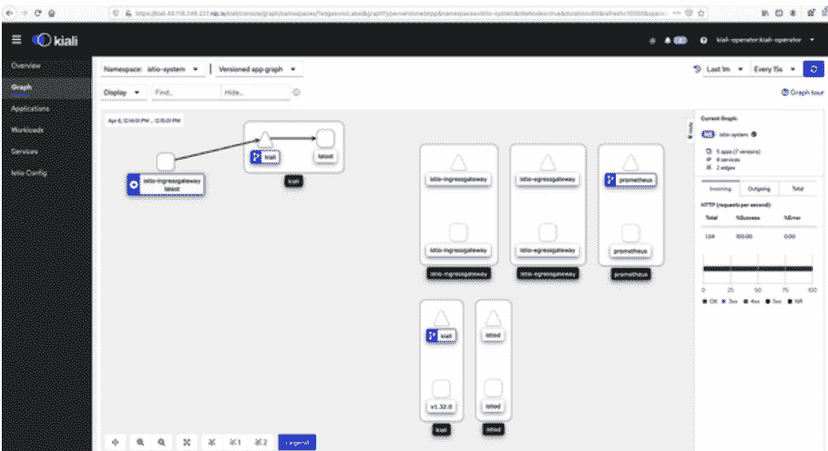
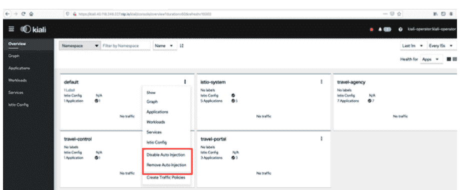
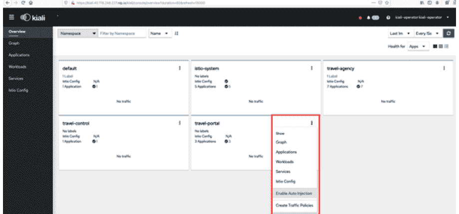
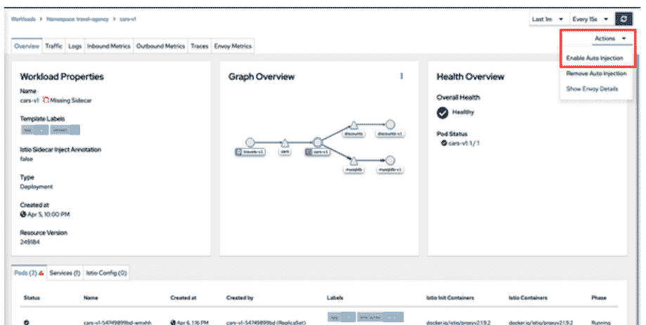
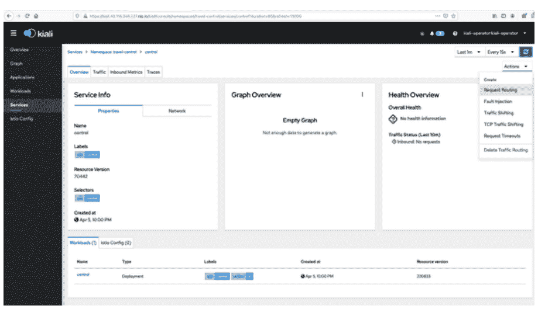

## Chapter 7. Service Discovery and Service Mesh: Finding New Territories and Crossing Borders

### A NOTE FOR EARLY RELEASE READERS

With Early Release ebooks, you get books in their earliest form—the author’s raw and unedited content as they write—so you can take advantage of these technologies long before the official release of these titles.

This will be the 7th chapter of the final book. Please note that the GitHub repo will be made active later on.

If you have comments about how we might improve the content and/or examples in this book, or if you notice missing material within this chapter, please reach out to the editor at rfernando@oreilly.com.

As modern applications moved to a microservices architecture, they became scalable and efficient over the cloud. Microservices favor breaking down an application into independent, decoupled components. Decoupling is usually achieved by separating the codebases into standalone applications that are connected using the network and well-defined APIs/interfaces that microservices use to communicate. Once you move your applications to a microservices architecture, a lot of opportunities open up: you can scale each individual service, decouple the release cycle for each service, choose a different language to write your individual application components, and even organize your team structure based on these independent services.


然而，现在你已经将应用程序拆分为更小的应用程序，这些二进制文件拥有各自的生命周期。该生命周期会独立调度并根据需要独立终止，同时通过网络保持通信。想象一下，在这种情况下，你运行着大量相互通信的微服务。你很可能会开始提出几个问题，包括以下问题：

- 当服务具有动态性时，服务之间如何相互通信？（也就是说，由于服务通过网络通信，IP地址不足以访问服务，因为它们可以独立终止并重新调度到不同的主机上。）
- 如何控制和管理流量或按需路由流量，包括金丝雀发布、A/B 测试和断路器等高级场景？
- 如何确保服务之间的安全并加密它们之间的流量？

为了解决这些问题，你可以开始在应用程序内编写和构建额外的基础设施特定逻辑。然而，这会使应用程序范围超出你的业务需求，并且你必须为使用的每个微服务栈实现此逻辑。

幸运的是，这些问题在云原生环境领域已通过服务发现和服务网格技术的帮助得到解决，这些技术提供了一种更灵活的方式来管理、保护服务并对服务提供更大的控制。

*服务发现*是一种服务相互发现以便通信的机制。服务发现主要关注在云中查找服务的网络位置。在传统环境中，你需要处理物理服务器，你知道服务器的静态IP地址，并且可以使用简单的配置文件存储 IP，这些 IP 可供你的服务用于访问其他服务。

这种设置在本地或物理环境设置中运行良好。但对于云中高度可扩展的应用程序，这种方法会失败，因为现在你的应用程序具有动态性，这意味着应用程序可以根据需要重新启动、重新调度或终止。在这种情况下，不能硬编码 IP，因为它可能会更改。服务发现通过在云中为每个服务名称存储到 IP 地址的映射来提供帮助。

*服务网格*专注于解决服务间通信带来的复杂性增加问题。服务网格是处理云环境中所有服务到服务网络通信的专用基础设施。它提供高可见性、弹性、流量管理和安全控制，而对现有应用程序代码几乎不需要或不需要更改。

在本章中，我们将介绍 CoreDNS，这是在云原生世界中一个突出的服务发现平台，被 Azure Kubernetes Service (AKS) 用于集群 DNS 管理和名称解析。我们还将介绍 Istio，这是一个在 Azure 等云环境中广泛使用的突出服务网格。

### 服务发现

服务发现是现代云原生环境的基本组件。它负责确保服务能够在网络上找到并相互通信。通常，服务发现涉及一个*服务注册表*，云环境中的所有服务/应用程序都需要在此注册。服务注册表是保存服务位置的中央存储库。在典型场景中，新服务首次进入环境时首先向服务注册表注册。服务注册表更新服务的最新网络位置，当消费者服务请求连接到该服务时，服务注册表会为消费者提供该服务的位置。

在本节中，我们将探索 CoreDNS，并了解它如何在云环境中用作服务发现工具。

### CoreDNS 简介

CoreDNS 是一个可扩展的 DNS 服务器，支持标准 DNS、DNS over TLS 和 DNS over gRPC 协议。CoreDNS 由 Miek Gieben 于 2016 年创建，利用了作为 Caddy¹ Web 服务器的一部分开发的服务器框架。它具有高度可配置、灵活且可扩展的插件架构。CoreDNS 在获得 Cloud Native Computing Foundation (CNCF) 的支持后获得了更广泛的采用。2019 年，CoreDNS 从 CNCF 获得了“毕业”成熟度级别。²

CoreDNS 现在是 Kubernetes 1.13 及更高版本的官方默认 DNS 服务器，取代了 kube-dns。CoreDNS 通过以下几个关键差异解决了 kube-dns 原始实现中的可靠性和安全问题：

- CoreDNS 运行单个容器，而 kube-dns 运行三个容器：kube-dns、dnsmasq 和 sidecar。
- CoreDNS 设计为可作为与 Kubernetes 向后兼容的通用 DNS 服务器使用。
- CoreDNS 主要是一个 Go 进程，增强了 kube-dns 的功能。

CoreDNS 插件架构确保 DNS 服务器功能保持稳定，并使使用插件添加进一步功能成为可能。最终用户可以通过配置区域在特定端口上提供服务来定义多个服务器。每个服务器将请求通过插件链传递，以确定发送何种类型的响应：

- 如果配置了多个服务器监听查询端口，它将检查哪一个对查询具有最具体的区域，使用最长后缀匹配。例如，如果用户查询 www.health.abc.com 且配置了两个服务器 abc.com 和 health.abc.com，则查询将被路由到后者服务器。
- 一旦找到合适的服务器，它将被路由通过为该服务器配置的插件链。

- 每个插件都会检查查询，并根据查询可能发生以下情况：
  - 如果查询由插件处理，将向客户端发送适当的响应。查询处理在此停止，不再调用其他插件。
  - 如果查询未被插件处理，它将调用链中的下一个插件。如果链中最后一个插件也无法处理查询，CoreDNS 将向调用客户端返回 SERVFAIL。
  - 如果查询使用 fall-through 方法处理，即链中其他插件也将被调用来查看查询，则使用关键字 `fallthrough` 来启用它。
  - 如果查询使用提示处理，下一个链中的插件将始终被调用。但是，它会提供一个提示，允许它查看将返回给客户端的响应。

图 7-1 展示了 CoreDNS 处理查询时发生的步骤。



图 7-1. CoreDNS 查询过程

现在让我们看看如何安装 CoreDNS 并使用配置文件，也称为 Corefile，来配置它。

### 安装和配置 CoreDNS

你可以通过使用二进制文件安装 CoreDNS，该二进制文件可在本书的 GitHub 位置³ 获取。一旦你为你的操作系统获取了二进制文件，你可以将其移动到本地 bin。例如，如果你下载了 macOS 的二进制文件 coredns_1.8.1_darwin_amd64.tgz，你可以解压文件并将其移动到 /usr/local/bin。验证 CoreDNS 是否正常工作，发出以下命令：

```
$ coredns -version
CoreDNS-1.8.1
darwin/amd64, go1.15.7, 95622f4
```

CoreDNS 提供了一堆由 Corefile 处理的配置选项。当 CoreDNS 启动时，如果未传递 -conf 标志，它会在当前目录中查找名为 Corefile 的文件。该文件主要定义以下内容：

- 哪个服务器监听哪个端口
- 每个服务器对哪个区域具有权威性
- 在服务器中加载哪些插件

Corefile 通常看起来像这样：

```
ZONE:[PORT] {
  [PLUGIN]...
}
```

其中 ZONE 表示 DNS 区域，PORT 是区域服务器运行的位置（通常为端口 53），PLUGIN 定义用户需要加载的插件。

Corefile 中最常见的条目之一是各种服务器块，它们在 CoreDNS 中定义一个服务器（即如何处理特定域名查询）。这里有一个例子：

```
example.com {
}
```

前面的服务器块将处理所有以 example.com 结尾的查询，除非存在更具体的服务器块，如 foo.example.com。对于更具体的例子，假设你的 Corefile 中有以下内容：

```
cloudnativeazure.io:53 {
  log
  errors
}

.:53 {
```


```
forward . 8.8.8.8
log
errors
cache
}
```

在这个示例中，我们为 cloudnativeazure.io 和根（.）服务器块配置了两个服务器块。两者都监听 53 端口。此外，还定义了多个插件：log，用于记录 CoreDNS 接收到的每个查询；errors，用于记录错误；cache，用于启用前端缓存（即除区域传输和元数据外的所有记录将被缓存，最长可达 3600 秒）。你只需在 Corefile 所在的同一目录下输入 coredns 即可运行前面的 Corefile，或执行 coredns -conf Corefile：

```
$ coredns -conf Corefile
.:53
cloudnativeazure.io.:53
CoreDNS-1.8.1
darwin/amd64, go1.15.7, 95622f4
```

如果在另一个终端中对 cloudnativeazure.io 执行 dig，你会看到以下内容：

```
$ ~ dig @127.0.0.1 cloudnativeazure.io:53
; <<>> DiG 9.10.6 <<>> @127.0.0.1 cloudnativeazure.io:53
; (1 server found)
;; global options: +cmd
;; Got answer:
;; ->>HEADER<<- opcode: QUERY, status: NXDOMAIN, id: 48995
;; flags: qr rd ra ad; QUERY: 1, ANSWER: 0, AUTHORITY: 1, ADDITIONAL: 1

;; OPT PSEUDOSECTION:
; EDNS: version: 0, flags;; udp: 4096
;; QUESTION SECTION:
;cloudnativeazure.io:53.      IN      A

;; AUTHORITY SECTION:
.                       1800    IN      SOA     a.root-servers.net.
nstld.verisign-grs.com. 2021021001 1800 900 604800 86400
```

```
;; Query time: 82 msec
;; SERVER: 127.0.0.1#53(127.0.0.1)
;; WHEN: Wed Feb 10 23:45:28 IST 2021
;; MSG SIZE  rcvd: 126
```

你可以在 CoreDNS 终端中看到如下日志：

```
$ coredns -conf Corefile
.:53
cloudnativeazure.io.:53
CoreDNS-1.8.1
darwin/amd64, go1.15.7, 95622f4

[INFO] 127.0.0.1:59741 - 48995 "A IN cloudnativeazure.io:53. udp 51 false 4096" NXDOMAIN qr,rd,ra,ad 115 0.05160016s
```

我们在这里只介绍了 CoreDNS 的基础知识。如需了解更多信息，建议阅读 John Belamaric 和 Cricket Liu 合著的 *Learning CoreDNS*（O’Reilly，2019）。

现在让我们讨论 CoreDNS 在 Kubernetes 中的服务发现用法。

### Kubernetes 服务发现与 CoreDNS

如前所述，CoreDNS 是 Kubernetes v1.13 及更高版本中的默认服务发现机制，你可以从一开始就使用它。如以下代码块所示，运行在 kube-system 命名空间中的 Pod 类型为 core-dns：

```
$ kubectl get pods --namespace=kube-system -o wide
NAME                          READY   STATUS    RESTARTS   AGE   IP           NODE                                      NOMINATED NODE   READINESS GATES
coredns-748cdb7bf4-9xggk      1/1     Running   0          4h31m 10.244.0.3    aks-agentpool-13363041-vmss000002         <none>
coredns-748cdb7bf4-f6glb      1/1     Running   0          4h30m 10.244.0.5    aks-agentpool-13363041-vmss000002         <none>
coredns-autoscaler-868b684fd4-7ck6z 1/1 Running 0 4h30m 10.244.0.4 aks-agentpool-13363041-vmss000002 <none>
```

```
<none>

$ kubectl get deployments --namespace=kube-system
NAME                READY   UP-TO-DATE   AVAILABLE   AGE
coredns             2/2     2            2           4h31m
coredns-autoscaler  1/1     1            1           4h31m
```

CoreDNS Kubernetes 插件会监视 Kubernetes 服务和端点资源，并缓存该数据。当请求发出时，CoreDNS 插件会检查是否存在与请求名称对应的资源，然后返回适当的数据。响应记录是根据传入请求即时构建的，利用 Kubernetes API 服务器的 watch 功能。

让我们看看 CoreDNS 如何在 Kubernetes 集群中协助服务发现。假设你按如下方式在 Kubernetes 集群中运行一个简单的 Nginx Pod：

```
$ kubectl get pods
NAME    READY   STATUS    RESTARTS   AGE
nginx   1/1     Running   0          3m20s
```

```
$ kubectl get services
NAME         TYPE        CLUSTER-IP      EXTERNAL-IP   PORT(S)   AGE
kubernetes    ClusterIP   10.0.0.1        <none>        443/TCP   41m
nginx         ClusterIP   10.0.148.122    <none>        80/TCP    3m26s
```

要访问此 Nginx 服务器，你需要运行一个包含 dig 和 curl 等 DNS 工具的 infoblox/dnstools Pod。要运行此 Pod，可以使用以下命令：

```
$ kubectl run --restart=Never -it --image infoblox/dnstools
dnstools
If you don't see a command prompt, try pressing enter.
dnstools#
```

前面的命令会将你登录到新启动的容器中并提供一个命令提示符。

在 Kubernetes 中，基于 DNS 的服务发现定义了一种规范，或 DNS 模式，定义了用于定位集群中运行的服务的 DNS 名称。Kubernetes 集群中的所有 DNS 记录都属于一个单一域，称为 *集群域*，在大多数 Kubernetes 集群中默认通常设置为 `cluster.local`。DNS 规范定义了为分配给服务的每个 IP（即集群 IP）存在一个 A 记录，该记录包含集群 IP，其名称由服务名称和命名空间派生为 `service.namespace.svc.cluster-domain`。因此，要访问我们创建的 Nginx Pod，你可以从 `infoblox/dnstools` 容器中发出以下命令：

```
dnstools# curl nginx.default.svc.cluster.local
<!DOCTYPE html>
<html>
<head>
<title>Welcome to nginx!</title>
<style>
    body {
        width: 35em;
        margin: 0 auto;
        font-family: Tahoma, Verdana, Arial, sans-serif;
    }
</style>
</head>
<body>
<h1>Welcome to nginx!</h1>
<p>If you see this page, the nginx web server is successfully installed and working. Further configuration is required.</p>

<p>For online documentation and support please refer to <a href="http://nginx.org/">nginx.org</a>.<br/>
Commercial support is available at <a href="http://nginx.com/">nginx.com</a>.</p>

<p><em>Thank you for using nginx.</em></p>
</body>
```

```
</html>
dnstools#
```

你也可以发出 dig 命令来查看服务的 A 记录：

```
dnstools# dig nginx.default.svc.cluster.local

; <<>> DiG 9.11.3 <<>> nginx.default.svc.cluster.local
;; global options: +cmd
;; Got answer:
;; WARNING: .local is reserved for Multicast DNS
;; You are currently testing what happens when an mDNS query is leaked to DNS
;; ->>HEADER<<- opcode: QUERY, status: NOERROR, id: 52488
;; flags: qr aa rd; QUERY: 1, ANSWER: 1, AUTHORITY: 0, ADDITIONAL: 1
;; WARNING: recursion requested but not available

;; OPT PSEUDOSECTION:
; EDNS: version: 0, flags; udp: 4096
; COOKIE: 5086e790e261bf20 (echoed)
;; QUESTION SECTION:
;nginx.default.svc.cluster.local. IN      A

;; ANSWER SECTION:
nginx.default.svc.cluster.local. 5 IN    A    10.0.148.122

;; Query time: 1 msec
;; SERVER: 10.0.0.10#53(10.0.0.10)
;; WHEN: Sat Feb 27 07:37:10 UTC 2021
;; MSG SIZE  rcvd: 119
```

Microsoft Azure 还提供 DNS 即服务，通过名为 Azure DNS 的托管服务。我们接下来将介绍它。

### Azure DNS

Azure DNS 主要提供 Microsoft Azure 基础设施来处理 DNS 域的名称解析。你可以使用 Azure DNS 来托管你的 DNS 域并管理你的 DNS 记录。通过在 Azure 中托管你的域，你可以使用与其它 Azure 服务相同的凭据、API、工具和计费来管理你的 DNS 记录。

Azure DNS 可用于解析公共和私有域中的主机名。公共 DNS 功能可用于通过 Azure 托管你预先购买的域名，而私有 DNS 让你能够在虚拟网络内管理和解析域名。

CoreDNS 还提供了一个 Azure 特定插件，用于从 Azure DNS 提供区域。你可以按如下方式启用 Azure 插件：

```
azure AZURE_RESOURCE_GROUP:ZONE... {
    tenant <TENANT_ID>
    client <CLIENT_ID>
    secret <CLIENT_SECRET>
    subscription <SUBSCRIPTION_ID>
    environment <ENVIRONMENT>
    fallthrough [ZONES...]
    access private
}
```

在前面的代码中：

- AZURE_RESOURCE_GROUP:ZONE 是 Azure 上托管区域所属的资源组，ZONE 是包含数据的区域。
- CLIENT_ID 和 CLIENT_SECRET 是 Azure 的凭据，tenant 指定要使用的 TENANT_ID。SUBSCRIPTION_ID 是订阅 ID。
- environment 指定 Azure ENVIRONMENT。
- fallthrough 指定如果区域匹配但无法生成记录，则请求应传递给下一个插件。如果省略 ZONES，则对插件具有权威性的所有区域都会发生回退。
- access 指定 DNS 区域是公共还是私有。默认值为 public。

我们已经介绍了服务发现在分布式云原生环境中的作用和意义，那么让我们讨论一下服务网格带来的


the table.

### 服务网格

服务网格是一种工具，可在云原生应用的平台层添加可观测性、可靠性和安全性。服务网格通常实现为可扩展的一组网络代理，以 sidecar 的形式部署在应用旁边。这些代理主要负责处理微服务之间的通信，并在 OSI 模型的第 7 层运行。除了若干附加功能外，服务网格还：

- 通过负载均衡、速率限制、流量切换和断路器提供流量管理
- 通过金丝雀发布帮助应用发布周期管理
- 开箱即用地添加一些可靠性检查，例如健康检查、重试和超时
- 协助故障注入和调试路由
- 通过 TLS 和 ACL 策略提供安全性
- 为集群内的所有流量提供自动指标、日志和追踪
- 使用强身份识别的身份验证和授权，在集群中保护服务到服务的通信

服务网格的总体架构由两个高层组件组成：数据平面和控制平面。图 7-2 展示了部署在服务网格中的四个服务（A–D）。



图 7-2. 服务网格总体架构

如你所见，每个服务实例都有一个 sidecar 代理实例，负责所有流量流和管理。这基本上意味着当服务 A 例如想要与服务 C 通信时，服务 A 通过其本地 sidecar 代理发起通信流，然后到达服务 C 的 sidecar 代理。这样，服务本身并不感知本地网络代理，并与更大网络隔离。因此，每当一个服务需要与另一个服务通信时，代理会拦截来自它的请求，然后转发给接收方。

所有 sidecar 代理的集合构成了服务网格架构的数据平面。数据平面负责以下工作：

- 请求转发
- 服务发现
- 健康检查
- 路由服务请求
- 负载均衡
- 身份验证和授权
- 提供可观测性

因此，数据平面从根本上触及集群中的每个网络请求或数据包。

另一方面，控制平面为服务网格中所有 sidecar 代理（数据平面）提供策略和配置细节。控制平面允许你控制和配置数据平面。所有高层配置都会发送到控制平面，然后被转换为数据平面特定的配置。控制平面通过以下方式协助数据平面：

- 服务间路由
- 为数据平面使用填充服务发现数据
- 指定负责负载均衡、断路和超时的配置输入
- 在集群中配置验证、身份验证和授权设置

在下一节中，我们将介绍 Istio，它在现代云原生环境中充当服务网格的控制平面。

### Istio 简介

随着单体应用向微服务转型，开发人员和运维团队在服务网格中服务如何相互通信方面遇到了挑战。随着服务网格规模的增长，管理和维护变得困难。甚至理解不同组件如何协同工作也变得困难。

Istio 是一个开源服务网格，简化了分布式云原生应用中微服务之间的通信。Istio 提供了丰富的内置功能集，可强制执行重试、断路器、整形流量、路由行为、金丝雀部署等弹性模式。此外，Istio 允许你使用负载均衡、监控和身份验证轻松创建已部署微服务的网络，而几乎无需更改应用代码。

正如我们在上一节讨论的，服务网格架构由数据平面和控制平面组成。Istio 使用 Envoy 作为其数据平面，使用 istiod 作为其控制平面（如图 7-3 所示）：

#### Envoy（数据平面）

Envoy 是一个用 C++ 编写的高性能代理，拦截服务网格中每个应用的全部入站和出站流量。它与应用一起作为 sidecar 部署，并提供大量功能，包括 TLS 终止、负载均衡、断路、健康检查、动态服务发现、故障注入等。

这种 sidecar 代理模型允许你在使用 Istio 作为服务网格时无需任何代码更改。

#### Istiod（控制平面）

Istiod 管理和配置代理。Istiod 由三个子组件组成：

- Pilot，负责在运行时配置 Envoy 代理
- Citadel，负责证书签发和轮换
- Galley，负责在 Istio 内部验证、摄取、聚合、转换和分发配置

Istiod 将控制流量的高层路由规则转换为 Envoy 特定配置，并在运行时传播到 Envoy sidecar。



图 7-3. Istio 架构

让我们看看如何在 Azure Kubernetes 环境中使用 Istio 和 Envoy。

### 在 Azure Kubernetes Service 上安装 Istio

你可以通过三种方式在 Kubernetes 集群上安装 Istio：

- Istio 提供了一个名为 istioctl 的命令行工具，可用于对 Istio 控制平面和 Envoy 代理数据平面提供丰富的定制级别。
- 你可以使用 Istio Kubernetes operator 通过 Kubernetes API 的自定义资源定义（CRDs）来管理安装。
- 你可以使用 Helm charts 直接安装 Istio。

由于 Helm charts 也在方法 1 和 2 中间接使用，我们将在这里使用它们来安装 Istio。

### 使用 Helm 安装 Istio

要使用 Helm 安装 Istio，你需要一个已经运行的 AKS 集群（如果需要复习如何在 Azure 中创建 AKS 集群，请查看第 5 章）。以下步骤将在 AKS 集群上安装 Istio：

- 通过在本地机器上运行以下命令下载 Istio：
  
  ```
  $ curl -L https://istio.io/downloadIstio |
  ISTIO_VERSION=1.9.2 TARGET_ARCH=x86_64 sh -
  
  $ cd istio-1.9.2
  ```
- 创建一个新的命名空间用于 Istio 组件，名为 `istio-system`：
  
  ```
  $ kubectl create namespace istio-system
  
  namespace/istio-system created
  ```
- 安装包含 istiod 控制平面使用的集群范围资源的 Istio base chart：
  
  ```
  $ helm install istio-base manifests/charts/base -n istio-system
  NAME: istio-base
  LAST DEPLOYED: Sun Mar 28 15:59:16 2021
  NAMESPACE: istio-system
  STATUS: deployed
  REVISION: 1
  TEST SUITE: None
  ```
- 安装部署 istiod 服务的 Istio discovery chart：

```
$ helm install istiod manifests/charts/istio-control/istio-discovery -n istio-system

NAME: istiod
LAST DEPLOYED: Sun Mar 28 16:02:23 2021
NAMESPACE: istio-system
STATUS: deployed
REVISION: 1
TEST SUITE: None
```

- 验证安装：

```
$ helm list -A
NAME            NAMESPACE       REVISION UPDATED
STATUS  CHART                   APP VERSION
istio-base      istio-system    1        2021-03-28
15:59:16.429126 +0530 IST    deployed    base-1.9.2
istiod          istio-system    1        2021-03-28
16:02:23.950541 +0530 IST    deployed    istio-discovery-1.9.2
```

```
$ kubectl get pods -n istio-system
NAME                          READY   STATUS    RESTARTS
AGE
istiod-6d68c86c8d-5nv2r       1/1     Running   0
10m
```

重要的是要确保每当在集群中部署新的 Pod 时，Istio sidecar 代理（Envoy 代理）也会注入到同一个 Pod 中，以便你能利用 Istio 的所有功能。我们将在下一节讨论如何做到这一点。

### 自动注入 Sidecar 代理（Envoy 代理）


为了充分利用 Istio 作为服务网格，集群中的 Pod 也必须使用 Istio sidecar 代理。istio-proxy，本质上是 Envoy 代理，可以通过两种方式部署：手动或自动。手动方法允许你修改注入和代理配置。自动方法顾名思义，在 Pod 创建时通过使用突变准入控制器实现自动代理配置。虽然手动方法在需要特定配置时很有用，但自动方法更受青睐。我们接下来将介绍如何使用自动方法。

### KUBERNETES ADMISSION CONTROLLERS

准入控制器是一段在对象持久化之前但在请求经过身份验证和授权之后拦截对 Kubernetes API 服务器请求的代码。Kubernetes 提供了一系列编译到 kube-apiserver 库中的准入控制器。

MutatingAdmissionController 可以修改其允许的对象。也就是说，它会调用与请求匹配的任何突变 webhook。

要使用自动 sidecar 注入，请在所需命名空间上使用标签 istio-injection 并将其设置为 enabled。这允许在该命名空间中创建的任何新 Pod 在应用程序旁边部署代理 sidecar。为了让你更好地了解其工作原理，首先我们将部署一个没有 sidecar 注入的 Nginx Pod，然后我们将启用 sidecar 注入，以便在未来的部署中 sidecar 代理会自动注入。

假设我们已使用一个 Pod 部署了 Nginx：

```
$ kubectl apply -f nginx_deploy.yaml
deployment.apps/nginx-deployment created

$ kubectl get deployment -o wide
NAME                 READY   UP-TO-DATE   AVAILABLE   AGE
CONTAINERS           IMAGES                  SELECTOR
```

```
nginx-deployment    1/1    1    1    105s    nginx
nginx:1.14.2    app=nginx
```

```
$ kubectl get pod
NAME    READY    STATUS    RESTARTS    AGE
nginx-deployment-6b474476c4-bqgh8    1/1    Running    0    4m5s
```

让我们为 default 命名空间添加标签 istio-injection=enabled：

```
$ kubectl label namespace default istio-injection=enabled --overwrite
namespace/default labeled
$ kubectl get namespace -L istio-injection
NAME            STATUS    AGE    ISTIO-INJECTION
default         Active    24m    enabled
istio-system    Active    18m
kube-node-lease Active    25m
kube-public     Active    25m
kube-system     Active    25m
```

由于注入发生在 Pod 创建时，我们可以杀掉 Nginx Pod 并重新启动一个新的 Nginx Pod，这次 Pod 将自动注入 sidecar：

```
$ kubectl delete pod -l app=nginx
pod "nginx-deployment-6b474476c4-bqgh8" deleted

$ kubectl get pod -l app=nginx
NAME    READY    STATUS    RESTARTS    AGE
nginx-deployment-6b474476c4-pfgqv    2/2    Running    0    57s
```

请注意，部署已启动了两个容器。这是在 Pod 中运行的 sidecar 代理。你可以通过以下方式使用 describe 验证：

```
$ kubectl describe pod -l app=nginx

Events:
  Type    Reason    Age    From
  Message
```

```
    ----    ------    ----    ----
----------
    Normal    Scheduled    <unknown>    default-scheduler
Successfully assigned default/nginx-deployment-6b474476c4-pfgqv
to aks-agentpool-20139558-vmss000001
    Normal    Pulling    2m35s    kubelet, aks-agentpool-20139558-
vmss000001    Pulling image "docker.io/istio/proxyv2:1.9.2"
    Normal    Created    2m34s    kubelet, aks-agentpool-20139558-
vmss000001    Created container nginx
    Normal    Created    2m34s    kubelet, aks-agentpool-20139558-
vmss000001    Created container istio-init
    Normal    Started    2m34s    kubelet, aks-agentpool-20139558-
vmss000001    Started container istio-init
    Normal    Pulled    2m34s    kubelet, aks-agentpool-20139558-
vmss000001    Container image "nginx:1.14.2" already present on
machine
    Normal    Pulled    2m34s    kubelet, aks-agentpool-20139558-
vmss000001    Successfully pulled image
"docker.io/istio/proxyv2:1.9.2"
    Normal    Started    2m34s    kubelet, aks-agentpool-20139558-
vmss000001    Started container nginx
    Normal    Pulling    2m34s    kubelet, aks-agentpool-20139558-
vmss000001    Pulling image "docker.io/istio/proxyv2:1.9.2"
    Normal    Pulled    2m33s    kubelet, aks-agentpool-20139558-
vmss000001    Successfully pulled image
"docker.io/istio/proxyv2:1.9.2"
    Normal    Created    2m33s    kubelet, aks-agentpool-20139558-
vmss000001    Created container istio-proxy
    Normal    Started    2m33s    kubelet, aks-agentpool-20139558-
vmss000001    Started container istio-proxy
```

现在你知道了如何部署 sidecar 代理，你就可以使用 Istio 进行流量管理、安全、策略执行和可观测性。我们不会深入探讨这些方面，因为它们超出了本书的范围。

在使用服务网格时，你应该能够可视化和管理它。在下一节中，我们将重点介绍 Kiali，一个用于基于 Istio 的服务网格的管理控制台。

### Managing Istio Service Meshes Using Kiali

Kiali 是 Istio 的管理控制台，可让你轻松操作和配置服务网格，并为你的环境提供额外的可观测性。Kiali 通过使用流量拓扑来显示其结构和健康状况的仪表板，对服务网格提供清晰的视图。在本节中，我们将讨论如何在 Kubernetes 集群上安装 Kiali 以获得对 Istio 服务网格的可见性。

我们将从 istio-1.9.2 目录开始安装 Istio 的 ingress 和 egress 网关，该目录我们在之前安装 Istio 时使用过：

```
Istio-1.9.2 $ helm install istio-ingress
manifests/charts/gateways/istio-ingress -n istio-system
NAME: istio-ingress
LAST DEPLOYED: Mon Apr  5 15:19:01 2021
NAMESPACE: istio-system
STATUS: deployed
REVISION: 1
TEST SUITE: None
```

```
Istio-1.9.2 $ helm install istio-egress
manifests/charts/gateways/istio-egress  -n istio-system
NAME: istio-egress
LAST DEPLOYED: Mon Apr  5 15:19:31 2021
NAMESPACE: istio-system
STATUS: deployed
REVISION: 1
TEST SUITE: None
```

现在我们可以使用 Helm chart 安装 Kiali：

```
$ kubectl create namespace kiali-operator
namespace/kiali-operator created
$ istio-1.9.2 helm install --set cr.create=true  --set
cr.namespace=istio-system  --namespace kiali-operator  --repo
https://kiali.org/helm-charts kiali-operator kiali-operator

NAME: kiali-operator
LAST DEPLOYED: Mon Apr  5 15:27:03 2021
NAMESPACE: kiali-operator
STATUS: deployed
REVISION: 1
```

TEST SUITE: None
NOTES:
Welcome to Kiali! For more details on Kiali, see:
https://kiali.io

The Kiali Operator [v1.32.0] has been installed in namespace [kiali-operator]. It will be ready soon.
You have elected to install a Kiali CR in the namespace [istio-system]. You should be able to access Kiali soon.

If you ever want to uninstall the Kiali Operator, remember to delete the Kiali CR first before uninstalling the operator to give the operator a chance to uninstall and remove all the Kiali Server resources.

(Helm: Chart=[kiali-operator], Release=[kiali-operator], Version=[1.32.0])

这将安装最新的 Kiali operator 以及 Kiali 自定义资源 CR，本质上是一个保存 Kiali 配置的 YAML 文件。

要访问 Kiali 仪表板，我们首先需要正确地将其暴露到互联网。为此，我们需要按如下方式获取 ingress 网关地址：

```
$ export INGRESS_HOST=$(kubectl -n istio-system get service istio-ingressgateway -o jsonpath='{.status.loadBalancer.ingress[0].ip}')
$ export INGRESS_DOMAIN=${INGRESS_HOST}.nip.io
```

现在我们需要创建一个自签名证书：

```
$ CERT_DIR=/tmp/certs
$ mkdir -p ${CERT_DIR}
$ openssl req -x509 -sha256 -nodes -days 365 -newkey rsa:2048 -subj "/O=example Inc./CN=*.${INGRESS_DOMAIN}" -keyout ${CERT_DIR}/ca.key -out ${CERT_DIR}/ca.crt
$ openssl req -out ${CERT_DIR}/cert.csr -newkey rsa:2048 -nodes -keyout ${CERT_DIR}/tls.key -subj "
"/CN=*.${INGRESS_DOMAIN}/O=example organization"
$ openssl x509 -req -days 365 -CA ${CERT_DIR}/ca.crt -CAkey ${CERT_DIR}/ca.key -set_serial 0 -in ${CERT_DIR}/cert.csr -out ${CERT_DIR}/tls.crt
```


```
$ kubectl create -n istio-system secret tls telemetry-gw-cert --key=${CERT_DIR}/tls.key --cert=${CERT_DIR}/tls.crt
```

此时，我们可以使用以下配置公开 Kiali，这些配置将创建一个网关、一个虚拟服务和一个目标规则：

- `Gateway` 表示一个数据平面，通过为 HTTP/TCP 流量配置负载均衡器将流量路由到 Kubernetes 集群，而不管它将在哪里运行。
- `VirtualService` 定义了一组在访问主机时要应用的流量路由规则。路由规则可以匹配特定类型的流量，当规则匹配时，流量将被发送到命名的目标服务。
- `DestinationRule` 配置在将流量转发到服务时要应用的一组策略。

以下是代码：

```
$ cat <<EOF | kubectl apply -f -
apiVersion: networking.istio.io/v1alpha3
kind: Gateway
metadata:
  name: kiali-gateway
  namespace: istio-system
spec:
  selector:
    istio: ingressgateway
  servers:
  - port:
      number: 443
      name: https-kiali
      protocol: HTTPS
    tls:
      mode: SIMPLE
      credentialName: telemetry-gw-cert
    hosts:
    - "kiali.${INGRESS_DOMAIN}"
---
apiVersion: networking.istio.io/v1alpha3
kind: VirtualService
metadata:
name: kiali-vs
namespace: istio-system
spec:
  hosts:
  - "kiali.${INGRESS_DOMAIN}"
  gateways:
  - kiali-gateway
  http:
  - route:
    - destination:
        host: kiali
        port:
          number: 20001
---
apiVersion: networking.istio.io/v1alpha3
kind: DestinationRule
metadata:
  name: kiali
  namespace: istio-system
spec:
  host: kiali
  trafficPolicy:
    tls:
      mode: DISABLE
---
EOF
```

现在你可以在 https://kiali.${INGRESS_DOMAIN} 访问 Kiali UI（在我们的例子中是 https://kiali.40.118.246.227.nip.io）。当你访问此 URL 时，你会看到 Kiali 登录屏幕，需要输入 Kiali 操作员的令牌。你可以通过以下方式获取令牌：

```
$kubectl get secrets --namespace=kiali-operator -o wide
NAME                                 TYPE                                  DATA   AGE
default-token-7ng81                  kubernetes.io/service-account-token   3      142m
kiali-operator-token-jj88t           kubernetes.io/service-account-token   3      141m
sh.helm.release.v1.kiali-operator.v1 helm.sh/release.v1                    1      141m

$ ~ kubectl describe secret kiali-operator-token-jj88t --
```

namespace=kiali-operator
Name:               kiali-operator-token-jj88t
Namespace:          kiali-operator
Labels:             <none>
Annotations:        kubernetes.io/service-account.name: kiali-operator
                    kubernetes.io/service-account.uid: 9a30ba7a-7d21-
484d-9e7a-0a38458690a4

Type:  kubernetes.io/service-account-token

Data
====
ca.crt:          1765 bytes
namespace:       14 bytes
token:
eyJhbGciOiJSUzI1NiIsImtpZCI6InVvQXNpV01QRG1fRjhmal0RRZjVIWXBNVHRnZ
DhJdHhoOXI2RmQ2eGx
DZDQifQ.eyJpc3MiOiJrdWJlcms1ldGVzL3N1cnZpY2VhY2NvdW50Iiwia3ViZXJuZ
XRlcys5pby9zZXJ2aWN
1YWNjb3VudC9uYW1lc3BhY2UiOiJraWFsaS1vcGVyYXrvciIsImt1YmVybV0ZXMu
aW8vc2VydmljZWfJY2
91bnQvc2VjcmV0Lm5hbWUiOiJraWFsaS1vcGVyYXrvci10b2tlbi1qajg4dCIsImt
1YmVybV0ZXMu
aW8vc2VydmljZWfJY291bnQvc2VydmljZS1hY2NvdW50Lm5hbWUiOiJraWFsaS1vcGVyYX
RvciIsImt1YmVybV0
ZXMu
aW8vc2VydmljZWfJY291bnQvc2VydmljZS1hY2NvdW50LnVpZCI6IjlhMzBiY
TdhLTdkMjEtNDg0ZC0
5ZTdhLTBhMzq0NTg2OTBhNCIsInN1YiI6InN5c3RlbTpzZXJ2aWN1YWNjb3VudDpr
aWFsaS1vcGVyYXrvcj
praWFsaS1vcGVyYXrvciJ9.uJ6056HMQGvc0OQIK1OOMj1PCSrWMpYZL0jKiG27EB
urhUcZ73ngr1S0Ifzc
NnRwJLuwUkMPrzzKOzVvrUUMf6biPb0MieWn001HX6mfHOzNgXRAxdP-
0ApehmEiCyENQS4DEQL2Eg8mUuaFsExuwzpx8LAibdLRpbI7sQa4P5B7he2Huol5F
zJsoySjaKcP6eJGOaI
bscIz-qtDcoM311EXhZr6xx8G7b5O7VEYuzs-
LNKNyqCJL_iDyxV73WGgaPA2KHUjM-ESpBF-
qkoWZDMY6oLqbe24Kcv-
Mzmji_WlTMc28mTttjiMgVP1lUeQfFTK4wYNvpnFEQCJ6ogYC4JJoRLSUuPs1SC2J
X_Bi40aiGus1BH3JtF
QsxxmL3f7ZnPa-
XY66Zk_ZyKZF1rqLKnzXCa85KkZZnCA83kpKT4ksM9MnqTBGBLNMW7OV4gTDT19zU
vQm-
-VgaoN2lnHZ-ogHPzeNym769OYHzSAA_C_g1un1gtc8R1kUDM8u4F-
DUSDGnJTBqjUQLiwXDyJS_epCpLuuA-
6xCtx9DLkWTcGy886SPXlu3OLVeZUfRRlumjteEdId8Z884Iqx1T4V8Qo6AomdI0m
LjbyFbpKoDLTfaTA98
SuaEbko0oF5dzxo2xBgYXy-bliE4K09r_PnBZ-BLVQ0zfO_1Bjym9JYW0

你现在可以复制令牌并使用它登录。你还需要安装 Prometheus 与 Istio 配合使用，以记录跟踪 Istio 健康状况以及服务网格中应用程序的指标（如果需要复习如何操作，请参考第 6 章）。使用以下清单安装和配置 Prometheus：

```
$ kubectl apply -f https://raw.githubusercontent.com/istio/istio/release-1.9/samples/addons/prometheus.yaml
```

图 7-4 显示了生成的 Kiali 仪表板。你会注意到 Istio 入口网关将流量发送到 Kiali 以及 istio-system 命名空间中的其他部署。仪表板展示了多种 Istio 配置和功能，可以直接从 UI 使用。例如，如果你检查概览选项卡中的默认命名空间，你可以看到它已经为该命名空间中的所有部署启用了 sidecar 代理自动注入（见图 7-5）。你可以使用此功能从 UI 启用或禁用 sidecar 代理的自动注入。



图 7-4. Kiali 仪表板展示简单的入站流量



图 7-5. Kiali 仪表板显示默认命名空间中自动注入 sidecar 代理的状态

### 探索 Kiali 仪表板

在本节中，我们将解释如何直接从 Kiali 仪表板使用 Istio 功能。对于本次演示，我们使用一个小型旅行应用程序服务的示例。虽然我们不会过多关注应用程序，但我们将重点介绍 Kiali 的功能以及它如何高效地提供有关你的云原生应用程序的每个细节。我们还将提供演示应用程序业务逻辑的高级概述。如果你想了解更多，请参考旅行演示的官方 Kiali 文档。⁴

该应用程序模拟了在不同命名空间中组织的两个业务域。第一个命名空间称为 travel-portal，它有多个旅行商店，用户可以在其中搜索和预订航班、酒店、汽车和旅行保险。商店应用程序可以根据请求特征（如渠道（网页或移动）和用户（新用户或现有用户））表现出不同的行为。所有门户都使用部署在 travel-agency 命名空间中的名为 travels 的服务。

第二个命名空间称为 travel-agency，它托管了一组用于提供旅行报价的服务。主要的旅行服务将是旅行机构的业务入口点。它接收目的地城市和用户作为参数，并计算构成旅行预算的所有元素：机票、住宿、汽车预订和旅行保险。

每个服务都可以提供独立的报价，旅行服务必须将其聚合为单个响应。

还有第三个命名空间，称为 `travel-control`，它运行具有不同功能的主业务仪表板。

我们按如下方式在服务中部署了这三个命名空间：

```
$ kubectl create namespace travel-agency
$ kubectl create namespace travel-portal
$ kubectl create namespace travel-control
```

```
$ kubectl apply -f <(curl -L https://raw.githubusercontent.com/kiali/demos/master/travels/travel_agency.yaml) -n travel-agency
$ kubectl apply -f <(curl -L https://raw.githubusercontent.com/kiali/demos/master/travels/travel_portal.yaml) -n travel-portal
$ kubectl apply -f <(curl -L https://raw.githubusercontent.com/kiali/demos/master/travels/travel_control.yaml) -n travel-control
```

部署旅行演示应用程序后，你需要做的第一件事是启用 sidecar 代理支持。首先通过点击图 7-6 中突出显示的框中的三个点，为所有新创建的命名空间启用自动注入。



图 7-6. 为 `travel-portal` 命名空间启用自动注入


你也可以通过点击右上角的 Actions 按钮（见图 7-7）为已部署的工作负载（即 Pods）启用自动注入。



图 7-7. 为 cars 工作负载启用自动注入

当你通过 Kiali 仪表板为工作负载启用自动注入时，它将自动重新部署应用程序 Pod 并注入 sidecar，这与我们之前讨论的为 Nginx Pod 的方法类似。

你还可以在 Services 选项卡中使用请求路由功能为服务生成流量规则，如图 7-8 所示，该规则将为 Istio 创建配置以将所需量的流量路由到某个网关主机，或使用断路器。



图 7-8. Services 选项卡操作

你也可以通过点击 Add Rule 按钮在控制服务上使用请求路由功能来生成流量规则，这将添加一条默认规则，其中任何请求都将被路由到控制工作负载。同样，你也可以通过点击 Update 按钮向你的负载均衡器添加一个带有主机的网关并进行更新，如图 7-9 所示。

### Update Request Routing

Matching selected: Match any request

Rules defined:

Hide Advanced Options

图 7-9. 通过 Kiali 在 Istio 配置中为服务添加请求路由

Kiali 还开箱即用地提供日志、通过 Prometheus 的指标，以及如果你在环境中部署了这些组件，则通过 Jaeger 的追踪。我们强烈建议你探索 Kiali UI 以了解其全部功能。

### Summary

在本章中，我们探讨了服务发现和服务网格，这两个重要的概念有助于你在像 Azure 这样的云环境中有效地将应用程序连接起来。我们介绍了 CoreDNS 作为 Kubernetes 环境中服务发现机制中取代 kube-dns 的默认 DNS。我们还介绍了 Istio 服务网格，它使用 Envoy 作为数据平面来获取有关服务的有用洞察，并提供 Istio 服务网格的完整功能集。我们以关于 Kiali 的部分作为本章的结尾，Kiali 为基于 Istio 的服务网格提供了一个完整的管理控制台。Kiali 能够通过提供堆栈中所有内容的单一视图，为云原生服务提供可观测性。

在下一章中，我们将深入讨论 Kubernetes 中的容器网络是如何工作的，以及你如何通过各种策略管理技术来紧密保护你的基础设施。

- 1 阅读更多关于 Caddy 的内容请访问 https://caddyserver.com。
- 2 CNCF 为项目分配不同的成熟度级别：sandbox、incubated 和 graduated，这对应于《跨越鸿沟》图表中的 Innovators、Early Adopters 和 Early Majority 层级。成熟度级别是 CNCF 分配给项目的一个信号，用于识别哪些类型的企业应该采用该项目。
- 3 https://github.com/coredns/coredns/releases/tag/v1.8.1
- 4 https://kiali.io/docs/tutorials/travels/02-install-travel-demo
