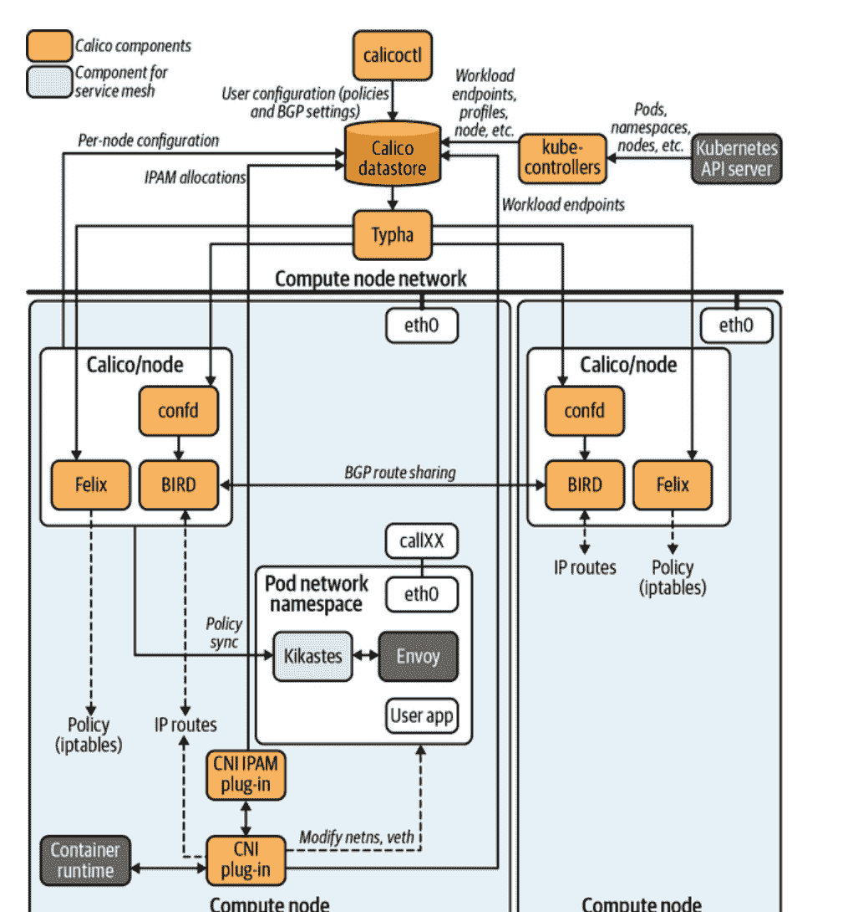
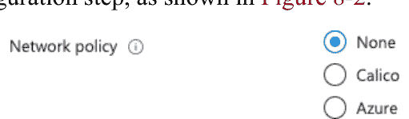
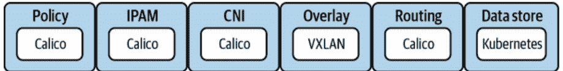
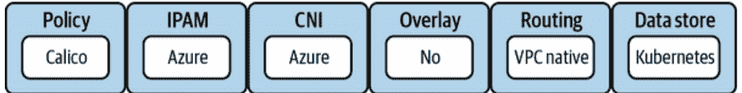
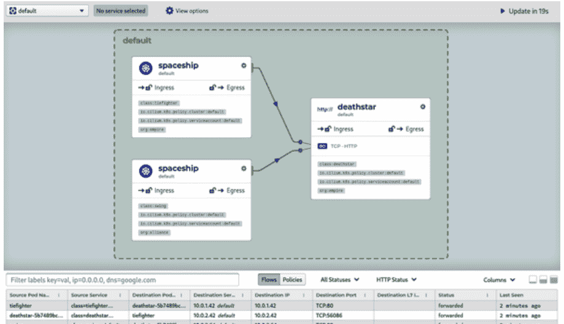
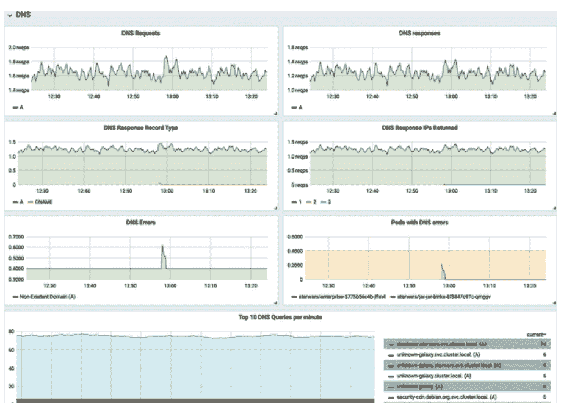
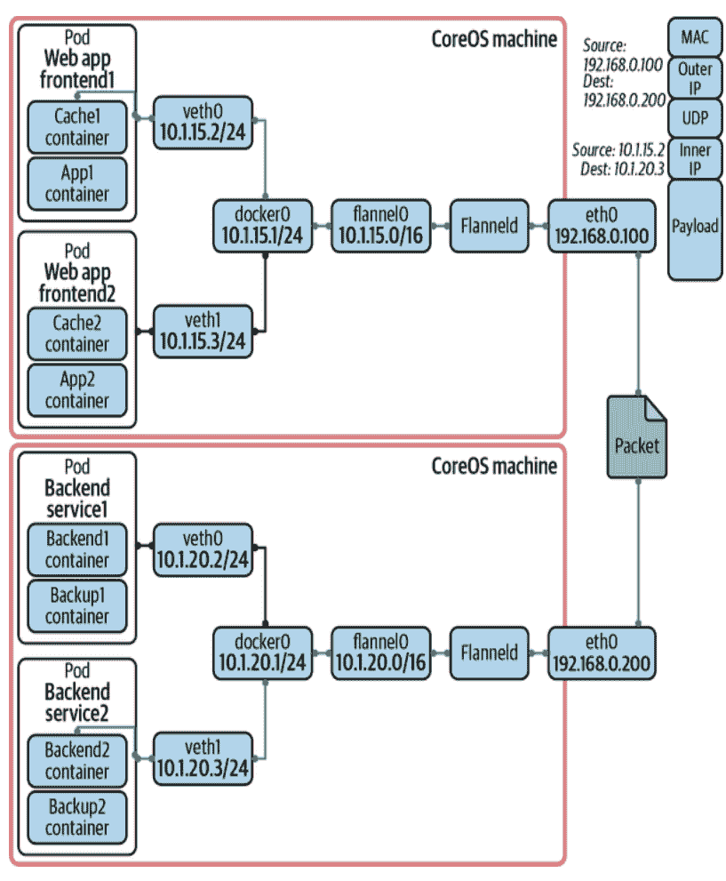
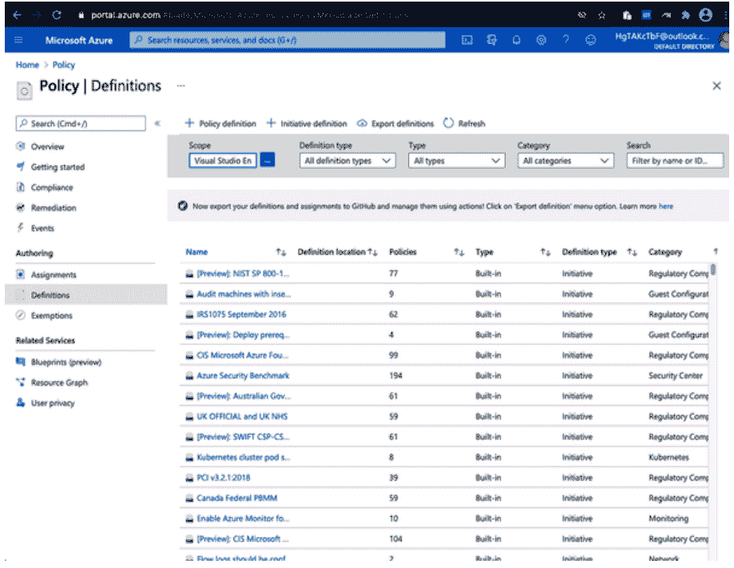
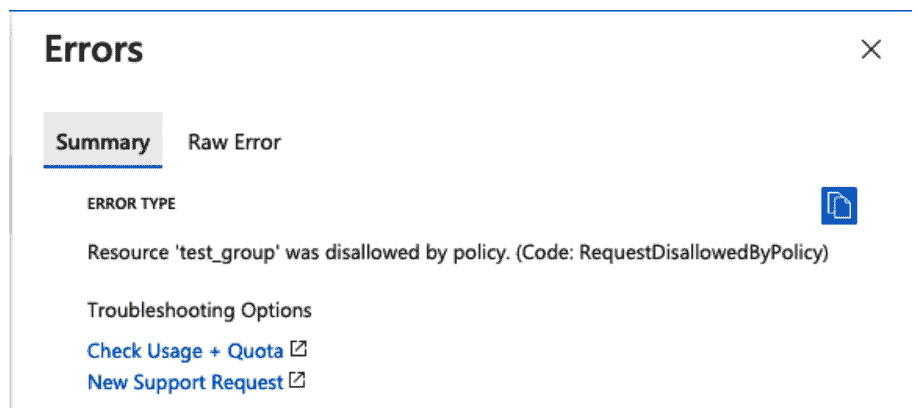
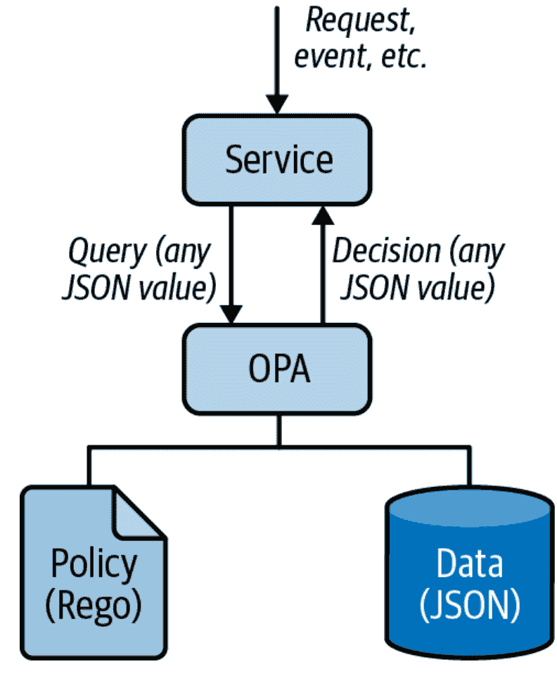

## Chapter 8. Networking and Policy Management: Behold the Gatekeepers

### A NOTE FOR EARLY RELEASE READERS

对于早期发布读者的一则说明

使用 Early Release 电子书，你可以在这些标题正式发布之前很久就利用这些技术——作者在写作时提供的原始未编辑内容——让你能够尽早利用这些技术。

这将是最终书籍的第 8 章。请注意，GitHub 仓库将在稍后激活。

如果你对如何改进本书的内容和/或示例有任何评论，或者如果你注意到本章中缺少材料，请联系编辑 rfernando@oreilly.com。

在前面的章节中，我们在 Azure 中构建了基础设施并解释了如何发现和监控我们的应用程序。现在是时候保护这些应用程序了！尽管由于简单的错误配置，过去发生了许多云数据泄露，但事实是，保护云基础设施并不困难。云网络技术已经迅速发展，今天有许多厂商提供云原生软件，可以帮助你增强网络配置并保护它。

Azure 提供了一个名为 Azure Policy 的功能，允许你针对租户、管理组或订阅设置策略，从而默认提供一层安全保护。例如，在 Azure 中，你可以设置一个策略，确保管理组或订阅中的任何存储帐户都不可公开访问。

在本章中，我们将探索容器网络的强大功能以及你可以用它来改进基础设施的多种方式。我们还将解释如何将策略应用于你的基础设施以保持其安全。

我们将从关于容器网络及其被多个项目构建所围绕的标准规范的讨论开始，然后重点介绍 Calico、Flannel 和 Weave 等产品，它们提供网络连接和网络策略执行。我们将以关于使用 Open Policy Agent（OPA）进行系统策略执行的讨论作为本章的结尾。

### The Container Network Interface (CNI)

正如我们在前几章中所提到的，容器提供了大量的安全性和可移植性功能。其中最大的回报之一来自网络栈。Linux cgroups 和网络命名空间功能开启了各种网络功能，可用于增强安全性和遥测，以及管理性能。容器网络功能灵活性和强大功能的一个很好的例子是 Cilium，这是一个软件工具，为 Kubernetes 提供负载均衡、安全、遥测、带宽管理和其他功能作为插件。我们将在本章后面详细介绍 Cilium。

在第 3 章中，我们简要提到了行业有一个用于容器运行时和容器镜像的标准规范。Container Network Interface（CNI）于 2015 年创建（最终被添加到 Cloud Native Computing Foundation [CNCF] 孵化项目列表中）作为配置容器网络接口和相关网络设置的规范。CNI 规范允许管理以下原语：

- 接口名称和网络命名空间绑定
- IP 地址
- 路由
- DNS 设置
- Sysctl 设置

一个示例 CNI 配置如下所示：

```
{
  "cniVersion": "1.0.0",
  "name": "dbnet",
  "plugins": [
    {
      "type": "bridge",
      "bridge": "cni0",
      "args": {
        "labels" : {
          "appVersion" : "1.0"
        }
      },
      "ipam": {
        "type": "host-local",
        "subnet": "10.1.0.0/16",
        "gateway": "10.1.0.1"
      },
      "dns": {
        "nameservers": [ "10.1.0.1" ]
      }
    },
    {
      "type": "tuning",
      "sysctl": {
        "net.core.somaxconn": "500"
      }
    }
  ]
}
```

### Why Would You Use a CNI?

你可能会问自己，为什么行业只需要一个仅用于网络的规范。正如我们在第 3 章中提到的，容器生态系统有大量网络项目可插入 Docker 和 Kubernetes 等容器系统。多个团队正在创建公开可用的与网络相关的插件，因此需要一种标准方式来描述和控制容器的网络层。

CNI 平台实现了真正的网络虚拟化，这意味着你无需担心管理网络基础设施——包括在云中！利用容器平台作为网络基础设施大大降低了实施和运营复杂网络基础设施的成本，并提供了在无需投资物理或专用虚拟网络设备的情况下进行扩展和升级的能力。

### How Does CNI Work with Azure?

Azure 支持 CNI，但它有两个特殊的插件可将你的容器连接到 Azure Virtual Network（VNet）：

- azure-vnet，它实现了 CNI 网络插件
- azure-vnet-ipam，它实现了 CNI IP 地址管理（IPAM）插件

这些插件确保容器可以正确地与 Azure VNet 控制平面交互。你可以在 Azure Kubernetes Service（AKS）和独立的 Azure 虚拟机中同时使用这些插件。

> NOTE
> 
> Windows Networking
> 
> 虽然 Linux 和 Windows 的网络栈在根本上非常不同，但 Azure CNI 插件确实对 Windows 提供了第一类支持，这意味着你可以在同一基础设施中同时运行 Windows 和 Linux 容器，而无需创建单独的网络基础设施。

Azure CNI 配置如下所示：

```
{
  "cniVersion": "1.0.0",
```


```
"name": "azure",
"plugins": [
    {
        "type":"azure-vnet",
        "mode":"bridge",
        "bridge":"azure0",
        "ipam":{
            "type":"azure-vnet-ipam"
        }
    },
    "ipam": {
        "type": "azure-vnet-ipam",
        "Environment": "azure"
    },
    "dns": {
        "nameservers": [ "10.1.0.1" ]
    }
    },
    {
        "type": "tuning",
        "sysctl": {
            "net.core.somaxconn": "500"
        }
    }
]
}
```

使用 azure-vnet 和 azure-vnet-ipam 插件可将 IP 配置和管理从主机转移到 Azure VNet 控制平面。

### 各类 CNI 项目

CNI 项目包含一组默认的 CNI 插件，分为三个类别：

*Main*

这些插件创建接口（bridge、ipvlan、macvlan、ptp、host-device）。

*IPAM*

这些插件为接口分配 IP 地址（dhcp、host-local、static）。

### Meta

这些是其他原生插件，可用于执行以下操作：

- Sysctl 调优
- 带宽限制
- 防火墙
- Flannel（将在本章后面介绍）

您可以在 CNI 插件页面上找到有关这些原生插件的更多信息。

除了我们在此提到的 CNI 插件之外，还有一个庞大的第三方项目生态系统在编写 CNI 兼容的插件。截至撰写本文时，已有超过 25 个外部项目利用了 CNI 标准。这些项目提供不同类型的功能，包括负载均衡、IPAM、覆盖网络、安全和网络遥测。

一些较小的项目包括：

- Infoblox
- Juniper Contrail
- VMware NSX

虽然一些 CNI 插件专为非常特定的基础设施而设计（例如 Cisco 的 ACI CNI），但许多插件与 Azure 和 Azure 服务配合使用效果非常好。在以下各节中，我们将探讨 Calico、Cilium、Weave、Flannel 和 OPA，并讨论这些系统如何帮助构建和保护网络基础设施。

### Calico

Calico 是一个开源的网络安全和策略解决方案，适用于 Windows 和 Linux 下的容器、虚拟机和裸机安装。Calico 提供网络安全策略执行以及实现零信任网络的能力。Calico 支持多种数据平面，包括最先进的纯 Linux 扩展 Berkeley Packet Filter（eBPF）数据平面、标准 Linux 网络数据平面和 Windows HNS 数据平面。Calico 在主机数据平面之上运行以执行网络策略。它支持标准 Linux 网络栈。

### 为什么要使用 Calico？

随着基础设施的增长，管理网络连接和策略变得呈指数级困难。此外，确保预期策略正确且正确应用，以及对策略的反馈得到应用，异常困难。这正是 Calico 擅长的地方。它允许您以抽象、可扩展的管理器定义网络策略，然后确保策略得到应用，而不会牺牲网络性能。

### 基本架构

Calico 具有客户端/数据存储架构，可简化平台操作。它包括以下关键组件（也在图 8-1 中显示）：

Felix

安装网络访问控制列表（ACL）、路由信息以及接口管理和状态报告的网络编程守护进程

BIRD

从 Felix 获取路由信息并通过边界网关协议（BGP）重新分发路由

confd

监听 Calico 数据存储的路由更改并将其传递给 BIRD

Calico CNI 插件

容器网络接口的接口

数据存储

包含有关策略、工作负载和 IPAM 分配的操作信息

Typha

数据存储的缓存代理，用于扩展连接到数据存储的节点数量

calicoctl

用于创建、读取、更新和删除 Calico 对象的 CLI



图 8-1. Calico 架构

### 部署 Calico

部署 Calico 有两种选择：作为 AKS 安装中的网络策略引擎的一部分安装，或在 Kubernetes 上手动部署。

### 通过 AKS 安装部署 Calico

Azure 已为 Calico 作为网络 *policy* 引擎引入了第一类支持；它可以在创建 AKS 实例的网络配置步骤中作为安装的一部分安装，如图 8-2 所示。



在此步骤中，如果您在 AKS 安装过程中选择 Calico，将在每个 Kubernetes 计算节点上安装一个 Calico Typha Pod。

### 手动安装 Calico

如果您想在 Kubernetes 集群上手动安装 Calico，可以使用 kubectl 下载 operator 并安装组件。

- 首先，安装 operator 然后安装 Calico 资源。这将创建 `tigera-operator` 命名空间：
  
  ```
  $ kubectl create -f
  https://docs.projectcalico.org/manifests/tigera-operator.yaml
  $ kubectl create -f
  https://docs.projectcalico.org/manifests/custom-resources.yaml
  ```

- 验证所有 Calico 节点是否正在运行：
  
  ```
  $ kubectl get pods -n calico-system
  ```

- 等待所有 Pod 进入 Running 状态。

> **WARNING**
> 
> *custom-resources.yaml* 文件中的 `ipPools` 配置在部署后无法修改。这意味着 `ipPools`（分配给每个 Pod 的 IP 地址）在您应用 *custom-resources.yaml* 文件后即已设置。

### 安装 calicoctl

要控制 Calico，您需要访问其 CLI 实用程序。有几种方法可以访问该实用程序，如 Calico 安装文档所述。对于此示例，我们将简单地将 CLI 下载到我们的机器上并作为 kubectl 插件运行。

- 登录到主机并导航到 /usr/local/bin：
  
  ```
  $ cd /usr/local/bin
  ```

- 下载二进制文件：
  
  ```
  $ curl -o kubectl-calico -O -L "https://github.com/projectcalico/calicoctl/releases/download/v3.21.0/calicoctl-linux-ppc64le"
  ```

- 将二进制文件设为可执行：
  
  ```
  $ chmod +x kubectl-calico
  ```

- 验证插件是否工作：
  
  ```
  $ kubectl calico -h
  ```

### Calico 深度解析

我们已经在高层次上讨论了使用 Calico 的好处以及它如何工作以及如何安装的一些基础知识。现在我们将了解如何使用它。对于本节的其余部分，我们将使用 eBPF 作为数据平面，而不是标准 Linux 网络栈。

Azure 不允许在其数据平面中使用未知 IP，因此您只能在节点之间使用基于 VXLAN 的覆盖网络。这只有在您构建自管理集群（图 8-3）时才可能，而在 AKS 上则不行。在 AKS 上您必须使用 Azure 作为网络提供程序，如图 8-4 所示。



图 8-3. 自管理设置（使用 VXLAN）



图 8-4. AKS 网络设置

### 启用 eBPF

设置 Calico 基础设施的下一步是启用 eBPF 数据平面。启用 eBPF 允许您利用新的内核功能并移除对 kube-proxy 进行负载均衡的使用。启用 eBPF 后，kube-proxy 的使用将被禁用。您可以在此博客文章中找到有关 Calico eBPF 实现的更多信息。

要启用 eBPF，请按照以下步骤操作。

- 通过运行查找 API 服务器：

```
$ kubectl get configmap -n kube-system kube-proxy -o jsonpath='{ .data.kubeconfig}' | grep server`
    server:
https://d881b853ae312e00302a84f1e346a77.hcp.us-east-1.azmk8s.io
```

- 更新您的 tigera-operator 命名空间：

```
kind: ConfigMap
apiVersion: v1
metadata:
  name: kubernetes-services-endpoint
  namespace: tigera-operator
data:
  KUBERNETES_SERVICE_HOST: "<API server host>"
  KUBERNETES_SERVICE_PORT: "<API server port>"
```

- 重新启动 operator 以应用更改：

```
$ kubectl delete pod -n tigera-operator -l k8s-app=tigera-operator
```

- 禁用 kube-proxy 的部署（以节省资源）：

```
$ kubectl patch networks.operator.openshift.io cluster --type merge -p '{"spec":{"deployKubeProxy": false}}'
```

- 使用 calicoctl 启用 eBPF：

```
$ calicoctl patch felixconfiguration default --patch='{"spec": {"bpfEnabled": true}}'
```

如果您在运行 eBPF 时遇到问题，Calico 提供了故障排除指南。

NOTE
如果您使用 eBPF 且内核版本高于 4.16，Calico 将自动尝试使用 XDP 处理数据包，这将提供性能改进。这对于高吞吐量服务或遭受 DOS 攻击的服务很有用。

### 实现 Calico 安全策略


现在我们已经配置好网络，可以开始应用一些安全策略了。Calico 网络策略的功能比 Kubernetes 更强大，包括：

- 策略排序
- 拒绝规则
- 匹配规则的更大灵活性

Calico 网络策略支持使用 OSI 第 5 层到第 7 层标准以及加密身份来保护应用程序。你可以在 Calico 网络策略配置页面找到示例。

网络策略可以通过以下几种方式强制执行：

- 全局（适用于所有命名空间中的所有 Pod），称为 GlobalNetworkPolicy
- 按网络或主机，称为 HostEndpoint
- 按命名空间，称为 NetworkPolicy

### GlobalNetworkPolicy：允许 ICMP 流量

我们创建的第一个策略是一个全局网络策略，允许集群内所有主机之间的 ICMP 流量用于 ping 和 traceroute。按如下方式创建文件 global-policy.yaml：

```
apiVersion: projectcalico.org/v3
kind: GlobalNetworkPolicy
metadata:
  name: allow-ping-in-cluster
spec:
  selector: all()
  types:
  - Ingress
  ingress:
  - action: Allow
    protocol: ICMP
    source:
      selector: all()
    icmp:
```

```
type: 8 # Ping request
- action: Allow
  protocol: ICMPv6
  source:
    selector: all()
  icmp:
    type: 128 # Ping request
```

通过运行以下命令应用策略：

```
$ calicoctl create global-policy.yaml
```

### NetworkPolicy：允许命名空间内两个标签之间的流量

在此示例中，我们将允许来自 production 命名空间且选择器为 green 的流量访问同一命名空间中选择器为 blue 的 Pod，端口为 TCP/1234。创建一个名为 network-policy.yaml 的新文件：

```
apiVersion: projectcalico.org/v3
kind: NetworkPolicy
metadata:
  name: allow-tcp-1234
  namespace: production
spec:
  selector: color == 'blue'
  ingress:
  - action: Allow
    protocol: TCP
    source:
      selector: color == 'green'
    destination:
      ports:
      - 1234
```

通过运行以下命令应用策略：

```
$ calicoctl create network-policy.yaml
```

应用此策略后，流量将能够流向任何 green Pod 的 TCP 1234 端口。

### Cilium

过去五年中引入的最具创新性的网络工具之一是 Cilium 项目，它大量利用 eBPF 来提供面向云原生基础设施的网络、可观测性和安全功能套件。

Cilium 利用 eBPF Linux 内核技术，可为内核及其上运行的应用程序提供低开销、高性能的可见性和控制逻辑。eBPF 的使用使 Cilium 成为基础设施架构师的热门选择，因为该平台围绕三个关键支柱提供功能：

#### Networking

Cilium 实现了自己的 CNI，利用 Linux eBPF。这使得 Cilium 性能极高，并允许其执行负载均衡，而无需依赖 kube-proxy。它还允许多集群连接，这对于大型安装非常重要。

#### Observability

Cilium 对 eBPF 的使用使其成为独特的观测软件。Cilium 可以对网络连接和数据的所有层执行深度包检测。

#### Security

Cilium 的最佳功能之一是它可以通过 IPSec 在主机之间执行透明加密。这意味着你可以通过高效的机制获得端到端加密，而无需更改应用程序。虽然 Cilium 提供了自己的 label+CIDR 匹配安全策略，但它也执行（OSI）第 7 层过滤（例如，过滤传出 DNS 查询或过滤传入 HTTP 请求）。

最后，Cilium 允许你对策略制定决策执行第 7 层内省（有关更多信息，请参阅此博客文章）。

Cilium 将 eBPF 作为其核心使用，使软件能够深入检查和操作（在需要时）所有网络流量，而不会影响系统性能。

Cilium 代理（cilium-agent）在每个节点上运行（见图 8-5）并通过 Kubernetes API 接受配置。代理会将该配置转换为在容器的网络接口、主机的网络或主机之一的网卡上运行的 eBPF 程序。

### Orchestration systems

#### Cilium layer

Cilium CLI

Policy repository

Plug-ins

Cilium monitor

Cilium daemon
Code generation

Bytecode injection

BPF program

BPF program

BPF program

BPF program

eth0

Container

Container

Container

#### Kernel

Figure 8-5. The Cilium architecture

### Deploying Cilium

Cilium 可以安装在自管理的 Kubernetes 集群或托管的 AKS 集群上。在这两种情况下，Cilium 都可以通过 Helm 部署，这使得安装变得简单。此外，Cilium 还提供了一个容器来执行连接检查，以验证集群中 Pod 之间的网络流量是否可以自由流动。

有关更多信息，请参阅部署 Cilium 到 Azure 的专用文档。

#### Self-managed Cilium installation

我们将使用其 quick-install 文件安装 Cilium：

```
$ kubectl apply -f
https://raw.githubusercontent.com/cilium/cilium/v1.9/install/kubernetes/quick-install.yaml
```

以下代码将安装主机之间的连接检查：

```
$ kubectl apply -f
https://raw.githubusercontent.com/cilium/cilium/v1.9/examples/kubernetes/connectivity-check/connectivity-check.yaml
```

这将部署一系列 Pod，它们将使用各种网络路径相互连接以验证连接性。连接路径包括有无服务负载均衡以及各种网络策略组合。

#### AKS Cilium installation

要在 AKS 上设置 Cilium，我们将使用 Helm chart。

- 首先我们将创建一个新的 AKS 集群：

```
$ export RESOURCE_GROUP_NAME=aks-test
$ export CLUSTER_NAME=aks-test
$ export LOCATION=westus
```

```
$ az group create --name $RESOURCE_GROUP_NAME --location $LOCATION
$ az aks create \
    --resource-group $RESOURCE_GROUP_NAME \
    --name $CLUSTER_NAME \
    --location $LOCATION \
    --node-count 2 \
    --network-plugin azure
```

- 现在我们将创建一个服务主体来与 Azure API 交互并填充环境变量以传递给 Helm：

```
$ az ad sp create-for-rbac --name cilium-operator > azure-sp.json

$ AZURE_SUBSCRIPTION_ID="$(az account show | jq -r .id)"
$ AZURE_CLIENT_ID="$(jq -r .appId < azure-sp.json)"
$ AZURE_CLIENT_SECRET="$(jq -r .password < azure-sp.json)"
$ AZURE_TENANT_ID="$(jq -r .tenant < azure-sp.json)"
$ AZURE_NODE_RESOURCE_GROUP="$(az aks show --resource-group $RESOURCE_GROUP_NAME --name $CLUSTER_NAME | jq -r .nodeResourceGroup)"
```

- 我们将本地安装 Cilium 仓库，然后在 Kubernetes 集群上安装 Cilium：

```
$ helm repo add cilium https://helm.cilium.io/
$ helm install cilium cilium/cilium --version 1.9.9 \
    --namespace kube-system \
    --set azure.enabled=true \
    --set azure.resourceGroup=$AZURE_NODE_RESOURCE_GROUP \
    --set azure.subscriptionID=$AZURE_SUBSCRIPTION_ID \
    --set azure.tenantID=$AZURE_TENANT_ID \
```

```
--set azure.clientID=$AZURE_CLIENT_ID \
--set azure.clientSecret=$AZURE_CLIENT_SECRET \
--set tunnelDisabled \
--set ipam.mode=azure \
--set masquerade=false \
--set nodeinit.enabled=true
--set kubeProxyReplacement=strict \
--set hostFirewall=true \
--set loadBalancer.algorithm=maglev \
--set k8sServiceHost=REPLACE_WITH_API_SERVER_IP \
--set k8sServicePort=REPLACE_WITH_API_SERVER_PORT
```

- 我们可以通过检查是否已创建四个初始 Pod，并且 `cilium` 和 `cilium-operator` Pod 正在运行来验证安装：

```
$ kubectl -n kube-system get pods --watch
cilium-operator-ad4375ds5-2x2q3        1/1     Running
0               4m18s
cilium-s5x8xk                    1/1     Running
0               4m19s
```

### Installing Hubble

你还想安装 Hubble，这是一个 UI，允许你查看服务图，该图描绘了服务之间的依赖关系以及网络使用和性能的统计数据。Hubble 的实时更新、类似图形的界面（见图 8-6）允许你展示有关容器之间数据布局和流向的大量信息。此外，它还提供了一个建模 Cilium 策略的界面。




图 8-6. 显示简单架构的 Hubble UI 截图

你可以使用 kubectl 安装 Hubble：

```
kubectl apply -f
https://raw.githubusercontent.com/cilium/cilium/v1.9/install/kubernetes/quick-hubble-install.yaml
```

### 将 Cilium 与云集成

正如我们之前提到的，Cilium 具有丰富的特性集可供利用。在本节中，我们将使用 Cilium 作为网络提供者和策略执行器（防火墙）。然后我们将查看 Cilium 的可观测性。

### 主机防火墙

与我们对 Calico 的深入探讨类似，这里我们将实现一组网络策略。Cilium 的优势在于它可以在 L3、L4 或 L7 上执行策略。网络策略执行有三种模式，如表 8-1 所示。

表 8-1. 网络策略执行

| 模式 | 描述 |
|------|-------------|
| Default | 如果规则选择了端点并且规则具有 ingress 或 egress 部分，则端点将根据策略拒绝。 |
| Always | 在所有端点上启用策略执行，即使没有规则选择特定端点。 |
| Never | 在所有端点上禁用策略执行，并且允许所有流量。 |

要为 Cilium 代理管理的全部端点在运行时配置策略执行模式，请使用以下命令并选择 default、always 或 never 之一的模式：

```
$ cilium config PolicyEnforcement={default,always,never}
```

策略是基于允许列表模型编写的，如果没有明确的允许规则，流量将被阻止。

L3 和 L4 规则可以使用以下方法指定：

#### 标签

使用选择器对 Pod 进行分组。

#### 服务

使用 Kubernetes 服务定义策略。

#### 实体

Cilium 管理的特殊预定义作用域。

#### IP/CIDR

一个 IP 或 IP 范围（CIDR）。

#### DNS 名称

一个 DNS 名称。

例如，如果你想允许两个带标签的 Pod 之间的流量，可以创建以下策略：

```
apiVersion: cilium.io/v2
kind: CiliumNetworkPolicy
metadata:
  name: "l3-rule"
spec:
  endpointSelector:
    matchLabels:
      role: backend
  ingress:
  - fromEndpoints:
  - matchLabels:
      role: frontend
```

你可以通过运行以下命令应用此策略：

```
$ cilium policy import l3-rule-example-1.yaml
```

此外，如果你想创建一个 L4 示例，其中你想将出站 egress DNS 限制为 Google 公共 DNS 服务器，你可以编写以下示例中显示的规则：

```
apiVersion: "cilium.io/v2"
kind: CiliumNetworkPolicy
metadata:
  name: "allow-to-google-dns"
spec:
  endpointSelector:
    {}
```

```
egress:
- toCIDR:
  - 8.8.8.8/32
  - 8.8.8.4/32
  toPorts:
  - ports:
    - port: '53'
      protocol: UDP
  - ports:
    - port: '53'
      Protocol: TCP
```

你可以通过运行以下命令应用规则：

```
$ cilium policy import l4-rule-example-1.yaml
```

最后，Cilium 还允许对 HTTP(s)、Kafka 和 DNS 流量进行 L7 可见性。在下一个示例中，我们允许所有 Pod 对 80 端口上的 /admin 端点进行流量：

```
apiVersion: "cilium.io/v2"
kind: CiliumNetworkPolicy
metadata:
  name: "rule1"
spec:
  description: "Allow HTTP GET /admin
endpointSelector:
  {}
ingress:
- fromEndpoints:
  toPorts:
  - ports:
    - port: "80"
      protocol: TCP
    rules:
      http:
      - method: "GET"
        path: "/admin"
```

你可以在 Layer 7 policy Cilium 文档中找到有关 L7 策略规则的更具体细节。

NOTE
Cilium 提供了一个交互式工具来建模网络策略并可视化它们。你可以在 Cilium Editor 页面上尝试使用它。

### 可观测性

正如我们之前简要提到的，Hubble 是 Cilium 操作员观察其基础设施中发生情况的地方。一旦你安装了 Hubble 和连接性测试（来自安装步骤），你将能够观察命名空间内的网络流。在本节中，我们将更进一步，利用 Cilium 的一项新功能，该功能提供 L3 和 L4 协议可见性，这将为每个端口上的流量提供更具体的详细信息。你需要实现 L7 策略才能获得 L7 可观测性功能。

要启用 L3 和 L4 可见性，你需要在 Pod 上启用注解。以下是一个示例：

```
$ kubectl annotate pods --all io.cilium.proxy-visibility="<Egress/53/UDP/DNS>,<Ingress/80/TCP/HTTP>"
```

这将启用对 Pod 的出站（egress）DNS 流量以及入站（ingress）HTTP 流量的指标。

可见性信息由注解中的逗号分隔的元组列表表示：

```
<{Traffic Direction}/{L4 Port}/{L4 Protocol}/{L7 Protocol}>
```

启用后，Hubble 将显示协议特定的信息。图 8-7 显示了 DNS 可见性的示例。



图 8-7. DNS 流量可观测性的示例

如果你想了解如何检查传输层安全（TLS）加密连接，请访问 Inspecting TLS Encrypted Connections with Cilium 页面。

### Flannel

Flannel 是 Kubernetes 的（OSI）第 3 层网络 fabric 系统，最初是 Red Hat CoreOS 项目的一部分。它是 Kubernetes 最简单的 CNI 之一。它依赖于一个名为 flanneld 的二进制代理在每个主机上运行，以配置覆盖 Pod 网络，然后将配置存储在 Kubernetes 数据存储中。Flannel 仅提供网络连接。它不支持任何类型的网络策略执行。

### 部署 Flannel

当你设置集群时，可以通过运行以下命令快速安装 Flannel：

```
$ kubectl apply -f
https://raw.githubusercontent.com/coreos/flannel/master/Documentation/kube-flannel.yml
```

应用 *kube-flannel.yml* 将定义以下内容：

- 一个用于基于角色的访问控制（RBAC）的 `ClusterRole` 和 `ClusterRoleBinding`。
- Flannel 使用的 Kubernetes 服务帐户。
- 一个包含 CNI 配置和 Flannel 配置的 `ConfigMap`。Flannel 配置中的网络应与 Pod 网络的无类域间路由（CIDR）方案匹配。 后端的选择也在此处进行，默认值为 VXLAN。
- 用于在每个节点上部署 Flannel Pod 的每个架构的 DaemonSet。Pod 有两个容器：Flannel 守护进程本身，以及用于将 CNI 配置部署到 kubelet 可读取的位置的 `initContainer`。

当你运行 Pod 时，它们将从 Pod 网络 CIDR 分配 IP 地址。无论这些 Pod 最终位于哪个节点，它们都能够相互通信。

> **NOTE**
> 
> 此清单将配置 Pod 网络默认为 10.244.0.0/16 并默认使用 VXLAN 后端。每个节点在 Pod 中将获得一个 10.244.X.0/24 掩码。

你可以通过修改写入 *kube-flannel.yaml* 文件中 *net-conf.json* 的数据来重新配置后端以使用不同的地址空间、更小的掩码或不同的后端设置。你可以在 Flannel backend 文档和 Flannel 配置页面上找到有关后端配置的更多信息。

现在 Kubernetes 工作节点将具有来自你的 Azure VNet 的 IP 地址，但任何部署的 Pod 将具有来自配置的 Pod 网络 IP 范围的 IP 地址。如果你想要多个 Pod 网络（用于网络流量分离），你将不得不运行单独的 `flanneld` 进程。

### Flannel 深入解析

Flannel 是一个更简单的 Kubernetes CNI，需要最少的配置。它具有可插拔的后端，可在网络上的机器之间创建覆盖网络（见图 8-8）。支持的传输后端包括：

- VXLAN
- Host-gw
- 用户数据报协议（UDP）
- Alivpc
- Alloc
- Amazon Virtual Private Cloud（VPC）
- Google Compute Engine（GCE）
- IPIP
- IPsec



图 8-8. Flannel 架构示例

Flannel 项目团队建议将 VXLAN 或 host-gw 作为通信后端。如果你需要加密流量，IPsec 也是一个选项。你可以在 Flannel 文档中找到有关支持后端的更多信息。

Flannel 不允许你从一个守护进程运行多个网络；你需要使用不同的配置文件运行单独的守护进程。


### Azure Policy

虽然主动运行保护云基础设施的软件无疑很有用，但 Azure Policy 允许你针对云基础设施的许多方面制定全面的策略，尤其是在资源安全方面。

Azure Policy 执行三个关键功能：

- 创建防止或强制执行特定配置的策略
- 允许对你自己的策略以及行业基准进行合规性报告
- 通过对现有资源的批量修复和对新资源的自动修复使你的资源达到合规

Azure Policy 的潜在用例包括实施资源一致性、监管合规性、安全、成本和管理方面的治理。

Azure Policy 定义以 JSON 格式定义并以分层方式应用；这意味着一种策略可以应用于一个管理组（以及其中的所有订阅/资源），而更宽松的策略可以设置为另一个管理组（以及其中的所有订阅/资源）。

#### Azure Policy 快速入门

Azure 默认包含一些内置策略。你可以通过在终端中运行以下命令查看它们：

```
$ az policy definition list
```

或者你可以在门户中查看它们（图 8-9）。



图 8-9. 可用 Azure Policy 定义的概览

Azure Policy 还包括 *initiatives*，它们是与行业标准（例如，PCI v3.2.1:2018）保持一致的策略集合。

此时，策略已经创建但尚未分配作用域。你可以在订阅（以及订阅内的所有资源）上应用策略，或者你可以将其应用于管理组，从而覆盖所有子管理组和订阅。

无论哪种方式，你都需要为你的订阅注册 Microsoft.PolicyInsights 资源提供程序。你可以通过运行以下命令启用它：

```
$ az provider register --namespace 'Microsoft.PolicyInsights'
```

Azure Policy 有各种策略执行模式，也称为 *effects*。目前有七种类型的 Azure Policy 效果：

- Append
- Audit
- AuditIfNotExists
- Deny
- DeployIfNotExists
- Disabled
- Modify

你可以在文章 Understand Azure Policy effects 中阅读有关其用法的介绍。

#### 创建你自己的 Azure Policy

创建你自己的 Azure 策略很容易。在以下示例中，我们创建了一个策略，只允许在美国境内的 Azure 区域部署资源。如果用户尝试在非美国区域创建资源，则将被拒绝：

```
{
  "properties": {
    "displayName": "Allowed locations",
    "description": "This policy enables you to restrict the locations your organization can specify when deploying resources.",
    "mode": "Indexed",
    "metadata": {
      "version": "1.0.0",
      "category": "Locations"
    },
    "parameters": {
      "allowedLocations": {
        "type": "array",
        "metadata": {
          "description": "The list of locations that can be specified when deploying resources",
          "strongType": "location",
          "displayName": "Allowed locations"
        }
      }
    }
  }
}
```

```
},
"defaultValue": [ "westus2", "eastus", "eastus2", "southcentralus", "centralus", "northcentralus", "westus", "westcentralus", "westus3" ]
}
```

我们将通过运行以下命令创建策略：

```
$ az policy definition create --name 'allowed-regions' --display-name 'Deny non-US regions' --description 'This policy ensures that resources are only created in US regions.' --rules 'region-rule.json' --params 'region-params.json' --mode All
```

在响应中，我们将在 id 字段中看到新策略的路径；例如：

```
"id": "/subscriptions/<subscription-ID>/providers/Microsoft.Authorization/policyDefinitions/allowed-regions"
```

我们将通过运行以下命令将策略分配给我们的订阅：

```
$ az policy assignment create --name 'allowed-regions' --scope '/subscriptions/<subscription-id>' --policy '/subscriptions/<subscription-ID>/providers/Microsoft.Authorization/policyDefinitions/allowed-regions'
```

策略现在将被应用。如果我们尝试在非美国区域创建资源，我们将收到类似于图 8-10 中的错误。



图 8-10. 由于 Azure Policy 而部署新资源组时出现的错误消息

NOTE
Azure Policy Limits
Azure Policy 在可以应用的策略、例外、参数和条件数量方面存在限制。这些限制可能会根据策略的作用域而变化。请阅读文档以了解更多详情。

#### Azure Policy for Kubernetes

Azure Policy 还支持 Kubernetes，使你能够深入了解 Kubernetes 部署的策略并创建与 Kubernetes 相关的策略。你可以通过阅读 Understand Azure Policy for Kubernetes clusters 和 Secure your cluster with Azure Policy 找到更多相关信息，这些文章将指导你如何将 Azure Policy 应用于 Kubernetes。

#### Open Policy Agent

Open Policy Agent (OPA) 是一种开源的通用策略引擎，允许你对软件执行授权策略操作（图 8-11）。OPA 允许你将策略指定为代码，并为软件集成提供简单的 API。



图 8-11. OPA 的工作原理

OPA 策略以一种名为 Rego 的声明式语言编纂（请参阅 policy language documentation）。然后策略被部署到主机上的 OPA 服务。与本章中讨论的许多系统不同，OPA 不执行任何强制执行；相反，它执行

策略决策。OPA 评估策略和数据以生成查询结果，然后将结果发送回客户端。策略以高级声明式语言编写，可以动态加载到 OPA 中，通过 API 远程加载，或通过本地文件系统加载。

OPA 提供了一个 REST API，第三方服务/系统（如 Kubernetes、SSH、Sudo 和 Envoy）可以利用它来回答以下问题：

- 哪些用户可以访问哪些资源
- 哪些子网的出站流量是允许的
- 工作负载必须部署到哪些集群
- 可以下载哪些注册表的二进制文件
- 容器可以使用哪些操作系统功能
- 系统可以在一天中的哪些时间被访问

你可以在 OPA REST API 文档页面上找到更多详细信息。OPA 提供的关键 API 如下：

```
GET /v1/policies
```

获取所有策略

```
GET /v1/policies/<name>
```

返回特定策略

```
PUT /v1/policies/<name>
```

创建或更新策略

```
DELETE /v1/policies/<name>
```

删除策略

```
GET/POST /v1/data/<name>
```

允许你返回或创建文档

OPA 允许你将多个安全策略跨多个基础设施组件集中到一个系统中。你可以在 OPA Ecosystem 页面上找到 OPA 集成的完整列表。没有 OPA，你就需要从头开始为你的软件实现策略管理。所需组件（如策略语言（语法和语义）和评估引擎）需要经过精心设计、实现、测试、记录，然后维护，以确保正确行为并为你的客户提供积极的用户体验。

#### 在 Kubernetes 上部署 OPA

在 Kubernetes 上部署 OPA 很简单。

- 创建部署定义文件（*deployment-opa.yaml*）：

```
apiVersion: apps/v1
kind: Deployment
metadata:
  name: opa
  labels:
    app: opa
spec:
  replicas: 1
  selector:
    matchLabels:
      app: opa
  template:
    metadata:
      labels:
        app: opa
      name: opa
    spec:
```

```
containers:
  - name: opa
    image: openpolicyagent/opa:edge
    ports:
      - name: http
        containerPort: 8181
    args:
      - "run"
      - "--ignore=.*"  # exclude hidden dirs created by Kubernetes
      - "--server"
      - "/policies"
    volumeMounts:
      - readOnly: true
        mountPath: /policies
        name: policy
    volumes:
      - name: policy
        configMap:
          name: policy
```

- 创建服务定义文件（*service-opa.yaml*）：

```
kind: Service
apiVersion: v1
metadata:
  name: opa
  labels:
    app: opa
spec:
  type: NodePort
  selector:
    app: opa
  ports:
```


- name: http
  protocol: TCP
  port: 8181
  targetPort: 8181

- Apply both files:

```
$ kubectl create -f deployment-opa.yaml
$ kubectl create -f service-opa.yaml
```

### Deploying Policy with OPA

如前所述，OPA 是一个通用策略引擎，可与多种软件生态系统集成。在本示例中，我们将使用 OPA 为机器配置 SSH 访问。

在本示例中，我们将有三个组：

*sre*

这些是所有应用程序的管理员。

*foo-frontend*

这些是 foo-frontend 应用程序的贡献者。

*bar-backend*

这些是 bar-backend 应用程序的贡献者。

我们将实现以下策略：

- 组 `sre` 可以 SSH 登录任何主机并运行 sudo 命令。
- 与应用程序开发相关的其他用户组中的用户可以登录主机，但不能运行 sudo 命令。

以下示例将创建一个策略，允许 sre 组和与应用程序关联的组进行 SSH 授权：

```
package sshd.authz

import input.pull_responses
import input.sysinfo

import data.hosts

### By default, users are not authorized.
default allow = false

### Allow access to any user that has the "admin" role.
allow {
    data.roles["sre"][_] == input.sysinfo.pam_username
}

### Allow access to any user who contributed to the code running on the host.
#
### This rule gets the "host_id" value from the file
"/etc/host_identity.json".
### It is available in the input under "pull_responses" because we
### asked for it in our pull policy above.
#
### It then compares all the contributors for that host against the username
### that is asking for authorization.
allow {

hosts[pull_responses.files["/etc/host_identity.json"].host_id].contributors[_] == sysinfo.pam_username
}

### If the user is not authorized, then include an error message in the response.
errors["Request denied by administrative policy"] {
    not allow
}
```

我们将创建一个第二个策略，仅允许 sre 组使用 sudo：

```
package sudo.authz

### By default, users are not authorized.
default allow = false

### Allow access to any user that has the "admin" role.
allow {
    data.roles["sre"][_] == input.sysinfo.pam_username
}

### If the user is not authorized, then include an error message in the response.
errors["Request denied by administrative policy"] {
    not allow
}
```

现在我们可以将这两个策略注册到 OPA 中：

```
curl -X PUT --data-binary @sshd_authz.rego localhost:8181/v1/policies/sshd/authz
curl -X PUT --data-binary @sudo_authz.rego localhost:8181/v1/policies/sudo/authz
```

在成功执行这些命令后，我们的策略将被应用，只有 sre 组中的用户才具有对所有机器的 SSH 和 sudo 访问权限。与此同时，相关的服务组将仅对部署服务的机器具有 SSH 访问权限。

### Summary

尽管运营云原生基础设施为运营者带来了巨大的好处，但如果基础设施未得到良好保护，也会给您的业务带来重大风险。在本章中，我们回顾了一种保护和审计基础设施的方法。首先我们回顾了 CNI 标准以及它如何成为 Flannel 和 Cilium 等其他平台的基础。我们研究了这些系统如何用于为云基础设施提供连接性和网络安全。然后我们研究了通过 Azure Policy 管理云基础设施以及通过 Open Policy Agent 管理应用程序的非网络策略机制。

使用安全的网络设置以及明确定义的策略构建云基础设施将有助于确保您的基础设施以安全的方式扩展。现在您了解了容器和云网络的基础知识，我们将把讨论转向了解如何在云中存储和提供数据。
