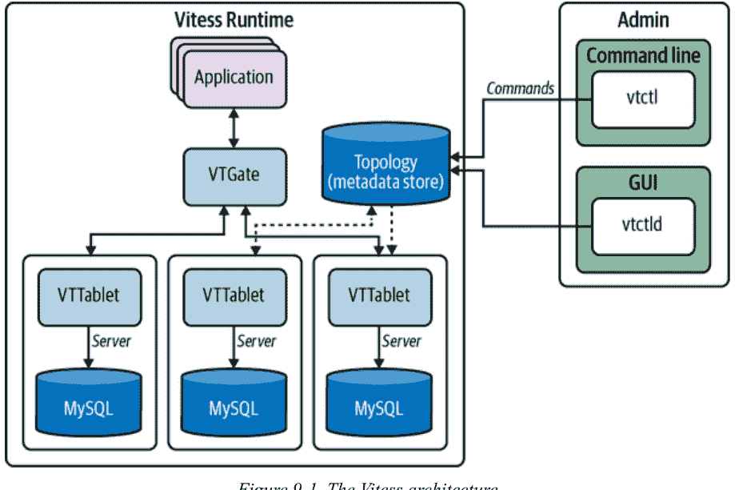
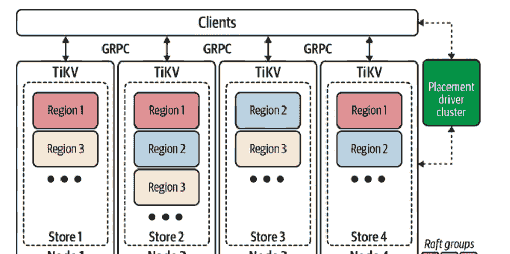
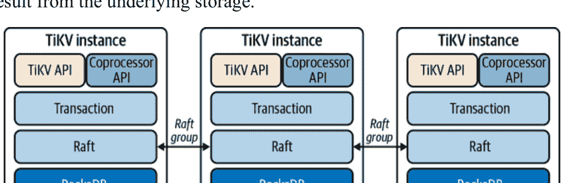
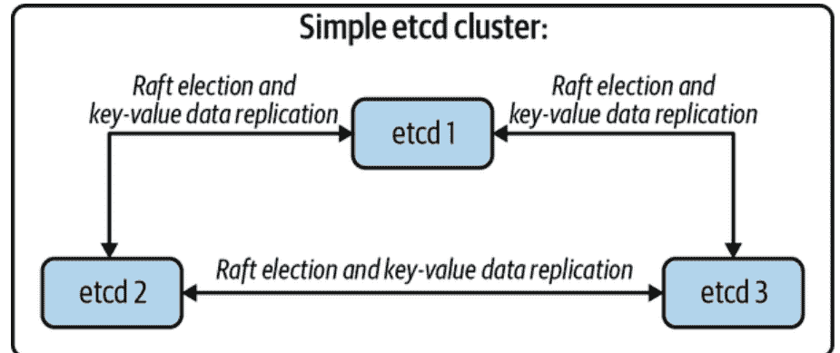

## Chapter 9. Distributed Databases and Storage: The Central Bank

### A NOTE FOR EARLY RELEASE READERS

对于早期发布的电子书，您可以在作者撰写时获得书籍的最原始形式——未经编辑的原始内容，以便您在这些书籍正式发布之前就能利用这些技术。

这将是最终书籍的第 9 章。请注意，GitHub 仓库将在稍后激活。

如果您对如何改进本书的内容和/或示例有任何建议，或者如果您注意到本章中缺少材料，请联系编辑 rfernando@oreilly.com。

在构建云原生基础设施时需要克服的最大障碍之一是为在线和离线使用运营可靠且可扩展的存储。虽然过去对在云中运行存储服务的看法并不受欢迎，但许多云原生存储项目取得了成功，其中最突出的是 Vitess。包括 Azure 在内的云服务也大量投资于虚拟机和虚拟机规模集的托管磁盘，以及高级存储账户（如 Gen2）和托管数据库服务（如 MySQL、SQL Server 和 Redis）。所有这些都使存储成为 Azure 云中的一等概念。在本章中，我们将探讨为什么您应该在 Azure 中大规模运行存储解决方案，以及如何以易于管理的方式编排它们。

### The Need for Distributed Databases in Cloud Native Architecture

尽管 Azure 提供了许多托管数据（SQL 和 NoSQL）解决方案，但有时您可能需要在云中运行更大、更专业的设置。云原生计算基金会（CNCF）数据库项目的自运营生态系统将使您能够扩展到比 Azure 平台即服务（PaaS）服务提供的更大规模，并为您提供更多功能和性能选项。

正如本章将进一步讨论的那样，CNCF 格局列出了主要为云操作而设计的存储解决方案集。这些系统的好处是服务器管理开销最小化，同时您仍对系统有完全控制权。

在本章中，我们将研究 CNCF 格局中一些成熟的数据存储。Vitess、Rook、TiKV 和 etcd 都是成熟的云数据存储，能够扩展到巨大的规模，并在 Azure 中作为一流的数据系统运行。这些系统代表了在云基础设施中运营的数据生态系统的基础构建块。

### RUNNING STATEFUL WORKLOADS ON AKS

> 在撰写本文时，Azure Kubernetes Service（AKS）支持多个可用区（即区域内的多个数据中心）；然而，它不支持多个故障域。这意味着如果您的 AKS 集群仅位于一个可用区，理论上可能会出现停机，因为集群中的多个节点不可用。我们建议您将 AKS 集群分布在多个可用区，直到 AKS 支持故障域。

### Azure Storage and Database Options

在开始构建云数据存储之前，您应该彻底评估您的用例，特别是您试图构建的存储、性能和成本。您可能会发现 Azure 的 PaaS 服务更适合特定用例，而不是使用 CNCF 产品。例如，Azure 的 Hadoop 分布式文件系统（HDFS）存储产品 Gen2 存储账户，是存储大量数据的极具经济性的解决方案。

在撰写本文时，Azure 提供了以下存储和数据库 PaaS 服务：

- Azure Cosmos DB
- Azure Cache for Redis
- Azure Database for:
  - MySQL
  - PostgreSQL
  - MariaDB
- Storage accounts (providing blob, Network File System [NFS], and hierarchical storage)
- Azure Storage Explorer

我们建议您评估这些 Azure 产品的性能，特别是考虑 PaaS 服务的性能、可用性和成本，以确保您为用例使用正确的系统。Azure 提供了定价计算器工具，对于建模成本非常有用。

如果您认为 Azure PaaS 服务不符合您的要求，请继续阅读本章以了解其他潜在的数据存储解决方案。

### Introduction to Vitess: Distributed and Sharded MySQL


Vitess 是一个用于 MySQL 和 MariaDB 水平扩展的数据库集群系统。它由 YouTube 工程师于 2010 年创建，用以保护和扩展他们的数据库。它提供了许多有助于性能、安全性和监控的功能，但最重要的是，它提供了强大的工具来管理数据库拓扑，并为垂直和水平分片以及重新分片提供一流的支持。在许多方面，它允许你以 NoSQL 的方式操作 SQL 数据库，同时仍然获得运行关系型数据库的所有好处。

### 为什么运行 Vitess？

你可能会问自己：“为什么我应该运行 Vitess，而不是使用 Azure Cosmos DB？” 尽管 Cosmos DB 对于全球分布式写入和副本来说是一个有吸引力的选择，但当前的价格模型使其在规模化运行（每秒数千次查询）时成本高得令人望而却步，这使得像 Vitess 这样的系统对于需要高吞吐量关系型数据库且设置更可定制的人来说具有吸引力。

Vitess 提供了以下好处：

#### 可扩展性

你可以将单个模式向上或向下扩展。

#### 可管理性

集中的控制平面管理所有数据库相关操作。

#### 保护

你可以重写查询、构建查询拒绝列表，并添加表级访问控制列表（ACL）。

#### 分片管理

你可以轻松创建和管理数据库分片。

#### 性能

许多内部组件都是为性能而构建的，包括客户端连接池和查询去重。

Vitess 帮助你管理关系型数据库的运维和扩展开销以及集群的健康状况。此外，Vitess 提供的可配置选项范围比传统的云数据库产品（包括 Cosmos DB）更广，这将帮助你满足扩展和复制需求。

### Vitess 架构

Vitess 通过创建中间件风格的系统同时仍使用 MySQL 存储数据来提供分片即服务。客户端应用程序连接到一个名为 VTGate 的守护进程（见图 9-1）。VTGate 是一个集群感知路由器，它将查询路由到适当的 VTTablet 实例，这些实例管理每个 MySQL 实例。拓扑服务存储基础设施的拓扑结构，包括数据存储位置以及每个 VTTablet 实例提供数据的能力。



图 9-1. Vitess 架构

Vitess 还提供了两个管理界面：vtctl，一个 CLI；以及 vtctld，一个 Web 界面。

VTGate 是用于将客户端查询路由到数据库的查询路由器（或代理）。客户端无需了解任何其他信息，只需知道 VTGate 实例的位置即可，这意味着客户端到服务器的架构非常简单。

### 在 Kubernetes 上部署 Vitess

Vitess 对 Kubernetes 具有一流的支持，并且入门非常简单。在本演练中，我们将创建一个集群和一个模式，然后扩展集群。

- 首先，克隆 vitess 仓库并移动到 vitess/examples/operator 文件夹：
```
$ git clone git@github.com:vitessio/vitess.git
$ cd vitess/examples/operator
```
- 现在，通过运行以下命令安装 Kubernetes 操作器：
```
$ kubectl apply -f operator.yaml
```
- 接下来，通过运行以下命令创建一个初始 Vitess 集群：
```
$ kubectl apply -f 101_initial_cluster.yaml
```
- 你可以通过以下方式验证初始集群安装是否成功：
```
$ kubectl get pods
NAME                                 READY   STATUS    RESTARTS   AGE
example-etcd-faf13de3-1              1/1     Running   0          78s
example-etcd-faf13de3-2              1/1     Running   0          78s
example-etcd-faf13de3-3              1/1     Running   0          78s
example-vttablet-zone1-2469782763-bfadd780  3/3     Running   1          78s
example-vttablet-zone1-2548885007-46a852d0  3/3     Running   1          78s
example-zone1-vtctld-1d4dcad0-59d8498459-kwz6b  1/1     Running   2          78s
example-zone1-vtgate-bc6cde92-6bd99c6888-vwcj5  1/1     Running   2          78s
vitess-operator-8454d86687-4wfnc     1/1     Running   0          2m29s
```

你现在有一个运行中的小型单区域 Vitess 集群，包含两个副本。

你可以在 Vitess Kubernetes Operations 示例页面中找到更多数据库操作示例。

你会遇到的更常见用例之一是需要添加或删除数据库副本。你可以通过运行以下命令轻松完成此操作：
```
$ kubectl edit planetscale.com example

### 要添加或删除副本，请将适当资源的 replicas 字段更改为所需值。例如

keyspaces:
- name: commerce
  turndownPolicy: Immediate
  partitionings:
  - equal:
      parts: 1
      shardTemplate:
        databaseInitScriptSecret:
          name: example-cluster-config
          key: init_db.sql
        replication:
          enforceSemiSync: false
      tabletPools:
      - cell: zone1
        type: replica
        replicas: 2 # 更改此值
```

> NOTE
> 
> 构建分布式数据存储的一个考虑因素是确定你的故障域大小。Vitess 建议你每个服务器最多存储 250 GB 数据。虽然有一些 MySQL 性能原因，但其他常规运维任务在分片大小/故障域更大时变得更加困难。你可以在 Vitess 博客上阅读有关 Vitess 建议每个服务器 250 GB 的原因。

### Rook 简介：Kubernetes 的存储编排器

到目前为止，我们已经介绍了关系型 SQL 数据库存储和高性能服务，但云中还需要提供和操作的还有其他类型的存储。这些被称为 blob 文件系统。Blob

存储非常适合存储图像、视频和其他不适合关系型数据库的文件。Blob 存储在高效存储和复制大量数据方面带来了额外的挑战。

Rook 是一个云原生文件、块和对象开源存储编排器，提供软件定义的 blob 存储。Rook 于 2018 年毕业成为 CNCF 项目，专门设计用于在 Kubernetes 上运行存储。类似于 Vitess，Rook 管理集群的许多日常操作，包括自扩展和自愈，并自动化其他任务，如灾难恢复、监控和升级。

### Rook 架构

Rook 是一个 Kubernetes 编排器，而不是实际的存储解决方案。Rook 支持以下存储系统：

- Ceph，一个高度可扩展的分布式存储解决方案，用于块存储、对象存储和共享文件系统，具有多年的生产部署经验
- Cassandra，一个高可用的 NoSQL 数据库，具有闪电般的性能、可调一致性和大规模可扩展性
- NFS，允许远程主机通过网络挂载文件系统并像本地挂载一样与之交互

Rook 可以在 Kubernetes 集群上编排多个存储提供商。每个都有自己的操作器用于部署和管理资源。

### 在 Kubernetes 上部署 Rook

在本示例中，我们将使用 Rook（Cassandra）Kubernetes 操作器部署一个 Cassandra 集群。如果你通过 Rook 部署 Ceph 集群，也可以使用 Helm chart 进行部署。

- 克隆 Rook 操作器：
```
$ git clone --single-branch --branch master
https://github.com/rook/rook.git
```
- 安装操作器：
```
$ cd rook/cluster/examples/kubernetes/cassandra
$ kubectl apply -f operator.yaml
```
- 你可以通过运行以下命令验证操作器是否已安装：
```
$ kubectl -n rook-cassandra-system get pod
```
- 现在，进入 cassandra 文件夹并创建集群：
```
$ cd rook/cluster/examples/kubernetes/cassandra
$ kubectl create -f cluster.yaml
```
- 要验证所有期望的节点是否正在运行，请发出以下命令：
```
$ kubectl -n rook-cassandra get pod -l app=rook-cassandra
```

使用 Kubernetes `kubectl edit` 命令非常容易地将 Cassandra 集群向上或向下扩展。你只需将 `Spec.Members` 的值向上或向下更改即可相应地扩展集群：
```
$ kubectl edit clusters.cassandra.rook.io rook-cassandra
### 要扩展机架，请将机架的 Spec.Members 字段更改为所需值。
### 要缩小机架，请将机架的 Spec.Members 字段更改为所需值
### 编辑并保存 yaml 后，检查集群的 Status 和 Events 以获取正在发生的事情的信息：

apiVersion: cassandra.rook.io/v1alpha1
```


kind: Cluster
metadata:
  name: rook-cassandra
  namespace: rook-cassandra
spec:
  version: 3.11.6
  repository: my-private-repo.io/cassandra
  mode: cassandra
  annotations:
  datacenter:
    name: us-east2
    racks:
      - name: us-east2
        members: 3 # 将此数字上调或下调

```
$ kubectl -n rook-cassandra describe clusters.cassandra.rook.io rook-cassandra
```

> **NOTE**
> 
> 你可以在 Cassandra CRD 文档中找到有关 Cassandra 可配置项的更多详细信息。

同样，Ceph 和 NFS 集群也可以使用 Rook 操作符轻松部署。

### TiKV 简介

TiKV（Titanium Key-Value）由 PingCAP Inc. 创建，是一款开源的分布式事务型键值存储。与许多键值和 NoSQL 系统不同，TiKV 提供了简单的（原始）API 以及提供原子性、一致性、隔离性和持久性（ACID）合规的事务 API。

### 为什么使用 TiKV？

TiKV 提供了以下功能：

- 地理复制
- 水平扩展
- 一致的分布式事务
- Coprocessor 支持
- 自动分片

由于其自动分片和地理复制功能，以及能够扩展到存储超过 100 TB 数据的能力，TiKV 是一个有吸引力的选择。它还通过使用 Raft 协议进行复制提供了强大的共识保证。

### TiKV 架构

如前所述，TiKV 具有可用于不同用例的两种 API：原始和事务。表 9-1 概述了这两种 API 之间的差异。

### 表 9-1 TiKV API：原始与事务

|  | 原始 | 事务 |
|---|---|---|
| 描述 | 一个较低级别的键值 API，用于直接与单个键值对交互 | 一个较高级别的键值 API，提供 ACID 语义 |
| 原子性 | 单个键 | 多个键 |
| 使用时机... | 你的应用程序不需要分布式事务或多版本并发控制（MVCC） | 你的应用程序需要分布式事务和/或 MVCC |

TiKV 在每个节点中使用 RocksDB 作为存储容器，并利用 Raft 组提供分布式事务，如图 9-2 所示。Placement Driver 充当集群管理器，并确保所有分片都满足其复制约束，并且数据已在池上进行负载均衡。最后，客户端使用 Google 远程过程调用（gRPC）协议连接到 TiKV 节点，该协议针对性能进行了优化。



图 9-2. TiKV 架构

在 TiKV 节点内（如图 9-3 所示），RocksDB 提供底层存储机制，Raft 为事务提供共识。TiKV API 为客户端提供交互接口，而 coprocessor 处理类似 SQL 的查询并从底层存储中组装结果。



图 9-3. TiKV 实例架构

### 在 Kubernetes 上部署 TiKV

TiKV 可通过多种自动化方法部署，包括 Ansible、Docker 和 Kubernetes。在以下示例中，我们将使用 Kubernetes 和 Helm 部署一个基本集群。

- 安装 TiKV 自定义资源定义：
  
  ```
  $ kubectl apply -f
  https://raw.githubusercontent.com/tikv/tikv-operator/master/manifests/crd.v1beta1.yaml
  ```
- 我们需要探索 Helm 操作符。首先，添加 PingCap 仓库：
  
  ```
  $ helm repo add pingcap https://charts.pingcap.org/
  ```
- 现在为 tikv-operator 创建一个命名空间：
  
  ```
  $ kubectl create ns tikv-operator
  ```
- 安装操作符：
  
  ```
  $ helm install --namespace tikv-operator tikv-operator
  pingcap/tikv-operator --version v0.1.0
  ```
- 部署集群：
  
  ```
  $ kubectl apply -f
  https://raw.githubusercontent.com/tikv/tikv-operator/master/examples/basic/tikv-cluster.yaml
  ```
- 你可以通过运行以下命令检查部署状态：
  
  ```
  $ kubectl wait --for=condition=Ready --timeout 10m
  tikvcluster/basic
  ```
  
  这将创建一个单主机存储集群，存储空间为 1 GB，并包含一个 Placement Driver（PD）实例。

你可以在集群定义中修改 `replicas` 和 `storage` 参数以匹配你的需求。我们建议你为冗余目的至少使用三个副本进行存储。例如，如果你运行 `kubectl edit tikv.org TikvCluster` 并将 `replicas` 修改为 4，`storage` 修改为 500Gi：

```
apiVersion: tikv.org/v1alpha1
kind: TikvCluster
metadata:
  name: basic
spec:
  version: v4.0.0
  pd:
    baseImage: pingcap/pd
    replicas: 4
    # if storageClassName is not set, the default Storage Class
    of the Kubernetes cluster will be used
    # storageClassName: local-storage
    requests:
      storage: "1Gi"
    config: {}
  tikv:
    baseImage: pingcap/tikv
    replicas: 4
    # if storageClassName is not set, the default Storage Class
    of the Kubernetes cluster will be used
    # storageClassName: local-storage
    requests:
      storage: "500Gi"
    config: {}
```

你将获得四个副本的 500 GB 存储分区。

### 关于 etcd 的更多内容

我们已在整本书中（隐秘地）使用了 etcd。在这里我们将花一些时间详细讨论它。

Etcd 是一个强一致性（Raft 共识）的分布式键值存储，旨在用于分布式系统。它设计为能够优雅地处理领导者选举以及网络中断和意外节点停机等故障。Etcd 具有简单的 API（图 9-4），因此你会发现我们在这本书中讨论的许多系统（例如 Kubernetes、TiKV、Calico 和 Istio）在幕后利用了它。

通常，etcd 用于以键值格式存储配置值、功能标志和服务发现信息。Etcd 允许客户端监视这些项目以获取更改，并在它们更改时重新配置自身。Etcd 也适用于领导者选举和锁定用途。Etcd 在 Kubernetes 中用作服务发现后端，也用于 Rook 中的编排。



图 9-4. Etcd 运行架构

如果你利用 etcd 作为核心基础设施，你很快就会理解这个基础设施可靠运行有多重要。由于 etcd 集群是基础设施的关键部分，我们建议以下措施以确保 Azure 中 etcd 集群的稳定。

### 硬件平台

一致的键值存储性能在很大程度上依赖于底层硬件的性能。性能不佳的一致键值集群会严重影响分布式系统的性能。etcd 也是如此。如果你每秒进行数百次事务，你应该为虚拟机使用托管固态硬盘（SSD）（我们推荐高级或超高速 SSD）以防止性能下降。你至少需要四个核心来运行 etcd，并且吞吐量会随着 CPU 核心数量的增加而扩展。你可以在通用硬件页面和 AWS 指南上找到有关容量规划和云硬件配置的更多信息（etcd 目前未发布 Azure 专用指南）。

我们建议在以下 Azure SKU 上运行 etcd：

- Standard_D8ds_v4（八核 CPU）
- Standard_D16ds_v4（16 核 CPU）

这些 SKU 明确允许你附加高级或超高速 SSD，这将提高集群的性能。

> **NOTE**
> 与我们在这本书中讨论的任何生产用例一样，我们强烈建议你在所有 Azure 计算实例上启用加速网络。

### 自动扩展和自动修复

如果我们不讨论自动扩展和自动修复如何与 etcd 配合使用，那就说不过去了。自动扩展不建议用于 etcd，因为如果容量增加或减少对集群性能产生不利影响，可能会产生意想不到的后果。也就是说，启用对损坏的 etcd 实例的自动修复（自动恢复）被认为是可以的。你可以通过在 Kubernetes 集群上运行以下命令来禁用 etcd 的自动扩展：

```
$ kubectl delete hpa etcd
```

这将禁用水平 Pod 自动扩缩器（HPA），它用于在 Kubernetes 中自动将集群扩展或缩减。你可以在 Kubernetes 文档中找到有关 HPA 的更多信息。


### AZURE 自动扩缩容

Azure 在其众多产品中提供自动扩缩容功能，包括虚拟机规模集和 Azure Functions。自动扩缩容功能允许你在适当时高效地将资源向上和向下扩展。使用虚拟机规模集时，扩展时新虚拟机可用可能存在长达 10 分钟的延迟。

### 可用性和安全性

Etcd 是一个控制平面服务，因此它必须具有高可用性，并且与其通信必须安全。我们建议你在集群中运行至少三个 etcd 节点以确保集群的可用性。
集群吞吐量将取决于存储性能。我们强烈建议不要对集群节点使用静态发现机制，而是按照 etcd 集群指南使用 DNS SRV 记录。

### Etcd TLS

Etcd 支持客户端到服务器和对等（服务器到服务器）传输层安全（TLS）加密。我们强烈建议你启用此功能，因为 etcd 是一个控制平面系统。这里我们不会详细介绍实现细节（因为它们高度依赖于你的基础设施）。你可以在 etcd 安全文档中找到配置选项。

### 基于角色的访问控制

自 etcd v2.1 起，基于角色的访问控制（RBAC）已成为 etcd API 的一项功能。使用 RBAC，你可以创建仅允许特定用户（或应用程序）访问 etcd 数据子集的访问模式。
传统上，这是通过在向 etcd 发出 HTTP 请求时提供 HTTP 基本身份验证来实现的。自 etcd v3.2 起，如果你使用 `--client-cert-auth=true` 配置选项，客户端 TLS 证书的通用名称（CN）将被用作用户（而不是用户名/密码组合）。

你可以在文档中找到如何将 RBAC 应用于你的 etcd 数据空间的示例。

### 总结

尽管存在常见的误解，但在 Azure 中原生运行大规模数据系统是可行的。在本章中，我们回顾了在 Azure 云中使用云原生数据系统的优势。我们介绍了四种系统：Vitess（关系型）、Rook（blob）、TiKV（键值）和 etcd（键值配置/服务发现）。这些系统是云原生架构的基石，用于存储和提供在线数据，并相比使用 PaaS 组件具有很大的优势。到现在为止，你应该了解哪些软件适合你自行管理，以及使用哪些 PaaS 服务以及如何在你的基础设施中部署它们。

云，特别是 Kubernetes，已经成为运行有状态基础设施的更友好之地。虽然 Azure Gen2 存储账户是 blob 存储的绝佳资源，但云原生软件可以帮助你构建持久化的大规模有状态基础设施。

现在你了解了如何在云环境中存储和提供数据，让我们来看看如何使用实时消息传递在系统之间移动数据。
