# 第 10 章 获取消息

## 早期发布读者的说明

使用 Early Release 电子书，你可以在这些书籍正式发布之前很久就利用这些技术——作者在撰写时提供的原始未编辑内容。

这将是最终书籍的第 10 章。请注意，GitHub 仓库将在稍后激活。

如果你对如何改进本书的内容和/或示例有任何评论，或者如果在本章中发现缺失的材料，请联系编辑 rfernando@oreilly.com。

在本章中，我们将讨论消息传递在云原生架构中的好处，并提供消息传递模式的简要历史，以便你了解其起源以及进程间通信向云原生分布式系统的演变。

到本章结束时，你将能够部署当今云原生应用程序和微服务中最常用的消息传递实现。我们将比较 RabbitMQ 和 Kafka 等成熟消息传递解决方案的功能，这些解决方案已在生产环境中使用多年，并且我们将在 NATS 中实现常见的消息传递模式。鉴于本书关注 Azure，你将能够使用 Terraform 管理 Azure 消息传递服务。我们还将提供 Python 中的少量代码示例，展示生产和消费消息以及验证 Azure 和 NATS 消息传递基础设施的正确部署是多么容易。

## 消息传递的需求

应用程序和系统组件在接近实时传递消息和交换数据的需求并非云所独有，也不是容器化微服务或甚至网络化客户端/服务器应用程序的新需求。任何在 shell 提示符下管道化命令的人都使用过进程间通信，这是一种基本的消息传递形式。

即使是最原始的操作系统也提供传递消息和共享数据的能力。这个问题空间（以及各种解决方案）可以追溯到 1970 年代，并在 2000 年代继续演变，尤其是在金融服务行业，需要将股票信息传达给客户、在服务提供商和其他机构之间交换数据以及处理订单。与我们在互联网或企业应用程序中最常见的客户端/服务器交互不同，消息传递依赖于一个中间人（称为代理）在发送方和接收方之间，通常不遵循请求-响应范式，从而使通信变为异步。我们稍后会讨论为什么这很重要。

随着云在 2010 年代成熟，使用消息传递托管服务，例如 Amazon SQS 和在虚拟机上运行的 RabbitMQ 服务器，在提高网站的可靠性和可扩展性方面发挥了作用。到 2010 年代中期，Kafka 成为消息传递用例的流行解决方案，包括日志聚合、点击流分析和数据管道。NATS 是另一种轻量级和高性能的消息传递实现，因其能够扩展到更小占地面积的设备以及易于操作性而在边缘分析和物联网（IoT）用例中变得流行。

队列和消息发布/订阅（亲切地称为“pub/sub”）模式是云提供商提供的早期托管服务之一，Azure 拥有多个消息传递服务，包括 Azure Event Grid、Azure Event Hubs 和 Azure Service Bus，它们提供标准化的协议和实现，与 Java、.NET、Python 和其他 SDK 兼容。这些服务允许迁移现有工作负载和/或开发新的云原生应用程序。

在我们深入探讨消息传递的历史之前，以下是为什么以及何时需要在你的基础设施内实现消息传递或供应用程序使用：

## 提高性能和吞吐量

使用消息传递模式（无论是简单的队列还是更复杂的发布/订阅模式）允许工作负载的水平扩展和并行化。基于负载扩展生产者、消费者和代理是可能的，通过虚拟机自动扩缩容方法（如 Azure 虚拟机规模集）、通过 Kubernetes 或由云服务实现。

## 提高弹性

能够拥有多个发送方（生产者）和接收方（消费者）交换消息提供了更好的弹性。此外，消息可以累积在队列中（发送方继续发送），而你的消费者未处理时可确保消息不会丢失，并且你可以对工作进程进行维护。根据排队模式，系统可以承受组件之间的连接故障以及生产者或消费者中的应用程序故障。

## 确保异步操作

尽管可怕的 Apache 和 Nginx 上的 502 网关超时错误今天发生的频率较低，但当我们看到它们时，我们会想起早期网站在大量请求压倒 Web 服务器响应能力时遇到的可扩展性问题。同样，当数据库客户端连接到后端数据库且数据库耗尽线程或耗尽时，同样原则适用。当工作进程根据队列深度自动扩缩容时，结果是响应需求的高消息处理速率。消息队列还能够实现更小范围的服务边界，并且在微服务应用程序架构中很常见。最后，因为应用程序不是直接通信（像 RPC 或甚至 REST API 的情况），它们可以专注于正在交换的数据，假设它们正在实现标准消息传递协议。

## 一个示例消息传递用例：日志摄取和分析

为了说明引入消息队列到架构中的一些实际改进，我们将描述一个我们可以构建和运行的日志分析软件即服务（SaaS）解决方案。日志和事件处理是实现消息传递和流服务的常见用例。

该产品将从本地设备收集系统和安全日志，并将其解析并摄取到全文搜索引擎中，允许安全分析师检测和查找其网络上的攻击。我们极大地简化了该平台的描述，但以下示例展示了我们之前列出的引入消息队列的好处。

让我们回顾该产品架构的三个世代，并探讨消息传递的使用如何演变。

## 第一代：没有队列

解决方案的第一代是从本地设备实时收集事件并发布到负载均衡器，该负载均衡器将日志分发给多个摄取和搜索节点（日志收集器），如图 10-1 所示。这是一个紧密耦合的架构，其中大量收集的事件（基于客户使用模式）可能导致摄取变慢，进而可能导致搜索 UI 出现挑战。


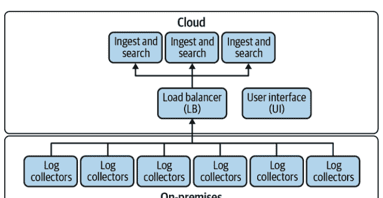

图 10-1. 第一代，无队列

## 第二代：使用云队列和对象存储

该解决方案的第二次迭代使用云提供商的对象存储和消息队列来摄取消息捆绑包，而不是直接发送到摄取 API。在每个索引/搜索节点上，都有一个轻量级的工作进程从队列中拉取消息。工作进程包含对象存储中日志捆绑包的路径，如图 10-2 所示。

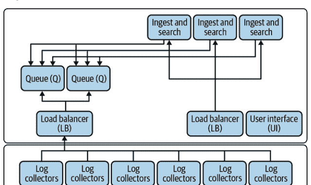

图 10-2. 第二代，使用云队列和对象存储

这两种解决方案都具有单体应用程序架构，该架构在平台的第三代中得到解决。该代还将解析逻辑移至云端，并降低了本地客户团队的运营开销。

## 第三代：基于内存的 Pub/Sub 队列

平台的第三代实现了微服务架构和高性能基于内存的队列，允许各个服务处理消息以使用文档数据库而不是之前的基于 RDBMS 的搜索引擎提供高级分析。这分离了故障和性能域，并允许系统水平扩展，如图 10-3 所示。

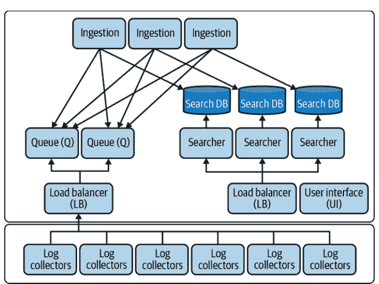

图 10-3. 第三代，使用微服务架构和水平扩展的队列

采用消息系统可以帮助扩展产品的重要组成部分之一。在前面的示例中，消息系统用于扩展事件处理。然而，消息系统可用于其他用途，例如传输分析、日志或任何其他格式的数据，这些数据不必实时处理。

## 消息平台的基础

软件组件的需求，无论是客户端/服务器应用程序还是在单台计算机上运行的单个程序，都早于云甚至互联网。除了最原始的通用和嵌入式操作系统外，所有操作系统都提供程序向其他程序发送和接收数据的功能。

## 消息与流式

Cloud Native Computing Foundation（CNCF）景观，图 10-4 所示，将消息类别命名为 Streaming & Messaging，但在本章中我们将主要关注消息。Kafka、NATS 和 RabbitMQ 提供了流式功能，但与 Spark 和 Flink 等流式分析平台不同，它们默认未启用，也不是这些消息平台的初始用例。我们将在下一节详细讨论消息概念，但在这一点上需要注意，流式系统的关键考虑因素是操作发生在多个消息上，通常在内存操作中具有时间或有序事件窗口，用于聚合或过滤。

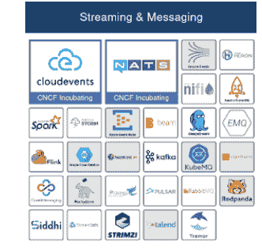

图 10-4. CNCF 流式与消息景观

## 消息基础

了解当代消息解决方案之间的相似性和差异可以帮助您确定哪种工具最适合工作或手头的问题。正如我们在整本书中所看到的，构建某物的方法总不止一种，而且在工具的广告功能经过测试并在您的特定基础设施和用例中得到验证之前，选择正确的路径并不总是容易的。在我们探讨 RabbitMQ、Apache Kafka 和 NATS 如何融入云原生基础设施和应用程序之前，我们必须了解消息、队列和流式系统中的基本概念和常见功能。

### 生产者和消费者

正如你与另一个人交流时一样，消息始终有一个发送者和接收者，但消息可能并非直接发送，你也可能不会得到回复。当你发送电子邮件时，有多个中间方，见图 10-5。这些方包括你的电子邮件客户端、你的电子邮件提供商的服务器，消息传输代理 [MTA]，它们扮演代理角色，接收者的服务器，另一个 MTA，以及接收电子邮件客户端。在此示例中，有多个消费者和生产者；电子邮件客户端将消息排队以发送/生产到 ISP 的邮件服务器，然后 MTA 将已发送的消息排队并发送/生产到接收者的 MTA。接收者的电子邮件客户端将从其 ISP 的 MTA 接收/消费消息。

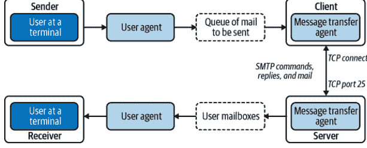

图 10-5. SMTP 邮件协议，队列系统的示例

正如在网络中存在单播、多播和广播交付模式一样，在消息传递中可能存在单个消费者处理单个生产者的数据或多个消费者，类似于电子邮件的情况。消息可能由消费者推送或拉取，具体取决于平台和配置。

### 代理和集群

在我们之前的电子邮件示例中，中间组件 MTA 在发送者和接收者之间充当代理。在许多情况下，MTA 软件可以集群化。集群中的一个或多个代理允许发送者和接收者彼此解耦。本章讨论的消息实现 RabbitMQ、Kafka 和 NATS 至少需要一个代理，并且遵循大多数分布式系统协议的原则，它们通常需要最少三个代理，并且通常应为奇数计数，以实现一致性算法。集群的考虑因素包括状态复制、领导者选举、节点成员行为以及网络故障时的集群分区，令人 dread 的脑裂问题。

集群的其他考虑因素，可能会迅速成为瓶颈，是如何在不中断服务的情况下进行扩展。维护高吞吐量和低延迟消息集群的运营开销是团队选择云提供商管理基础设施的原因，以便开发人员可以专注于开发和优化生产者和消费者应用程序。

### 持久性和耐久性

任何曾经向不存在的地址发送电子邮件的人都会收到邮件服务器的错误消息，指出在一定时间后消息已过期。暗示你的消息在离开你的邮件客户端后存储在外部系统上。

根据消息用例和存储和处理的数据类型，它可能具有更高的或更低的关键性，具有更高的或更低的易腐性，并且每条消息或事务是否必须在处理前存储更为关键。就像传输控制协议 TCP 和用户数据报协议 UDP 客户端/服务器应用程序一样，在构建生产系统时，应用程序层与底层传输层实现的错误处理和重试逻辑的数量是需要考虑的重要因素。消息系统以不同的方式将智能分配给生产者、消费者和代理。

此外，用于存储消息的机制因系统而异。一些系统具有纯内存存储，这使它们在云环境中耐久性较差，而其他系统具有磁盘支持的解决方案，虽然在云环境中存在挑战，但提供了更耐用和可靠的体验。

### 消息传递

除了源和目的地之外，您还应该了解消息导向平台的三种重要模式，我们将在本章中介绍：

- *至少一次*
意味着可能存在重复；特别是如果消费者崩溃并且未通知代理已接收消息，或者消息可能被传递给多个消费者

- *至多一次*
假设消息可能已发送但未被消费者实际接收或确认，将重传的负担放在客户端上

- *恰好一次*
在需要事务且消息必须恰好传递一次的非常有限的情况下

消息架构可能支持其中一种或多种模式。这些也可以在代理本身或消费者和生产者客户端库中配置。

## 安全


消息主题中包含的数据敏感性可能各不相同，因此需要对谁可以向这些主题生产和消费具有灵活的控制。消息系统应验证生产者和消费者的身份，然后对主题应用读写权限。此外，系统保留的数据应静态加密。

现在你已经了解了消息传递的一些基本原理，让我们来看一些你可能会遇到的常见消息传递模式。

## 常见消息传递模式

我们将介绍在现代基础设施中常见的三种消息传递架构。

### 简单队列

生产者（P）发布到队列（B），随着消费者（C）从队列中读取，消息会被删除且不会有其他消费者处理该消息。

### 发布和订阅

如图 10-6 所示，生产者（P）发送消息，所有监听（订阅）的消费者（C）都会收到消息。可能有也可能没有确认，但如果消费者不在线，他们将错过消息。

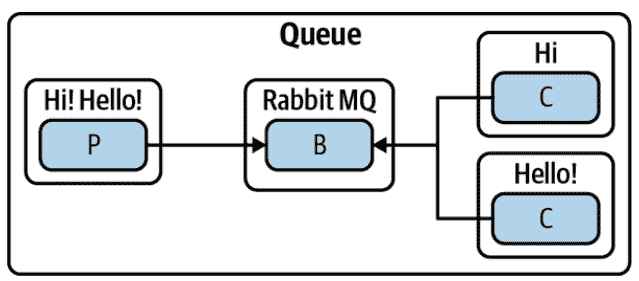

图 10-6. 一个简单的 pub/sub 消息系统

### 持久队列

如 10-7 图所示，生产者（P）将消息发送到代理（B），（C）独立消费基于指针的有序列表中的消息进行处理，但可以回退到列表中的已知点，例如给定窗口内的第一条消息。

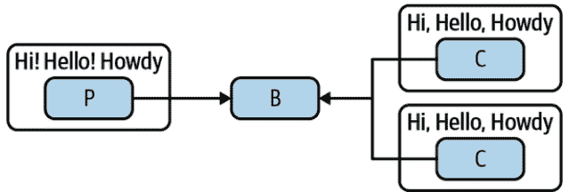

图 10-7. 一个持久的有序消息队列

到目前为止，我们已经涵盖了大量关于消息传递基础和架构的理论。我们现在将深入探讨各种云原生消息传递平台。

## 主流云原生消息传递平台概述

在本节中，我们将回顾一些在现代基础设施中已成为常见做法的主流云原生消息传递平台。

### RabbitMQ

尽管 RabbitMQ 已有 15 多年历史，显然早于云和微服务的广泛公有云采用，但它是一个经过验证的消息系统，曾为关键工作负载提供支持，并在容器和 Kubernetes 集群的世界中持续保持相关性。其原因之一是 RabbitMQ 是用 Erlang/OTP 开发的，Erlang/OTP 是一种为可扩展性、并发性和可靠性而设计的函数式编程语言，因此非常适合构建每天处理数百万到数亿条消息且停机时间极低的分布式系统。

### Apache Kafka

2010 年，LinkedIn 的工程师发现 RabbitMQ 无法扩展到其生态系统的复杂性和规模。Kafka 被创建以使消息传递成为 LinkedIn 技术栈的核心，并已成功扩展到全站每天数万亿条消息。

本章后面我们将讨论 Azure Event Hubs，这是一项与 Apache Kafka 兼容的服务，允许应用程序只需更新消费者/生产者连接字符串，但可能无法提供 Kafka 的所有功能。托管 Kafka 也是 HDInsight 的一部分，HDInsight 是 Azure 云上的一个广泛的分析服务套件。HDInsight 超出了本书的范围。

### CNCF CloudEvents

CloudEvents 最早于 2017 年在 CNCF Serverless 工作组中启动。用 CNCF 自己的话说：“CloudEvents 是用于以通用格式描述事件数据的规范，以提供跨服务、平台和系统的互操作性。” 虽然该项目具有很大的潜力（并且得到 Azure Event Grids 的支持），但我们不会在本書中进一步详细介绍。

### 使用 NATS 进行云消息传递深度解析

NATS 是另一个已被 CNCF 接受的开源消息传递实现。NATS 于 2011 年首次发布，最初以 Ruby 实现，作为 Cloud Foundry 的消息传递和服务发现层。后来改用 Golang 重写，目前处于非常活跃的开发中。虽然不如 RabbitMQ 或 Kafka 流行，但 NATS 由于其可在多个操作系统、处理器架构上运行的单二进制服务器以及官方 Docker 仓库，提供多种易于部署的选项。所有流行编程语言的客户端库均可用。简单性、可操作性、性能和安全性被认为是 NATS 相对于其他消息传递实现的优势，也是能够轻松使用最小功能集并偏好“至多一次”传递的能力。

由于基础 pub/sub 协议未实现消息持久化，消费者必须处于活动状态才能接收消息，这使得 NATS 非常适合交换高度易腐的数据，以及频繁更新的数据，例如传感器数据。默认情况下，消息将被路由到订阅该主题的所有监听订阅者，类似于多播网络。

由于其内存占用低且性能极高，NATS 也非常适合边缘和物联网分析用例。对于这样一个轻量级且专注于简单性的消息传递实现，NATS 具有相对复杂的身份验证和授权功能，并且默认通过账户支持多租户。NATS Streams 和 NATS JetStream 支持内存和磁盘持久化。NATS pub/sub 和流式传输从一开始就支持高可用性和水平扩展，而 JetStream 自 2021 年初以来一直在实现它们。

## NATS 协议架构

与 RabbitMQ 一样，NATS 提供多种消息传递模式，其功能已从最初的 pub/sub 实现不断发展，到 NATS 流式传输（如图 10-8 所示），再到其最新的存储子系统 JetStream。JetStream 于 2020 年发布，现已在 NATS 2.2.x 中可用。NATS 现在还包括原生的 MQTT 协议支持。

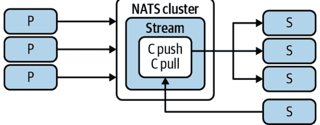

图 10-8. 基本 NATS 架构

由于基础架构是发布/订阅，NATS 生产者称为发布者，其消费者称为订阅者。NATS JetStream 使用内部消费者抽象。

使用 NATS CLI 在发布者和订阅者之间进行的最简单的交换是了解协议有多简单的最佳方式。

让我们看一个例子。在以下代码中，生产者使用主题 dog.food 发送消息 "arf"：

```
$ echo "arf" | nats pub dog.food
16:10:43 Reading payload from STDIN
16:10:43 Published 4 bytes to "dog.food"
```

在以下代码中，消费者订阅服务以接收所有以 dog. 开头的消息：

```
$ nats sub dog.*
16:09:49 Subscribing on dog.*
[#1] Received on "dog.food"
```

## 集群多个 NATS 服务器

NATS 允许将多个服务器集群在一起以提供高可用性和负载均衡。

最简单的集群可以通过以下方式启动：

- 使用 -cluster 参数在启动服务器时配置集群 URL
- 在额外的服务器节点中指定路由

假设我们在 192.168.2.238 和 192.168.2.247 上有两个不同的 Linux 服务器，我们可以使用以下命令配置一个集群：

```
nats-server -DV -cluster nats://192.168.2.238:4248
nats-server -DV -cluster nats://192.168.2.247:4248 -routes nats://192.168.2.238:4248
```

## 使用 Docker NATS 服务器

除了 RPM 和 deb 之外，Synadia 还分发和维护 Docker 镜像，这可能是运行 NATS 服务器的最简单方式，如示例 10-1 所示。

示例 10-1. 使用 Docker 运行 NATS

```
$ docker run -p 4222:4222 -p 8222:8222 -v ~/tmp/jetstream:/tmp/jetstream nats -js -m 8222
[1] 2021/06/26 21:23:21.572029 [INF] Starting nats-server
[1] 2021/06/26 21:23:21.572258 [INF] Version: 2.3.0
[1] 2021/06/26 21:23:21.572289 [INF] Git: [56a144a]
[1] 2021/06/26 21:23:21.572311 [INF] Name: NDT... 
[1] 2021/06/26 21:23:21.572378 [INF] Node: N3Qm3ud7
[1] 2021/06/26 21:23:21.572399 [INF] ID: NDT... 
[1] 2021/06/26 21:23:21.574923 [INF] Starting JetStream
[1] 2021/06/26 21:23:21.576592 [INF] 
[1] 2021/06/26 21:23:21.576622 [INF] JETSTREAM
[1] 2021/06/26 21:23:21.576631 [INF] 
[1] 2021/06/26 21:23:21.576639 [INF] 
[1] 2021/06/26 21:23:21.576647 [INF] 
[1] 2021/06/26 21:23:21.576656 [INF] https://docs.nats.io/jetstream
[1] 2021/06/26 21:23:21.576664 [INF] ---------------- JETSTREAM ----------------
[1] 2021/06/26 21:23:21.576697 [INF] Max Memory: 2.06 GB
[1] 2021/06/26 21:23:21.576711 [INF] Max Storage: 4.64 GB
[1] 2021/06/26 21:23:21.576779 [INF] Store Directory: "/tmp/nats/jetstream"
[1] 2021/06/26 21:23:21.576800 [INF] --------------------------------------------
[1] 2021/06/26 21:23:21.579799 [INF] Starting http monitor on 0.0.0.0:8222
[1] 2021/06/26 21:23:21.580581 [INF] Listening for client connections on 0.0.0.0:4222
[1] 2021/06/26 21:23:21.581147 [INF] Server is ready
```

我们可以传递完整的命令行参数。在这种情况下，我们指定将 ~/tmp 目录中的卷挂载以用于 JetStream 持久化。

## 监控 NATS 服务器

NATS 暴露了一个监控端点，可以通过浏览器、命令行或网络浏览器查看，如图 10-9 所示。

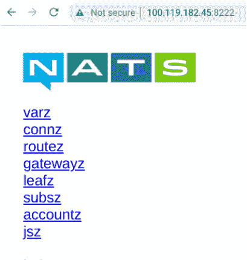

图 10-9. NATS 监控端点

以下是 NATS 监控端点输出的示例：

```
$ curl http://100.119.182.45:8222/varz
{
  "server_id": "ND6FZROVHED32BDLBTMCPXEN4L1KB2ROR3HO3GZ6DLDB64Z54SLG5GOD",
  "server_name": "ND6FZROVHED32BDLBTMCPXEN4L1KB2ROR3HO3GZ6DLDB64Z54SLG5GOD",
  "version": "2.2.2",
  "proto": 1,
```


```
"git_commit": "a5f3aab",
"go": "go1.16.3",
"host": "0.0.0.0",
"port": 4222,
"connect_urls": [
"192.168.2.247:4222",
"192.168.122.1:4222",
"172.17.0.1:4222",
"100.119.182.45:4222",
"[fd7a:115c:ale0:ab12:4843:cd96:6277:b62d]:4222",
"192.168.122.1:4222",
"172.17.0.1:4222",
"100.119.135.53:4222",
"[fd7a:115c:ale0:ab12:4843:cd96:6277:8735]:4222",
"192.168.2.238:4222"
],
"max_connections": 65536,
"ping_interval": 120000000000,
"ping_max": 2,
"http_host": "0.0.0.0",
"http_port": 8222,
"http_base_path": "",
"https_port": 0,
"auth_timeout": 2,
"max_control_line": 4096,
"max_payload": 1048576,
"max_pending": 67108864,
"cluster": {
"name": "xCQWcOMbOGCPm7ESUUctIc",
"addr": "192.168.2.247",
"cluster_port": 4248,
"auth_timeout": 2,
"urls": [
"192.168.2.238:4248"
],
"tls_timeout": 2
},
"gateway": {},
"leaf": {},
"jetstream": {},
"tls_timeout": 2,
"write_deadline": 1000000000,
"start": "2021-05-03T15:13:05.512147331Z",
"now": "2021-05-03T15:41:53.509877951Z",
"uptime": "28m47s",
"mem": 12353536,
"cores": 6,
"gomaxprocs": 6,
"cpu": 0,
"connections": 1,
"total_connections": 1,
"routes": 1,
"remotes": 1,
"leafnodes": 0,
"in_msgs": 117,
"out_msgs": 115,
"in_bytes": 67297,
"out_bytes": 66346,
"slow_consumers": 0,
"subscriptions": 144,
"http_req_stats": {
"/": 3,
"/accountz": 1,
"/connz": 1,
"/gatewayz": 0,
"/leafz": 1,
"/routez": 0,
"/subsz": 1,
"/varz": 2
},
"config_load_time": "2021-05-03T15:13:05.512147331Z",
"system_account": "$SYS"
}
```

你可以使用 Telegraf 之类的工具抓取这些 HTTP 端点，并将它们发送到上游指标后端或 Prometheus 导出器。¹

## NATS 使用 JetStream 的持久性

尽管 NATS 在 2019 年引入了名为 NATS Streaming 的持久性实现，但它将在 2023 年 6 月被弃用。第二代实现 JetStream 自 2020 年起一直在开发中，将成为今后用例的首选方案。尽管 JetStream 有单独的 GitHub 仓库，但它现在已集成到 NATS Server 2.2.x 中，并由 NATS CLI 支持，我们稍后会讨论。NATS pub/sub 仅提供“至多一次”传递；JetStream 允许“恰好一次”传递，更接近 RabbitMQ 队列和 Kafka 主题的行为（参见图 10-10）。

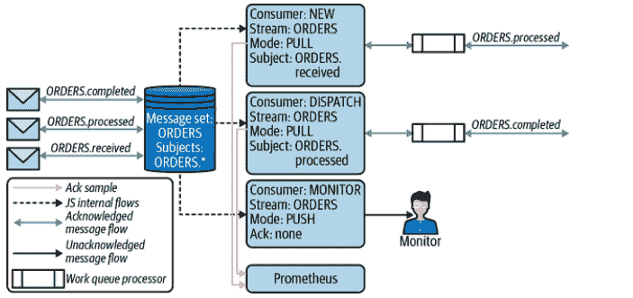

## NATS 安全

完全可以写一整章来介绍如何配置 NATS 2.3.x 的各种身份验证、授权和加密功能。在本节中，我们将介绍将安全级别从我们在迄今为止的大多数示例中使用的不安全默认值提升到生产部署所不合适的程度所需的基本步骤。强大的身份和密钥管理基础设施是安全云系统的基础，但超出了本书的范围。NATS 提供了一个强大的权限子系统，允许按主题为基础进行细粒度控制²并使用分布式身份存储。

### 基于 Nkey 的身份验证

尽管 NATS 仍支持令牌和用户名/密码身份验证，但今后推荐使用 Nkey 身份验证。它使用非对称加密，并且不需要在服务器上以明文或哈希格式存储共享密钥。密钥管理非常简单。

要生成密钥对，请使用 nkeys 仓库中的 nk³ 实用程序：

```
$ nk -gen user -pubout
SUAGWCAMM XKR43EDIXVC5FEA5G3767ALGQR75N27NGPK37KZUURS7F32FE
UBFHQJERKEBE323BXQEVT6257CIRJ4CIC5LGT6R2LJ524GQTUQHX CUK3
```

公钥（以“U”开头）配置在服务器上：

```
$ cat server.conf
net: 0.0.0.0
port: 4242
```

```
authorization {
  users: [
    { nkey: UBFHQJERKEBE323BXQEVT6257CIRJ4CIC5LGT6R2LJ524GQTUQHXCU K3 }
  ]
}
```

私钥（或种子；“S”前缀即表示此含义）存储在磁盘上并作为参数传递给 NATS 客户端或作为代码中的变量。如同任何敏感材料一样，最好将这些密钥存储在外部密钥存储中，例如 Azure Key Vault 或 Kubernetes secret：

```
$ cat client.nkey
SUAGWCAMM XKR43EDIXVC5FEA5G3767ALGQR75N27NGPK37KZUURS7F32FE

$ nats -s nats://127.0.0.1:4224 --nkey client.nkey pub "foo"
12:57:17 Published 4 bytes to "foo"
```

### TLS 身份验证

尽管我们已有安全的身份验证（并且根据我们如何配置主题权限，可能还有授权），仅使用 Nkey 对于网络安全来说是不够的，因为 NATS 默认是一个 ASCII 明文协议。

与大多数云原生协议一样，NATS 支持双向 TLS 加密。通常，TLS 最大的挑战是证书和密钥管理，这超出了本书的范围。为演示目的，mkcert 比 OpenSSL 更容易生成用于端到端加密所需的证书颁发机构（CA）、客户端和服务器密钥对。

首先，我们在 ~/nats 目录中设置 CA 并创建客户端和服务器证书：

```
$ mkdir ~/nats && cd ~/nats

### Create the CA
$ mkcert -install

### Create the server
$ mkcert -cert-file server-cert.pem -key-file server-key.pem localhost 127.0.0.1 ::1

### Generate a certificate for client authentication.
$ mkcert -client -cert-file client-cert.pem -key-file client-key.pem localhost ::1 127.0.0.1 email@localhost
$ cp -av `mkcert -CAROOT`/* ~/nats
```

然后我们在 ~/nats 目录中启动服务器并添加 TLS 证书参数：

```
$ nats-server -DV --tls --tlscert=server-cert.pem --tlskey=server-key.pem -ms 8222
```

最后，我们使用客户端连接：

```
$ nats --tlscert=client-cert.pem --tlskey=client-key.pem account info
```

在服务器上，我们应该看到成功的 TLS 连接：

```
[10108] 2021/06/28 14:46:40.126469 [DBG] 127.0.0.1:50192 - cid:11 - Client connection created
[10108] 2021/06/28 14:46:40.126573 [DBG] 127.0.0.1:50192 - cid:11 - Starting TLS client connection handshake
[10108] 2021/06/28 14:46:40.157446 [DBG] 127.0.0.1:50192 - cid:11 - TLS handshake complete
[10108] 2021/06/28 14:46:40.157468 [DBG] 127.0.0.1:50192 - cid:11 - TLS version 1.3, cipher suite TLS_AES_128_GCM_SHA256
[10108] 2021/06/28 14:46:40.157584 [TRC] 127.0.0.1:50192 - cid:11 - <- [CONNECT
{"verbose":false,"pedantic":false,"tls_required":true,"name":"NATS CLI Version 0.0.23","lang":"go","version":"1.11.0","protocol":1,"echo":true,"headers":true,"no_responders":true}
]
```

## 在 Kubernetes 上部署 NATS

NATS 可以使用 Helm chart 快速安装。Helm chart 还会安装 Prometheus operator 和证书管理器，使你能够充分利用 NATS 随附的指标和 TLS 支持。

- 首先添加 Helm 仓库：
- 然后安装 NATS 服务器：
- 安装 NATS streaming 服务器（称为 stan）：
- 完成这些步骤后，将有一个 Grafana Surveyor，你可以通过端口转发到 Pod 来查看：
- 你可以在浏览器中 http://127.0.0.1:3000/d/nats/nats-surveyor?refresh=5s&orgId=1 查看 Grafana。

```
$ helm repo add nats https://nats-io.github.io/k8s/helm/charts/
$ helm repo update
```

```
$ helm install my-nats nats/nats
```

```
$ helm install my-stan nats/stan --set stan.nats.url=nats://my-nats:4222
```

```
kubectl port-forward deployments/nats-surveyor-grafana 3000:3000
```

你的 Help 部署提供了许多 Helm 可配置项。你可以在 NATS Helm 部署配置页面上阅读更多相关信息。

你可以使用 nats-py 包以非常直接的方式用 Python 编写 NATS 代码。在以下示例中，我们用 Python 编写了一个基本的生产者和消费者。NATS 为你提供了公共服务器用于测试。如果要在自己的环境中测试，请将 nc = await nats.connect("nats://demo.nats.io:4222") 替换为你的 NATS 实例地址：

```
import time

import asyncio
import nats
from nats.aio.errors import ErrConnectionClosed, ErrTimeout, ErrNoServers

async def run():
    # The Nats project provides a public demo server `nats://demo.nats.io:4222`.
    # You can add your own Nats server on the next line
    nc = await nats.connect("nats://demo.nats.io:4222")

    async def message_handler(msg):
        subject = msg.subject
        reply = msg.reply
        data = msg.data.decode()
        print("Received a message on '{subject} {reply}': {data}".format(
            subject=subject, reply=reply, data=data))

    # Simple publisher and async subscriber via coroutine.
    sub = await nc.subscribe("foo", cb=message_handler)

    await nc.publish("foo", b'Message1')
    await nc.publish("foo", b'Message2')

    time.sleep(5)
    # Remove interest in subscription.
    await sub.unsubscribe()
```


### 终止与 NATS 的连接。
await nc.drain()

if __name__ == '__main__':
    loop = asyncio.get_event_loop()
    loop.run_until_complete(run())
    loop.close()

## Azure 消息服务

当商业公有云服务在 2000 年代中期首次推出时，存储和消息服务（如 AWS S3 和 AWS SQS）是首批可供客户使用的服务之一。Microsoft Azure 提供了多种托管消息服务，以支持云特定实现，以及 AMQP 和 JMS 等基于标准的消息协议，以及我们在本章中已探讨的工作队列和发布/订阅等模式。所有 Azure 选项均提供“至少一次”传递。

在 Azure Service Bus、Azure Event Hubs 和 Azure Event Grid 之间进行选择时，应考虑以下标准：

- 与本地消息线协议和平台（ActiveMQ、RabbitMQ）及工具的兼容性
- 与其他 Azure 托管服务所需集成的程度
- 对有序消息和事务的需求
- 处理事件流的能力
- 使用大数据管道
- 最大摄取速率（每秒事件数）
- 可用的异步事件模式
- 定价

使用 Azure 消息服务的主要好处之一是能够利用 Azure IAM 功能和密钥管理。让我们现在详细了解 Azure 的产品。

## Azure Service Bus

Azure Service Bus 是一种托管队列服务，提供与 ActiveMQ 和 RabbitMQ 相当的企业级功能，但无需管理虚拟机上的多个代理或在 Kubernetes 之上的部署的开销。Azure Service Bus 可通过 Azure Service Bus Premium⁴ 跨多个可用区扩展，并旨在支持从本地 JMS 2.0 实现的迁移。

Service Bus 支持我们在本章开头讨论的简单消息队列和发布/订阅模式。最常见的模式是“拉取模型”，消费者轮询服务端点以获取新消息。就像 RabbitMQ 和 Kafka 一样，多个消费者可以在消息可用时尽可能快地处理消息，从而允许工作在多个工作节点之间分配。Azure Service Bus 实现 AMQP 1.0⁵，并为 .NET、Java、Python、Go 等提供了完善的文档 SDK 和代码示例。

### Service Bus 概念

Azure Service Bus 抽象（请参阅图 10-11 和图 10-12 了解参考架构）提供的功能与 NATS 中的功能相似。

图 10-11. 一个参考 Service Bus 架构

图 10-12. 一个简单的消息架构

### 命名空间

命名空间允许将主题、队列和服务作为消息组件的容器进行分段，就像虚拟网络为虚拟机和负载均衡器等网络组件提供边界一样。Kafka 没有提供可比的抽象，但 RabbitMQ 虚拟主机和 NATS 账户则提供。

### 队列、主题和订阅

Azure Service Bus 队列提供有序的 FIFO 消息集，其拉取方式类似于 Kafka 和 RabbitMQ 消费者或 NATS 基于拉取的消费者，而主题主要用于发布/订阅模式和面向大量消费者的点对多通信。订阅允许消费者基于过滤规则接收消息。就像 NATS JetStream 一样，消息是从订阅（类似于 JetStream 的消费者）中检索的，而不是从主题本身检索的（相当于 NATS JetStream 流）。

### 使用 Terraform 管理 Azure Service Bus

尽管 Microsoft 提供了 Service Bus 管理的 Python SDK，但我们将继续使用 Terraform 来创建 Service Bus 命名空间、队列和主题。以下代码示例部署了一个新的 servicebus、命名空间、队列和主题：

```
provider "azurerm" {
  features {}
}

resource "azurerm_resource_group" "example" {
  name     = "terraform-servicebus"
  location = "Central US"
}

resource "azurerm_servicebus_namespace" "example" {
  name                = "mdfranz-servicebus-namespace"
  location            = azurerm_resource_group.example.location
  resource_group_name = azurerm_resource_group.example.name
  sku                 = "Standard"
```

```
tags = {
    source = "terraform"
}

resource "azurerm_servicebus_queue" "example" {
    name                = "mdfranz-servicebus-queue"
    resource_group_name = azurerm_resource_group.example.name
    namespace_name      = azurerm_servicebus_namespace.example.name
    enable_partitioning = true
}

resource "azurerm_servicebus_topic" "example" {
    name                = "mdfranz-servicebus-topic"
    resource_group_name = azurerm_resource_group.example.name
    namespace_name      = azurerm_servicebus_namespace.example.name
    enable_partitioning = true
}
```

使用 azure-cli，我们可以看到创建的资源：

```
$ az servicebus queue list --namespace-name mdfranz-servicebus-namespace -g terraform-servicebus
[
  {
    "accessedAt": "0001-01-01T00:00:00+00:00",
    "autoDeleteOnIdle": "10675199 days, 2:48:05.477581",
    "countDetails": {
      "activeMessageCount": 0,
      "deadLetterMessageCount": 0,
      "scheduledMessageCount": 0,
      "transferDeadLetterMessageCount": 0,
      "transferMessageCount": 0
    },
    "createdAt": "2021-04-14T02:24:28.260000+00:00",
    "deadLetteringOnMessageExpiration": false,
    "defaultMessageTimeToLive": "10675199 days, 2:48:05.477581",
    "duplicateDetectionHistoryTimeWindow": "0:10:00",
    "enableBatchedOperations": true,
    "enableExpress": false,
    "enablePartitioning": true,
    "forwardDeadLetteredMessagesTo": null,
    "forwardTo": null,
    "id": "/subscriptions/1bf91ee3-5b21-4996-bd72-ae38e8f26ce9/resourceGroups/terraform-servicebus/providers/Microsoft.ServiceBus/namespaces/mdfranz-servicebus-namespace/queues/mdfranz-servicebus-queue",
    "location": "Central US",
    "lockDuration": "0:01:00",
    "maxDeliveryCount": 10,
    "maxSizeInMegabytes": 81920,
    "messageCount": 0,
    "name": "mdfranz-servicebus-queue",
    "requiresDuplicateDetection": false,
    "requiresSession": false,
    "resourceGroup": "terraform-servicebus",
    "sizeInBytes": 0,
    "status": "Active",
    "type": "Microsoft.ServiceBus/Namespaces/Queues",
    "updatedAt": "2021-04-14T02:24:28.887000+00:00"
  }
]

$ az servicebus topic list --namespace-name mdfranz-servicebus-namespace -g terraform-servicebus
[
  {
    "accessedAt": "0001-01-01T00:00:00+00:00",
    "autoDeleteOnIdle": "10675199 days, 2:48:05.477581",
    "countDetails": {
      "activeMessageCount": 0,
      "deadLetterMessageCount": 0,
      "scheduledMessageCount": 0,
```

```
"transferDeadLetterMessageCount": 0,
"transferMessageCount": 0
},
"createdAt": "2021-04-14T12:32:46.243000+00:00",
"defaultMessageTimeToLive": "10675199 days, 2:48:05.477581",
"duplicateDetectionHistoryTimeWindow": "0:10:00",
"enableBatchedOperations": false,
"enableExpress": false,
"enablePartitioning": true,
"id": "/subscriptions/SUBSCRIPTION/resourceGroups/terraform-servicebus/providers/Microsoft.ServiceBus/namespaces/mdfranz-servicebus-namespace/topics/mdfranz-servicebus-topic",
"location": "Central US",
"maxSizeInMegabytes": 81920,
"name": "mdfranz-servicebus-topic",
"requiresDuplicateDetection": false,
"resourceGroup": "terraform-servicebus",
"sizeInBytes": 0,
"status": "Active",
"subscriptionCount": 0,
"supportOrdering": false,
"type": "Microsoft.ServiceBus/Namespaces/Topics",
"updatedAt": "2021-04-14T12:32:46.487000+00:00"
]
```

我们也可以在 Azure 控制台中看到资源，如图 10-13 所示。

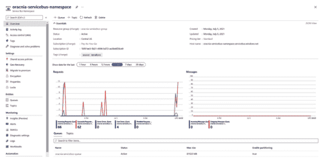

我们还可以看到命名空间中的总体指标，以及点击特定队列以提供有关存储和消息大小的更多详细信息（见图 10-14）。

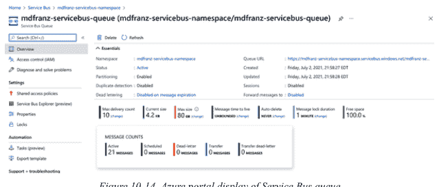

### 在 Python 中向 Service Bus 队列发送和接收消息

假设我们在前面的步骤中成功创建了基础设施，我们可以通过运行 Azure CLI 命令检索可用于使用的连接字符串：


```
$ az servicebus namespace authorization-rule keys list --resource-group $RES_GROUP --namespace-name $NAMESPACE_NAME --name RootManageSharedAccessKey --query primaryConnectionString
```

Azure 提供开源库，可在所有流行的编程语言中向 Azure 服务发送和接收消息。以下示例在 Python 中构建了一个简单的生产者和消费者：

```
from azure.servicebus import ServiceBusClient, ServiceBusMessage

import os
connstr = os.environ['SERVICE_BUS_CONN_STR']
queue_name = os.environ['SERVICE_BUS_QUEUE_NAME']

messages = ["Testing 1","Testing 2", "Testing 3"]

with ServiceBusClient.from_connection_string(connstr) as client:
    s = client.get_queue_sender(queue_name)
    r = client.get_queue_receiver(queue_name)

    print(s,r)

    for m in messages:
        s.send_messages(ServiceBusMessage(m))

    while True:
        print(r.receive_messages(max_message_count=1,max_wait_time=10))
```

除了 RabbitMQ 之外，熟悉 AWS SNS 和 SQS 的读者会发现 Service Bus 非常直观，能够满足类似的使用场景。

## Azure Event Hubs

Azure Event Hubs 设计用于提供 Apache Kafka 的部分功能，以满足分区和消费者组的使用场景，但以托管的云服务形式提供（见图 10-15）。虽然你失去了在虚拟机或 Kubernetes 上运行 Kafka 时对后端基础设施的可见性，但你获得了与 Azure Blob Storage、Azure Data Lakes 和 Azure Stream Analytics 等其他数据服务更紧密的集成，等等。Azure 还支持 AMQP 1.0 和 Kafka 1.0 协议，以保持与客户端库的兼容性。

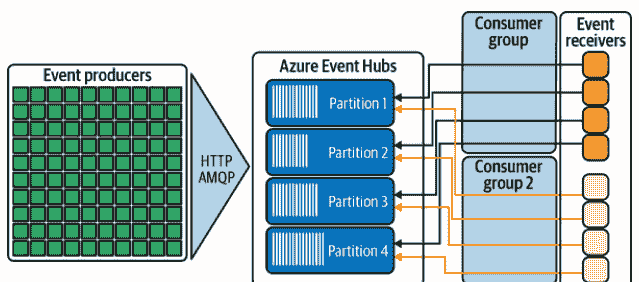

图 10-15. Azure Event Hubs 架构

Azure Event Hubs 有一些概念是从 Azure Service Bus 转移过来的。我们在这里快速回顾一下：

*生产者*

这些是向 Azure Event Hubs 发送消息的客户端。

*分区*

消息被分片到各个分区，以便消息的副本可以被存储。

### 消费者组

这些是协同工作以协调方式消费消息的客户端。

### 使用 Terraform 管理 Azure Event Hubs

为向 Azure Event Hubs 发送消息而预配所需资源的 Terraform 代码与我们之前用于在 Azure Service Bus 中配置队列和主题的代码非常相似。我们必须声明一个资源组和一个命名空间，我们的 Event Hubs 实例将属于该命名空间：

```
provider "azurerm" {
  features {}
}

resource "azurerm_resource_group" "example" {
  name     = "mdfranz-eventbus-group"
  location = "East US"
}

resource "azurerm_eventhub_namespace" "example" {
  name                = "mdfranz-eventhub-namespace"
  location            = "East US"
  resource_group_name = azurerm_resource_group.example.name
  sku                 = "Standard"
  capacity            = 1
}

resource "azurerm_eventhub" "example" {
  name                = "mdfranz-eventhub"
  namespace_name      = azurerm_eventhub_namespace.example.name
  resource_group_name = azurerm_resource_group.example.name
  partition_count     = 1
  message_retention   = 1
}

resource "azurerm_eventhub_consumer_group" "example" {
  name                = "mdfranz-consumergroup"
  resource_group_name = azurerm_resource_group.example.name
  namespace_name      = azurerm_eventhub_namespace.example.name
  eventhub_name       = azurerm_eventhub.example.name
}
```

创建消费者组是可选的，因为存在默认消费者组。还请注意，具有多个消费者组需要标准 SKU 而不是基本 SKU。

与 Azure Event Bus 一样，有多种方式可以对 Event Hubs 端点进行身份验证。最简单的方法是使用连接字符串，如以下示例所示：

```
$ az eventhubs namespace authorization-rule keys list --resource-group mdfranz-eventbus-group --namespace-name mdfranz-eventhub-namespace --name RootManageSharedAccessKey
{
  "aliasPrimaryConnectionString": null,
  "aliasSecondaryConnectionString": null,
  "keyName": "RootManageSharedAccessKey",
  "primaryConnectionString": "Endpoint=sb://mdfranz-eventhub-namespace.servicebus.windows.net/;SharedAccessKeyName=RootManageSharedAccessKey;SharedAccessKey=jFMUbfQZX8UjGjcCKLAeIp5CZVLcWcSGpuKdJX/CMzK=",
  "primaryKey": "jFMUbfQZX8UjGjcCKLAeIp5CZVLcWcSGpuKdJX/CMzK=",
  "secondaryConnectionString": "Endpoint=sb://mdfranz-eventhub-namespace.servicebus.windows.net/;SharedAccessKeyName=RootManageSharedAccessKey;SharedAccessKey=gFy7SuuGjw12GfoHXd6UQeZdy5Y0xu/gStZtQUhaxsY=",
  "secondaryKey": "gFy7SuuGjw12GfoHXd6UQeZdy5Y0xu/gStZtQUhaxsY="
}
```

> 注意
> 参数 EntityPath=mdfanz-eventhub（即 Endpoint=sb://mdfanz-eventhub-namespace.servicebus.windows.net/;SharedAccessKeyName=RootManageSharedAccessKey;EntityPath=mdfanz-eventhubSharedAccessKey=jfMUbFqZX8UjG1cKLAeIp5CZVLcwcSGpuKdJX/CMzk=）必须添加到连接字符串中，因为如果你使用 NewHubfromConnectionString 创建客户端，Send 方法不允许将事件网格名称指定为参数，因此你需要改为添加 EntityPath。

## Azure Event Grid

Azure Event Grid 于 2018 年正式发布，是 Azure 提供的最佳消息代理之一，因为它允许多个事件源路由到 Azure 生态系统中的各种目的地。消息可以发送到/从我们刚刚讨论的现有消息服务（Azure Service Bus 和 Azure Event Hubs）以及其他服务和端点（见图 10-16），例如 Azure Functions、Web Hooks、Logic Apps，以及其他应用内用途（例如跟踪用户与应用程序的交互方式）。Azure Event Hubs 是一种首屈一指的“无服务器”产品，按事件计费。

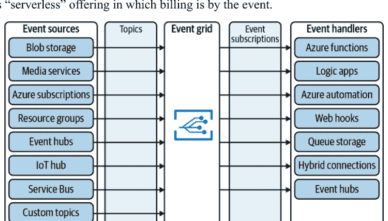

图 10-16. Event Grid 生态系统

在图 10-16 中，请注意 Event Grid 的推送特性，与我们在其他系统中习惯的通用推拉拓扑不同。

Azure Event Grid 使用的术语与我们讨论的其他平台略有不同：

### 域

域类似于命名空间，用于在租户内分隔使用场景。

### 主题

对于 Event Grid，存在两种类型的主题：系统主题，来自 Azure 系统（Event Hubs、Blob Storage 等），如图 10-16 左侧所示；以及自定义主题，可以是您自己的自定义方案，包装在 Event Grid Schema 中。

### 部署和使用事件网格

Azure 事件网格具有简约的 Terraform 部署，如以下示例所示：

```
resource "azurerm_resource_group" "example" {
  name     = "example-resources"
  location = "East US"
}
```

```
resource "azurerm_eventgrid_topic" "example" {
  name                = "my-eventgrid-topic"
  location            = azurerm_resource_group.example.location
  resource_group_name = azurerm_resource_group.example.name

  tags = {
    environment = "Production"
  }
}
```

你需要更改主题的名称，因为它在你部署到的 Azure 区域中是全局唯一的。一旦此 Terraform 部署应用完成，将创建一个新的 Event Grid 主题，名称为 https://<event-grid-topic-name>.<topic-location>.eventgrid.azure.net/api/events；或在我们的例子中，为 https://my-eventgrid-topic.east-us.eventgrid.azure.net/api/events。你可以通过运行 az eventgrid topic key list --resource-group example-resources --name my-eventgrid-topic 来找到该主题的访问密钥。

这里有一个使用 azure-eventgrid Python 包的简单生产者：

```
from azure.identity import DefaultAzureCredential
from azure.eventgrid import EventGridPublisherClient, EventGridEvent

event = EventGridEvent(
    data={"team": "azure-sdk"},
    subject="Door1",
    event_type="Azure.Sdk.Demo",
    data_version="2.0"
)

credential = DefaultAzureCredential("<access-key>")
endpoint = `https://my-eventgrid-topic.east-us.eventgrid.azure.net/api/events`
client = EventGridPublisherClient(endpoint, credential)
client.send(event)
```

大量关于如何使用 Event Grid 编程的优秀示例可在 Azure Event Grid Python 客户端库 中找到。

### 总结

在为新应用或现有应用选择消息技术时，你有很多选择。像往常一样，关于如何运行某项技术的答案通常是“视情况而定！”我们在本章中讨论的开源和 Azure 消息产品之间存在显著的功能重叠。在选择消息服务之前，确保你了解自己的持久性、规模和安全需求，将为你部署消息基础设施奠定成功的基础。我们现在将进入我们最后的基础设施部分，无服务器计算。


## 第11章. 无服务器

### 早期发布读者须知

使用 Early Release 电子书，您可以在官方发布这些书名之前很久就利用这些技术——作者在撰写时的原始未编辑内容。

这将是最终书籍的第11章。请注意，GitHub 仓库将在稍后激活。

如果您对如何改进本书的内容和/或示例有任何意见，或者如果您注意到本章中缺少材料，请联系编辑 rfernando@oreilly.com。

到目前为止，我们主要关注将本地概念带入云端并讨论和实现其云端等价物。在本章中，我们将深入探讨一种新型计算架构——无服务器，它植根于云计算。具体来说，我们将研究常见的无服务器平台，包括 Azure 函数应用、Knative、KEDA 和 OpenFaaS。

### 无服务器计算简介

与容器类似，无服务器计算周围也有很多炒作，以及可以用它做什么。本章将探讨无服务器计算的功能和优势。

### 什么是无服务器？

与容器不同，容器在很大程度上仍然包含许多基于主机的概念，而无服务器将所有这些都抽象掉了，以至于您只关心能够运行软件函数。

由于能够快速创建应用程序并在无需担心基础设施管理的情况下运行它们，无服务器获得了很大的流行。此外，无服务器将自动扩缩容视为一项首要功能，这意味着您无需担心其他事情，只需编写代码并使用标准化的框架部署机制进行部署即可。

无服务器的好处是服务器维护和配置大多不是问题。此外，如果您想不频繁地运行软件函数，无服务器函数可以是一种更经济的选择，因为您按请求付费，而不是按计算资源（即计算）的预留付费。

正如前面提到的，无服务器生态系统是一个相当新的领域，创新速度很快。除了大型云服务提供商提供函数平台外，像 Cloudflare、Netlify 和 Twilio 这样的其他互联网公司也提供无服务器功能。

### 什么是无服务器函数？

无服务器函数是一个小型、短生命周期的程序，在触发时运行。无服务器函数可以通过 HTTP(s) 请求、通过计时器触发，或在 Azure Event Grid 中通过基于 Cosmos DB 或 Service Bus 事件触发函数来触发。

函数通常具有单一的自包含目的，执行速度快且依赖有限。此外，它通常不是高 qps（每秒查询数）的端点，因为性能是无服务器函数的次要关注点。

您可能听说过像 https://icanhazip.com 这样的实用工具，它只返回您连接的公共 IP 地址。这可以很容易地作为无服务器函数编写和部署：

```
async function handleRequest(request) {
  const clientIP = request.headers.get("CF-Connecting-IP")
```

```
return new Response(clientIP)
}

addEventListener("fetch", event => {
  event.respondWith(handleRequest(event.request))
})
```

前面的示例为“fetch”类型的事件（即 HTTP GET）创建了一个事件监听器，当该事件被触发时，handleRequest 函数将被调用。函数解析 HTTP 请求头 CF-Connecting-IP，即向无服务器函数发出请求的 IP。函数然后以请求的 IP 地址进行响应。

### 无服务器生态系统

如前所述，尽管是一个新领域，无服务器生态系统已经见证了快速的系统开发。CNCF 无服务器生态系统（如图 11-1 所示）包含多个部分：

Tools

协助构建无服务器软件的软件框架

Security

专门用于保护无服务器基础设施的软件

Frameworks

用于构建无服务器函数的软件框架

Hosted platform

提供无服务器函数的公共提供商

Installable platform

您可以安装以运行无服务器函数的软件

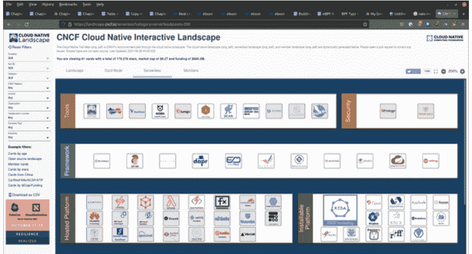

图 11-1. CNCF 无服务器生态系统

虽然本书中不会详细介绍，但除了框架和主要云服务提供商提供无服务器服务外，边缘网络（或 CDN）提供商也提供无服务器或“边缘计算”功能。这在 Cloudflare 等公司变得非常流行。

### 无服务器的优势

正确使用时，无服务器可以为用户带来重大优势：

Lower costs

您按函数运行的次数或运行时间计费，这意味着您无需为闲置的云资源付费。

Eliminated operational overhead

鉴于函数模型的简单性和依赖性有限，主动配置或管理函数的需要大大减少。

#### Autoscaling

函数会自动扩缩容，无需额外工作即可将函数工作进程数量向上或向下扩展。

#### Faster development cycles

将上述所有要点结合起来有助于产生更快的工程周期，这可以提高开发人员和操作人员的生产力。

### 无服务器的潜在缺点

无服务器也可能存在一些潜在的缺点，需要考虑：

#### Debuggability

当所有计算完全是短暂的且生命周期短时，调试函数变得异常复杂。

#### Large number of functions

虽然自动扩缩容固有地内置于所有无服务器函数中，但始终自动扩缩容也会产生一些副作用。首先，它可能对性能产生不利影响，其次，下游连接池的管理变得更加复杂（尤其是在数据库方面）。

#### Vendor lock-in

所有无服务器平台的一个缺点是，您的函数代码直接绑定到您运行函数的软件平台上。这在很大程度上限制了您随时间的移植性。

现在我们已经解释了无服务器是什么以及使用该技术的一些好处，我们将查看可以运行无服务器函数的各种平台。

### Azure 函数应用

Azure 函数应用是 Azure 的无服务器应用程序平台提供。函数应用提供在 Linux 或 Windows 环境中运行代码或容器的能力，并支持多种编程语言，包括：

- .NET Platform (C#, F#)
- JavaScript and TypeScript
- Python
- Java
- PowerShell Core

Azure 函数应用将具有一个关联的计划，该计划决定了您的应用如何扩缩容、可用的功能以及您支付的价格。截至撰写本文时，有三个选项：

*Consumption*

这是一个基本计划，函数会自动扩缩容，您仅在函数运行时付费。

*Functions Premium*

这会根据需求自动扩缩容，使用预热的工作进程。它运行在更强大的实例上，并允许一些高级网络功能。

#### App Service Plan

这适用于需要预测扩缩容和计费的长期运行场景。

您可以在 Azure Functions 主机选项文档页面上找到有关每个计划的更多信息。

### 函数应用架构

Azure 的应用架构（见图 11-2）与更大的 Azure 产品套件相契合，包括 Cosmos DB、存储账户和 Azure Pipelines。与 Cosmos DB 和存储账户的原生集成使其成为与其它 Azure 产品简单集成的有吸引力的选择。虽然本书不会涵盖，但 Azure 函数也与 Azure Pipelines 中的持续集成/持续部署（CI/CD）提供集成，并且可以由 Azure Monitor 监控。

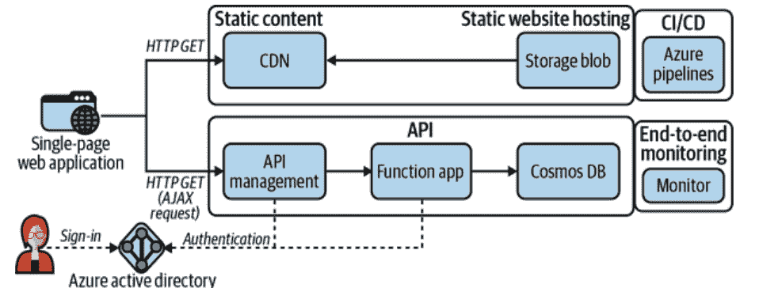

图 11-2. Azure 的无服务器函数参考架构


创建函数应用时，还必须链接一个存储账户。这可用于临时存储。每个应用在创建时都会被分配一个公共的 HTTP(s) 端点，以便函数可以被访问。可以使用私有端点来保护函数应用。

### 创建函数应用

在本节中，我们将使用 Azure 门户创建一个函数应用。

- 我们将开始打开 Azure 门户并在 Function App 下点击 Create。
- 现在我们将填写函数应用的基本参数：
  - 我们将创建一个名为 serverless-test 的新资源组。
  - 我们应用程序的 DNS 名称将是 ourtestfunctionapp.azurewebsites.net。
  - 我们将运行代码（一个函数）而不是容器。
  - 语言将是 Python v3.9。
  - 函数应用将部署在 East US 区域。
- 在 Hosting 选项卡中：
  - 我们将创建一个名为 functionstorageaccount 的新存储账户。由于存储账户名称在全球范围内唯一，您需要选择自己的名称。
  - 因为我们运行的是 Python，所以必须运行 Linux。
  - 最后，为本示例的目的，我们将使用 Consumption 计划。
- 在 Monitoring 选项卡中：
  - 我们将关闭 Application Insights。
  - 然后我们将点击 Review + Create。

现在我们已经创建了函数应用，我们需要创建一个函数。Visual Studio Code 有一个扩展，Azure Functions，它使创建、测试和发布函数变得简单。

- 如果您尚未安装 Visual Studio Code，您可以从 Visual Studio Code 下载页面下载。
- 安装 Visual Studio Code 后，您需要安装 Azure Functions 扩展。
- 点击屏幕左侧活动栏上的 Azure 图标，这将打开 Azure Functions 窗口。点击“Create new project”。
- 将弹出一个对话框，您需要在其中选择一个本地目录来保存您的代码。
- 然后您将被提示在单独的 Visual Studio Code 弹出窗口中输入一些项目信息：
  - 选择函数项目的语言：选择 Python。
  - 选择一个 Python 别名来创建虚拟环境：选择您的 Python 解释器的位置。
  - 如果位置未显示，输入您的 Python 二进制文件的完整路径。
  - 选择项目的第一个函数的模板：选择“HTTP trigger”。
  - 提供函数名称：输入 HttpExample。
  - 选择授权级别：选择 Anonymous，这允许任何人调用您的函数端点。要了解授权级别，请参阅 Authorization keys 文档。

- 选择您希望如何打开项目：选择“Add to workspace”。
- 使用此信息，Visual Studio Code 生成一个带有 HTTP 触发器的 Azure Functions 项目。您可以在 Explorer 中查看本地项目文件。要了解更多关于创建的文件的信息，请参阅 Generated project files 文档。

- 此时，您将拥有一个项目的骨架。向 *HttpExample* 文件添加以下代码，这将返回向函数发出请求的客户端的 IP（类似于 *icanhazip.com*）：

```
import azure.functions as func

def main(req: func.HttpRequest ) -> func.HttpResponse:
    response = False
    if (req.headers.get('X-Forwarded-For')):
        response = req.headers.get('X-Forwarded-For').split(':')[0]
    else:
        response = "127.0.0.1"
    return func.HttpResponse(response)
```

- 通过按键盘上的 F5 然后访问 http://localhost:7071/api/HttpExample 来测试您的函数。
- 要部署到 Azure，您需要在 Azure Functions 窗口中点击“Sign in to Azure…”按钮。
- 点击 Upload 按钮，这将允许您将函数上传到之前创建的应用。

现在我们已经了解了 Azure 原生的产品，让我们讨论使用 Kubernetes 部署的函数应用。

### Knative

Knative 是一个构建在 Kubernetes 之上的无服务器平台，在 Kubernetes 发布时因其热度而成为行业早期热门选择。Knative 的优势之一是函数被打包并作为 Docker 容器执行，这使得将其集成到现有云环境中的工作量最小。

### Knative 架构

Knative 有两种运行模式：

- Knative Serving 使用 Kubernetes 部署无服务器函数或容器，并完全支持自动缩放（包括缩减到零 Pod）。它还额外支持 Gloo 和 Istio 等云网络解决方案。
- Knative Eventing 允许开发人员开发围绕事件驱动架构构建的应用程序。在事件化部署中，您可以指定事件生产者（源）以做出响应。

让我们看看如何在 Kubernetes 上安装 Knative。

### 在 Kubernetes 上安装和运行 Knative Serving

在本节中，我们将运行一个基本的 Knative serving 系统。

- 首先安装自定义资源：
- 然后安装 serving 组件：

```
kubectl apply -f https://github.com/knative/net-kourier/releases/download/v0.26.0/kourier.yaml
```

```
kubectl apply -f https://github.com/knative/serving/releases/download/v0.26.0/serving-core.yaml
```

如果您想使用任何网络集成（Kourier、Ambassador、Contour、Istio），您可以按照网络层说明进行操作。

- 现在您需要创建您的应用程序。我们将使用 Python 的 Flask 库创建一个简单的应用程序：
```
import logging
import os

from flask import Flask

app = Flask(__name__)

@app.route('/', methods=['POST'])
def hello_world():
    return f'Hello world. Data {request.data}\n'

if __name__ == '__main__':
    app.run(debug=True, host='0.0.0.0', port=int(os.environ.get('PORT', 8080)))
```

- 现在您需要一个包含您的无服务器应用程序的 Docker 镜像：
```
FROM python:3.7-slim

RUN pip install Flask gunicorn

WORKDIR /app
COPY . .
```

```
CMD exec gunicorn --bind :$PORT --workers 1 --threads 8 app:app
```

- 使用以下命令构建并推送您的新无服务器镜像：

```
docker push https://myharborinstallation.com/helloworld:v1
```

- 现在在名为 *hello-world.yaml* 的文件中定义您的无服务器服务：

```
apiVersion: serving.knative.dev/v1
kind: Service
metadata:
  name: helloworld
  namespace: default
spec:
  template:
    metadata:
      name: helloworld
    spec:
      containers:
        - image: docker.io/test/helloworld:v1
```

- 使用以下命令部署函数：

```
kubectl apply -f hello-world.yaml
```

- 此时，您的无服务器函数将被部署。您可以通过运行以下命令找到函数的 URL：

```
$ kubectl get ksvc hello-world --output=custom-columns=NAME:.metadata.name,URL:.status.url
```

- 通过调用 URL 测试您的函数：

```
$ curl -X POST <URL found from above> -d "My Data"
Hello World: My Data
```

现在一个基本的 serving 函数正在运行，让我们看看 Knative eventing。

### 在 Kubernetes 上安装和运行 Knative Eventing

在本节中，我们将安装 Knative eventing 组件并编写一个简单的事件系统。

- 首先安装自定义资源：

```
kubectl apply -f https://github.com/knative/eventing/releases/download/v0.26.0/eventing-crds.yaml
```

- 现在安装 serving 组件：

```
kubectl apply -f https://github.com/knative/eventing/releases/download/v0.26.0/eventing-core.yaml
```

此时，您将拥有 eventing 组件已安装。我们将重用前面部分中的 Docker 镜像。然而，我们将配置 Knative，以便我们可以向 Knative 内的消息总线发送 HTTP 消息，而不是发布到 HTTP 应用程序服务器。当消息到达消息总线时，它将触发我们的 Python 应用程序服务器。在更复杂的示例中，您可以将 Kafka 主题设置为事件源。

- 创建一个 *knative-eventing.yaml* 文件：


### 启用事件处理的示例应用命名空间
apiVersion: v1
kind: Namespace
metadata:
    name: knative-samples
    labels:
        eventing.knative.dev/injection: enabled
---
### 默认 Broker
apiVersion: eventing.knative.dev/v1
kind: Broker
metadata:
    name: default
    namespace: knative-samples
    annotations:
        # Note: you can set the
eventing.knative.dev/broker.class annotation to change
the class of the broker.
        # The default broker class is MTChannelBasedBroker,
but Knative also supports use of the other class.
        eventing.knative.dev/broker.class:
MTChannelBasedBroker
spec: {}
---
### hello-world 应用部署
apiVersion: apps/v1
kind: Deployment
metadata:
    name: hello-world
    namespace: knative-samples
spec:
    replicas: 1
    selector:
        matchLabels: &labels
app: hello-world
template:
  metadata:
    labels: *labels
  spec:
    containers:
      - name: hello-world
        image:
https://myharborinstallation.com/helloworld:v1
        imagePullPolicy: IfNotPresent
---
### 暴露 helloworld-python 应用的服务。
### 这将是 Trigger 的订阅者
apiVersion: v1
kind: Service
metadata:
  name: hello-world
  namespace: knative-samples
spec:
  selector:
    app: hello-world
  ports:
    - protocol: TCP
      port: 80
      targetPort: 8080
---
### Knative Eventing Trigger 用于触发 helloworld-python 服务
apiVersion: eventing.knative.dev/v1
kind: Trigger
metadata:
  name: hello-world
  namespace: knative-samples
spec:
broker: default
filter:
  attributes:
    type: dev.knative.samples.hello-world
    source: dev.knative.samples/helloworldsource
subscriber:
  ref:
    apiVersion: v1
    kind: Service
    name: hello-world

- 在 Kubernetes 上应用 *knative-eventing.yaml* 配置：

```
$ kubectl apply -f knative-eventing.yaml
```

这将创建一个名为 `knative-samples` 的新 Kubernetes 命名空间以允许事件处理，并创建一个消息 Broker 来将消息传递给我们的 Python 应用服务器（在事件发生时）。

- 我们现在将向我们的 Knative 消息 Broker 发送一个事件。以下是响应：

```
curl -v "broker-ingress.knative-eventing.svc.cluster.local/knative-samples/default" \
-X POST \
-d 'My data'
```

```
Event received. Context: Context Attributes,
  specversion: 0.3
  type: dev.knative.samples.hello-world
  source: dev.knative.samples/helloworldsource
  id: 536808d3-88be-4077-9d7a-6a3f162705f79
  time: 2021-11-09T06:21:26.09471798Z
  datacontenttype: application/json
```

```
Extensions,
    Knativearrivaltime: 2021-11-09T06:21:26Z
    knativehistory: default-kn2-trigger-kn-channel.knative-samples.svc.cluster.local
    traceparent: 00-971d4644229653483d38c46e92a959c7-92c66312e4bb39be-00
```

```
Hello World Message "My data"
Responded with event Validation: valid
Context Attributes,
    specversion: 0.2
    type: dev.knative.samples.hifromknative
    source: knative/eventing/samples/hello-world
    id: 37458d77-01f5-411e-a243-a459bbf79682
Data,
    My data
```

### KEDA

KEDA 代表 *Kubernetes Event-Driven Autoscaling*。KEDA 允许你根据传入事件的数量来扩展 Kubernetes 中的任何容器。KEDA 是 Kubernetes 的一个插件，并利用 Horizontal Pod Autoscaler 根据多种事件源进行扩展，包括 Apache Kafka、Azure Event Hubs 和 NATS streaming。

### KEDA 架构

典型的 KEDA 架构如图 11-3 所示，其中 KEDA 直接与 Kubernetes API 服务器、HPA 和配置的触发源交互。

KEDA 组件执行以下角色：

*Controller and scaler*

控制器和缩放器会根据指标适配器的信号向上或向下扩展 Pod 的数量。

### 指标适配器

指标适配器充当 Kubernetes 指标服务器，为代理提供队列长度或流滞后信息。缩放器使用此信息来扩展容器。

你可以在 Scalers 文档中查看所有 KEDA 缩放器。

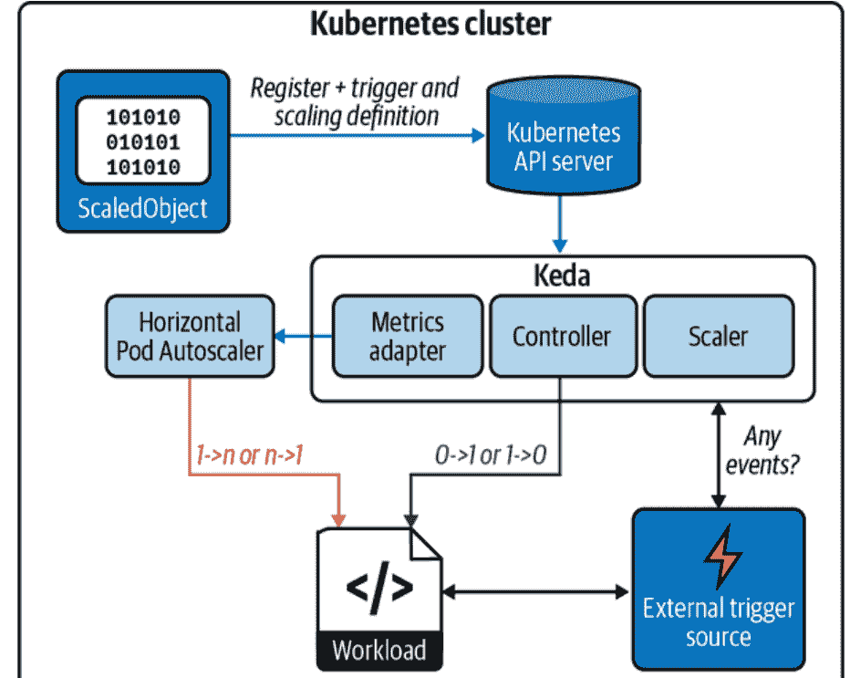

图 11-3. KEDA 参考架构

### 在 Kubernetes 上安装 KEDA

KEDA 最好使用 Helm 操作符在 Kubernetes 上安装。我们现在将逐步进行。

- 添加 KEDA Helm 仓库：
  
  $ helm repo add kedacore
  https://kedacore.github.io/charts
  
- 安装 Helm chart：
  
  $ kubectl create namespace keda
  $ helm install keda kedacore/keda --namespace keda

之后，你的 Kubernetes 集群将准备好进行函数部署。

在下一个示例中，我们将使用 Azure Service Bus 队列构建一个概念验证事件系统。我们将使用 Python 脚本向 Azure Service Bus 队列生成消息，然后使用 KEDA 来扩展 Python 消费作业。

- 使用 Azure 文档中描述的手动方法或通过运行以下命令获取你的 Service Bus 连接字符串：
  
  az servicebus namespace authorization-rule keys list \
    -n RootManageSharedAccessKey -g <group> --namespace-name <namespace> \
    --query primaryConnectionString -o tsv
  
- 你需要通过运行以下命令获取连接字符串和队列名称的 Base64 编码值：
  
  $ echo -n "<connection string>" | base64
  $ echo -n "<queue name>" | base64

- 现在创建一个名为 *secret.yaml* 的文件。用上一 步生成的 Base64 字符串替换 `servicebus-queue` 和 `servicebus-connectionstring` 值。

```
apiVersion: v1
kind: Secret
metadata:
  name: sample-job-secret
  namespace: default
data:
  servicebus-queue:
    <base64_encoded_servicebus_queue_name>
  servicebus-connectionstring:
    <base64_encoded_servicebus_connection_string>
```

- 创建第二个文件，名为 *keda.yaml*，它将创建你的扩展作业。触发时它将运行一个 docker 镜像（`docker.pkg.github.com/prabdeb/sample-python-keda-service-bus-scaler/consumer:latest`）：

```
apiVersion: keda.sh/v1alpha1
kind: TriggerAuthentication
metadata:
  name: auth-service-bus-sample-job
spec:
  secretTargetRef:
    - parameter: connection
      name: sample-job-secret
      key: servicebus-connectionstring
---
apiVersion: keda.sh/v1alpha1
kind: ScaledJob
metadata:
name: servicebus-queue-so-sample-job
namespace: default
spec:
  jobTargetRef:
    parallelism: 1 # max number of desired pods
    completions: 1 # desired number of successfully
finished pods
    activeDeadlineSeconds: 600 # Specifies the duration
in seconds relative to the startTime that the job may be
active before the system tries to terminate it; value
must be positive integer
    backoffLimit: 6 # Specifies the number of retries
before marking this job failed. Defaults to 6
    template:
      metadata:
        labels:
          app: sample-keda-job
      spec:
        containers:
        - name: sample-keda-job
          image: docker.pkg.github.com/prabdeb/sample-python-keda-service-bus-scaler/consumer:latest
          env:
          - name: SERVICE_BUS_CONNECTION_STR
            valueFrom:
              secretKeyRef:
                name: sample-job-secret
                key: servicebus-connectionstring
          - name: SERVICE_BUS_QUEUE_NAME
            valueFrom:
              secretKeyRef:
                name: sample-job-secret
                key: servicebus-queue
        restartPolicy: Never
pollingInterval: 30                                      # Optional.
Default: 30 seconds
    successfulJobsHistoryLimit: 100                      # Optional.
Default: 100. How many completed jobs should be kept.
    failedJobsHistoryLimit: 100                         # Optional.
Default: 100. How many failed jobs should be kept.
    #envSourceContainerName: {container-name}    # Optional.
Default: .spec.JobTargetRef.template.spec.containers[0]
    maxReplicaCount: 100                                # Optional.
Default: 100
    scalingStrategy:
        strategy: "custom"                             # Optional.
Default: default. Which Scaling Strategy to use.
        customScalingQueueLengthDeduction: 1            # Optional.
A parameter to optimize custom ScalingStrategy.
        customScalingRunningJobPercentage: "0.5"  # Optional.
A parameter to optimize custom ScalingStrategy.
    triggers:
    - type: azure-servicebus
        metadata:
            # Required: queueName OR topicName and
subscriptionName
            queueName: <servicebus_queue_name>
            # Required: Define what Azure Service Bus to
authenticate to with Managed Identity
            namespace: <servicebus_namespace>
            messageCount: "10" # default 5
        authenticationRef:
            name: auth-service-bus-sample-job #
authenticationRef would need either podIdentity or define
a connection parameter
```

- 现在你可以使用以下命令将两个文件应用到 Kubernetes：


```
$ kubectl apply -f keda-config/jobs/secret.yaml
$ kubectl apply -f keda-config/jobs/keda.yaml
```

+   - 通过运行以下命令验证你的扩缩作业是否就绪：

```
$ kubectl get ScaledJob
$ kubectl get TriggerAuthentication
```

+   - 你可以通过运行测试脚本来测试你的 KEDA 部署。首先你需要设置 Python 环境：

```
$ python3 -m venv .
$ source bin/activate
$ pip3 install logger
$ pip3 install azure-servicebus
```

+   - 现在你需要创建你的程序来向 Azure Service Bus 队列发送消息。你需要修改 connection_string 和 queue_name：

```
import os
import sys
import time
import yaml
from logger import logger
from azure.servicebus import ServiceBusClient,
ServiceBusMessage
```

```
def send_a_list_of_messages(sender):
    messages = [ServiceBusMessage(f"Message in list {i}")
    for i in range(1000)]
    sender.send_messages(messages)
    logger.info("Sent a list of 1000 messages")
```

```
def main():
    with open("azure-service-bus.yaml", 'r') as stream:
        config = yaml.safe_load(stream)

    logger.info("Start sending messages")
    connection_string = <FIXME>
    queue_name = <FIXME>

    queue =
ServiceBusClient.from_connection_string(conn_str=connecti
on_string, queue_name=queue_name)

    with queue:
        sender =
queue.get_queue_sender(queue_name=queue_name)
        with sender:
            send_a_list_of_messages(sender)

    logger.info("Done sending messages")
    logger.info("------------------------")

if __name__ == "__main__":
    main()
```

+   - 运行 *python3 send_message_queue.py*。这将创建 1,000 条消息并发送到 Azure Service Bus 队列。

你可以在 Azure Service Bus 队列中看到消息被摄取然后处理（图 11-4）。


图 11-4. Azure Service Bus 队列

在下一节中，我们将介绍 OpenFaaS，它在独立系统和 Kubernetes 集群上都提供简单、无[content]

```
$ kubectl apply -f keda-config/jobs/secret.yaml
$ kubectl apply -f keda-config/jobs/keda.yaml
```

+   - 通过运行以下命令验证你的扩缩作业是否就绪：

```
$ kubectl get ScaledJob
$ kubectl get TriggerAuthentication
```

+   - 你可以通过运行测试脚本来测试你的 KEDA 部署。首先你需要设置 Python 环境：

```
$ python3 -m venv .
$ source bin/activate
$ pip3 install logger
$ pip3 install azure-servicebus
```

+   - 现在你需要创建你的程序来向 Azure Service Bus 队列发送消息。你需要修改 connection_string 和 queue_name：

```
import os
import sys
import time
import yaml
from logger import logger
from azure.servicebus import ServiceBusClient,
ServiceBusMessage
```

```
def send_a_list_of_messages(sender):
    messages = [ServiceBusMessage(f"Message in list {i}")
    for i in range(1000)]
    sender.send_messages(messages)
    logger.info("Sent a list of 1000 messages")
```

```
def main():
    with open("azure-service-bus.yaml", 'r') as stream:
        config = yaml.safe_load(stream)

    logger.info("Start sending messages")
    connection_string = <FIXME>
    queue_name = <FIXME>

    queue =
ServiceBusClient.from_connection_string(conn_str=connecti
on_string, queue_name=queue_name)

    with queue:
        sender =
queue.get_queue_sender(queue_name=queue_name)
        with sender:
            send_a_list_of_messages(sender)

    logger.info("Done sending messages")
    logger.info("------------------------")

if __name__ == "__main__":
    main()
```

+   - 运行 *python3 send_message_queue.py*。这将创建 1,000 条消息并发送到 Azure Service Bus 队列。

你可以在 Azure Service Bus 队列中看到消息被摄取然后处理（图 11-4）。


图 11-4. Azure Service Bus 队列

在下一节中，我们将介绍 OpenFaaS，它在独立系统和 Kubernetes 集群上都提供简单、无附加功能的函数。

### OpenFaaS

OpenFaaS 是 Kubernetes 的另一个事件驱动函数服务，允许你使用任何语言编写函数，然后将它们打包到 Docker 或 OCI 兼容的容器中。

#### OpenFaaS 架构

OpenFaaS 参考架构（如图 11-5 所示）与 KEDA 相当相似。然而，OpenFaaS 确实依赖于 Prometheus 的指标作为自动扩缩信号。

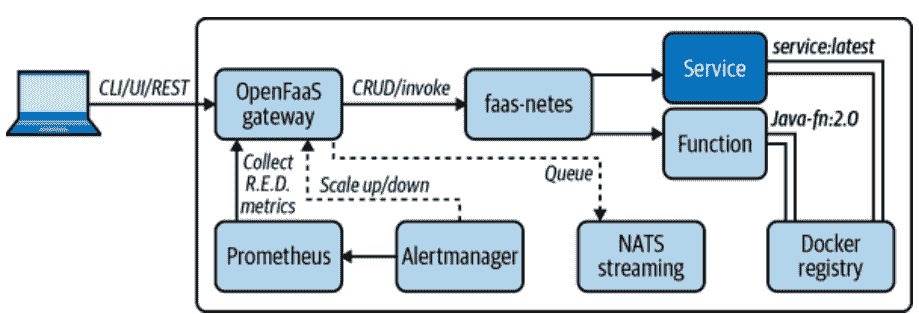

图 11-5. OpenFaaS 参考架构

### 安装 OpenFaaS

OpenFaaS 有三种推荐的安装方法：

- 使用 `arkade`
- 使用 `helm`
- 使用 Flux 或 ArgoCD 安装

为了与本书其余部分保持一致，我们将使用 Helm 部署 OpenFaaS。

- 创建命名空间（一个用于 OpenFaaS 核心服务，一个用于函数）：

```
kubectl apply -f
https://raw.githubusercontent.com/openfaas/faas-netes/master/namespaces.yml
```

- 添加 OpenFaaS Helm 图表：

```
helm repo add openfaas https://openfaas.github.io/faas-netes/
```

- 最后，部署 OpenFaaS：

```
helm repo update \
  && helm upgrade openfaas --install openfaas/openfaas \
    --namespace openfaas \
    --set functionNamespace=openfaas-fn \
    --set generateBasicAuth=true
```

- 你可以通过运行以下命令检索管理员密码；该密码将用于访问 OpenFaaS 仪表板：

```
PASSWORD=$(kubectl -n openfaas get secret basic-auth -o jsonpath="{.data.basic-auth-password}" | base64 --decode)
&& \
echo "OpenFaaS admin password: $PASSWORD"
```

现在我们已经安装了 OpenFaaS，我们将编写一个 OpenFaaS 函数。

### 编写你的第一个 OpenFaaS 函数

在本节中，我们将利用 faas-cli 快速创建和部署一个无服务器函数。

- 通过在 OSX 上运行 `brew install faas-cli`，或在 Linux 上运行 `curl -sSL https://cli.openfaas.com | sudo sh` 来下载 faas-cli。
- 创建一个文件夹来放置你的新函数：
- 使用 faas-cli 创建一个新的 Python 函数项目：

```
mkdir -p ~/functions && cd ~/functions
```

```
faas-cli new --lang python helloworld
```

这将创建三个新文件：

```
$ ls
helloworld/handler.py
helloworld/requirements.txt
helloworld.yml
```

handler.py 文件是你编写函数的地方。requirements.txt 文件与标准的 Python *requirements.txt 文件*相同。*helloworld.yml* 文件定义了函数的一些样板。

- 在 *handler.py* 文件中，我们将定义我们的函数。此函数将打印 "Hello World! You said: " 加上发布到函数端点的数据：
  
  ```
  def handle(req):
      print("Hello World! You said: " + req)
  ```

- 最后，在你的 *helloworld.yml* 文件中，你将定义函数的相关元数据。http://127.0.0.1:31112 是 OpenFaaS 网关/API 服务器的默认地址：
  
  ```
  provider:
    name: openfaas
    gateway: http://127.0.0.1:31112
  
  functions:
    hello-python:
      lang: python
      handler: ./hello-world
      image: hello-world
  ```

- 构建无服务器镜像并推送到你在第 2 章中创建的 Harbor 仓库：
  
  ```
  $ faas-cli build -f ./hello-world.yml
  $ faas-cli push -f ./hello-world.yml
  ```

- 部署到 Kubernetes 集群：
  
  ```
  $ faas-cli deploy -f ./hello-world.yml
  Deploying: hello-python.
  No existing service to remove
  ```

```
Deployed.
200 OK
URL: http://127.0.0.1:31112/function/hello-python
```

- 上一步输出了你可以测试的 URL。使用 `curl` 来测试它：

```
$ curl -X POST 127.0.0.1:31112/function/hello-world -d
"My name is Michael"
Hello world! My name is Michael
```

默认情况下，OpenFaaS 使用每秒请求数（rps）作为执行自动扩缩的机制。你可以在 Autoscaling 文档页面上找到有关 OpenFaaS 自动扩缩配置的更多信息。

此时，你将在 Kubernetes 上拥有一个运行中的 OpenFaaS 函数。你也可以使用 faasd 在 Kubernetes 外部运行 OpenFaaS。有关更多信息，请参阅 OpenFaaS 部署页面。

最后，OpenFaaS 建立在 Kubernetes HPA 之上。你可以从 OpenFaaS Kubernetes 教程页面了解有关如何负载测试和自动扩缩你的 OpenFaaS 函数的更多信息。

### 总结

虽然无服务器绝对不是适合所有人的方案，但在正确的情况下使用可以提供显著的优势。无服务器空间仍在不断发展，但入门门槛极低，这使其成为令人兴奋的技术。在本章中，我们探讨了四种在 Azure 上运行无服务器函数的方式。首先我们介绍了 Azure 函数应用，然后介绍了三个领先的 CNCF 项目：Knative、KEDA 和 OpenFaaS。此时，我们已经概述了云原生基础设施的主要支柱。在第 12 章中，我们将回顾你在整个旅程中学到的内容。

## 第 12 章. 结论

### 早期发布读者的注意事项

使用 Early Release 电子书，你可以在这些标题的正式发布之前很久就利用这些技术——作者在撰写时提供的原始和未编辑内容，以便你可以在这些技术正式发布之前利用它们。

这将是最终书籍的第 12 章。请注意，GitHub 仓库将在稍后激活。

如果你对如何改进本书的内容和/或示例有任何意见，或者如果你注意到本章中缺少材料，请联系编辑 rfernando@oreilly.com。

我们已经到了本书的结尾，让我们回顾一下我们的旅程。在本书中，我们的目标是提供一个单一资源，你可以用它在 Azure 中构建和运行云原生基础设施。虽然 Azure 是我们的重点，但你也可以将相同的知识应用于在不同云厂商平台上构建和运营你自己的云原生环境。让我们回顾一下你迄今为止学到的内容。

我们首先回顾了基础设施和服务世界随着云的引入而随时间演变的过程。为了充分利用云所提供的优势，我们需要开发原生于云的解决方案，而不是事后将其改编为云。我们理解云原生是充分利用云强大功能的方式。

在第 2 章中，我们介绍了使用 Azure 构建现代云原生环境的基石。我们设置了 Azure 账户并开始使用 Ansible、Terraform 和 Packer。通过将它们作为我们的关键工具，我们可以以自动化方式启用生产就绪的服务。我们


我们选择 Microsoft Azure 作为云服务提供商，并且在整本书中我们同时使用了云原生和 Azure 服务来展示现代基础设施是如何构建和支持的。

在第 3 章中，我们向您介绍了容器和容器运行时，它们构成了现代云原生世界的基础。我们讨论了构成容器生态系统的抽象层。

我们在第 4 章和第 5 章中转向了强大的编排器 Kubernetes，并展示了这个重要工具如何在现代云基础设施中用于促进云原生应用程序的平台。Kubernetes 推动了 Cloud Native Computing Foundation（CNCF）的创立以及其适应，并是其下毕业的第一个项目。这导致了容器化世界的极大简化以及云原生生态系统的更高采用。我们深入研究了使该系统能够大规模运行的各种组件和概念，并学习了如何手动创建 Kubernetes 集群以及使用 Azure AKS 作为托管服务创建。

此时，我们已经涵盖了最小云原生基础设施的基础是什么。下一步是添加一种获取应用程序和基础设施洞察的方法。因此，在第 6 章中，我们介绍了可观测性的三大支柱的概念，以便您深入了解这个庞大的基础设施和应用程序堆栈。通过构建可观测的系统，您可以更好地控制跨边界交互的复杂分布式系统。在本章中，我们也尝试了可观测性及其在云原生环境中日益增长的需求。凭借可观测性的三大支柱以及在 Azure 上对现代分布式系统进行日志记录、监控和追踪的首选方式的介绍，我们以简要介绍 Azure 如何提供其内置解决方案 Azure Monitor 来执行类似任务作为本章的结尾。

当我们谈论边界和边境时，我们面临着在这种动态变化的环境中服务到服务通信的问题。因此，为了解决这个问题，我们在第 7 章中引入了服务发现和服务网格，以便找到服务并有效地与之通信。我们还仔细展示了服务网格和代理在高效控制微服务所在整体环境方面的需求。我们介绍了 CoreDNS 作为 Kubernetes 环境中默认的 DNS，取代了 kube-dns。我们还使用 Istio 介绍了服务网格，Istio 使用 Envoy 作为其数据平面来获取有关服务的有用洞察，并提供 Istio 服务网格的完整功能集。在本章的最后，我们展示了 Kiali，它为基于 Istio 的服务网格提供了一个完整的管理控制台。

在第 8 章中，我们转向了云原生环境中网络和策略管理的问题。我们向您介绍了三个主要工具：Calico、Weave 和 Flannel，它们充当容器网络接口。我们还阐明了您如何使用开放策略管理在整个堆栈中强制执行策略。我们回顾了 CNI 标准以及它如何成为 Flannel 和 Cilium 等平台的基础。我们研究了这些系统如何用于为您的云基础设施提供连接和网络安全。我们还通过 Azure Policy 查看了管理云基础设施的非网络策略机制，以及通过 Open Policy Agent 对应用程序的策略。

在第 9 章中，我们使用 Vitess 作为分布式数据库，探讨了存储在云原生环境中的感知和设计。我们还谈到了 Rook，它是一个广泛的存储编排器，可以通过诸如自扩展和自愈等功能帮助您减轻管理分布式存储系统的负担。在本章中，我们回顾了为什么在 Azure 云中使用云原生数据系统是有利的。我们涵盖了四种系统：Vitess（关系型）、Rook（blob）、TiKV（键值）和 etcd（键值配置/服务发现）。这些系统是云原生架构存储和提供在线数据的基石，并且相比使用 PaaS 组件具有很大的优势。

在第 10 章中，我们谈到了如何在云原生环境中使用传统技术如 NATS、gRPC、Apache Kafka 和 RabbitMQ 来构建和部署消息传递和流服务。

最后，在第 11 章中，我们探讨了在 Azure 上运行无服务器函数四种不同方式。首先我们查看了 Azure Function Apps，然后我们查看了三个领先的 CNCF 项目：Knative、KEDA 和 OpenFaaS。

我们希望您能够很好地理解如何构建和使用云原生基础设施。现在您拥有了在 Azure 上构建和运营自己的云原生基础设施的知识。

### 下一步？

CNCF 景观相当庞大，它包含大量由许多优秀公司持续构建和支持的项目（图 12-1）。这些项目从一开始就考虑了规模和可靠性而构建。


图 12-1. CNCF 景观

我们强烈鼓励您探索 CNCF 景观中的其他技术，以根据您的用例构建您的云原生环境，并且我们也鼓励您探索 CNCF 无服务器景观（图 12-2）。

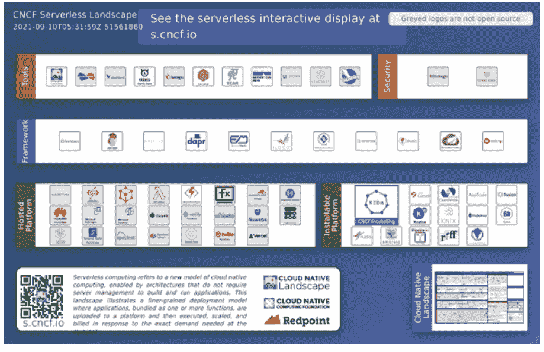

图 12-2. CNCF 无服务器景观

CNCF 无服务器景观突出了无服务器计算以及相关的编程模型和消息格式。虽然无服务器计算已经广泛可用，但在这种方法的开发中仍有大量的范围和深度。您可以探索无服务器计算，如果您的工作负载是异步的、间歇性的、无状态的，并且在不断变化的业务需求方面高度动态。您也可以开始使用各种 Azure 服务，并查看它们如何与 CNCF 技术进行比较。

大多数这些项目都是开源的，是许多工程师为社区做出积极贡献的成果。开源也为这些项目的整体设计带来了大量的质量控制。这意味着云原生技术在全球范围内都得到很好的支持，并且易于适应。同样重要的是要指出，许多这些云原生技术都是为了解决需要高效解决的困难问题而产生的。因此，有时冒险提出难题同样重要，以便深入了解您的系统，这最终会引导您找到复杂问题的正确解决方案。

云原生景观仍在不断增长，我们鼓励您进一步探索其真正的潜力。祝您好运。

### 关于作者

**Nishant Singh** 是 LinkedIn 的站点可靠性工程师，在那里他致力于提高网站的可靠性，重点是减少事件的 MTTD 和 MTTR。在加入 LinkedIn 之前，他曾在 PayTM 和 Gemalto 等公司担任 DevOps 工程师，花时间为客户构建定制解决方案并在公共云上管理、维护服务。

**Michael Kehoe** 是 LinkedIn 的高级员工站点可靠性工程师。在之前从事事件响应、灾难恢复、可视化工程和可靠性原则的工作后，他现在领导着一项迁移到云的努力。他目前是 LinkedIn 迁移到 Microsoft Azure 的负责人。Michael 专注于维护大型系统基础设施，这在他在 LinkedIn（应用程序、自动化和基础设施）以及昆士兰大学（网络）的工作中得到了体现。他还在 NASA 建造小型卫星并在 Rio Tinto 编写热环境软件方面花费了时间。

