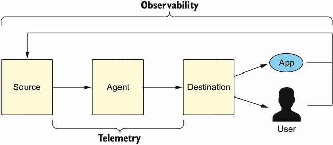

# 云可观测性实战

## 内页封面

## 献辞

*献给我的家人*：*我的妻子 Anneliese；我们的孩子 Iannis、Ranya、Saphira；以及狗 Snoopy 和猫 Charles*

# 前言部分

## 前言

我们正生活在令人激动的时代！云原生技术的兴起——从十年前 Docker 和 Kubernetes 开始——以及能够让你基于微服务架构运行大规模应用的云服务，使得我们编写和运维软件的方式发生了改变。

我很幸运也很荣幸参与了这段旅程，从 2015 年开始在容器领域工作，随后一直到 2021 年在 Kubernetes 领域工作。云原生中有一个方面给我留下了深刻印象：鉴于容器和函数即服务的动态性，如果你对系统内部情况缺乏洞察，无法就状态和趋势提出临时性问题，你就相当于蒙着眼睛开车。当我在 AWS 换团队专注于可观测性时，OpenTelemetry 刚刚成立，该领域正在快速发展。现在，在出版之时，可以公平地说，可观测性已经成为主流。

回顾起来，我才意识到一件事：除了围绕 Cloud Native Computing Foundation（CNCF）项目生态系统的开源性质之外，吸引我进入可观测性领域的原因是，可观测性本质上是数据工程的一个应用领域。它是关于基于管道生成、收集、存储和查询数据。为什么我要指出这一点？在进入容器世界之前，我在数据工程领域花费了十多年时间，首先是在应用研究中，然后是在一家初创公司，在“大数据”时代，我得以应用所学经验。

当有机会分享我在过去 20 年里在数据工程和云原生领域学到的知识，并以提供可观测性实践指南为背景时，我认为这正是合适的时机和地点。基本思路是涵盖整个可观测性领域，从数据生成的位置，到如何收集和处理，再到如何被人类和软件消费——所有这些的目标都是理解可观测性的基本原理和方法，使用开源软件进行演示，以便任何对该主题感兴趣的人都可以自己尝试，而无需担心成本。

我希望这本书能在你将可观测性引入组织的旅程中作为参考和指南。如果它能帮助你创建解决方案，使你的团队能够从云原生服务中受益，而不会盲目飞行，那么它就完成了使命。

## 致谢

写一本书是一项长期承诺，通常需要一年或更长时间。虽然这不是我的第一本书，我能够应用过去经验中学到的教训，但毋庸置疑，结果并非我独自完成，因为有许多人帮助塑造和改进了这本书。

首先，我要感谢我的家人，他们在整个过程中一直支持和激励着我！接下来，我要对 Manning 的编辑 Ian Hough 表示衷心感谢，感谢你所有的指导（和耐心）。虽然我大部分时间都与 Ian 一起工作，但 Manning 还有几位同事帮助让这本书成为现实，我对你们所做的一切心怀感激：Malena Selic、Marina Matesic、Ivan Martinović、Rebecca Rinehart、Stjepan Jurekovic、Ana Romac、Susan Honeywell、Mike Stephens 和 Marjan Bace。我还要感谢我的项目编辑 Deirdre Blanchfield-Hiam；我的文字编辑 Christian Berk；我的校对 Katie Tennant；以及我的技术校对 Ernest Gabriel Bossi Carranza。

我的出色技术编辑 Jamie Riedesel 值得大大的表扬！Jamie 是 Dropbox 的员工工程师，拥有超过二十年的 IT 经验。她对本书产生了重大影响和塑造，提供了解释事物的指导、对技术方面的反馈，以及更努力尝试的动力。谢谢。但我也想感谢许多为各章节提供反馈、分享宝贵见解的人：Frederic Branczyk、Matthias Loibl、Kit Merker；以及 Manning 的审阅者 Adrian Buturuga、Alessandro Campeis、Bhavin Thaker、Bobby Lin、Borko Djurkovic、Chris Haggstrom、Clifford Thurber、Doyle Turner、Ernesto Bossi、Fernando Bernardino、Filipe Teixeira、Ganesh Swaminathan、Ian Bartholomew、Ioannis Atsonios、Jakub Warczarek、Jan Krueger、Jorge Ezequiel Bo、Juan Luis、Ken Finnigan、Kent Spiller、Kosmas Chatzimichalis、Maciej Drozdzowski、Madhav Ayyagari、Michael Bright、Michele Di Pede、Miguel Montalvo、Onofrei George、Pablo Chacin、Rahul Modpur、Rui Liu、Sander Zegveld、Sanjeev Jaiswal、Satadru Roy、Sebastian Czech、Stefan Turalski、Stephen Muss、Vivek Dhami 和 Wesley Rolnick。

最后，感谢我在 AWS 的优秀同事们的支持和反馈，以及我参与过的开源社区，尤其是在 CNCF 的背景下。这是一种荣幸，也是一种乐趣。

## 关于本书

可观测性是指基于受观察的（云原生）系统发出的信号，持续生成和发现可操作的洞察的能力，目标是影响该系统。我们从投资回报的角度来探讨这一主题：我们会从源到遥测（包括代理）再到信号目的地（后端）的成本和收益进行考察，包括时间序列数据存储，如 Prometheus，以及前端，如 Grafana。

在整本书中，我使用开源工具，包括但不限于 OpenTelemetry（采集器）、Prometheus、Loki、Jaeger 和 Grafana 来演示不同的概念，并让你能够在没有任何成本的情况下进行实验，除了你的时间之外。

### 本书适合哪些读者

本书主要面向从事云原生应用的开发人员、DevOps/站点可靠性工程师（SRE）。它适用于任何对运行云原生应用感兴趣的人，无论是在 Kubernetes 中还是使用函数即服务，例如 AWS Lambda。

此外，我认为如果你是发布经理、IT 架构师、安全和网络工程师、技术负责人，或云原生领域中的产品经理，你也能从本书中受益。本书可与任何公共云一起使用（我出于熟悉的原因在多个演示中使用 AWS），也可与任何本地云原生设置一起使用（例如，数据中心中的 Kubernetes）。

### 本书的组织方式

本书共有 11 章和一个附录，内容如下：

* 第 1 章为你提供了一个端到端的示例，并定义了从源到代理再到目的地的术语。它还讨论了可观测性背景下的用例、角色和挑战。
* 第 2 章讨论了不同的遥测信号类型（日志、指标和追踪），何时使用哪种信号、如何收集信号，以及相关的成本和收益。
* 第 3 章涵盖信号源，即遥测生成的地点。我们讨论了存在的源类型以及何时选择哪种源，如何通过为任务选择正确的源来获得可操作的洞察，以及如何处理你拥有的代码的 instrumentation，包括供应链方面。
* 第 4 章讨论了从日志路由器到 OpenTelemetry 的不同遥测代理。你将学习如何选择和使用代理，重点介绍 OpenTelemetry 为统一遥测管理带来的优势。
* 第 5 章专注于遥测信号的后端目的地，作为事实来源。你将学习如何使用和选择日志、指标和追踪的后端，并深入探讨时间序列数据库，如 Prometheus，以及列式数据存储，如 ClickHouse。
* 第 6 章讨论可观测性前端作为消费遥测信号的场所。你将了解纯前端和一体式产品，以及如何选择它们。
* 第 7 章涵盖云原生解决方案的一个方面，称为 *云操作*，包括如何检测事物未按预期工作时；对异常行为做出反应；以及从过去的错误中吸取教训。你还将了解警报、使用情况和成本跟踪。
* 第 8 章深入探讨分布式追踪以及它如何帮助你理解和排查微服务。
* 第 9 章深入探讨面向开发者的可观测性，涵盖持续剖析和开发者生产力工具。
* 第 10 章讨论服务等级目标，展示如何使用它们来回答服务消费者满意度的问题。
* 第 11 章深入探讨信号关联，解决单一遥测信号类型通常无法回答所有可观测性问题的挑战，以及你可以采取的措施。
* 附录带你完成一个完整的端到端示例，使用 OpenTelemetry、Prometheus、Jaeger 和 Grafana。

第 2 章至第 6 章提供了概念基础，因此如果你完全是可观测性领域的新手，我建议你先学习这些章节。第 7 章至第 11 章专注于可观测性的某些运营或开发相关方面，涵盖最佳实践，如果你愿意，可以按任意顺序阅读。

### 关于代码

本书包含许多源代码示例，既有编号的列表，也有与普通文本行内出现的情况。在这两种情况下，源代码均以 `fixed-width` `font like` `this` 格式显示，以将其与普通文本区分开来。

在许多情况下，原始源代码已被重新格式化；我们添加了换行符并重新调整了缩进以适应书中可用的页面空间。在极少数情况下，即使这样也不够，列表中包含行延续标记（➥）。此外，当代码在正文中被描述时，源代码中的注释通常已从列表中删除。代码注释伴随许多列表，突出重要概念。

你可以在本书的 liveBook（在线）版本中获取可执行的代码片段，网址为 [`livebook.manning.com/book/cloud-observability-in-action`](https://livebook.manning.com/book/cloud-observability-in-action)。本书示例的完整代码可从 Manning 网站 [`www.manning.com/books/cloud-observability-in-action`](https://www.manning.com/books/cloud-observability-in-action) 下载，也可在 GitHub 上获取，地址为 [`github.com/mhausenblas/o11y-in-action.cloud/tree/main/code`](https://github.com/mhausenblas/o11y-in-action.cloud/tree/main/code)。

### liveBook 讨论论坛

购买 *Cloud Observability in Action* 可免费访问 liveBook，Manning 的在线阅读平台。利用 liveBook 独有的讨论功能，你可以将评论附加到整本书或特定章节或段落。轻松为自己做笔记、提问和回答技术问题，并获得作者和其他用户的帮助。要访问论坛，请前往 [`livebook.manning.com/book/cloud-observability-in-action/discussion`](https://livebook.manning.com/book/cloud-observability-in-action/discussion)。你也可以在 [`livebook.manning.com/discussion`](https://livebook.manning.com/discussion) 了解更多关于 Manning 论坛和行为准则的信息。

Manning 对读者的承诺是提供一个场所，让个人读者之间以及读者与作者之间能够进行有意义的对话。这并不是对作者参与程度的任何具体承诺，作者对论坛的贡献仍然是自愿的（且无偿）。我们建议你尝试向他提出一些具有挑战性的问题，以免他的兴趣转移！只要本书仍在印刷发行，论坛以及以往讨论的存档都将可通过出版商网站访问。

## Online Resources

如果你想深入了解某些主题，请查看以下在线资源：

* 本书的延伸阅读部分（[`o11y-in-action.cloud/further-reading/`](https://o11y-in-action.cloud/further-reading/)），其中列出了文章、书籍和工具
* “Return on Investment Driven Observability” ([`arxiv.org/abs/2303.13402`](https://arxiv.org/abs/2303.13402))，我发表的一篇短文，讨论了在组织中推广可观测性时出现的问题，以及如何基于投资回报率（ROI）分析来解决这些问题
* OpenTelemetry 博客（[`opentelemetry.io/blog/`](https://opentelemetry.io/blog/)）

## About the author

**Michael Hausenblas** 在 Amazon Web Services（AWS）开源可观测性服务团队工作，负责领导 OpenTelemetry 相关工作。他在数据工程和云原生系统方面拥有超过 20 年的经验。在加入 AWS 之前，Michael 在 Red Hat 负责 Kubernetes，在 Mesosphere（现为 D2iQ）负责 Mesos 和 Kubernetes，在 MapR（现为 HPE 旗下）担任首席数据工程师，并在符号人工智能领域从事了十多年的应用研究。

## About the cover illustration

*Cloud Observability in Action* 封面上的图案是 “Cauchoise”，或称 “Caux 的女人”，取自 Jacques Grasset de Saint-Sauveur 于 1797 年出版的系列作品。每幅插图都是手工精细绘制并上色。

在那个时代，仅凭服饰就能很容易辨认出人们的居住地以及其职业或社会地位。Manning 以数个世纪前地区文化的丰富多样性为灵感，选用书籍封面来庆祝计算机行业的创造力和进取精神，这些画面通过此类收藏得以重现生机。
