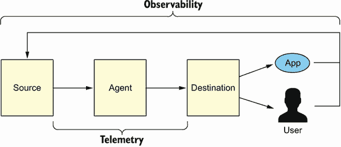
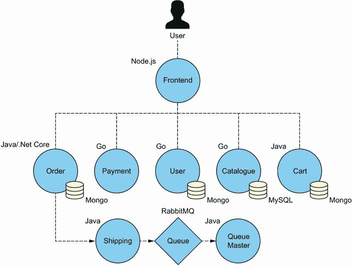
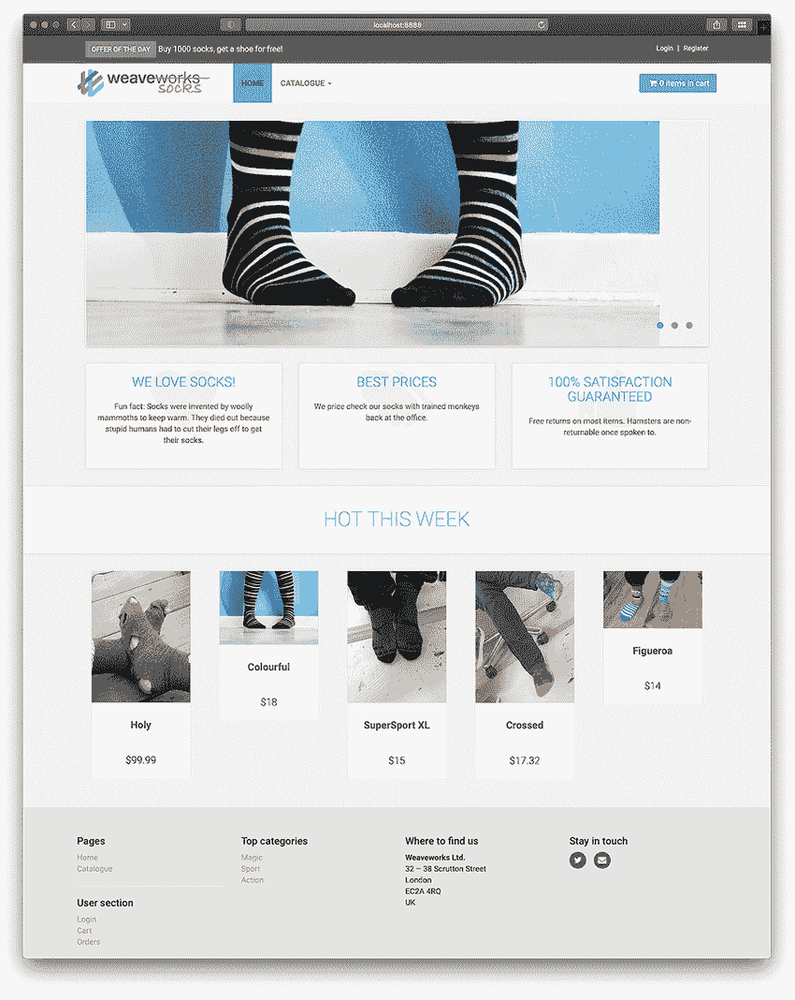

# 1 End-to-end observability

本章涵盖

* 我们所说的可观测性
* 可观测性为何重要
* 可观测性的端到端示例
* 云原生系统的挑战以及可观测性如何提供帮助

在云原生环境中，例如 AWS 等公共云服务或本地基础设施（如 Kubernetes 集群），通常需要处理众多 moving parts。这些部分从基础设施层，包括计算（如 VM 或容器）和数据库，到你拥有的应用程序代码。

根据你的角色和环境，你可能负责拼图中任意数量的组件。让我们看一个具体示例：考虑云服务提供商中的无服务器 Kubernetes 环境。在这种情况下，Kubernetes 控制平面和数据平面（工作节点）都由你管理，这意味着你可以在运营方面专注于你的应用程序代码。

无论你负责哪一部分，你都希望知道发生了什么，以便能够做出反应，理想情况下甚至能够主动管理诸如突发使用量激增（因为市场部门在未告知你的情况下启动了 25% 折扣活动）或由于第三方集成失败而影响你的应用程序等情况。你拥有或可以直接影响的组件范围决定了你在可观测性方面应关注的内容。

归根结底，你不想盲目飞行。在云原生系统的上下文中，这具体意味着什么，我们将在本章中以实践方式进行探索。虽然在进展过程中看到事物实际运行很重要，但我们也将尝试通过更正式的方式，包括定义，来概括概念的要点。

本书假设你熟悉云原生环境。一般来说，你会期望找到微服务架构，大量相对短暂的组件协同工作以提供功能。这包括云提供商服务（我在此使用 AWS 来演示这些想法）；容器技术，包括 Docker 和 Kubernetes；以及函数即服务（FaaS）产品，尤其是 AWS Lambda。如果想进一步阅读，这里有一些建议：

* *Kubernetes in Action, Second Edition*，Marko Lukša 著（Manning，2020）
* *AWS Lambda in Action*，Danilo Poccia 著（Manning，2016）

此外，我推荐 Jamie Riedesel 所著的 *Software Telemetry*（Manning，2021），它与本书相辅相成，并对我们不会在本书记载详细的可观测性方面提供了有用的深入探讨。

在本书记载中，我们专注于云原生环境。我们主要使用开源可观测性工具，以便你无需许可成本即可尝试所有内容。然而，重要的是要理解，虽然我们使用开源工具来展示概念的实际应用，但它们具有普遍适用性。也就是说，在专业环境中，你应始终考虑将部分或全部工具外包给你选择的云提供商提供的托管产品，或同等的可观测性厂商提供的产品，如 Datadog、Splunk、New Relic、Honeycomb 或 Dynatrace。在深入探讨云原生环境以及在该上下文中可观测性意味着什么之前，让我们先退一步，从概念层面来看待它。

## 1.1 What is observability?

可观测性是什么，为什么你应该关心？当我们说 *observability* 时，我们指的是通过测量外部可用的数据来理解内部系统状态。通常，我们这样做是为了采取行动。

在给出可观测性的更正式定义之前，让我们回顾一下本书中将反复使用的几个核心概念：

* *System*—简称为 *system under observation*（SUO）。这是你关心的云原生平台（以及其上运行的应用程序），也是你负责的对象。
* *Signals*—从系统外部可观察到的信息。有不同类型的信号（最常见的是日志、指标和追踪），它们由源生成。第 2 章详细介绍了信号类型。
* *Sources*—基础设施和应用层的一部分，例如微服务、设备、数据库、消息队列或操作系统。它们通常必须经过 instrument 以发出信号。我们将在第 3 章讨论源。
* *Agents*—负责信号收集、处理和路由。第 4 章专门介绍代理及其使用。
* *Destinations*—你出于不同原因和用例而消费信号的地方。这些包括可视化（如仪表板）、警报、长期存储（出于监管目的）以及分析（为应用寻找新用途）。我们将在第 5 章和第 6 章分别深入探讨后端和前端目标。
* *Telemetry*—从源收集信号，经由代理路由或预处理，并摄取到目标的过程。

图 1.1 为你提供了可观测性的视觉描述。其动机是通过代理从由一组源表示的系统收集信号到目标，供人类或应用程序消费，以了解和影响系统。



图 1.1 Observability overview

可观测性本质上代表了一个反馈回路。例如，人类用户可能会根据收集到的信息重启服务。在应用程序的情况下，这可能是基于测量的系统利用率添加工作节点的集群自动扩缩器。


The most important aspect of observability is to provide actionable insights. Simply displaying an error message in a log line or having a dashboard with fancy graphics is not sufficient.

Definition *Observability* is the capability to continuously generate and discover actionable insights based on signals from the system under observation, with the goal of influencing the system.

The field of observability is growing and covering more and more domains, including developer observability (which we will cover in chapter 9) and data observability.

But how do you know what signals are relevant, and how do you make the most out of them? Before we get to this topic, let’s first step back a bit to set the scene, have a look at common observability use cases, and define roles and tasks.

## 1.2 Observability use cases

Observability is a means to an end. In other words, when you have a certain challenge or task at hand you want to address, observability supports you in achieving said task faster or managing said challenge more effectively. Let’s have a look at common use cases now and see what kind of requirements arise from them:

* *Understanding the impact of code changes*—As a developer, you often add a new feature or fix bugs in your code base. How do you understand the impact of these code changes? What are the relevant data points you need to assess the (potentially negative) effects, such as slower execution or more resource usage?
* *Understanding third-party dependencies*—As a developer, you may use things that are outside of your control—for example, external APIs (payment, location services, etc.). How do you know they are available, healthy, and performing as they should?
* *Measuring user experience (UX)*—As a developer, site reliability engineer (SRE), or operator, you want to make sure your app or service is responsive and reliable. How and where do you measure this?
* *Tracking health and performance*—As an operator, you want to be able to understand the health of your service or app, which can include the overall uptime, the response time distribution, and the parties impacted by a partial or full outage (e.g., paying customers, free-tier users, or canary accounts).
* *Blast radius exploration*—Just like health and UX, on a more fundamental level, you may wish to understand the blast radius for any of your direct apps or services and the underlying platform (e.g., a deployment running in a Kubernetes cluster). How can you tell whether an error is in your app or in the Kubernetes data plane or underlying VM?
* *Optimizing a service*—As a developer, you want to carry out optimizations, including performance, resource usage, costs, and response time of your service. How can you measure these?
* *Increasing developer productivity*—As a service owner or engineering manager, you’re interested in your developers being productive. Now, a set of big screens and a comfy gaming chair sure help with that, as well as a no-meeting Monday, Tuesday, and Friday. But how can you measure developer productivity around the code produced from a long-term (maintenance) perspective?
* *Auditing access and tracking compliance*—As an operator, you want to keep track of who has access to different services and customer data, for example. How does your system capture both permissions and access, automatically allow you to alert on unauthorized access, and provide you with an audit trail in case of inspection (for regulatory purposes, let’s say)?

This was just a very concise and compressed taste of potential observability use cases. If you would like to learn more about observability use cases, signals, and methods, I strongly encourage you to peruse the “Observability Whitepaper” (which I had the pleasure of contributing to; [`mng.bz/EQJO`](http://mng.bz/EQJO)) by the Cloud Native Computing Foundation’s Technical Advisory Group for Observability or, more informally, *CNCF TAG o11y*. (The term *o11y* refers to *observability*).

### Observability vs. monitoring

Is *observability* just a new buzzword for *monitoring*, or are these distinct concepts that relate to each other? When monitoring, you’re looking at the health of a system (e.g., your platform or a particular service). Observability is conceptually broader; while health is still relevant, it also considers changes in your system, such as what the impact of a code change is or what external dependencies contribute to (for example, the p90 of the response time of one of your services). Marketing terms aside, you can think of monitoring as shorthand for *system health and performance-related observability*, and that’s how I will treat it in this book.

With some use cases under our belts, let’s move on to different roles within an organization. We’ll discuss their goals and tasks to more fully appreciate and understand how observability can assist different people on your team and in the wider organization.

## 1.3 Roles and goals

Nowadays, building products is a team sport. Except in the case of a small tool, a variety of different job functions or roles typically work together to realize a software-based offering. The different roles involved in the software creation and operation process focus on different tasks along the application life cycle:

* *Developers*—Developers write code, test and document it, and make artifacts, such as a container image, a binary, or a script (for interpreted languages, such as Python), available for deployment. Observability can help to more quickly iterate (finding bugs via logs and traces), optimize runtime behavior (identifying slow code paths via traces), and support operations (via metrics and logs).
* *Release and test engineers*—A release engineer can own CI and/or CD pipelines and needs visibility into build, test, and deploy processes. In this context, some organizations have a dedicated tester (or QA tester) role that has similar requirements as those for release engineers.
* *DevOps roles*—Some teams have DevOps roles, which are partially responsible for code, often own operations (are on call), and establish and enforce good practices. Similar considerations as with developers apply concerning observability, and in addition, metrics are typically useful for either dashboards or alerts. One notable DevOps role is an SRE, who coaches developers or supports other DevOps roles, helping them to meet certain operational goals (we will come back to that in the last chapter on SLOs and SLIs).
* *Infrastructure and platform operations*—In environments that are not cloud native, these are usually called *system administrators* or *sysadmins*. They own the platform (IaaS or containers) and provide (self-service) access to the platform to developers and DevOps roles. They are usually interested in low-level signals, such as utilization of resources and cost-related signals.
* *Nonengineering roles*—A product owner is often called a *product (or project) manager* and owns a feature, a service, or an entire application, depending on the scope and size. These roles usually focus on end user–facing indicators as well as performance and usability. Another nontechnical role is that of a business stakeholder. They represent the part of the organization that specifies the requirements and usually focuses on financial indicators, such as usage, revenue, or units sold. For this role, technical indicators are usually irrelevant. Table 1.1 shows example observability flows across the roles discussed in this section.

### Table 1.1 Example flows per role

| Role | Example flow |
| --- | --- |
| Developer | Uses traces to figure out which microservice along the request path is slow |
| Developer | Uses continuous profiling to speed up the hot path of a microservice |
| DevOps | Receives an alert about a component being down and then uses metrics plotted in a dashboard to understand the alert in context |


| Role | Description |
|---|---|
| DevOps | 使用指标缩小导致高延迟的组件范围；然后跳转到追踪以深入分析特定请求路径；然后查看该请求路径上提供服务的某个微服务的日志以获取详细信息（关联） |
| SRE | 跟踪目标及其完成情况，通过仪表板为开发人员提供建议 |
| Platform operator | 使用集群级仪表板随时间跟踪自动扩缩容 |
| Release engineer | 使用仪表板监控微服务构件（例如容器镜像）的构建进度，例如防止性能退化 |
| Product manager | 使用 CD 仪表板监控微服务的部署进度 |
| Business stakeholder | 使用仪表板跟踪每周收入和 SLA 违规情况 |

现在让我们来看一个云原生系统的具体示例、信号源和遥测。

## 1.4 Example microservices app

我们将使用 Weaveworks 的微服务应用 Sock Shop (`https://github.com/microservices-demo/microservices-demo`) 来探索可观测性。图 1.2 显示了其整体架构。Sock Shop 示例应用是一个简单的演示应用，使用不同的语言和框架（Spring Boot、Go kit 和 Node.js）构建，并使用符合 Open Container Initiative 的容器镜像进行打包。这使其可广泛用于容器编排器，如 Kubernetes、Docker Compose 和 ECS，以及 FaaS，如 AWS Lambda。我们将展示该示例应用在 Kubernetes 中运行。



Figure 1.2 The example microservices app we use for observability exploration

图 1.2 我们用于可观测性探索的示例微服务应用

Tip Throughout the book, you will find me using a didactical device to explain concepts along the boundaries of logs, metrics, and traces. This is purely to structure the content and make it easier for you to learn and find information. The practical reality is much messier, since projects and products have the tendency to expand their scopes; therefore, a clear-cut explanation, such as “This thing is for logs” or “Use XYZ for metrics,” is in most cases not applicable in the real world.

提示 在整本书中，你会发现我使用一种教学手段来沿着日志、指标和追踪的边界解释概念。这纯粹是为了结构化内容，使你更容易学习和查找信息。实际现实要混乱得多，因为项目和产品往往会扩大其范围；因此，像“这个东西用于日志”或“使用 XYZ 用于指标”这样清晰的解释，在大多数情况下在现实世界中并不适用。

设置示例微服务应用需要一个 Kubernetes 集群。然后，按照以下列表中的步骤操作。

Listing 1.1 Local observability

Listing 1.1 本地可观测性

```
$ git clone https:/ /github.com/microservices-demo/microservices-demo.git &&
  \  cd microservices-demo/deploy/kubernetes/                ❶
 
$ kubectl create namespace sock-shop                         ❷
 
$ kubectl apply -f complete-demo.yaml                        ❸
 
$ kubectl -n sock-shop port-forward svc/front-end 8888:80    ❹
```

❶ Clones the example app repo and changes into the directory where the Kubernetes deployment YAML docs are located
❶ 克隆示例应用仓库并进入 Kubernetes 部署 YAML 文档所在的目录
❷ Creates a Kubernetes namespace that acts as a logical home for our app
❷ 创建一个充当应用逻辑主目录的 Kubernetes 命名空间
❸ Creates all necessary Kubernetes resources (deployments, services, etc.) that together make up the app; if you want to keep an eye on it, waiting until all resources are ready, you can (in a different terminal session) use the `watch kubectl -n sock-shop get deploy,pod,svc` command.
❸ 创建构成应用所需的所有 Kubernetes 资源（部署、服务等）；如果你想监控其状态，等待所有资源就绪，可以（在另一个终端会话中）使用 `watch kubectl -n sock-shop get deploy,pod,svc` 命令。
❹ Once all pods are ready, you can make the frontend accessible on your local machine using the `port-forward` command.
❹ 一旦所有 Pod 就绪，你可以使用 `port-forward` 命令将前端在本地机器上公开。

如果你成功设置了 Sock Shop 应用，你可以在浏览器中访问入口点（the `front-end` service）。前往 `http://localhost:8888`，你应该会看到类似于图 1.3 所示的内容。



Figure 1.3 Screenshot of the Sock Shop example microservices app frontend

图 1.3 Sock Shop 示例微服务应用前端的屏幕截图

接下来，你需要生成一些流量，因此在右上角登录，使用用户名 `user` 和密码 `password`，然后将一些商品添加到购物车。现在，可观测性如何？让我们从头到尾看一个具体示例。

Sock Shop 示例应用会发出各种信号。让我们更仔细地查看两种信号类型，日志和指标，以探索究竟发出了什么以及为给定角色引入可观测性需要什么。

就日志信号类型而言，Sock Shop 服务会发出各种日志。以 `orders` 服务为例，输出如下（output edited to fit）：

```
$ kubectl logs deploy/orders
2021-10-25 14:33:10.649  INFO [bootstrap,,,] 7 --- [           main] s.c.a.
AnnotationConfigApplicationContext : Refreshing org.springframework.context.
annotation.AnnotationConfigApplicationContext@51521cc1: startup date
[Mon Oct 25 14:33:10 GMT 2021]; root of context hierarchy
2021-10-25 14:33:16.838  INFO [bootstrap,,,] 7 --- [           main] tratio
Delegate$BeanPostProcessorChecker : Bean 'configurationPropertiesRebinderAu
toConfiguration' of type [class org.springframework.cloud.autoconfigure.Con
figurationPropertiesRebinderAutoConfiguration$$EnhancerBySpringCGLIB$$b894f
39] is not eligible for getting processed by all BeanPostProcessors (for ex
ample: not eligible for auto-proxying)
...
```

在这种情况下，来源是 `orders` 服务，信号类型是日志。

Note Nearly everyone uses logs (in contrast to metrics or even traces), yet there is much less standardization and interoperability going on in this signal type compared to others. While OpenTelemetry is, at the time of publication, stable for traces and almost stable for metrics, we’re still working in the community to achieve a similar level of coverage for logs.

注意 几乎每个人都使用日志（与指标甚至追踪相比），然而与其它信号类型相比，这种信号类型的标准化和互操作性要少得多。虽然在出版时 OpenTelemetry 对于追踪已稳定，对于指标几乎稳定，我们社区仍在努力为日志实现类似程度的覆盖。

使日志可操作，例如供开发人员修复 bug，我们需要以下内容：
* An agent (like `Fluent Bit`) to route the logs to a destination
* A destination, such as `OpenSearch` or `CloudWatch`
* 一个代理（如 `Fluent Bit`）将日志路由到目的地
* 一个目的地，如 `OpenSearch` 或 `CloudWatch`

服务还以 Prometheus 暴露格式公开指标（例如，查看我们之前转发到本地机器的 `front-end` 服务）。以下输出已编辑以适应：

```
$ curl localhost:8888/metrics
### HELP process_cpu_user_seconds_total Total user CPU time spent in seconds.
### TYPE process_cpu_user_seconds_total counter
process_cpu_user_seconds_total 156.37216999999978
...
```

在这种情况下，来源是 `front-end` 服务，信号类型是指标。

Note

When talking with customers, I notice that many are facing the same challenge: feeling the need to collect and retain all metrics because “we might need them.” Try to prune as much as possible on ingest and check if metrics that land in destinations are actually used. These are some questions you can ask yourself about whether collecting a particular metric is necessary:
* Is that metric used in an alert? Is it used in a dashboard?
* Can you think of a use case where you could derive insights from the metric? Would an aggregate be sufficient?
* Would a trace be a better choice here?

注意

与客户交谈时，我注意到许多人面临同样的挑战：感觉需要收集和保留所有指标，因为“我们可能需要它们”。尝试在摄取时尽可能精简，并检查到达目的地的指标是否实际被使用。以下是你可以问自己的关于是否需要收集特定指标的问题：
* 该指标是否用于告警？是否用于仪表板？
* 你能想到一个可以从该指标中获得洞察的用例吗？聚合是否足够？
* 追踪在这里会是更好的选择吗？

使指标可操作，例如供 SRE 评估指标，我们需要以下内容：
* An agent (e.g., `Prometheus` or `OpenTelemetry collector`) to scrape the metrics
* A destination, such as `Prometheus` or, for long-term storage and federation, `Cortex` or `Thanos`
* 一个代理（例如 `Prometheus` 或 `OpenTelemetry collector`）来抓取指标
* 一个目的地，如 `Prometheus`，或用于长期存储和联邦的 `Cortex` 或 `Thanos`

目前，我们不会考虑追踪，因为它们需要多一点设置（来自遥测端和目的地），但简而言之，你可以把追踪看作提供跨服务的执行概览，包括持续时间和状态 of the service that successfully handled the request。

我们现在已经初步接触了日志和指标。在本书剩余部分深入探讨云可观测性之前，让我们通过查看处理云原生系统时需要牢记的挑战以及可观测性如何帮助解决这些挑战来结束本章。

## 1.5 Challenges and how observability helps

云原生环境及其上运行的应用面临若干挑战。在本小节中，我们讨论其中最紧迫的挑战，并展示可观测性如何帮助解决它们。


一般来说（忽略打包和调度等细节，例如 `Kubernetes` Pod 与 `Lambda` 函数），云原生系统具有以下特征：

*   *它们本质上是分布式的。* 大多数通信并非在进程内进行——甚至可能不在同一台机器上（例如使用进程间通信 \[`IPC`\] 机制）——而是通过网络进行的。

*   *由于分布式特性，不仅是* what *而且* where *至关重要。* 想象一下沿着请求路径为特定用户提供服务的多个微服务。你希望能够端到端地了解发生了什么，并且能够深入到每个服务中。

*   *与在例如 `VM` 上运行的单体应用相比，服务的波动性更高。* `Pods`（以及随之而来的其 IP 地址）会来来去去，`Lambda` 函数的新版本可能每小时都会推送，等等。

现在让我们看看可观测性如何帮助解决云原生系统中发现的挑战。 对于云原生系统，你不想盲目飞行；以自动化的方式收集所有相关信号并将其用作决策输入——即可操作的洞察——是理想状态。

### 1.5.1 投资回报

要了解对可观测性的合适投资水平（即时间和金钱），你首先需要了解成本：

*   *仪器化成本* — 这些包括开发人员的时间，这是一项持续成本。

*   *信号保留* — 这些成本（例如日志存储）可以是一次性的，但通常属于按需付费模式。

*   *代理和仪器化的开销* — 这体现在除服务本身使用之外在计算和内存资源使用上的额外开销。成本应保持在 `CPU` 和 `RAM` 利用率的个位数低范围。例如，`AWS` `OpenTelemetry Collector` ([`mng.bz/N2J1`](http://mng.bz/N2J1)) 提供了跨不同信号类型的占用情况报告。

*   *网络使用* — 此类成本，例如出站流量，可能是可观测性解决方案的重要成本驱动因素。

对可观测性的投资回报更难计算。确定你的回报主要取决于目标是否明确。我们稍后将讨论不同角色的目标。例如，你可以测量给定服务在仪器化前后的平均恢复时间（`MTTR`；[`www.atlassian.com/incident-management/kpis/common-metrics`](https://www.atlassian.com/incident-management/kpis/common-metrics)）。但也有许多与人为相关的因素（例如值班压力或工作与生活平衡）会计入收益。你可以在“Return on Investment Driven Observability” ([`arxiv.org/abs/2303.13402`](https://arxiv.org/abs/2303.13402)) 中阅读更多关于该主题的内容，这是一篇我发表的短论文。

### 1.5.2 信号关联

不同信号类型通常适用于不同的任务。此外，单一信号类型通常无法回答你可能有的所有问题。我们将在第 11 章详细讨论信号关联；然而，我想在这里提供一个快速的动机示例。

假设你在值班并接到呼叫（在半夜）。你打开笔记本电脑并查看警报中链接的 `Grafana` 仪表板。从仪表板中，例如绘制 `Prometheus` 指标，你可以了解到微服务应用中的某些服务在过去 20 分钟内错误率有所增加。你怀疑这可能与最近的服务升级有关。你使用嵌入在 `Prometheus` 指标中的 exemplar 的 trace ID ([`mng.bz/D4Jw`](http://mng.bz/D4Jw)) 作为入口点，使用分布式追踪工具 `Jaeger` 更详细地查看相关服务。在 `Jaeger` 中，你可以看到 traces 持续时间分布和错误代码，并深入到服务的日志中以验证你的假设。

在此场景中，你关联了不同的信号类型（指标到 traces 到日志），并能够快速有效地确认你的假设。一种简单的关联形式是基于时间的关联，这是在许多前端（如 `Grafana`）中开箱即得的功能。这意味着你使用一个时间段查询不同的后端，以手动找到讲述完整故事的信号。

### 1.5.3 可移植性

通过选择开放标准和开源来避免锁定。这确保你可以在不同的环境（例如云提供商或本地基础设施）中使用相同的机制和工具，而无需更改太多设置。例如，如果你使用 `OpenTelemetry` 对应用程序进行仪器化，那么你可以从一个目的地切换到另一个目的地，而无需更改应用程序或代理。

## 摘要

*   云原生系统，例如 `Kubernetes`，会产生大量遥测信号。

*   遥测信号的来源可以是你的代码、API（例如 `AWS` 服务）、数据库等等。

*   术语 *telemetry* 指的是从源收集信号、通过代理处理它们并将其摄取到可观测性目的地，在那里它们可以被人类和机器消费。

*   一般来说，*observability* 意味着从信号中获得可操作的洞察以理解和影响被观察的系统。

*   可观测性有许多用例，从降低 `MTTR` 到成本优化再到提高开发人员生产力。

*   可观测性与不同角色（开发人员、DevOps、非技术角色等）相关，以执行其典型任务。

*   我们查看了一个云原生应用（`Kubernetes` 中的容器化微服务应用）的具体示例设置、其信号，以及在这种情况下可观测性可能意味着什么。

*   云原生系统的挑战包括其分布式特性以及所涉及组件的波动性。

*   可观测性可以通过让你不盲目飞行来帮助解决云原生系统中发现的挑战。

*   了解可观测性的成本和投资回报很重要。

*   信号关联很重要，因为它使你能够结合不同信号类型来回答你可能对系统有的所有问题。
