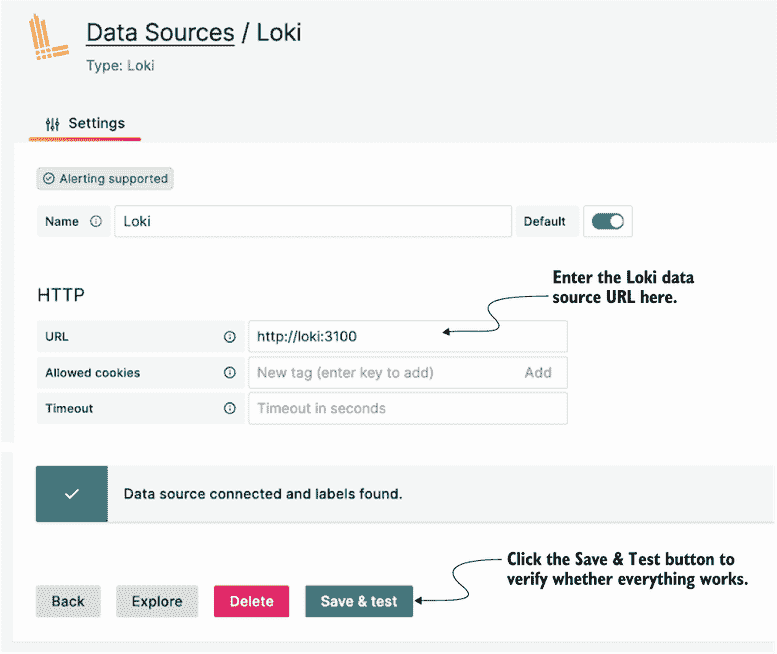
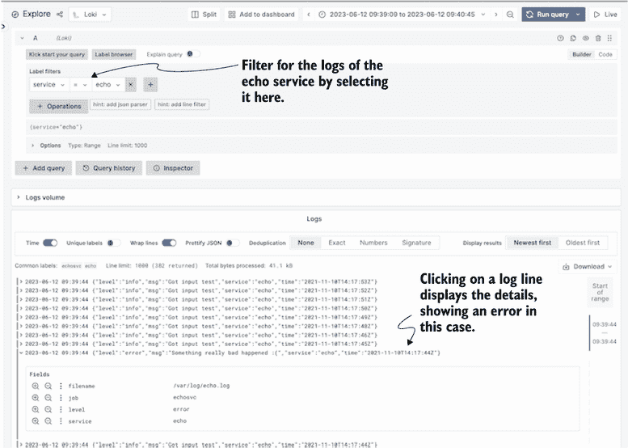
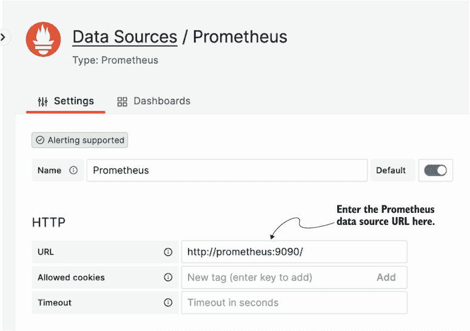
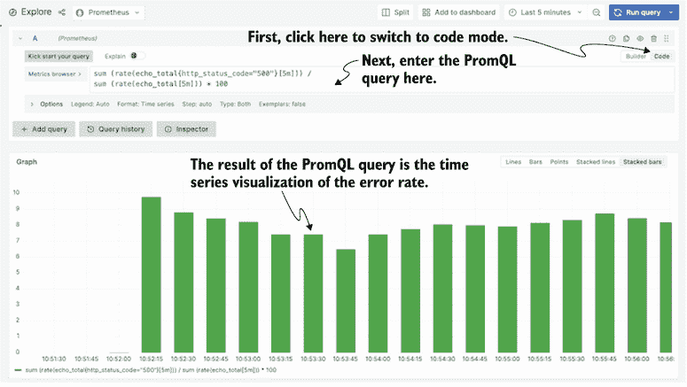
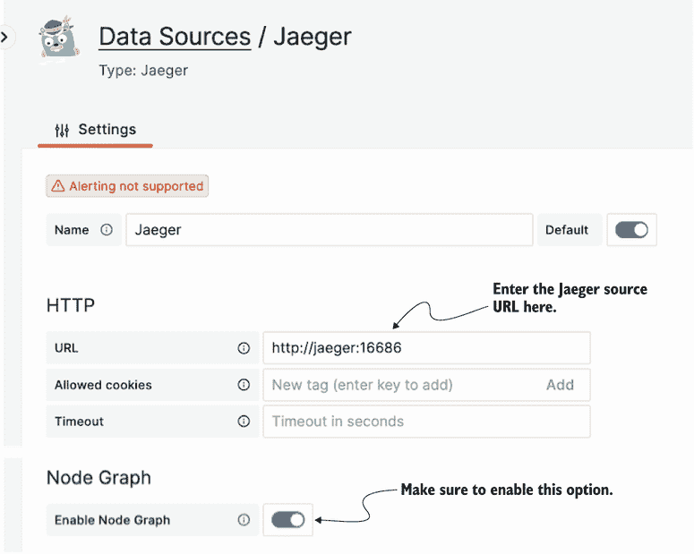
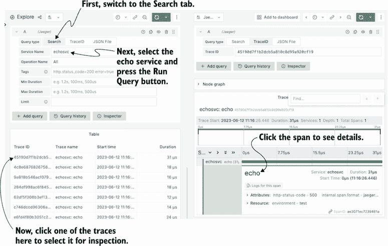

# 2 信号类型

本章涵盖

*   不同信号类型是什么

*   何时以及如何使用某种信号类型

*   每种信号类型的成本和收益

*   如何确定哪些信号相关

*   确定信号基线

在可观测性的上下文中，信号发挥着核心作用：这是我们基于做出决策的情报。在高层次上，我们可以将信号区分为本质上是数值型的（例如服务调用次数）和携带需要人工解释的文本负载的信号（例如日志行）。

如第 1 章所述，被观察的系统，或简称 *system*（例如 `Kubernetes` 应用程序或基于 `Lambda` 函数的无服务器应用），会从各种来源发出信号。你作为人类，或同等程度的一段软件，然后使用这些信号来理解系统并做出决策以影响它。系统与来源之间存在一对多的关系。你的系统通常涉及计算、存储和网络，每一个都代表一个信号源。我们将在第 3 章详细讨论来源。

就信号（和来源）而言，我们可以区分两种情况：

*   你拥有的并且可以自行仪器化的来源，例如代码（即决定在何处以及发出何种信号）。

*   你不拥有的来源，这意味着任何信号都是预定义的。在这种情况下，你的任务仅限于选择要消费哪些信号。这可能是由于以下几个原因：

    *   代码的依赖项（库、包、模块等）。

    *   组件的源代码不可用（例如二进制文件）。


* 组件仅提供（网络）API。您选择的云提供商的任何托管服务都属于此类。

无论您拥有代码并可以决定发出何种信号类型，还是在使用您不拥有的组件，在某个时间点，您都希望收集信号并将其发送到中央位置进行处理和存储。这就是遥测部分。

在可观测性方面，您希望采取以投资回报率（ROI）驱动的方法。换句话说，您不仅需要了解可用的不同信号，还需要了解每种信号类型的成本以及它们使您能够做什么。

在本章中，我们将回顾最常见的信号类型，检查如何对每种信号进行仪器化并收集它们，并讨论这样做的成本和收益。

## 2.1 Reference example

虽然有多个信号需要考虑，但实际上最常用的三个是日志、指标和追踪。在本章中，我们将使用一个运行中的参考示例，即一个名为 `echo` 的简单 Go 程序，公开 HTTP 接口，以查看三种常见信号类型的实际应用。

进入 `ch02/base/` 目录，您可以在其中找到第 2.1 节所示的 `main.go` 程序。随着我们的进展，我们将使用不同的信号对参考示例进行仪器化，目标是使用开源工具（包括 Grafana、Prometheus 和 Jaeger）使用和交互信号。

Listing 2.1 示例 Go 程序以供仪器化

```
package main

import (
    "fmt"
    "log"
    "math/rand"
    "net/http"
    "time"
)

func handleEcho(w http.ResponseWriter, r *http.Request) {
    message := r.URL.Query().Get("message")                   ❶
    if rand.Intn(100) > 90 {                                  ❷
        w.WriteHeader(http.StatusInternalServerError)
        return
    }
    fmt.Fprintf(w, message)                                   ❸
}

func main() {
    rand.Seed(time.Now().UnixNano())
    http.HandleFunc("/echo", handleEcho)                      ❹
    log.Fatal(http.ListenAndServe(":4242", nil))              ❺
}
```

❶ 从查询参数 `message` 中检索要回显的负载，其结果是可以向 `/echo?message` 发出 HTTP GET 请求来与服务交互

❷ 模拟 10% 的错误情况

❸ 在 90% 的情况下返回我们检索到的确切负载

❹ 为 `/echo` 路径注册处理器

❺ 启动 HTTP 服务器，该服务器将在所有可用网络接口上的 4242 端口提供服务

首先，让我们构建 `echo` 服务，如以下列表所示。

Listing 2.2 构建我们的示例 Go 程序

```
$ go build -o echosvc .     ❶
```

❶ 构建可执行文件，然后它将作为 `./echosvc` 可用在当前目录中

现在，您可以在同一目录中使用 `./echosvc` 运行服务。要通过其 HTTP API 调用它，您可以使用以下代码（在单独的终端会话中）：

```
$ curl localhost:4242/echo?message=test

test
```

默认情况下，我将使用 Grafana 作为目标，因为它允许我们以统一的方式可视化和交互各种数据源。这将允许您免费使用开源重现所有内容。现在我们已经介绍了参考示例，让我们在进入仪器化本身之前谈谈评估仪器化成本的方法。

### Tip

要在 Grafana 中看到后续的信号，您需要对 `echo` 服务施加一些负载。一个选项是直接从 shell 执行类似以下操作（每秒调用一次端点）：

```
while true ; do curl -s -o
/dev/null localhost:4242/echo ; sleep 1 ; done
```

另外，您可以使用更高级的东西，例如像 Salvo 这样的完整测试工具（[`github.com/tarekziade/salvo`](https://github.com/tarekziade/salvo)）甚至 K6（[`k6.io/docs/testing-guides/api-load-testing/`](https://k6.io/docs/testing-guides/api-load-testing/)）。

## 2.2 Assessing instrumentation costs

为了评估每种信号类型的仪器化成本，我们将使用一个简单的度量：*业务逻辑与仪器化*（B2I）比率。

### The B2I ratio

要计算 B2I 比率，请确定添加仪器化（为信号类型添加发出信号的代码）之前的代码行数（LOC），然后确定仪器化后的 LOC。B2I 比率如下

```
B2I = LOC_AFTER_INSTRUMENTATION/LOC_BEFORE_INSTRUMENTATION
```

在理想世界中，B2I 比率将为 1，表示代码中仪器化成本为零。然而，实际上，您用于仪器化的 LOC 越多，B2I 比率就越高。例如，如果您的代码有 3800 行 LOC，并且您为仪器化添加了 400 行 LOC（例如，用于发出日志和指标），那么您的 B2I 比率将为 1.105，计算方式为 (3800 + 400) / 3800。

关于 B2I 有两点值得提及：

* 您是否要在 B2I 比率计算中考虑遥测库，例如 OpenTelemetry SDK（[`opentelemetry.io/docs/instrumentation/`](https://opentelemetry.io/docs/instrumentation/)），由您决定。从务实的观点来看，专注于您自己的代码（排除这些依赖项）可能最有意义。在本章的剩余部分，我将这样做。
* B2I 比率是一个简单的度量，绝不应作为代码仪器化程度好坏的指标，也不应告诉您代码是否 *过度仪器化*。古德哈特法则（参见 Strathern and Marilyn, 1997, “Improving Ratings: Audit in the British University System,” *European Review*, John Wiley & Sons）指出，当一个度量成为目标时，它就不再是一个好的度量——这里适用。用 B2I 比率作为回归验证中的粗略指南，而不是绝对的北极星。

在理论和概述之后，让我们现在回顾三种基本的信号类型：日志、指标和追踪。在本章的剩余部分，我们将对每种信号类型执行以下操作：

1. 定义信号特征和语义。
2. 讨论如何对我们的示例 `echo` 服务进行仪器化。
3. 设置遥测以收集和路由信号。
4. 分析信号的成本（以资源使用和工作量衡量）和收益。
5. 解释相应的信号如何有助于可观测性解决方案。

## 2.3 Logs

让我们首先关注日志。日志是具有文本负载的信号，用于捕获事件。*事件* 是代码中发生的任何感兴趣事情的统称，无论是在正常路径（完成的上传）还是意外或错误行为（“failed to store items in shopping basket”）。

日志带有时间戳，并且应该是结构化的，最好包括一些上下文（例如标签），可用于与其他信号进行关联。通常，人类会消费日志，要么直接通过搜索事件，要么间接通过关联。

### Note

有许多方式来指代单个日志事件，包括日志行、日志项、日志条目，以及我可能尚未遇到过的其他名称。为了保持简单，我们将在此一致使用 *事件* 一词，但这些术语在很大程度上是可以互换的。

在日志的上下文中，我们通常区分 *级别*，它可以表示日志事件的性质。不同的编程语言、库和框架随着时间的推移建立了约定；然而，以下是一些常见语义：

* 与开发或修复错误相关的细粒度日志事件（`DEBUG`）
* 生产类型日志事件，包括以下内容：
    * 预期行为（通常为 `INFO`）
    * 意外行为，例如 `WARNING` 或 `ERROR`


有多种日志标准和格式可用，包括行式格式，例如 syslog RFC 5424 ([`tools.ietf.org/html/rfc5424`](https://tools.ietf.org/html/rfc5424)) 和 Apache 通用日志格式（CLF； [`mng.bz/lWg8`](http://mng.bz/lWg8)）；JSON 日志格式（大多数现代库均支持）；以及二进制格式，例如在 `systemd` 上下文中找到的 journal 文件格式（[`mng.bz/Bmw8`](http://mng.bz/Bmw8)）。要了解更多信息，请查看 Graylog 的 Logs Format Guide（[`mng.bz/d1nO`](http://mng.bz/d1nO)）。在日志上下文中，一些良好的实践包括以下内容：
*   考虑记录什么内容，目标是提供可操作的洞察（上下文为王）。
*   记录到 `stdout` 而不是固定位置，例如文件。这使得日志代理能够收集和路由你的日志事件。另请参阅 `12-factor` 方法论中的条目（[`12factor.net/logs`](https://12factor.net/logs)）以了解背景。
*   使用标签来增强日志事件的价值。例如，你可以使用组件名称或类型、源的类型或操作的类型作为标签来帮助筛选事件。

提示 如果你想知道如何让你的日志策略“面向未来”，我建议阅读 Ben Sigelman（Lightstep 的联合创始人，以其在 OpenTelemetry、Google Dapper 和 Monarch 方面的工作而闻名）的 2001 年 Twitter 线程，“Why Tracing Might Replace (Almost) All Logging”（[`mng.bz/rWzD`](http://mng.bz/rWzD)），其中他认为在云原生系统中，追踪将通过关于事务本身的仪器化（而不是关于基础设施或其他资源的日志记录）取代大部分工作负载的日志记录。这是有道理的，至少对于事务性设置中日志的许多用例而言，我希望你能考虑这种思维方式并将其应用于你的环境，如果你有条件这样做的话。当然，许多环境更偏向棕地而非绿地，因此建立这种以追踪为中心（而非以日志为中心）的方法可能很困难或需要花费大量时间和精力。

### 2.3.1 仪器化

现在让我们看看日志的实际应用。为此，我们对 `echo` 服务进行仪器化，使其发出日志事件。以下列表展示了我们的 `echo` 服务经过仪器化以发出日志。

列表 2.3 用于发出结构化日志的示例 Go 程序，已进行仪器化
```
package main
 
import (
    "fmt"
    "math/rand"
    "net/http"
    "time"
 
    log "github.com/sirupsen/logrus"
)
 
func handleEcho(w http.ResponseWriter, r *http.Request) {
    message := r.URL.Query().Get("message")
    log.WithFields(log.Fields{
        "service": "echo",
    }).Info("Got input ", message)                    ❶
    if rand.Intn(100) > 90 {
        log.WithFields(log.Fields{
            "service": "echo",
        }).Error("Something really bad happened :(")  ❷
        w.WriteHeader(500)
        return
    }
    fmt.Fprintf(w, message)
}
 
func main() {
    rand.Seed(time.Now().UnixNano())
    log.SetFormatter(&log.JSONFormatter{})            ❸
    http.HandleFunc("/echo", handleEcho)
    log.Fatal(http.ListenAndServe(":4242", nil))
}
```
❶ 无论如何，始终在此处发出一条 INFO 日志行，确认我们通过查询参数 `message` 获得的输入值。请注意上文（以及下面的错误情况中再次出现）中的 "service": "echo"：这为事件提供了上下文，使你能够精确定位服务。
❷ 在错误情况下发出一条 ERROR 日志行。
❸ 配置记录器以发出 JSON 格式的日志行。另外，请注意我们在此使用的记录器 `logrus` (https://github.com/Sirupsen/logrus) 默认输出到 `stderr`，在我们稍后消费日志时需要考虑这一点。

要构建该服务，你还需通过名为 `go.mod` 的文件（如下列表所示）定义其依赖项。

列表 2.4 示例 Go 程序依赖文件 `go.mod`
```
module co11yia/ch2/logs
 
go 1.20
 
require github.com/sirupsen/logrus v1.8.1
```
现在，要引入 `echo` 服务的依赖项，运行以下命令：
```
$ go mod vendor
```
通过执行 `go build` 完成构建，如列表 2.2 中所述。

### 2.3.2 遥测

我们现在可以本地执行 `echo` 服务，并将执行期间发出的日志事件发送到某些目标，例如屏幕和文件：
```
$ ./echosvc 2>&1 | \
  tee echo.log
```
❶ 执行 `echosvc` 并将其 `stderr` 输出重定向到 `stdout`。
❷ 使用 `tee` 命令在终端上显示日志行，同时将日志行追加到名为 `echo.log` 的文件中。我们将在下一步中使用此文件作为输入将其发送到目标。

接下来，我们将使用 Grafana Labs 提供的一些开源工具来路由和收集日志。我们使用 `Promtail`（[`mng.bz/V1J0`](http://mng.bz/V1J0)）捕获 `echo` 服务的日志，并将其发送到 `Loki`（[`grafana.com/docs/loki/latest/`](https://grafana.com/docs/loki/latest/)）作为目标（作为 `Grafana` 中的数据源）。使用 `Grafana` 作为前端，你就可以按需查看和查询日志。

要设置我们的日志场景，请使用以下列表中所示的 Docker Compose 清单文件。它启动了所需的一切，从目标到前端。

列表 2.5 使用 `docker-compose.yaml` 启动 `Promtail`、`Loki` 和 `Grafana`
```
version: "3.5"
networks:
  loki:
services:
  loki:
    image: grafana/loki:2.4.0
    ports:
      - "3100:3100"
    command: -config.file=/etc/loki/local-config.yaml
    networks:
      - loki
  promtail:
    image: grafana/promtail:2.4.0
    volumes:
      - ./promtail-config.yaml:/etc/promtail/config.yml     ❶
      - ./echo.log:/var/log/echo.log                        ❷
    command: -config.file=/etc/promtail/config.yml
    networks:
      - loki
  grafana:
    image: grafana/grafana:latest
    ports:
      - "3000:3000"
    networks:
      - loki
```
❶ 定义 `Promtail` 配置文件的位置。我们将主机本地文件 `promtail-config.yaml` 映射到容器中的 `/etc/promtail/config.yml`，`Promtail` 预计在该位置找到它。
❷ 将主机本地文件 `echo.log`（我们的 `echo` 服务记录到该文件）映射到容器中的 `/var/log/echo.log`。我们将在列表 2.6 中使用它来定义日志处理和路由管道。

提示 虽然使用 `Docker Compose` 在本地开发或测试应用非常方便，但对于生产环境设置，`Kubernetes` 更有用。例如，你可以通过 `Helm` 图表或使用 `Tanka`（[`tanka.dev/`](https://tanka.dev/)）安装 `Promtail`、`Loki` 和 `Grafana` 堆栈。

现在我们已通过 `Docker Compose` 文件（列表 2.5）设置了启动日志目标（`Loki`）、遥测代理（`Promtail`）和前端（`Grafana`）的框架，我们还需要做最后一件事：配置 `Promtail`，我们的日志路由器/摄取器。`Docker Compose` 清单在第 15 行引用了此 `Promtail` 配置文件，我们称其为 `promtail-config.yaml`，如下列表所示。

列表 2.6 `Promtail` 配置文件 `promtail-config.yaml`
```
server:
  http_listen_port: 9080
  grpc_listen_port: 0
 
positions:
  filename: /tmp/positions.yaml
 
clients:
  - url: http://loki:3100/loki/api/v1/push
 
scrape_configs:
- job_name: app
  static_configs:
  - targets:
      - localhost
    labels:
      job: echosvc
      __path__: /var/log/echo.log    ❶
 pipeline_stages:
  - json:                            ❷
     expressions:
        level: level
        payload: msg
        timestamp: time
        service: service
  - labels:                          ❸
     level:
      service:
```
❶ 这定义了 `Promtail` 的输入。在这里，我们告诉它从名为 `/var/log/echo.log` 的文件摄取日志（我们已通过 `Docker Compose` 清单第 16 行的卷从主机挂载）。


❷ 这是 Promtail 管道的第一个部分（`http://mng.bz/x48e`）。它将我们 echo 服务发出的输入 JSON 字段（例如 `service` 或 `level`，此处右侧的值）映射为我们在 Loki 中想要过滤的标签；例如 `service` 或 `level`（此处名称相同，但你可以，并且通常必须，规范化键，这是一个很好的地方来执行此操作）。

❸ 在这里，我们定义想要索引或公开的标签。

假设你将清单 2.5 的内容存储在名为 `docker-compose.yaml` 的文件中，使用以下代码启动堆栈非常简单：

```
$ docker-compose -f docker-compose.yaml up
Creating network "logs_loki" with the default driver
Pulling loki (grafana/loki:2.4.0)...
2.4.0: Pulling from grafana/loki
...
Status: Downloaded newer image for grafana/promtail:2.4.0
Creating logs_loki_1     ... done
Creating logs_promtail_1 ... done
Creating logs_grafana_1  ... done
Attaching to logs_loki_1, logs_grafana_1, logs_promtail_1
...
```

现在，你可以在浏览器中前往 `http://localhost:3000/` 登录 Grafana。使用以下默认值（输入凭据后请务必跳过密码更改请求）：

* 用户名：`admin`
* 密码：`admin`



图 2.1 在 Grafana 中添加和配置 Loki 数据源

接下来，如图 2.1 所示配置 Loki 数据源（请注意，截图已被编辑以聚焦于相关部分；实际上，此屏幕上你会看到更多选项）。在此步骤中你唯一需要设置的配置是数据源 URL，即 `http://loki:3100`，得益于我们的 Docker Compose 设置。

现在，你可以前往左侧菜单中的 Explore 选项卡，其图标看起来像指南针。选择 Loki 作为数据源（如果尚未设为默认），然后在标签过滤器下，从下拉框中选择 `service` 作为标签，`echo` 作为值。如果随后选择某个时间范围，你应该会看到类似图 2.2 所示的内容。



图 2.2 在 Loki 中探索日志

Loki 数据源的 Explore 视图快速且简单地用于过滤特定日志级别。例如，你可以添加另一个标签过滤器，如 `level="error"`，以仅显示错误日志行。

提示 要查看正在运行的内容，请使用 `docker-compose top`（在包含 `docker-compose.yaml` 文件的目录中）或 `docker ps`（任何位置）。此外，要拆除所有内容并再次移除所有容器，请使用 `docker-compose -f docker-compose.yaml down` 命令。

至此，我们已完成了实用的日志场景。现在，我们可以继续讨论日志带来的价值以及与日志相关的成本（以资源和工作量衡量）。

### 2.3.3 成本与收益

在本小节中，我们将更仔细地审视日志信号类型的成本和收益。表 2.1 显示了成本的概述。

表 2.1 日志成本概述

|   || 开销 || 考虑因素 |
| --- | --- | --- |
| **Instrumentation** || 添加日志行简单且易于实现 || 被编程语言广泛采用并支持 |
| --- | --- | --- |
| **Agent** || 一些运行时开销、很多选项、格式标准较少（syslog、OTLP） || 运行时占用、摄取性能、可靠性与安全性 |
| **Destination** || 长期存储可能很昂贵。 || 数据温度（访问的近期性或频率）可指导保留 |

#### 日志的插桩成本

日志的插桩成本相对较低、易于理解且得到广泛支持。所有编程语言及其库都允许用户发出日志。通过添加日志行，可读性及其可维护性并未受到很大影响。

让我们从开发者的角度具体看看插桩成本。清单 2.1 中的原始代码有 24 行代码，而清单 2.3 中带日志插桩的代码有 32 行代码。综合这两个 LOC 数字，我们可以计算 B2I 比率，得出 1.33 的值，这并不算太差。

#### 日志的遥测成本

收集和路由日志到中央位置会产生一些成本，这在分布式系统中通常是必要的。根据你在此使用的选项，可能会产生摄取（网络流量）成本。

选择某个代理时，请自问以下问题：

* 运行时占用（CPU 和内存消耗）是多少？
* 摄取性能如何？例如，代理每秒能处理多少条日志行？
* 在可靠性方面，是否保证每条日志行都能送达（如果确实需要的话）？
* 是否有适当的安全级别，从线路加密（TLS）到多租户支持？

提示 如果你不确定如何衡量日志代理性能，请查看 Phil Wilkins 的 *Logging in Action*（Manning，2022；https://www.manning.com/books/logging-in-action）第 7 章。

以下是一些日志路由器示例：

* 云原生计算基金会（CNCF）项目的 Fluentd (https://github.com/fluent/fluentd) 和 Fluent Bit (https://github.com/fluent/fluent-bit)。
* CNCF 项目 OpenTelemetry 提供了一个名为 Collector 的实验性日志路由器（http://mng.bz/AoJK）。
* 云提供商特定的代理，例如 Amazon CloudWatch 代理（http://mng.bz/ZqJO）、Azure Monitor 代理（http://mng.bz/2DNd）或 Google Cloud 操作套件代理（https://cloud.google.com/monitoring/agent/）。
* 专有代理，例如 Elastic 的 Logstash (https://github.com/elastic/logstash) 和 Filebeat (http://mng.bz/1qEV)、Datadog 代理（https://docs.datadoghq.com/agent/）或 Splunk Universal Forwarder（https://docs.splunk.com/Documentation/Forwarder）。

为避免此阶段以及目标位置的成本过高，你可能希望在此处修剪日志。你可能想要考虑的一些修剪策略包括

* *采样*——即基于启发式丢弃一定比例的事件
* *基于类型的过滤*——例如，在生产环境中丢弃 `DEBUG` 级别日志

有一些商业产品，例如 Cribl (https://cribl.com/)，可以帮助在不同提供商之间大规模定义和应用修剪策略。

#### 日志的目标成本

一旦来自不同微服务的日志到达中央位置（目标，例如 Splunk、CloudWatch、OpenSearch 或 Datadog），主要成本类型是存储。在大规模情况下，日志可能非常昂贵，因此通常你不想永远保留所有内容。最好根据 *数据温度* 决定日志的保留期：

* *热数据*——你的工作集——即你在当前时间范围内用于故障排除或开发的日志。它必须易于访问且查询速度快。通常跨度为几天到几周。
* *温数据*——你可能需要但不必立即访问或查询的东西。此处的保留期可能是数月甚至数年。
* *冷数据*——你不主动使用的所有（日志）数据。你可能因监管原因需要保留这些日志行。最好将这类日志数据存储在便宜、可靠且耐用的对象存储中，例如 Amazon S3 Glacier。访问数据可能需要几分钟到几小时，但鉴于你很少甚至根本不使用它，这是可以接受的权衡。

#### 日志的收益


现在你已经对日志的成本有了一定的了解，让我们简要谈谈它们的好处。首先，日志被普遍采用且易于理解。每个开发者都知道如何输出日志行，并且在每种编程语言中都有出色的日志支持，通常在标准库中或更广泛的生态系统（第三方包、模块或库）中。

日志的第二个主要好处是，由于其文本特性，人类通常可以解读其含义；然而，仍然要求开发者能够编写可操作的日志行（[`logz.io/blog/logging-best-practices/`](https://logz.io/blog/logging-best-practices/)），例如格式化、上下文等等。除此之外，你只需要找到一条日志行，就能解读它。查找相关日志行有两种方法：

* 传统上，每条日志行（或日志项）都会被 *全文索引*。Elasticsearch 或 OpenSearch 以及许多商业产品都采用这种方法。这很棒，因为你可以搜索所有内容；然而，它带来了可扩展性和成本方面的挑战。
* 近期，*基于标签的索引*变得流行。无需对日志行的整个文本进行索引，只需对提供上下文的标签（或标签）进行索引即可（例如，这来自服务 `foo`，并且是关于 `error` 条件）。这种方法的最流行示例是 Grafana Loki（[`grafana.com/oss/loki/`](https://grafana.com/oss/loki/)），由 Prometheus 启发。

至此，我们已结束对日志成本和收益的讨论，让我们继续探讨在可观测性上下文中日志的用例。

### 2.3.4 使用日志进行可观测性

我们可以用日志做什么，以及我们在动手部分看到的内容与可观测性有何关联？

作为开发者，你可以使用日志
* 用于调试现有代码库（你拥有源代码或可以逆向工程）。
* 执行测试（例如，浸泡测试、性能测试或混沌工程）并查看微服务在何处以及如何崩溃。

此外，在 DevOps 或 SRE 角色中，日志
* 有助于识别导致错误或中断的服务和代码，目标是 (a) 止血（重启或将其下线）以及 (b) 修复已识别代码中的问题。
* 提供上下文（例如，识别何时谁做了哪些更改）并解决监管或安全相关问题。我们在 2021 年底看到的 Log4j 漏洞 CVE-2021-44228（[`nvd.nist.gov/vuln/detail/CVE-2021-44228`](https://nvd.nist.gov/vuln/detail/CVE-2021-44228)）和 CVE-2021-45046（[`nvd.nist.gov/vuln/detail/CVE-2021-45046`](https://nvd.nist.gov/vuln/detail/CVE-2021-45046)）就是安全驱动用例的良好示例。

## 2.4 指标

指标是数值信号，通常以固定的时间间隔采样。它们通常由名称、值和一些元数据组成。名称标识指标（例如，`temperature`），值是我们感兴趣的观测值（比如，`2.5`），元数据提供上下文（例如，`room_42` 用于位置相关上下文）。观测值的单位可以编码在名称中或作为元数据提供。最后但同样重要的是，指标会被时间戳标记，要么由指标的生产者显式提供，要么在摄取时（服务器端）提供。

传统上，语义通常以层级方式编码，但随着 Kubernetes 和 Prometheus 的出现，基于标签的扁平化组织方案变得更主流。这种基于标签的方案更灵活且可扩展。以下示例展示了差异：

```
room_42.sensor_window.temperature 2.5                   ❶

temperature[location="room_42", sensor="window"] 2.5    ❷
```

❶ 使用层级方案的指标

❷ 使用基于标签方案的相同指标。如果想添加另一个方面，例如位置，使用基于标签的方案只需添加一个新标签（例如，`position="top"`）即可，而使用层级方案则需要重新考虑整个名称。

我们通常区分低级或系统指标与应用级或业务指标。前者是资源使用指标，如 CPU 利用率或分配的主内存，后者包括每秒处理的请求数或每个用户产生的收入等。一般来说，低级指标通常可以自动获取，而应用级指标需要人工协助定义和暴露。

指标的另一个方面，再次由 Prometheus 推广，是拉取与推送的方法。核心思想是，在处理容器或短生命周期函数的云原生环境中，发现过程最好集中化，中央实体收集指标（或抓取，正如 Prometheus 社区所说——技术上意味着调用 HTTP API 端点检索指标），而不是让应用程序将指标推送到中央位置。

在确定应考虑哪些重要指标时，社区提出了几种方法和建议。以下是最值得注意的：

* *利用率、饱和度、错误（USE）方法*——由 Brendan Gregg 创建（参见 [`www.brendangregg.com/usemethod.html`](https://www.brendangregg.com/usemethod.html)），该方法非常适合低级指标，常用于性能工程和根因分析的上下文中。
* *速率、错误、持续时间（RED）方法*——由 Tom Wilkie 创建（参见 [`mng.bz/PzJ9`](http://mng.bz/PzJ9)），该方法关注服务的请求数、失败请求的数以及请求花费的时间。这对于应用级场景很有用。
* *监控的四大黄金信号*——由 Google 工程师确立（参见 [`mng.bz/JgJ0`](http://mng.bz/JgJ0)），四个信号是延迟、流量、错误和饱和度，这相当于 RED 和 USE 的结合。

从消费角度来看，我们可以说指标通常会被绘制成图表（在仪表板中）或在监控和分析的上下文中用作警报触发器。但指标也很有用，确实被用作程序的输入。例如，Kubernetes 中的水平 Pod 自动扩缩器（`HPA`）可能会根据某些自定义指标（如服务处理的请求数）将副本数向上或向下扩缩。

### 2.4.1 仪器化

让我们看看如何扩展我们的 `echo` 服务以发出指标。列表 2.7 显示了经过仪器化以发出指标的 `echo` 服务。准确地说，我们使用的是 Prometheus Go 库进行仪器化。请注意，列表 2.7 仅显示相关片段，而不是完整的 Go 代码，完整代码可通过代码仓库中的 `code/ch02/metrics/main.go`（[`mng.bz/wvWq`](http://mng.bz/wvWq)）获取。

列表 2.7 示例 Go 程序，已仪器化以发出 Prometheus 指标


```
func handleEcho(w http.ResponseWriter, r *http.Request) {
    message := r.URL.Query().Get("message")
    log.WithFields(log.Fields{
        "service": "echo",
    }).Info("Got input ", message)
    if rand.Intn(100) > 90 {
        log.WithFields(log.Fields{
            "service": "echo",
        }).Error("Something really bad happened :(")
        invokes.WithLabelValues(strconv.Itoa(http.StatusInternalServerError)).Inc()❶
        w.WriteHeader(500)
        return
    }
    invokes.WithLabelValues(strconv.Itoa(http.StatusOK)).Inc()                     ❶
    fmt.Fprintf(w, message)
}
var (
    registry = prometheus.NewRegistry()                                            ❷
    invokes  = promauto.NewCounterVec(                                             ❸
        prometheus.CounterOpts{
            Name: "echo_total",
            Help: "Total invocations of the echo service endpoint.",
        },
        []string{"http_status_code"},
    )
)
func main() {
    rand.Seed(time.Now().UnixNano())
    registry.MustRegister(invokes)                                                 ❹
    log.SetFormatter(&log.JSONFormatter{})
    http.HandleFunc("/echo", handleEcho)
    http.Handle("/metrics", promhttp.HandlerFor(                                   ❺
        registry,
        promhttp.HandlerOpts{
            EnableOpenMetrics: true,
        },
    ))
    log.Fatal(http.ListenAndServe(":4242", nil))
}
```

❶ 使用携带 HTTP 状态码的上下文特定标签递增我们的指标
❷ 设置 Prometheus 注册表
❸ 定义我们的指标
❹ 注册我们的指标
❺ 定义 `/metrics` 端点处理器

此时，你已经知道如何为 `echo` 服务添加 instrumentation 以发出指标，但这些指标如何到达可以消费它们的终点？让我们在下一节中查看。

### 2.4.2 遥测

我们现在可以本地执行 `echo` 服务并公开 Prometheus 指标：

```
$ ./echosvc
```

我们可以使用 `Prometheus` ([`prometheus.io/`](http://prometheus.io/)) 来抓取我们的 `echo` 服务的指标，其本身可以作为 `Grafana` 中的数据源作为目的地。要设置目的地，请使用下一列表中所示的 Docker Compose 清单文件（引用列表 2.9）来设置 `Prometheus` 和 `Grafana`。

列表 2.8 使用 `docker-compose.yaml` 启动 `Prometheus` 和 `Grafana`

```
version: "3.5"
networks:
  prom:
services:
  prometheus:
    image: prom/prometheus:latest
    ports:
      - "9090:9090"
    volumes:
      - ./prom-config.yaml:/etc/prometheus/prometheus.yml
    networks:
      - prom
  grafana:
    image: grafana/grafana:latest
    ports:
      - "3000:3000"
    networks:
      - prom
```

正如我们在日志中所见，我们还需要为指标配置遥测代理。在这种情况下，我们通过定义 `Prometheus` 抓取配置来实现，如以下列表中 `prom-config.yaml` 文件所示。

列表 2.9 `Prometheus` 配置文件 `prom-config.yaml`

```
global:
  scrape_interval: 5s
  evaluation_interval: 5s
  external_labels:
      monitor: 'lab'
scrape_configs:
  - job_name: 'prometheus'
    static_configs:
    - targets: ['localhost:9090']
  - job_name: 'lab'
    static_configs:
    - targets: ['host.docker.internal:4242']
```

接下来，如图 2.3 所示，使用 `http://prometheus:9090/` 作为 URL 在 `Grafana` 中添加 `Prometheus` 作为数据源。



图 2.3 在 `Grafana` 中添加和配置 `Prometheus` 数据源

现在，你可以再次使用 Explore 选项卡来消费 `echo` 服务公开的指标。选择 `Prometheus` 作为数据源，如果你输入以下 `PromQL` ([`mng.bz/qrGw`](http://mng.bz/qrGw)) 查询，表示我们服务的错误率，你应该会看到与图 2.4 所示类似的内容：

```
sum (rate(echo_total{http_status_code="500"}[5m]))
/
sum (rate(echo_total[5m])) * 100
```



图 2.4 使用 `Prometheus` 探索指标

前述 `PromQL` 查询是捕获错误率的规范方法。通过将错误（HTTP 状态码 500）除以所有数据点，你有一种灵活而完整的方式来捕获错误。在这种情况下，错误率是一个低的个位数，并且平均应为 10%，因为我们在列表 2.7 中就是这样配置服务的。接下来，让我们讨论指标的优缺点。

### 2.4.3 成本与收益

我们现在更详细地了解指标信号类型的成本和收益。表 2.2 显示了与指标相关的成本概述。

表 2.2 指标成本概述

|   || Overhead || Considerations |
| --- | --- | --- |
| **插桩** || 如果可能，自动插桩 || 在编程语言中得到日益支持 |
| --- | --- | --- |
| **代理** || `Prometheus`、`OpenTelemetry` collector 和 `OpenMetrics` 作为新兴标准 || 要收集的内容和自动修剪 |
| **目的地** || 基数、长期存储和联邦 || 要摄取的内容和保留的数据温度 |

### 指标的插桩成本

关于使用指标对代码进行插桩的成本，我们可以区分两种情况：
* 使用自动插桩通常需要很少的精力，例如包含一个库或配置它（例如，使用 `Prometheus` [[`mng.bz/7Dr9`](http://mng.bz/7Dr9)]；`OpenTelemetry` [[`opentelemetry.io/docs/instrumentation/`](https://opentelemetry.io/docs/instrumentation/)]；以及日益基于 `eBPF`）。
* 手动插桩比自动插桩需要更多的精力，但也提供了更多控制，可以以何种方式公开哪些指标。通常，这些插桩应该是一次性操作，对于一类指标（业务级指标），这种插桩是唯一可行的。

代码的可读性，以及随之而来的可维护性，可能会因手动插桩而受损。

让我们现在从开发者的角度具体看看插桩成本：列表 2.1 中的原始代码有 24 行代码，而列表 2.3 中使用指标插桩的代码总共有 56 行代码。为了将指标引起的插桩成本与总成本（日志 + 指标）插桩成本分离，我们需要减去日志引起的插桩的 8 行代码。然后我们得到 48 行代码的值。

将这两个 `LOC` 数字放在一起，我们可以计算 `B2I` 比率，并得出指标的值为 2。这个 `B2I` 值略高于我们使用日志时的值（1.33），但仍然不令人担忧。

如果你想了解有关指标插桩良好实践的更多信息，我建议你查阅以下资源：
* `CNCF SIG Instrumentation` 关于为 `Kubernetes` 插桩的指导 ([`mng.bz/mVer`](http://mng.bz/mVer))。
* `CNCF TAG observability` 白皮书输入，其中包含开发人员如何实现新指标的指南 ([`github.com/cncf/tag-observability/issues/18`](https://github.com/cncf/tag-observability/issues/18))。

### 指标的遥测成本

指标的代理具有与我们对日志讨论的类似考虑。此外，还有基数方面的挑战——即指标维度中可能的不同值的数量，这可能导致成本（急剧）增加。

指标代理的示例包括以下内容：
* `CNCF Prometheus`，尤其是在代理模式下 ([`prometheus.io/blog/2021/11/16/agent/`](https://prometheus.io/blog/2021/11/16/agent/))
* `CNCF OpenTelemetry` collector ([`opentelemetry.io/docs/collector/`](https://opentelemetry.io/docs/collector/))，更具体地说，来自 `OpenTelemetry` 发行版的 collector，例如 `AWS Distro for OpenTelemetry Collector` ([`mng.bz/5wBB`](http://mng.bz/5wBB))

### 指标的目的地成本


### 基数爆炸

指标最具挑战性的方面之一就是我们所称的 *cardinality explosion*，我们将在第 5 章中详细讨论这个问题。 这在高层面上意味着什么？好吧，在许多情况下，指标的维度只有一组很小的可能值。 例如，HTTP 状态码的数量（[`httpstatuses.com/`](https://httpstatuses.com/)）可能仅限于几十个：

```
myapp_http_requests_total{code="200", handler="/helloworld"} --> 42
myapp_http_requests_total{code="404", handler="/cryptomining"} --> 5
...
```

这不会引起任何问题，因为从存储和查询的角度来看，时序数据库完全能够处理它。 但如果您决定按如下方式将用户 ID 编码到标签中呢？

```
myapp_http_requests_total{code="200", handler="/ex1", uid="9876" } --> 567
```

恭喜！您刚刚引入了基数爆炸的可能性。为什么呢？好吧，想象一下您的服务变得流行，您最终不得不处理数万、数十万——甚至可能是数百万——的用户。

`uid` 标签的值可能与用户数量一样多，这对于时序数据库来说非常昂贵，无论是存储还是查询性能方面，如果可能的话（通常，在这种情况下您会看到查询变慢）。实际上只有一个解决方案：保持维度受控。

目标端成本的另一个来源是当存在多个来源时。假设您有一组 Kubernetes 集群并希望集中查询指标。您需要考虑如何进行指标的长期存储和联邦（[`mng.bz/6Ddo`](http://mng.bz/6Ddo)） ，我们将在第 5 章中更详细地讨论这个问题。

### 指标的优势

正因指标的本质，其数值能够实现各种自动化。 例如，您不必通过查看仪表板手动跟踪指标，而是定义一个条件（例如，“在至少 3 分钟内超过此值”），如果且当这种情况发生时就会收到通知。这种类型的自动化通常称为 *alerting*。

然后，还有建立基线的广泛领域。（指标“正常”看起来如何——它的范围、最大值和最小值是多少？）这里也可以采用花哨的方法，并且有一个专门研究事物为何看起来异常的领域，称为 *anomaly detection*。我们将在本书后面更详细地再次讨论这个主题。

消费指标的流行目标包括以下内容：

* Frontends, such as low-level/debug offerings, including the Prometheus UI or PromLens ([`github.com/promlabs/promlens-public`](https://github.com/promlabs/promlens-public))
* Universal data sources frontends, such as Grafana ([`github.com/grafana/grafana`](https://github.com/grafana/grafana))
* Commercial or integrated offerings, including CloudWatch, New Relic, Datadog, and so on
* Object storage, such as an S3 bucket, for later analysis

至此，我们已结束关于指标成本和收益的讨论，让我们继续探讨指标在可观测性方面的用例。

### 2.4.4 使用指标进行可观测性

我们可以用指标做什么，以及我们刚刚看到的内容与可观测性有何关系？在 DevOps 或 SRE 角色中，我们可以执行以下操作：

* *Establish baselines for signals, based on metrics*—Further, you can define anomalies and expectations via alerts and get notifications if certain values are exceeded (this is more of a traditional monitoring use case for metrics, since the questions are already known up front).
* *Track metrics over time and study histograms*—This can help for capacity planning or scalability conversations.
* *Define operational and tactical goals*—Usually, this is called *service level objective* (`SLO`) (e.g., “serve less than 12% errors, over a period of a week”). To assess whether the goal has been met, one uses a measurement—usually called a *service level indicator* (`SLI`)—such as the error rate (ratio of errors to overall requests). Chapter 10 is dedicated to `SLO`s, so feel free to skip ahead now if you want to learn more.

现在，让我们看看如何处理 traces。

## 2.5 Traces

当您听到 *traces* 这个术语时，可能意味着您首先需要澄清——也就是说，请确保询问某人提到 traces 时真正指的是什么。一般来说，我们可以区分两种情况——本地或分布式：

* In the case of local “traces,” the more widely used and established term is *profiles*. We use *tracing* and *sampling* (regarding a profile) interchangeably. This is related to capturing certain characteristics of the execution of a process in the context of a single machine, such as kernel-level events or user space function calls along with execution time and resource usage, including CPU and memory, such as in the case of using `strace` to see syscalls. If you go a step further and do this sampling over a period of time, you will end up with what is called *continuous profiling* (`CP`; e.g., what the eBPF-based Parca ([`www.parca.dev/`](https://www.parca.dev/)) project offers. We will discuss the concept of `CP`, its use cases, and its tooling in detail in chapter 9.
* Distributed traces are used to propagate a context across a number of microservices along a request path in the context of a distributed system, such as a containerized microservice. After the request is completed, you can stitch together the separate service executions, often visualized in a waterfall view or a graph view showing the service invocations, often called *service map*.

Note The term *waterfall visualization* is neither new nor unique to distributed tracing. If you look at the in-browser developer tooling available nowadays, you will find that it uses a similar representation to show how long the browser spends handling events ([`mng.bz/o1Od`](http://mng.bz/o1Od)), such as DOM elements handling, or networking-related actions, such as downloading style files or images.

现在，让我们从高层面上看分布式 traces，但如果您对细节感兴趣，可以跳到第 8 章，我们将在那里深入探讨该主题。简而言之，分布式追踪就是捕获并可视化请求如何通过您的微服务，可能跨越不同的机器并涉及 HTTP 或 gRPC 等不同协议。在此上下文中，您经常会遇到两个术语

* `Trace`—Represents the end-to-end processing of the request as it moves through the participating microservices. A trace can have multiple spans.
* `Span`—Represents the execution in one particular service along the request path, with the root span as the first span in a trace and child spans as the subsequent (nested) ones.

但它是如何工作的？当请求进入系统时，会生成一个唯一标识符（the `trace ID`）。然后，根据服务用于通信的协议，例如 HTTP 或 gRPC，此 `trace ID` 连同一些负载一起发送给子进程。这就是我们在网络设置中跨进程的 *context propagation*。

The distributed tracing solution abstracts away the technical details of how the propagation is implemented as well as takes care of stitching all the spans together and delivers them to a central place where you then can view, query, and analyze the traces.

Combining distributed traces with what logs offer yields some interesting insights:

* You can look up the active trace context, pinpointing interesting sources quickly.
* If you attach a log event to the span, you can directly jump from the waterfall/timing visualization to the relevant log message of a component. This means you don’t have to search for log messages and can get away with less indexing overhead.

现在，让我们看看如何将这些知识付诸实践，从在我们的示例应用中发出 spans 开始。


### 2.5.1 仪器化

清单 2.10 显示了我们在进行追踪仪器化时 `echo` 服务的相关代码行。注意，这里我们使用 `OpenTelemetry` 来发出 spans，相关内容将在第 4 章详细介绍。

清单 2.10 已为发出追踪而进行仪器化的示例 Go 程序

```
func handleEcho(w http.ResponseWriter, r *http.Request) {
    message := r.URL.Query().Get("message")
    log.WithFields(log.Fields{
        "service": "echo",
    }).Info("Got input ", message)
    ctx, cancel := context.WithCancel(context.Background())
    defer cancel()
    tr := otel.Tracer("http-api")
    _, span := tr.Start(ctx, "echo")                                ❶
    defer span.End()
    if rand.Intn(100) > 90 {
        log.WithFields(log.Fields{
            "service": "echo",
        }).Error("Something really bad happened :(")
        invokes.WithLabelValues(
            strconv.Itoa(http.StatusInternalServerError)).Inc()
        span.SetAttributes(
            attribute.Key("http-status-code").String(
                strconv.Itoa(http.StatusInternalServerError)))      ❷
        w.WriteHeader(500)
        return
    }
    invokes.WithLabelValues(
        strconv.Itoa(http.StatusOK)).Inc()
    span.SetAttributes(
        attribute.Key("http-status-code").String(
            strconv.Itoa(http.StatusOK)))                           ❸
    fmt.Fprintf(w, message)
}
 
func main() {
    rand.Seed(time.Now().UnixNano())
    registry.MustRegister(invokes)
    log.SetFormatter(&log.JSONFormatter{})
    http.HandleFunc("/echo", handleEcho)
    http.Handle("/metrics", promhttp.HandlerFor(
        registry,
        promhttp.HandlerOpts{
            EnableOpenMetrics: true,
        },
    ))
    tp, err := tracerProvider("http://localhost:14268/api/traces")  ❹
    if err != nil {
        log.Fatal(err)
    }
    otel.SetTracerProvider(tp)
    log.Fatal(http.ListenAndServe(":4242", nil))
}
```

❶ 调用时启动一个新的 span
❷ 将错误代码作为 span 的属性（信号元数据）设置
❸ 将成功作为 span 的属性（信号元数据）设置
❹ 设置 OpenTelemetry 配置，将 Jaeger 作为追踪提供者

现在，让我们启动服务并生成一些 spans。

### 2.5.2 遥测

我们现在可以本地执行 `echo` 服务并像这样摄取追踪：

```
$ ./echosvc
```

我们可以使用 Jaeger ([`www.jaegertracing.io/`](https://www.jaegertracing.io/)) 摄取 `echo` 服务的追踪，然后将其用作 Grafana 的数据源。

要设置目标，请使用以下清单中所示的 Docker Compose 清单文件来设置 Jaeger 和 Grafana。

清单 2.11 使用 `docker-compose.yaml` 启动 Jaeger 和 Grafana

```
version: "3.5"
networks:
  jaeger:
services:
  jaeger:
    image: jaegertracing/all-in-one:latest
    ports:
    - "6831:6831/udp"
    - "16686:16686"
    - "14268:14268"
    networks:
    - jaeger
  grafana:
    image: grafana/grafana:latest
    ports:
    - "3000:3000"
    networks:
    - jaeger
```

接下来，如图 2.5 所示，在 Grafana 中添加 Jaeger 作为数据源，使用 `http://jaeger:16686` 作为 URL。



图 2.5 在 Grafana 中添加和配置 Jaeger 数据源

现在，你可以再次使用 Explore 选项卡。选择 Jaeger 作为数据源；切换到 Search 选项卡（在 Query type 字段中）；选择 `echosvc`；然后如果点击 Trace ID 选择其中一个追踪，你应该会看到与图 2.6 所示类似的内容（在 Trace View，右侧）。在下一小节中，我们将查看追踪的成本和收益。



图 2.6 使用 Jaeger 探索追踪：详细追踪视图

### 2.5.3 成本与收益

让我们更仔细地看看 traces 信号类型的成本和收益。表 2.3 提供了追踪的成本概览。

表 2.3 追踪成本概览

|   || 开销 || 考虑因素 |
| --- | --- | --- |
| `Instrumentation` || 一定程度的投入和自动仪器化 || `OpenTelemetry` 采用情况和遗留系统 |
| --- | --- | --- |
| `Agent` || 采样策略和延迟开销 || 使用 `OpenTelemetry` collector |
| `Destination` || 专用存储层以及查询和分析 || 众多商业方案和部分开源软件（例如 `Tempo` 和 `Jaeger`） |

追踪的仪器化成本

从开发者的角度来看，追踪的仪器化成本如下：清单 2.1 中的原始代码有 24 行代码，而清单 2.10 中带有追踪仪器化的代码总共有 99 行。

现在，为了将追踪引起的仪器化成本从总计（`logs` + `metrics` + `traces`）仪器化成本中分离出来，我们需要减去日志引起的仪器化中的 8 LOC，以及指标仪器化贡献的 24 LOC。我们得到仅追踪仪器化为 67 LOC。将这两个 LOC 数字放在一起，我们可以计算 B2I 比率，得到 2.79 的值，这几乎是仅日志的两倍（1.33），略高于仅指标仪器化（2）。

追踪的遥测成本

一个主要考虑因素（这个主题也可以放在之前的仪器化部分，但我选择在这里讨论）是追踪的采样。我们将在第 8 章更详细地讨论这个主题。

采样，在分布式追踪的上下文中，意味着捕获或丢弃源发出的某个追踪。我们通常将其区分为
* `Head-based (sometimes called up-front) sampling`—代理会丢弃固定数量的追踪。它是确定性的，有助于关注网络成本；然而，你可能会错过有趣的追踪（异常、错误等）。
* `Tail-based sampling`—其思想是将采样决策推迟到追踪完成时。但如何知道追踪何时完成（滞后者）？它通常要求代理保留更多状态，并且可能导致更复杂的设置以及更高的资源使用（网络 + 存储成本），相比更简单的预先采样决策。

除了我们已在日志和指标中看到的运行时开销（资源消耗）之外，在追踪的情况下，通信路径中还存在微小的延迟开销。这是因为上下文传播在源中以及在网络上传输时都会消耗时间和带宽。

追踪的目标成本

分布式追踪解决方案通常使用允许处理稀疏、带时间戳数据的存储。在一般情况下，追踪需要被索引，以便你可以搜索或过滤特定服务，或按持续时间排序。这通常意味着存储（后端）需要能够索引某些 span 特性，例如服务名称、标签和其他元数据（例如 HTTP 方法）。

在实际使用中，有不同的实现追踪存储和检索的方法，可分为以下几类：
* 专用数据存储，例如 `ClickHouse` ([`clickhouse.com/`](https://clickhouse.com/))
* 通用 NoSQL 数据存储，例如 `Cassandra`、`HBase` 或 `Elasticsearch/OpenSearch`，它们使用特定领域的模式和逻辑来满足需求
* 基于对象存储的后端（例如使用 `S3` 存储桶），带有查询/摄取逻辑，例如 Grafana `Tempo`

追踪中后端（如指标）的成本通常分为三类之一或多类：摄取（插入了多少追踪以及负载大小）、处理（有时称为 `scanning` 或 `traces retrieved`）以及长期存储成本（保留策略）。我们将在第 5 章详细讨论后端。


实际的总成本取决于用例和你的策略，因此不可能提出普遍适用的有意义指导。例如，考虑这样一种情况：你为所有开发人员提供分布式追踪解决方案的访问权限，与仅让运维或值班人员受益的情况相比。

## 追踪的优势

在微服务架构中，你不应将分布式追踪视为可选项。你可以获得服务实际通信方式的动态高层调用图/服务地图，并且可以深入请求路径，而无需通过日志事件手动（基于时间戳）关联服务调用。

流行分布式追踪前端包括以下内容：

*   Zipkin（[`zipkin.io/`](https://zipkin.io/)）内置 UI
*   Jaeger（[`www.jaegertracing.io/`](https://www.jaegertracing.io/)）内置 UI
*   使用 Grafana 配合各种数据源插件（例如 Jaeger、Tempo 和 X-Ray）
*   用于 Kibana 或 OpenSearch 仪表板的各种插件

有一系列商业（部分 SaaS 和部分 OSS）产品将后端/存储和前端结合在一起，涵盖追踪以及其他信号类型。我们将在第 6 章深入探讨这一主题。至此，我们已完成了对追踪成本和收益的讨论。现在让我们在可观测性的上下文中查看追踪的用例。

### 2.5.4 使用追踪进行可观测性

使用追踪能做什么，以及我们刚才看到的内容与可观测性有何关系？在开发人员或 QA/测试角色中，

*   开发人员可以使用 spans 识别缓慢的服务，并基于此信息优化请求延迟。
*   QA 员工可以使用追踪来排查开发/测试或预生产环境，以捕获性能退化。
*   在调试情况下，开发人员和测试人员可从分布式追踪中受益——例如，当客户报告问题且需要调查实时（生产）工作负载时。

在 DevOps 或 SRE 角色中，

*   基于告警或客户报告问题，值班人员通常会处于第一响应者的角色。他们需要能够搜索并识别可能导致问题的服务或组件。
*   对于 SRE 来说，为了评估整体或组件健康状况，追踪聚合（例如 `p90` 或 `p95` 值）可作为指标或为开发人员提供建议的输入数据。

至此，我们已完成了对信号类型和用例的调查。接下来，让我们转向一些普遍适用的良好实践。

## 2.6 选择信号

收集信号时，请务必考虑以下事项：

*   我为什么要捕获此信号？从投资回报率角度来看，该信号是否能产生可操作的洞察，还是会增加噪音（更糟的是，可能导致网络和存储相关成本，而没有任何收益）？
*   我应该存储信号多长时间（保留期）？这主要取决于手头的任务（例如故障排除、值班或优化），但也可能存在影响信号保留时长决策的外部因素。例如，在金融行业，你可能需要保留交易日志一段时间，以符合例如支付卡行业数据安全标准（`PCI DSS`）。
*   对于数值信号，例如指标，“正常”值（或值范围）是多少？这通常用作基线。你可以考虑自动化建立基线的过程，可能使用机器学习技术。在这种情况下，如果信号不在其正常范围内，异常检测（[`github.com/AICoE/prometheus-anomaly-detector`](https://github.com/AICoE/prometheus-anomaly-detector)）就是你的朋友。
*   警惕信号囤积；仅仅因为某天可能需要而保留所有指标或日志（没有策略），会很昂贵并负面影响投资回报率。
*   在信号类型之间一致地标记（例如 Loki、Prometheus 和 Parca）。

有了这组关于选择信号的通用良好实践和考虑事项，我们已到达本章的结尾。

## 摘要

*   为了生成可操作的洞察，实现可观测性，我们依赖于不同的遥测信号，最重要的是日志、指标和追踪。
*   你需要根据其效用和成本决定收集、存储和使用哪些信号。
*   日志是具有文本负载的信号，用于捕获事件，通常由人类消费。
*   理想情况下，日志应为结构化（例如以 `JSON` 表达）并附带模式，但在现实中，由于使用格式和协议众多，情况可能很混乱。
*   指标是数值信号，有助于自动化（例如仪表盘和告警）。
*   Prometheus 格式已在云原生系统中确立为标准。
*   分布式追踪是捕获并可视化请求如何在微服务中移动的信号，显示服务持续时间和成功状态。
*   所有信号都伴随成本和收益，从埋点工作到遥测代理再到目标。这是在投资回报率上下文中需要按案例（工作负载）考虑的事情。
*   你已从样本应用上下文中的埋点到通过代理路由到目标，端到端地看到了信号类型在实际中的运行。
*   我们回顾了在选择为给定用例或任务（如故障排除或优化）暴露哪些信号以及以何种方式暴露时的不足之处和良好实践。
