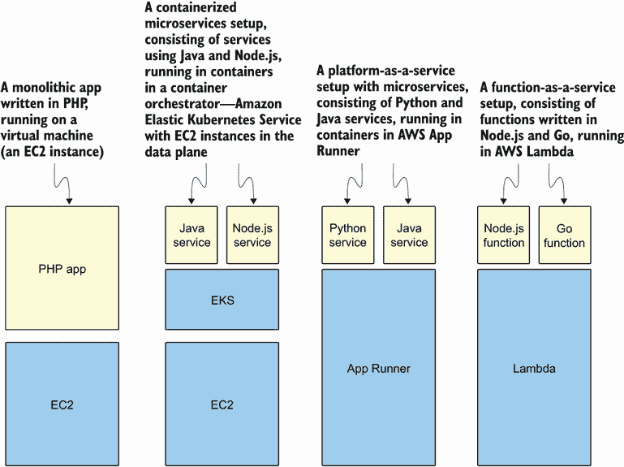
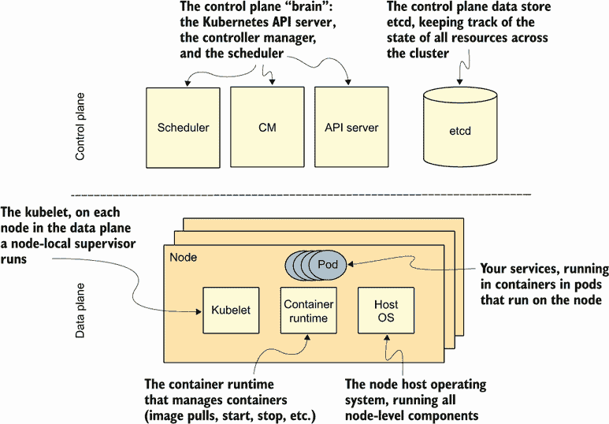
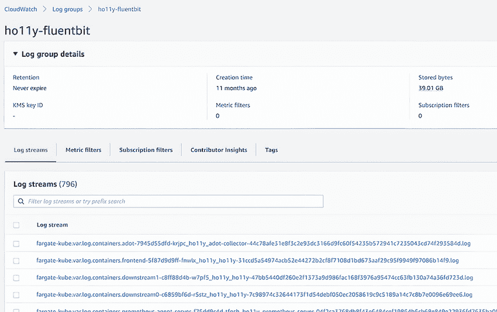
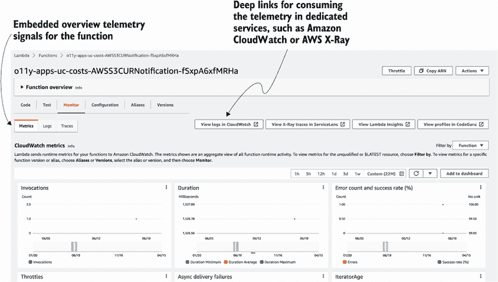
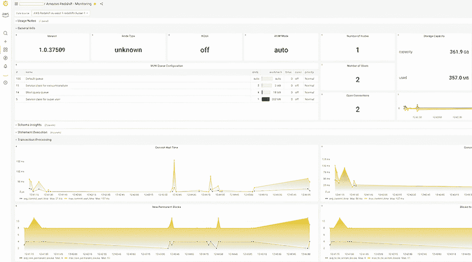
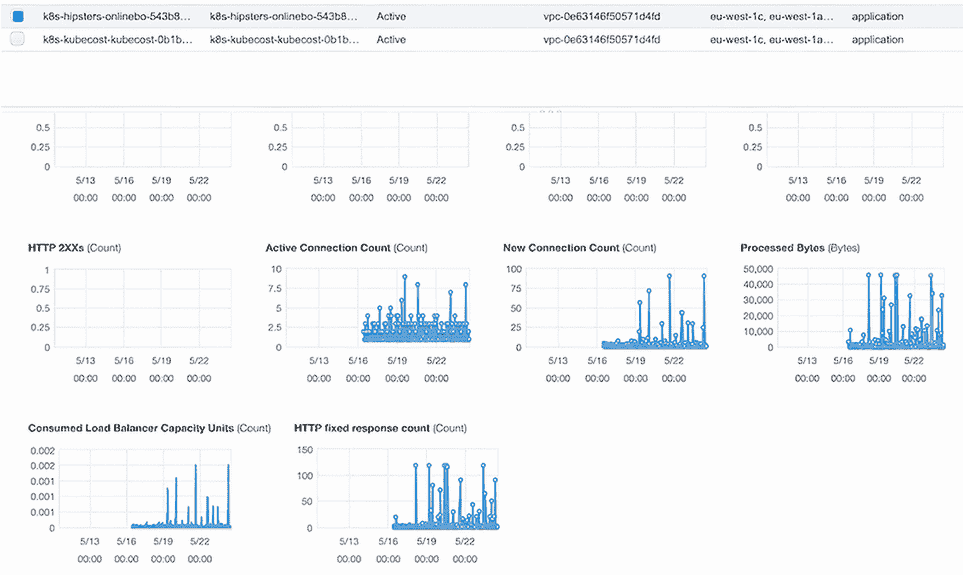
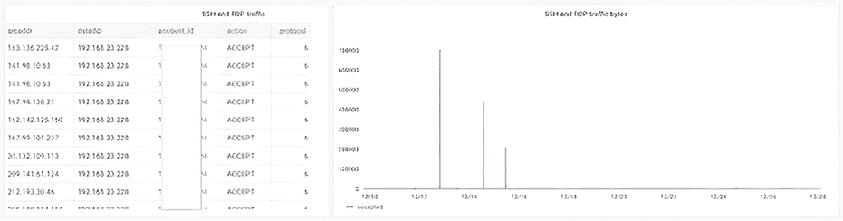

# 3 来源

本章涵盖

*   我们所说的信号来源是什么意思
*   存在哪些类型的来源以及何时选择哪个来源
*   通过为任务选择正确的来源获得可操作的洞察
*   如何处理你拥有的代码以及何时和如何进行埋点
*   理解供应链可见性

从可观测性的角度来看，被观察系统（`SUO`）由一组 *来源* 组成。这些来源发出遥测信号，例如日志、指标和追踪，我们在第 2 章中讨论过，它们构成了人类和机器可操作洞察的基础。

在云原生系统的上下文中，事物往往变化迅速——新的开源项目被推出、提供商为其产品添加功能、云提供商推出新服务。正因如此（即云原生系统中发现的迭代速度），我们不会详细介绍特定产品、其 API 或功能。重要的是，我希望关注的是让你了解你可用的来源有哪些，以及你可能希望为特定任务选择哪些来源。

在本章中，我们将使用简单且广泛使用的三分法对来源进行分类：计算、存储和网络。在高层面上，这如下所示：

*   *计算*——运行时环境，例如虚拟机（`VM`），包括通用和语言特定的环境，如 Java `VM`，以及计算单元，如在容器中运行的微服务或由 AWS Lambda 支持的函数
*   *存储*——关系数据库（PostgreSQL、MySQL 等）、NoSQL 数据存储（Redis、MongoDB、DynamoDB 等）、文件系统（本地和网络，如 NFS），以及对象存储（例如 S3）
*   *网络*——网络接口；网关；负载均衡器；虚拟专用网络（VPN）；以及整个隔离的云提供商网络，例如虚拟私有云（VPC）

在本章中，我们将涵盖广泛的技术。目标不是详细涵盖每个来源的每种信号类型，而是为你提供概述以及对预期内容的总体概念，以及有关在哪里了解更多每个来源的信息。

## 3.1 选择来源


请记住，可观测性的目标是获得可操作的洞察，而这始于了解需要考虑哪些来源和信号。好的一面是，我们选择的每个来源都会提供可以直接使用或与其他信号关联的信号。另一方面，我们考虑的每个来源都需要投入：从仪器成本到摄取信号所需的代理，再到目标存储中的存储成本。

在来源的上下文中需要考虑的一个重要问题是，什么来源与当前任务或角色相关。选择信号来源的有效策略是按任务或用例进行逆向工作。例如，当前任务可能是基础设施运营的 on-call，你可能主要关心整体的 `CPU`、`RAM` 和文件系统利用率。另一个例子可能是作为开发者改进 `API` 请求的延迟，此时你需要对网络相关来源的可视性。

你不仅必须考虑选择哪些来源，还必须考虑从某个来源使用哪些信号以及使用程度。例如，考虑 serverless `Kubernetes` 服务的情况，其中控制平面和数据平面都由你来管理。以 `etcd` 为例，在此上下文中 `Kubernetes` 控制平面将其状态保存在其中：由于你无法访问它，你无法更改设置中的任何内容（例如重新平衡或扩展 `etcd`）。由于这种不可变性，详细的指标并不那么有价值，而整体健康指标则是有价值的。

然而，你需要考虑权衡；例如，虽然你可能无法控制自动扩缩容如何发生，但对发生频率或时间的良好可见性可以帮助故障排除。至少，它应该帮助你确定问题出在提供商端还是你的应用中。

我们可以区分你拥有的来源——因此你可以自由地对其进行仪器化——以及你不拥有的来源。通常，你不拥有的来源——因此无法自由仪器化——占来源的大多数。这范围从计算运行时到存储和网络，再到你在自己的代码中使用的并依赖的库和其他服务。

好了，理论就讲到这里。现在，让我们动手实践，从与计算相关的来源开始。

## 3.2 与计算相关的来源

本节回顾与计算相关的来源。我们将从可观测性的角度来看不同类型的计算、其主要特征，以及哪些信号与哪些角色相关。

### 3.2.1 基础

在云原生环境的上下文中，关于计算我们通常面临多种选择。最终，我们关心的是能为业务利益相关者提供的功能。所以在理想世界中，我们将能够专注于应用层，这是业务的核心，并将尽可能多的繁重工作（例如安全补丁和操作系统升级，这些通常不是业务核心）外包给我们选择的服务提供商。

然而，通常有很好的理由让我们想要或必须拥有比我们希望的更大的基础设施堆栈部分——从合规要求到控制计算某些方面（如 `GPU` 或 `I/O` 相关）的需求。不管基础设施和应用层之间的界限在哪里，在你的情况下，对职责（例如谁负责升级或安全方面）的良好理解是成功云原生运营的基础。

根据你的角色（运营、开发人员、架构师、发布工程师等），你可能会以不同的方式看待计算。一些常见的方式包括以下内容：

*   部署单元（`VM`、容器或函数）

*   以服务器为中心与无服务器计算

*   单体应用与面向服务（微服务）



图 3.1 计算、基础设施和应用层的谱系

图 3.1 显示了计算的谱系，其中包含一些常见的云原生示例设置。每个设置中未着色的框代表相应的基础设施组件，而着色框代表应用级组件。

注意 实际上，在任何给定的生产环境中，你都会遇到计算的组合。这可能是由于技术原因（例如迁移到云端，并随之而来服务的容器化），也可能是由于业务原因，例如收购或合并，需要集成不同的架构。不管原因如何，这意味着你几乎总是必须准备好处理各种来源，而且对于监控单体来说看起来不错的工具或方法可能不适合容器。

表 3.1 提供了计算相关来源中信号覆盖情况的概述。

表 3.1 计算相关来源的可观测性就绪情况

| 信号 || 覆盖范围 || 示例来源 |

| --- | --- | --- |

| **日志** || 所有来源 || `EC2` 实例、`Docker` 守护进程和 `Lambda` 函数 |

| --- | --- | --- |

| **指标** || 许多来源 || `EC2` 实例和 `Kubernetes` 指标管道 |

| **追踪** || 部分来源 || `Lambda` 中的 `Node.js` 函数 |

现在让我们更仔细地看看具体的计算相关来源及其特征，从信号的角度来看。`VM` 是一种成熟且广泛使用的方式，用于在底层（物理）机器上的其他租户之间运行任意代码并提供一定的隔离保证。还有特定语言的虚拟机，例如 Java 虚拟机（`JVM`）。`JVM` 代表一个丰富的信号来源，公开日志（[`openjdk.java.net/jeps/158`](https://openjdk.java.net/jeps/158)）以及大量指标，从堆内存使用到线程，你有许多工具可用于监控 `JVM` 性能（[`sematext.com/guides/java-monitoring/`](https://sematext.com/guides/java-monitoring/)）。

如今大多数 Linux 系统（裸机和 `VM`）的共同点是它们都在使用 `systemd`，因此让我们看看某些方面，这些方面通常适用于用户可以访问操作系统的系统。而不是依赖文本日志，`systemd` 附带了自己的子系统，称为 `journalctl`，它使用二进制格式存储日志，其优点是访问速度更快，存储比文本更紧凑。然而，这也带来了缺点，即传统的基于文本的工具（例如 `tail`）不再工作。

`journalctl` 工具支持丰富的接口，允许交互式以及一次性查询。例如，要显示过去 12 小时 `systemd` 单元 `example` 的日志，

```
journalctl --since "12 hours ago" -u example.service
```

在各种编程语言的日志库和框架中广泛采用的概念是 *日志级别*，它表示某条消息的严重程度或粒度。例如，使用 `journalctl` 你可以使用 `--priority=3` 将输出限制为优先级为 `Error`（或更高优先级）的日志。

我们现在将 `VM` 视为基础设施的一部分，并在其他计算相关来源（如 `Kubernetes`）的上下文中介绍其特定特征。对于所有可以访问 `VM` 的情况——即除了无服务器环境之外——通常可以查看和查询 `VM` 的系统日志。让我们看一个具体示例，并借此介绍一种专有的日志解决方案：考虑以下 `EC2` 实例（请注意，输出已编辑以适应；相关部分已标注）：


```
$ aws ec2 get-console-output --instance-id i-0c87223xxxxx --output text
i-0c87223xxxxx     [    0.000000] Linux version 5.8.0-1041-aws             ❶
(buildd@lcy01-amd64-017) (gcc (Ubuntu 10.3.0-1ubuntu1~20.10) 10.3.0,
 GNU ld (GNU Binutils for Ubuntu) 2.35.1)
 #43-Ubuntu SMP Wed Jul 14 14:49:43 UTC 2021 (Ubuntu 5.8.0-1041.43-aws 5.8.18)
[    0.000000] Command line: BOOT_IMAGE=/boot/vmlinuz-5.8.0-1041-aws
  root=PARTUUID=fd4c3fdd-01 ro console=tty1 console=ttyS0
  nvme_core.io_timeout=4294967295 panic=-1
[    0.000000] KERNEL supported cpus:
...
Welcome to Ubuntu 20.10!
[    8.645187] systemd[1]: Set hostname to <ubuntu>.                       ❷
[    8.650813] systemd[1]: Initializing machine ID from KVM UUID.
[    8.655158] systemd[1]: Installed transient /etc/machine-id file.
...
[  OK  ] Finished Execute cloud user/final scripts.
[  OK  ] Reached target Cloud-init target.
```

❶ 关于虚拟机启动过程的详细信息，包括支持的硬件

❷ 在这里，systemd 启动并接管虚拟机的初始化。

在基础设施或平台运维角色中，你会发现虚拟机级别的信号很有用，无论是用于故障排除还是规划。开发人员可能无法始终访问此空间中的源代码，`JVM` 是一个潜在的例外。在基础知识讲完之后，让我们首先将注意力转向容器化环境。

### 3.2.2 容器

*容器* 是提供应用级依赖管理的便捷抽象。也就是说，容器利用 Linux 内核特性，包括用于隔离的命名空间（例如，进程、网络栈或文件系统挂载点）和用于资源使用管理的 cgroups。容器将这些内核特性封装在简单易用的 API 中，使你能够在一定的隔离保证下启动应用程序。它们非常适合将你的应用程序所需的所有依赖项（从编程语言库到操作系统级资源再到环境变量）打包成一个单一的构件，称为 *container image*，并在主机上运行。对于容器主机，针对虚拟机或裸金属实例的一般观察同样适用——也就是说，通常依赖于 `journald` 来处理事件，而 `journalctl` 是其主要接口。

具体来说，对于容器，信号可以来自容器运行时，例如 `Docker` 或 `containerd` 本身。另一方面，信号也来自正在运行的容器——也就是应用级信号。

对于日志，不同的容器运行时提供不同程度的支持：

* Docker 守护进程（[`docs.docker.com/config/daemon/#read-the-logs`](https://docs.docker.com/config/daemon/#read-the-logs)）提供了一个完整的解决方案，取决于主机环境，通常通过 `journalctl` 或某个文件系统位置，例如 `/var/log/` 下使日志可用。

* 对于 `containerd`，假设使用它的环境（例如，`Kubernetes`）会负责日志管理。换句话说，它不支持自己的端到端解决方案；然而，如果你以 `systemd` 单元运行 `containerd`，`journald` 将捕获输出，为你提供一些基本信息。

* `Kubernetes` 专用的容器运行时接口（`CRI`；[`mng.bz/0KAJ`](http://mng.bz/0KAJ)）是平台无关的，并且不直接支持日志记录。相反，`CRI` 将具体的日志支持推迟给你使用的容器运行时，例如 `containerd`（见上文）。

关于来自应用层的容器日志，我们需要稍微退一步。十二要素应用认为将日志（[`12factor.net/logs`](https://12factor.net/logs)）视为事件流，鼓励应用程序记录到 `stdout`，并且不关心日志路由。这种“记录到 stdout”的做法在容器中也很常见；`Docker` 对容器日志有完整支持（[`mng.bz/Ke8X`](http://mng.bz/Ke8X)），使你能够通过日志驱动程序，例如 `journald`、`syslog` 和 `Fluentd`，以及云提供商特定的格式来管理日志输入和输出。例如，要将 `Docker` 容器的日志直接发送到 Amazon CloudWatch，你会这样配置日志驱动程序：

```
docker run --log-driver=awslogs \
           --log-opt awslogs-region=eu-west-1 \
           --log-opt awslogs-group=docker-test \
           --log-opt awslogs-create-group=true \
       ...
```

如果你想了解更多关于如何在容器中使用日志的信息，我推荐阅读 Phil Wilkins 所著的 *Logging in Action*（Manning，2022；[`www.manning.com/books/logging-in-action`](https://www.manning.com/books/logging-in-action)，该书对此主题进行了详细阐述。

对于指标，容器有一些可用的选项：

* 一个相当流行且广泛使用的暴露指标的解决方案是 `cAdvisor`（[`mng.bz/9D4j`](http://mng.bz/9D4j)），它与 `Prometheus` 一起使用。

* `Telegraf`（[`mng.bz/WzRg`](http://mng.bz/WzRg)）支持一个 `Docker` 插件（[`github.com/influxdata/telegraf/tree/master/plugins/inputs/docker`](https://github.com/influxdata/telegraf/tree/master/plugins/inputs/docker)）可生成丰富的指标，包括容器统计、内存、CPU 使用率和网络相关指标。

* `Docker` 提供了一个原生的（[`docs.docker.com/config/daemon/prometheus/`](https://docs.docker.com/config/daemon/prometheus/)）`Prometheus` 集成，其范围仅限于运行时（截至撰写时，不涵盖应用程序）。

具体来说，如果你使用的是 `Docker` 守护进程（[`docs.docker.com/config/daemon/`](https://docs.docker.com/config/daemon/)），你可以通过其套接字获得（低级）指标访问权限，如以下代码所示。`curl` 命令的输出已被编辑以显示一些示例统计信息；它采用 JSON 格式，因此你可以直接查询，例如使用 `jq`：

```
$ sudo docker run -d --rm  nginx                                         ❶
82cea007263254659534e47cfb13b951f3426f6d91a16246143480f18a217718
 
$ sudo curl --unix-socket /var/run/docker.sock \
    "http://localhost/v1.40/containers/82cea0072632/stats?stream=false"  ❷
 
{
 ... "system_cpu_usage":18084207160000000,"online_cpus":2,
 ... "rss":1892352,"rss_huge":0,"total_active_anon":1892352,
 ... "total_active_file":0,"total_cache":0,"total_dirty":0,
}
```

❶ 启动一个长期运行的容器——在本例中为 NGINX 服务器。请注意此处的容器 ID `82cea007263254659534e47cfb13b951f3426f6d91a16246143480f18a217718`，我们在下一步查询指标时需要它。

❷ 使用 `curl` 查询 UNIX 套接字 `/var/run/docker.sock`。`Docker` 守护进程提供启动或停止容器等服务。我们需要提供我们想要获取指标的容器 ID，或者至少提供唯一标识容器的部分（在本例中为 `82cea0072632`）。

表 3.2 显示了一些示例指标（来自 `cAdvisor`），你通常可以从容器及其运行时中找到这些指标。

表 3.2 容器指标示例

| 类别 || cAdvisor 中的示例指标 |

| --- | --- |

| CPU || `container_cpu_usage_seconds_total`（累计 CPU 时间消耗）和 `container_cpu_load_average_10s`（过去 10 秒内容器的 CPU 负载平均值） |

| --- | --- |

| 内存 || `container_memory_max_usage_bytes`（最大应用内存使用量）和 `machine_memory_bytes`（主机上安装的内存） |

| 文件系统 || `container_file_descriptors`（容器的打开文件描述符） |

| 网络 || `container_network_receive_packets_total`（接收数据包的累计计数） |


作为开发者，你希望能够访问应用级别的日志，并且你可能会发现某些指标很有用，无论是为了优化应用的资源使用还是用于故障排除。对于运维人员来说，具有灵活的日志路由配置方式很重要（发送某些类型日志的位置和/或保留要求可能会发生变化），以及能够使用运行时公开的指标以确保主机可靠且高效地使用。现在我们对容器运行时和应用基本信号源有了一定的了解，让我们继续探讨容器通常在大规模使用的方式：容器编排器，其中 Kubernetes 是最流行且使用最广泛的示例。

### 3.2.3 Kubernetes

从可观测性的角度来看，Kubernetes 既先进又有限。为了理解这一说法，让我们稍微退一步：一方面，Kubernetes 定义了多个 API 并公开了一系列信号；另一方面，它假设你负责遥测和处理部分。也就是说，如果没有关于如何收集、路由、存储和查询 Kubernetes 提供的信号的全面策略，几乎没有开箱即用的东西供你消费信号。



图 3.2 Kubernetes 中的信号源

图 3.2 提供了 Kubernetes 中可用信号源的高级概述（[`kubernetes.io/docs/concepts/architecture/`](https://kubernetes.io/docs/concepts/architecture/)），包括控制平面和数据平面。

Kubernetes 控制平面管理集群中所有资源的状态，例如工作负载、命名空间、节点等，并允许你查询和更改受管理资源的状态。在数据平面中，多个组件协同工作以启动、健康检查、报告和终止工作负载（在 Pod 中运行的容器）。请注意，虽然 Kubernetes 本身承诺工作负载可移植，但低级部分（从负载均衡器到网络存储）在不同云提供商之间可能会有所不同，包括 API 和格式。

日志和指标信号类型在 Kubernetes 中已得到良好支持，其中日志（[`mng.bz/8rvK`](http://mng.bz/8rvK)）分布在各个地方更为分散，社区正在增加对追踪的支持。让我们更详细地了解一下 Kubernetes 上下文中不同的信号类型和来源。

关于 Kubernetes 中的日志，我们在高层面上可以区分以下内容：

*   来自控制平面的系统日志（[`mng.bz/EQzq`](http://mng.bz/EQzq)），包括 API 服务器、kubelet 和容器运行时。
*   应用日志，基于你选择的日志策略（[`mng.bz/N2DE`](http://mng.bz/N2DE)）（节点本地或路由到中央搜索服务，如 OpenSearch）。

根据使用的容器运行时，不同的日志管理功能可用，作为后备，你可以依赖 [`github.com/kubernetes/klog`](https://github.com/kubernetes/klog)（一个 Kubernetes 特定的 Go 日志库）在整个系统中可用。Kubernetes 也没有内置的日志轮转解决方案，因此这也是另一个决策点，尤其是在可移植性方面。

对于应用日志，Kubernetes 支持一种简单而有效的方式来捕获日志，我们在容器部分已经了解过：`stdout` 和 `stderr`。临时日志可通过 `kubectl logs` 命令获取；然而，由于其限制，例如保留期，通常不适用于生产使用。

在开发或测试的上下文中，Kubernetes 提供的这些临时日志相当有用，如以下示例所示（请注意输出已被编辑）：

```
$ kubectl logs deployment/frontend ho11y -f | head -4                      ❶
{"level":"info","msg":"Using http://d...0","time":"2022-03-25T11:35:51Z"}  ❷
{"level":"info","msg":"Using http://d...1","time":"2022-03-25T11:35:51Z"}
{"level":"info","msg":"Using adot:4317","time":"2022-03-25T11:35:51Z"}
{"level":"info","msg":"Init instr... done","time":"2022-03-25T11:35:51Z"}
```

❶ 使用 `kubectl logs deployment`，我们请求由 `deployment` 控制的所有 Pod 的集合日志。在我们的示例中，`deployment` 称为 `frontend`，我们特别感兴趣的是容器 `ho11y` 的日志。最后，我们使用 `head` 限制输出（显示的日志行）。

❷ 来自 `ho11y` 容器的 workload 或应用级别日志

要能够查找工作负载的日志，你需要有一种策略或解决方案，能够从各个 Pod 收集日志并将其存储在中央位置。让我们看一个具体的设置，假设你在数据平面中使用 Amazon EKS 和 AWS Fargate。在这种情况下，日志（[`mng.bz/D4Gy`](http://mng.bz/D4Gy)）设置简化为使用 Kubernetes `ConfigMap` 资源作为接口来配置 Fluent Bit 作为日志路由器，将日志发送到 CloudWatch 等位置。这看起来如下（输出已缩短）：

```
$ kubectl -n aws-observability \
          get configmap/aws-logging -o yaml   ❶
apiVersion: v1
kind: ConfigMap
data:
  output.conf: |                              ❷
   [OUTPUT]
       Name cloudwatch_logs
       Match *
       region eu-west-1                       ❸
      log_group_name ho11y-fluentbit          ❹
      log_stream_prefix fargate-              ❺
...
```

❶ 获取资源 `aws-logging` 的内容并将其渲染为 `yaml`

❷ 将应用日志路由到 CloudWatch 的 Fluent Bit 配置

❸ 指定要使用的 AWS 区域

❹ 指定要发送日志到的日志组名称（如果不存在将被创建）

❺ 在每一行的开头添加 `fargate-`（便于过滤）

要从命令行消费日志，你可以例如使用 `aws logs get-log-events --log-group-name ho11y-fluentbit ...` 命令或 AWS 控制台，如图 3.3 所示。



图 3.3 在 CloudWatch 控制台中消费 Kubernetes 应用级别日志

有许多可用的选项来路由和消费 Kubernetes 日志，例如使用 Elasticsearch 和 Kibana 的流行端到端设置（[`mng.bz/lWKj`](http://mng.bz/lWKj)）或基于 OpenSearch 的变体，以及像 Grafana Loki 这样的新来者，我们将在第 5 章中详细介绍。

在 Kubernetes 控制平面中，如图 3.2 所示，有多个组件，例如 API 服务器或 etcd，会产生日志。Kubernetes 控制平面中的另一个日志来源是节点级监视器（kubelet），通常可通过 journald 获取。在这里，最重要的是考虑是否使用托管服务或自行运行 Kubernetes。

对于托管服务，控制平面日志更具信息性，因为你通常无法访问控制组件（在与云提供商支持团队交互时可能有用）：

*   在 Amazon EKS 中，控制平面日志（[`mng.bz/BmOv`](http://mng.bz/BmOv)）可配置，默认情况下会进入 CloudWatch。
*   在 Azure AKS 中，可用多个控制平面组件的资源日志（[`mng.bz/d1gD`](http://mng.bz/d1gD)）。
*   在 Google GKE 中，你可以管理系统日志和应用日志（[`mng.bz/rWNg`](http://mng.bz/rWNg)），前者包括控制平面组件。

审计日志（[`mng.bz/V1ZX`](http://mng.bz/V1ZX)）是 Kubernetes 中的另一个日志来源，捕获用户生成活动以及与控制平面相关的活动。这些审计日志提供了谁发起每次更改的详细记录以及集群内身份验证事件，通常与受监管的工作负载和环境相关，甚至是必需的。


对于指标，Kubernetes 使用 Prometheus 暴露格式（[`mng.bz/x4V8`](http://mng.bz/x4V8)）来发出指标，该格式定义在指标管道（[`mng.bz/Aopp`](http://mng.bz/Aopp)）中，后者是控制平面的一部分。与日志不同，指标的定义和管理是集中的。你可以直接使用 `kubectl` `get` `--raw` 命令查询这些原始指标，格式为 Prometheus 暴露格式，用于调试目的。以下代码提供了一个示例（已编辑以适应）：

```
$ kubectl get --raw /metrics | grep --color=auto apiserver | head -5       ❶
### HELP apiserver_admission_controller_admission_duration_seconds [ALPHA]
  Admission controller latency histogram in seconds, identified by name
  and broken out for each operation and API resource and type (validate
  or admit).
### TYPE apiserver_admission_controller_admission_duration_seconds histogram ❷
apiserver_admission_controller_admission_duration_seconds_bucket{
name="CertificateApproval",operation="UPDATE",rejected="false",
type="validate",le="0.005"} 9.729562e+06
apiserver_admission_controller_admission_duration_seconds_bucket{
name="CertificateApproval",operation="UPDATE",rejected="false",
type="validate",le="0.025"} 9.729568e+06
apiserver_admission_controller_admission_duration_seconds_bucket{
name="CertificateApproval",operation="UPDATE",rejected="false",
type="validate",le="0.1"} 9.729568e+06
```

❶ 访问 `/metrics` 端点以获取原始指标，使用 `grep` 过滤包含 `apiserver` 的指标，并使用 `head` 限制为五行。

❷ 这里显示的指标 `apiserver_admission_controller_admission_duration_seconds` 是控制平面组件（准入控制器）的一种直方图类型。

Traces 是 Kubernetes 中最近添加的信号类型。它使用 OpenTelemetry（[`mng.bz/Zq6m`](http://mng.bz/Zq6m)）来捕获并暴露（截至撰写时）API 服务器的跟踪。

### 3.2.4 无服务器计算

本节中，我们将从无服务器计算服务提供的角度来看信号源。这些无服务器计算环境通常从运营角度来看比自行管理服务器更可取；然而，在某些情况下你无法使用它们。其中一些情况包括出于性能原因需要控制某些低级设置的使用案例，例如 Linux 内核模块或硬件配置。另一类使用案例来自监管要求，如果金融行业或医疗行业工作负载所需的某些认证不可用。

如果可以的话，你应该强烈考虑为你的工作负载使用无服务器计算。让我们先讨论无服务器计算的一般特征以及这些环境对可观测性方面的 implications。

#### 无服务器

按定义，*serverless* 意味着你不处理服务器——也就是说，你不提供或维护服务器。自然地，这些服务器仍然存在于你的提供商账户中，但现在维护它们是他们的责任。一个含义是，你通常没有对服务器的 `ssh` 访问权限，因此，前一节中与 `journalctl` 相关的许多陈述不适用。相比之下，你处理的是允许你消费日志或指标的 API，以及允许在浏览器中查看相同内容的提供商控制台仪表板。

#### 无需修补

从运营角度来看，你外包给无服务器计算提供商的维护的重要部分是安全补丁，通常在操作系统和（语言）运行时级别。这意味着，虽然你仍然希望跟踪漏洞（尤其是在应用级别），但除测试外，你这边所需的工作更少。

#### 自动扩缩容

无服务器计算中的一个突出期望是自动扩缩容。这意味着垂直（使用 CPU/RAM 更多或更少的虚拟机）或水平（添加或移除相同的机器），以改变计算容量以适应变化的负载。无服务器计算让你处理自动扩缩容而无需担心缩放模型的细节，这反过来减少了你需要摄取的指标数量。

#### 按需付费

通常，无服务器采用按需付费模式。换句话说，如果你不使用容量，理论上你就不必为其付费。对此有例外情况（例如，像 Kubernetes 这样的编排器的固定费用），计费粒度也可能是一个因素。这里的含义是，你需要确保以自动化方式跟踪成本（包括警报），尤其是在考虑自动扩缩容的情况下。

从可观测性角度来看，无服务器环境通常意味着所需的工作更少，因为很大一部分运营工作已外包给提供商。潜在的缺点是缺乏可见性——如果操作系统或虚拟机信号未明确公开，你就无法访问它。

#### 容器与函数

无服务器计算服务大致分为两种类型：以容器为中心和函数即服务（FaaS）。让我们快速了解一下主要云提供商在此领域提供的服务。

Amazon Web Services (AWS) 中的以容器为中心的无服务器服务是 AWS Fargate，你可以在两种容器编排器的上下文中使用它作为数据平面，要么在 Amazon ECS on AWS Fargate（[`mng.bz/Rxrj`](http://mng.bz/Rxrj)）中，要么在 Amazon EKS on AWS Fargate（[`mng.bz/2DR8`](http://mng.bz/2DR8)）中。根据你使用的编排器，可用的信号不同。例如，EKS on Fargate 提供基于 Fluent Bit 的日志路由解决方案（[`mng.bz/D4Gy`](http://mng.bz/D4Gy)）以及通过 CloudWatch 的指标（[`mng.bz/1qZ1`](http://mng.bz/1qZ1)），而 ECS on Fargate 提供通过 CloudWatch 的监控（[`mng.bz/PzBY`](http://mng.bz/PzBY)）以及 Prometheus 格式的指标。

AWS Lambda（[`mng.bz/JgWK`](http://mng.bz/JgWK)）是 FaaS 无服务器计算服务。如图 3.4 所示，它提供了一种统一且全面的可观测性（[`mng.bz/j129`](http://mng.bz/j129)）方法，其中包括 AWS X-Ray（[`mng.bz/wv12`](http://mng.bz/wv12)）。在此上下文中，你还应考虑如何节省 Amazon CloudWatch Logs 成本（[`mng.bz/qrVJ`](http://mng.bz/qrVJ)）。



图 3.4 控制台中的 AWS Lambda 监控

在 Microsoft 的云中，有许多无服务器计算服务，最突出的是 Azure Container Instances（[`mng.bz/7Dge`](http://mng.bz/7Dge)），它具有 Azure Monitor（[`mng.bz/mVl4`](http://mng.bz/mVl4)）支持，涵盖 CPU、内存和网络使用以及全面的日志管理。此外，还有具有集成可观测性（[`mng.bz/6DaA`](http://mng.bz/6DaA)）的 Azure Container Apps（[`mng.bz/5wMa`](http://mng.bz/5wMa)）无服务器服务。Azure Functions（[`mng.bz/o1dp`](http://mng.bz/o1dp)）是 FaaS 服务。它与 Azure Application Insights（[`mng.bz/nWB2`](http://mng.bz/nWB2)）集成，用于日志和指标，以及基于 OpenTelemetry 的跟踪支持。

Google Cloud Run（[`cloud.google.com/run/`](https://cloud.google.com/run/)）是 Google 云的以容器为中心的无服务器服务，针对无状态服务进行了优化。它附带 Google Cloud 的 operations suite（[`cloud.google.com/products/operations`](https://cloud.google.com/products/operations)—formerly Stackdriver）集成，支持日志、指标、跟踪和配置文件。Google Cloud Functions（[`cloud.google.com/functions/`](https://cloud.google.com/functions/)）是 Google 的 FaaS 服务，同样使用 Google Cloud 的 operations suite 进行可观测性。至此，我们结束了与计算相关的源，并转向各种形式的状态。

## 3.3 与存储相关的源


接下来，我们将更详细地审视与存储相关的来源。这些来源从关系数据库到文件系统不等。总的来说，由于很少有人需要编写自己的存储系统，在这一类别中，主要在于识别有哪些信号可用，以何种形式存在，以及保留多长时间（保留期）。

### 3.3.1 关系数据库和 NoSQL 数据存储

任何有用的实际应用通常都具有某种状态。在云原生系统的上下文中，存在多种不同的关系数据库管理系统（RDBMS），例如 PostgreSQL 和 MySQL，以及在微服务中使用的 NoSQL 数据存储（如 DynamoDB、Redis 和 MongoDB），具体取决于需求，例如强一致性、可扩展性和访问模式。

不论数据库类型如何，从用户角度来看，最重要的问题是如何快速处理查询。数据库采用了多种技术来加速查询处理，从使用索引到缓存。总的来说，你希望将数据库视为黑盒，除非你的角色专门聚焦于此部分，例如数据库管理员。要在高层次上了解更多相关指标，请查阅 Omed Habib 的文章“企业应用中需要监控的 Top 6 数据库性能指标” ([`mng.bz/vn24`](http://mng.bz/vn24))。

#### 关系数据库管理系统

在 RDBMS 的上下文中，最常见的信号类型是日志和指标，跟踪数据也日益可用。捕获数据库查询指标，例如最频繁或最慢的查询以及数据库性能（如缓存和会话），为运维提供了基础。

Silvia Botros 和 Jeremy Tinley 所著的 *High Performance MySQL*、*Fourth Edition* ([`mng.bz/4Dyj`](http://mng.bz/4Dyj)) 是了解 MYSQL 提供哪些信号类型的绝佳资源。它也可以作为将相关信号推广到其他 RDBMS（如 Maria DB ([`mariadb.com/kb/en/server-monitoring-logs/`](https://mariadb.com/kb/en/server-monitoring-logs/))）的基础。让我们看一个具体示例：在图 3.5 中，你可以看到使用 Grafana 作为前端的 Amazon Redshift 性能监控。



图 3.5 使用 CloudWatch 作为数据源在 Grafana 中进行 Amazon Redshift 性能监控

你可以自行收集相关数据库指标（例如流行的 RDBMS PostgreSQL）：

* 使用 Prometheus 配合 PostgreSQL Server Exporter ([`mng.bz/QP1v`](http://mng.bz/QP1v))
* 使用专用工具，如 pgMonitor ([`github.com/CrunchyData/pgmonitor`](https://github.com/CrunchyData/pgmonitor))

处理 RDBMS 性能指标的另一种选择是将此任务外包给供应商，无论是专注于可观测性的供应商，如 Dynatrace ([`mng.bz/XNQa`](http://mng.bz/XNQa))、Datadog ([`www.datadoghq.com/blog/postgresql-monitoring/`](https://www.datadoghq.com/blog/postgresql-monitoring/)) 或 New Relic ([`mng.bz/yQ6d`](http://mng.bz/yQ6d))。或者，你也可以使用你选择的云提供商提供的服务，如 AWS（见图 3.5）、Azure SQL Database ([`mng.bz/MBAB`](http://mng.bz/MBAB)) 或 Cloud SQL Insights ([`mng.bz/a1Ym`](http://mng.bz/a1Ym))。

对于 SQL 这种声明式语言，你声明期望的操作是什么，而不是如何执行。执行你的 SQL 查询的 RDBMS 有一个专门的组件称为 *query planner* ([`sqlite.org/queryplanner.html`](https://sqlite.org/queryplanner.html))，它负责优化 SQL 查询，考虑索引和其他因素。你可以通过 PostgreSQL 中的 `EXPLAIN` 语句 ([`explain.depesz.com/s/Q6sQ`](https://explain.depesz.com/s/Q6sQ)) 等方式了解查询规划的细节。

#### NoSQL

NoSQL 数据存储出现的时间不如关系数据库长（相比 RDBMS 的 50 多年，NoSQL 不到 20 年）。对于日志而言，同样适用于 RDBMS 的考虑：对于性能指标，我们面临不同的特征。在 NoSQL 的上下文中，重点较少放在查询规划上，因为缺乏关系意味着查询规划的重要性降低。在 NoSQL 上下文中最重要的是访问模式以及存储层中发生的情况。

鉴于 NoSQL 数据存储的广泛性（从键值和文档存储，如 Redis、MongoDB 和 DynamoDB，到图存储，如 Neo4j 或 Amazon Neptune，再到包括 Elasticsearch/OpenSearch 在内的搜索引擎），我们在这里不会深入详细介绍，但几个示例可能会突出良好的实践：

* “使用 Prometheus 监控 Redis” 由 David de Torres Huerta ([`sysdig.com/blog/redis-prometheus/`](https://sysdig.com/blog/redis-prometheus/))
* “MongoDB 监控” ([`mng.bz/pPrK`](http://mng.bz/pPrK))
* “Top DynamoDB 性能指标” 由 Jean-Mathieu Saponaro ([`www.datadoghq.com/blog/top-dynamodb-performance-metrics/`](https://www.datadoghq.com/blog/top-dynamodb-performance-metrics/))
* “使用 Sematext 监控 Elasticsearch” ([`mng.bz/e1KV`](http://mng.bz/e1KV))

接下来，我们将介绍两种通用而简单的存储系统：文件系统和对象存储。

### 3.3.2 文件系统和对象存储

我们现在将转向两种在云原生系统中广泛使用的与存储相关的来源，通常用于二进制大对象（BLOB），例如图像、视频或文档（PDF、Word 文档等）。在云原生环境中，本地文件系统（例如 Linux `ext4` 或 Windows NTFS）的一个重要用例是作为临时空间，即管理临时文件。网络文件系统，如 NFS ([`datatracker.ietf.org/doc/rfc3530/`](https://datatracker.ietf.org/doc/rfc3530/))，以及对象存储通常用于长期存储，因为它们与本地附加的非临时存储形成对比（即生命周期超出实例、容器或函数存在的时间）。

在 Linux 中，`/var/log` 目录是各种日志的中心位置，从应用日志到系统日志，而管理本地日志的主流工具日益是 `journalctl`。我在此强调 *local*，因为 `journalctl`（按设计）不支持将日志从机器上发送出去，这留给操作员自行处理。我们将在第 4 章和第 5 章中重新审视这个问题，当我们从代理和后端目标的角度讨论日志传输时。

从基础设施操作员的角度来看（例如 Kubernetes 平台管理员），最重要的文件系统信号是根设备上剩余的可用空间，如果磁盘空间用完，会发生各种坏事 ([`sre.google/workbook/eliminating-toil/`](https://sre.google/workbook/eliminating-toil/))。检查 Linux 系统上可用磁盘空间的一种简单方法是 `df` ([`man7.org/linux/man-pages/man1/df.1.html`](https://man7.org/linux/man-pages/man1/df.1.html)) 命令。以下是一个示例：

```
$ df -h                                            ❶
Filesystem      Size  Used Avail Use% Mounted on
/dev/root       7.7G  3.7G  4.1G  47% /            ❷
tmpfs           3.8G     0  3.8G   0% /dev/shm
tmpfs           1.5G  904K  1.5G   1% /run
tmpfs           5.0M     0  5.0M   0% /run/lock
tmpfs           4.0M     0  4.0M   0% /sys/fs/cgroup
tmpfs           767M  4.0K  767M   1% /run/user/1000
```

❶ 使用 -h 选项以 1024 的幂打印大小——即更易于人类阅读的格式

❷ 我们在这里可以看到，这台机器上使用了略少于一半的磁盘空间（47%）。


You can gather further relevant file system metrics with low-level tooling, such as `iostat` and `nfsstat`, or using higher-level tools and agents, like Prometheus ([`prometheus.io/docs/guides/node-exporter/`](https://prometheus.io/docs/guides/node-exporter/)) or, in the case of OpenTelemetry, the Host Metrics receiver ([`mng.bz/OxRw`](http://mng.bz/OxRw)).

For cloud-native applications, object stores are the workhorses, used for virtually anything from small files (JSON) to large BLOBs, such as images. Typically, these object stores offer a simple HTTP API to store and list objects. Different cloud providers offer a range of signals from object stores, usually at least logs and metrics—for example, Amazon S3 ([`mng.bz/Y1Xz`](http://mng.bz/Y1Xz)), Azure Blob Storage ([`mng.bz/GylD`](http://mng.bz/GylD)), and Google Cloud Storage ([`cloud.google.com/storage/docs/access-logs`](https://cloud.google.com/storage/docs/access-logs)).

We’ve now completed a brief review of storage-related sources, which is mostly relevant for infrastructure operators and is secondary for developers. We now move on to a kind of signal source that you will have to pay attention to, no matter what your role is: networks and their signals.

## 3.4 Network-related sources

In this section, we will look at all sorts of network-related sources, from low-level interfaces to virtual networks. As with storage, these sources are mostly owned by others (e.g., your cloud provider of choice) and, by their nature, are high-volume sources, meaning you have to deal with a lot of noise.

### 3.4.1 Network interfaces

Physical network interfaces or virtual interfaces, such as the loopback interface, form the lowest layer of network-related sources. Depending on the environment (think serverless data planes or FaaS), you may or may not have direct access to these interfaces. By *direct access*, I mean being able to use commands such as `ip` ([`mng.bz/zXo1`](http://mng.bz/zXo1)) to query interface and routing information.

To demonstrate the difference between having direct access to the network interface information and when that’s not the case, imagine you have an EC2 instance (e.g., as part of a Kubernetes cluster data plane) that you can `ssh` into and then execute (the output is edited to fit):

```
$ ip link show                                                            ❶
1: lo: <LOOPBACK,UP,LOWER_UP> mtu 65536 qdisc noqueue state UNKNOWN mode
    DEFAULT group default qlen 1000
    link/loopback 00:00:00:00:00:00 brd 00:00:00:00:00:00
2: ens5: <BROADCAST,MULTICAST,UP,LOWER_UP> mtu 9001 qdisc mq state UP mode
    DEFAULT group default qlen 1000
    link/ether 0a:78:c2:54:1f:39 brd ff:ff:ff:ff:ff:ff
    altname enp0s5
3: docker0: <NO-CARRIER,BROADCAST,MULTICAST,UP> mtu 1500 qdisc noqueue state
    DOWN mode DEFAULT group default
    link/ether 02:42:18:7d:57:00 brd ff:ff:ff:ff:ff:ff
 
$ ip route                                                                ❷
default via 172.31.32.1 dev ens5 proto dhcp src 172.31.40.108 metric 100
172.17.0.0/16 dev docker0 proto kernel scope link src 172.17.0.1 linkdown
172.31.32.0/20 dev ens5 proto kernel scope link src 172.31.40.108
172.31.32.1 dev ens5 proto dhcp scope link src 172.31.40.108 metric 100
```

❶ Using the `ip` command, list network interfaces, their configuration, and status.

❷ Using the `ip` command, list routing information, such as the default gateway.

While you do have visibility into network interfaces (both configuration and dynamic information) in the case of a VM or a physical server, in the context of a cloud function or lambda function, you do not.

### 3.4.2 Higher-level network sources

In contrast to network interfaces, higher-level network sources, such as load balancers, are usually directly accessible in terms of having access to the relevant signals, most importantly metrics (health and performance related). Load balancers, both L3/4 and L7 (that is, HTTP level) typically provide a wealth of signals—for example, the Amazon Application Load Balancer (ALB; [`mng.bz/0KvJ`](http://mng.bz/0KvJ)) supports logs, metrics, and traces. For a concrete example, see figure 3.6, which is derived from an open source observability demo ([`github.com/observe-k8s/Observe-k8s-demo`](https://github.com/observe-k8s/Observe-k8s-demo)). The same is the case for the Amazon API Gateway ([`mng.bz/9Dpj`](http://mng.bz/9Dpj)) in front of lambda functions. One important aspect in this context is the health of the backends and how to make sure they are up—and, hence, traffic can be routed to them. For example, an `HTTPCode_ELB_504_Count` code from the ALB ([`mng.bz/Wz4g`](http://mng.bz/Wz4g)) indicates that backend resources didn’t respond in time or, as shown in figure 3.6, various usage-related metrics. Further, you should consider that certain orchestrators, such as Kubernetes, introduce network abstractions ([`mng.bz/8reK`](http://mng.bz/8reK))—for example, an Ingress resource—allowing you to manage higher-level network resources in clusters along with signals that may or may not be exposed with the abstractions.



Figure 3.6 Screenshot of the ALB-monitoring console, showing usage metrics

Another high-level source in the network space is the virtual private network (VPN) or, when directly provided by a cloud provider, virtual private cloud (VPC). For an example source, you can use Amazon VPC flow logs ([`mng.bz/EQNq`](http://mng.bz/EQNq)), which provide details about IP traffic going into and coming from network interfaces in a VPC, for a range of security-related use cases. In figure 3.7, you see an example depiction of VPC flow logs exported to an S3 bucket and using Athena for querying ([`mng.bz/6n9D`](http://mng.bz/6n9D)).



Figure 3.7 Screenshot of VPC flow logs rendered in Grafana, showing SSH and RDP traffic

With this, we’ve completed the infrastructure-related sources. Now, we can move on to a source type that you typically have a lot more control over: your code.

## 3.5 Your code

We now switch gears and focus on code you own and can instrument. There are two aspects to this:

*   *The (business) code you write yourself*—This refers to developing new features from scratch or fixing bugs in your own code.

*   *The code you depend on in your code*—This includes programming language standard libraries or third-party libraries. These libraries typically abstract low-level operations or common functionality, including storage and network access.

For the second case, your dependencies, you may, in certain cases (e.g., regulatory requirements and business reasons), decide to own it end to end. For example, you may decide to maintain a private fork of an open source project, so you can iterate faster or issue quick fixes.

In addition, supply chain aspects are important to consider—which (third-party) dependencies you should take into account, from what sources they come, and so on. For visibility into where dependencies come from, you can use tools like Backstage ([`github.com/backstage/backstage`](https://github.com/backstage/backstage)) and OpenLineage ([`openlineage.io/`](https://openlineage.io/)).

In this context, we often talk about developer or development observability (e.g., practices to consider and use CI/CD pipelines as signal sources \[[`mng.bz/D4Ey`](http://mng.bz/D4Ey)\]) as well as emerging dedicated tooling in this space, such as what Digma ([`github.com/digma-ai/digma`](https://github.com/digma-ai/digma)) and Sprkl ([`sprkl.dev/`](https://sprkl.dev/)) envision. The general direction is to make developers more productive by providing insights into code changes and their impacts on the application, using a variety of signals.

### 3.5.1 Instrumentation


我们已在第 2 章详细介绍了为日志、指标和追踪对代码进行仪器化（instrumenting）的成本和收益。取决于你使用的编程语言（即解释型与编译型），你需要付出不同的努力来发出多种信号。在可能的情况下，你应该使用自动仪器化，并且通常最好标准化为 `OpenTelemetry`，以避免在切换信号目标时重新进行仪器化工作。我们将在第 4 章更详细地介绍这一点。

### 3.5.2 代理源

在你不拥有代码但仍想获取一些信号的情况下，可以使用代理源。例如，在使用 Prometheus 抓取指标的上下文中，考虑以下情况：

*   你想将来自消息队列（如 Kafka 或物联网设备）的指标加入其中，那么你会运行 Prometheus 可以抓取的众多导出器之一（[`mng.bz/lWDj`](http://mng.bz/lWDj)）。
*   另一种可能的情况是你确实拥有代码（例如在批处理作业或 Lambda 函数的上下文中），这是一个短暂运行的进程。另一方面，Prometheus 假定是一个可以随时抓取的长期运行进程；在这种情况下，你会使用 Pushgateway（[`github.com/prometheus/pushgateway`](https://github.com/prometheus/pushgateway)）来弥补阻抗不匹配。你可以通过 Bartek Płotka 和 Saswata Mukherjee 在 KubeCon EU 2022 的演讲“Fleeting Metrics: Monitoring Short-lived or Serverless Jobs”了解更多信息，该演讲可通过 YouTube 获取（[`www.youtube.com/watch?v=rt4JiK995s8`](https://www.youtube.com/watch?v=rt4JiK995s8)）。

代理也可以是适配器（例如从日志文件到 `stdout`），以使某些信号类型（如日志）在云原生设置中兼容且可用。

至此，我们已完成了对云原生设置中源的讨论，从计算到存储到网络再到你自己的代码，现在我们转向信号如何到达各种目的地以供消费的问题。简而言之，我们转向代理。

## 摘要

*   源是被观察系统中的任何发出遥测信号的实体，例如日志、指标、追踪和概要文件。
*   如果你拥有一个源（例如你在容器中运行的应用程序代码），那么你可以对其进行仪器化；否则，你需要绕过它，处理源所有者发出的内容。
*   我们可以区分源类型：计算、存储和网络。
*   容器和函数由于其短暂的生命周期，可能具有挑战性的源类型。
*   从可观测性的角度来看，无服务器环境意味着工作量更少但控制也更少。
*   与存储相关的源附带广泛的日志；指标支持；以及在较小程度上追踪，但概要文件是可用的。
*   对于 RDBMS，查询规划（分析）至关重要。对于 NoSQL 数据存储，访问模式和存储布局是最重要的关注领域。
*   对于文件系统，最重要的是关注可用磁盘空间（对于操作员而言）。
*   与网络相关的源可能很嘈杂，因为事件量很高。按源、目标或应用程序进行过滤可能具有挑战性。
*   更高级别的网络源，例如负载均衡器，通常比更低级别的源，例如 NIC，更有价值且更易访问。
*   在对代码进行仪器化时，请注意供应链问题（依赖项）。
*   对于追踪和指标，始终将自动仪器化用作基线，然后根据投资回报率决定在哪里以及对什么进行手动仪器化。
