# 4 代理和仪器化

本章涵盖

*   我们所说的代理和仪器化是什么意思
*   存在哪些类型的代理，适用于哪些信号类型
*   什么是 OpenTelemetry 以及你如何从中受益
*   选择代理的标准

在本章中，我们将重点介绍如何将我们在第 3 章中讨论的源的信号获取到我们将在第 5 章和第 6 章中重点介绍的目的地。由于可观测性完全是关于从被观察系统公开的信号中获取可操作的见解，如果没有代理和仪器化，就几乎没有什么可观察的。

简而言之，在本章中，我们将学习如何对代码进行仪器化（并自动化该任务）以及选择和部署收集、聚合、过滤、下采样、脱敏和路由日志、指标和追踪的代理。

遥测行业在撰写本文时正处于一场 tectonic 转变之中。这种从特定于供应商或特定于信号的仪器化和代理向名为 `OpenTelemetry` 的行业标准的转变始于 2019 年。在本书的上下文中，我们将特定于供应商以及特定于信号的代理视为传统代理，与 `OpenTelemetry` 形成对比。

从 AWS 到 Azure 再到 Google Cloud 的云提供商，以及从 Datadog 到 Splunk 到 New Relic 到 Lightstep 到 Dynatrace 到 Honeycomb 到 Grafana Labs 的可观测性供应商，都已决定在 `OpenTelemetry` 背后组建。这有效地意味着遥测行业已决定使遥测成为基本要求，将其商品化，而是在目的地（存储和查询以及前端）上竞争。

`OpenTelemetry` 涵盖，按成熟度排序且截至撰写本文时，追踪、指标和日志。今后，社区已决定也在 `OpenTelemetry` 中涵盖概要文件（进程中的资源使用和时间）。另见我们在第 2 章中的讨论。

由于日志在 2022 年仍在进行中，我将在本章中使用特定于供应商或特定于信号的设置来演示日志。对于指标和追踪，另一方面，我将向你展示如何从开放且与供应商无关的标准 `OpenTelemetry` 及其代理收集器中受益。

## 4.1 日志路由器

首先，我们将看一下日志路由器。这些代理允许你从各种源收集日志，无论是系统级别还是你的应用程序，并将其发送到中央位置以供查找。在此上下文中，你经常还会听到日志转发、日志收集和日志聚合。然而，为了保持简单，我们将忽略细节并将所有这些统称为 *log routers*。

截至撰写本文时（2023 年），特定于供应商的代理，例如 Splunk 的 Universal Forwarder 或 Datadog 代理，以及特定于信号的代理，包括 Fluentd/Fluent Bit 或广泛使用的 Logstash。预计今后会发生变化并转向 `OpenTelemetry`。

我们将区分系统日志和应用程序日志。系统日志来自，但不限于，以下源（有关详细信息，请参阅我们在第 2 章中的讨论）：

*   操作系统（例如，在 Linux 中，来自 `/var/log` 和 `journalctl`）
*   Kubernetes 控制平面（[`mng.bz/BmWv`](http://mng.bz/BmWv)）日志（包括来自 `API server`、`etcd` 和 `controller manager` 的日志）以及工作节点日志（[`mng.bz/d10D`](http://mng.bz/d10D)），例如来自 `kubelet` 或 `container runtime` 的日志
*   用户活动和 API 使用日志，如 AWS CloudTrail（[`aws.amazon.com/cloudtrail/`](https://aws.amazon.com/cloudtrail/)）提供的日志
*   基础设施自动化日志（例如来自 HashiCorp `Terraform` 或 AWS `CloudFormation`）

应用程序日志，另一方面，是你在代码中发出的内容。你最终可能会为系统日志和应用程序日志使用不同的代理；但是，如果可能，你应该尝试通过选择一个代理来标准化，例如以下各节中讨论的代理。这主要是出于运营原因，因为这意味着需要修补（例如，考虑 `Log4j` 挑战）的内容会更少，并且升级。


注意 如果你对我在此提到的 `Log4j` 挑战不熟悉（或可能已经忘记了），`CVE-2021-44228`（[`nvd.nist.gov/vuln/detail/CVE-2021-44228`](https://nvd.nist.gov/vuln/detail/CVE-2021-44228)），非正式地称为 `Log4Shell`，是 `Log4j` 中于 2021 年 11 月发现的一个零日漏洞。它在许多地方造成了大量工作（应用安全补丁），从内部 IT 到云服务提供商，并作为此类事物可能产生多大运营影响的示例。

虽然从 API 和模型角度来看日志是稳定的，但在 `OpenTelemetry` 中，直到 2024 年中它们才可能在 `SDKs` 和发行版中得到全面支持。这意味着在你最终能够迁移到 `OpenTelemetry` 之前，你需要一个临时策略。

好了，理论就讲到这里。让我们看看日志路由的实际应用。首先是在容器环境中很受欢迎的选择：`Fluentd` 和 `Fluent Bit`。

### 4.1.1 Fluentd 和 Fluent Bit

CNCF 项目 `Fluentd`（[`www.fluentd.org/`](https://www.fluentd.org/)）和 `Fluent Bit`（[`fluentbit.io/`](https://fluentbit.io/)）是流行的云原生代理，最初起源于日志领域。最初只有 `Fluentd`（用 `Ruby` 和 `C` 编写），提供丰富的生态系统（超过 1,000 个插件），但代理的内存占用相对较大（数十 MB）。

2014 年，`Fluentd` 背后的团队 `Treasure Data` 认识到需要在受限环境（容器、物联网）中专门使用轻量级日志路由器。这种洞察促使开发了 `Fluent Bit`（用 `C` 编写），内存占用仅几百 KB，且插件比 `Fluentd` 少得多（少于 100 个）。

在撰写本文时，`Fluent Bit` 正在将其范围从仅日志扩展到其他信号类型，例如指标和追踪。详情请参阅 GitHub 议题“`Fluent Bit v2.0 Is Coming`”（[`github.com/fluent/fluent-bit/discussions/5993`](https://github.com/fluent/fluent-bit/discussions/5993)）。不过由于仍有许多 WIP 项目在进行中，本节我们将重点关注日志方面。让我们看一个容器化设置中的基本使用示例，并在过程中讨论一些特性。

为了演示日志路由，我们使用的是 `OpenSearch` 与 `Docker Compose`（[`opensearch.org/docs/latest/opensearch/install/docker/`](https://opensearch.org/docs/latest/opensearch/install/docker/)）的设置。现在不用担心 `OpenSearch`；我们将在第 5 章详细介绍它。只需将其视为日志可以发送到的地方，你可以在其中查找、搜索和查询日志行。例如，你可能对特定微服务在特定时间范围内（比如过去 24 小时）的所有 `ERROR` 级别日志行感兴趣。

在图 4.1 中，你可以看到我们的示例日志管道——我们使用 `ho11y`（[`mng.bz/rWxg`](http://mng.bz/rWxg)）作为在 Docker 容器中运行的日志信号源。容器公开端口 8765 用于其 HTTP API，并使用 `Fluentd` 日志驱动程序将日志行发送到 `Fluent Bit`（主要日志路由器），将日志行摄取到 `OpenSearch` 作为日志后端目标，然后你可以在 `OpenSearch Dashboards` 中查询和可视化。

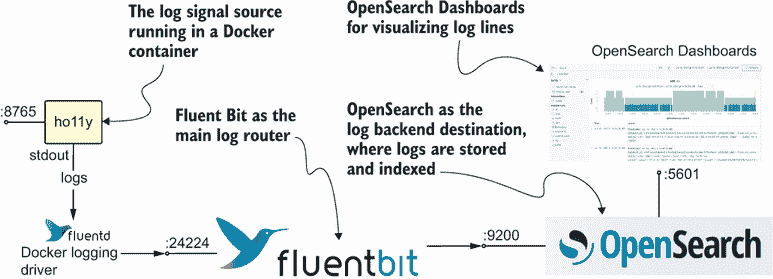

图 4.1 使用 `Fluentd` 和 `Fluent Bit` 的示例日志管道

进入实现部分，我们再次使用 `Docker Compose` 来启动管道，其定义在 `ch04/fluent-bit/docker-compose.yaml` 文件中。让我们逐步回顾管道。我已在 `Docker Compose` 文件中配置 `ho11y` 容器，使其使用 `fluentd` 日志驱动程序（因为目前在那里还不直接支持使用 `Fluent Bit` 作为驱动程序）。

#### 列表 4.1 信号源 `ho11y` 的 Docker Compose 配置片段

```
ho11y:
    image: public.ecr.aws/mhausenblas/ho11y:stable
    ports:
      - 8765:8765           ❶
    logging:                ❷
      driver: fluentd
      options:
        tag: ho11y
        fluentd-address: localhost:8765 
    depends_on:             ❸
      - fluent-bit
```

❶ 在端口 `8765` 上公开 `ho11y` HTTP API 服务端口，使其可从主机访问（这样我们就可以使用 `curl` 调用它）

❷ 配置容器使用 `Fluentd` 日志驱动程序

❸ 定义 `ho11y` 容器依赖于 `Fluent Bit` 日志路由器，强制启动顺序

接下来是 `Fluent Bit` 配置，如以下列表所示。如你所见，这以一个名为 `fluent-bit.conf` 的文件作为参数，我们将在本章后面讨论。

#### 列表 4.2 Fluent Bit 的 Docker Compose 配置片段

```
fluent-bit:
    image: fluent/fluent-bit:1.9.8
    volumes:
      - ./fluent-bit.conf:/fluent-bit/etc/fluent-bit.conf   ❶
    ports:
      - "24224:24224"                                       ❷
      - "24224:24224/udp"
```

❶ 定义 `Fluent Bit` 配置（路由信息）的位置

❷ 确保打开端口 `24224`，以便我们可以监听来自 `Docker` 中 `Fluentd` 日志驱动程序的传入日志行

最后但同样重要，让我们看看日志后端 `OpenSearch` 如何配置（在以下列表的 `Docker Compose` 文件中）在单节点设置中以及前端/UI `OpenSearch Dashboards`。

#### 列表 4.3 OpenSearch（和 Dashboards）的 Docker Compose 配置片段

```
opensearch-node1:
    image: opensearchproject/opensearch:2.1.0
    container_name: opensearch-node1
    environment:
      - cluster.name=opensearch-cluster
      - node.name=opensearch-node1
      - bootstrap.memory_lock=true
      - "OPENSEARCH_JAVA_OPTS=-Xms512m -Xmx512m"
      - "DISABLE_INSTALL_DEMO_CONFIG=true"
      - "DISABLE_SECURITY_PLUGIN=true"
      - "discovery.type=single-node"
    volumes:
      - opensearch-data1:/usr/share/opensearch/data
    ports:
      - 9200:9200                                            ❶
 
  opensearch-dashboards:
    image: opensearchproject/opensearch-dashboards:2.1.0
    container_name: opensearch-dashboards
    ports:
      - 5601:5601                                            ❷
    environment:
      - 'OPENSEARCH_HOSTS=["http://opensearch-node1:9200"]'  ❸
      - "DISABLE_SECURITY_DASHBOARDS_PLUGIN=true"
```

❶ 公开端口 `9200`，以便我们可以摄取日志行（来自 `Fluent Bit`）

❷ 公开端口 `5601`，使 `OpenSearch Dashboards`（前端/UI）可从主机访问

❸ 配置 `OpenSearch Dashboards`（前端）使用 `OpenSearch`（日志后端）

在这一点上，我们已经有效地实现了图 4.1 所示的日志管道。现在，让我们更仔细地查看 `Fluent Bit` 配置本身。如列表 4.4 所示，我在 `Fluent Bit` 中使用 `Forward`（[`docs.fluentbit.io/manual/pipeline/inputs/forward`](https://docs.fluentbit.io/manual/pipeline/inputs/forward)）输入插件，从 `Fluentd`（来自 `Docker` 运行时）接收日志流，并通过 `OpenSearch` 输出部分配置 `Fluent Bit` 将日志行路由到 `OpenSearch`。

#### 列表 4.4 Fluent Bit 配置

```
[INPUT]
    Name forward            ❶
    Listen 0.0.0.0          ❷
    Port 24224              ❸
 
[OUTPUT]
    Name opensearch         ❹
    Match **                ❺
    Host opensearch-node1   ❻
    Port 9200
    Index ho11y             ❼
    Suppress_Type_Name on   ❽
```

❶ 在这里，我们配置 `Forward` 插件，使其能够从 `Fluentd`（来自 `Docker` 日志驱动程序）接收日志项。

❷ `Forward` 插件将监听所有网络接口（即 `0.0.0.0`）。

❸ `Forward` 插件的默认端口（`Fluentd` 连接到的端口）

❹ 目标配置——在我们的例子中，是 `OpenSearch` 插件作为日志项的后端（下游）

❺ 在这里，我们定义确实接收任何日志项（我们可以在这里更具选择性，决定路由到 `OpenSearch` 的日志项，但目前我们使用全部）。


❻ OpenSearch 节点的主机名（也可以是原始 IP 地址）

❼ 我们要在 OpenSearch 中创建的索引的名称

❽ 告诉 OpenSearch 节点我们无需设置类型（在本次配置的上下文中我们并不关心）

呼，配置真不少！现在，是时候启动管道并生成一些日志行了。首先，我们需要启动 Fluent Bit–OpenSearch 组合：

```
docker-compose -f docker-compose.yaml up
```

在另一个终端会话中，像这样启动一个简单的负载生成器（在 Bash shell 中）：

```
while true ; do \
  curl -s -o /dev/null -w "%{http_code}"
  ➥ localhost:8765 ; \      ❶
  sleep 1 ; \                ❷
done
```

❶ 使用 `curl` 调用 `ho11y` 并生成日志行，丢弃输出仅显示返回的 HTTP 状态码

❷ 暂停 1 秒后从头开始重复

现在，你可以导航到 `http://localhost:5601/`。你应该会看到 OpenSearch Dashboards 的欢迎页面（在 ELK 堆栈——Elasticsearch、Logstash 和 Kibana 中——等效组件是 Kibana）。点击左上角的汉堡图标（三条线），然后依次选择 Stack Management 和 Index Patterns；你应该会看到如图 4.2 所示的内容。

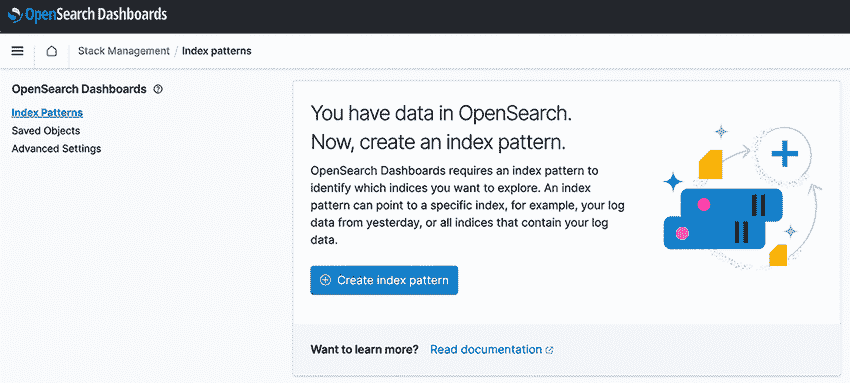

图 4.2 在 OpenSearch Dashboards 中创建索引模式

接下来，点击 Create Index Pattern，并在标记为 Index Pattern Name 的输入框中输入 `ho11y`，然后点击 Next Step。然后，在 Time Field 下拉列表中选择 `@timestamp`，随后点击 Create Index Pattern 按钮。你应该看到的结果类似于图 4.3 所描绘的内容。

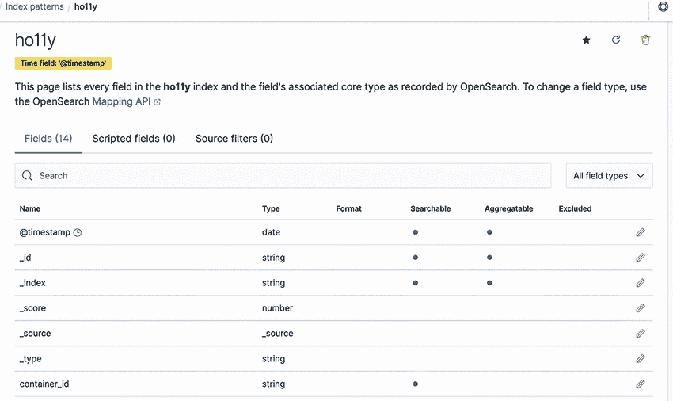

图 4.3 OpenSearch Dashboards 中生成的索引模式

现在，返回 OpenSearch Dashboards 主页，点击左上角的汉堡图标（三条线），然后点击 Discover。你应该会看到类似于图 4.4 所示的内容。

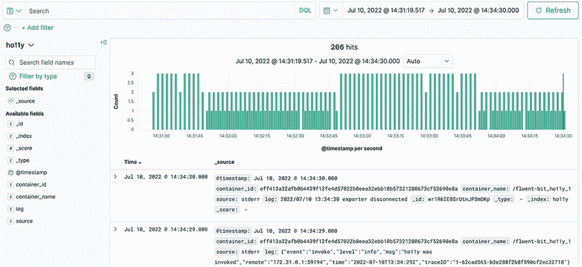

图 4.4 OpenSearch Dashboard 的 Discover 视图，已选择我们的 `ho11y` 索引

你现在拥有一个基于 Fluent Bit 作为日志路由器的可用功能日志管道。从现在开始，你可以随意深入查看日志行，或使用 Dashboards 查询语言（DQL；[`opensearch.org/docs/latest/dashboards/dql`](https://opensearch.org/docs/latest/dashboards/dql)），这是一种领域专用查询语言，来在 OpenSearch 索引中查找数据，或查询 `ho11y` 日志中的特定术语。

如果你有兴趣更详细地了解 Fluentd 和 Fluent Bit 的工作原理，以及在容器（尤其是 Kubernetes）环境中构建日志路由管道的最佳实践，我强烈推荐阅读 Phil Wilkins 所著的精彩 Manning 书籍 *Logging in Action*（2022；[`www.manning.com/books/logging-in-action`](https://www.manning.com/books/logging-in-action)）。

### 4.1.2 其他日志路由器

我们已经见识了 Fluent Bit 的实际应用，但这并不是我们唯一的选项。事实上，有许多商业和开源日志路由器可供选择，例如以下这些：

*   Beats（[`github.com/elastic/beats/tree/master`](https://github.com/elastic/beats/tree/master)）家族以及 Logstash（[`github.com/elastic/logstash`](https://github.com/elastic/logstash)），均为 Elastic Stack 的一部分。
*   Data Prepper（[`github.com/opensearch-project/data-prepper`](https://github.com/opensearch-project/data-prepper)），一个允许状态化处理的 AWS 开源项目。
*   syslog-ng（[`www.syslog-ng.com/products/open-source-log-management/`](https://www.syslog-ng.com/products/open-source-log-management/)）是一个 syslog 实现，默认从 systemd journal 摄取消息，应用过滤器并将其发送到文件。
*   rsyslog（[`www.rsyslog.com/`](https://www.rsyslog.com/)）是一个用于在 TCP/IP 网络上路由和过滤日志消息的开源工具，作为 `syslogd` 的替代品引入。
*   Graylog（[`www.graylog.org/`](https://www.graylog.org/)）是一家日志管理软件公司，提供以安全用例为重点的日志解决方案。
*   Cribl（[`cribl.io/`](https://cribl.io/)）是一款具有强大摄取和处理能力的云服务。

请记住，随着 OpenTelemetry 的成熟和日志的持续稳定，请确保制定迁移策略，以便从你当前与 OpenTelemetry collector 一起使用的日志路由代理迁移。让我们现在转向指标。

## 4.2 指标收集

与日志相比，指标方面的生态系统碎片化程度较低。过去几年（实际上自 2016 年 Kubernetes 兴起以来），主导者是 Prometheus 项目，它提出了指标的收集方式以及指标在传输线上的表示方式——*exposition format*。让我们先来看看 Prometheus，然后快速浏览一下指标领域中的其他成熟代理。

注意 虽然 Prometheus 建立了基于拉取的收集——即代理通过默认为 `/metrics` 的 HTTP 端点查询指标源——但在 OpenTelemetry 的上下文中情况更为微妙。在那里，入口部分仍然是基于拉取的；然而，出口部分（面向后端目标）通常是基于推送的。我们将在下一节关于 OpenTelemetry 的内容中详细介绍。

### 4.2.1 Prometheus

Prometheus（[`prometheus.io/`](https://prometheus.io/)）是一个成熟的 CNCF 项目，与 Kubernetes 共同成长，在 Kubernetes 中也主要使用。它涵盖了指标的摄取、存储以及查询和联邦接口，包括一个简单的 UI。此外，Prometheus 项目的一部分是告警功能（一个独立的二进制文件但紧密集成）。

在第 2 章中，我们对指标进行了一般性讨论。现在，让我们更详细地仔细看看 Prometheus 是如何运作的。

Prometheus 中的一个时间序列由其指标名称和若干（可选的）键值对唯一标识，这些键值对称为 *labels*。指标名称捕获你想要测量的通用特征。例如，`api_requests_total` 可用于 API 调用的总数。另一方面，标签代表 Prometheus 的维度数据模型。假设你想用 API 调用指标捕获两个维度：使用的 HTTP 方法以及 URL 路径是什么。你可以使用两个标签 `method` 和 `path` 来实现，例如如下所示：

```
api_requests_total{method="GET", path="/some/interesting/thing"}
```

Prometheus 支持不同类型的指标，包括计数器、仪表和直方图，并且 Prometheus 对指标和标签有命名约定（[`prometheus.io/docs/practices/naming/`](https://prometheus.io/docs/practices/naming/)），但它并未为其定义或强制执行语义。实际上，Prometheus 缺乏定义的语义并不是一个大问题，因为 Prometheus 提供了一个名为 *relabeling* 的功能（[`prometheus.io/docs/prometheus/latest/configuration/configuration/#relabel_config`](https://prometheus.io/docs/prometheus/latest/configuration/configuration/#relabel_config)），它允许你对命名进行标准化。

通过 relabeling，你可以按目标添加、删除或修改标签。一个具体的例子就是重命名标签以标准化标签名称。假设我们的源会在标签 `handler` 下公开 URL 路径，但我们希望在设置中使用 `path`。在这种情况下，我们想要执行以下 relabeling：

```
api_requests_total{method="GET", handler="/some/interesting/thing"}

=>

api_requests_total{method="GET", path="/some/interesting/thing"}
```


## 4.2 Prometheus

你可以使用在 Prometheus scrape config 中定义的重新标记规则来实现此操作（[`prometheus.io/blog/2015/06/01/advanced-service-discovery/#scrape-configurations-and-relabeling`](https://prometheus.io/blog/2015/06/01/advanced-service-discovery/#scrape-configurations-and-relabeling)），如下所示：

```
- source_labels: [handler]   ❶
  action: replace
  target_label: path
- regex: "handler"           ❷
  action: labeldrop
```

❶ 匹配 `handler` 标签名称并使用相同的标签值添加 `path` 标签

❷ 完成后，它会删除 `handler` 标签名称，仅保留 `path` 作为捕获 URL 路径的标签。

提示

如果你想交互式地尝试重新标记，可以访问 [`relabeler.promlabs.com/`](https://relabeler.promlabs.com/) 并使用重新标记规则（在左侧的 Relabeling Rules 输入框中）以及以下内容作为右侧（Object Labels）的输入：

```
method: "GET"
handler: "/some/interesting/thing"
```

当你现在点击 Analyze Rules 按钮时，你应该能看到规则引擎运行并产生预期结果。

此外，为了提高查询性能，你可以在 Prometheus scrape config 中定义 recording rules（[`mng.bz/V1vX`](http://mng.bz/V1vX)）。此功能允许我们预先计算频繁使用或开销大的表达式，实质上是用空间换时间，将结果保存为新的时间序列。假设我们想要使用 recording rule 来捕获 API 调用示例的服务器端错误率（其中 `api_requests_total` 为 counter 指标类型）：

```
- name: api_invocation_server_error                              ❶
  interval: 5m                                                   ❷
  rules:
  - record: http_status_5xx:api_requests_total:ratio_rate_5m     ❸
    expr:                                                        ❹
      sum(rate(api_requests_total{code=~"5.."}[5m]))
        /
        sum(rate(api_requests_total[5m]))
```

❶ recording rule 名称

❷ 评估规则的频率（此处为每 5 分钟）

❸ 生成指标的名称（请注意 `:` 的使用，按惯例它保留用于 recording rule 指标）

❹ 在当前时间评估的 PromQL 表达式，会生成一个新时间序列，其指标名称由前面的 record 值定义——在我们的例子中为 `http_status_5xx:api_requests_total:ratio_rate_5m`

你可以用两种方式使用 Prometheus（即使用相同的二进制文件，但配置不同）：

* Prometheus server（默认模式）
* Prometheus agent mode（[`prometheus.io/blog/2021/11/16/agent/`](https://prometheus.io/blog/2021/11/16/agent/)），针对抓取和联邦的远程读写进行了优化

我们在第 2 章已经看到 Prometheus 的实际应用，但作为提醒，Prometheus 的核心是其 `scrape config`。在这里你定义 Prometheus 应该抓取什么（其 `targets`）以及它应该如何找到 `targets`（服务发现），以及可选的 recording 和 alerting 规则。例如，要抓取 Prometheus 本身公开的指标（即自抓取），你可以在 scrape config 中使用如下内容：

```
global:
  scrape_interval: 30s                 ❶
 
scrape_configs:
  - job_name: "prom"                   ❷
    static_configs:
      - targets: ["localhost:9090"]    ❸
```

❶ 默认情况下，Prometheus 每 15 秒抓取（调用）一次 `targets`，但此处我们放宽到 30 秒。

❷ Prometheus 会将 `job_name` 作为标签（此处为 `job=prom`）添加到抓取的任何指标时间序列中。这是良好的溯源实践，有助于关联。

❸ 我们使用静态服务发现方法（提供要抓取或调用的 URL）。在这种情况下，由于 Prometheus 在 `$host:9090/metrics` 下公开指标，我们将其用作 `targets` 键的值。

请注意，`scrape configs`  going forward 仍然很重要，因为 OpenTelemetry 旨在与 Prometheus 兼容，并允许你重用你的 `scrape configs`（只需做少量调整）。你将在本章的端到端示例中看到所有这些的实际应用。

如果你想了解更多关于如何使用 Prometheus 以及其内部工作原理，我强烈推荐终极参考书：*Prometheus: Up & Running*，作者 Julien Pivotto 和 Brian Brazil，*Second Edition*（O’Reilly；[`mng.bz/x458`](http://mng.bz/x458)）。

### 4.2.2 其他指标代理

虽然 Prometheus 是云原生生态系统，尤其是 Kubernetes 上下文中已确立的指标平台，但出于各种原因，包括遗留使用或你的组织决定全力投入某个厂商或项目，你可能会遇到其他代理。这包括但不限于以下代理（按字母顺序排列）：

* `Collectd`（[`collectd.org/`](https://collectd.org/)）—用 C 编写，使用此代理可以高效收集操作系统和应用程序性能指标。多个云提供商和 ISV 提供了与 `collectd` 的集成，例如 Amazon CloudWatch、Splunk 和 Sumo Logic。
* `Grafana Agent`（[`grafana.com/docs/agent/latest/`](https://grafana.com/docs/agent/latest/)）—由 Grafana Labs 创建，此代理针对 Prometheus 指标进行了优化。该代理的代码已捐赠给 Prometheus 项目，并构成了 Prometheus 中代理模式的基础。在代理模式下，Prometheus 会停用多个功能，包括 UI、告警和本地存储。
* `Graphite`（[`grafana.com/oss/graphite/`](https://grafana.com/oss/graphite/)）—现在也在 Grafana Labs 旗下，此代理代表了上一代机器中心化监控的遥测示例。
* `Nagios`（[`www.nagios.org/`](https://www.nagios.org/)）—这是一个久负盛名的开源系统（包括代理），用于监控机器和网络。
* `StatsD`（[`github.com/statsd/statsd`](https://github.com/statsd/statsd)）—由 Etsy 开发，此代理是一个 Node.js 工具，采用客户端-服务器模型，允许你收集和聚合应用程序指标并将指标发送到后端，例如 Graphite。
* `Telegraf`（[`github.com/influxdata/telegraf`](https://github.com/influxdata/telegraf)）—来自 InfluxData，这是一个功能丰富且强大的代理，拥有许多插件，最初为其 InfluxDB 时序开源数据存储编写，现在也支持 OpenTelemetry。

本节故意简短，因为我认为了解该领域的其他代理很重要；然而，实践中，你可以预期在大多数情况下，你将以一种或另一种形式处理 Prometheus。如果你遇到使用上述代理之一的遗留环境，你需要确保有清晰的迁移路径到 Prometheus 或 OpenTelemetry 取代它。

## 4.3 OpenTelemetry

OpenTelemetry 是一个孵化中的云原生计算基金会项目，最初由两个专注于分布式追踪的项目 `OpenCensus` 和 `OpenTracing` 合并而成。OpenTelemetry 从 2019 年开始将其范围扩展到指标和日志。该项目是 Kubernetes 之后第二大的 CNCF 项目，其核心是一组 API、SDK 和工具，你可以用它们来对遥测信号进行检测、收集、处理和摄取。

它提供了一种厂商无关的模型，用于发出 traces、metrics、logs（以及今后还包括 profiles [[`github.com/open-telemetry/oteps/issues/139`](https://github.com/open-telemetry/oteps/issues/139)]），同时具有向后兼容性（通过 `receivers` 和 `exporters`）以及通过专用协议的原生功能。OpenTelemetry 包括对一些流行编程语言和运行时的自动检测支持，例如 Java/JVM、.NET、JavaScript/Node.js 和 Python。如果你有兴趣了解 OpenTelemetry 众多组件的当前状态，你可以


## 4.3 OpenTelemetry 概述

* 查看高层项目状态（[`opentelemetry.io/status/`](https://opentelemetry.io/status/)）页面。
* 查看细粒度信息，因为项目也会跟踪实现与规范的详细合规性（[`mng.bz/Aojp`](http://mng.bz/Aojp)）。

请注意，除了规范（`API`s 和数据模型）之外，OpenTelemetry 还提供了一套语义，例如系统/运行时指标仪器的标准名称（[`mng.bz/Zqmm`](http://mng.bz/Zqmm)）。

在图 4.5 中，你可以看到 OpenTelemetry 的信号收集概念，重点在于关联。从底部向上，图示展示了信号从应用程序和基础设施出发，经过 OpenTelemetry Collector，最终被摄入到后端目标的流程。

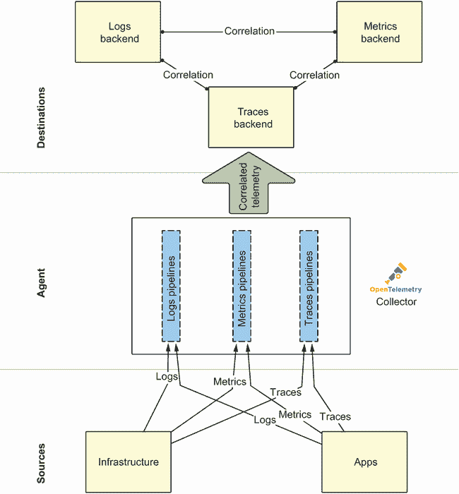

图 4.5 OpenTelemetry 收集概念（来自上游文档；[`opentelemetry.io/docs/reference/specification/logs/overview/`](https://opentelemetry.io/docs/reference/specification/logs/overview/)）

在 Collector 中，各种信号类型（目前为日志、指标和追踪）会在所谓的管道中处理，每个管道专用于一种信号类型。我们将在本章稍后更详细地讨论该代理的内部工作原理，但首先让我们深入 OpenTelemetry 体系的应用程序代码侧：[content]
## 4.3 OpenTelemetry 概述

* 查看高层项目状态（[`opentelemetry.io/status/`](https://opentelemetry.io/status/)）页面。
* 查看细粒度信息，因为项目也会跟踪实现与规范的详细合规性（[`mng.bz/Aojp`](http://mng.bz/Aojp)）。

请注意，除了规范（`API`s 和数据模型）之外，OpenTelemetry 还提供了一套语义，例如系统/运行时指标仪器的标准名称（[`mng.bz/Zqmm`](http://mng.bz/Zqmm)）。

在图 4.5 中，你可以看到 OpenTelemetry 的信号收集概念，重点在于关联。从底部向上，图示展示了信号从应用程序和基础设施出发，经过 OpenTelemetry Collector，最终被摄入到后端目标的流程。


图 4.5 OpenTelemetry 收集概念（来自上游文档；[`opentelemetry.io/docs/reference/specification/logs/overview/`](https://opentelemetry.io/docs/reference/specification/logs/overview/)）

在 Collector 中，各种信号类型（目前为日志、指标和追踪）会在所谓的管道中处理，每个管道专用于一种信号类型。我们将在本章稍后更详细地讨论该代理的内部工作原理，但首先让我们深入 OpenTelemetry 体系的应用程序代码侧：仪器化。

### 4.3.1 仪器化

在你拥有的代码上下文中，首先要解决的就是使用 OpenTelemetry 发出信号。截至撰写时，OpenTelemetry 为 11 种编程语言提供仪器化支持。更具体地说，OpenTelemetry 支持 C++、.NET、Erlang/Elixir、Go、Java、JavaScript、PHP、Python、Ruby、Rust 和 Swift。

在 OpenTelemetry 中，仪器化是这样组织的：用户为每种编程语言获得一个库软件开发工具包，并且可能支持自动仪器化。某些语言通过单独的仓库提供此功能（例如 Java），而其他语言，如 Ruby，则维护一个同时支持手动和自动仪器化的单一仓库。请记住，仪器化并非免费。即使在最佳的自动仪器化情况下，你无需更改代码，应用程序的性能仍会受到轻微影响（[`mng.bz/Rx5j`](http://mng.bz/Rx5j)）。

让我们更详细地了解 OpenTelemetry 中的不同仪器化方法。我们将从自动仪器化开始，因为它是一个很好的起点，并且所需工作较少。

#### 自动仪器化

在 OpenTelemetry 中，使用自动仪器化，或简称为自动仪器化，所需步骤如下：

1. 首先，启用自动仪器化。你通常需要添加一个或多个依赖项。至少，这些依赖项将添加 OpenTelemetry `API` 和 `SDK` 功能。
2. 然后，配置自动仪器化，可以通过 `environment variables`（和/或语言特定的机制，例如 Java 中的 `system properties`）进行。你至少必须提供一个 `service name` 来标识你要仪器化的服务，并且可选地提供其他配置选项，包括诸如 `source configuration`、`exporter configuration` 和 `resource configuration` 之类的内容。

OpenTelemetry（截至撰写时）为某些编程语言生成追踪提供自动仪器化，包括

* Java 自动仪器化（[`github.com/open-telemetry/opentelemetry-java-instrumentation`](https://github.com/open-telemetry/opentelemetry-java-instrumentation)），它是 OpenTelemetry 的一部分，以你包含的 `JAR` 文件形式存在（使用 `-javaagent`）。你可以在精细程度上配置此代理（[`mng.bz/2DQ8`](http://mng.bz/2DQ8)），从清理数据库查询到捕获预定义的 `HTTP` 头部，它将动态注入 `JVM` 字节码以从流行的 Java 框架中捕获信号。
* JavaScript（[`github.com/open-telemetry/opentelemetry-js`](https://github.com/open-telemetry/opentelemetry-js)），也通过 OpenTelemetry 核心官方支持，允许你使用所有 JavaScript 应用。请注意，还有额外的框架特定 SDK，例如 OpenTelemetry `Node SDK`（[`mng.bz/1q41`](http://mng.bz/1q41)），可启用自动仪器化。
* Python（[`mng.bz/Pz2Y`](http://mng.bz/Pz2Y)）也在官方支持的自动仪器化语言之列。
* .NET（[`opentelemetry.io/docs/instrumentation/net/automatic/`](https://opentelemetry.io/docs/instrumentation/net/automatic/)）将自动仪器化作为 .NET 分析器支持，以在运行时使用猴子补丁注入额外的仪器化。
* Go（[`github.com/keyval-dev/opentelemetry-go-instrumentation`](https://github.com/keyval-dev/opentelemetry-go-instrumentation)）是基于 `eBPF` 的用户贡献。严格来说，`eBPF` 是一个 `Linux syscall` 和虚拟机（`VM`），对内核版本和符号支持有一定要求，允许你将用户空间功能下推到 Linux 内核中，基于事件触发。在此上下文中，这意味着为你自动捕获遥测信号。

 going forward，你可以期待为更多编程语言以及支持指标提供自动仪器化。自动仪器化是一个值得始终考虑的良好基线，因为你几乎可以免费获得一些洞察。然而，它也有局限性：自动仪器化将服务视为黑盒，这意味着你无法从中获得业务逻辑相关的信号。为此，你需要使用手动仪器化，让我们来看一下。

#### 手动仪器化

手动仪器化意味着你修改自己的代码以手动发出信号。语言无关地执行此操作所需的步骤是

1. 在你的代码中导入 OpenTelemetry——即对语言特定的 `API` 和 `SDK` 产生依赖。
2. 对于追踪和指标，首先创建一个 `provider`（通常已有默认实现），它进而允许你创建一个 `instance`（连同 `name` 和 `version`）。
3. 对于服务（与你可能仪器化的库相对），此外，还需配置 `SDK`，并提供导出信号的适当选项。
4. 在所有设置完成后，专注于主要工作：创建事件（追踪和指标）。

注意 `Logs`（[`mng.bz/JgrK`](http://mng.bz/JgrK)）不遵循之前所示的模式。相反，它们利用现有的设置；换句话说，虽然 OpenTelemetry 对指标和追踪采用了全新方法（通过指定新的 `API` 并在各编程语言中提供所述 `API` 的完整实现），但日志的方法不同，其重点在于支持现有日志和日志库。

手动和自动仪器化存在许多可能的用例和组合，如果你确实想在自己的设置上下文中获得实践指导，你将在网上找到大量优秀的文章和教程。例如，“OpenTelemetry and Python: A Complete Instrumentation Guide”（[`mng.bz/wvK2`](http://mng.bz/wvK2)）、“Auto-Instrumenting Node.js Apps With OpenTelemetry”（[`mng.bz/qrpJ`](http://mng.bz/qrpJ)）、“Trace Context Propagation With OpenTelemetry”（[`mng.bz/7DAe`](http://mng.bz/7DAe)）和“OpenTelemetry in Java: Tutorial & Agent Example”（[`www.containiq.com/post/opentelemetry-in-java`](https://www.containiq.com/post/opentelemetry-in-java)）都是优秀资源。接下来，我们来看 OpenTelemetry Collector——“通用信号类型”代理或“通用遥测”代理。

### 4.3.2 Collector


# OpenTelemetry 收集器

## 概述

OpenTelemetry 的代理称为 `collector`。它由管道组成，这些管道组装收集器组件，例如接收器、处理器和导出器，如图 4.6 所示。将管道视为组件的组合，这些组件定义了如何以及从何处获取信号（接收器）、在边缘处处理它们（通过处理器和连接器进行转换、批处理等），以及将信号摄取到哪个后端（导出器）。

你可以在收集器中定义一个或多个管道。每个管道专用于一种信号类型（例如，metrics）。你也可以为同一信号类型拥有多个管道，例如不同的环境或强制执行不同的策略。每个管道都独立运行，从源收集信号并将其摄取到后端。

## OTLP 协议

与收集器通信的原生方式是通过 OpenTelemetry 协议（`OTLP`; [`tinyurl.com/mngbz`](https://tinyurl.com/mngbz)），一种通用遥测数据传输协议。`OTLP` 规范描述了在下游源、中间节点（如收集器）和后端目标之间信号的编码、传输和交付机制。

`OTLP` 本身由 OpenTelemetry 项目设计，是对 `OpenCensus` 协议的增量改进，专注于交付的高可靠性以及在数据无法交付时提供清晰的可视性。此外，`OTLP` 友好于 L7 负载均衡器，支持将不均衡的入站流量映射到均衡的出站流量。进一步，`OTLP` 允许从目标一直到源的反压信号，使你能够通过中间节点（例如 OpenTelemetry 收集器）构建可靠的多跳交付，每个节点可能具有不同的处理能力。

从协议角度来看，`OTLP` 使用请求-响应风格：下游客户端发送请求，上游服务器回复相应的响应。`OTLP` 相当灵活——你可以在 `gRPC`、`HTTP` 以及（今后）`WebSockets` 上运行它。

虽然未来我们可能生活在一个每个人和一切都原生支持 OpenTelemetry 的世界——即使用 `OTLP` 进行通信——但在撰写本文时，2023 年还不是这种情况。OpenTelemetry 社区找到了一种巧妙的方法来帮助启动这一进程：通过引入大量入口和出口组件（接收器和导出器），这些组件可以从源读取现有格式和协议，以及向目标写入现有格式和协议。

详细来说，这如何工作？现在让我们更仔细地查看图 4.6，看看如何使用 OpenTelemetry 收集器定义特定于信号类型的管道来从下游收集信号并将其摄取到上游。

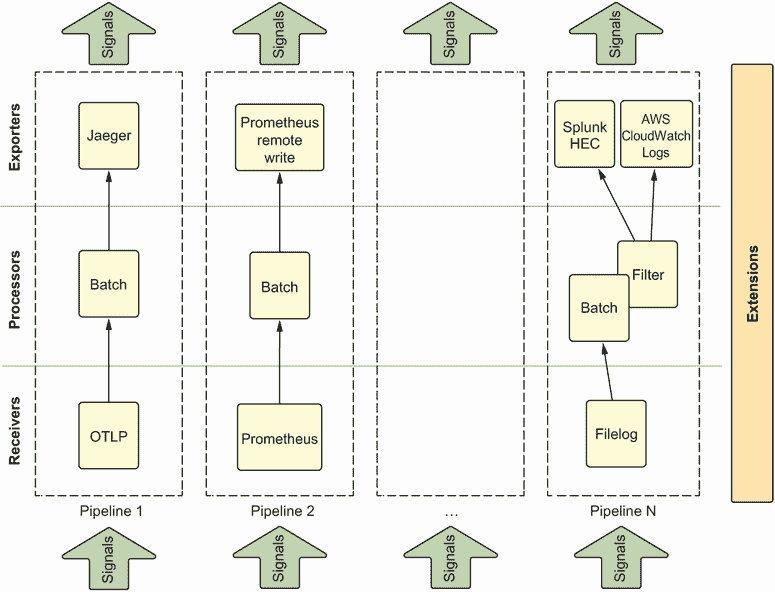

图 4.6 OpenTelemetry 收集器及其组件

## 收集器组件

现在，我们将重点关注收集器中的管道。每个管道使用一个或多个组件：

* 在入口路径中，从下游源收集信号，一个或多个接收器可以来自两个地方。
  * 对于原生的 `OTLP`，来自 `opentelemetry-collector` ([`mng.bz/mVM4`](http://mng.bz/mVM4)) 仓库
  * 对于所有其他接收器（`Prometheus`、`Jaeger`、`Kafka` 等），来自 `opentelemetry-collector-contrib` ([`mng.bz/5wVa`](http://mng.bz/5wVa)) 仓库
* 核心操作组件——一个或多个处理器可以来自两个地方。
  * 对于少量通用处理器，例如 `Batch`，来自 `opentelemetry-collector` ([`mng.bz/6DxA`](http://mng.bz/6DxA)) 仓库
  * 对于所有其他处理器（`Filter`、`Transform`、`Tail Sampling` 等），来自 `opentelemetry-collector-contrib` ([`mng.bz/o1gp`](http://mng.bz/o1gp)) 仓库
* 在出口路径中，将信号摄取到上游目标，一个或多个导出器可以来自两个地方。
  * 对于原生的 `OTLP`（和日志导出器），来自 `opentelemetry-collector` ([`mng.bz/nWa2`](http://mng.bz/nWa2)) 仓库
  * 对于所有其他导出器（`Prometheus Remote Write`、`Elasticsearch`、`AWS X-Ray` 等），来自 `opentelemetry-collector-contrib` ([`mng.bz/vn04`](http://mng.bz/vn04)) 仓库

## 示例管道

让我们从高层次来看图 4.6 中的一些示例管道：

* `pipeline 1` 是一个 traces 管道，可以通过 `OTLP` 入站收集 traces，批量处理它们，并将它们摄取到 `Jaeger` 实例中。
* `pipeline 2` 是一个 metrics 管道，通过 `Prometheus` 接收器入站抓取指标，再次批量处理，并使用 `Prometheus remote write` API 将它们摄取到例如 `Thanos` 或 `Cortex` 中。
* `pipeline N` 是一个 logs 管道，通过 `Filelog` ([`mng.bz/rjJE`](http://mng.bz/rjJE)) 接收器入站收集日志行，然后再次批量处理并过滤它们，然后可以将日志行摄取到两个不同的后端目标 `Splunk` 和 `CloudWatch` 中，通过各自的导出器。

## 扩展和部署

此外，收集器还提供多个扩展（[`opentelemetry.io/docs/collector/configuration/#extensions`](https://opentelemetry.io/docs/collector/configuration/#extensions)）来运行代理，包括健康检查、服务发现以及丰富的遥测（例如，日志、Prometheus 格式的指标、`OTLP` 中的 traces 以及 `pprof` 格式的 profiles）。

Tip 有不同的部署方式（[`opentelemetry.io/docs/collector/deployment/`](https://opentelemetry.io/docs/collector/deployment/)）收集器，通常区分于靠近工作负载（`agent mode`）和在中心位置（`gateway mode`）。在 `gateway mode`（有效地，在负载均衡器后面的一组收集器）中运行收集器可以帮助集中执行策略并支持围绕访问控制和身份验证的关注点分离，包括 `API keys` 和 `IAM roles`。

## 具体示例

让我们看一个具体示例，展示 OpenTelemetry 收集器在实际运行中如何处理指标和 traces 的收集和路由；我们的示例设置看起来与图 4.7 所描绘的类似。我们再次使用 `ho11y` 作为信号生成器，以 Prometheus 展示格式公开指标并以 `OTLP` 格式发出 traces，OpenTelemetry 收集器配置为抓取指标、收集 traces 并将它们摄取到各自的后端目标——指标到 `Prometheus`，traces 到 `Jaeger`。

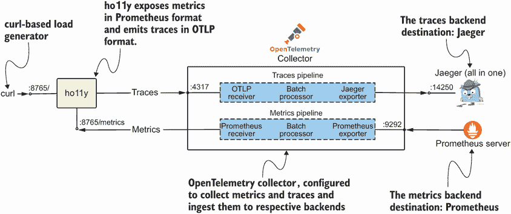

图 4.7 用于 traces 和 metrics 的示例 OpenTelemetry 管道

我们现在将构建图 4.7 所示的整体设置，同样使用 `Docker Compose`，因此让我们依次更仔细地查看每个组件。Listing 4.5 显示了示例应用 `ho11y`，生成指标和 traces。请特别注意通过 `OTEL_EXPORTER_ OTLP_ENDPOINT` 环境变量连接到 OpenTelemetry 收集器的配置。

### Listing 4.5 用于 `ho11y` 的 Docker Compose 配置片段

```
ho11y:
    image: public.ecr.aws/mhausenblas/ho11y:stable
    ports:
    - "8765:8765"                                          ❶
    environment:
    - "OTEL_EXPORTER_OTLP_ENDPOINT=otel-collector:4317"    ❷
    - "OTEL_RESOURCE_ATTRIB=ho11y"
    - "HO11Y_INJECT_FAILURE=enabled"
    depends_on:
    - otel-collector
```

❶ HTTP API 的端口

❷ 配置下游 OpenTelemetry 收集器（用于通过 gRPC 的 OTLP）

### Listing 4.6 用于 OpenTelemetry 收集器的 Docker Compose 配置片段

Listing 4.6 显示了 OpenTelemetry 收集器使用我们稍后会讨论的自定义配置（`otel-collector-config.yaml`）。我们在那里公开所有这些端口，以便它们可以从 Docker 外部访问——也就是说，使用此设置可以更轻松地从主机机器进行故障排除。


# OpenTelemetry Collector 与后端配置

## otel-collector Docker Compose 配置

```
otel-collector:
    image: otel/opentelemetry-collector-contrib:0.55.0
    command: ["--config=/conf/otel-collector-config.yaml"]    ❶
    volumes:
    - ./otel-config.yaml:/conf/otel-collector-config.yaml     ❷
    ports:
    - "4317:4317"                                             ❸
    - "8888:8888"                                             ❹
   - "9292:9292"                                              ❺
   - "13133"                                                  ❻
   depends_on:
   - prometheus
   - jaeger
```
❶ 使用的收集器配置
❷ 配置文件（从主机文件系统挂载到容器中）
❸ 4317 是 OTLP 接收器端口。
❹ 8888 是收集器用于指标自遥测的端口。
❺ 9292 是我们暴露 Prometheus exporter 的位置。
❻ 13133 是用于收集器健康检查的端口。

列表 4.7 显示 Prometheus 被配置为指标后端目标，用于接收指标，然后我们可以通过 CLI 或使用内置 UI 查询。注意，这里引用的 Prometheus 抓取配置（`prom-config.yaml`）是我们将在本章稍后讨论的内容（参见列表 4.12）。

## 列表 4.7 后端 Prometheus 的 Docker Compose 配置片段

```
prometheus:
    image: prom/prometheus:latest
    ports:
    - "9090:9090"
    volumes:
    - ./prom-config.yaml:/etc/prometheus/prometheus.yml    ❶
```
❶ 用于抓取 OpenTelemetry collector 的 Prometheus 配置

最后但同样重要的是，列表 4.8 显示了我们如何配置 Jaeger，即跟踪的后端目标。这里需要注意的两点是端口 14250，我们将在 OpenTelemetry collector 中将其用作发送跟踪的目标，以及环境变量 `COLLECTOR_OTLP_ENABLED`，我们（在撰写本文时，对于此处使用的 Jaeger 版本）仍需设置它，以便 collector 与 Jaeger 之间的 OTLP over gRPC 连接正常工作。

## 列表 4.8 后端 Jaeger 的 Docker Compose 配置片段

```
jaeger:
    image: jaegertracing/all-in-one:1.36
    ports:
    - "5778:5778"      ❶
    - "14250:14250"    ❷
    - "16686:16686"    ❸
    environment:
    - "COLLECTOR_OTLP_ENABLED=true"
```
❶ 5778 是 Jaeger 的配置接口端口。
❷ 14250 是 Jaeger 接收 `model.proto` 的端口，即 OTLP over gRPC。
❸ 16686 是 Jaeger 暴露其前端 UI 的端口。

现在我们了解了设置的所有组件，让我们继续进行 OpenTelemetry collector 和 Prometheus 的配置。为了从示例应用收集指标和跟踪，我们将使用两个管道配置 OpenTelemetry collector，一个用于指标，一个用于跟踪，如列表 4.9 至 4.11 所示（将配置拆分为接收器、导出器和实际的服务配置），您可以在 `ch04/otel/otel-config.yaml` 文件中找到它们。

让我们从入口路径开始，即接收器。

## 列表 4.9 OpenTelemetry collector 配置，接收器

```
receivers:
  otlp:                   ❶
    protocols:
      grpc:
        endpoint: "0.0.0.0:4317"
  prometheus:             ❷
    config:
      scrape_configs:
       - job_name: "ho11y"
         static_configs:
         - targets: ["ho11y:8765"]
```
❶ 启用并配置我们用于摄取跟踪的 OTLP over gRPC 接收器（[`mng.bz/4Drj`](http://mng.bz/4Drj)）。我们在此声明它应监听端口 4317，这是该方案和协议的官方 IANA 注册端口。
❷ 在这里，我们启用 Prometheus 接收器（[`mng.bz/QP9v`](http://mng.bz/QP9v)）并配置它以抓取我们的示例应用。

请注意，Docker Compose 使 `ho11y` 应用可以通过该名称访问。让我们继续进行出口路径，即导出器。

## 列表 4.10 OpenTelemetry collector 配置，导出器

```
exporters:
  logging:
    loglevel: debug
  prometheus:                 ❶
    endpoint: "0.0.0.0:9292"
  jaeger:                     ❷
    endpoint: "jaeger:14250"
    tls:
      insecure: true
```
❶ 我们启用并配置 Prometheus exporter（[`mng.bz/XNla`](http://mng.bz/XNla)），有效地将我们的收集器变成一个直通。
❷ 接下来是 Jaeger gRPC Exporter（[`mng.bz/yQjd`](http://mng.bz/yQjd)），顾名思义，它允许我们通过 gRPC 将（跟踪）数据导出到 Jaeger 后端目标。

在继续之前有一点需要注意：请记住列表 4.8 中显示的 Docker Compose 中的 Jaeger 配置指出了端口 14250？这正是我们在列表 4.10 中此处插入的内容，以便 OpenTelemetry collector 知道将跟踪发送到哪里。

为了保持此示例的简单性，我们使用 Prometheus exporter 以允许 Prometheus 服务器抓取。在生产环境中，联邦和长期存储相关时，您可能希望改用 Prometheus Remote Write Exporter（[`mng.bz/MBGB`](http://mng.bz/MBGB)）在此处。这使您可以将指标摄取到后端，例如 Cortex、Thanos 或托管 OSS 服务，如 Amazon Managed Service for Prometheus（[`aws.amazon.com/prometheus/`](https://aws.amazon.com/prometheus/)）。

### 提示
在收集器配置中，组件（接收器、处理器、导出器、连接器和管道）由 `type[/name]` 格式的组件标识符定义。只要标识符唯一，您就可以多次定义给定类型的组件。例如，您可以有两个指标管道，一个名为 `metrics/dev`，另一个名为 `metrics/prod`，后端不同。

最后，我们可以使用所有这些接收器和导出器来定义我们的管道，如以下列表所示。

## 列表 4.11 OpenTelemetry collector 配置，服务（管道定义）

```
service:
  telemetry:                    ❶
    logs:
      level: debug
    metrics:
      level: detailed
  pipelines:                    ❷
   metrics:                     ❸
      receivers: [prometheus]
      processors: [batch]
      exporters: [logging, prometheus]
    traces:                     ❹
      receivers: [otlp]
      processors: [batch]
      exporters: [logging, jaeger]
```
❶ 在开发/测试中，一个良好的实践是配置收集器遥测以发出细粒度的代理日志和指标（可通过收集器上的端口 8888 访问）。
❷ 这是管道定义开始的地方；您可以根据需要定义任意多个。
❸ 在这里，我们使用入口路径中的 Prometheus 接收器和出口的 Prometheus exporter 定义指标管道。
❹ 我们配置使用 OTLP 从 `ho11y` 摄取跟踪并将其路由到下游配置的 Jaeger 实例的跟踪管道。

### 警告
如果您只启用并配置了组件，例如接收器或导出器，就像我们在之前的步骤中所做的那样，但未在管道定义中使用它们，那么该组件就如同不存在一样。收集器会简单地忽略它，并且没有任何东西按您预期的方式工作。这是我们在实践中见过的一个非常常见的陷阱，我自己也承认遇到过几次。

此外，您可能已经注意到在 `exporters` 部分有两个条目。原因很简单：通过包含 `logging` exporter，您可以直接在屏幕上看到正在发生的事情（例如，被抓取的指标），因为该 exporter 会将信号发送到 `stdout`。

为了完成配置，让我们快速查看下游 Prometheus（我们的指标后端目标）是如何配置的（列表 4.8）：它抓取自身，这是一个良好的实践，最重要的是，为了我们的整体设置能够工作，它通过 `otel-collector:9292` 抓取 OpenTelemetry collector（这就是我们告诉 Prometheus exporter 暴露其端点的地方）。

## 列表 4.12 Prometheus 服务器配置，抓取 OpenTelemetry collector


## Walkthrough
```
global:
  scrape_interval: 5s
  evaluation_interval: 5s
scrape_configs:
  - job_name: "prometheus"
    static_configs:
    - targets: ["localhost:9090"]       ❶
  - job_name: "otel-collector"
    static_configs:
    - targets: ["otel-collector:9292"]  ❷
```
❶ 自我抓取 Prometheus 服务器
❷ 抓取 OpenTelemetry 收集器中的 Prometheus exporter
好了，这么多 YAML 代码要看确实不少。现在，让我们运行一下。启动一个终端会话，`cd` 进入 `ch04/otel/`，然后执行
```
docker-compose -f docker-compose.yaml up
```
注意 这次，我在 Docker Compose 文件中包含了基于 `curl` 的简易负载生成器，因此目前无需进一步操作。
现在，是时候收获我们辛苦的 YAML 调整成果了，打开你喜欢的浏览器并输入 Prometheus (`localhost:9090`) 和 Jaeger (`localhost:`) 的两个 URL，你应该能看到一些活动。
切换到 Prometheus 并输入 PromQL 查询
```
sum by(http_status_code) (ho11y_total)
```
你应该会在（图形标签页）看到类似图 4.8 所示的内容——即按返回的 HTTP 状态码分组的总体示例应用调用（HTTP API 调用）之和（它被配置为平均产生 10% 的错误率）。
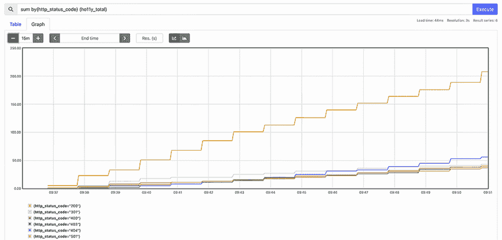
图 4.8 Prometheus UI 正在运行，显示随时间绘制的简单 `ho11y` 指标
转到追踪：在 Jaeger 中，你首先需要选择服务。你可以通过从相应的下拉框中选择它来完成。此外，在 Tags 字段中，你将输入
```
http.status_code=403
```
这意味着你只对携带此特定标签的追踪感兴趣——换句话说，追踪捕获了 `ho11y` 示例应用返回 HTTP 状态码 403 的事件。现在，按下左侧导航中的 Find Traces 按钮，结果应类似于图 4.9 所示。
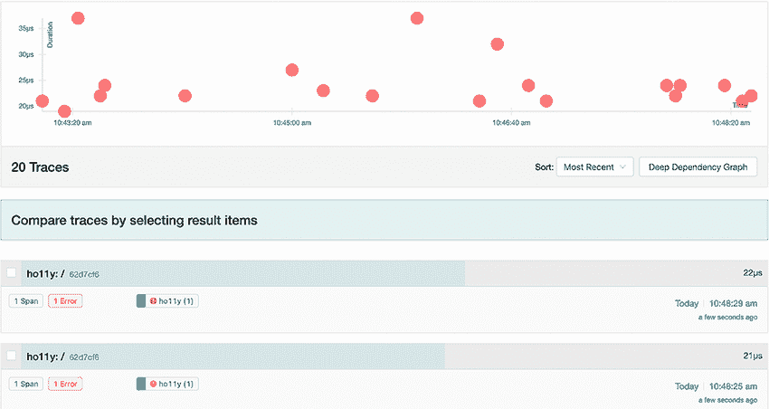
图 4.9 Jaeger UI 正在运行，显示按 HTTP 403 状态码过滤的 `ho11y` 追踪
请记住，在 Jaeger 中查看单个追踪只需在右侧追踪列表中点击它即可，所以请随意选择一个随机追踪。这应该会带你进入一个类似于图 4.10 所示的视图。
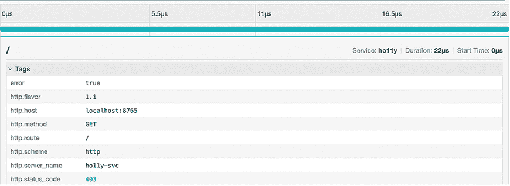
图 4.10 在 Jaeger 中深入某个特定追踪，显示所有可用详情
总结一下，在这次 OpenTelemetry 实战演练中，我们已
1. 通过手动埋点生成了追踪和指标。
2. 配置 OpenTelemetry 收集器收集这些信号并将其摄取到两个不同的后端目标（用于追踪的 Jaeger，以及用于指标的 Prometheus）。
3. 查看了后端中的信号。在 Prometheus 中，我们按 HTTP 响应码绘制了总体调用次数，在 Jaeger 中，我们查看了客户端错误 span（包含 403 HTTP 响应码）。
我们将在后续章节深入探讨与目标的工作细节，但在这里，我们专注于 OpenTelemetry 上下文中的埋点和代理方面。
好了，这确实很多——恭喜你坚持下来！我希望这次小小的 OpenTelemetry 演练能让你初尝滋味，并了解通过这个通用遥测代理可获得的强大功能。
提示 关于 OpenTelemetry 发行版（[`mng.bz/a12m`](http://mng.bz/a12m)），有几种方式可供选择：你可以使用上游现成的预构建发行版（[`mng.bz/gBnv`](http://mng.bz/gBnv)），也可以选择特定云服务提供商或可观测性厂商的发行版（例如 AWS 发行版 \[[`mng.bz/5wBB`](http://mng.bz/5wBB)\]），或者使用项目提供的 OpenTelemetry collector Builder（[`mng.bz/5wVO`](http://mng.bz/5wVO)）自行构建发行版。
如果你想深入了解 OpenTelemetry，了解它的起源、整体愿景以及如何在你的环境中应用，我推荐阅读以下书籍：
* Alex Boten 的优秀著作，*Cloud Native Observability with OpenTelemetry*（[`www.cloudnativeobservability.com/`](https://www.cloudnativeobservability.com/)），为你提供更多关于 OpenTelemetry 的背景和大量实践示例。
* Daniel Gomez Blanco 所著的 *Practical OpenTelemetry: Adopting Open Observability Standards Across Your Organization*（Apess, 2023；[`mng.bz/6Dxe`](http://mng.bz/6Dxe)），这是一本很棒的学习书籍，也有助于将 OpenTelemetry 引入组织（基于他自己的经验）。
* Austin Parker 和 Ted Young 所著的 *Learning OpenTelemetry*（O’Reilly；[`mng.bz/o1gZ`](http://mng.bz/o1gZ)），是该领域的最新书籍，有望成为参考书，两位作者本身就是 OpenTelemetry 的推动者。
为了完成我们对代理的回顾，让我们快速看看目前正在使用且未来可能被 OpenTelemetry 取代的成熟代理。
## 4.4 Other agents
除了用于日志的 Fluent 家族、用于指标的 Prometheus，以及作为通用遥测代理的 OpenTelemetry 收集器之外，还有一些成熟且广泛使用的代理。大多数由云服务提供商编写和分发，另外一些可观测性厂商也推出了代理，让我们快速了解一下（同样的思路适用：随着时间的推移，它们很可能会被 OpenTelemetry 或其收集器取代）：
* Amazon CloudWatch Agent（[`github.com/aws/amazon-cloudwatch-agent/`](https://github.com/aws/amazon-cloudwatch-agent/)）可用于日志和指标，支持 AWS 专有的嵌入式指标格式（EMF；[`mng.bz/nWa5`](http://mng.bz/nWa5)）。CloudWatch 代理已通过嵌入式收集器支持 OpenTelemetry，并已在 OpenTelemetry 上重新平台化（[`mng.bz/G91q`](http://mng.bz/G91q)）。除 CloudWatch 代理外，AWS 已通过其 AWS Distro for OpenTelemetry 提供符合 OpenTelemetry 的收集器（[`aws.amazon.com/otel/`](https://aws.amazon.com/otel/)）。
* Azure 正在逐步淘汰其 Log Analytics 代理和 Telegraf 代理，转而采用新的 Azure Monitor 代理（AMA；[`mng.bz/2DNd`](http://mng.bz/2DNd)）。与其它云服务提供商一样，Azure 在长期内也在标准化 OpenTelemetry（[`mng.bz/vn0p`](http://mng.bz/vn0p)）。
* 与 Azure 类似，Google Cloud 正在放弃其基于 collectd 的传统监控代理，转而采用新的 Ops Agent（[`cloud.google.com/monitoring/agent/ops-agent`](https://cloud.google.com/monitoring/agent/ops-agent)），它使用 Fluent Bit 进行日志收集和路由，并使用 OpenTelemetry 收集器处理指标。
* Datadog 的 Vector（[`vector.dev/docs/about/what-is-vector/`](https://vector.dev/docs/about/what-is-vector/)）是一个有趣的开源项目，在通用信号类型支持方面在一定程度上与 OpenTelemetry 竞争；然而它也支持 OpenTelemetry。如果您完全使用 Datadog，它似乎是一个不错的代理选择。
现在我们对存在的代理、其覆盖范围和使用场景有了良好的理解，让我们继续讨论如何选择代理的话题。
## 4.5 Selecting an agent
如常一样，你有多种选择。确保选择一个适合你的工作负载、环境和组织能力的代理非常重要。


阅读主题相关的通用资料，例如博客文章和文章，并不会有什么坏处——例如，参阅“Logstash、Fluentd、Fluent Bit 或 Vector？如何选择合适的开源日志收集器” ([`mng.bz/4DrR`](http://mng.bz/4DrR)) 或“Who Is the Winner: Comparing Vector, Fluent Bit, Fluentd Performance ([`medium.com/ibm-cloud/log-collectors-performance-benchmarking-8c5218a08fea`](https://medium.com/ibm-cloud/log-collectors-performance-benchmarking-8c5218a08fea))；然而，你应该将它们用作灵感或起点，而不是“购买指南”。换句话说，你很可能需要根据自己的需求和偏好自行评估，才能正确选择一个代理。按任意顺序，我为你列出可作为评估代理并挑选合适方案的起点标准。

### 4.5.1 Security for and of the agent

我所在的 AWS，安全是最高优先级，所以我从这里开始。重要的是同时考虑代理的安全*的*和安全*为*，我的意思是：

*   对于代理的安全*为*，请自问和/或向厂商询问以下问题：

    *   谁负责处理 CVE 和安全补丁？

    *   代理是否经过渗透测试，如果有，是在何时进行（例如，一次性、定期，或在主要组件变更时）？

    *   你能否获得可复现的构建产物，例如代理的容器镜像？

    *   代理的供应链是否已知和/或有文档记录？

*   对于代理的安全*的*，请尝试确定以下内容：

    *   代理是否支持 TLS/HTTPS 以及等效的加密安全流量？

    *   你能否在代理集群中应用策略（例如凭据、访问和过滤器）？

    *   是否已建立机制来处理敏感数据，例如个人身份信息（PII），以满足某些立法（如欧洲通过《通用数据保护条例》（GDPR））的要求？

理想情况下，你应通过提供代理的开源项目、ISV 或云服务商的清单，提前获得这些信息。

### 4.5.2 Agent performance and resource usage

代理性能——即信号的处理速度，通常通过吞吐量以及所用资源来衡量——是关键的评估标准。以下是此类性能相关报告的一些示例：

*   上游“OpenTelemetry Collector Performance”文档 ([`mng.bz/QP96`](http://mng.bz/QP96))。

*   AWS Distro for OpenTelemetry Collector（ADOT）收集器性能报告 ([`mng.bz/N2J1`](http://mng.bz/N2J1))。

聚焦性能时，一个重要标准简而言之与代理的资源占用有关。例如，一个标准可能是代理在各个阶段（例如空闲、平均或峰值）用于收集、转换和摄取信号时消耗多少 RAM 和/或 CPU 秒。

除此之外，你希望能够按信号类型进行分解，以防是多信号代理，如 OpenTelemetry 收集器。图 4.11 显示了 Grafana 仪表板 ([`ref.otel.help/otel-collector-ops/otel-collector-dashboard.json`](https://ref.otel.help/otel-collector-ops/otel-collector-dashboard.json)) 的示例屏幕截图，捕获了 OpenTelemetry 收集器随时间的资源使用情况。

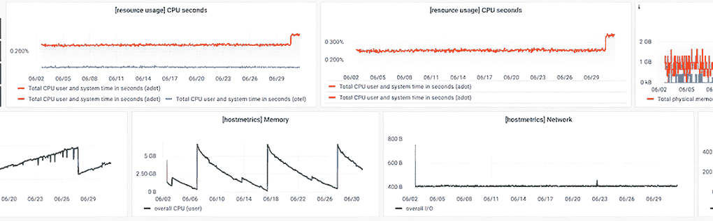

图 4.11 OpenTelemetry 收集器资源使用情况的 Grafana 仪表板

在资源使用方面，你要确保代理使用的资源相对于你的整体占用来说很少。不要忘记累积效应——也就是说，虽然单个代理可能只使用几 MB，但在拥有数千个代理的整个集群中，这可能会累积到 TB 级别。如今大多数代理都有控制资源使用的机制（例如，在 OpenTelemetry 收集器的情况下，你可以使用内存限制处理器来防止内存不足（OOM）情况）。

### 4.5.3 Agent nonfunctional requirements

除了功能方面外，还应自问以下问题：

*   代理是开源的、可扩展的，还是由单一厂商或社区支持？

*   谁来监控监控者，或者换句话说，代理遥测怎么办？在 2023 年及以后，你应该期望不仅能够访问代理日志，还能获得指标（理想情况下为 Prometheus 格式）以及来自代理的追踪和剖析。

*   代理是否能够处理一种或多种信号类型？信号特定的代理意味着你需要多个代理才能实现 360 度覆盖。

非功能性需求远不止我们讨论的内容，但再次强调，这些问题构成了基础，在选择代理时你可以根据组织需求或偏好对其进行扩展。

## Summary

*   有两种类型的代理：厂商特定的代理，如 Datadog 代理，以及信号特定的代理（通常为开源），如用于日志的 Fluent Bit。

*   在本书中，我们将厂商特定和信号特定的代理视为传统代理，与开源的、包罗万象的 OpenTelemetry 收集器形成对比。

*   OpenTelemetry 是一组规范、SDK、协议（OTLP）和代理。

*   OpenTelemetry 允许你以厂商中立的方式收集、处理和摄取日志、指标、追踪以及（未来）剖析。

*   使用 OpenTelemetry，你可以获得有关信号来源（资源属性）的丰富元数据，以及关于遥测信号本身的元数据。

*   基于语义约定，OpenTelemetry 使你能够在后端实现有效的关联。

*   自动插桩是无需更改应用程序代码即可自动生成遥测的重要基线方法。

*   如果某个厂商或编程语言（在 OpenTelemetry 中）支持自动插桩，请使用它。

*   当自动插桩无法满足你的需求（业务逻辑）时，你需要使用 OpenTelemetry SDK 手动为代码插桩。

*   使用 OpenTelemetry 收集器从任何来源收集和路由追踪和指标，最终还有日志，到任何目标，形成一个通用遥测代理。

*   代理需要安全、高性能且精简（资源使用最少）。

*   选择代理可能需要时间和精力，但从长远来看是值得的投资。
