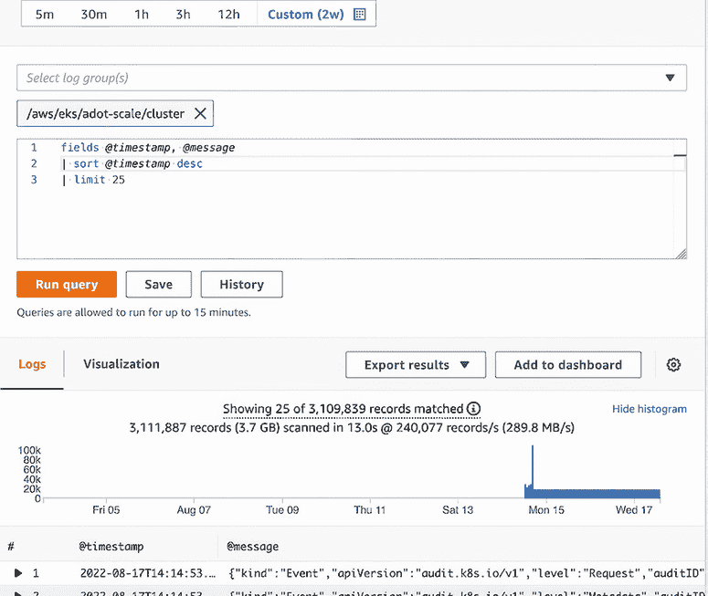
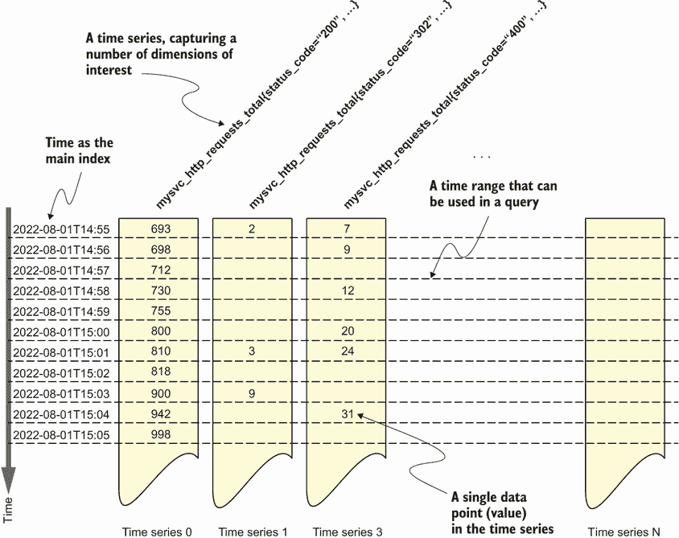
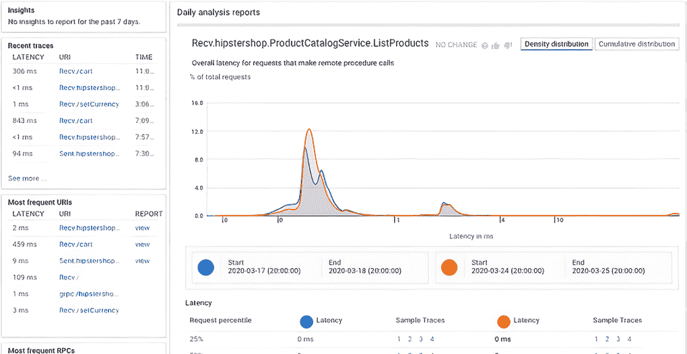
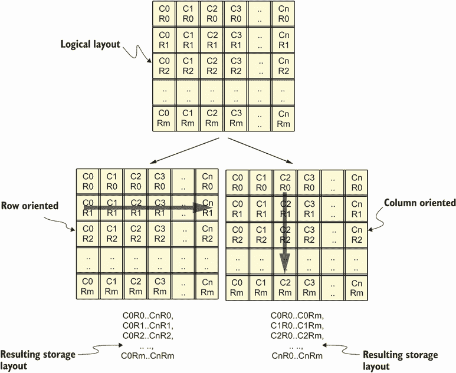
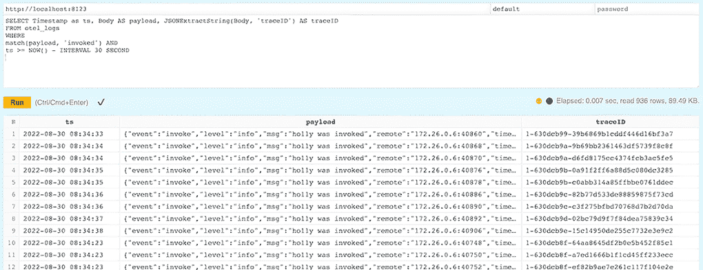

# 5 Backend destinations

本章涵盖

*   我们所说的后端目标是什么以及存在哪些类型的目标

*   处理日志、指标和追踪的后端目标选项

*   什么是时序数据存储以及可以用它们做什么

*   介绍列式数据存储和格式及其用例

*   选择后端目标的注意事项

到目前为止，你应该知道存在哪些主要信号类型（参见第 2 章），它们来自哪里（参见第 3 章），以及收集和预处理这些信号有哪些选项（参见第 4 章）。在本章中，我们将深入探讨后端目标，即代理的目标或接收器。后端目标，或简称为后端，是你可观测性问题的事实来源。它们允许你存储和查询信号，并使其可用于前端目标（参见第 6 章）。

为什么我要区分后端和前端？嗯，有一些例子完全属于其中一类。例如，Grafana 是一个纯前端目标（有时也称为*展示阶段*），它查询后端目标以可视化或对信号发出警报。另一方面，Cloud Native Computing Foundation（CNCF）项目 Cortex 是一个纯后端目标（除了一个简陋的管理 Web UI，你只有用于摄取和查询指标的 API）。


然后，来自专业可观测性厂商的解决方案，例如 Splunk、Datadog、Dynatrace、Honeycomb、New Relic、ServiceNow 旗下的 Lighstep、Cisco 旗下的 AppDynamics 以及 Sumo Logic，通常将前端和后端结合在一起，提供集成体验。在这些情况下，你无法将前端（UI）与后端分开使用。开源领域中也存在混合案例，例如 CNCF `Jaeger`（它拥有摄取管道，但需要额外的存储系统）。我们将在第 6 章介绍这些一体式或统一的目的地。

另一个特殊情况是云厂商原生提供的方案，尤其是 Amazon CloudWatch、Azure Monitor（含 Application Insights）以及 Google Cloud operations suite，它们涵盖了广泛的功能并提供与不同后端和前端的集成。

Note 我在第 1 章中提到过，关于我为何使用日志、指标和追踪的边界来呈现主题，我对前端-后端的区别主要是在概念层面上做出。这种区分有助于你理解；然而，到现在你应该知道现实要混乱和复杂得多。

现在，让我们开始吧。本章我们将
*   查看一些共性和通用的后端术语
*   回顾日志后端的选项及使用方法
*   回顾指标后端的选项及使用方法
*   回顾追踪后端的选项及使用方法
*   讨论列式数据存储
*   讨论如何选择后端

准备好了吗？让我们深入了解！

## 5.1 后端目的地术语

后端是所有可观测性问题的事实来源，无论是人类提出的问题（临时性的，基于直觉）还是代码片段（例如查询后端以评估是否满足特定条件的告警）。在深入讨论不同类型的后端及其优缺点之前，我们先退一步，看看它们的共同特征以及本章和本书其余部分所需的一些基本术语。

总体而言，无论是关于性能还是成本（更多内容请参见 5.6 节），后端有三个主要部分需要考虑：
*   `Ingestion`—信号如何到达后端。存在各种协议和格式，例如 OpenTelemetry 的 `OTLP` 或 `Prometheus` 格式。
*   `Storage`—通常，期望摄取的信号会被存储较长时间（数周、数月甚至数年），以便进行历史查询和数据分析。但这并不总是必须的，因为存在纯内存解决方案（例如 CNCF `Pixie`），它们也有其用途，例如实时集群调试，仅保留数小时的（易失性）数据。
*   `Query`—我们用来表示*向后端提问*的更精确且常见的术语是*查询后端*。*query* 的具体含义因后端而异，可能从声明式风格，如 `SQL`，到 `API` 调用，如许多追踪后端的情况。你还会经常遇到领域特定语言（`DSLs`），例如 `PromQL`，并且在本章中你会看到这些 DSL 的多个使用示例。考虑到这一点，让我们继续介绍第一种，也是可能最广泛采用的后端类型，用于各种日志。

## 5.2 日志的后端目的地

在本节中，我们将简要查看可用于摄取日志并查询它们的后端目的地。正如我们在第 2 章中讨论的，日志带有时间戳，通常捕获事件；具有（最好是结构化的）负载；主要用于人工消费。不同日志类型和格式的数量众多，有时很难确定最佳后端。通常这在很大程度上取决于用例和你的偏好，例如优先开源和开放标准，或者你可能更喜欢托管方案而不是 DIY 方法（或反之亦然）。话虽如此，当然这也适用于指标和分布式追踪的其余后端，让我们看看这里有什么。

### 5.2.1 云厂商

每个云厂商至少在其产品中提供一项服务，允许你落地日志——更具体地说，聚焦于三大超大规模厂商：
*   Amazon `CloudWatch Logs` ([`mng.bz/yQjp`](http://mng.bz/yQjp)) 将不同种类的日志组织在日志组中，日志组又包含一个或多个日志流（可视为永无止境的事件序列），日志流由日志事件组成。它使用专有方式摄取日志，并提供嵌入式指标格式（`EMF`；[`mng.bz/nWa5`](http://mng.bz/nWa5)），该格式允许你在日志旁嵌入自定义指标。换句话说，`EMF` 更以事件为中心（支持高基数），而非纯日志格式。你可以使用 `CloudWatch Logs Insights`，它提供专用的查询语言来查询你的日志。
*   Azure `Azure Monitor Logs` ([`mng.bz/MBGQ`](http://mng.bz/MBGQ)) 允许你收集、组织和分析 Azure 中受监控资源（从资源组到应用级别）的日志和性能数据。它在工作区中组织日志，查询使用 Kusto 查询语言（`KQL`）编写，这与 `CloudWatch Logs Insights` 中的功能 somewhat similar。它提供了一个有趣的功能 `functions`，可让你重用查询逻辑以及丰富的导出功能（基于规则，目标多样，从存储到事件中心）。
*   Google Cloud Logging [`cloud.google.com/logging/`](https://cloud.google.com/logging/)) 是 Google Cloud operations suite 的一部分，包含存储、查询和日志路由。作为顶层单元，Google Cloud Logging 使用日志来组织条目。日志包含日志条目（事件），可以来自 Google Cloud 服务或第三方（平台级）以及应用程序。在此上下文中引人注目的是日志路由目的地的灵活性：从存储在 `Cloud Storage` 存储桶中的 `JSON` 文件（可视为 `S3` 存储桶的等价物）到 `BigQuery`（用于数据仓库的大规模、临时 `SQL` 分布式查询引擎）到 `Pub/Sub`（Google 的事件流）再到与其它云提供的内容更可比的东西——即支持自定义保留期的日志“存储桶”。

让我们通过 CloudWatch 看一个具体的日志示例。查看以下 CloudWatch Logs Insights 查询（其中 CloudWatch 报告扫描了 3.7 GB 数据，涵盖 310 万条记录）：
```
fields @timestamp, @message     ❶
| sort @timestamp desc          ❷
| limit 25                      ❸
```
❶ 选择 `fields` `@timestamp` 和 `@message` 作为输出；我们期望得到一个包含两列的表作为结果。
❷ 按时间降序排序，更简单地说，最近的事件在前
❸ 仅显示 25 条结果

Warning 在前面的 `CloudWatch Logs Insights` 查询示例中，我们使用 `limit` `25` 指示 CloudWatch 将显示的输出限制为 25，但 CloudWatch 仍需要扫描大量日志，具体取决于所选的时间范围。时间范围以及随之而来的扫描数据量是你始终应考虑的问题。一方面，查询返回可能需要很长时间，最长可达数分钟，远非交互式使用；另一方面，你通常会被收取已扫描数据的费用。

图 5.1 显示了前面 `CloudWatch Logs Insights` 查询的结果。通常，云厂商会将所有系统级日志（有时称为 *platform logs*，例如 `syslog` 和 `journald`，但也包括云平台/`API` 日志）落地到其自身产品中，这使其成为一个良好的默认起点，尤其适用于所有非应用级日志。如果你好奇如何将应用级日志路由到这些目的地，请参阅第 4 章，我们在其中讨论了代理的选项及使用方法。接下来，让我们看看该领域的开源方案。




Figure 5.1 CloudWatch Logs Insights query result showing the 25 most recently added log events
图 5.1 显示 25 个最近添加的日志事件的 CloudWatch Logs Insights 查询结果

### 5.2.2 Open source log backends
### 5.2.2 开源日志后端

There are not that many widely used, open source–based log backends available (compared to metrics and traces, although as you will see later, log and trace backends share a lot of characteristics, and backends often store them similarly):
与指标和追踪相比，可用的广泛使用的基于开源的日志后端并不多（尽管如你稍后会看到，日志和追踪后端共享许多特征，并且后端通常以类似的方式存储它们）：
*   *Elasticsearch and OpenSearch*—I’m lumping Elasticsearch ([`www.elastic.co/elasticsearch/`](https://www.elastic.co/elasticsearch/)) and OpenSearch ([`opensearch.org/`](https://opensearch.org/)) together—ES/OS for short, going forward—because it really is a family of two projects and products (managed services) with a common root. They are both extending Apache Lucene ([`lucene.apache.org/`](https://lucene.apache.org/)), a veteran, comprehensive text search engine written in Java to make it easy to use for signal ingestion and query, even in a distributed setup. OpenSearch started out as a fork of Elasticsearch, sponsored by Amazon, and reached general availability ([`mng.bz/a12j`](http://mng.bz/a12j)) with its 1.0 version in July 2021. As time goes by, the ES/OS code bases are expected to diverge, but from the get-go, the major difference was the license under which each project was distributed. However, ES and OS have the fact that they are logs-first backends in common (optimized for storage and retrieval of logs). As a reminder, in chapter 4, we used OpenSearch as a destination for the Fluent Bit agent.
*   *Elasticsearch 和 OpenSearch*—我将 Elasticsearch ([`www.elastic.co/elasticsearch/`](https://www.elastic.co/elasticsearch/)) 和 OpenSearch ([`opensearch.org/`](https://opensearch.org/)) 合并在一起——今后简称为 ES/OS——因为它确实是一个拥有共同根源的两个项目和产品（托管服务）的家族。它们都扩展了 Apache Lucene ([`lucene.apache.org/`](https://lucene.apache.org/))，这是一款用 Java 编写的老牌、功能全面的文本搜索引擎，旨在便于在分布式环境中进行信号摄取和查询。OpenSearch 最初是 Elasticsearch 的一个分支，由亚马逊赞助，并在 2021 年 7 月以 1.0 版本达到通用可用性 ([`mng.bz/a12j`](http://mng.bz/a12j))。随着时间的推移，预计 ES/OS 代码库会分化，但从一开始，主要区别就是每个项目分发的许可证。然而，ES 和 OS 共同之处在于它们都是以日志为先的后端（针对日志的存储和检索进行了优化）。作为提醒，在第 4 章中，我们将 OpenSearch 用作 Fluent Bit 代理的目的地。
I won’t cover ES/OS in detail in this book, as there are plenty of resources available on the topic, so if you want to dive deep, I’d recommend reading the excellent second edition of the Manning book *Elasticsearch in Action* by Madhusudhan Konda (2023; [`www.manning.com/books/elasticsearch-in-action-second-edition`](https://www.manning.com/books/elasticsearch-in-action-second-edition)).
我不会在本書中详细介绍 ES/OS，因为该主题已有大量资源，因此如果你想深入研究，我推荐阅读 Madhusudhan Konda 所著的 Manning 出版社的优秀著作 *Elasticsearch in Action* 第二版（2023 年；[`www.manning.com/books/elasticsearch-in-action-second-edition`](https://www.manning.com/books/elasticsearch-in-action-second-edition)）。
We will get back to the ES/OS topic in the context of traces later in this chapter, since this is a signal type ES/OS have decided to cover nowadays as well (support for metrics is also available; however, it is not as full blown as for the other two types).
我们将在本章后面在追踪的上下文中再次讨论 ES/OS 主题，因为这是 ES/OS 如今也决定覆盖的信号类型（也支持指标；不过，与另外两种类型相比，其支持并不那么全面）。
*   *Grafana Loki (*[`grafana.com/oss/loki/`](https://grafana.com/oss/loki/)*)*—This is a horizontally scalable, multitenant log aggregation system, released under the AGPLv3 license, and its design was inspired by Prometheus. It does not index the contents of the logs themselves (as ES/OS do) but rather a set of labels for the ingested log streams. You have seen Loki in action already in chapter 2, and it’s certainly something to take a closer look at; currently, few managed offerings based on it exist.
*   *Grafana Loki (*[`grafana.com/oss/loki/`](https://grafana.com/oss/loki/)*)*—这是一个水平可扩展、多租户的日志聚合系统，采用 AGPLv3 许可证发布，其设计灵感来自 Prometheus。它不会索引日志本身的内容（如 ES/OS 所做的那样），而是为摄取的日志流索引一组标签。你在第 2 章中已经见过 Loki 的实际应用，它绝对值得更仔细地研究；目前基于它的托管产品很少。
*   *ZincObserve (*[`github.com/zinclabs/zincobserve`](https://github.com/zinclabs/zincobserve)*)*—This is a search engine you can use for indexing and looking up logs, with a focus on reducing log storage costs.
*   *ZincObserve (*[`github.com/zinclabs/zincobserve`](https://github.com/zinclabs/zincobserve)*)*—这是一个可用于索引和查找日志的搜索引擎，重点在于降低日志存储成本。
Now, let’s move on to commercial offerings in the space.
现在，让我们转向该领域的商业产品。

### 5.2.3 Commercial offerings for log backends
### 5.2.3 日志后端的商业产品

The commercial offering space for log backends is well set up, and you will find some common features across of all of these, such as paid ingestion, strong multitenancy support, and a wide range of built-in integrations with other signal sources, from apps to cloud provider offerings. The offerings include but are not limited to the following:
日志后端的商业产品空间已建立完善，你会在所有这些产品中发现一些共同功能，例如付费摄取、强大的多租户支持，以及与各种信号源（从应用到云提供商产品）广泛的内置集成。产品包括但不限于以下内容：
*   *Splunk (*[`www.splunk.com/`](https://www.splunk.com/)*)*—The established logs incumbent, with a range of enterprise features and strong OpenTelemetry commitment
*   *Splunk (*[`www.splunk.com/`](https://www.splunk.com/)*)*—成熟的日志厂商，提供一系列企业功能并对 OpenTelemetry 坚定承诺
*   *Instana (*[`www.instana.com/`](https://www.instana.com/)*)*—Acquired by IBM and provides many interesting features and integrations
*   *Instana (*[`www.instana.com/`](https://www.instana.com/)*)*—已被 IBM 收购，提供许多有趣的功能和集成
*   *SolarWinds (*[`www.solarwinds.com/`](https://www.solarwinds.com/)*)*—Acquired formerly independent SaaS offerings Loggly and Papertrail as well as the monitoring offering Pingdom
*   *SolarWinds (*[`www.solarwinds.com/`](https://www.solarwinds.com/)*)*—收购了原先独立的 SaaS 产品 Loggly 和 Papertrail 以及监控产品 Pingdom
*   *Logz.io (*[`logz.io/`](https://logz.io/)*)*—A start-up with an amazing range of offerings in the cloud-native domain (using OpenSearch and Jaeger)
*   *Logz.io (*[`logz.io/`](https://logz.io/)*)*—一家初创公司，在云原生领域提供令人惊叹的产品范围（使用 OpenSearch 和 Jaeger）
No matter where you look, logs are always in use, so the question is not *if* but *which* backend you should use. We will get back to the selection criteria later in the chapter, but for now, you can rest assured that you will need a log backend. With this, you have a rough idea what logs backends can do and what options exist so let’s move on to metrics.
无论你看哪里，日志总是在使用中，所以问题不是 *if* 而是 *which* 后端你应该使用。我们将在本章后面再次讨论选择标准，但现在你可以放心，你需要一个日志后端。有了这些，你对日志后端能做什么以及有哪些选项有了大致的了解，所以让我们继续讨论指标。

## 5.3 Backend destinations for metrics
## 5.3 指标的后端目标

Time series databases (TSDB) are the bread and butter of storing and querying signals of the metrics type. You can use TSDBs to track a range of different metrics, from low-level systems metrics, such as the memory usage of a container, to application-level metrics, such as the number of invocations of your service.
时间序列数据库（TSDB）是存储和查询指标类型信号的基石。你可以使用 TSDB 来跟踪各种不同的指标，从低级系统指标（如容器的内存使用量）到应用级指标（如服务的调用次数）。
What is a TSDB, and how does it work? As shown in figure 5.2, the main index is the time. The unit of bookkeeping is the metric that comprises one or more time series. Each time series, in turn, keeps track of a value and, typically, you can have many of these time series active at the same time (in the sense that you can use them in a query, with their values readily being available). The typical way to interact with the TSDB is to ask, “In the time frame from `x` to `y`, what are the values or value aggregates matching these conditions?”
TSDB 是什么，它如何工作？如图 5.2 所示，主要索引是时间。记账的单位是包含一个或多个时间序列的指标。每个时间序列反过来跟踪一个值，并且通常你可以同时拥有许多这些时间序列处于活动状态（即你可以在查询中使用它们，其值可以随时获取）。与 TSDB 交互的典型方式是询问：“在从 `x` 到 `y` 的时间范围内，匹配这些条件的数值或数值聚合是什么？”


Figure 5.2 Time series database concept, showing `N` time series of the `mysvc_http_request_total` metric
图 5.2 时间序列数据库概念，显示 `mysvc_http_request_total` 指标的 `N` 个时间序列

The main index used in a TSDB is the time, usually divided into equal buckets. To keep things simple, figure 5.2 uses minute intervals, but usually, the intervals can be as small as seconds or milliseconds in granularity.
TSDB 中使用的主要索引是时间，通常分为相等的时间桶。为了简化，图 5.2 使用分钟间隔，但通常间隔可以小到秒或毫秒粒度。
Each time series has a unique name (e.g., `mysvc_http_request_total{status_` `code="400"}`), capturing several dimensions of interest. The dimension of interest here is the HTTP status code returned (`status_code`), and many more, like the HTTP URL path, HTTP method, and so on might also be something you want to track. The metric this time series belongs to is of the type `counter`. That means its values increase strictly monotonically, and it captures the overall number of invocations of the `mysvc` service’s HTTP API. In this context, the net change between time periods will give you the number of invocations in a period. A single data point, addressed by time and unique time series, represents the value. In our case, as shown in figure 5.2, it means that at time `2022-08-01T15:04`, the TSDB has seen a total of 31 invocations that resulted in a `400` HTTP status code.
每个时间序列都有一个唯一名称（例如，`mysvc_http_request_total{status_` `code="400"}`），捕获多个感兴趣的维度。这里感兴趣的维度是返回的 HTTP 状态码（`status_code`），还有很多其他维度，如 HTTP URL 路径、HTTP 方法等，也可能是你想要跟踪的内容。该时间序列所属的指标类型为 `counter`。这意味着其值严格单调递增，并捕获 `mysvc` 服务 HTTP API 的总体调用次数。在这种情况下，时间段之间的净变化将给出该时段内的调用次数。单个数据点由时间和唯一时间序列寻址，表示该值。在我们的例子中，如图 5.2 所示，这意味着在时间 `2022-08-01T15:04`，TSDB 已看到总共 31 次导致 `400` HTTP 状态码的调用。
Oftentimes, you want to query a time range, rather than a particular instant in time. You can do this by specifying the start (`2022-08-01T14:58`) and end (`2022-08-01T15:01`). You can, for example, ask the TSDB how many invocations of a certain type occurred; in our case, if you’re interested in client errors, you’d ask how many `400` HTTP status codes were witnessed in the time frame, and the answer would be 12 (at the end of range, we have 24, and at the start, we had 12).
通常，你希望查询一个时间范围，而不是某个特定瞬间。你可以通过指定开始时间（`2022-08-01T14:58`）和结束时间（`2022-08-01T15:01`）来实现。例如，你可以询问 TSDB 发生了多少次特定类型的调用；在我们的例子中，如果你对客户端错误感兴趣，你会询问在该时间范围内观察到多少个 `400` HTTP 状态码，答案是 12（在范围结束时，我们有 24，在开始时我们有 12）。

### Cardinality explosion
### 基数爆炸

You might wonder what happens if you start adding dimensions to a metric you want to track, with a metric being the umbrella term for all related time series. In this example, let’s say a dimension you’re interested in is the user ID.
你可能会想，如果你开始为想要跟踪的指标添加维度，会发生什么，其中指标是所有相关时间序列的上位术语。在这个例子中，假设你感兴趣的一个维度是用户 ID。
In contrast to, say, the HTTP status code, which has a small, bounded number of values (a couple of dozens, from 1xx to 5xx), the user ID could have many values. If your app is successful, potentially serving many hundreds of thousands of users, this means the TSDB has to ingest and store hundreds of thousands of time series (for that single metric only, and you may have thousands of metrics you want to track).
与 HTTP 状态码相比，后者具有少量、有界的值（几十个，从 1xx 到 5xx），用户 ID 可能有许多值。如果你的应用成功，可能为数十万用户提供服务，这意味着 TSDB 必须摄取和存储数十万个时间序列（仅针对该单个指标，而你可能想要跟踪数千个指标）。


这个关于维度可以取的不同值乘以指标数量的想法就是我们所说的基数爆炸，它可能导致查询变慢，因为 `TSDB` 需要在给定的时间范围内对每个维度检查每个时间序列。这种系统特性使得 `TSDBs` 对于某些类型的可观测性用例并不是最佳选择：至少，你应该意识到这一点，并避免添加你知道或怀疑在基数方面“爆炸”的维度。

如果你想更深入地了解 `TSDBs` 主题及其一般用例，请考虑阅读 Ajay Kulkarni、Ryan Booz 和 Attila Toth 所著的文章“什么是时序数据？定义与示例” ([`www.timescale.com/blog/time-series-data/`](https://www.timescale.com/blog/time-series-data/))。现在，让我们转换思路，通过查看可作为 `TSDB` 后端的多个开源和商业产品来变得更实用，尤其是在 `Prometheus` 兼容的场景下。我们在第 4 章中介绍了 `Prometheus` 基础知识，这里不再重复。本章将重点关注中大型生产用例——换句话说，就是单个 `Prometheus` 实例通常已不再足够的情况。让我们再次看看云服务提供商、开源产品和商业产品的选项。

注意 `Prometheus` 在设计上不是水平可扩展的。也就是说，你可以通过添加更多 RAM 和本地附加的持久存储来垂直扩展 `Prometheus` 以处理更多指标或更长的时间段。你不能期望的是，在这种分布式设置中运行多个 `Prometheus` 副本就意味着遥测数据会自动为你管理。

如果你有诸如 `Kubernetes` 集群群这样的用例，你希望将来自多台机器的指标汇聚到一个地方（联邦），或希望能够查询长达数年的时间段，例如过去三年，而单个 `Prometheus` 实例无法处理该任务，那么你需要的是长期存储（LTS）解决方案。以下选项可以处理这些用例。

### 5.3.1 云服务提供商

每个云服务提供商至少在其产品中提供一项服务，允许你摄取指标，以及一些开源或基于 `Prometheus` 的服务，除其原生产品外。以下是一些最突出的超大规模云服务提供商选项，提供平台和应用指标摄取：

* `Amazon CloudWatch Metrics` ([`mng.bz/gBne`](http://mng.bz/gBne)) — 涵盖来自 100 多个 AWS 服务的指标（厂商指标）并保留 15 个月，让你能够同等查询最新数据和历史数据。你可以使用属性查询语言以及 `SQL`（通过 CloudWatch Metrics Insights）来查询指标并在某些条件下发出警报（称为 alarms）。它还附带开箱即用的仪表板，提供洞察。

* `Amazon Managed Service for Prometheus` ([`mng.bz/e169`](http://mng.bz/e169)) — 一项使用 `CNCF Cortex` 作为数据平面的 `Prometheus` 兼容监控服务。你可以通过 `Prometheus` `remote_write` 接口 ([`mng.bz/pPe5`](http://mng.bz/pPe5)) 摄取指标并使用 `PromQL` 查询它。

* `Amazon Timestream` ([`mng.bz/Ox0K`](http://mng.bz/Ox0K)) — 适用于物联网和运营应用的无服务器时序数据库服务，提供基于 `SQL` 的查询语言，并使你能够在更传统的 big data 用例中使用它。

* `Azure Monitor Metrics` ([`mng.bz/Y1Bo`](http://mng.bz/Y1Bo)) — 允许你收集、组织和分析 Azure 中受监控资源的指标。它支持命名空间以逻辑分组时序，以及丰富的探索和细粒度的存储和保留选项。

* `Google Cloud Monitoring` ([`cloud.google.com/monitoring`](https://cloud.google.com/monitoring)) — Google Cloud 运营套件的一部分；它使你能够从 Google Cloud、AWS、托管的正常运行时间探测和应用[content]
这个关于维度可以取的不同值乘以指标数量的想法就是我们所说的基数爆炸，它可能导致查询变慢，因为 `TSDB` 需要在给定的时间范围内对每个维度检查每个时间序列。这种系统特性使得 `TSDBs` 对于某些类型的可观测性用例并不是最佳选择：至少，你应该意识到这一点，并避免添加你知道或怀疑在基数方面“爆炸”的维度。

如果你想更深入地了解 `TSDBs` 主题及其一般用例，请考虑阅读 Ajay Kulkarni、Ryan Booz 和 Attila Toth 所著的文章“什么是时序数据？定义与示例” ([`www.timescale.com/blog/time-series-data/`](https://www.timescale.com/blog/time-series-data/))。现在，让我们转换思路，通过查看可作为 `TSDB` 后端的多个开源和商业产品来变得更实用，尤其是在 `Prometheus` 兼容的场景下。我们在第 4 章中介绍了 `Prometheus` 基础知识，这里不再重复。本章将重点关注中大型生产用例——换句话说，就是单个 `Prometheus` 实例通常已不再足够的情况。让我们再次看看云服务提供商、开源产品和商业产品的选项。

注意 `Prometheus` 在设计上不是水平可扩展的。也就是说，你可以通过添加更多 RAM 和本地附加的持久存储来垂直扩展 `Prometheus` 以处理更多指标或更长的时间段。你不能期望的是，在这种分布式设置中运行多个 `Prometheus` 副本就意味着遥测数据会自动为你管理。

如果你有诸如 `Kubernetes` 集群群这样的用例，你希望将来自多台机器的指标汇聚到一个地方（联邦），或希望能够查询长达数年的时间段，例如过去三年，而单个 `Prometheus` 实例无法处理该任务，那么你需要的是长期存储（LTS）解决方案。以下选项可以处理这些用例。

### 5.3.1 云服务提供商

每个云服务提供商至少在其产品中提供一项服务，允许你摄取指标，以及一些开源或基于 `Prometheus` 的服务，除其原生产品外。以下是一些最突出的超大规模云服务提供商选项，提供平台和应用指标摄取：

* `Amazon CloudWatch Metrics` ([`mng.bz/gBne`](http://mng.bz/gBne)) — 涵盖来自 100 多个 AWS 服务的指标（厂商指标）并保留 15 个月，让你能够同等查询最新数据和历史数据。你可以使用属性查询语言以及 `SQL`（通过 CloudWatch Metrics Insights）来查询指标并在某些条件下发出警报（称为 alarms）。它还附带开箱即用的仪表板，提供洞察。

* `Amazon Managed Service for Prometheus` ([`mng.bz/e169`](http://mng.bz/e169)) — 一项使用 `CNCF Cortex` 作为数据平面的 `Prometheus` 兼容监控服务。你可以通过 `Prometheus` `remote_write` 接口 ([`mng.bz/pPe5`](http://mng.bz/pPe5)) 摄取指标并使用 `PromQL` 查询它。

* `Amazon Timestream` ([`mng.bz/Ox0K`](http://mng.bz/Ox0K)) — 适用于物联网和运营应用的无服务器时序数据库服务，提供基于 `SQL` 的查询语言，并使你能够在更传统的 big data 用例中使用它。

* `Azure Monitor Metrics` ([`mng.bz/Y1Bo`](http://mng.bz/Y1Bo)) — 允许你收集、组织和分析 Azure 中受监控资源的指标。它支持命名空间以逻辑分组时序，以及丰富的探索和细粒度的存储和保留选项。

* `Google Cloud Monitoring` ([`cloud.google.com/monitoring`](https://cloud.google.com/monitoring)) — Google Cloud 运营套件的一部分；它使你能够从 Google Cloud、AWS、托管的正常运行时间探测和应用[content]
这个关于维度可以取的不同值乘以指标数量的想法就是我们所说的基数爆炸，它可能导致查询变慢，因为 `TSDB` 需要在给定的时间范围内对每个维度检查每个时间序列。这种系统特性使得 `TSDBs` 对于某些类型的可观测性用例并不是最佳选择：至少，你应该意识到这一点，并避免添加你知道或怀疑在基数方面“爆炸”的维度。

如果你想更深入地了解 `TSDBs` 主题及其一般用例，请考虑阅读 Ajay Kulkarni、Ryan Booz 和 Attila Toth 所著的文章“什么是时序数据？定义与示例” ([`www.timescale.com/blog/time-series-data/`](https://www.timescale.com/blog/time-series-data/))。现在，让我们转换思路，通过查看可作为 `TSDB` 后端的多个开源和商业产品来变得更实用，尤其是在 `Prometheus` 兼容的场景下。我们在第 4 章中介绍了 `Prometheus` 基础知识，这里不再重复。本章将重点关注中大型生产用例——换句话说，就是单个 `Prometheus` 实例通常已不再足够的情况。让我们再次看看云服务提供商、开源产品和商业产品的选项。

注意 `Prometheus` 在设计上不是水平可扩展的。也就是说，你可以通过添加更多 RAM 和本地附加的持久存储来垂直扩展 `Prometheus` 以处理更多指标或更长的时间段。你不能期望的是，在这种分布式设置中运行多个 `Prometheus` 副本就意味着遥测数据会自动为你管理。

如果你有诸如 `Kubernetes` 集群群这样的用例，你希望将来自多台机器的指标汇聚到一个地方（联邦），或希望能够查询长达数年的时间段，例如过去三年，而单个 `Prometheus` 实例无法处理该任务，那么你需要的是长期存储（LTS）解决方案。以下选项可以处理这些用例。

### 5.3.1 云服务提供商

每个云服务提供商至少在其产品中提供一项服务，允许你摄取指标，以及一些开源或基于 `Prometheus` 的服务，除其原生产品外。以下是一些最突出的超大规模云服务提供商选项，提供平台和应用指标摄取：

* `Amazon CloudWatch Metrics` ([`mng.bz/gBne`](http://mng.bz/gBne)) — 涵盖来自 100 多个 AWS 服务的指标（厂商指标）并保留 15 个月，让你能够同等查询最新数据和历史数据。你可以使用属性查询语言以及 `SQL`（通过 CloudWatch Metrics Insights）来查询指标并在某些条件下发出警报（称为 alarms）。它还附带开箱即用的仪表板，提供洞察。

* `Amazon Managed Service for Prometheus` ([`mng.bz/e169`](http://mng.bz/e169)) — 一项使用 `CNCF Cortex` 作为数据平面的 `Prometheus` 兼容监控服务。你可以通过 `Prometheus` `remote_write` 接口 ([`mng.bz/pPe5`](http://mng.bz/pPe5)) 摄取指标并使用 `PromQL` 查询它。

* `Amazon Timestream` ([`mng.bz/Ox0K`](http://mng.bz/Ox0K)) — 适用于物联网和运营应用的无服务器时序数据库服务，提供基于 `SQL` 的查询语言，并使你能够在更传统的 big data 用例中使用它。

* `Azure Monitor Metrics` ([`mng.bz/Y1Bo`](http://mng.bz/Y1Bo)) — 允许你收集、组织和分析 Azure 中受监控资源的指标。它支持命名空间以逻辑分组时序，以及丰富的探索和细粒度的存储和保留选项。

* `Google Cloud Monitoring` ([`cloud.google.com/monitoring`](https://cloud.google.com/monitoring)) — Google Cloud 运营套件的一部分；它使你能够从 Google Cloud、AWS、托管的正常运行时间探测和应用[content]
这个关于维度可以取的不同值乘以指标数量的想法就是我们所说的基数爆炸，它可能导致查询变慢，因为 `TSDB` 需要在给定的时间范围内对每个维度检查每个时间序列。这种系统特性使得 `TSDBs` 对于某些类型的可观测性用例并不是最佳选择：至少，你应该意识到这一点，并避免添加你知道或怀疑在基数方面“爆炸”的维度。

如果你想更深入地了解 `TSDBs` 主题及其一般用例，请考虑阅读 Ajay Kulkarni、Ryan Booz 和 Attila Toth 所著的文章“什么是时序数据？定义与示例” ([`www.timescale.com/blog/time-series-data/`](https://www.timescale.com/blog/time-series-data/))。现在，让我们转换思路，通过查看可作为 `TSDB` 后端的多个开源和商业产品来变得更实用，尤其是在 `Prometheus` 兼容的场景下。我们在第 4 章中介绍了 `Prometheus` 基础知识，这里不再重复。本章将重点关注中大型生产用例——换句话说，就是单个 `Prometheus` 实例通常已不再足够的情况。让我们再次看看云服务提供商、开源产品和商业产品的选项。

注意 `Prometheus` 在设计上不是水平可扩展的。也就是说，你可以通过添加更多 RAM 和本地附加的持久存储来垂直扩展 `Prometheus` 以处理更多指标或更长的时间段。你不能期望的是，在这种分布式设置中运行多个 `Prometheus` 副本就意味着遥测数据会自动为你管理。

如果你有诸如 `Kubernetes` 集群群这样的用例，你希望将来自多台机器的指标汇聚到一个地方（联邦），或希望能够查询长达数年的时间段，例如过去三年，而单个 `Prometheus` 实例无法处理该任务，那么你需要的是长期存储（LTS）解决方案。以下选项可以处理这些用例。

### 5.3.1 云服务提供商

每个云服务提供商至少在其产品中提供一项服务，允许你摄取指标，以及一些开源或基于 `Prometheus` 的服务，除其原生产品外。以下是一些最突出的超大规模云服务提供商选项，提供平台和应用指标摄取：

* `Amazon CloudWatch Metrics` ([`mng.bz/gBne`](http://mng.bz/gBne)) — 涵盖来自 100 多个 AWS 服务的指标（厂商指标）并保留 15 个月，让你能够同等查询最新数据和历史数据。你可以使用属性查询语言以及 `SQL`（通过 CloudWatch Metrics Insights）来查询指标并在某些条件下发出警报（称为 alarms）。它还附带开箱即用的仪表板，提供洞察。

* `Amazon Managed Service for Prometheus` ([`mng.bz/e169`](http://mng.bz/e169)) — 一项使用 `CNCF Cortex` 作为数据平面的 `Prometheus` 兼容监控服务。你可以通过 `Prometheus` `remote_write` 接口 ([`mng.bz/pPe5`](http://mng.bz/pPe5)) 摄取指标并使用 `PromQL` 查询它。

* `Amazon Timestream` ([`mng.bz/Ox0K`](http://mng.bz/Ox0K)) — 适用于物联网和运营应用的无服务器时序数据库服务，提供基于 `SQL` 的查询语言，并使你能够在更传统的 big data 用例中使用它。

* `Azure Monitor Metrics` ([`mng.bz/Y1Bo`](http://mng.bz/Y1Bo)) — 允许你收集、组织和分析 Azure 中受监控资源的指标。它支持命名空间以逻辑分组时序，以及丰富的探索和细粒度的存储和保留选项。

* `Google Cloud Monitoring` ([`cloud.google.com/monitoring`](https://cloud.google.com/monitoring)) — Google Cloud 运营套件的一部分；它使你能够从 Google Cloud、AWS、托管的正常运行时间探测和应用[content]
这个关于维度可以取的不同值乘以指标数量的想法就是我们所说的基数爆炸，它可能导致查询变慢，因为 `TSDB` 需要在给定的时间范围内对每个维度检查每个时间序列。这种系统特性使得 `TSDBs` 对于某些类型的可观测性用例并不是最佳选择：至少，你应该意识到这一点，并避免添加你知道或怀疑在基数方面“爆炸”的维度。

如果你想更深入地了解 `TSDBs` 主题及其一般用例，请考虑阅读 Ajay Kulkarni、Ryan Booz 和 Attila Toth 所著的文章“什么是时序数据？定义与示例” ([`www.timescale.com/blog/time-series-data/`](https://www.timescale.com/blog/time-series-data/))。现在，让我们转换思路，通过查看可作为 `TSDB` 后端的多个开源和商业产品来变得更实用，尤其是在 `Prometheus` 兼容的场景下。我们在第 4 章中介绍了 `Prometheus` 基础知识，这里不再重复。本章将重点关注中大型生产用例——换句话说，就是单个 `Prometheus` 实例通常已不再足够的情况。让我们再次看看云服务提供商、开源产品和商业产品的选项。

注意 `Prometheus` 在设计上不是水平可扩展的。也就是说，你可以通过添加更多 RAM 和本地附加的持久存储来垂直扩展 `Prometheus` 以处理更多指标或更长的时间段。你不能期望的是，在这种分布式设置中运行多个 `Prometheus` 副本就意味着遥测数据会自动为你管理。

如果你有诸如 `Kubernetes` 集群群这样的用例，你希望将来自多台机器的指标汇聚到一个地方（联邦），或希望能够查询长达数年的时间段，例如过去三年，而单个 `Prometheus` 实例无法处理该任务，那么你需要的是长期存储（LTS）解决方案。以下选项可以处理这些用例。

### 5.3.1 云服务提供商

每个云服务提供商至少在其产品中提供一项服务，允许你摄取指标，以及一些开源或基于 `Prometheus` 的服务，除其原生产品外。以下是一些最突出的超大规模云服务提供商选项，提供平台和应用指标摄取：

* `Amazon CloudWatch Metrics` ([`mng.bz/gBne`](http://mng.bz/gBne)) — 涵盖来自 100 多个 AWS 服务的指标（厂商指标）并保留 15 个月，让你能够同等查询最新数据和历史数据。你可以使用属性查询语言以及 `SQL`（通过 CloudWatch Metrics Insights）来查询指标并在某些条件下发出警报（称为 alarms）。它还附带开箱即用的仪表板，提供洞察。

* `Amazon Managed Service for Prometheus` ([`mng.bz/e169`](http://mng.bz/e169)) — 一项使用 `CNCF Cortex` 作为数据平面的 `Prometheus` 兼容监控服务。你可以通过 `Prometheus` `remote_write` 接口 ([`mng.bz/pPe5`](http://mng.bz/pPe5)) 摄取指标并使用 `PromQL` 查询它。

* `Amazon Timestream` ([`mng.bz/Ox0K`](http://mng.bz/Ox0K)) — 适用于物联网和运营应用的无服务器时序数据库服务，提供基于 `SQL` 的查询语言，并使你能够在更传统的 big data 用例中使用它。

* `Azure Monitor Metrics` ([`mng.bz/Y1Bo`](http://mng.bz/Y1Bo)) — 允许你收集、组织和分析 Azure 中受监控资源的指标。它支持命名空间以逻辑分组时序，以及丰富的探索和细粒度的存储和保留选项。

* `Google Cloud Monitoring` ([`cloud.google.com/monitoring`](https://cloud.google.com/monitoring)) — Google Cloud 运营套件的一部分；它使你能够从 Google Cloud、AWS、托管的正常运行时间探测和应用[content]
这个关于维度可以取的不同值乘以指标数量的想法就是我们所说的基数爆炸，它可能导致查询变慢，因为 `TSDB` 需要在给定的时间范围内对每个维度检查每个时间序列。这种系统特性使得 `TSDBs` 对于某些类型的可观测性用例并不是最佳选择：至少，你应该意识到这一点，并避免添加你知道或怀疑在基数方面“爆炸”的维度。

如果你想更深入地了解 `TSDBs` 主题及其一般用例，请考虑阅读 Ajay Kulkarni、Ryan Booz 和 Attila Toth 所著的文章“什么是时序数据？定义与示例” ([`www.timescale.com/blog/time-series-data/`](https://www.timescale.com/blog/time-series-data/))。现在，让我们转换思路，通过查看可作为 `TSDB` 后端的多个开源和商业产品来变得更实用，尤其是在 `Prometheus` 兼容的场景下。我们在第 4 章中介绍了 `Prometheus` 基础知识，这里不再重复。本章将重点关注中大型生产用例——换句话说，就是单个 `Prometheus` 实例通常已不再足够的情况。让我们再次看看云服务提供商、开源产品和商业产品的选项。

注意 `Prometheus` 在设计上不是水平可扩展的。也就是说，你可以通过添加更多 RAM 和本地附加的持久存储来垂直扩展 `Prometheus` 以处理更多指标或更长的时间段。你不能期望的是，在这种分布式设置中运行多个 `Prometheus` 副本就意味着遥测数据会自动为你管理。

如果你有诸如 `Kubernetes` 集群群这样的用例，你希望将来自多台机器的指标汇聚到一个地方（联邦），或希望能够查询长达数年的时间段，例如过去三年，而单个 `Prometheus` 实例无法处理该任务，那么你需要的是长期存储（LTS）解决方案。以下选项可以处理这些用例。

### 5.3.1 云服务提供商

每个云服务提供商至少在其产品中提供一项服务，允许你摄取指标，以及一些开源或基于 `Prometheus` 的服务，除其原生产品外。以下是一些最突出的超大规模云服务提供商选项，提供平台和应用指标摄取：

* `Amazon CloudWatch Metrics` ([`mng.bz/gBne`](http://mng.bz/gBne)) — 涵盖来自 100 多个 AWS 服务的指标（厂商指标）并保留 15 个月，让你能够同等查询最新数据和历史数据。你可以使用属性查询语言以及 `SQL`（通过 CloudWatch Metrics Insights）来查询指标并在某些条件下发出警报（称为 alarms）。它还附带开箱即用的仪表板，提供洞察。

* `Amazon Managed Service for Prometheus` ([`mng.bz/e169`](http://mng.bz/e169)) — 一项使用 `CNCF Cortex` 作为数据平面的 `Prometheus` 兼容监控服务。你可以通过 `Prometheus` `remote_write` 接口 ([`mng.bz/pPe5`](http://mng.bz/pPe5)) 摄取指标并使用 `PromQL` 查询它。

* `Amazon Timestream` ([`mng.bz/Ox0K`](http://mng.bz/Ox0K)) — 适用于物联网和运营应用的无服务器时序数据库服务，提供基于 `SQL` 的查询语言，并使你能够在更传统的 big data 用例中使用它。

* `Azure Monitor Metrics` ([`mng.bz/Y1Bo`](http://mng.bz/Y1Bo)) — 允许你收集、组织和分析 Azure 中受监控资源的指标。它支持命名空间以逻辑分组时序，以及丰富的探索和细粒度的存储和保留选项。

* `Google Cloud Monitoring` ([`cloud.google.com/monitoring`](https://cloud.google.com/monitoring)) — Google Cloud 运营套件的一部分；它使你能够从 Google Cloud、AWS、托管的正常运行时间探测和应用[content]
这个关于维度可以取的不同值乘以指标数量的想法就是我们所说的基数爆炸，它可能导致查询变慢，因为 `TSDB` 需要在给定的时间范围内对每个维度检查每个时间序列。这种系统特性使得 `TSDBs` 对于某些类型的可观测性用例并不是最佳选择：至少，你应该意识到这一点，并避免添加你知道或怀疑在基数方面“爆炸”的维度。

如果你想更深入地了解 `TSDBs` 主题及其一般用例，请考虑阅读 Ajay Kulkarni、Ryan Booz 和 Attila Toth 所著的文章“什么是时序数据？定义与示例” ([`www.timescale.com/blog/time-series-data/`](https://www.timescale.com/blog/time-series-data/))。现在，让我们转换思路，通过查看可作为 `TSDB` 后端的多个开源和商业产品来变得更实用，尤其是在 `Prometheus` 兼容的场景下。我们在第 4 章中介绍了 `Prometheus` 基础知识，这里不再重复。本章将重点关注中大型生产用例——换句话说，就是单个 `Prometheus` 实例通常已不再足够的情况。让我们再次看看云服务提供商、开源产品和商业产品的选项。

注意 `Prometheus` 在设计上不是水平可扩展的。也就是说，你可以通过添加更多 RAM 和本地附加的持久存储来垂直扩展 `Prometheus` 以处理更多指标或更长的时间段。你不能期望的是，在这种分布式设置中运行多个 `Prometheus` 副本就意味着遥测数据会自动为你管理。

如果你有诸如 `Kubernetes` 集群群这样的用例，你希望将来自多台机器的指标汇聚到一个地方（联邦），或希望能够查询长达数年的时间段，例如过去三年，而单个 `Prometheus` 实例无法处理该任务，那么你需要的是长期存储（LTS）解决方案。以下选项可以处理这些用例。

### 5.3.1 云服务提供商

每个云服务提供商至少在其产品中提供一项服务，允许你摄取指标，以及一些开源或基于 `Prometheus` 的服务，除其原生产品外。以下是一些最突出的超大规模云服务提供商选项，提供平台和应用指标摄取：

* `Amazon CloudWatch Metrics` ([`mng.bz/gBne`](http://mng.bz/gBne)) — 涵盖来自 100 多个 AWS 服务的指标（厂商指标）并保留 15 个月，让你能够同等查询最新数据和历史数据。你可以使用属性查询语言以及 `SQL`（通过 CloudWatch Metrics Insights）来查询指标并在某些条件下发出警报（称为 alarms）。它还附带开箱即用的仪表板，提供洞察。

* `Amazon Managed Service for Prometheus` ([`mng.bz/e169`](http://mng.bz/e169)) — 一项使用 `CNCF Cortex` 作为数据平面的 `Prometheus` 兼容监控服务。你可以通过 `Prometheus` `remote_write` 接口 ([`mng.bz/pPe5`](http://mng.bz/pPe5)) 摄取指标并使用 `PromQL` 查询它。

* `Amazon Timestream` ([`mng.bz/Ox0K`](http://mng.bz/Ox0K)) — 适用于物联网和运营应用的无服务器时序数据库服务，提供基于 `SQL` 的查询语言，并使你能够在更传统的 big data 用例中使用它。

* `Azure Monitor Metrics` ([`mng.bz/Y1Bo`](http://mng.bz/Y1Bo)) — 允许你收集、组织和分析 Azure 中受监控资源的指标。它支持命名空间以逻辑分组时序，以及丰富的探索和细粒度的存储和保留选项。

* `Google Cloud Monitoring` ([`cloud.google.com/monitoring`](https://cloud.google.com/monitoring)) — Google Cloud 运营套件的一部分；它使你能够从 Google Cloud、AWS、托管的正常运行时间探测和应用[content]
这个关于维度可取值乘以指标数量的想法就是我们所说的基数爆炸，它可能导致查询变慢，因为 `TSDB` 需要在给定时间范围内对每个维度检查每个时间序列。这种系统特性使 `TSDBs` 对于某些可观测性用例并非最佳选择：至少应意识到这一点，避免添加你知道或怀疑在基数上会“爆炸”的维度。

如果你想更深入了解 `TSDBs` 及其一般用例，可阅读 Ajay Kulkarni、Ryan Booz 和 Attila Toth 的文章“什么是时序数据？定义与示例” ([`www.timescale.com/blog/time-series-data/`](https://www.timescale.com/blog/time-series-data/))。现在让我们转向实践，查看可作为 `TSDB` 后端的多个开源和商业产品，尤其在 `Prometheus` 兼容场景下。我们在第 4 章已介绍 `Prometheus` 基础，不再重复。本章聚焦中大型生产用例——即单个 `Prometheus` 实例通常已不足时。让我们再次看云服务提供商、开源和商业产品的选项。

注意 `Prometheus` 在设计上不可水平扩展。你可通过增加 RAM 和本地持久存储来垂直扩展 `Prometheus` 以处理更多指标或更长时间。但不能期望运行多个 `Prometheus` 副本就能在分布式环境中自动管理遥测数据。

如果你有如 `Kubernetes` 集群群的用例，想将多台机器的指标汇聚到一处（联邦），或想查询如过去三年这样长的时间段，而单个 `Prometheus` 实例无法胜任，则需要长期存储（LTS）方案。以下选项可满足这些用例。

### 5.3.1 云服务提供商

每个云服务提供商至少提供一项服务，可摄取指标，以及一些开源或基于 `Prometheus` 的服务，除其原生产品外。以下是一些最突出的超大规模云选项，提供平台和应用指标摄取：

* `Amazon CloudWatch Metrics` ([`mng.bz/gBne`](http://mng.bz/gBne)) — 涵盖 100 多个 AWS 服务的指标（厂商指标）并保留 15 个月，可同等查询实时和历史数据。可使用属性查询语言及 `SQL`（通过 CloudWatch Metrics Insights）查询指标并在特定条件下告警（称为 alarms）。还附带开箱即用的仪表板。

* `Amazon Managed Service for Prometheus` ([`mng.bz/e169`](http://mng.bz/e169)) — 使用 `CNCF Cortex` 作为数据平面的 `Prometheus` 兼容监控服务。可通过 `Prometheus` `remote_write` 接口 ([`mng.bz/pPe5`](http://mng.bz/pPe5)) 摄取指标并用 `PromQL` 查询。

* `Amazon Timestream` ([`mng.bz/Ox0K`](http://mng.bz/Ox0K)) — 面向物联网和运营应用的无服务器时序数据库，提供基于 `SQL` 的查询语言，可用于更传统的 big data 用例。

* `Azure Monitor Metrics` ([`mng.bz/Y1Bo`](http://mng.bz/Y1Bo)) — 允许收集、组织和分析 Azure 受监控资源的指标。支持命名空间以逻辑分组时序，并提供丰富的探索和细粒度存储与保留选项。

* `Google Cloud Monitoring` ([`cloud.google.com/monitoring`](https://cloud.google.com/monitoring)) — Google Cloud 运营套件的一部分；可从 Google Cloud、AWS、托管正常运行时间探测和应用[content]
这个关于维度可取值乘以指标数量的想法就是我们所说的基数爆炸，它可能导致查询变慢，因为 `TSDB` 需要在给定时间范围内对每个维度检查每个时间序列。这种系统特性使 `TSDBs` 对于某些可观测性用例并非最佳选择：至少应意识到这一点，避免添加你知道或怀疑在基数上会“爆炸”的维度。

如果你想更深入了解 `TSDBs` 及其一般用例，可阅读 Ajay Kulkarni、Ryan Booz 和 Attila Toth 的文章“什么是时序数据？定义与示例” https://www.timescale.com/blog/time-series-data/。现在让我们转向实践，查看可作为 `TSDB` 后端的多个开源和商业产品，尤其在 `Prometheus` 兼容场景下。我们在第 4 章已介绍 `Prometheus` 基础，不再重复。本章聚焦中大型生产用例——即单个 `Prometheus` 实例通常已不足时。让我们再次看云服务提供商、开源和商业产品的选项。

注意 `Prometheus` 在设计上不可水平扩展。你可通过增加 RAM 和本地持久存储来垂直扩展 `Prometheus` 以处理更多指标或更长时间。但不能期望运行多个 `Prometheus` 副本就能在分布式环境中自动管理遥测数据。

如果你有如 `Kubernetes` 集群群的用例，想将多台机器的指标汇聚到一处（联邦），或想查询如过去三年这样长的时间段，而单个 `Prometheus` 实例无法胜任，则需要长期存储（LTS）方案。以下选项可满足这些用例。

### 5.3.1 云服务提供商

每个云服务提供商至少提供一项服务，可摄取指标，以及一些开源或基于 `Prometheus` 的服务，除其原生产品外。以下是一些最突出的超大规模云选项，提供平台和应用指标摄取：

* `Amazon CloudWatch Metrics` http://mng.bz/gBne — 涵盖 100 多个 AWS 服务的指标（厂商指标）并保留 15 个月，可同等查询实时和历史数据。可使用属性查询语言及 `SQL`（通过 CloudWatch Metrics Insights）查询指标并在特定条件下告警（称为 alarms）。还附带开箱即用的仪表板。

* `Amazon Managed Service for Prometheus` http://mng.bz/e169 — 使用 `CNCF Cortex` 作为数据平面的 `Prometheus` 兼容监控服务。可通过 `Prometheus` `remote_write` 接口 http://mng.bz/pPe5 摄取指标并用 `PromQL` 查询。

* `Amazon Timestream` http://mng.bz/Ox0K — 面向物联网和运营应用的无服务器时序数据库，提供基于 `SQL` 的查询语言，可用于更传统的 big data 用例。

* `Azure Monitor Metrics` http://mng.bz/Y1Bo — 允许收集、组织和分析 Azure 受监控资源的指标。支持命名空间以逻辑分组时序，并提供丰富的探索和细粒度存储与保留选项。

* `Google Cloud Monitoring` https://cloud.google.com/monitoring — Google Cloud 运营套件的一部分；可从 Google Cloud、AWS、托管正常运行时间探测和应用[content]
测试


## 5.3 Metrics backends

* *Netdata* ([`github.com/netdata/netdata`](https://github.com/netdata/netdata))—一个开源的高保真基础设施监控和故障排除工具（代理和 UI）。
* *Nightingale* ([`github.com/ccfos/nightingale/blob/main/README_en.md`](https://github.com/ccfos/nightingale/blob/main/README_en.md))—一个云原生监控系统，可用于封装和增强 Prometheus、Alertmanager 和 Grafana 组合。
* *OpenTSDB* ([`github.com/OpenTSDB/opentsdb`](https://github.com/OpenTSDB/opentsdb))—一个基于 HBase 构建的分布式、可扩展 TSDB。其鼎盛时期在 2010 年代中期，当时 HBase 被广泛使用。
* *Promscale* ([`www.timescale.com/promscale`](https://www.timescale.com/promscale))—一个用于 Prometheus 指标和 OpenTelemetry 追踪的统一可观测性后端，构建于 PostgreSQL 以及名为 TimescaleDB ([`www.timescale.com/`](https://www.timescale.com/)) 的 TSDB 扩展之上。
* *QuestDB* ([`github.com/bluestreak01/questdb`](https://github.com/bluestreak01/questdb))—一个高性能的开源 SQL 数据库，适用于从金融服务到可观测性的各种应用。它包括 PostgreSQL 线路协议的端点；使用 InfluxDB 行协议的高吞吐量、与模式无关的摄取；以及用于查询、批量导入和导出的 REST API。
* *Zabbix* ([`github.com/zabbix/zabbix`](https://github.com/zabbix/zabbix))—一个开源的分布式监控解决方案。与本列表中的其他产品（如 Nagios、Icinga 和 OpenTSDB）一样，它在当今的云原生环境中并不广泛使用，但你应该了解它。

其中一些开源项目被打包并作为服务提供。让我们现在转向这个话题。

### 5.3.3 Commercial offerings for metrics backends

有一些专门针对指标的解决方案，包括以下内容：

* *Chronosphere* ([`chronosphere.io/`](https://chronosphere.io/))—本质上是“M3DB 即服务”。它们在功能和 OpenTelemetry 兼容性方面取得了良好进展。
* *VictoriaMetrics* ([`github.com/VictoriaMetrics/VictoriaMetrics`](https://github.com/VictoriaMetrics/VictoriaMetrics))—一个集成了 TSDB 的监控解决方案，可独立使用或作为服务使用。虽然 Prometheus 兼容性 ([`github.com/prometheus/compliance`](https://github.com/prometheus/compliance)) 在撰写本文时是 VictoriaMetrics 的一个增长领域，但整体方案是云原生且功能强大的。

在大多数，如果不是全部的情况下（Kubernetes、ECS），你需要指标，并且需要相应的后端。选择后端时应基于 Prometheus 兼容性以及你的特定使用模式（例如，摄取、存储或查询分发）。

## 5.4 Backend destinations for traces

现在，我们来看一下用于摄取和查询分布式追踪的各种选项。在这个领域，你通常会发现对 OpenTelemetry 的广泛支持，尽管在某些地方（如 PHP）仍然需要 Zipkin 支持。

### 5.4.1 Cloud providers

就像日志和指标一样，如果你想摄取和使用追踪，你选择的云提供商也有相应的产品：

* *AWS X-Ray* ([`aws.amazon.com/xray/`](https://aws.amazon.com/xray/))—Amazon 的托管分布式追踪服务，可用于分析和调试应用程序。它过去是一个独立服务，现在正被集成到 CloudWatch 中。X-Ray 已标准化为 OpenTelemetry，并可捕获来自多个计算和数据库 AWS 服务以及用 Java、Node.js 和 .NET 编写的应用程序的追踪数据。
* *Distributed tracing in Azure* ([`mng.bz/zXWw`](http://mng.bz/zXWw))—Application Insights 的一部分，提供 .NET、Java 和 Node.js/JavaScript 的 SDK。Application Insights 现在也通过 OpenTelemetry 支持分布式追踪。
* *Cloud Trace* ([`cloud.google.com/trace`](https://cloud.google.com/trace))—Google 的分布式追踪服务，通过 OpenTelemetry 支持 Go、Java、Node.js 和 Python。

图 5.4 提供了 Google Cloud Trace 的示例输出，Google Cloud Trace 是一个复杂的分布式追踪后端。它展示了追踪的分析，特别是延迟分布。接下来，我们将介绍开源追踪解决方案。



图 5.4 在 Google Cloud Trace 中查看追踪（Google Cloud 文档；[`cloud.google.com/trace/docs/trace-overview`](https://cloud.google.com/trace/docs/trace-overview)）

### 5.4.2 Open source traces backends

开源追踪解决方案提供的选项不如指标后端多，但仍有一些选择：

* *CNCF Jaeger and Zipkin*—Jaeger ([`github.com/jaegertracing/jaeger`](https://github.com/jaegertracing/jaeger)) 和 Zipkin ([`github.com/openzipkin/zipkin`](https://github.com/openzipkin/zipkin)) 都是由 CNCF 主办的分布式追踪系统。如今，Jaeger 似乎是更积极开发的项目，但 Zipkin 仍然被广泛使用和支持。我建议你查看各自的社区（Slack 和 GitHub 问题）并自行判断。我们将在第 6 章介绍两者。
* *Elasticsearch and OpenSearch*—这些选项已从日志扩展到支持处理追踪。两者都有出色的前端（Kibana 和 Dashboards），我们将在第 6 章再次介绍。
* *Grafana Tempo* ([`grafana.com/oss/tempo/`](https://grafana.com/oss/tempo/))—一个在 AGPLv3 许可证下提供的分布式追踪后端。它在持久层使用对象存储（例如 S3），并与 Grafana、Prometheus 和 Loki 集成。它支持 Jaeger、Zipkin 和 OpenTelemetry 摄取。

现在，让我们转向商业方案，与开源方案相比，它们配备非常丰富。这从关联功能开始，一直到采样和集成。

### 5.4.3 Commercial offerings for trace backends

最初被称为 *application performance monitoring*（APM）厂商，如今，追踪方面（或 *observability solution*）经常被突出强调。我们将在第 6 章详细介绍这些方案。

虽然分布式追踪尚未达到与指标和日志相同的采用水平，但对于云原生环境来说越来越重要。即使你没有短期策略，也应考虑在范围较小的项目或产品中进行测试。现在，我们将转换话题，讨论一类有助于解决上述基数爆炸挑战的后端：列式数据存储和格式。

## 5.5 Columnar data stores

有许多所谓的基于列式存储的引擎或简单的数据存储，可用作遥测数据的后端。*Columnar* 指的是数据在内存或磁盘上的布局方式，从而提升查询性能。

行式数据库，如 MySQL 和 PostgreSQL，会将记录相关的数据在内存（或磁盘）中紧密存储在一起。这意味着，一般来说，行式数据库非常适合在线事务处理（OLTP）用例，例如电子商务，其中需要对记录进行就地更新。它们针对读取和写入行进行了优化，这在存在大量单个事务且数据量可能较低的情况下非常适用，例如在在线 Web 应用程序中插入或更新单个记录时（例如，将产品放入购物车、在社交媒体网站上关注某人等）。


## 列式数据存储

列式或列存储数据存储（参见 Mike Stonebraker 等人，《`C-Store`: A Column-oriented DBMS.》第 31 届 `VLDB` 大会论文集，挪威特隆赫姆，2005 年；另见 [`people.brandeis.edu/~nga/papers/VLDB05.pdf`](https://people.brandeis.edu/~nga/papers/VLDB05.pdf)）将列的数据彼此相邻存储，通常是所谓的在线分析处理（`OLAP`）用例的良好选择。这些情况事务较少，但查询量很大。写入路径是例如时序数据的摄取，而读取路径例如是对时间范围的即席查询。因此，这些列式数据存储非常适合历史（时序）数据，在这些数据中，我们希望以通常交互的方式从大型数据集（数十亿行，甚至可能达到 PB 级数据）中提取可操作的洞察，或者换句话说，可观测性用例。让我们更仔细地看一下：图 5.5 显示了行式与列式存储策略。

## 存储布局

从逻辑布局开始，以列（垂直）和行（水平）的表格视图来看，某个值具有坐标 `CiRj`（例如，第三列第二行的值会被引用为 `C2R1`）。现在，当你以行式存储值（图 5.5 的左侧）时，你从第一行开始，然后进入第二行，依此类推，从而得到一个存储布局（在磁盘或内存上），它存储第一行、第二行，依此类推，直到最后一行。相比之下，当以列式存储值（图 5.5 的右侧）时，你从第一列开始，然后进入第二列，依此类推，从而得到一个存储布局（在磁盘或内存上），它存储第一列、第二列，依此类推，直到最后一列。



图 5.5 行式与列式存储

你可能会想，为什么要使用列式存储？事实证明，列式存储对于 `OLAP` 用例有许多优势，其中包括我们的可观测性用例。

## 优势

在可观测性用例中，你可能有许多感兴趣的维度，导致高基数和大量列。对于任何给定查询，可能只有少数列与查询相关。列式数据存储允许更快、更少的扫描，因为需要读取的不必要值更少（这些值随后会被立即丢弃，因为它们不贡献于答案）。

此外，列式设计允许你应用存储优化技术，例如差分存储，如 Facebook 在 `Gorilla TSDB` 上下文中开发的 `XOR` 压缩（参见 Tuomas Pelkonen 等人，《Gorilla: A Fast, Scalable, In-Memory Time Series Database.》`VLDB` Endowment 第 8 卷第 12 期，2015 年；另见 [`www.vldb.org/pvldb/vol8/p1816-teller.pdf`](http://www.vldb.org/pvldb/vol8/p1816-teller.pdf)）以及游程编码（`RLE`；参见 D. Abadi、S. Madden、M. Ferreira，《Integrating Compression and Execution in Column-Oriented Database Systems.》第 33 届数据管理国际会议论文集 [`SIGMOD`]；[`doi.org/10.1145/1142473.1142548`](https://doi.org/10.1145/1142473.1142548)），从而获得更小的占用空间和更少的资源使用。

除了压缩之外，列式设计还支持向量化执行（每个 CPU 周期处理多个数据项）以及在单机环境中的有效分区，并通过分片和复制实现扩展，从而让你在亚秒级时间内回答涉及数亿行的查询。

## 典型示例

以下列出了使用该策略的典型列式数据存储、列式格式或服务的示例：

* `Apache Cassandra` ([`cassandra.apache.org/`](https://cassandra.apache.org/)) — 用 Java 编写 — C++ 变体 `ScyllaDB` 也可获得 ([`www.scylladb.com/`](https://www.scylladb.com/))。
* `Apache Druid` ([`druid.apache.org/`](https://druid.apache.org/)) — 一个开源实时分析数据库，由 Airbnb、Alibaba、eBay、Lyft 等公司用于可观测性用例。你可以在 `Kubernetes` 中运行 `Druid` ([`mng.bz/0KDp`](http://mng.bz/0KDp))。
* `Apache Pinot` ([`pinot.apache.org/`](https://pinot.apache.org/)) — 一个开源实时分布式 `OLAP` 数据存储，被 LinkedIn ([`mng.bz/KeOP`](http://mng.bz/KeOP))、Uber、Slack、Stripe 等众多公司使用。
* `ClickHouse` ([`clickhouse.com/`](https://clickhouse.com/)) — 一个开源列式数据库，最初由 Yandex 于 2008 年开发。你可以使用 `ClickHouse` 处理所有信号类型，既可用于单机，也可用于各种分布式环境（使用 `Apache Zookeeper` 作为协调器的分片和复制数据）。在 `Kubernetes` 上运行它时，应考虑使用 `ClickHouse` 的 `Altinity Operator` ([`github.com/Altinity/clickhouse-operator`](https://github.com/Altinity/clickhouse-operator))。`ClickHouse` 的采用率相当不错，包括 Uber（日志）、Cloudflare 和 SigNoz，在这些地方它被用作 o11y 解决方案的构建块。
* `FrostDB` ([`github.com/polarsignals/frostdb`](https://github.com/polarsignals/frostdb)) — 一个允许半结构化模式的列式数据库，使用 `Apache Parquet` 进行存储以及 `Apache Arrow` 进行查询，由 Polar Signals 以开源形式开发。
* `Snowflake` ([`www.snowflake.com/`](https://www.snowflake.com/)) — 一个作为服务交付的集成平台。它具有存储、计算和全球服务层，这些层在物理上分离但在逻辑上集成。

如果你有兴趣了解上述数据存储的一些实现细节，我推荐阅读 Roman Leventov 的优秀文章，“Comparison of the Open Source `OLAP` Systems for Big Data: `ClickHouse`, `Druid`, and `Pinot`,” ([`mng.bz/9DRx`](http://mng.bz/9DRx))。

在此上下文中，有趣的是，列式存储不仅限于后端。例如，在 `OpenTelemetry` 中，正在进行工作以在采集器和协议中引入列式编码 ([`github.com/open-telemetry/oteps/pull/171`](https://github.com/open-telemetry/oteps/pull/171))，以加快处理速度并提高性能和可扩展性。

### 提示

列式数据存储和数据库、格式以及开源项目的空间在过去十年中爆炸式增长。事实上，我在研究领域工作约 12 年后的第一份行业工作，是在 `Hadoop` 初创公司中，参与现在已退役的 `Apache Drill` 项目（它类似于 Google 的 `Dremel` 的开源版本，而 `Dremel` 是 `BigQuery` 的基础）。

有许多有趣的数据存储你可能会感兴趣，包括 `MonetDB`、`Hypertable`、`Apache Kudu` 和 `Greenplum`。在本书范围内详细涵盖它们超出了范围。如果你想了解更多，我推荐阅读 Martin Kleppmann 的优秀书籍 *设计数据密集型应用*（O’Reilly，2017 年；[`dataintensive.net/`](https://dataintensive.net/)）和唯一一位 Andy Petrella 所著的 *数据可观测性基础*（O’Reilly，2023 年；[`mng.bz/jPQz`](http://mng.bz/jPQz)）。

## 使用 ClickHouse 的演练

在这么多理论之后，我们理应有些实际操作！所以让我们深入研究一个在过去几年中获得大量关注的开源列式数据存储的示例：`ClickHouse`。

在本演练中，你将（再次）使用 `ho11y` 生成器，配置为通过 `Fluentd` 日志驱动程序将其日志发送到使用 `Fluent Forward` 接收器 ([`mng.bz/WzD4`](http://mng.bz/WzD4)) 的管道发送到 `OpenTelemetry` 采集器，并使用 `ClickHouse exporter` ([`mng.bz/8rZZ`](http://mng.bz/8rZZ)) 将日志摄取到 `ClickHouse`，然后你就可以使用 `SQL` 查询日志。

兴奋吗？让我们开始吧！


我们从下一节列出的 Docker Compose 配置开始。你已经从之前的示例中了解了大部分设置，因此我们将重点关注此设置的新的部分。

### Listing 5.1 用于 ClickHouse 设置的 Docker Compose 配置片段

```
ho11y:
    image: public.ecr.aws/mhausenblas/ho11y:stable
    ports:
      - 8765:8765
    logging:
      driver: fluentd
      options:
        fluentd-address: "localhost:8006"       ❶
 
  otel-collector:
    image: otel/opentelemetry-collector-contrib:0.55.0
    command: ["--config=/conf/otel-collector-config.yaml"]
    volumes:
    - ./otel-config.yaml:/conf/otel-collector-config.yaml
    ports:
    - "8006:8006"                               ❷
 
  clickhouse-server:                            ❸
    image: clickhouse/clickhouse-server
    ports:
    - "8123:8123"
    - "9000:9000"
    ulimits:                                    ❹
      nproc: 65535
      nofile:
```

❶ 在这里，我们为 Docker Fluentd 驱动程序提供 `fluentforward` 接收器（OpenTelemetry collector 管道的一部分）的地址。
❷ 我们需要在此处公开 Fluent Forward 接收器端口，以便可以从 Docker 接收日志行。
❸ 在这里我们设置 ClickHouse：8123 端口用于 Web UI，9000 端口是客户端的默认原生 TCP 端点（允许 OpenTelemetry exporter 与其通信）。
❹ 这里我们设置了一些低级 Linux 设置，例如允许 ClickHouse 使用的进程数和文件数。

有关 ClickHouse 配置和良好实践的更多详细信息，请参阅 ClickHouse 运维文档（[`clickhouse.com/docs/en/operations/settings`](https://clickhouse.com/docs/en/operations/settings)），具体来说是关于 ClickHouse 网络的优秀文章（[`mng.bz/EQyo`](http://mng.bz/EQyo)）。现在，我们将转向遥测代理设置。以下列表展示了我为 ClickHouse 示例准备的 OpenTelemetry collector 配置。

### Listing 5.2 用于 ClickHouse 设置的 OpenTelemetry collector 配置

```
receivers:
  fluentforward:                  ❶
    endpoint: 0.0.0.0:8006
 
processors:
  batch:
    timeout: 5s
    send_batch_size: 100          ❷
 
exporters:
  logging:
    loglevel: debug
  clickhouse:                     ❸
    dsn: tcp://clickhouse-server:9000/default
    ttl_days: 3
 
service:
  telemetry:
    logs:
      level: debug
  pipelines:
    logs:                         ❹
      receivers: [ fluentforward ]
      processors: [ batch ]
      exporters: [ logging, clickhouse ]
```

❶ 我们在此配置 Fluent Forward 接收器 `fluentforward`，使其在所有地址的 8006 端口上监听 TCP 连接。如果一切正常，Docker Fluentd 驱动程序将连接到此处。
❷ 在这里，我们将批大小设置为 100 条日志行。实际上，这个值会高得多，可能达到数千条（取决于你希望日志在 ClickHouse 中可访问前等待多久）。我选择这个较低的数字是为了加快速度，让你更快看到结果。
❸ 这里是我们设置 ClickHouse exporter 的地方，使用 ClickHouse 服务器运行地址进行配置。从服务器的角度来看，我们的 exporter 只是一个与其通过 TCP 通信的客户端。`ttl_days` 设置限制了数据保留的时间（对于我们的演示来说并不重要）。
❹ 最后，在这里，我们使用之前配置的组件组装管道。

哇！又是一番 YAML 操作，让我们来应用它。在新的终端会话中，进入 `ch05/clickhouse/`，然后执行（自包含，无需外部负载生成器）以下命令：

```
docker-compose -f docker-compose.yaml up
```

现在你可以访问 http://localhost:8123/play，这是 ClickHouse 的游乐场，并输入以下 SQL 查询（供参考，在我的机器上，读取大约 1,000 行需要几毫秒）：

```
SELECT                                 ❶
  Timestamp as ts,
  Body AS payload,
  JSONExtractString(Body, 'traceID') AS traceID
FROM otel_logs                         ❷
WHERE
  match(payload, 'invoked') AND        ❸
  ts >= NOW() - INTERVAL 30 SECOND     ❹
```

❶ 我们提取某些感兴趣的列，特别是关联的 `traceID`。
❷ 表 `otel_logs` 是 OpenTelemetry ClickHouse exporter 为我们设置以便查询的表。
❸ 我们对日志消息的主体执行正则表达式 `match(payload, 'invoked')`，要求其包含字符串 `invoked`。
❹ 我们将输出限制为最近 30 秒。

SQL 查询执行的结果就是你在图 5.6 中看到的内容。注意输出表格上方右侧区域中的查询统计信息。



图 5.6 ClickHouse Web UI 游乐场，执行我们的 SQL 查询并显示结果

提示 如果你发现自己更多地使用 ClickHouse，那么我建议你查看 `ClickCat`（[`github.com/clickcat-project/ClickCat`](https://github.com/clickcat-project/ClickCat)），这是一个简洁易用的用户界面，可让你在 ClickHouse 中搜索、探索和可视化数据。

另一个（相关）类别是分布式查询引擎，它们可以使用列式数据格式等。包括

*   PrestoDB（[`prestodb.io/`](https://prestodb.io/)），由 Facebook（Meta）开源

*   云服务提供商提供的服务，例如 Amazon Redshift（[`aws.amazon.com/redshift/`](https://aws.amazon.com/redshift/)）和 Google BigQuery（[`cloud.google.com/bigquery`](https://cloud.google.com/bigquery)）

在本章的最后一部分，我们转换思路，转向一个热门话题：在众多选择中，如何最好地选择一个（或多个）后端。

## 5.6 选择后端目标

选择后端可能很困难。为了让你感受一下选项的庞大数量，请查看 CNCF 在可观测性和分析（[`landscape.cncf.io/card-mode?category=observability-and-analysis`](https://landscape.cncf.io/card-mode?category=observability-and-analysis)）领域的全景图。它提供了从开源到 SaaS 的许多不同选项。

现在你对后端领域的产品范围有了大致了解，让我们把注意力转向选择一个适合你需求的后端。从你的工作负载和需求倒推进行选择是我推荐的做法。此外，请注意同时使用多种类型的后端并不少见。例如，你可能会使用 CNCF Cortex 进行指标长期存储和联邦，同时使用 OpenSearch 进行日志和追踪的存储和查询。最后，请记住某些前端，例如 Grafana 作为典型示例，允许你将来自各个后端的信号汇集起来，有效地为你的可观测性需求构建单一视图。我们将在第 6 章详细讨论这一点。

我们在前几章讨论了投资回报率（ROI），对于后端而言，这至关重要。让我们先深入探讨成本方面。

### 5.6.1 成本

在 ROI 的背景下，后端需要投资，通常在中长期范围内——也就是几年。这是因为数据具有引力，意味着你数据的大部分所在位置决定了你的主要环境（考虑本地与云或不同云服务提供商之间）。在环境之间传输数据需要时间和金钱，你希望避免不必要的出站和入站数据传输成本。

更具体地说，后端的货币投资可以分解为

*   *摄取成本*—代理，例如 OpenTelemetry collector，将信号摄取（或写入）到后端。例如，对于 Prometheus 兼容的后端，这可能以每百万个样本摄取的美元计费。

*   *存储成本*—摄取后，信号需要存储以便长期检索。这些成本通常不是账单的最大组成部分（最常见的是摄取或查询）。


关于存储，一个经常有用的属性是“保留期”。通过它，你的服务提供商说明你的信号将被存储多长时间并且可用于回答查询。这可以是一个静态或固定的属性（例如，一年），也可以是你可配置的（可能与指标后端中的降采样策略一起，如 CNCF Thanos 已提供的）。

*   *查询成本*—使用信号来回答你的 o11y 问题意味着你需要能够查找、扫描和查询它们；这些成本可以用处理的样本数来表示，也可以用更偏向体积的方式表示（例如，扫描的 GB）。理解查询发生的位置和方式（除了也许显而易见的你作为人类交互式执行的临时查询）至关重要。

例如，考虑你定义一个警报或告警（参见第 7 章）的情形，然后条件会在定期时间段内被评估，导致执行一个或多个查询。再次强调，在大规模情况下，这会累积起来，我见过客户因未意识到这一点而遇到惊喜（不是好类型的惊喜）。

除这些可变成本外，还可能存在固定成本，例如按席位计费的许可成本；然而，这些成本相对可预测（与可变成本如摄取或查询相比），并且更常见于前端或一体式解决方案。关于后端成本的另一个考虑因素——超出实际任务本身，如故障排除或性能优化——是可能存在监管要求，要求保留某些类型的信号（通常是日志）数年之久。

注意 关于遥测信号的存储和保护的监管要求在受监管的行业中尤其相关，例如金融行业或医疗保健。你可能需要在获得认证的背景下证明这一能力，例如处理信用卡的应用程序通常需要支付卡行业数据安全标准（PCI DSS）合规性，或在系统和组织控制（SOC）背景下的隐私要求。

关于后端在买与建方面的简短说明：除非你是可观测性厂商（或云服务提供商），请考虑不要从头构建自己的后端。构建一个可靠且可扩展的东西可能需要多年时间，而且如果你有 `N` 个创新代币或工程周期可花费，它们通常更适合投资于你的核心业务和让你与竞争对手区别开来的地方，而不是构建下一个时间序列数据存储。

我并不是要阻止你基于例如集成各种开源后端、并以开源前端作为单一视图来构建内部可观测性平台。然而，你应该意识到总拥有成本（TCO），因此在做出决策时，请准备好将工程团队、支持、培训和安全补丁（仅举几个常见项目）的成本考虑在内。让我们接下来转向开源和开放标准的话题。

### 5.6.2 开放标准

基于开放标准是一个不错的选择：尽量避免只能通过专有 API 访问的后端，或者至少要有策略来考虑如何使这些专有 API 符合（行业）标准。

例如，在我们的可观测性考量中，对 OpenTelemetry（至少在路线图上）的支持是你希望纳入检查清单的内容。每个主要云服务提供商和独立软件厂商现在都已支持 OpenTelemetry——请参阅项目主页上的相应厂商列表（[`opentelemetry.io/vendors/`](https://opentelemetry.io/vendors/)），其中详细说明了 OpenTelemetry 支持（发行版和 OTLP 端点支持）。

就这一点而言，并非所有信号类型都相等：

*   日志往往使用许多开放标准和格式。标准化并不实际，因此像 OpenTelemetry 这样的标准通常仅限于声明与既定标准（如 syslog）之间的规范映射。

*   指标越来越多地以 Prometheus 暴露格式或其继任者 OpenMetrics（支持 exemplar）表示。然而请注意，仍有大量老式的东西，尤其是在非云原生环境中，仍在使用诸如 Graphite 格式、InfluxDB 行协议或 StatsD 之类的东西。

*   如今，确保追踪符合 OpenTelemetry 标准非常重要。

接下来，我们将查看摄取路径中的一个常见挑战。

### 5.6.3 反压

在大规模摄取信号时，你可能会遇到处理源以高速率生成日志行或 span 的挑战。为了解决反压——即不使后端过载——你可以在源、代理和后端之间使用队列。这允许你将生产方（信号源或代理）和消费方（后端）解耦。

例如，你可以在管道中使用配置了 Kafka Exporter ([`mng.bz/N2zN`](http://mng.bz/N2zN)) 组件的 OpenTelemetry collector 的 egress 路径中使用 Apache Kafka ([`kafka.apache.org/`](https://kafka.apache.org/))，正如我们在第 4 章讨论的那样。在此配置中，collector 将作为短期内存队列发布到 Kafka broker，而后端例如可以是一个通过 lambda 函数按计划填充的 S3 存储桶。接下来，我们将介绍如何管理过多的值。

### 5.6.4 基数和查询

在本节中，我们讨论在选择后端时遇到的两个相关问题：基数和查询。我们已在指标后端部分讨论过基数爆炸。我们所指的是指标的维度（例如，session ID 或 user ID）可能取高度变化的值，导致在摄取和存储指标（成本）以及查询它们时出现问题。在查询的上下文中，高基数可能导致缓慢或挂起的查询——即查询可能在返回结果前超时。

解决此问题的最佳方法是使用指标后端时避免高基数。我的意思是谨慎控制你抓取（或收集）的指标，并从你实际使用的内容反向推导。例如，你的指导可以是只有在仪表板或告警中 actively 使用的指标才“允许进入”。你可以通过在代理中实现此逻辑来推迟决策——例如，通过在其中一个管道中的 OpenTelemetry processor。

或者，如果你不能或不愿限制自己，你可以使用能够处理大量指标的专用数据存储，例如 ClickHouse 或商业产品。例如，Honeycomb 最初花费了大量时间从头构建专有的高基数信号数据存储。在他们的情况下，这是有意义的，因为这 literally 就是他们的商业模式。再次，这是在此上下文中关于买与建的快速提醒。

总体而言，查询性能（后端对查询做出反应返回结果的速度）是一个重要话题；然而，细节超出了本章范围。它在某些系统中确实存在时间-速度权衡；例如，如果你在基数限制内并且执行“alerting”- 风格的查询，Prometheus 和 InfluxDB 都是快速的执行者。另一方面，分布式系统在短期内往往较慢，但处理长程查询（即“tell me how we performed for the last quarter”）要好得多。

如果你有兴趣设置自己的查询性能 TSDB 基准测试，可以查看例如 Aliaksandr Valialkin 在“High-Cardinality TSDB Benchmarks: VictoriaMetrics vs. TimescaleDB vs. InfluxDB” ([`mng.bz/D4mn`](http://mng.bz/D4mn)) 中分享的内容。


## 查询语言、模式和格式

关于查询的表达方式以及线格式，一些常用的查询语言、模式和格式如下（注意我在此有意混淆传输模式和查询语言以保持简单）：

* 对于日志信号类型：
  * `Elastic Common Schema (ECS)` ([`mng.bz/lWy6`](http://mng.bz/lWy6)) 查询语法为 `Elastic-flavored Lucene`
  * Grafana Labs’ `LogQL` ([`grafana.com/docs/loki/latest/logql/`](https://grafana.com/docs/loki/latest/logql/))
  * `CloudWatch Logs Insights` 查询语法 ([`mng.bz/BmJ0`](http://mng.bz/BmJ0))
  * `syslog` 协议 ([`datatracker.ietf.org/doc/rfc5424/`](https://datatracker.ietf.org/doc/rfc5424/))，依据 RFC 5424
  * Apache 的 `Common Log Format` ([`en.wikipedia.org/wiki/Common_Log_Format`](https://en.wikipedia.org/wiki/Common_Log_Format))
  * `NGINX` 访问和错误日志 ([`docs.nginx.com/nginx/admin-guide/monitoring/logging`](https://docs.nginx.com/nginx/admin-guide/monitoring/logging))
  * `Graylog Extended Log Format (GELF)` ([`go2docs.graylog.org/5-0/getting_in_log_data/gelf.html`](https://go2docs.graylog.org/5-0/getting_in_log_data/gelf.html))
  * `Windows Event Log` 模式 ([`mng.bz/d1AN`](http://mng.bz/d1AN))，如果你使用 Windows Event Explorer 时作为查询格式
  * `Common Event Format (CEF)` ([`docs.nxlog.co/userguide/integrate/cef-logging.html`](https://docs.nxlog.co/userguide/integrate/cef-logging.html))

* 在时序数据库领域或对于指标信号类型：
  * `PromQL` ([`mng.bz/qrGw`](http://mng.bz/qrGw))，即 Prometheus 查询语言
  * `Prometheus` 导出格式 ([`mng.bz/rW7B`](http://mng.bz/rW7B)) 和 `OpenMetrics` ([`openmetrics.io/`](https://openmetrics.io/))
  * InfluxData 的 `Flux` ([`www.influxdata.com/products/flux/`](https://www.influxdata.com/products/flux/))，一种独立的数据脚本和查询语言

* 对于追踪信号类型，目前还没有广泛建立的查询标准，但 Grafana Labs 正在研究这一主题。此外，`OpenTelemetry OTLP` 作为默认的线格式，在此上下文中被广泛采用。

* 对于类型为 profiles 的信号，`pprof` ([`github.com/google/pprof`](https://github.com/google/pprof)) 被广泛使用；另请参阅第 9 章，我们将在其中深入探讨这一主题。

请注意，对于大多数上述信号类型（排除 profiles，预计 2023 年可用），`OpenTelemetry OTLP` ([`mng.bz/V1KP`](http://mng.bz/V1KP)) 已经是或即将成为执行数据交换的标准方式。在大多数情况下，你希望选择支持（开放）行业标准的后端，例如 `OpenTelemetry` 或 `OpenMetrics`，而不是专有（仅）方案，但请参阅有关开放标准的上一节，了解此上下文中预期的注意事项。

有了这个选型指南，我们已经到达了后端章节的结尾。接下来，我们将讨论前端（例如 `Grafana`）和一体式解决方案，例如 `Apache SkyWalking`。

## 摘要

* 后端是你可观测性问题的事实来源。
* 后端以持久且长期的方式存储信号，支持各种查询语言，通常是声明式的。
* 日志、指标和追踪后端各有多种选择。你可以在云提供商提供的方案、开源（自行运行）选项以及众多提供商的管理型方案之间进行选择。
* 一些后端（例如 OSS 领域的 `OpenSearch` 以及可观测性厂商的大多数商业方案）可以处理多个信号类型；然而，实践中可能会为每种信号类型使用不同的后端。
* 能够将后端中的一种信号类型移动到另一个——可能不同——后端中的另一种信号类型，对于回答任意问题至关重要。
* 基数爆炸是指指标维度可能取许多不同的值（想想用户 ID）这一挑战。
* `TSDBs`，例如 `Prometheus`，是指标信号类型（数值聚合）的绝佳选择，直到你遇到基数爆炸。
* 对于高基数信号和用例，使用列式数据存储和格式。
* 确保你对要存储的确切内容有清晰的认识（例如日志与指标）。
* 由于数据引力，仔细选择后端至关重要（以避免在传输数据时产生大量导出-导入成本）。
* 在选择后端时，要注意摄取、存储和查询阶段的直接和间接成本。
* 在后端中选择对查询语言和线格式的开放标准支持，而非专有方案，以最大限度地减少锁定并提高互操作性。
