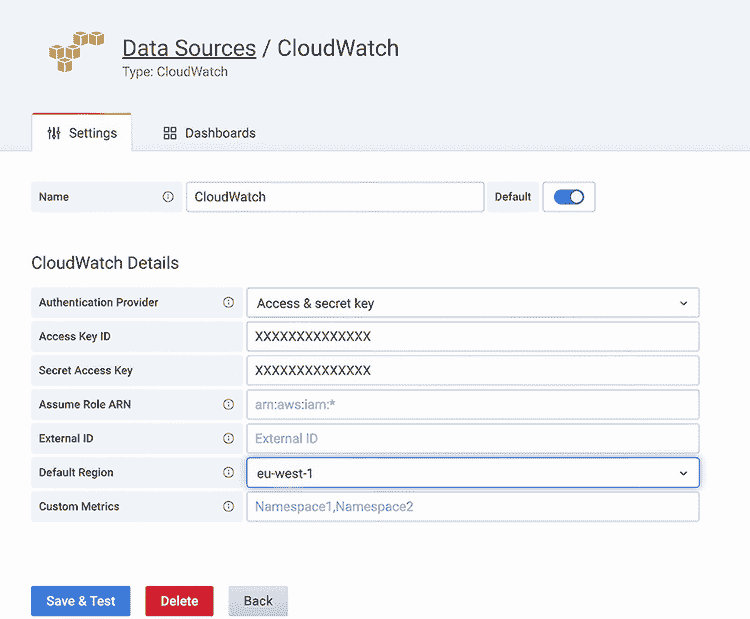
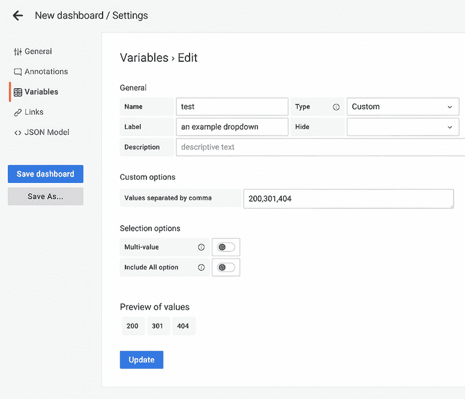
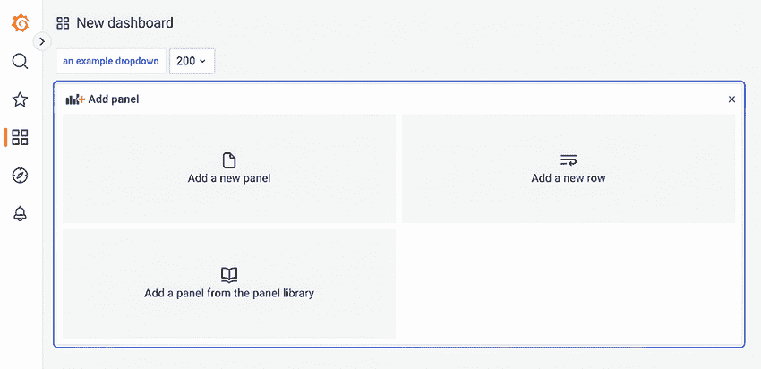
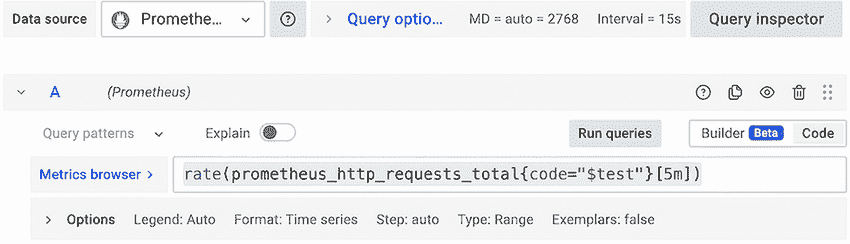
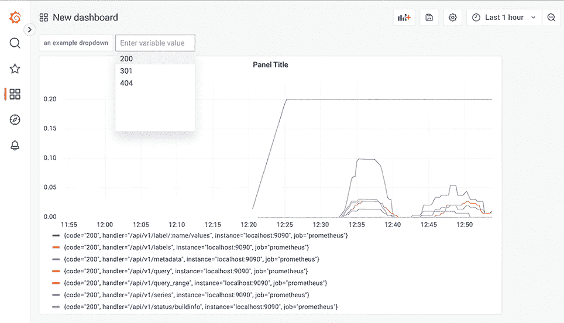
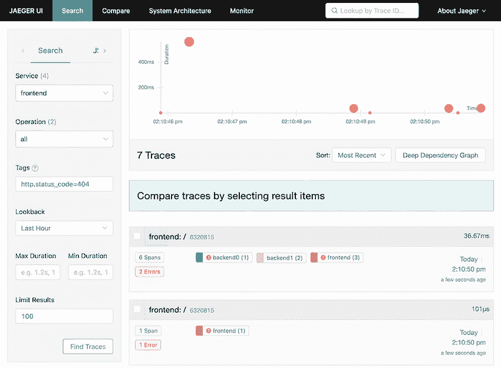
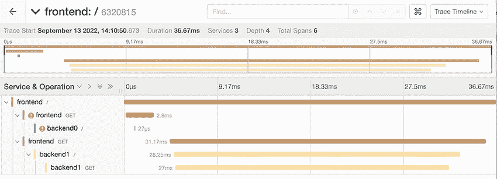
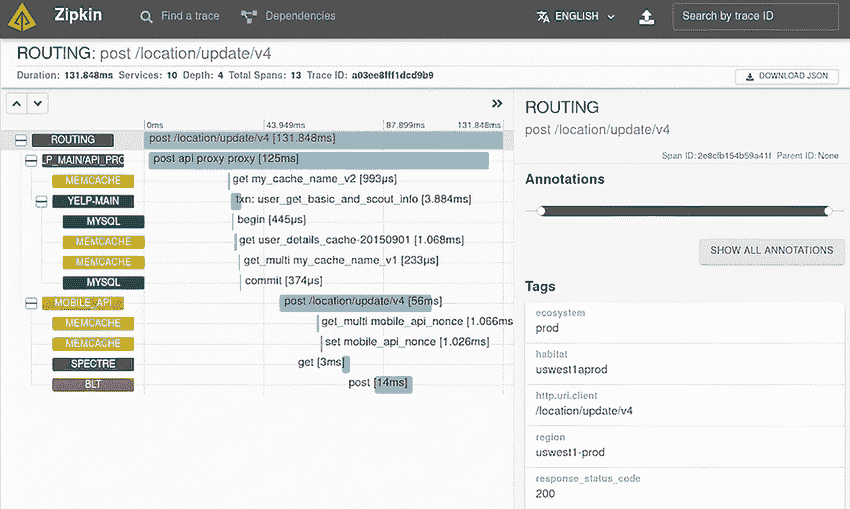
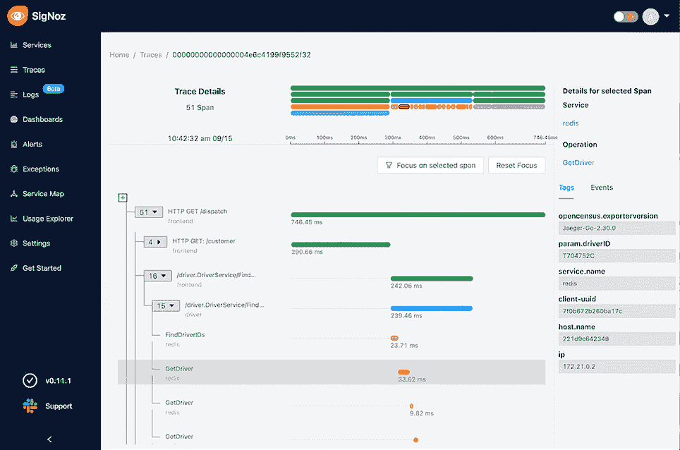

# 6 前端目的地

本章涵盖

* 前端目的地是什么以及有哪些选项
* 一体式目的地是什么以及有哪些可用选项
* 如何选择前端和一体式方案

在第 5 章中，我们查看了可观测性后端。本质上，这些是专门的时序数据库（`TSDBs`）、具有 `TSDB` 扩展的通用关系数据库，或能够存储日志、指标和追踪的列式数据存储。一旦你在后端中摄取了信号，你就可以使用后端来回答可观测性问题，通常称为 *查询*。这个过程可能是声明式的，例如使用 `SQL` 或 `PromQL` 的情况，也可能是命令式的，例如你指示追踪后端通过根 span ID 查找一个 span。

但信号的存储和能够查询它们只是手段。可观测性是关于理解系统并从收集和摄取的遥测信号中获得可操作的洞察。所以作为可观测性解决方案的用户，你真正想要的是提出临时问题并获得（及时的）答案。

理想情况下，这应该无论你询问的时间范围或涉及的遥测数据量如何都成立。例如，假设你每天摄取 10 GB 的日志数据和 10 亿条追踪，保留期为一年。当你在进行故障排除时，你不希望这一事实拖慢你（等待查询超时或花费数分钟返回），因为这会打断你的流程，可能导致你忽视问题，例如更慢地找到 bug——甚至找不到。

提出这些（可观测性）问题的环境是什么？这些环境可以是前端和一体式。前端按设计是纯图形用户界面（`GUIs`），允许你配置一个或多个数据源以创建仪表板或告警，例如 `Grafana`。一体式则将后端和前端组合成一个不可分割的逻辑单元。换句话说，你不能将一体式的 GUI 作为独立使用，只能与提供商为其设计的后端（们）结合使用。

那么你如何提出不同的问题，结果如何呈现给你？你猜对了：正是前端和一体式目的地让你实现这一点。可观测性社区中你可能会遇到的一个术语是 *一站式视图*。在本书的上下文中，我指的是一个单一位置或应用程序，你可以用它来消费所有信号、查询并关联不同信号类型。让我们深入了解可观测性前端的巡览。

**提示**

现实表明，将追求一站式视图作为最重要需求或优先事项（可能来自管理层）往往不是最有效的时间和金钱使用方式。能否在单一位置标准化消费许多、如果不是大多数信号？可以。是否会有例外？也会有。换句话说：通过考虑本章介绍的解决方案之一来追求它，但在不易实现的地方允许灵活性。


请注意，我并不是建议你放弃在单一主要前端（如 Grafana）上标准化的想法（将所有数据集中在一处，包括关联支持是非常有帮助的）。不过，请做好准备，总会存在某些信号或数据源未被该前端覆盖的情况，这时你还需要额外使用专用工具。

## 6.1 前端

我们将首先讨论两个最受欢迎的开源前端：Grafana 和 Kibana。接下来，我们将看看可观测性领域中使用的其他开源方案和商业方案。

### 6.1.1 Grafana

Grafana（[`github.com/grafana/grafana`](https://github.com/grafana/grafana)）如今是 Grafana Labs LGTM 堆栈（[`github.com/grafana`](https://github.com/grafana)）的一部分——Loki、Grafana、Tempo 和 Mimir——其首个也是最重要的资产。Grafana 最初是 Kibana（[`mng.bz/x47W`](http://mng.bz/x47W)）的一个分支，当时 Grafana Labs 的创始人 Torkel Ödegaard 正在寻找一个专注于时间序列数据并提供以图表为中心的仪表板的 UI。

Grafana 提供了多种资源，但其中最重要的三个是
* `Data sources`——代表你在仪表板或告警中想要使用的后端
* `Dashboards`——组织相关可视化的一种方式
* `Alerts`——在某事发生时向你发送通知（详见第 7 章）

现在让我们看看 Grafana 及其顶级资源在实际中的运行。首先，我们需要启动一个 Grafana 实例；我们使用以下 Docker Compose 文件来实现，你可以用现在已广为人知的命令 `docker-compose` `-f` `docker-compose.yaml` `up` 来启动它（请确保先进入 `ch06/grafana/`）。

Listing 6.1 Grafana 实例的 Docker Compose 配置
```
version: "3.5"
services:
  grafana:
    image: grafana/grafana-oss:9.1.4
    ports:
    - "3000:3000"
    volumes:
    - ./grafana.ini:/etc/grafana/grafana.ini                           ❶
    - ./ds.yaml:/etc/grafana/provisioning/datasources/datasource.yaml  ❷
    depends_on:
    - prometheus
 
  prometheus:
    image: prom/prometheus:latest
    ports:
    - "9090:9090"
    volumes:
    - ./prom-config.yaml:/etc/prometheus/prometheus.yml
```
❶ 提供一个简化登录的 Grafana 配置文件
❷ 将 Prometheus 配置为默认数据源

我们在 Docker Compose 文件中引用的 `grafana.ini` 文件使我们无需登录即可使用。请注意，在撰写本文时，Grafana 的版本为 9；因此，概念和截图均参考此版本。从 Grafana 8 到 9 有一些根本性的变化（统一告警——即告警是全局的，而非按仪表板划分），因此在将屏幕输出与此处看到的截图进行比较时请牢记这一点。

让我们从 Grafana 数据源开始（[`grafana.com/docs/grafana/latest/datasources/`](https://grafana.com/docs/grafana/latest/datasources/)），包括 Amazon CloudWatch、MySQL、Prometheus 和 Jaeger，它们代表可用于可视化或告警的后端。如果核心数据源不足，还有数百个插件（[`grafana.com/grafana/plugins/`](https://grafana.com/grafana/plugins/)）可供使用，或你可以自行创建。

现在访问 `http://localhost:3000/`，然后点击左侧菜单下部带有 Configuration 标签的齿轮图标。选择 Data Sources 菜单项。你应该会看到预配置的 Prometheus 数据源，并且当你点击 Add Data Source 按钮时，会列出所有可用的数据源（包括你安装的数据源插件）。

你可以在 Grafana 启动时预安装和预配置插件（数据源和可视化）。细节超出了本书范围，但作为起点，这里有一个示例。假设你想预安装 ClickHouse 数据源插件（假设你本地有 `grafana-clickhouse-ds` 二进制文件可用），并且 ClickHouse 以自托管方式运行或来自某个 SaaS 方案。使用 Docker Compose，你需要在 Grafana 部分的 `docker-compose.yaml` YAML 清单中添加以下行：
```
...
    volumes:
    - ./ds.yaml:/etc/grafana/provisioning/datasources/datasource.yaml
    environment:
      GF_INSTALL_PLUGINS: grafana-clickhouse-ds    ❶
```
❶ 插件的二进制文件，位于本地文件系统

此外，你需要在名为 `ds.yaml` 的文件中定义 ClickHouse 数据源（该文件在之前的 Docker Compose 文件中使用），内容如下：
```
apiVersion: 1
datasources:
  - name: ClickHouse
    type: grafana-clickhouse-datasource   ❶
    jsonData:                             ❷
      defaultDatabase: default
      port: 9000
      server: clickhouse
      username:
      tlsSkipVerify: true
      secureJsonData:
        password:
```
❶ 定义数据源插件的类型
❷ 下面是数据源插件特定的配置

如果你现在执行 `docker-compose` `up`，ClickHouse 数据源将被自动添加并配置，可立即在 Grafana 中使用。

在简要介绍了如何配置插件后，让我们来看一个具体的数据源。点击 Add Data Source 按钮后（我选择了 CloudWatch；见图 6.1，注意我删减了一些行，因此你这里会看到更多内容），你应该会看到数据源特定的配置选项，包括身份验证、授权以及你想要设置的各种默认值或限制。



图 6.1 一个 Grafana 数据源示例，显示配置选项

在此视图中，你还可以定义该数据源是否应作为新仪表板或告警的默认数据源（Default 切换开关位于右上角），并且如果点击 Dashboards 选项卡，你通常（但不总是）会找到该数据源的预定义仪表板。你可以直接使用这些预定义仪表板，或将其作为自己仪表板的起点。最后，在底部一行，你会找到几个按钮，使用 Save & Test 按钮时，Grafana 会执行一个简单的（取决于数据源）检查，以查看是否可以使用你提供的凭据访问该数据源。

注意 当你按下 Save & Test 按钮时，Grafana 执行的测试通常非常基础。将其视为必要但不充分的条件：如果通过，你可以继续（例如，使用 Explore 对数据源发出测试查询）。如果未通过，你需要检查连通性以及是否可以访问数据源，例如检查 IAM 角色或 API 密钥。

Grafana 仪表板（[`grafana.com/docs/grafana/latest/dashboards/`](https://grafana.com/docs/grafana/latest/dashboards/)）将面板（[`grafana.com/docs/grafana/latest/panels/`](https://grafana.com/docs/grafana/latest/panels/)）分组，支持多种可视化（[`grafana.com/docs/grafana/latest/visualizations/`](https://grafana.com/docs/grafana/latest/visualizations/)），从时间序列图到热力图再到组织成（可折叠）行的条形图。你可以通过在仪表板中使用变量（[`grafana.com/docs/grafana/latest/dashboards/variables/`](https://grafana.com/docs/grafana/latest/dashboards/variables/)）使仪表板更具可重用性和灵活性。


## 6.1 仪表盘变量

让我们实际操作一下：首先，创建一个新的仪表盘（点击显示四个方块且标题为 `Dashboards` 的菜单项），然后点击 `New Dashboard`。接着，选择右上角图标行中带有标签 `Dashboard Settings` 的齿轮符号。你现在应该能看到仪表盘设置；在那里（左侧选项卡选择中），点击 `Variables`。在这里，你可以通过点击 `Add Variable` 按钮来创建一个新变量。我们将其名称设为 `Test`，类型为 `Custom`，标签字段中填写 `An Example Dropdown`。这使我们能够定义一个预定义值的下拉列表，供仪表盘用户从中选择一个或多个。对于 `Values Separated by Comma` 选项中的值，使用 `200,301,404`，结果将类似于图 6.2 所示。



图 6.2 预定义（固定）值的示例 Grafana 仪表盘变量定义

输入完成后，点击 `Update` 按钮。现在按 `ESC` 键或点击左上角的左箭头，你将返回到仪表盘，并应看到定义 `test` 变量的结果，如图 6.3 所示。



图 6.3 我们示例仪表盘变量 `test` 在仪表盘中的渲染效果

Tip 在 Grafana 9 版本中，可考虑使用支持的不同类型的变量（例如 `query`、`custom` 和 `data source`）作为实现关联的一种方式。从 Grafana 10 版本开始，提供了专门的关联 API，包括在关联中使用变量和转换的 UI 支持（[`mng.bz/AoPz`](http://mng.bz/AoPz)）。

现在你已经定义了变量 `test`，可以例如在仪表盘查询中使用它来进行参数化。我们就这样做。首先，我们需要一个容纳可视化的面板，因此点击 `Add a New Panel` 按钮创建它。由于我们将 `Prometheus` 定义为默认数据源，Grafana 会为我们选择合适的可视化（类型为 `time series`）。

那里已经有一个名为 `A` 的占位符（空）查询。接下来，请确保你处于 `Code`（而不是默认的 `Builder`）模式；这可以在查询右上角切换。现在，在 `Metrics Browser` 输入字段中输入以下参数化的 PromQL 查询：

```
rate(
  prometheus_http_requests_total{code="$test"}[5m]
)
```

此查询使用我们之前定义的 Grafana 仪表盘变量 `test` 来过滤标签值。换句话说，让仪表盘用户选择要查询的 HTTP 状态码（默认 HTTP 状态码为 `200`）。图 6.4 显示了仪表盘编辑器中参数化查询的结果（当你满意并想尝试仪表盘时，按右上角的 `Apply` 按钮）。



图 6.4 Grafana 仪表盘变量 `test` 在 PromQL 查询中的使用（面板编辑器）

图 6.5 显示了在我们的 PromQL 查询中使用仪表盘变量 `test` 的结果，允许你选择 HTTP 状态码。如果你选择不同的值，例如 `301`，面板很可能为空，这是预期的，因为不存在此类标签值（除非你对 `Prometheus` 做了额外操作或发生了异常情况）。



图 6.5 使用 Prometheus 作为数据源的 Grafana 仪表盘（带参数化 PromQL 查询）

尝试对 `test` 的值进行调整，或为 `handler` 标签添加一个新变量。在此上下文中，请注意，除了我们刚才使用的简单示例之外，还有多种变量类型，从数据源选择到自由文本输入再到查询变量。后者允许你针对特定数据源编写查询，返回一个值列表。例如，你可以编写一个 PromQL 查询，为新的 `handler` 变量填充下拉列表，然后在扩展的参数化 PromQL 查询 `prometheus_http_requests_total{code="$test",handler="$handler"}` 中使用它。另一个针对数据源查询以填充仪表盘变量值的示例是，考虑一个 Kubernetes 集群，你希望根据 PromQL 查询为仪表盘用户提供可供选择的可用命名空间列表。

Tip 与数据源一样，你可以直接（如前所示）或使用 `Terraform` ([`mng.bz/Zq8P`](http://mng.bz/Zq8P)) 为 Grafana 配置仪表盘。通过 Grafana 仪表盘注册表（[`grafana.com/grafana/dashboards/`](https://grafana.com/grafana/dashboards/)）可以获得许多优秀的社区维护仪表盘，你可以通过引用导入或通过下载 `JSON` 定义导入。

`Alerts` ([`grafana.com/docs/grafana/latest/alerting/`](https://grafana.com/docs/grafana/latest/alerting/)) 是第三个核心 Grafana 资源。统一告警的主题在 Grafana 9 版本中引入了根本性变化。我们在本章中不会讨论告警，而是在第 7 章深入探讨该主题。

你不必自行运行 Grafana。如果你更喜欢将升级、安全补丁和访问控制等繁重工作外包，（截至出版时）有许多选择：

*   Amazon Managed Grafana ([`aws.amazon.com/grafana/`](https://aws.amazon.com/grafana/)) 自 2020 年底以来就已存在，并于 2021 年 9 月进入通用可用性（GA）。它支持 AWS SSO 和 SAMLv2，使向组织中的任何用户授予仪表盘访问权限变得容易。

*   Azure Managed Grafana ([`mng.bz/RxYK`](http://mng.bz/RxYK)) 自 2022 年 8 月起进入 GA，支持 Grafana 9 版本功能。

*   你可以使用托管 Grafana 作为 Grafana Labs 的 Grafana Cloud ([`grafana.com/products/cloud/`](https://grafana.com/products/cloud/)) 方案的一部分，同时还包括一系列其他基于 OSS 的工具，包括用于日志的 Grafana Loki 和用于追踪的 Grafana Tempo。

*   阿里云提供 Grafana 托管服务 ([`www.alibabacloud.com/product/grafana`](https://www.alibabacloud.com/product/grafana))，提供与协作工具的集成，包括钉钉和企业微信。

好的，这很有趣。接下来是 Kibana（及其 OpenSearch 变体 Dashboards）。

### 6.1.2 Kibana 和 OpenSearch Dashboards

我们在第 5 章中讨论了 Elasticsearch 和 OpenSearch（ES/OS）作为后端。在此上下文中，你可以选择 Kibana ([`www.elastic.co/kibana/`](https://www.elastic.co/kibana/)) 用于 Elasticsearch，以及 OpenSearch Dashboards ([`opensearch.org/docs/latest/dashboards/index/`](https://opensearch.org/docs/latest/dashboards/index/)) 用于 OpenSearch 作为各自的前端。

由于 OpenSearch Dashboards 是 Kibana 的分支，因此不出所料，有许多共同的概念和功能，不考虑许可方面的差异。鉴于这两个项目及其基于的托管服务的性质和动态，我在这里不会详细介绍 Kibana 或 OpenSearch Dashboards，但我会指出一些起点，供你如想了解更多时参考：

*   在第 4 章中，我们使用 OpenSearch 和 OpenSearch Dashboards 作为使用 Fluent Bit 代理进行日志摄取和查询的后端和前端目标。

*   通过 Logz.io 博客，有一个优秀的 Kibana 教程（[`logz.io/blog/kibana-tutorial/`](https://logz.io/blog/kibana-tutorial/)）可供使用，或者如果你想投入更多时间，可以深入 Kibana 文档（[`www.elastic.co/guide/en/kibana/current/get-started.html`](https://www.elastic.co/guide/en/kibana/current/get-started.html)），它也提供了很好的入门指导。


* 对于 OpenSearch Dashboards，我建议查阅项目文档，其中提供了 OpenSearch Dashboards 101 快速入门（[`opensearch.org/docs/latest/dashboards/index/`](https://opensearch.org/docs/latest/dashboards/index/)），如果你想了解 OpenSearch Dashboards Notebooks（类似 Jupyter Notebook；[`mng.bz/2D80`](http://mng.bz/2D80)），项目博客已为你涵盖。

顺带一提，有趣的是 Grafana 最初是 Kibana 的分支，极大地简化了 UI，并强烈聚焦于时间序列数据，尤其是指标。这导致 Grafana 常常与 Prometheus 一起使用，今天仍然如此。过去几年中，Grafana 扩大了其范围，现在也旨在涵盖日志（和追踪）可视化。另一方面，Kibana 和 OpenSearch Dashboards 最初专注于日志，现在正逐步增加对指标和追踪的支持。确实是令人有趣的时代！

与 Grafana 一样，你可以将 Kibana 和 OpenSearch Dashboards 的运维外包给 SaaS 服务：

* Elastic 提供托管 Kibana 作为其可观测性（[`www.elastic.co/observability/`](https://www.elastic.co/observability/)）解决方案的一部分。
* Amazon OpenSearch Service（[`aws.amazon.com/opensearch-service/`](https://aws.amazon.com/opensearch-service/)）提供由 OpenSearch Dashboards 驱动的可视化功能，同时也支持 Kibana（版本 1.5 至 7.10）。
* Aiven for OpenSearch（[`aiven.io/opensearch/`](https://aiven.io/opensearch/)）支持 OpenSearch Dashboards，你可以选择部署在哪个云平台（AWS、Azure、Google 等）。
* Logz.io 拥有基于 OpenSearch 和 OpenSearch Dashboards 构建的日志管理（[`logz.io/platform/log-management/`](https://logz.io/platform/log-management/)）服务，包含集成和人工指导的 AI/ML。

接下来，让我们看看在可观测性设置中使用的另外两个开源前端。

### 6.1.3 其他开源前端

除了 Grafana 和 Kibana/OpenSearch Dashboards，在评估选项时你可能还想查看另外两个开源前端：

* Apache Superset（[`superset.apache.org/`](https://superset.apache.org/)），在 Apache License Version 2.0 下可用，定位为数据探索和可视化平台，支持多种数据库（[`mng.bz/1qWj`](http://mng.bz/1qWj)），包括 Amazon Athena、Google BigQuery、ClickHouse、Elasticsearch、MySQL 和 TimescaleDB；不过截至撰写时，Prometheus 支持不可用。它于 2021 年初成为 Apache 软件基金会（ASF）的顶级项目，拥有众多贡献者，包括 Airbnb（其发源地）、Dropbox 和 Lyft。
* Metabase（[`github.com/metabase/metabase`](https://github.com/metabase/metabase)）承诺让公司里的每个人都能“提问并从数据中学习”，这非常适合可观测性用例。它在 AGPL 以及商业许可证下发布，具有强大的 SQL  focus。你可以将（[`mng.bz/Pzpn`](http://mng.bz/Pzpn)）Metabase 连接到多种数据库（包括 Google BigQuery、PostgreSQL 和 Snowflake），更多选项可通过合作伙伴和社区驱动程序获得。除了开源 DIY 模式，你还可以使用同名商业托管服务（[`www.metabase.com/pricing/`](https://www.metabase.com/pricing/)），可在本地或云中使用。现在，让我们转向云服务提供商和 ISV 提供的服务。

### 6.1.4 云服务提供商和商业前端

在这个领域，你经常会听到或读到 `business intelligence`（BI）这一术语——可将其视为业务流程的可观测性。事实上，该领域许多产品都源于此，并已适配或在可观测性上下文中作为特定用例领域使用。让我们更仔细地看看：

* `Amazon QuickSight`（[`aws.amazon.com/quicksight/`](https://aws.amazon.com/quicksight/)）——AWS 的云 BI 服务，可用于仪表盘和报告。它还支持许多流行的后端，包括 Amazon Athena、S3、OpenSearch 和 Salesforce。
* `Looker Studio`（[`lookerstudio.google.com/overview`](https://lookerstudio.google.com/overview)）——Google 的 BI 托管服务，支持多种可视化和连接到数百个后端的连接器。
* `Microsoft Power BI`（[`powerbi.microsoft.com/en-us/`](https://powerbi.microsoft.com/en-us/)）——Microsoft 的 BI 云服务，支持数据集市和应用，并与 Microsoft Office 套件深度集成。或者，你也可以使用 Azure 仪表盘（[`learn.microsoft.com/en-us/azure/azure-portal/azure-portal-dashboards`](https://learn.microsoft.com/en-us/azure/azure-portal/azure-portal-dashboards)），它附带了与 Azure Monitoring 的多个开箱即用集成。
* `Tableau`（[`www.tableau.com/`](https://www.tableau.com/)）——一种可视分析平台，可在多种环境中使用，从桌面到本地再到云，支持大量数据源和可视化。

本节提到的商业产品被广泛使用，主要是由企业业务部门而非工程团队使用。然而，在可观测性上下文中，我们确实需要一种全面的方法，使尽可能多的岗位族能够参与并从系统信号中受益。

## 6.2 一体化方案

从技术上讲，所有云服务提供商的服务，包括 CloudWatch、X-Ray、Azure Monitor 和 Google Cloud 的运维套件，都属于一体化类别。我们已在第 5 章中介绍过它们，因此这里重点关注该领域的其他产品。

有一些开源产品，部分由云原生计算基金会（CNCF）或 Apache 软件基金会（ASF）托管，提供两种或更多信号类型的支持。它们具备摄取和查询能力，通常允许插入不同的后端或使用内存（非持久化）存储。

### 6.2.1 CNCF Jaeger

CNCF Jaeger（[`github.com/jaegertracing/jaeger`](https://github.com/jaegertracing/jaeger)）项目起源于 Uber，并受 Google 的 Dapper 项目和 Zipkin 启发。如今，它是一个毕业的 CNCF 项目，定位为分布式追踪平台，内置对多种后端的支持，包括 Apache Cassandra；ES/OS；以及通过第三方存储插件框架的自定义后端，如 ClickHouse。

Jaeger 的整体架构是一组协同工作的微服务，用 Go 编写。核心 Jaeger 组件包括

* `Agent (optional)`——守护进程通过 UDP 将追踪发送到收集器，设计用于部署到运行应用的所有主机。代理正被 OpenTelemetry 取代。
* `Collector`——接收来自 OpenTelemetry（SDK 或收集器）或 Jaeger 代理的追踪，并对其进行验证、丰富并存储到存储后端。
* `Query service`——公开从存储中检索追踪的 API 并托管 UI。
* `UI`——用户交互的基于 Web 的 GUI，用于搜索和分析追踪和/或查看系统架构（微服务的图表示）。
* `Ingester`——收集器的简化版本，从 Apache Kafka（流行的开源消息代理）读取追踪并将其写入存储后端。

对于实验（开发-测试用例），Jaeger 还支持纯内存存储，可通过“一体化”发行版轻松使用，该发行版将核心 Jaeger 组件组合在一个包中。

让我们看看 Jaeger 的实际运行：我们再次使用 Docker Compose 设置，并将 Jaeger 配置为使用 ClickHouse 作为 span 存储（列表 6.2）。这次我们使用了一个小型微服务设置，其中三个 `ho11y` 实例相互连接，以模拟一个调用两个后端服务的前端服务。


### 清单 6.2 用于 Jaeger 与 ClickHouse 部署的 Docker Compose 文件的相关部分

```
frontend:                                           ❶
    image: public.ecr.aws/mhausenblas/ho11y:stable
    ports:
    - 8765:8765
    environment:
    - "DOWNSTREAM0=http://backend0:8766"
    - "DOWNSTREAM1=http://backend1:8767"
    - "OTEL_RESOURCE_ATTRIB=frontend"
    - "OTEL_EXPORTER_OTLP_ENDPOINT=otel-collector:4317"
    - "HO11Y_INJECT_FAILURE=enabled"
 
  jaeger:                                           ❷
    image: jaegertracing/all-in-one:1.35
    command: [
      "--grpc-storage-plugin.binary=/etc/jaeger-clickhouse",
      "--grpc-storage-plugin.configuration-file=/etc/clickhouse-plugin.config"
    ]
    volumes:
    - ./jaeger-clickhouse:/etc/jaeger-clickhouse
    - ./clickhouse-plugin.config:/etc/clickhouse-plugin.config
    ports:
    - "9090:9090"
    - "16686:16686"
    - "14250:14250"
    environment:
    - "SPAN_STORAGE_TYPE=grpc-plugin"
 
  clickhouse:                                       ❸
    image: clickhouse/clickhouse-server
    ports:
    - "8123:8123"
    - "9000:9000"
```

❶ 使用 `ho11y` 的 `frontend` 微服务。它被配置为调用两个后端并将追踪发送到 OpenTelemetry Collector。
❷ 使用基于 gRPC 的插件机制配置了 ClickHouse 作为后端的 Jaeger 一体化发行版
❸ ClickHouse 作为后端存储追踪数据（并使其可搜索）

我们再次使用 OpenTelemetry Collector 来收集基于 `ho11y` 的微服务设置中的追踪数据并将其摄取到 ClickHouse（通过 Jaeger）。相应的 OpenTelemetry Collector 配置显示在以下清单中（另见第 4 章）。

### 清单 6.3 用于 Jaeger 与 ClickHouse 的 OpenTelemetry Collector 配置

```
receivers:
  otlp:
    protocols:
      grpc:
        endpoint: 0.0.0.0:4317
exporters:
  jaeger:                   ❶
    endpoint: jaeger:14250
    tls:
      insecure: true
service:
  pipelines:
    traces:                 ❷
      receivers: [ otlp ]
      processors: [ batch ]
      exporters: [ logging, jaeger ]
```

❶ Jaeger exporter 配置（我们不使用 TLS，因此配置为不安全）
❷ 追踪管道，使用 `OTLP` 接收器和 Jaeger exporter

现在是执行 `docker-compose` `up` 的时候了，如果你现在在你选择的浏览器中打开 http://localhost: 16686/，在将 Service 下拉菜单先设置为 `Frontend` 并在标记为 Tags 的输入字段中输入 `http.status_code=404` 后，你应该会看到类似于图 6.6 所示的内容（左侧表单）。



图 6.6 Jaeger UI 显示特定标签的全部追踪（`http.status_code=404`）

获取所有追踪的概览很有用，但通常你希望深入挖掘并了解请求端到端上下文中发生了什么。为此，你可以点击其中一个追踪，进入图 6.7 所示的视图。追踪详情视图以瀑布模型的形式展示构成该追踪的各个 span，包括持续时间以及高层元数据，例如操作类型以及是否成功。让我们继续介绍该类别中的另一个 CNCF 项目。



图 6.7 Jaeger UI 显示追踪详情

### 6.2.2 CNCF Pixie

Pixie ([`px.dev/`](https://px.dev/)) 是一个 Kubernetes 专用的实时调试平台，可在无需手动埋点或重新部署的情况下收集遥测数据，例如指标、追踪和剖析。Pixie 拥有一个前端，可帮助你查询和可视化这些数据。它由 New Relic 贡献给 CNCF，并于 2021 年 6 月被接受为沙箱项目。

为了在不更改代码的情况下收集数据，Pixie 大量使用 `eBPF` ([`ebpf.io/`](https://ebpf.io/))。`eBPF` 是一种 Linux 内核功能，允许你在验证后直接在内核中执行沙箱程序。

由于 `eBPF` 允许收集大量细粒度数据，例如完整的请求和响应体，因此它将所有数据存储在内存中。不过，你可以将遥测数据发送到任何 OpenTelemetry 兼容的端点 ([`mng.bz/JgXV`](http://mng.bz/JgXV)) 以实现长期数据保留。换句话说，历史数据在设计上不在 Pixie 的范围内。

为了查询遥测数据，Pixie 使用了一种相当巧妙的领域特定语言 `PxL` ([`docs.px.dev/tutorials/pxl-scripts/write-pxl-scripts`](https://docs.px.dev/tutorials/pxl-scripts/write-pxl-scripts))，它受 Python Pandas 启发。用户可以使用 `PxL` 按自己喜欢的方式查询和处理 Pixie 的底层数据。Pixie 的所有仪表板也完全可脚本化，允许用户构建最适合自己的视图和可视化。

Pixie 拥有一个活跃的社区和一个有趣且前景广阔的路线图。它提供多种集成，从 Slack 告警到通过 OpenTelemetry 导出在 Grafana 仪表板中使用。如果你正在运行 Kubernetes 集群，我建议你更仔细地了解一下 Pixie，因为它可以成为你工具箱中非常有用的工具。现在，让我们继续介绍一个分布式追踪领域的老牌开源前端。

### 6.2.3 Zipkin

Zipkin ([`zipkin.io/`](https://zipkin.io/)) 是一个开源分布式追踪系统，用 Java 编写，由 OpenZipkin 志愿者组织运营。Zipkin 拥有一个专注于追踪的 UI（见图 6.8），并集成了多种后端，包括 ES/OS、Apache Cassandra 和 MySQL，其他后端作为第三方扩展提供。Zipkin 项目也受 Google Dapper 启发，最初由 Twitter 创建，可追溯至 2015 年。



图 6.8 Zipkin 运行的屏幕截图（来自项目文档）

我在这里不会详细介绍 Zipkin 的架构，因为它与我们在 CNCF Jaeger 上下文中看到的内容非常相似。如果你想尝试 Zipkin 并亲眼看看它是如何工作的，请查看 Zipkin GitHub 仓库，其中收集了大量 Docker Compose 示例 ([`mng.bz/wv7P`](http://mng.bz/wv7P))，从使用 Apache Cassandra 作为后端到使用 Apache Kafka 进行追踪摄取，应有尽有。要查看 Docker Compose 示例，请在相应目录中执行 `docker-compose` `up`，然后前往 http://localhost:9411 并点击 Run Query 查看结果。接下来，我们将介绍一个令人兴奋的 Apache 软件基金会（ASF）项目。

### 6.2.4 Apache SkyWalking

Apache SkyWalking ([`skywalking.apache.org/`](https://skywalking.apache.org/)) 是一个 ASF 开源项目，如今提供对分布式系统（如 Kubernetes 环境中的微服务）分布式追踪的支持。它始于 2015 年中国联通的分布式追踪系统，已被包括阿里巴巴、中国招商银行和华为在内的 100 多家公司采用。如果你想深入了解该主题，请查看 Liangjun Jiang 的“Application Performance Monitor and Distributed Tracing with Apache SkyWalking in Datahub” ([`mng.bz/qr7r`](http://mng.bz/qr7r)) 以了解其实际应用。至此，我们将介绍两个基于 ClickHouse 的一体化解决方案。

### 6.2.5 SigNoz

SigNoz ([`github.com/SigNoz/signoz`](https://github.com/SigNoz/signoz)) 将自己定位为 Datadog 和 New Relic 的开源替代品。目前它使用 ClickHouse 作为后端；在 2021 年年中之前，它专注于使用 Apache Kafka 和 Apache Druid 组合 ([`mng.bz/7DBv`](http://mng.bz/7DBv)) 进行存储。另请参阅第 5 章，了解这些后端的更多详细信息。SigNoz 易于设置，并附带多个教程，涵盖从消费 Kubernetes 基础设施指标 ([`mng.bz/mV7a`](http://mng.bz/mV7a)) 到可视化 Spring Boot 应用的 JVM 指标等主题。

让我们快速浏览一下 SigNoz 的实际运行情况。你只需要安装 `Docker Compose`，然后执行以下操作：


```
$ git clone -b main https:/ /github.com/SigNoz/signoz.git && cd signoz/deploy/
$ docker-compose -f docker/clickhouse-setup/docker-compose.yaml up
```

如果现在等待几分钟（给捆绑的应用一些时间生成信号），前往 http://localhost:3301/，并选择一个跟踪，你应该会看到与图 6.9 所示类似的内容（SigNoz 的跟踪视图）。接下来是另一个基于 ClickHouse 的开源一体化方案。



图 6.9 SigNoz 运行时的屏幕截图，跟踪视图处于激活状态

### 6.2.6 Uptrace

Uptrace ([`github.com/uptrace/uptrace`](https://github.com/uptrace/uptrace)) 是一个一体化工具，声称支持 traces、metrics 和 logs，并使用 OpenTelemetry 收集数据，同时使用 ClickHouse 持久化遥测信号，且能够将冷数据（你不经常访问的历史数据）卸载到 S3 兼容的对象存储中。对于告警，Uptrace 提供了与多个通知渠道的集成，包括电子邮件、Slack 和 Telegram。

Uptrace 的定位和架构与你之前看到的 SigNoz 相似，而在撰写时它似乎比 SigNoz 成熟度稍低，但这里确实存在潜力。我不会感到惊讶，如果今后会有更多开源一体化方案采用类似的设置。至此，我们结束了开源方案的介绍，并将注意力转向该领域的商业方案。

### 6.2.7 商业方案

许多全能型类别中的商业方案早在数年前、有些甚至十多年前就已启动。当时用于其服务的标签通常是 *application performance monitoring*（APM）。术语 *APM* 已大多被 *observability solution* 取代，因为它更具包容性，而且据推测在标题和广告搜索引擎优化（SEO）方面效果更好。

本节故意写得很简短，因为我不想给人留下可以对所有厂商及其各自方案进行全面评测，甚至比较的印象。截至撰写时，这确实是一个繁忙而拥挤的领域，我们已经见证了几次整合和收购，未来几年可能还会继续。以下列表想要实现的是对可用选项的简短总结，突出其优势和整体定位。这应该能让你在选择时拥有几个起点（下一节会详细介绍）。该领域感兴趣的厂商和方案包括（但不限于）以下按字母顺序排列的：

*   *Aspecto (*[`www.aspecto.io/`](https://www.aspecto.io/)*)*—一个以分布式跟踪为重点的 SaaS 方案，你可以通过关联 traces、logs 和 metrics 来进行根因分析。其团队在 OpenTelemetry 项目中很活跃，因此 Aspecto  heavily 使用它也就不足为奇了。

*   *AppDynamics (*[`www.appdynamics.com/`](https://www.appdynamics.com/)*)*—最早的 APM 厂商之一，现为 Cisco 旗下。它将自身定位为业务可观测性平台，具有专用代理（支持 OpenTelemetry），可用于从终端用户监控到异常检测再到仪表盘的各种用例。

*   *Datadog (*[`www.datadoghq.com/`](https://www.datadoghq.com/)*)*—提供众多功能，包括基础设施、容器和数据库监控；日志管理；分布式跟踪；以及持续剖析。它可通过所有主要云服务提供商使用，具有丰富的集成和基于自动插桩的开箱即用能力。Datadog 在 2022 年 5 月还宣布支持 OpenTelemetry。

*   *Honeycomb (*[`www.honeycomb.io/`](https://www.honeycomb.io/)*)*—一种云原生可观测性 SaaS 方案，具有出色且独特的用于调查异常的能力，例如 BubbleUp。它拥有非常有趣的数据存储（自建）并原生支持 OpenTelemetry。Honeycomb 非常注重手动插桩。其创始人多年来在定义和确立可观测性（o11y）这一称谓方面发挥了关键作用。

*   *Instana (*[`www.instana.com/`](https://www.instana.com/)*)*—一个被 IBM 收购的 APM 工具，具有丰富的监控和分析能力。它像该领域所有主要 ISV 一样，很早就押注 OpenTelemetry，现在已支持。你可以在 AWS、Azure、Google 和 IBM Cloud 上使用 Instana。

*   *Lightstep (*[`lightstep.com/`](https://lightstep.com/)*)*—一个 SaaS 方案，具有统一的存储层（[`lightstep.com/blog/lightstep-metrics-database`](https://lightstep.com/blog/lightstep-metrics-database)），允许其存储不同信号；具有有趣的定价结构；并且在上游 OpenTelemetry 方面有很多活动。Lightstep 由 Ben Sigelman 创立（他曾在 Google 帮助建立 Dapper），现在是 ServiceNow 的一部分。

*   *Lumigo (*[`lumigo.io/`](https://lumigo.io/)*)*—一个规模较小的厂商，但在该领域提供一个有趣且定价具有竞争力的 SaaS 方案。它原生支持 OpenTelemetry，并专注于分布式跟踪。

*   *New Relic (*[`newrelic.com/`](https://newrelic.com/)*)*—一个源自 APM 的 SaaS 方案，将自身定位为面向 DevOps、安全和业务的可观测性平台。它原生支持 OpenTelemetry；拥有超过 400 个集成；并支持 traces、metrics 和 logs。

*   *SolarWinds (*[`www.solarwinds.com/solarwinds-observability`](https://www.solarwinds.com/solarwinds-observability)*)*—整合了过去十年收购的众多可观测性解决方案，包括但不限于 Pingdom、Librato、Papertrail、LogicNow、Loggly、VividCortex 和 SentryOne。

*   *Splunk (*[`www.splunk.com/`](https://www.splunk.com/)*)*—可观测性 ISV 领域的大型厂商之一。如今它既提供 SaaS 也提供本地部署；历史悠久（可追溯至 2003 年）。Splunk 常用于日志，但也支持 metrics 和 traces，具有包括分析、仪表盘和业务诊断在内的广泛功能。Splunk 重大投入并为 OpenTelemetry 做贡献，因此其产品提供一流的支持也就不足为奇了。

*   *Sumo Logic (*[`www.sumologic.com/`](https://www.sumologic.com/)*)*—一个与所有主要云服务提供商集成的 SaaS 方案。它拥有众多集成，支持具有监控和安全相关功能的多种用例，并支持 OpenTelemetry。

至此，我们已完成了对一体化方案的介绍，现在转向选择时的考虑。

## 6.3 选择前端和一体化方案

鉴于本章中你看到的前端和一体化方案选项之多，可以想象挑选一个（或多个）并非易事。如果可以的话，从你希望为内部客户、开发者和业务利益相关者提供的价值倒推。考虑以下问题：你是在寻找支持加速交付功能和修复 bug 的解决方案吗？你对能减少生产环境问题修复时间的产品感兴趣吗？你想提高开发者生产力吗？

根据答案，你首先需要对以下做出决策：构建还是购买。一般来说，除非你已将其确定为竞争优势，否则你希望尽可能外包。换句话说，购买。然而，也有几家大型企业出于战略考虑，希望最大限度地减少对厂商和/或云服务提供商的依赖。在这种情况下，使用开源组件并基于开放标准进行工作非常有意义。换句话说，构建。


## 考虑事项
效果因人而异，但在评估和选择该领域的方案时，这里有几点考虑事项：

* 你能否确定成本？前端在托管方案中通常按用户计费（查看者和编辑者），且相对可预测。一体化方案通常采用类似后端的计费计划（可能也有按席位计费）。对于自托管部署，请务必考虑补丁、扩展、值班时间、安全相关要求和工作以及跟上上游更新的运营成本。数据存储、摄取和查询也可能产生成本，正如我们在第 5 章中更详细讨论的那样。
* 一体化方案通常是实现单一视图面板的最接近选择，如果你确保支持 OpenTelemetry 等开放标准，从而最大限度地减少厂商锁定，它们是极佳的选择。
* 对于所有开源方案，请确保了解项目背后的主体（即单一厂商开源与通常由 CNCF 或 ASF 主持的社区）、许可（可能发生变化）以及开源项目的健康状况。关于最后一点，仅仅查看其 GitHub 星标数量是不够的（这纯粹是流行度指标）。你需要投入时间查看其发布节奏（你应能适应该节奏）、贡献者数量（理想情况下来自不同地方的多个贡献者）和用户数量（理想情况下来自不同行业领域）、可用的文档、存在的 issue 以及 pull 或 merge 请求的数量（以及处理速度），以及支持策略（即内部或社区支持），因为支持是企业使用的关键。
* 越来越相关且被要求的功能之一，有助于你更高效地使用所选工具的是关联（[`www.youtube.com/watch?v=qVITI34ZFuk`](https://www.youtube.com/watch?v=qVITI34ZFuk)）。请确保检查可用的关联类型（基于时间、示例等；另见第 11 章）以及从一种信号类型切换到另一种所需的手动工作量，前提是所评估的工具确实支持一种以上的信号类型，这是关联工作的基础。

Tip 鉴于前端和一体化方案的本质是最终用户交互的可见部分，请确保让所有利益相关者参与其中。仅基于价格标签或因其精致程度而选择工具可能会变得具有挑战性。

现在，这是一大堆新信息！我希望你能将其利用起来，在该领域选择工具时发挥优势。这是一个发展迅速且令人兴奋的领域，因此定期重新审视你的选择是有意义的。

## 摘要
* 前端允许你与后端存储的可观测性数据集进行交互。
* 你使用前端以各种图形和文本方式找到对你（临时）问题的答案。
* 有许多开源前端（Grafana、Kibana、Metabase 等）可用，当你构建自己的内部可观测性解决方案时，请考虑使用这些而不是从头构建。
* 如果你能避免过度的厂商锁定，一体化方案是极佳的选择；它们允许你将大部分运营负担外包，并通常以溢价提供一系列功能。
* 过去的 APM 现在基本上被重新命名为分布式追踪。
* 在该领域选择工具可能很棘手，但请确保你充分了解相关成本，并对想要交付的价值（以及交付给谁）有清晰的认识。
* 选择开源工具是实现互操作性和厂商无关性的好方法；然而，请确保你了解开源项目的动态，并有明确的支持获取策略。
* 工具支持的开放标准（如 OpenTelemetry）越多，你就越不可能被锁定，并在其不再符合需求时能够转向其他工具。
* 前端通常是关联发生的地方；也就是说，你期望 UI 支持操作和可视化，以便轻松地从一种遥测信号类型切换到另一种。
