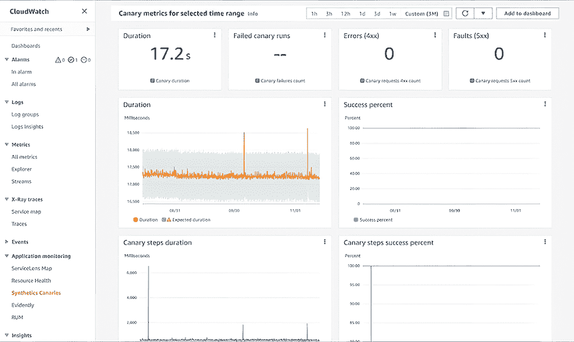
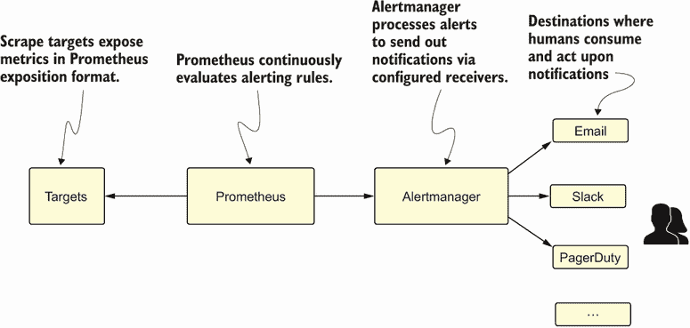
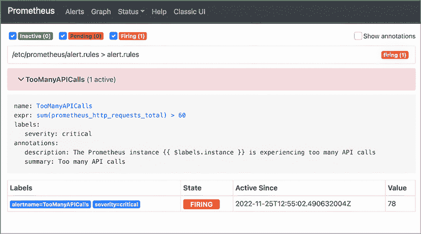
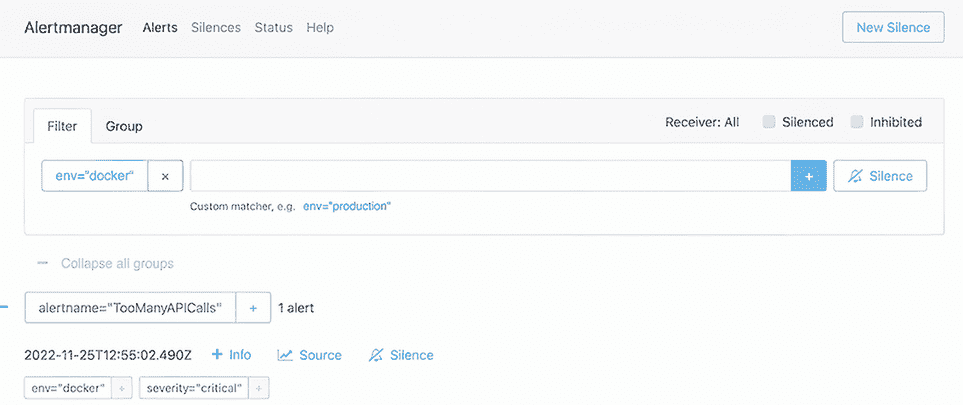
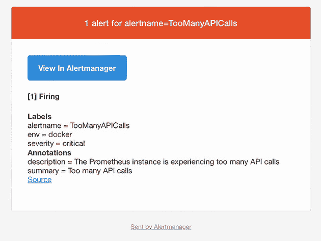

# 7 云运营
本章涵盖
* 如何管理事件
* 健康监控和告警
* 治理和用量跟踪

到目前为止，本书主要关注我们云原生设置的理想路径，涵盖信号源、遥测以及存储、查询、可视化并与信号交互的目的地，以理解和影响系统。在本章中，我们将讨论我称之为 *云运营* 的云原生解决方案的一个方面，它涵盖了你在运营角色中很可能会遇到的多个主题。

我们从事件开始：如何检测事物未按预期工作、应对异常行为并从过去的错误中学习。然后，我们关注告警或警报（我在此互换使用这两个术语，尽管告警可以是触发条件，而警报可能涵盖多个告警）——即检查条件并通知负责服务或基础设施的人员的自动化过程。本章的最后一部分，我们将讨论用量跟踪，无论是内部或外部用户访问的内容，还是提供云原生应用所使用的资源成本。

为什么云运营会很棘手？嗯，在云原生解决方案的背景下，无论是运行在 Kubernetes 上的工作负载还是一堆 lambda 函数，它们的共同点都是有很多 moving parts 且可能有许多不同的所有者。因此，当你的云原生应用的最终用户受到影响时——例如响应时间比平时慢或（部分）故障——谋杀之谜就开始了：请求路径上的哪些服务导致了问题？谁拥有它，因此应该被通知来修复它？

请记住，对于最终用户来说，你运行了数百个微服务这一事实是未知的，而且坦率地说，不应该重要。他们感知到的是某些东西无法正常工作，而你的组织有责任确保你能检测到此类问题——理想情况下，在用户向你反馈之前——并制定策略，不仅能尽快修复问题，还能从问题中学习以确保它不再发生。在此背景下，我们可以考虑客户体验跟踪（并不总是清楚谁拥有此项）与基础设施跟踪（通常所有权明确定义）。让我们从事件开始，了解如何以结构化方式检测和响应它们。

## 7.1 事件管理
在本书的背景下，我们将考虑两种事件：服务或平台的意外行为负面影响其功能或性能，以及尚未应用经验教训的意外行为重复。对于后一种重复的意外行为的情况，拥有先前事件如何解决的运行手册对于处理重复情况会很有帮助。

通常，最好建立事件响应流程。此事件响应流程通常是一套定义如何解决和从事件中学习的过程。你可以将其视为三个阶段：
1. 首先，你需要能够检测到某些事情出了问题（健康和性能监控）。
2. 然后，你需要能够以结构化方式对事件做出反应并处理它。
3. 最后但同样重要的是，你需要从事件中学习。你希望避免未来重复类似情况（应完成哪些行动项目以防止同一问题再次发生）。我们将从介绍如何检测问题开始。

### 7.1.1 健康和性能监控


我们之前讨论过，解决事件的第一步是能够首先理解确实出现了问题。这听起来可能很简单，但在由众多组件组成的云原生系统中，这是一个非平凡的问题。换句话说，像在浏览器中访问你的网站并检查一切是否看起来正常这样的人工方法，是你不想考虑的。相反，力求尽可能自动化对你的服务以及“外部视角”——即客户体验（`CX`）的检查。在此上下文中，强调这一外部视角至关重要；想象一下这样一种情况：你的所有服务都报告健康且按预期工作，但你的终端用户却无法访问应用，例如由于 `DNS` 问题。

实际用于执行健康和性能监控的机制实际上是一个谱系，包括以下内容：

*   *可达性监控*—执行一次简单的调用（`ICMP`、`TCP`、`HTTP`）以检查可达性或确保端点返回预定义的状态码。

*   *合成监控*—执行脚本以模拟典型的终端用户操作。这些模拟的终端用户有时被称为 *canaries*（源自原始用例的引用，其中那些小鸟被用来检测矿井中的瓦斯泄漏）。多个开源和商业产品允许你执行合成监控——例如，Datadog（[`docs.datadoghq.com/synthetics/`](https://docs.datadoghq.com/synthetics/)）、Elastic（[`mng.bz/5wDO`](http://mng.bz/5wDO)）、New Relic（[`mng.bz/6Dle`](http://mng.bz/6Dle)）和 Amazon CloudWatch（[`mng.bz/o17Z`](http://mng.bz/o17Z)）。请参阅图 7.1 作为示例。



图 7.1 CloudWatch，合成监控的一个示例，用于跟踪网站的可用性

你通常希望自动化检查条件的过程并通知相关负责人，这也被称为 *alerting* 或 *alarming*。有一篇不错的高层次文章，“When to Alert on What?”（[`ali.sattari.me/posts/2023/when-to-alert-on-what/`](https://ali.sattari.me/posts/2023/when-to-alert-on-what/)），它是从手动到使用服务等级目标（我们在第 10 章详细讨论）等主题入门的有用文章。

顺带一提，你如何知道某事是否异常？你需要一个基线。你可以通过手动观察和记录事物来确定基线（即“当一切健康时，服务或系统是什么样子？”），也可以采用更复杂的技巧，通常称为 *anomaly detection*（[`www.reddit.com/r/sre/comments/zxdd2y/anomaly_detection/`](https://www.reddit.com/r/sre/comments/zxdd2y/anomaly_detection/)）。在解决了检测基础之后，我们现在关注在得知事件后如何处理事件。

### 7.1.2 处理事件

现在我们已经通过部署健康和性能监控，能够检测到云原生应用中出现问题，我们接下来讨论如何处理事件。让我们先讨论“谁”，然后再讨论“什么”和“如何”。通常需要有一个人在循环中，被指派处理事件。这通常通过值班机制完成。在一段时间内，从数小时到一周甚至更久，值班人员会由监控系统通知，需要尽快掌控情况。

Tip 有些产品，有时称为 `AIOps`，试图优化人在回路中的体验（例如，Shoreline，[`www.shoreline.io/`](https://www.shoreline.io/)）。

如今，此通知通常通过应用交付（同时通过电子邮件、Slack、MS Teams 提醒、电话等），并且可能在一天中的任何时间到达。你可以想象，如果这样的通知（或呼叫）在凌晨 2 点到达你，并且你有 15 分钟的时间签到，你希望确保自己有一个结构化的方法。

谈论值班角色和模式时，有几个需要考虑的问题：

*   *传统与值班*—在传统设置中，开发和运维严格分离，运维（ops）团队值班（技术响应者）。这会造成问题，因为值班设置本身就很苛刻，而且最熟悉某项服务的人肯定不是值班的运维人员。另一种选择是建立开发和值班相结合的模式。例如，这就是 AWS 服务团队的工作方式。这为开发人员提供了正确为代码添加监控的激励，使值班人员能够尽快解决问题。

*   *工程与沟通*—不言而喻，要修复技术问题，需要有工程师值班。然而，还有另一个可能被分离出来的角色：沟通（事件经理或指挥官）。一方面，这可以是内部沟通（让利益相关者保持最新），另一方面，它可以指向客户传达问题。有人需要确定客户是否确实受到影响（与 canaries 相比）；有多少客户受到影响；以及他们在何处受到影响（如果我们谈论的是全球系统）。根据结果，你可能会看到更个性化层面的更新，例如 AWS Personal Health Dashboard（[`mng.bz/nW75`](http://mng.bz/nW75)），或与 GitHub Status（[`www.githubstatus.com/`](https://www.githubstatus.com/)）页面类似的适用于所有用户的全局视图。

关于 *what* 和 *how*，最重要的是记住要止血——也就是说，尝试修复问题，理想情况下在过程中收集数据点。分析（为什么出错）稍后再进行；不要让分析减缓你止血的努力。

为了支持值班人员，组织通常会制定操作手册和运行手册（[`mng.bz/vn7p`](http://mng.bz/vn7p)），描述事件期间需要检查的内容并记录依赖关系，以了解下游影响或上游问题的可能来源。此外，一些团队会在通常称为 *game day*（[`mng.bz/4DNR`](http://mng.bz/4DNR)）的活动中练习流程或可用材料（包括运行手册的覆盖）。

### 7.1.3 事后从事件中学习

假设值班团队做得很好并修复了问题。这并不是故事的结束。你希望有一个流程来审视事件并实现两件事：了解根本问题是什么，并确保不再重复同样的错误。

我建议遵循无责事后分析的路径（[`mng.bz/QPO6`](http://mng.bz/QPO6)）；在 AWS，我们称之为 *corrections of error*（`COE`；[`wa.aws.amazon.com/wat.concept.coe.en.html`](https://wa.aws.amazon.com/wat.concept.coe.en.html)）。这些会议帮助你确定问题的原因以及如何避免未来再次发生，通常采用五问法技术（[`www.lucidchart.com/blog/5-whys-analysis`](https://www.lucidchart.com/blog/5-whys-analysis)）。你也可能会遇到 *root cause analysis*（`RCA`；[`www.techtarget.com/searchitoperations/definition/root-cause-analysis`](https://www.techtarget.com/searchitoperations/definition/root-cause-analysis)）这一术语，它指的是用实证数据测试关于问题最初原因的各种理论。

在这一理论性较强的部分之后，让我们继续讨论如何处理值班角色的通知——换句话说，*alerting*。

## 7.2 告警

在本节中，我们首先查看 Prometheus 生态系统中的告警。然后我们转向 Grafana 的告警，最后讨论云提供商及其他厂商的告警产品。

### 7.2.1 Prometheus 告警


# Prometheus 告警

我们在前几章中谈到了 Prometheus 并看到了它的实际应用（例如第 2 章和第 5 章）。现在在可观测埋点和后端方面有了更完整的图景，让我们看看 Prometheus 如何处理告警。

## 告警组件

在 Prometheus 的上下文中，告警包含两个不同的部分：

* *Prometheus 本身*—你定义什么是告警。这实际上意味着你使用 `PromQL` 定义条件，并且 Prometheus 会定期评估它们。一旦条件满足，Prometheus 认为该告警处于“触发”状态并将其发送到 Alertmanager API。
* *Alertmanager API*—它提供了一个 API，使客户端（通常是 Prometheus）能够发送告警并负责通知。例如，你可以定义一个策略，通过电子邮件为某些类型的告警发送通知，或实施一个策略，例如 *工作时间发送通知到 Slack；下班后发送短信*。但这并不是 Alertmanager 唯一的功能：它会去重告警，并允许你对通知进行分组和抑制，以减少告警疲劳并减轻告警风暴。

## Prometheus 与 Alertmanager 之间的交互

图 7.2 显示了 Prometheus 和 Alertmanager 如何协同处理告警。如我们在第 4 章所讨论的，抓取目标（例如你的可观测应用或 Prometheus Exporter，如 Node Exporter）以 Prometheus 暴露格式公开指标，Prometheus 会抓取这些指标（换句话说，它调用端点，默认情况下预计位于 `/metrics`）。如果你在 Prometheus 中定义了告警规则，Prometheus 会持续评估它们，并在达到定义阈值时调用 Alertmanager。Alertmanager 随后处理告警，目标是尽可能发送最少且简洁的通知。通过 Alertmanager 中配置的接收器，它将通知传递到一个或多个目的地，最终由操作员（人类）接收通知并据此采取行动。



图 7.2 Prometheus 和 Alertmanager

如图 7.2 所示，Prometheus 和 Alertmanager 的分离提供了灵活性和可扩展性。例如，你可以扩展或重启其中任一工具，而不会中断另一个。

### 提示

从运维角度来看，最终你希望避免告警疲劳（[`en.wikipedia.org/wiki/Alarm\_fatigue`](https://en.wikipedia.org/wiki/Alarm_fatigue)）。也就是说，你希望在确保不会遗漏重要问题的同时，将需要处理的通知降到最低。想象一下你负责一个具有多个命名空间的 Kubernetes 集群的情况。如果数据平面出现问题导致节点无法访问或重启，你只希望收到一条通知，而不是例如为集群中的每个 Pod 都收到一条通知。

现在，让我们更深入地了解告警规则和 Alertmanager 的工作原理。

## Prometheus 告警规则

从 Prometheus 开始，我们现在逐步了解如何定义和处理告警。在 Prometheus 配置中，你使用告警规则定义告警（[`mng.bz/XNj9`](http://mng.bz/XNj9)）。告警规则定义了你希望 Prometheus 评估的条件。一个具体的示例如下所示（改编自优秀的参考网站 Awesome Prometheus Alerts（[`awesome-prometheus-alerts.grep.to/`](https://awesome-prometheus-alerts.grep.to/)），它提供了大量可供使用的精选告警示例）：

```
- alert: PrometheusAllTargetsMissing    ❶
  expr: sum by (job) (up) == 0          ❷
  for: 0m                               ❸
  labels:                               ❹
    severity: critical
  annotations:                          ❺
    summary: Prometheus all targets missing {{ $labels.instance }}
    description: "A Prometheus job has no alive targets.\n
                  VALUE = {{ $value }}\n  LABELS = {{ $labels }}"
```

❶ 告警的名称。惯例是 CamelCase。
❷ 要评估的条件——Prometheus 执行的 `PromQL` 表达式
❸ 可选地，你可以指定在将告警发送到 Alertmanager 之前条件需要满足多长时间。
❹ 用于在 Alertmanager 中过滤和路由的键值元数据
❺ 使用模板化用于直接供人工消费的键值上下文（通知的内容）

虽然 `for` 字段是可选的，但你应该考虑设置它。原因在于，在云原生系统中，你会处理大量临时组件、网络连接问题以及超时或重试。你不希望一个过于敏感的告警在你这里刷屏，而实际上它只是遥测的临时问题，例如。假设我们在前面的示例中选择了 `for:` `3m`。在这种情况下，当条件首次满足时，Prometheus 最初会将告警视为待处理状态。如果条件持续 3 分钟，则告警被视为处于触发状态并发送到 Alertmanager。在前面的片段中，我们使用了 `for:` `0m`，因此告警直接进入触发状态。

关于 `annotations` 字段，你希望为基于告警接收通知的人工操作员提供丰富的上下文。考虑到通知可能在凌晨到达值班人员，而在这种情况下你最不想做的就是开始查找参考资料，浪费宝贵时间来止血，同时还在努力醒来。例如，除了我们在前一个示例中定义的 `summary` 和 `description` 字段之外，你还可以添加以下内容：

* 显示相关时间范围内时间序列的仪表板的链接
* 受影响对象（是真实客户还是金丝雀）的评估
* 指向运行手册的链接，用于已知问题和促成因素。如果你可以从手机上点击这些链接，而无需登录例如八个系统即可让它们呈现出来，那么你就做得很好。

## 使用告警规则配置 Prometheus

现在我们知道了告警规则是什么以及如何定义它们，让我们看看如何设置 Prometheus 以包含告警规则并建立与 Alertmanager 的连接。这在 Prometheus 配置文件 `prometheus.yml` 中如下所示完成：

```
global:
  scrape_interval: 30s
  external_labels:       ❶
    environment: dev
    region: us-west-1
rule_files:
  - alert.rules          ❷
alerting:
  alertmanagers:         ❸
  - static_configs:
    - targets: ["alertmanager.local:9093"]
scrape_configs:
  ...
```

❶ 添加外部标签以提供 Prometheus 实例的上下文
❷ 指向定义告警规则的文件
❸ 配置 Prometheus 应使用的 Alertmanager

## Alertmanager

现在让我们转向 Alertmanager（[`mng.bz/yQ7p`](http://mng.bz/yQ7p)）。首先，我们来看一下 Alertmanager 如何处理告警。这是在所谓的通知管道中完成的，包含以下阶段：

### 通知管道阶段

1. *抑制*—如果其他（相关）告警已在触发，则抑制告警的通知。例如，考虑前述情况，当你已经收到集群数据平面问题的通知时，你不希望收到 Pod 级别的通知。
2. *静默*—以主动的方式临时抑制通知。例如，如果你正在升级 Kubernetes 集群中的节点，你事先就知道节点会暂时宕机，因此你不希望为此收到通知。
3. *路由*—决定谁接收通知。
4. *分组和节流*—确保每个事件只收到一条通知。
5. *通知*—使用所谓的接收器，定义通知应如何传递，例如通过电子邮件、Slack、PagerDuty 或亚马逊简单通知服务（SNS；[`aws.amazon.com/sns/`](https://aws.amazon.com/sns/)）。


## Prometheus 告警端到端示例

一个示例配置（[`mng.bz/MBaQ`](http://mng.bz/MBaQ)） for the `Alertmanager` 应该能让你对如何配置通知管道有一个大致的了解，但让我们来看一个具体的端到端示例，以便更全面地了解其工作原理。

在本示例中，我们实现了一个简单的 `Prometheus` 自监控用例。目标是在 `Prometheus` API 调用次数超过一定数量时收到通知。

通常，我们需要使用清单 7.1 中的 Docker Compose 文件启动一个 `Prometheus` 和一个 `Alertmanager` 实例，你可以从 `ch07/prometheus/` 启动，命令如下：

```
docker-compose -f docker-compose.yaml up
```

在 Docker Compose 文件中，我们传递环境变量和配置文件。

### 清单 7.1 Prometheus 告警设置的 Docker Compose 配置

```
version: "3.5"
services:
 
  prometheus:                       ❶
    image: prom/prometheus:latest
    ports:
    - "9090:9090"
    volumes:
    - ./prom-config.yaml:/etc/prometheus/prometheus.yml
    - ./alerting.yaml:/etc/prometheus/alert.rules
 
  alertmanager:                     ❷
    image: prom/alertmanager:latest
    volumes:
    - ./am-config.yaml:/etc/alertmanager/alertmanager.yml
    ports:
    - "9093:9093"
 
  webhook:                          ❸
    image: kennethreitz/httpbin
    ports:
    - "9999:80"
```

❶ 使用告警和 Alertmanager 配置 Prometheus

❷ 使用分组和通知配置 Alertmanager

❸ 设置一个 Alertmanager 可以调用的通用 webhook

下一个清单展示了 `prometheus.yml` 中的完整 Prometheus 配置，定义了告警的位置并连接到 Alertmanager。

### 清单 7.2 Prometheus 配置

```
global:
  scrape_interval: 5s
  external_labels:
   env: "docker"
rule_files:                  ❶
- alert.rules
alerting:                    ❷
  alertmanagers:
  - static_configs:
    - targets:
      - "alertmanager:9093"
scrape_configs:              ❸
  - job_name: "prometheus"
    static_configs:
    - targets: ["localhost:9090"]
```

❶ 引用告警规则的定义位置

❷ 配置 Alertmanager

❸ 定义要抓取的内容（本例中为 Prometheus 自抓取）

我们的告警在 `alert.rules` 中定义，如下清单所示。我们希望一旦 Prometheus 看到的 HTTP 请求总数超过某个数量（本例中为 40）就触发告警。

### 清单 7.3 告警规则

```
groups:
- name: alert.rules
  rules:
  - alert: TooManyAPICalls                           ❶
    expr: sum(prometheus_http_requests_total) > 40   ❷
    labels:
      severity: "critical"                           ❸
    annotations:
      summary: "Too many API calls"
      description: "The Prometheus instance {{ $labels.instance }} is experiencing too
      many API calls"
```

❶ 我们的告警规则名称

❷ Prometheus 评估的 PromQL 表达式

❸ 使用 Prometheus 标签来传达告警的重要性

接下来展示 Alertmanager 配置 `alertmanager.yml`。

### 清单 7.4 Alertmanager 配置

```
route:
  group_by: ["env"]            ❶
  receiver: "mywebhook"        ❷
receivers:
- name: "mywebhook"
  webhook_configs:             ❸
  - url: "http://webhook:80/anything"
```

❶ 分组定义。我们希望所有带有 `env` 标签的告警一起分组。

❷ 为此路由定义接收者（如何发送通知）

❸ 配置接收者。本例中，我们希望通过 webhook 发送通知。

如果你访问 `http://localhost:9090`，应该能看到 Prometheus UI。你可以通过顶层的 Alerts 菜单项找到告警规则及其状态，如图 7.3 所示。如果想加快进程，你需要执行几次查询（例如使用 PromQL 查询 `sum(prometheus_http_requests_total)`），否则等待几分钟直到看到告警触发。



图 7.3 Prometheus 中触发告警的屏幕截图

现在，你应该在 Prometheus 中看到我们的告警正在触发；因此 Alertmanager 被调用。所以一旦你在 Prometheus 中看到告警 `TooManyAPICalls` 触发，请前往 `http://localhost:9093`，在按 `env=docker` 过滤后你应该能看到该告警（图 7.4）。



图 7.4 Alertmanager 中处理告警的屏幕截图

图 7.5 显示了如果你配置了邮件接收器而不是通用 webhook 会收到的通知。它包含告警规则中定义的标签以及外部标签 `env`。



图 7.5 通知邮件的屏幕截图

提示 Alertmanager 提供了许多出色的自定义选项，可用于使通知更具可操作性和帮助性（例如通知模板，[`mng.bz/a1rj`](http://mng.bz/a1rj)）。

至此，我们已完成 Prometheus 告警端到端示例。这里讨论的概念也适用于 Prometheus 生态系统中的其他工具，例如 CNCF 项目 Cortex ([`mng.bz/gB2e`](http://mng.bz/gB2e)) 和 Thanos ([`mng.bz/e1Z9`](http://mng.bz/e1Z9))；两者都支持与 Alertmanager 兼容的告警规则。这使得迁移到联邦设置变得容易，从而可以有效重用所有配置。

如果你想更深入地了解使用 Prometheus 进行告警的主题，这里有一些我可以推荐的资源：

*   *Prometheus 实战* 作者 Brian Brazil (2018, O’Reilly, [`mng.bz/OxeK`](http://mng.bz/OxeK))

*   “使用 Prometheus 和 Alertmanager 改进告警” 作者 Julien Pivotto (2019, PromCon 演讲, [`mng.bz/Y1Wo`](http://mng.bz/Y1Wo))

*   “告警的生命周期” 作者 Stuart Nelson (2018, PromCon 演讲, [`www.youtube.com/watch?v=PUdjca23Qa4`](https://www.youtube.com/watch?v=PUdjca23Qa4))

接下来，我们将快速了解一下使用 Grafana 进行告警，使你能够在 Prometheus 之外管理告警和通知。

### 7.2.2 使用 Grafana 进行告警

我们在第 6 章讨论了 Grafana，现在将简要了解其告警功能。直到版本 8，Grafana 支持以仪表板为中心的告警模型。这意味着告警局限于仪表板，使得管理通知策略变得困难。例如，回答“什么通过 PagerDuty 向某个目的地发送警报？”这个问题需要手动检查所有仪表板。我们将重点关注统一告警 ([`mng.bz/GyvM`](http://mng.bz/GyvM))，该功能从 Grafana 版本 9 及以后可用。

首先，为什么你会想使用 Grafana 进行告警？通常，你的用例涵盖多个后端（第 5 章）。也就是说，想象你使用 Prometheus 存储指标，使用 OpenSearch 存储日志和追踪，并希望在中央位置跨这些后端定义告警。

借助统一告警，Grafana 现在通过以下方式支持这些用例：

*   支持多种数据源，包括 Amazon CloudWatch、Azure Monitor、Google Cloud Monitoring、InfluxDB、Jaeger 和 Prometheus。

*   你可以按组组织告警（类似于我们在 Prometheus 中看到的）。

*   支持不同的 Alertmanager，包括与 Prometheus 的集成。

*   对于通知 ([`mng.bz/zX7w`](http://mng.bz/zX7w))，你使用所谓的联系点，支持多种类型 ([`grafana.com/docs/grafana/v9.5/alerting/fundamentals/contact-points/`](https://grafana.com/docs/grafana/v9.5/alerting/fundamentals/contact-points/))，包括 Discord、Email、Kafka、PagerDuty、Slack、Telegram 和 WebHook。

*   你可以使用静默来抑制通知。请注意，告警规则仍由 Grafana 评估，可能导致调用后端产生费用，但通知不会被创建。

现在，让我们转向云提供商的告警解决方案。

### 7.2.3 云提供商


每家主要云服务提供商都提供一种警报解决方案，通常与其产品深度集成。这些产品是一个很好的基准，你应该始终考虑，因为它们涵盖了云服务提供商的 API。包括

*   Amazon CloudWatch 警报 ([`mng.bz/0Kjp`](http://mng.bz/0Kjp))，它使用 Amazon SNS 发送电子邮件或 SMS 通知
*   Azure Monitor 警报 ([`mng.bz/KeyP`](http://mng.bz/KeyP))，支持电子邮件、SMS 和推送通知
*   Google 云警报 ([`cloud.google.com/monitoring/alerts/`](https://cloud.google.com/monitoring/alerts/))，支持从电子邮件到 Pub/Sub 的多种通知类型

如前所述，你也可以从 Grafana 使用这些警报解决方案（如果想从该面板控制警报，它提供了一个 CloudWatch 数据源），提供单一操作视图。我们现在转换话题，快速了解一下终端用户跟踪以及资源使用跟踪。

## 7.3 使用跟踪

警报在很大程度上是一个反应性过程。这意味着某些事情正在发生，并基于此，有人收到通知，对事件做出反应。本节介绍一种不同的云运营技术，你可以将其用于各种情况，从故障排除到安全再到规划。我说的是跟踪用户及其访问的内容。让我们从你的云原生应用的终端用户开始。

### 7.3.1 用户

要了解你的终端用户如何使用你的应用，你需要有一种方式来跟踪他们在应用内的活动。这使你能够识别受欢迎的功能和潜在的 UX 问题。多年来，术语 *real user monitoring*（RUM；[`github.com/open-telemetry/oteps/issues/169`](https://github.com/open-telemetry/oteps/issues/169)）为此而流行。例如，对于 Web 应用，有广泛使用的 Google Analytics（[`analytics.google.com/analytics/web/`](https://analytics.google.com/analytics/web/)），并且你可以在 AWS 中使用 CloudWatch RUM（[`mng.bz/9Drx`](http://mng.bz/9Drx)）。所有这些产品都需要预先在你的网页中嵌入一些小的 JavaScript 代码片段，以便在专用位置查看使用信息（人口统计、区域、设备类型、使用路径等）。如果你想更深入地了解该主题，我推荐阅读 Chinmay Gaikwad 的优秀文章，“An Introduction to Real User Monitoring (RUM): Monitoring and Observability”（[`mng.bz/jPJz`](http://mng.bz/jPJz)）。

注意 RUM 需要注意的一件事是单页应用（SPA；[`en.wikipedia.org/wiki/Single-page\_application`](https://en.wikipedia.org/wiki/Single-page_application)）网站的兴起。在 SPA 的上下文中，传统的指标，例如页面加载时间，不再重要（或没有意义），因为页面只在会话开始时加载一次，而 UI 更新实际上是本地渲染。要了解更多关于这个主题，请查看 O11ycast 第 60 集，“Customer-Centric Observability With Todd Gardner and Winston Hearn”（[`mng.bz/Wz94`](http://mng.bz/Wz94)），以及 Jessica Kerr 的文章，“Observable Frontends: the State of OpenTelemetry in the Browser”（[`mng.bz/8rdZ`](http://mng.bz/8rdZ)）。

RUM 也是 CNCF OpenTelemetry 项目考虑的内容；OpenTelemetry 增强提案 OTEP 169（[`mng.bz/EQoo`](http://mng.bz/EQoo)）通过提出新的数据模型和语义来涵盖这一点，支持收集和导出 RUM 遥测数据，一种新的信号类型，与 traces、metrics、logs 和 profiles 并列。虽然仍处于早期阶段，你可以期待该领域有更多发展，尤其是日志信号类型在 2023 年 6 月稳定下来（意味着你可以使用 OpenTelemetry 在生产环境中处理日志）。

虽然 RUM 专注于终端用户，但还有另一类用户跟踪：内部用户，包括开发人员和运营人员。例如，你可能希望出于合规或风险审计原因，记录用户或服务账户采取的操作。这类服务的示例是 AWS CloudTrail（[`mng.bz/N2gN`](http://mng.bz/N2gN)），支持长长的服务列表，包括 Amazon API Gateway、AWS CloudFormation、Amazon CloudWatch、Amazon EKS、AWS Lambda 和 AWS Systems Manager。

你也可以从上述内部用户审计日志设置警报。话虽如此，让我们现在转向成本。

### 7.3.2 成本

跟踪资源访问的另一个完全不同的类别是成本跟踪。无论你想教育内部用户了解成本和使用情况（showback）还是提供需要向某些租户收费的服务（chargeback），你都希望尽可能精细地了解实际成本。我们可以区分计量，即计数访问（例如，API 端点 XYZ 在过去 15 分钟内被调用了 3,478 次），以及实际费用，后者可能取决于许多因素，从预先承诺到你可能根据消耗量协商的特殊优惠。

云服务提供商通常提供服务，允许你（交互式地）探索你的使用情况（例如，AWS Cost and Usage Reports \[CUR\]，[`mng.bz/D46n`](http://mng.bz/D46n)）。除了这些原生产品之外，你可能希望选择使用提供成本分配和资源使用监控的解决方案，监控到单个执行单元，例如 OpenCost（[`www.opencost.io/`](https://www.opencost.io/)）为 Kubernetes 环境所做的那样。

通过对用户和用量跟踪与报告的高层次讨论，我们已经到达了云运营章节的末尾。虽然我们讨论的大多数主题主要重要且由运营角色的人员负责理解和拥有，但对于云原生系统来说，让每个参与角色的人员，从开发人员到测试人员再到发布经理，都牢固掌握这些概念至关重要。在完全无服务器的环境中，这可能意味着，开发人员本身确实需要值班（[`mng.bz/lW76`](http://mng.bz/lW76)）。

## Summary

*   要成功运营云原生应用，你需要有一种结构化的方法来检测、处理和从事件中学习。
*   健康和性能监控使你能够拥有系统外部的视图，并了解某些功能未按预期工作。
*   如果你为某项服务值班并且发生事件，重点是止血；分析出了什么问题稍后再进行，最好在无责事后分析中进行。
*   警报的目标是让人类自动被通知到影响系统的事件。
*   你希望避免警报疲劳，因此需要制定政策，允许你接收有意义数量的通知（但不要太多）。
*   Prometheus 允许你定义警报规则，而分组、过滤、抑制和通知则由单独的组件处理：Alertmanager。
*   如果你想跨各种后端集中管理警报，可以使用 Grafana。
*   使用跟踪意味着捕获应用中的终端用户交互，或捕获对系统资源的访问以及成本。
