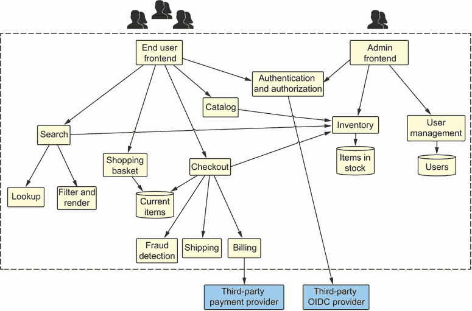
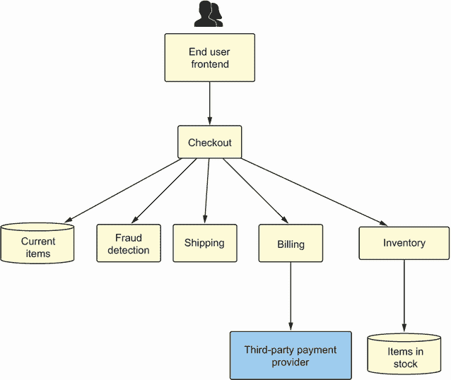
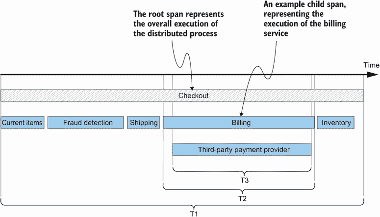
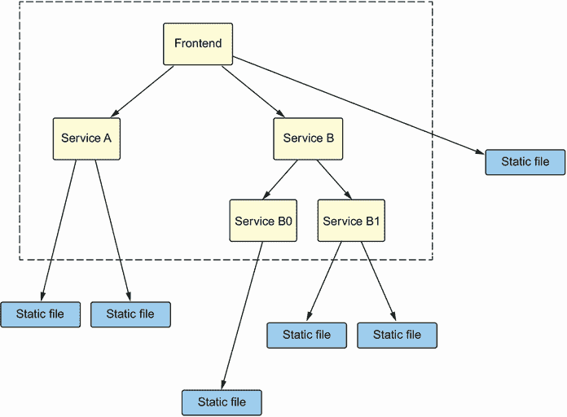
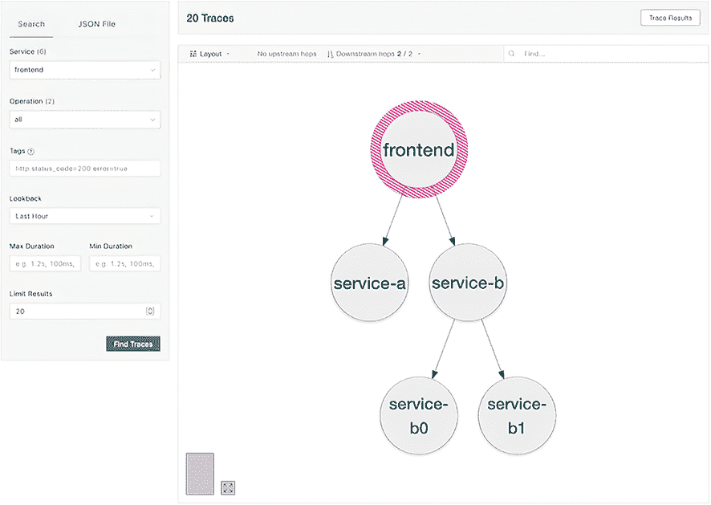
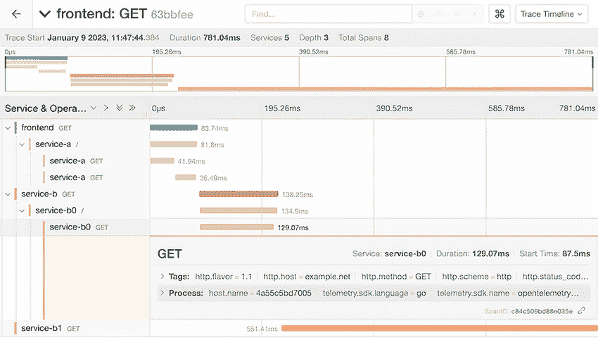
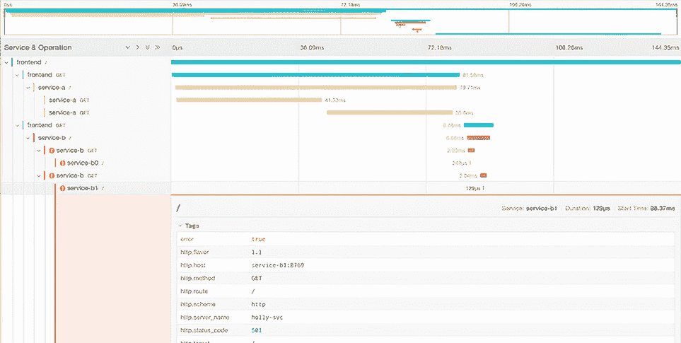

# 8 分布式追踪

本章涵盖

*   分布式追踪是什么以及为什么重要
*   在故障排除中实际看到分布式追踪
*   关于如何以及在何处使用分布式追踪的考虑
*   如何选择分布式追踪解决方案

在“好旧的日子”里，运行单体应用时，从可观测性角度来看事情相当方便；你有一个作为前端层的 Web 服务器、你的应用服务器（如基于 Java 的应用）以及 MySQL 等数据库。在这种设置下，很难弄清楚哪个组件导致了问题。这些组件的日志会涵盖 *where* 和 *what*。此外，你可能会捕获一些指标，指示整体健康和性能。


随着云原生系统和微服务的兴起，从终端用户角度来看，什么都不应该改变，或者更准确地说，与单体应用相比，他们在用户体验方面不应察觉到差异。从开发者和运维的角度来看，我们期望从微服务中获益。这包括功能交付速度（应用程序的不同部分可以独立编写和部署）、部分可用性（虽然某些部分对终端用户不可用，但整体应用程序可能仍在运行），以及能够为特定功能使用最合适的编程语言和数据存储（例如，前端使用 JavaScript，或像 Redis 这样的内存键值存储用于购物车）。

注意 我们之前已将功能交付速度作为基于微服务架构的优势进行了介绍。深入探讨，这里增加的功能交付速度的原因在于更小的单元带来了部署速度的提升。换句话说，如果你的部署单元更小，它们就更容易测试、升级和修复。值得注意的是，一些企业即使在被视为单体的架构下，通过将“小单元”思想应用于单体中严格解耦的模块，也实现了开发速度的提升。

另一方面，微服务确实是分布式系统，因此与单体应用相比，其运维更为复杂。可观测性已不再是可选项。问题的一部分在于确定某件事发生在哪里。你不必像 eBay、Netflix 或 Uber 那样处理数百个微服务才会遇到这个问题。即使你的云原生应用“仅”由几十个服务组成，要准确找出请求路径中哪个服务导致了错误或造成了比平时更慢的响应，也可能很棘手。

那么如何获得所有服务协同工作的概览并发现未按预期工作的服务呢？也许，你可以深入某个特定服务来检查其性能如何。

注意 分布式系统的一个挑战是（可能）服务运行在不同的机器上。这些服务的日志可能带有时间戳并不完全对齐（[`mng.bz/Bmp0`](http://mng.bz/Bmp0)），这很难处理，因为它破坏了跨服务的日志顺序，从而破坏了因果分析。即使将日志汇聚到中央位置，执行的动态通常仍需要基于标签或标记手动恢复。因此，虽然在微服务的上下文中使用日志是可行的，但这并不是对你时间最有效的利用，并且可能需要分析师具备比本章讨论的解决方案更多的技能。

在本章中，我们将更详细地研究上述挑战的解决方案：分布式追踪。我们在第 2 章中已在高层次上讨论了该主题，但现在是深入探讨的时候了。我将首先对可观测性领域中这一相对较新的概念提供总体介绍，然后我们将在具体用例的背景下看到分布式追踪的实际应用。最后，我们将以关于选择和使用分布式追踪解决方案的实际考虑来结束本章。

## 8.1 简介和术语

在本小节中，我将首先带你通过一个动机示例，展示分布式追踪的强大功能。然后，我将定义本章中使用的术语。

### 8.1.1 动机示例

为了设定场景，让我们先来看一个作为动机的微服务应用的具体示例。图 8.1 显示了这样一个示例应用。它是一个简化的电子商务应用，允许终端用户浏览和搜索商品、下单并安排发货。为了更具体一些，想象一下你正在构建一个允许你购买望远镜的电子商务应用，类似于我们在附录中将介绍的逐步示例。



图 8.1 一个基于微服务的电子商务应用示例（虚线框内）

在我们的电子商务示例应用中，我们有两个逻辑部分，其中一些功能，例如支付详情，由外部（第三方）服务提供，而一些功能（身份验证）在这些逻辑块之间共享（虚线框为我们的 Web 应用）。

图 8.1 的左侧显示面向终端用户（客户）的部分，实现了诸如搜索商品和允许终端用户将商品添加到购物车等功能。图右侧显示面向管理员的部分，允许商店管理员维护库存和管理客户。

让我们深入研究电子商务应用面向终端用户部分的一个请求路径（见图 8.2）。它描述了消费者点击购买按钮后处理请求的各个组件；另外请注意，本节其余部分我们将聚焦于面向终端用户部分，而非管理员部分。因此，在客户将商品，例如一副双筒望远镜，放入购物车后，他们希望结账以支付商品并安排发货。



图 8.2 应用中的单个请求路径

那么终端用户输入所有必要信息，例如收货地址和支付详情后会发生什么？如图 8.2 所示，此案例的请求路径如下：终端用户前端调用 `checkout` 服务，该服务随后需要完成几个阶段，其中一些阶段可能会终止请求（例如，由于用户输入错误或外部依赖超时）：

* `checkout` 服务查询 `current` `items` 数据存储。
* 调用 `fraud` `detection` 服务，检查是否有不继续的理由。
* 从 `shipping` 服务获取的运送信息用于确定运费。
* `billing` 服务收集所有支付信息并调用第三方提供商处理付款。
* 最后但同样重要的是，如果一切正常，`checkout` 服务会调用 `inventory` 服务以更新库存。

图 8.2 中微服务的表示在可观测性前端中有不同的名称，例如 *service map* 或 *dependency graph*。此服务图提供了架构的良好概览并显示了信息流。然而，它没有捕捉时间方面的内容。换句话说，我们需要一种沿时间轴可视化服务执行的方法，通常称为 *waterfall visualization*。图 8.3 显示了基于时间推移表示 `checkout` 服务调用的一种替代方式。



图 8.3 应用中的单个请求路径，作为时间（瀑布）可视化

图 8.3 中描绘的整个单元称为 `trace`，它代表了目录请求在瀑布可视化中的端到端处理。每次服务调用，例如 `checkout` 服务调用 `billing` 服务，都是一个 `span`（参见第 2 章中的讨论）：

* 根 span 是 `checkout` 服务的整体执行，端到端执行需要时间 `T1`。
* 子 span 的示例包括 `billing` 服务的执行（完成需要 `T2` 时间）和第三方支付提供商调用的执行（完成需要 `T3` 时间）。除了 `billing` 服务需要做的一些设置时间外，似乎大部分时间都花在了调用该外部服务上。


瀑布图可视化的一个优势在于，我们只需通过目视检查跟踪中的所有 span，就能看出大部分时间花费在何处（在我们的案例中，在图 8.3 中，结账服务大约有一半的时间花费在计费阶段）。在建立了这个以微服务为基础的电子商务应用的具体动机示例后，让我们继续对你在分布式追踪领域会遇到的术语进行更正式的定义。

### 8.1.2 Terminology

虽然不同厂商在术语上存在差异，但以下术语通常在各方案中都有明确定义且被理解。我主要遵循 `OpenTelemetry` 命名法 ([`mng.bz/d1QN`](http://mng.bz/d1QN))，尤其是在分布式追踪解决方案之间没有共识的地方：

*   一个 `span` 表示一个工作单元，并借此捕获请求执行的一部分（参见图 8.2）。这可能发生在服务的范围内，例如服务中函数的执行，或跨服务。跟踪中的一种特殊 span 是 `root span`，它在请求进入应用时创建。span 有一个 ID，通常它存储其所属跟踪的 ID 以及其触发的根 span 的 ID，还有包含有效负载的元数据（想想时间戳、标签等）。请注意，在 AWS X-Ray 中，这个单元被称为 segment。

*   一个 `trace` 是分布式系统中请求的端到端处理，由一组按时间顺序排列的 span 组成。它有一个 ID 和元数据。

*   在跨服务调用的上下文中，`trace context` 捕获单个跟踪和请求的全部唯一标识符。这使得跟踪能够通过一种称为 `context propagation` 的过程超出单个服务，在网络调用中转发此跟踪上下文。调用服务（父服务）会将跟踪上下文所需的所有数据附加到发往下游（子）服务的请求中，就像我们在示例电子商务应用（图 8.2）中计费服务与第三方支付提供商之间发生的情况一样。如今，随着 `OpenTelemetry` 成为标准，这种传播通常基于 `Trace Context` ([`www.w3.org/TR/trace-context/`](https://www.w3.org/TR/trace-context/)) W3C 建议（使用 HTTP 头传播上下文的标准方式）。

*   为了减少数据量（跟踪和 span 的数量），你可以使用一种称为 `sampling` 的技术。这允许你根据特征有选择地丢弃跟踪，包括固定百分比或基于跟踪的性质——例如，如果某个服务中存在错误，并且我们在表示该服务的 span 中看到该错误被标记。

现在我们对分布式追踪术语及其含义有了基本了解，让我们来看一些用例。

### 8.1.3 Use cases

分布式追踪不仅在服务通过网络相互调用的分布式系统中有用，对单体应用也很有用。一般来说，你可以在以下情况下受益：

*   *监控基于微服务的应用程序*——这些让你能够获得应用实际架构的端到端概览，包括调用依赖关系。 rather than relying on static architecture diagrams of how the app is supposed to work, you get a visual representation of how the app actually works. 你通常只需看一眼服务地图，就能确定服务的错误状态（哪些服务出错）和性能问题（服务调用的延迟图）。

*   *优化*——用于确定请求路径中大部分时间花费在何处。你可以 pinpoint 最慢的服务并在那里开始延迟优化，在投资回报方面具有最大的收益。

*   *发布管理*——在推出服务的新版本时，你可以评估其对服务所参与的整体请求路径的影响，对比新版本之前和之后的情况。

*   *故障排除*——在发生事故时，如我们在第 7 章讨论的那样，你可以使用分布式追踪解决方案找出哪些服务导致了问题，并可以将其回滚到已知良好的状态以遏制损失。我们将在本章下一小节实际看到这一常见用例。

好了，理论已经足够多了！让我们动手实践分布式追踪，重点关注故障排除用例。

## 8.2 Using distributed tracing in a microservices app

在本节中，你将在一个简单的示例微服务应用的上下文中使用分布式追踪。目标是了解服务如何协同工作，并在开始模拟错误后，使用分布式追踪识别导致问题的服务以及遇到的错误类型。

### 8.2.1 Example app overview

我们的示例应用（稍后设置）由四个服务组成，如图 8.4 所示。我们有一个作为入口的前端服务，它调用两个服务：服务 `A` 和服务 `B`；反过来，服务 `B` 再调用另外两个服务（`B0` 和 `B1`）。一些服务还会调用网络上的静态资源以模拟对外部第三方 API 的调用。请注意，我们的示例应用没有任何实用功能；所有服务都使用 `ho11y` ([`mng.bz/rWxg`](http://mng.bz/rWxg)) 合成信号生成器来生成跟踪，并且我们可以配置它来模拟某些故障模式。



图 8.4 示例微服务应用架构

我们的示例应用栈包含构成微服务应用的五个服务，以及 `OpenTelemetry` 收集器，用于将四个服务生成的 span 导入分布式追踪工具（`CNCF Jaeger`）。该设置基于你在第 6 章中已看到的内容。

### 8.2.2 Implementing the example app

要启动我们的示例应用栈，使用列表 8.1 中所示的 Docker Compose 文件，从 `ch08/jaeger/` 目录执行以下命令：

```
docker-compose -f docker-compose.yaml up
```

Note `ho11y` 合成信号生成器有几个通过环境变量定义的配置选项。使用 `HO11Y_PORT`，你可以定义 `ho11y` 应监听服务请求的端口，而使用 `DOWNSTREAM0` 到 `DOWNSTREAM4`，你可以定义 `ho11y` 实例应调用的 URL（从而允许你连接并模拟任意复杂的微服务）。为了模拟丢弃请求，我们将使用 `HO11Y_INJECT_ FAILURE` 环境变量，这会导致 `ho11y` 实例在半数情况下返回一些 `4xx` 或 `5xx` HTTP 状态码，而不是返回 200 HTTP 状态码。最后，为了模拟另一种故障模式（上游服务的限流），我们将使用 `HO11Y_CUTOFF_TPS` 环境变量来定义一个截止点，超过该点后 `ho11y` 将返回 429 HTTP 状态码 ([`httpstatuscodes.org/429/`](https://httpstatuscodes.org/429/))。

列表 8.1 显示了 Docker Compose 文件的相关片段（重点关注我们微服务应用的连接和配置）。

列表 8.1 Jaeger 设置的 Docker Compose 配置


## 8.2 服务配置

```
frontend:                          ❶
    environment:
    - "DOWNSTREAM0=http://service-a:8766"
    - "DOWNSTREAM1=http://service-b:8767"
    - "DOWNSTREAM2=https:/ /opentelemetry.io/img/logos/opentelemetry.png"
  service-a:                       ❷
    environment:
    - "HO11Y_PORT=8766"
    - "DOWNSTREAM0=https:/ /mhausenblas.info/"
    - "DOWNSTREAM1=https:/ /otel.help/"
  service-b:                       ❸
    environment:
    - "HO11Y_PORT=8767"
    - "DOWNSTREAM0=http://service-b0:8768"
    - "DOWNSTREAM1=http://service-b1:8769"
  service-b0:                      ❹
    environment:
    - "HO11Y_PORT=8768"
    - "DOWNSTREAM0=https:/ /example.net/"
    # - "HO11Y_CUTOFF_TPS=1"
  service-b1:                      ❺
    - "HO11Y_PORT=8769"
    - "DOWNSTREAM0=https:/ /www.w3.org/TR/trace-context/"
    - "DOWNSTREAM1=https:/ /example.org/"
    # - "HO11Y_INJECT_FAILURE=enabled"
```

❶ 我们微服务应用的前端服务，它调用 `service-a` 和 `service-b`
❷ 调用静态网页内容的 `service-a`
❸ 调用 `service-b0` 和 `service-b1` 的 `service-b`
❹ 可以被限流然后返回 HTTP 状态码 `429` 的 `service-b0`
❺ 可以通过一半时间返回 HTTP `4xx/5xx` 状态码来模拟故障的 `serviceb1`

下一个列表中显示的 OpenTelemetry Collector 配置基本上与我们在第 6 章中使用的相同，仅有一个跟踪管道用于将 spans 导入 Jaeger。

### 列表 8.2 用于收集 OTLP 中的跟踪并导入 Jaeger 的 Collector 配置

```
receivers:
  otlp:
    protocols:
      grpc:
        endpoint: 0.0.0.0:4317
processors:
  batch:                       ❶
    timeout: 1s
    send_batch_size: 10
exporters:
  jaeger:
    endpoint: jaeger:14250
    tls:
      insecure: true
service:
  pipelines:
    traces:
      receivers: [ otlp ]      ❷
      processors: [ batch ]    ❸
      exporters: [ jaeger ]    ❹
```

❶ 批大小故意设置得很小，仅用于演示目的。
❷ 以 OTLP 格式接收来自已 instrument 的 ho11y 服务的 spans
❸ 以批处理方式发送 spans 而非一次性全部发送
❹ 将 spans 导入 Jaeger 后端

与第 6 章中的设置相比，我在此移除了 Collector 的 debug 级别日志配置，因为我们不需要它，而且它会让跟随操作更分散注意力。

### 8.2.3 “happy path”

现在，是时候前往 `http://localhost:16686/` 打开 Jaeger UI 了，在那里我们将首先查看“happy path”（见图 8.5），意思是一切按预期工作，没有错误存在。这为我们提供了基线，说明服务应如何工作（例如执行时间持续时间）。

作为探索和理解分布式系统的初始步骤，让我们创建服务地图，显示（动态生成的）整体应用架构。为此，在左侧标有 Search 的框中选择 `frontend`，然后点击底部的 Find Traces 按钮。现在，你应该在右侧看到随时间变化的执行持续时间图，如果你现在点击它正下方的 Deep Dependency Graph 按钮，你应该会看到类似于图 8.5 的内容。另请注意我们没有看到的内容：外部服务或对服务的调用未作为 spans 表示。



图 8.5 故障排除演示微服务应用：happy path 依赖图

接下来，我们想查看瀑布模型。这意味着我们想可视化服务执行的时序渲染，因为全部四个服务协同工作以提供请求。为此，点击依赖图的右上角的 Trace Results 按钮，然后选择一个 trace（哪个都无所谓；只需选择列表中的第一个）。你应该会看到类似于图 8.6 的内容。此截图显示了一个展开的单个 span，查看了对服务 `B0` 的调用。从中，我们可以看出执行大约花费了 135 ms，其中超过 129 ms 花在了对外部资源的调用上。现在我们已经看到了 happy path，让我们模拟一些故障并使用 Jaeger 来弄清楚发生了什么。



图 8.6 故障排除演示微服务应用：一个 happy path 示例 trace 及其 spans

### 8.2.4 探索示例应用中的故障

为了开始我们的故障示例，使用 `CTRL-C` 停止 Docker Compose 栈，并为重置应用，还执行 `docker-compose -f docker-compose.yaml down` 以便移除所有容器。现在，前往 `ch08/jaeger/` 目录并在你选择的编辑器中打开 `docker-compose.yaml` 文件，移除第 62 行 `HO11Y_CUTOFF_TPS` 前面的注释（`#`），以及第 76 行 `HO11Y_INJECT_FAILURE` 前面的注释。这会导致服务 `B0` 和 `B1` 显示错误。

保存编辑器中的更改后，执行 `docker-compose -f docker-compose.yaml up` 以启动栈，并返回到你选择的网络浏览器中的 Jaeger UI。在那里，同样在左侧标有 Search 的框中选择 `frontend`，然后点击底部的 Find Traces 按钮。

如果现在你通过过滤 HTTP 状态码来查看失败的 spans（在 `tags` 输入字段中添加例如 `501` 或按 `error=true` 过滤），或点击显示错误的其中一个 span（该 span 上应显示红色感叹号），你应该会看到类似于图 8.7 的内容。这意味着什么？Jaeger 为我们提供了故障的可视化呈现，并允许我们深入到显示错误的服务。通过点击一个 span，你可以探索该服务并将诸如执行时间持续时间等与来自 happy path 的基线进行比较，以及查看错误代码是什么。这意味着你可以非常快速地 pinpoint 导致问题的服务，然后专注于这些服务进行故障排除。



图 8.7 故障排除演示微服务应用：一个示例故障 trace 和导致故障的 span

使用分布式跟踪对基于微服务的应用程序进行故障排除的此次动手练习现已完成。接下来，我们将讨论如何在实际设置中从我们新的应用中受益。

## 8.3 实际考虑

现在你已经了解了分布式跟踪的基础知识，并在具体用例的背景下看到了它的实际应用，让我们谈谈在全面投入分布式跟踪时需要考虑的一些事情。在高层面上，重要的是要理解并非 trace 的每个 span 具有相同的价值。例如，如果 99 次中有 100 次你看到一个 span 的 HTTP 状态码为 `200`，这告诉了你什么？相比之下，携带 `500` HTTP 状态码的那个 span 表明发出该 span 的服务可能存在某种问题，你可能希望更深入地研究。

此外，由于 trace 由一组 spans 组成，你会期望在查看 trace 时看到构成该 trace 的所有 spans。这听起来很明显，但在实践中可能更困难。以下是最突出的几个挑战，可能导致 trace 损坏和不完整：

*   *上下文传播*——要看到所有 spans，每个服务都需要传播 trace 信息（根 span 和元数据）。如果其中一个服务（你不拥有）不参与分布式跟踪会怎样？如果您使用的是未被 instrument 且因此不传播的云提供商 API 怎么办？如果 API 支持与您使用的不同的 trace 头怎么办（例如专有与 W3C trace 头）？为了解决这个问题，你可能需要升级你的 API 集成（支持新的头类型）；使用中间件或转换层来转换头类型；并且可能游说你的提供商支持跟踪。


*   `Dropped spans`—这可能是由于代理出现故障或资源不足（例如，OpenTelemetry 收集器的内存队列溢出，甚至可能被 OOMed——即由于内存不足，Linux 内核杀掉进程）或某些中间件被配置为过滤特定 span（例如 OpenTelemetry 中的网关部署；[`opentelemetry.io/docs/collector/deployment/`](https://opentelemetry.io/docs/collector/deployment/)），其中边缘使用的收集器将 span 发送到中央收集器，而你并不知情。

你在使用分布式追踪所做的投入包括 span 的生成（理想情况下，通过自动检测）；收集（例如，考虑一个 OpenTelemetry 收集器）；摄取和存储成本；最后但同样重要的是前端的查询或使用（例如，用于在瀑布图中绘制 trace 或提供服务地图和其他聚合）。

让我们聚焦于如何选择值得被收集并摄取到后端中的 span 的主题：换句话说，就是采样。

### 8.3.1 采样

分布式追踪意味着在生产环境中你会定期看到大量数据的生成。鉴于其与分布式系统（微服务）的天然契合，面临数十亿个 span、每天代表 1 TB 数据的情况并不罕见。那么问题就如下：我们如何选择相关的 span 进行收集和存储？我们在这里为选择过程使用的术语是 `sampling`。请注意，采样存在一些固有的局限性（[`research.swtch.com/sample`](https://research.swtch.com/sample)），但暂时忽略这一点，以下是可用的高层策略：

*   `No sampling`—你摄取所有 span，这对于开发/测试环境、评估工具，或你使用的工具不按用量收费的情况可能很有用。缓存可以在你调查 trace 时极大地帮助查询路径，但 span 摄取路径仍然具有挑战性。
*   `Head-based sampling`—在这种情况下，你在请求开始时（根 span）决定发出哪个 span。它实现简单，但由于你可能不知道下游（树的节点和叶子）是否会出现任何问题，因此你可能会错过有趣或有价值的 span。此外，由于采样决策是在开始时做出的，该决策需要全局传播。
*   `Tail-based sampling`—从某种意义上说，它是基于头的采样的相反，因为决策是在请求完成后做出的。这很好，因为你确切知道哪些 span 是相关的，但实际操作中很难知道请求何时真正完成。例如，请求路径上的一个或多个服务可能会超时。你会等待多久才宣布请求完成？

如果你对采样的更多细节感兴趣，我强烈推荐 Alex Boten 所著的书籍 `Cloud-Native Observability With OpenTelemetry`（Packt，2022；[`mng.bz/rW9B`](http://mng.bz/rW9B)）。就此，让我们转向资源的话题。

### 8.3.2 可观测性税

我们谈到 dropped spans 时在小节开头稍微提到了资源使用。让我们退一步，看看我喜欢称之为“可观测性税”的东西——即你在分布式追踪上下文中会遇到的成本（尽管它们不一定是独有的——其中一些，如果不是大多数，也会出现在指标和日志中——但控制方式可能不同）：

*   `Instrumentation costs`—涵盖与生成 span 相关的所有内容，包括你必须投入的手工工作以从应用程序发出 span、查找和修复与检测相关的 bug 的成本、由于检测而导致应用程序的额外资源使用（例如，即使在最佳情况下，自动检测也会消耗 CPU 周期并占用你需要付费的 RAM）。
*   `Transport and ingestion costs`—可分解为网络入站，至少在云提供商计费的上下文中（你通常需要为网络使用付费）；以及将 span 从你的环境（可能是本地）发送到后端，在那里你可能需要处理每 TB 十几美元或欧元的成本。此外，你的分布式追踪可能按 GB 或摄取的 span 数量收费。
*   `Storage costs`—通常不是你在提供商账单中会找到的最高项目，因为存储针对效率进行了优化，而且经常甚至免费提供。你通常有有限或固定的保留期（例如，AWS X-Ray 为 30 天，Datadog 为 15 天）。
*   `Query costs`—代表所有查找和 API 调用，以检索一系列 trace 用于查看它们或以聚合形式呈现它们，包括直方图（[`mng.bz/V1AP`](http://mng.bz/V1AP)）；服务地图（[`mng.bz/x4DW`](http://mng.bz/x4DW)）；以及高级可视化，例如 Honeycomb 的 BubbleUp（[`www.honeycomb.io/bubbleup`](https://www.honeycomb.io/bubbleup)）。

从实际角度来看，这只是所涉及潜在成本的非常简化的视图，你应该与你选择的供应商合作，以更好地了解你特定情况下的成本，包括适用的适当折扣。虽然确实存在 `are` 成本，但不要忘记，最终分布式追踪带来的回报是，你的微服务应用不再盲目飞行，并且可以预期平均修复/恢复时间（MTTR）下降以及开发人员生产力提高。

### 8.3.3 Trace 与 指标 与 日志

请记住，单一信号类型通常无法回答你为获得可操作的洞察而可能有的所有问题。我们将在第 11 章深入探讨该主题。

独立于关联，有时你可以从彼此推导出信号。例如，你可以根据观察到的 span 创建指标，例如使用 OpenTelemetry 的 span 指标连接器（[`mng.bz/Aoez`](http://mng.bz/Aoez)）。分布式追踪领域发展迅速，各类厂商和社区都在进行试验和迭代（[`keyval.dev/distributed-tracing-2025/`](https://keyval.dev/distributed-tracing-2025/)），以提高其性能和可用性，包括遥测信号的收集和压缩自动化。

## 摘要

*   分布式追踪为你提供了有关分布式系统可见性的 `where` 和 `what`。
*   执行分布在微服务上，为了获得整体视图，各种活动部件必须通过上下文传播拼接在一起。
*   trace 是分布式系统中请求的端到端处理，其中 span 代表一个工作单元，例如单个服务的调用或对数据库的调用。
*   分布式追踪存在大量可能的用例，从监控基于微服务的应用程序到延迟优化再到故障排除。
*   分布式追踪涉及多个成本，包括检测成本、传输和摄取成本到查询成本。
*   你需要从你的用例倒推以确定投资回报率（参见第 2 章的定义），确保你的利益相关者理解其价值，无论是 MTTR 降低，抑或开发人员生产力的提高。
*   单一信号类型，例如指标或日志，通常无法产生可操作的洞察；因此，信号关联支持是选择分布式追踪解决方案的关键因素。
*   分布式追踪仍然是一个相对年轻的领域，正在发生大量创新，这意味着基于 OpenTelemetry 等标准构建应该有助于降低投资风险，并在你想要切换后端时使你的解决方案更具可移植性。
