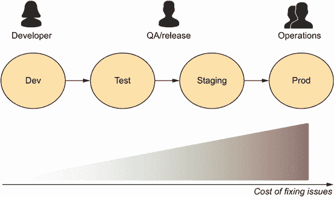
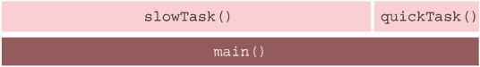
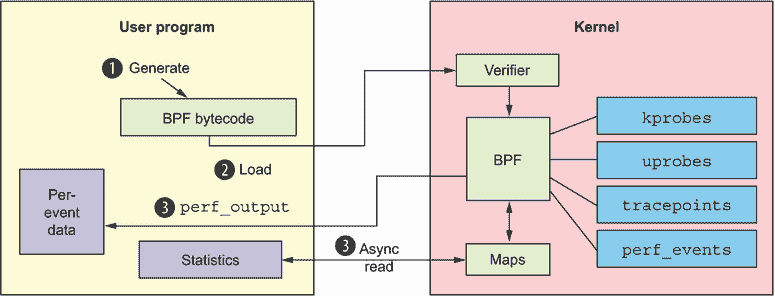
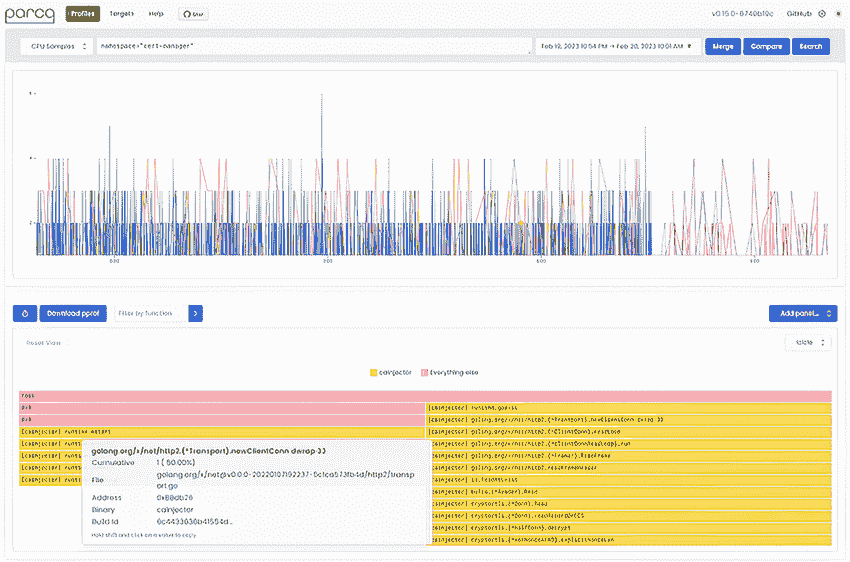
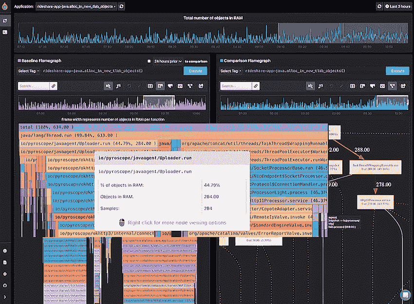
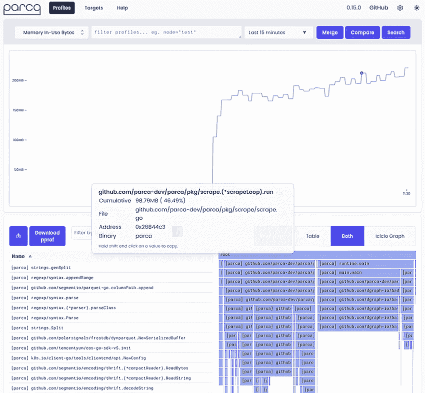
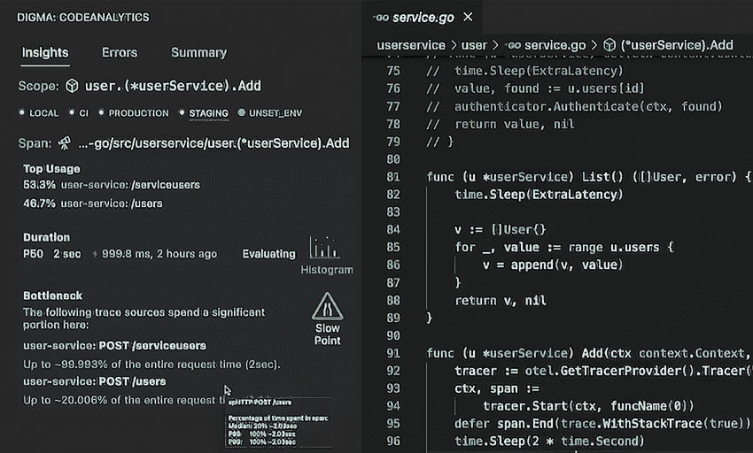
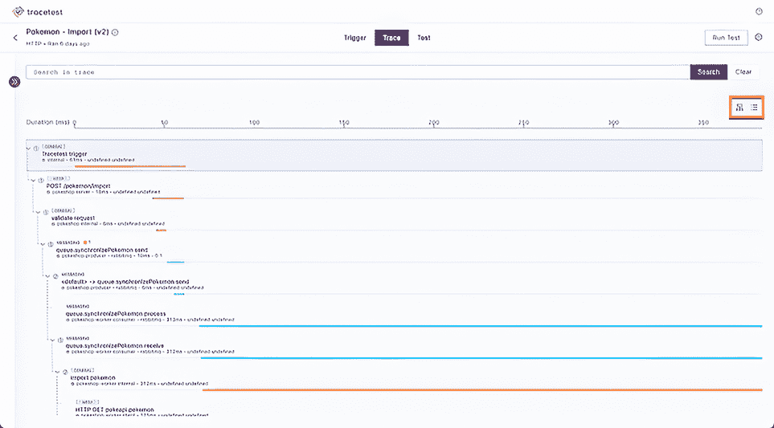

# 9 开发者可观测性


本章涵盖

* 开发人员可观测性意味着什么
* 什么是持续剖析以及为什么你应该关心
* 云可观测性和开发人员可观测性如何推动开发人员生产力
* 开发人员可观测性领域有哪些工具可用

在第 1 章中，我们讨论了不同的可观测性用例和目标受众。在过去的几章中，我们往往持有一种偏向运维的视角——也就是说，主题聚焦于生产环境中运行的云原生应用。现在，我们转换思路，在本章中将开发者作为可观测性的主要受众。我们将讨论他们的自然栖息地（IDE 和命令行）以及开发者可观测性的用途。所以本章是关于为开发者提供可观测性，而不是关于开发者的可观测性（例如时间跟踪、每天创建的提交或 LOC 产量）。

在进入挑战的核心之前，我们首先定义一个与本次对话相关的概念：*shift left*。该概念最初出现在测试（[`mng.bz/Zq1P`](http://mng.bz/Zq1P)）和 CI/CD 的背景下，随后扩展到安全（[`mng.bz/RxdK`](http://mng.bz/RxdK)）。如今，这个术语也被市场部门喜欢在可观测性的背景下使用。

shift left 的概念（见图 9.1）是使开发者能够执行传统上属于测试人员或运维人员的工作和职责。在“过去的好时光”里，在相对传统的环境中，开发者主要专注于一件事：编写代码——也许再加上一点单元测试。最终，开发者会“把工作抛过墙”去进行测试；打包（例如打包成 WAR 文件）；最后部署和运维。所有这些步骤都由除开发者之外的角色执行，例如发布工程师、QA 测试员或运维人员。如果你把软件开发和运维流程看作一个连续体，左侧代表开发者源源不断地输出源代码，右侧代表运维人员部署二进制文件，你就能想象 *shift left* 的含义。



图 9.1 向左移

将 shift left 的概念应用于可观测性，*developer observability* 意味着使用遥测信号为开发者提供可操作的洞察，以加速开发、调试代码或了解新功能在资源使用方面的影响。这会缩短反馈循环，从而降低识别和修复问题的总体成本。例如，开发者不再需要等待四周才能知道代码是否通过测试套件或在生产环境中崩溃，他们可以在提交拉取请求或合并请求的过程中自行运行测试套件，而且现在通常必须这样做。

在本章中，我们首先将讨论一种名为 *continuous profiling* 的特定开发者可观测性方法，以及它如何帮助你了解所编写代码的资源使用情况（例如 CPU 和内存），即使跨越源代码的不同版本。然后，我们将审视基于深度集成到编辑器和 IDE 中的可观测性工具的开发者生产力，这些工具能让你作为开发者深入了解所引入的更改如何影响你的服务，远超传统测试中的“全绿”状态。在本章的最后一小节，我们将讨论如何在开发者可观测性领域入门以及需要注意什么。有了这些，让我们直接进入第一个主题：持续剖析——它是什么以及何时可以从中受益。

## 9.1 持续剖析

在本小节中，我们将了解持续剖析、其用例以及可供使用的工具。首先，我们将从操作系统背景下审视其起源，然后回顾可供使用的常见技术和工具。最后，我们将在端到端演练示例的背景下应用这些知识。

与往常一样，我们将涵盖开源工具以及商业产品。开源工具让你可以在无需为许可证等投入资金的情况下探索这一领域。在验证该技术后，你可以确定投资回报率（ROI），它可能足以支付其中一种产品的费用。

那么 *continuous profiling*（CP）是什么？该术语包含两个词；让我们先关注后者（profiling），稍后再在本节中讨论前者（continuous）的含义。在深入细节之前，让我们先在高层次上定义该术语的含义：

*Continuous profiling 使你能够随着时间推移了解操作系统的和服务的资源使用情况（如 CPU 或主内存和函数执行时间）。你可以在故障排除和性能优化场景中从中受益*。

你可以使用持续剖析不仅了解服务的当前性能和资源使用情况，还可以将其与之前的迭代进行比较。考虑以下用例：你为服务添加新功能，并希望评估现在的权衡。一方面，你的服务现在更强大、更有用；另一方面，它可能消耗的 CPU 或内存资源远超预期。

注意 从某种意义上说，持续剖析与日志记录相关，因为你是在服务的上下文中操作，而分布式追踪则跨服务执行。与日志记录一样，在剖析中，你关注的是服务上下文中的某些函数调用。然而，你感兴趣的是数值答案，例如执行函数所需的时间、CPU 利用率或特定代码路径使用的主内存量，而不是日志行发出的事件。持续剖析从符号角度（函数名、数据类型等）来看也与调试相关；然而，与调试不同，你是整体地查看执行情况，而不是逐步执行单个步骤。

归根结底，新功能是否证明了增加的资源使用是合理的，这是一个商业决策。然而，现在借助持续剖析，你可以获得做出该决策的原始数据。

### 9.1.1 谦逊的开端

持续剖析从何处开始、如何开始，以及术语中的 *continuous* 指的是什么？让我们退一步。剖析已有数十年的历史，GNU `gprof`（[`ftp.gnu.org/old-gnu/Manuals/gprof-2.9.1/html_mono/gprof.html`](https://ftp.gnu.org/old-gnu/Manuals/gprof-2.9.1/html_mono/gprof.html)）和 Sun/Solaris `DTrace`（[`brendangregg.com/dtrace.html`](https://brendangregg.com/dtrace.html)）是早期示例，并在 Linux 背景下进一步发展。它通常在性能分析的背景下被考虑，并且经常在（操作）系统级别。

现在，什么是 *profile*，以及在实践中 profile 看起来如何？我们将在以下代码中使用一个发出 profile 的应用程序。请看这段使用 `pprof`（[`go.dev/blog/pprof`](https://go.dev/blog/pprof)）的 Go 代码（完整版本可通过 `ch09/cp/main.go` 获取——这里我们只关注相关部分）：

```
import (
    _ "net/http/pprof"                ❶
)
 
func quickTask() (result string) {    ❷
}
 
func slowTask() (result string) {     ❸
}
 
func main() {
    go func() {                       ❹
       http.ListenAndServe("localhost:6060", nil)
    }()
 
    for true {
        result := quickTask()
        fmt.Printf("Quick task result is %s\n", result)
        result = slowTask()
        fmt.Printf("Slow task result is %s\n", result)
    }
}
```

❶ 自动为我们收集并公开配置文件的 Go 包

❷ 一个相对快速完成的函数（总体 CPU 时间 10% 或更少）

❸ 一个相对较慢的函数（总体 CPU 时间 80% 或更多）

❹ 一个公开剖析信息的简单 Web 服务器


请注意，函数 `slowTask()` 和 `quickTask()` 除了使用 CPU 以便我们在分析器中看到一些内容外，并没有做任何有用的事情。你现在可以在终端会话中像这样运行 Go 程序：

```
$ go run .
Quick task result is 692530d563c476aea00dd73067d7e146edbece4c17bff4c
Slow task result is 692530d563c476aea00dd73067d7e146edbece4c17bff4c9
...
```

如果你导航到 `http://localhost:6060/debug/pprof/`，你现在将看到 `net/http/pprof` Go 包的 Web 服务器输出。在这里查看输出会显示各种提供的分析类型，包括协程、堆分配的详细信息等等。

接下来（并且你需要安装 `graphviz` `dot` [[`graphviz.org/docs/layouts/dot/`](https://graphviz.org/docs/layouts/dot/)\] 命令），你可以使用以下命令生成图像，例如渲染协程调用图：

```
$ go tool pprof -png http://localhost:6060/debug/pprof/goroutine > gr.png
 
Fetching profile over HTTP from http://localhost:6060/debug/pprof/goroutine
Saved profile in ~/tmp/pprof/pprof.goroutine.002.pb.gz
```

好吧，这个 Web 视图或图像可能有洞察力，也可能没有，但使用 `pprof` 的另一种（更流行）方式是：交互模式（想想 shell）。让我们这样做（收集 30 秒的 CPU 分析，因此你需要等待片刻）：

```
$ go tool pprof "http://localhost:6060/debug/pprof/profile?seconds=30"
 
Fetching profile over HTTP from
http://localhost:6060/debug/pprof/profile?seconds=30
Saved profile in ~/pprof/pprof.samples.cpu.002.pb.gz
Type: cpu
Time: Mar 8, 2023 at 07:01am (GMT)
Duration: 30.13s, Total samples = 29.55s (98.09%)
Entering interactive mode (type "help" for commands, "o" for options)
...
```

在这一点上，你已进入 `pprof` 交互式 shell，并且可以列出前 50 个函数（在这里称为 *nodes*）并使用累积聚焦，使用 `top 50 cum` 命令如下（已编辑以显示最重要的部分）：

```
(pprof) top 50 cum
Active filters:
   focus=cum
Showing nodes accounting for 15.54s, 52.59% of 29.55s total
Dropped 47 nodes (cum <= 0.15s)
      flat  flat%   sum%        cum   cum%
     3.72s 12.59% 12.59%      3.73s 12.62%  fmt.(*fmt).fmtSbx
     2.12s  7.17% 19.76%      4.15s 14.04%  runtime.mallocgc
     1.44s  4.87% 24.64%      1.44s  4.87%  crypto/sha256.sha256block
       ...
     0.12s  0.41% 50.19%     14.59s 49.37%  main.slowTask
       ...
         0     0% 52.59%      1.73s  5.85%  main.quickTask
```

从 `pprof` 中 `top` 命令的输出可以看出，`slowTask()` 函数（在 30 秒采样期间）占用了几乎 50% 的运行时间，而在同一时间内 `quickTask()` 函数占用了不到 6%。我在这里不会进一步详细说明，因为本次练习的目的是不是教你 Go 的 `pprof` 工具，而是让你了解所涉及的工作量。

那么让我们回顾一下我们为了看到任何东西所做的事情：

1. 我们必须通过包含 `net/http/pprof` 来为代码添加检测。
2. 我们必须包含一个 Web 服务器来公开分析文件（或者，我们可以将数据写入文件）。
3. 我们必须使用浏览器或 `curl`（以及其他依赖项，例如 `dot`）来获取“某一时刻”的结果，从而回答我们的资源使用问题。
4. 我们必须等待 30 秒让 `pprof` 收集分析文件，然后我们才能交互式查询。

注意 坦白说，我在这里使用 Go 作为示例，因为它自带强大的分析器已内置在其工具链和标准库中。对于其他编程语言来说，相同的练习可能意味着更大的工作量。

例如，这里有一些收集分析文件的特定语言方法：

* Java 有 `async-profiler` ([`github.com/jvm-profiling-tools/async-profiler`](https://github.com/jvm-profiling-tools/async-profiler))
* .NET 有 `dotTrace` ([`www.jetbrains.com/profiler/`](https://www.jetbrains.com/profiler/))
* PHP 有 `phpspy` ([`github.com/adsr/phpspy`](https://github.com/adsr/phpspy))
* Python 有 `cProfile` ([`docs.python.org/3/library/profile.html`](https://docs.python.org/3/library/profile.html))
* Ruby 有 `rbspy` ([`rbspy.github.io/`](https://rbspy.github.io/))
* Rust 有 `pprof-rs` ([`github.com/tikv/pprof-rs`](https://github.com/tikv/pprof-rs))

别误会；正如你在 Go 示例中看到的，分析是可能的，但需要专业知识，就像在 2015 年左右（Docker 出现时）之前使用容器是可行的，但需要深入了解 Linux 内核特性，包括 `cgroups` 和 `namespaces`。如今，运行容器对任何人来说只是一个 `docker run` 的距离。

但是在 2010 年，发生了某事：一群 Google 工程师发表了开创性论文“Google-Wide Profiling: A Continuous Profiling Infrastructure for Data Centers”，作者为 Gang Ren、Eric Tune、Tipp Moseley、Yixin Shi、Silvius Rus 和 Robert Hundt（2010 年，IEEE Micro，[`research.google/pubs/pub36575/`](https://research.google/pubs/pub36575/)）。在这篇论文中，作者描述了持续捕获 CPU 和内存使用情况并将此数据（分析文件）与源代码关联的想法，以便工程师能够使用其大规模的持续分析系统定位缓慢或有错误的源代码行以及共享的经验教训。这篇论文影响了社区，在随后的几年里，我们见证了该领域出现了许多商业产品。总之，使用原语进行分析是可行的，但在这个层面上创建和使用分析文件很复杂，因此它没有成为主流。

持续分析所做的权衡是以相对较低的频率进行分析并随着时间的推移收集统计显著性。这与传统分析形成对比，在传统分析中，我们以非常高的频率进行分析，因为我们希望在短时间内达到统计显著性——比如 10 秒。现在，在深入持续分析工具之前，让我们先退一步，讨论该领域广泛使用的一些常见技术和技术。

### 9.1.2 常见技术

你会在许多，如果不是全部，持续分析工具中找到三种技术。在进入工具本身之前，让我们快速讨论这些常见技术。

#### pprof

我们已经在该节的介绍中看到了 `pprof` 的实际应用，但让我们稍微放大一点。`pprof` ([`github.com/google/pprof`](https://github.com/google/pprof)) 是 Google 开发的用于分析数据的可视化和分析工具。它与 Go 集成良好，但对我们的讨论更重要的是，它定义了一种表示分析文件的数据格式。这种 `pprof` 格式基于协议缓冲区（protobuf）模式 ([`protobuf.dev/`](https://protobuf.dev/))，该模式在 `profile.proto` 中定义（请参阅以下站点以获取完整记录的 protobuf 文件，以及以下文本以获取最重要的部分描述：[`github.com/google/pprof/blob/main/proto/profile.proto`](https://github.com/google/pprof/blob/main/proto/profile.proto))：

```
message Profile {
  repeated ValueType sample_type = 1;    ❶
  repeated Sample sample = 2;            ❷
  repeated Mapping mapping = 3;          ❸
  repeated Location location = 4;        ❹
  repeated Function function = 5;        ❺
  repeated string string_table = 6;      ❻
  int64 time_nanos = 9;                  ❼
  int64 duration_nanos = 10;             ❽
  repeated int64 comment = 13;           ❾
}
```

❶ 描述值的含义和测量单位

❷ 分析文件中记录的样本集合

❸ 从地址范围到映射到该地址范围的二进制文件/库的映射

❹ 程序位置引用

❺ 位置引用的函数

❻ 消息引用的字符串的公共表

❼ 收集时间（UTC），以纳秒为单位，距 UNIX 纪元的时间

❽ 分析文件的持续时间


## ❾ 与配置文件关联的自由文本（描述）

`Profile` 消息使用了多个其他消息（再次，仅编辑了最重要的部分；详情请参阅 `profile.proto`），包括以下内容：

```
message ValueType {     ❶
}
 
message Sample {        ❷
}
 
message Location {      ❸
}
 
message Line {          ❹
}
 
message Function {      ❺
}
```

❶ 对每个 `Sample.value` 关联的样本的描述
❷ 每个 `Sample` 记录程序上下文中遇到的值。
❸ 描述函数和行表调试信息
❹ 源代码中的行号
❺ 捕获源文件名以及函数和起始行号

## pprof 格式和工具

目前尚无行业标准规定如何在传输中或静态存储（例如作为文件系统中的文件）表示配置文件，`pprof` 格式是我们迄今为止最接近此类标准的格式，许多可用工具都可以读取或生成它。

`pprof` 作为一种格式高度高效，因为它基于 `Protocol Buffers`，但这也意味着与从 `HTTP API` 获取 `JSON`（并且可以使用 `curl` 和 `jq` 过滤任何值）的设置相比，它可能更难使用。有一些工具可用于处理 `protobuf`，例如

* `Protoc` ([`grpc.io/docs/protoc-installation/`](https://grpc.io/docs/protoc-installation/)) — 缩写为 protocol buffer 编译器，您可以用它来编译 `.proto` 文件，也可以对其进行解码或反序列化（用于调试很有用）
* `Buf` ([`github.com/bufbuild/buf`](https://github.com/bufbuild/buf)) — 用于处理 protobuf 的功能强大的 CLI 工具
* `Protoman` ([`github.com/spluxx/Protoman`](https://github.com/spluxx/Protoman)) — 一个类似 Postman 的 API 客户端，用于基于 protobuf 的消息
* `Postman` ([`github.com/postmanlabs/postman-app-support/issues/2801#issuecomment-1002247567`](https://github.com/postmanlabs/postman-app-support/issues/2801#issuecomment-1002247567)) — 一款流行的工具，已通过新的 `gRPC` API 类型添加了（间接）支持

## 调试 protobuf 文件是什么样的？

我们用 `protoc` 来做这件事。首先，我们需要获取一个 `pprof` protobuf 格式的文件。我们确实在之前的示例中已经生成了一些这样的文件，当时我们使用 `go tool pprof` 进行分析。请注意，您的设置可能配置了不同的路径；请查看 `go tool pprof` 命令的输出，其中显示 Saved Profile In ...（我的在 `~/pprof` 中）。在 `ch09/cp/` 目录中执行以下操作：

```
$ cp ~/pprof/pprof.samples.cpu.001.pb.gz \
     ./pprof.gz && gzip -d pprof.gz
```

现在我们有了 `pprof` protobuf 文件，可以使用 `protoc` 对其进行反序列化：

```
$ protoc --decode=perftools.profiles.Function pprof.proto \    ❶
        < pprof | \                                            ❷
        grep --color=auto -e ".*Task"                          ❸
 
6: "main.slowTask"                                             ❹
```

❶ 我们告诉 `protoc` 使用 `pprof.proto` 作为模式，并要求它解码特定消息：`perftools.profiles.Function`。
❷ 这是我们上一步创建的 `pprof` protobuf 编码文件，也是 `protoc` 应该用作输入的文件。
❸ `protoc` 完成后，我们搜索包含 "Task" 的所有函数符号。
❹ 正如预期的那样，我们在 `pprof` 文件中找到了至少一个函数，在我的例子中它就是 `slowTask()`。

就目前而言，我们暂时完成了 `pprof` 的介绍，但我们肯定会在本章后面再次看到它的实际应用。

## 火焰图和冰柱图

Netflix 著名的性能大师 Brendan Gregg 在处理 MySQL 性能问题时需要了解 CPU 使用情况，于是发明了火焰图（[`www.brendangregg.com/flamegraphs.html`](https://www.brendangregg.com/flamegraphs.html)）。Brendan 于 2011 年底发布了它们，此可视化的核心思想（图 9.2）如下：

* 堆栈概要位于 x 轴上。请注意，x 轴 *不* 表示时间，而是堆栈跟踪的集合。每个矩形代表一个堆栈跟踪（可与编程语言中的调用堆栈相比），或者更简单地说，是对函数或操作系统系统调用的调用。矩形的宽度表示函数被调用的次数或运行花费的时间。例如，我们在图 9.2 中看到 `slowTask()` 在 CPU 上花费的时间远多于 `quickTask()`。
* y 轴显示堆栈深度，从零开始计数（函数调用入口点）。顶部的矩形代表在堆栈跟踪收集时处于 CPU 上（即实际运行）的函数调用。在我们的示例中，我们可以看到 `slowTask()` 是由 `main()` 调用的。
* 最初，Brendan 使用随机颜色来帮助区分堆栈帧；然而，它们可用于传达额外信息。换句话说，颜色本身并没有语义，仅用于帮助您导航火焰图。



图 9.2 使用我们的 `pprof` Go 示例的火焰图

虽然资源火焰图最初侧重于 CPU 使用率，但它们已扩展到涵盖更广泛的资源，包括主内存（RAM）或网络 I/O 以及运行时和操作系统级别（例如 Java 虚拟机或 Go 中的垃圾回收）。

尽管如此，不要认为火焰图仅限于系统级任务。事实上，能够同时看到操作系统（或 JVM）在做什么以及应用程序在执行时间、CPU 和内存使用方面的表现才是真正的最佳点。您也可能会遇到术语 `icicle charts`，它只是指上下颠倒的火焰图（就像冰柱从顶部向下生长一样）。如果您想深入了解该主题，我建议阅读 Polar Signal 的文章，“Ice and Fire: How to Read Icicle and Flame Graphs” ([`mng.bz/2DP0`](http://mng.bz/2DP0))。

## eBPF

许多（开源）连续分析工具使用的另一项技术是 Linux 内核功能 eBPF。如今，它本身就被用作一个术语，但最初，该术语源自 `Berkeley Packet Filter`（`BPF`）。

Linux kernel v3.18（2014 年 12 月 7 日发布）引入了对 eBPF 的支持。这一内核版本要求以及需要良好的调试符号支持才能有意义地使用它，意味着 eBPF 至少在 2023 年初撰写时，仍限于某些环境，包括 dev/test（您可以在这里完全控制使用的 Linux 版本，而与生产环境形成对比，在生产环境中使用调试符号会减慢执行速度）。

注意 您可能会想，为什么我在查看引入它的内核版本时说 eBPF 仅限于某些环境。截至撰写时，这已经过去近 10 年了；然而，由于发行版或其他原因，云提供商和大型企业将默认 Linux 版本迁移到“更新”的内核需要更长的时间。询问您的平台团队是否可以在生产中使用 eBPF，但如果答案是“我们正在进行中”，不要感到惊讶。

现在，为什么我们需要 eBPF，它是如何工作的？它使您能够通过添加您认为合适的新的功能来安全高效地扩展 Linux 内核。它通过 `bpf(2)` 系统调用暴露给 Linux 用户空间（有关更多详细信息，请参阅 `man` 手册页 [[`man7.org/linux/man-pages/man2/bpf.2.html`](https://man7.org/linux/man-pages/man2/bpf.2.html)]），并在内核中作为虚拟机（`VM`）实现，该虚拟机定义了自定义的 64 位 RISC 指令集。图 9.3 显示了 eBPF 工作原理的高级概述，摘自 Brendan Gregg 的著作 *BPF Performance Tools*（2019 年，Addison-Wesley，[`mng.bz/1q1j`](http://mng.bz/1q1j)）。如果您想了解更多关于 eBPF 的信息，我强烈推荐阅读 Liz Rice 的 *What Is eBPF?*（2022 年，O’Reilly，[`mng.bz/Pzln`](http://mng.bz/Pzln)）。




图 9.3 Linux 内核中 `eBPF` 调用流程的概念级视图（来源：Brendan Gregg。许可协议为 CC BY 4.0）

### 9.1.3 开源 CP 工具

首先让我们看看持续分析领域的开源工具。这是一个大约在 2020 年左右爆发增长的领域，我们看到对其兴趣不断增加，以至于 `OpenTelemetry` 于 2022 年 9 月启动了一个活动（另见 `OTEP 139`，[`mng.bz/JgjV`](http://mng.bz/JgjV)）以探索如何将分析数据作为信号类型来支持。按字母顺序，我们现在将查看流行的开源持续分析工具。

### Parca

Parca ([`www.parca.dev/`](https://www.parca.dev/)) 是一款受 Prometheus 启发的开源持续分析工具，特别专注于使用 `eBPF` 进行零侵入式分析，因此您无需更改应用程序的任何内容或将任何库放入代码中即可使其工作。它使用 Prometheus 服务发现来查找分析源。Parca 支持长长的编程语言列表（[`www.parca.dev/docs/parca-agent-language-support`](https://www.parca.dev/docs/parca-agent-language-support)），包括 C、C++、Rust、Haskell、Java、Python、.NET 和 WebAssembly。

您可以自行安装并尝试，或使用 demo.parca.dev 上的零安装在线环境（[`demo.parca.dev/`](https://demo.parca.dev/)）来试用。图 9.4 显示了 Parca 中 Kubernetes 应用的 CPU 分析，本节末尾我们将使用 Parca 进行端到端演练。



图 9.4 Parca 演示环境的屏幕截图

### Pixie

Pixie ([`px.dev/`](https://px.dev/)) 是一个专注于 Kubernetes 集群的 CNCF 项目，我们在第 6 章中介绍过它。它不仅仅是关于持续分析；Pixie 还提供完整请求体（例如 HTTP API 的 JSON blob 返回值）以及资源和网络指标等其他有用项目。

由于 Pixie 收集了大量丰富的数据，Pixie 中的遥测数据保存在内存中且本地于 Kubernetes 集群。简而言之，您可以将 Pixie 视为“我的 Kubernetes 集群现在发生了什么？”的工具。就资源使用而言，Pixie 声称最大使用量不超过集群 CPU 的 5%。Pixie 可以帮助您查看特定 Pod 中、跨节点等的应用程序分析，而无需进行任何代码更改或重新部署应用程序。截至撰写时，Pixie 支持 Go、Rust 和 Java 等编译语言的持续分析。

### Pyroscope

Pyroscope ([`pyroscope.io/`](https://pyroscope.io/)) 是一款开源持续分析工具，附带针对多种编程语言的丰富客户端收集机制，包括 Go、Python、Java、Ruby、Rust、PHP、.NET 和 Node.js，以及 `eBPF` 支持。2023 年 6 月，Pyroscope 被 Grafana Labs 收购（[`mng.bz/wvNP`](http://mng.bz/wvNP)），并将成为 Grafana Cloud 中持续分析产品的基石。

Pyroscope 的制作方建议采用混合的分析收集方法：即使用 `eBPF` 对系统（例如 VM 或 Kubernetes 节点）进行分析，结合每个服务的特定语言插桩。此外，Pyroscope 配备 `FlameQL`，一种用于探索分析数据的查询语言。您可以使用 [`demo.pyroscope.io/`](https://demo.pyroscope.io/) 上的零安装在线环境试用 Pyroscope，或自行本地安装。

图 9.5 显示了 Pyroscope UI 的概览（以及叠加了基线火焰图缩放视图的覆盖层）。在图的上半部分，显示了分析的基于时间的可视化，当您点击任何分析时，可以生成并放大特定分析（本例中为内存使用）。



图 9.5 Pyroscope 演示环境的屏幕截图

### 9.1.4 商业持续分析产品

持续分析领域有大量商业产品，从云服务提供商开始：
* AWS 提供 Amazon CodeGuru Profiler（[`mng.bz/qrKr`](http://mng.bz/qrKr)），旨在微调应用性能。它提供机器学习算法来查找代码中最昂贵的行，并提供进一步提高效率的方法。
* Azure 提供 Application Insights Profiler（[`mng.bz/7Dov`](http://mng.bz/7Dov)），可让您查看应用的性能跟踪。它捕获每个请求的中间值、最快和最慢响应时间，并帮助您识别特定请求的热点代码路径开销，支持 .NET 和 Java。
* Google 以其 Cloud Profiler（[`mng.bz/mVYa`](http://mng.bz/mVYa)）开创了这一领域。它是一种低开销的采样分析器，因此适用于生产环境。Cloud Profiler 支持常见语言和环境（例如 Go、Java、Node.js 和 Python）以及多种分析类型，包括 CPU 时间、堆和线程。

然后，还有一些独立软件厂商提供捆绑分析或独立产品。其中一些已以源代码可用方式发布，包括但不限于以下内容：
* Datadog 分析器（[`docs.datadoghq.com/profiler/`](https://docs.datadoghq.com/profiler/)）是整体产品的一部分，可帮助您查找 CPU、内存和 I/O 瓶颈；分析数据按函数、类名和代码行号进行细分。
* Dynatrace 的产品（[`mng.bz/5w5O`](http://mng.bz/5w5O)）是其整体套件的一部分，允许您进行 CPU 分析，包括深入到函数级别、内存转储分析和进程崩溃。
* g:Profiler（[`granulate.io/continuous-profiling/`](https://granulate.io/continuous-profiling/)）是一款 SaaS 产品（但也作为开源提供），支持 AWS、Azure 和 Google Cloud 环境。它支持多种语言（Clojure、Scala、C/C++、Ruby、Java、Python、JavaScript、PHP 和 Go），使用 `eBPF`，并声称利用率惩罚低于 1%。
* New Relic 具有名为 Real-time profiling for Java 的功能（[`mng.bz/OP6n`](http://mng.bz/OP6n)），支持火焰图以及 Thread profiler 工具 [`docs.newrelic.com/docs/apm/apm-ui-pages/events/thread-profiler-tool/`](https://docs.newrelic.com/docs/apm/apm-ui-pages/events/thread-profiler-tool/)，您可将其用于 Java、.NET、Python 和 Ruby。
* Prodfiler（[`prodfiler.com/`](https://prodfiler.com/)）自称是分布式轻量级持续全系统分析器，可让您深入了解 CPU 使用情况，支持火焰图，要求 Linux 内核版本 4.15 或更高，并在 Kubernetes 和 AWS ECS 等平台上可用。
* Splunk 提供 AlwaysOn（[`mng.bz/5w5O`](http://mng.bz/5w5O)）分析器。

持续分析领域的优秀概览和查询工具是 Mark Hansen 的 Profilerpedia（[`profilerpedia.markhansen.co.nz/`](https://profilerpedia.markhansen.co.nz/)），它是工具和分析器数据格式的目录。如果您想深入了解该主题，请考虑查看 Datadog 的 *The Busy Developer’s Guide to Go Profiling, Tracing and Observability*（[`github.com/DataDog/go-profiler-notes/tree/main/guide`](https://github.com/DataDog/go-profiler-notes/tree/main/guide)）。

### 9.1.5 使用持续分析来评估持续分析

在本小节中，我们将介绍如何使用持续分析来衡量 `OpenTelemetry` 收集器的资源使用情况。我在此使用 `OpenTelemetry` 收集器作为示例 CP 源，因为它可以直接公开 `pprof` 格式的分析数据，但您也可以接入任何其他提供分析数据的 HTTP API（例如本章开头我们的 Go 示例）。


## 9.1 使用 Parca 生成配置文件
为了生成配置文件，我们将设置一个信号源（与往常一样，我们将使用 `ho11y` 配合负载生成器），它将 trace 发送到 OpenTelemetry collector，然后我们将使用 Parca 从 collector 接收并查询配置文件。所有源代码都在 `ch09/parca` 中，因此请切换到该目录。首先，要查看来自 OpenTelemetry collector 的配置文件，你需要在 collector 中配置 `pprof` 扩展（[`mng.bz/6D6e`](http://mng.bz/6D6e)）（有关详细信息，请参阅下面的 `otel-config.yaml` 文件）。因此，让我们以通常的方式启动 Docker Compose 栈：
```
docker-compose -f docker-compose.yaml up
```
以下列表显示了与我们讨论相关的 Compose 文件片段。

### Listing 9.1 Parca 设置的 Docker Compose 配置相关片段
```
otel-collector:
    image: otel/opentelemetry-collector-contrib:0.68.0
    command: [
      "--config=/conf/otel-collector-config.yaml"
    ]
    volumes:
    - ./otel-config.yaml:/conf/otel-collector-config.yaml
    ports:
    - "4317:4317"
    - "1777:1777"                              ❶
 
  parca:                                       ❷
    image: ghcr.io/parca-dev/parca:v0.15.0
    command: /parca --config-path=/opt/parca.yaml
    ports:
    - "7070:7070"
    volumes:
    - "./parca.yaml:/opt/parca.yaml"           ❸
```
❶ 我们在 OpenTelemetry collector 上在此端口公开 `pprof` 扩展。
❷ Parca 作为服务器，提供服务发现和 UI。
❸ Parca 配置文件

`otel-config.yaml` 中 OpenTelemetry collector 的配置在以下列表中显示，配置了一个简单的 trace 管道，通过 `logging` exporter 将 trace 发送到 collector 的 `stdout`。

### Listing 9.2 用于生成配置文件的 OpenTelemetry collector 配置
```
receivers:
  otlp:
    protocols:
      grpc:
        endpoint: 0.0.0.0:4317
 
exporters:
  logging:
    loglevel: debug
 
extensions:                         ❶
  pprof:
    endpoint: "otel-collector:1777"
 
service:
  pipelines:
    traces:                         ❷
      receivers: [ otlp ]
      exporters: [ logging ]        ❸
```
❶ 用于 collector 自遥测配置文件生成的 `pprof` 扩展
❷ 一个简单的 traces 管道，以产生一定的负载
❸ 实际上意味着记录到 stdout 且不摄入后端

请注意，列表 9.2 中管道的细节对我们并不重要，因为我们关注的是 `pprof` 扩展，以及由此带来的整个 collector，而不是特定的管道。

接下来，我们需要确保 Parca 知道从哪里获取配置文件。与 Prometheus 类似，我们定义一个抓取配置（在 `parca.yaml` 中），如以下列表所示。

### Listing 9.3 Parca 用于从 OpenTelemetry collector 收集配置文件的配置
```
object_storage:                        ❶
  bucket:
    type: "FILESYSTEM"
    config:
      directory: "./tmp"
 
scrape_configs:
  - job_name: "default"
    scrape_interval: "2s"
    static_configs:
      - targets: ["127.0.0.1:7070"]    ❷
```
❶ 告诉 Parca 我们仅使用本地存储
❷ 我们配置文件的来源（collector 的 `pprof` 扩展）

现在，你应该能够在浏览器中打开 `localhost:7070`，并在几分钟后（给 Parca 足够时间抓取一些配置文件），看到类似图 9.6 的内容。确保你选择一个配置文件（我选择的是 Memory In-Use Bytes）并按下最右侧的 Search 按钮。要查看火焰图，Parca 称之为 Icicle Graph，请点击线图。



图 9.6 Parca 对 OpenTelemetry collector 进行分析的屏幕截图

好吧，这内容相当多，但我希望你不仅看到了 CP 的强大之处，而且体验到了如何利用它来解决具体问题——在我们的案例中是故障排除。因此，在完成这次演练后，让我们转向更广泛的开发者生产力主题，在其中你可以将 CP 视为一种特例——有时甚至是一种功能。现在，我们将左移，关注开发者生产力和可观测性在实际中的应用。

Tip 你也可以在生产环境中使用 `CP`；然而，对资源的影响和对工作负载的潜在干扰尚不完全清楚。另请参阅我的 InfoQ 演讲，“Profiles, the Missing Pillar: Continuous Profiling in Practice” ([`mng.bz/o1zZ`](http://mng.bz/o1zZ))，了解更多详情。

## 9.2 开发者生产力
我们正在见证一套工具的兴起，这些工具旨在通过为开发者提供洞察来提高开发者生产力，遵循左移趋势。在本节中，我们将查看该领域的工具，并描述它们与持续分析的关系。

### 9.2.1 挑战
开发者寻求哪些可操作的洞察来提高生产力？也就是说，我们如何更快、更安全地添加新功能或修复错误？挑战大致可分为以下几类：
*   *Volume of data*—你作为开发者编写的源代码以及你构建服务所依赖的所有库、包和模块构成了数据的大部分。然后，还有上下文数据集，包括问题跟踪器（GitHub、GitLab 等）以及路线图和用户输入与反馈，如访谈或录音。然后是文档，既与源代码相关，也有独立的项目或产品文档，以及 API，其操作和基于模式的数据类型。所有这些数据都作为输入，而作为开发者，我们倾向于试图将这些各种工件之间的所有连接都保存在脑海中。随着我们使用抽象层的增多，这变得越来越具有挑战性。
*   *Testing*—随着云服务的引入，许多事情发生了变化，我不一定是指基于云的 IDE；而是指软件的测试位置和方式。现在，我们仍会进行单元测试（取决于编程语言，这是可靠且可维护代码的一个或多或少重要的方面），但集成和端到端测试应该在哪里进行？一个假设是在生产中进行测试，并通过金丝雀、A/B 测试和功能标志（由 LaunchDarkly \[[`launchdarkly.com/`](https://launchdarkly.com/)\] 提供）或 Amazon CloudWatch Evidently ([`aws.amazon.com/blogs/aws/cloudwatch-evidently/`](https://aws.amazon.com/blogs/aws/cloudwatch-evidently/)) 来减轻影响。
*   *Distributed systems*—微服务是分布式系统，因此依赖网络通信。无论你使用 HTTP、gRPC 还是 WebSockets，你都需要了解通信行为、负载（编码、格式等），以及当远程 API 承受负载时会发生什么。这意味着一方面要处理泄漏的抽象（实现细节透过抽象层显现），另一方面要检测和处理超时、重试和限流。请记住，你的网络很可能不可靠或不安全（[`architecturenotes.co/fallacies-of-distributed-systems/`](https://architecturenotes.co/fallacies-of-distributed-systems/)）。

### 9.2.2 工具
我们在以下小节中更详细地介绍的开发者生产力工具通常基于或使用 OpenTelemetry，并提供深入的 IDE 集成，通常集成到 VS Code。越来越多的公司开始开源其（通常基于 OpenTelemetry 的）与开发者生产力相关的工具，其中包括 eBay，它提供了一个有趣的框架 `flow telemetry` ([`github.com/eBay/flow-telemetry`](https://github.com/eBay/flow-telemetry))。请注意，本节讨论的工具正在迅速发展，你可以预期功能的变化或其他工具或平台的整合。

### Digma


### Digma
Digma ([`digma.ai/`](https://digma.ai/)) 被定位为 *连续反馈管道*（这似乎是一个营销术语，因为我没有找到正式定义），具有分析后端和 IDE 插件。其目标是持续分析可观测性来源并向您作为开发人员提供反馈。插件在您编辑代码时提供与性能、错误和用法相关的代码级洞察。Digma 从您的 `OpenTelemetry` 追踪和指标生成这些洞察，这些数据由 Digma 后端收集和分析。图 9.7（左侧）展示了插件在 `VS Code` 中的运行情况。



Figure 9.7 Digma 的屏幕截图

### Sprkl
Sprkl ([`sprkl.dev/`](https://sprkl.dev/)) 自称是“个人可观测性平台”，在 IDE 中编码时提供对您代码更改的个性化反馈。它使用 `OpenTelemetry` 对代码进行检测，并允许您在执行时探索代码更改。您可获得代码级追踪、对代码更改在系统其他实体中如何交互的洞察，以及代码性能报告。

目前，Sprkl 专注于 Node.js 代码，通过 Kubernetes 对 Java、C# 和 Python 提供部分支持。Sprkl 本地需要 Docker，并以 `VS Code`（在那里作为扩展提供）作为 IDE。设置好 `VS Code` 中的 Sprkl 并运行 Docker 后，探索其功能的良好起点是示例应用 `sprkl-dev/use-sprkl` ([`github.com/sprkl-dev/use-sprkl`](https://github.com/sprkl-dev/use-sprkl))。

### Tracetest
Tracetest ([`tracetest.io/`](https://tracetest.io/)) 与前两种工具略有不同。它专注于让您能够构建由 `OpenTelemetry` 追踪驱动的集成和端到端测试。这意味着您需要一个分布式追踪后端并将 Tracetest 指向它，或者 alternatively 直接将 spans 发送到 Tracetest，例如使用 `OpenTelemetry` collector。您可以将其用于沿请求路径对服务定义测试和断言，并对响应和追踪数据同时定义断言。此外，您可以手动运行测试或通过 CI 构建作业运行。图 9.8 显示了 Tracetest 测试结果，以瀑布方式呈现请求。



Figure 9.8 Tracetest UI（结果视图）的屏幕截图

您可以通过 `Docker Compose` 或 `Helm` chart 安装 Tracetest ([`mng.bz/nWG5`](http://mng.bz/nWG5))，并提供多个示例集成，例如与 AWS X-Ray ([`mng.bz/vnEp`](http://mng.bz/vnEp)) 或 Grafana Tempo ([`mng.bz/4DwR`](http://mng.bz/4DwR))。

### Rookout
Rookout ([`www.rookout.com/`](https://www.rookout.com/)) 自称是“以开发者为先的可观测性工具”。它在您的技术栈中捕获实时调试数据，支持 Java、.NET、Node.js、Python、Ruby 和 Go。Rookout 允许您在多种环境中进行实时调试，并可在可用断点旁查看追踪。

### Autometrics
Autometrics ([`autometrics.dev/`](https://autometrics.dev/)) 建立在 `Prometheus` 和 `OpenTelemetry` 客户端库之上。它使在代码中对函数进行检测变得容易（目前支持 Rust、Go、Python、Typescript 和 C#），使用通用指标，包括请求率、错误率和延迟，并为您生成 `PromQL` 查询。

至此，我们已完成工具评述。现在，让我们讨论在该领域采用工具时应考虑的问题。

## 9.3 工具考量
我们在本章中研究了持续剖析以及更广泛的开发者生产力工具，到现在您可能已兴奋地想要深入其中。在您走得太远之前，我想在以下小节中分享一些想法和谨慎之词。虽然我个人非常看好并支持，但我们必须认识到其中的棱角并正确设定期望。

开发者可观测性是一个相对年轻的领域，许多竞争者上市时间不足一年。以下是专门针对 CP 工具所面临挑战的讨论。

### 9.3.1 符号化
通过 *符号化*，我们指的是将机器地址翻译为人类可读（符号）名称的过程。例如，如果您查看一个剖析文件，其中包含堆栈帧标签，如 `0x8c6fff910`，您就不会真正知道该内存地址代表什么。另一方面，如果您看到类似 `/some/path/ file.go:42` 或 `calculateSummary()` 的内容，那就具有意义。

现在的挑战是确定符号信息的所在位置。对于编译型语言，如 C/C++ 或 Go，符号表（包含所用符号）通常是二进制文件的一部分，而对于解释型语言，包括 Python、Ruby 或 JavaScript，符号通常是程序的一部分。

有关此主题的进一步阅读，请参阅以下博客文章：
*   “Fantastic Symbols and Where to Find Them” 作者 Kemal Akkoyun ([`mng.bz/QPB6`](http://mng.bz/QPB6))
*   “BPF binaries: BTF, CO-RE, and the Future of BPF Perf tools” 作者 Brendan Gregg ([`mng.bz/XNR9`](http://mng.bz/XNR9))
*   “BPF CO-RE (Compile Once – Run Everywhere)” 作者 Andrii Nakryiko ([`nakryiko.com/posts/bpf-portability-and-co-re/`](https://nakryiko.com/posts/bpf-portability-and-co-re/))

一旦我们获得了符号，我们的工作还未完成；我们仍需要存储剖析文件。但如何在高效且经济的方式下做到这一点呢？

### 9.3.2 存储剖析文件
在内存中存储剖析文件对于某些用例是足够的，当您检查当前发生的情况时。然而，当您想要比较更长的时间范围或服务的不同版本时，您需要能够处理剖析文件的量并以持久的方式将其存储在某处。

在持续剖析工具中发现的两种常见技术是
*   *为了高效存储和查询剖析文件，使用了列式存储（另请参阅第 5 章，其中我们讨论了列式数据存储的设计和属性）。* 例如，在 `Parca` 的背景下，团队决定开发 `FrostDB` ([`github.com/polarsignals/frostdb`](https://github.com/polarsignals/frostdb))，这是一个专用的剖析列式数据库，用 Go 编写。您可以嵌入 `FrostDB`，它具有半结构化模式（其中一些或全部模式字段和/或类型未知或未定义），使用 `Apache Parquet` 进行存储，使用 `Apache Arrow` 进行查询。
*   *为了最小化时间戳的存储占用，持续剖析后端通常使用 XOR 压缩。* 可以将其视为时间戳的 delta-of-delta 编码。这种技术最初由 Facebook 工程师团队在 “Gorilla: A Fast, Scalable, In-Memory Time Series Database” 中描述，由 Tuomas Pelkonen 等人撰写（2015 年，Proceedings of the VLDB Endowment；[`www.vldb.org/pvldb/vol8/p1816-teller.pdf`](http://www.vldb.org/pvldb/vol8/p1816-teller.pdf)）。如果您想了解该领域压缩的更多信息，请查看 Joshua Lockerman 和 Ajay Kulkarni 的 “Time-Series Compression Algorithms, Explained” ([`www.timescale.com/blog/time-series-compression-algorithms-explained/`](https://www.timescale.com/blog/time-series-compression-algorithms-explained/))。

一旦高效存储，您将希望查询剖析文件。那么这里的挑战是什么？

### 9.3.3 查询剖析文件
理想情况下，我们能够支持对剖析文件的表达性查询。目前，主要存在简单的基于标签的查询语言，例如 `Parca` ([`www.parca.dev/docs/querying-parca`](https://www.parca.dev/docs/querying-parca)) 中的以及 `Pyroscope` 的 `FlameQL` ([`pyroscope.io/docs/flameql/`](https://pyroscope.io/docs/flameql/))。这本身并不是坏事，因为 `Prometheus` 广泛使用且流行的查询语言 `PromQL` 也是基于标签的查询语言。然而，这里的问题是（开放）标准是否以及何时会出现，以及它将是与 SQL 相关还是与 DSL 相关的格式。


### 9.3.4 相关性
其中一个关键挑战，同时也是开发者可观测性领域的承诺之一，就是相关性。自然地，人们会期望从其他信号类型，例如分布式追踪或指标，跳转到剖析（无论是基于标签的还是通过前端支持，如 Grafana 插件）。这是一个活跃的研究领域，我们可以期待这里会有更多进展。我们将在第 11 章更详细地介绍该主题。

### 9.3.5 标准
我们已经多次讨论过标准；其要点是，你需要确保用于实现开发者可观测性的工具是建立在开放标准之上并使用开放标准，包括 OpenTelemetry 用于线上的信号，以及像 `pprof` 这样用于在传输中表示剖析的新兴标准。

### 9.3.6 在生产环境中使用工具
你可以在开发环境以及生产环境中使用持续剖析。在那里，你需要制定一个关于对实时流量的影响与理解正在发生的事情的有用性之间的权衡策略。这里的挑战是双重的：
*   为了获得有意义的洞察，你需要加载调试符号，这可能会改变执行时间并导致更高的资源使用。
*   然后，还有跟踪、摄取和存储剖析的开销（例如以 `pprof` 格式）。为此，你需要另一个能够高效存储剖析并允许你查询它们的后端，或在现有后端中引入对剖析处理的支持。

目前在现实生活中我们看到的是，CP 已在生产环境中得到验证，但可分享的最佳实践很少。因此，你需要逐案决定 CP 的回报是否超过所需投资（以存储、摄取、延迟影响等衡量）。

## 摘要
*   开发者可观测性意味着使用遥测信号为开发者提供可操作的洞察，以加速开发；调试代码；或了解新功能在运行时或资源使用方面的影响。
*   你可以使用持续剖析来了解服务的当前性能和资源使用情况，以及将资源使用情况与服务的先前版本进行比较。
*   Protobuf 编码的 `pprof` 格式是我们目前最接近用于在传输中或静态表示剖析的标准。
*   火焰图以可视化方式呈现调用栈，而 eBPF 是一种 Linux 内核扩展机制，被许多持续剖析工具用于剖析收集。
*   为了自动化从应用代码或操作系统收集剖析，你可以使用 eBPF，其采用率日益增长。
*   开源持续剖析工具是相对较近期的发展，包括 Parca、Pixie 和 Pyroscope。
*   云提供商和可观测性厂商都在持续剖析领域提供商业产品。
*   通常基于 OpenTelemetry 的开发者生产力工具为开发者提供有关代码更改在性能和资源使用方面的洞察。
*   有一些挑战，包括缺乏互操作性和小型厂商被收购或停止提供的风险；然而，开发者生产力工具的整体益处是明确的，很可能会成为主流。
*   你不仅可以在开发环境中受益于持续剖析，如果你了解对系统的影响，也可以在生产环境中受益。
*   对开放标准的支持至关重要。你必须尽职调查，以确保你选择的厂商（或开源项目）完全致力于支持其产品。
