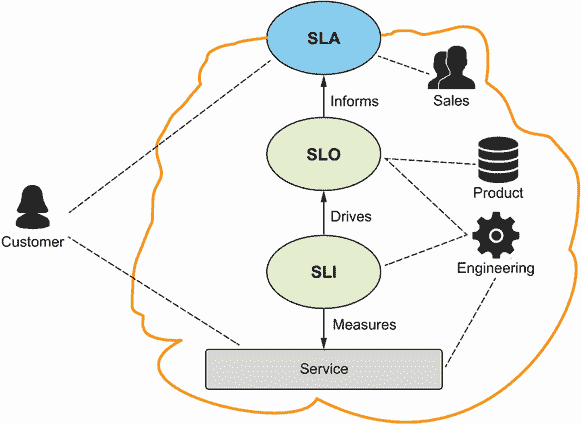
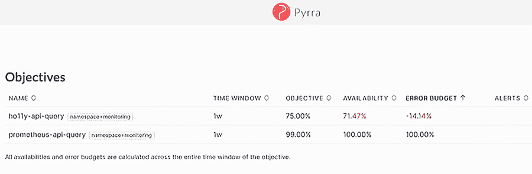
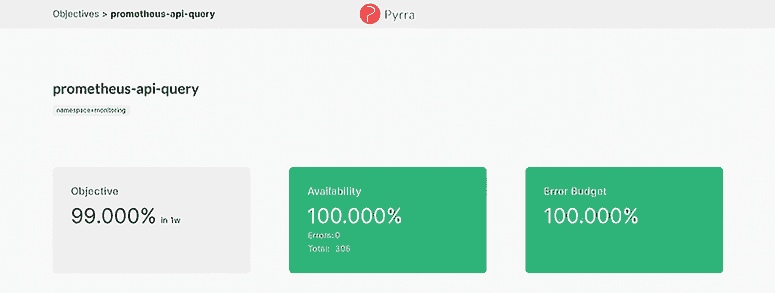
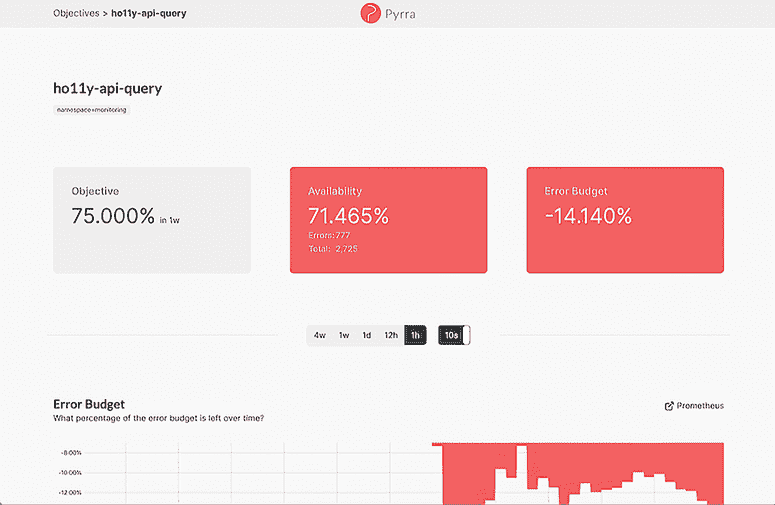
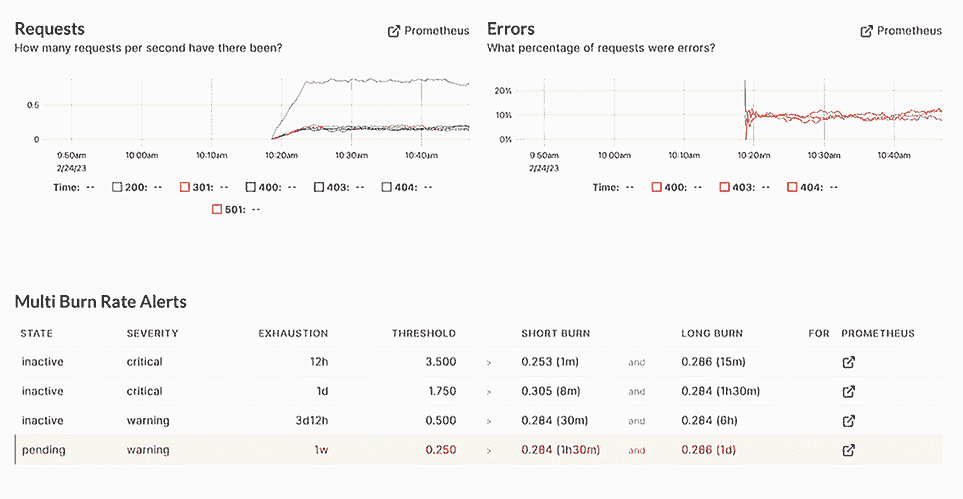

# 10 服务等级目标
本章涵盖
*   我们所说的服务等级目标的含义
*   如何实施服务等级目标
*   SLO 领域的可用工具
*   实施 SLO 时的注意事项

到本书的这一点，你应该对 *ROI 驱动的可观测性* 有了很好的理解。然而，还有一个我们尚未讨论的操作主题是完成图景所必需的：服务的消费者是否满意，以及我们如何根据数据知道消费者是否满意？消费者不一定是外部客户，尤其是在大型组织中，消费者可能是不同的业务单元。现在，别误会我——没有什么比一句讽刺的推文或在橙色网站（即 Hacker News）上的 thoughtful 评论更能激励人了。然而，如果我们能自动化整个流程，不是很好吗？

如果你退一步看，你会发现 DevOps 和站点可靠性工程（SRE）在过去十年中兴起，前者更偏向自下而上，后者明显由 Google 驱动。本章的核心概念和思想确实是 Google 的发明，如果你想研究每一个细节，包括最佳实践，我鼓励你前往 Google SRE 书籍网站（[`sre.google/books/`](https://sre.google/books/)）并阅读所有内容。在本章中，我们将采取更实用的方法，快速介绍基础知识，然后展示如何使用它们。

主要目标是使服务的可用性可衡量，并将从服务中得出的指标与目标进行比较。一旦你就目标达成一致并能够自动衡量它们，你可以做更多的事情：
*   你可以绘制漂亮的图表并查看它们，这对于前端使用是很好的。
*   你可以在有风险违反目标时发出警报（另见我们在第 7 章关于云运营的讨论）。
*   你可以将这些指标作为与客户合同中的输入来承诺某事，如果你无法兑现承诺，你可以承诺提供财务补偿（可能是积分甚至罚款）。这意味着你以可量化且系统的方式赢得客户的信任。
*   你可以推动合规（例如在金融或医疗保健领域）。

注意
我们在本章讨论的思想在现实生活中有一个平行例子：当我和孩子中的一个约定，比如说一个干净的房间会有奖励时，我们首先需要定义并同意 *干净* 的含义（那就是合同部分）。我可能会说，例如，在一个月的时间里，我期望只在地板上找到三件脏衣服（那是孩子需要达到以获得奖励的目标）。然后，我会随机检查房间并记录我在地板上发现多少件脏衣服（测量），并在月底与目标进行比较。如果我发现三件或更少的衣服在地板上，我就会宣布目标成功完成，孩子就会得到他们的奖励。

在任何时候，孩子都可以查看我的清单，看看我在测量期间（这里是一个月）发现了多少件衣服。有了这些，他们就可以确定他们距离违反约定目标有多近，或者换句话说，他们还剩下多少余地（你可以称之为 *预算*，事实上，这就是它的官方术语：*错误预算*）。

在本章中，我们将首先在理论层面处理服务等级目标；然而，我担心我们首先需要理清一些术语。然后，我们将转换思路，看看该领域可用的工具，你将完成一个动手练习，实现可用性指标并与你定义的目标进行比较。在最后一节中，我们将讨论一些重要的注意事项并提供进一步阅读。

## 10.1 SLO 的基础


## 10.1 服务等级协议、目标和指标

在本章中，我们区分了三个听起来相似但完全不同的术语：服务等级协议（SLAs）、服务等级目标（SLOs）和服务等级指标（SLIs）。在本节中，我们将深入探讨这三个术语如何相互作用，以及从角色角度来看，一个或多个术语对谁相关。

图 10.1 在高层面上展示了 SLAs、SLOs 和 SLIs 如何交互。我们在这里有两个分组中有四个角色：

* *服务消费者*，或*客户*，通常在团队外部，拥有服务（服务边界线）
* *服务提供商*，包括
  * *销售团队*，可能在业务侧，解决方案工程师、客户成功工程师/支持人员，或服务的联系人
  * *产品负责人*，是拥有路线图并与销售团队和工程团队共同工作的人
  * *工程团队*，从功能开发以及可能的操作角度拥有服务（尽管组织中可能有专门的角色，例如 `SRE` 来执行该任务）



图 10.1 SLAs、SLOs 和 SLIs 之间的交互和依赖关系

完全可能服务客户在组织内部（内部客户）；然而，这并不会改变对他们的期望或承诺，只会改变资金流动的可能性。如果服务的成本归因于内部客户，我们称之为 *回拨计费*。一种稍微不那么极端的形式（没有实际收费，只是成本和用量意识）是 *展示计费*，其中成本会显示给内部客户。对于我们的讨论，重要的是服务客户在服务团队的边界之外。

好吧，但这一切到底意味着什么？SLAs、SLOs 和 SLIs 到底是什么，我们应该如何定义和实施它们？让我们从图 10.1 的底部开始，逐步向上。 首先，让我们定义我们所说的 *服务* 的含义。

### 10.1.1 服务类型

在本章中，我将 *服务* 和 *API* 术语互换使用。我在任何一种情况下真正指的是同步服务的 API、异步服务或 *sui generis*（独特）服务类型。让我们现在更详细地了解服务类型：

* *同步服务*，通常是基于请求-响应的系统，例如长运行的 RESTful Web 服务、基于 WebSocket 的系统和基于 RPC（gRPC 或 SOAP）的系统，但也包括数据管道（例如 ETL）
* *异步服务*，包括事件总线、队列和 Pub/Sub 系统，其中发布操作（如 `put event X on a queue with topic Z`）与消费操作（如 `read the most recent event from queue with topic Z`）之间没有明显的因果关系
* *Sui generis 服务*，包括
  * 由特定事件触发、运行一段时间并预期终止的批处理作业
  * 存储，例如符合 POSIX 的本地或远程文件系统（包括 `ext4` 和 `NFS`）或对象存储，如 `Amazon S3`
  * 数据库和数据存储，包括关系数据库，如 `PostgreSQL`，以及 NoSQL 数据存储，如 `AWS DynamoDB` 或 `MongoDB`

根据服务类型，衡量服务客户如何感知服务的方式有所不同。进入 SLIs。

### 10.1.2 服务等级指标

服务等级指标（SLI）是确定服务表现的定量手段。简而言之，所有 SLIs 都是指标，但并非所有指标都是 SLIs。SLI 的目的是让你能够根据数值衡量服务客户体验你的服务。你可以聚合该值并对其进行花哨的数学运算，例如百分位数。但归根结底，SLIs 实际上只是服务指标，例如

* 服务的正常运行时间、可用性或可达性
* 同步服务的错误率（例如错误数占总请求数）
* 持续时间或延迟，例如同步服务响应请求所需的时间
* 异步服务的成功完成或失败作业
* 吞吐量，或服务能够维持的每秒事务数（TPS）

如果你对要考虑的指标类型（针对同步服务）感兴趣，我建议阅读 Joab Jackson 的“The RED Method: A New Approach to Monitoring Microservices”（[`mng.bz/a1nj`](http://mng.bz/a1nj)）。现在你已经在高层面上了解了 SLI 是什么，作为工程师定义的和跟踪的服务指标，让我们继续设置目标——或 SLOs。

### 10.1.3 服务等级目标

SLOs 是系统外部的目标，你可以在告知 SLAs 的上下文中使用一个或多个 SLO。为服务设置多个 SLO 使你能够将它们组合起来进行全面的通过/失败测试。与 SLAs 不同，SLOs 的受众不是你的服务客户；而是你的服务团队。你作为产品负责人，与工程师一起在与销售合作的情况下定义 SLOs，以确定服务的用户可以接受哪些错误。例如，你可能同意对于特定服务，你希望在一个月的时间段内达到 90% 的可用性。然后，在月底时，你可以将 SLIs 与 SLOs 进行比较，以确定是否达到了目标。

设置 SLO 阈值的平衡行为是在可用性和速度的竞争需求之间进行的。考虑 SLO 声明 0% 可用性的极端情况。这很容易实现；服务可以随时停机，你可以随时将新代码投入生产。从开发人员角度来看，这很棒，因为开发人员可以随时推送新功能或错误修复。从服务客户的角度来看，这就不那么好了；这意味着他们完全无法依赖服务。光谱的另一端将是 100% 可用性，这意味着实际上不允许任何更改，并且没有错误或其他因素导致服务中断。显然，这两个极端都不可取也不现实。

注意 在某些方面，SLOs 有点像光速：你越想接近它，你投入的能量就越多。将 SLO 设为 99% 与 99.9% 可能看起来只多了 0.9%，从目标角度来看，但请考虑实现它所需的工作量。此外，请记住，请求路径中最薄弱的环节决定了你总体上能实现什么。例如，如果你有三个服务——A、B 和 C——其中 A 调用 B；B 调用 C；并且假设 A 和 B 的 SLO 为 99.9%，而 C 的 SLO 为 90%，你不能期望整体承诺 99.9%，因为 C 不支持这一点。有关更多信息，请参阅 Steve McGhee 的 SLOconf 2021 演讲，“SLO Math，” ([`www.youtube.com/watch?v=-lHPDx90Ppg`](https://www.youtube.com/watch?v=-lHPDx90Ppg))。

与 SLOs 相关的术语还有更多，例如 *错误预算*，它定义了在一段时间内相对于 SLIs 的 SLO 可用的余地，以及 *消耗速率*，它定义了你消耗错误预算的速度。虽然术语可能有点密集，但简而言之，错误预算可以显著提高警报准确性，减少嘈杂的警报，并改善实践领先指标。我被 Nobl9 代表告知，有案例研究显示客户在实施 SLOs 后，误报警报减少了 90% 以上。

我们在这里不会进一步详细介绍。如果你有兴趣了解更多高级术语（在 Google 之外并不广泛采用），请查看免费的 `SRE` 书籍（[`sre.google/books/`](https://sre.google/books/)）。要了解 SLOs 最初源于何处，我建议阅读 Akshay Chugh 和 Piyush Verma 的“The Origin of Service Level Objectives”（[`mng.bz/gBMe`](http://mng.bz/gBMe)）。


从实践角度来看，还有工具可用，例如由 Nobl9 提供的 SLI Analyzer（[`docs.nobl9.com/slocademy/SLI_Analyzer/`](https://docs.nobl9.com/slocademy/SLI_Analyzer/)），可根据（历史）SLI 生成 SLO。现在我们已经对 SLO 是什么（目标）以及如何衡量我们满足它们的程度（SLI）有了概念，让我们将栈上移至服务提供商与服务客户之间的合同。

### 10.1.4 服务等级协议

SLA 是你作为服务提供商向你的（服务）客户承诺的内容，这主要是一个合同性话题。一种更带调侃的说法是，“SLOs are written in engineer, and SLAs are written in lawyer”（感谢 Jamie！）。这主要是在销售人员和客户之间进行的，其依据是产品和工程团队所承诺的 SLO，并以此为参考。

例如，如果产品和工程团队承诺一个 SLO，规定 API 在一个季度内 99% 可用，而在该季度之后，你只能让 API 可用 98% 的时间，那么你就违反了可用性 SLA。这可能会导致后果，例如退款甚至支付罚款，具体取决于你运营的服务类型或与客户的关系类型。

## 10.2 实现 SLO

现在你已经了解了术语，让我们讨论如何着手实现假设的 SLA、SLO 和 SLI。我们将从销售、产品和工程之间的一次示例对话开始，然后再看一个在 Prometheus 生态系统中实现 SLO 的具体示例。

### 10.2.1 高层示例

想象以下情况：你的服务团队计划为一个名为 Chat2Much 的对话式聊天机器人推出一个新 API。假设的对话大致如下：

*Sales → Product: Yo, I hear Chat2Much is soon ready to launch. I’m working on the SLA and wanted to understand what we can promise to customers about an API availability rate over the month as well as the request failure rate*.

*Product → Sales: Sure thing, let me get back to you on this*.

*Product → Engineering: I’d like to establish an SLO that sales can use as a basis for the Chat2Much SLA*.

*Engineering → Product: What SLO did you have in mind for Chat2Much?*

*Product → Engineering: I was thinking of committing to 99% API availability over a period of a month—what do you think? Also, can we do request count and errors?*

*Engineering → Product: That sounds reasonable, I believe we can achieve 99.9% with the current head count and technology stack. We will implement the service metrics `A`, `B`, and `C`, which you can use as SLIs to track the SLO*.

*Product → Engineering: OK, thanks—sounds good. I will work with Sales on the details*.

*Product → Sales: Alright, we can commit to 99% availability over the time period of a month for the Chat2Much API, and there is some wiggle room on our end already baked in with it. We are using SLIs `A`, `B`, and `C` to track this SLO*.

*Sales → Product: Perfect, thanks! I will use this and attach the financial implications—that is, the credits that a customer receives in the case we fail to meet the SLO*.

提示 要得出可用性百分比，你可以从最多能容忍多少错误反向推算。假设你在负载测试中观察到你的服务在一段时间内收到了 1,000,000 个请求，而在同一时间内有 6,942 个请求失败。为了留出一些余量，你可以向上取整，使其为 7,000。因此，你可以合理地承诺 99% 的可用性。

继续该示例，Chat2Much API 然后进入生产环境，工程团队使用仪表板和警报来跟踪 SLI `A`、`B` 和 `C`。他们按月报告 SLO 的满足情况，如果未满足，则报告偏离程度。客户从 SLA 中了解可用性，并可以在自己的仪表板上看到 API 相对于合同约定的目标的表现。大家都很满意——故事结束。

如果你想深入了解这个主题，我推荐以下资源：

*   *实施服务等级目标* 由 Alex Hidalgo 撰写（2020，O’Reilly Addison-Wesley，[`mng.bz/5w5q`](http://mng.bz/5w5q))

*   “从关键用户旅程到 SLO/SLIs” 由 Adam Roberts 撰写（[`mng.bz/6D65`](http://mng.bz/6D65)）

*   “SLO 开发生命周期” （SLODLC；[`www.slodlc.com/`](https://www.slodlc.com/)）

*   “Effective SLOs and You”（[`mng.bz/o1zj`](http://mng.bz/o1zj)）

*   “实施 SLO 的实用指南” 由 Prathamesh Sonpatki 和 Saurabh Hirani 撰写（[`mng.bz/nWG8`](http://mng.bz/nWG8)）

让我们现在转换思路，来看一个具体的领域：Prometheus。我们还将了解如何在该生态系统的上下文中实现 SLO。

### 10.2.2 使用 Prometheus 实现 SLO

在对 SLA、SLO 和 SLI 是什么以及如何在概念上实现它们进行了理论阐述之后，我们现在将更详细地了解如何使用来自 Prometheus 生态系统中的开源工具具体实现 SLO 和 SLI。与本书中的其他章节一样，想法是你可以无需成本或（许可）承诺地尝试和评估事物，并且这些步骤或多或少适用于该领域的任何提供商。

#### Pyrra

Pyrra（[`github.com/pyrra-dev/pyrra`](https://github.com/pyrra-dev/pyrra)）是一个开源工具，旨在让使用 Prometheus 的 SLO 变得易于使用。Pyrra 以 Prometheus 作为 SLI 的来源，这在云原生环境中被广泛采用的情况下是一个很大的优势。从架构角度来看，它包含以下组件：

*   作为运营者，你使用（YAML）文档来定义 SLO，并以此定义 SLI。

*   后端会监视 `ServiceLevelObjective` 资源（来自本地文件系统或 Kubernetes API），并基于此输入创建 Prometheus 记录规则。

*   Pyrra API 从后端（如 Kubernetes）收集 SLI。

*   Pyrra UI 使用 Pyrra API 来显示 SLO、SLI、错误预算等。

提示 如果你不想花费时间设置这里的基于 Docker 的示例，你也可以在 demo.pyrra.dev 的在线环境中（[`demo.pyrra.dev/`](https://demo.pyrra.dev/)）尝试一下。

要使用第 10.1 节中所示的 Docker Compose 文件启动堆栈，请从 `ch10/pyrra/` 目录执行以下命令：

```
docker-compose -f docker-compose.yaml up
```

以下列表显示了我们在此练习中使用的 Docker Compose 文件的相关片段，重点关注 Prometheus 和 Pyrra 的配置。

列表 10.1 Pyrra 设置的 Docker Compose 配置片段

```
prometheus:
    image: prom/prometheus:v2.40.0
    restart: always
    ports:
      - "9090:9090"
    command:
      - --config.file=/etc/prometheus/prometheus.yml
      - --storage.tsdb.path=/prometheus
      - --storage.tsdb.retention.time=33d
    volumes:
      - ./prometheus/prometheus.yaml:/etc/prometheus/prometheus.yml:ro
      - ./prometheus_pyrra:/etc/prometheus/pyrra    ❶
 
  pyrra-api:
    image: ghcr.io/pyrra-dev/pyrra:v0.5.5
    restart: always
    command:                                        ❷
      - api
      - --prometheus-url=http://prometheus:9090
      - --prometheus-external-url=http://localhost:9090
      - --api-url=http://pyrra-filesystem:9444
    ports:
      - "9099:9099"
 
  pyrra-filesystem:                                 ❸
    image: ghcr.io/pyrra-dev/pyrra:v0.5.0
    restart: always
    command:
      - filesystem
      - --prometheus-url=http://prometheus:9090
    volumes:
      - ./pyrra:/etc/pyrra
      - ./prometheus_pyrra:/etc/prometheus/pyrra
```

❶ 告诉 Prometheus 本地规则文件存储位置

❷ 使用 Prometheus 信息配置 Pyrra

❸ 设置 Pyrra 的本地文件系统提供程序（用于存储生成的规则）


下面的清单展示了 Prometheus 配置（`prometheus/prometheus.yaml`）。

### 清单 10.2 Prometheus 配置
```
global:
  scrape_interval: 5s
  scrape_timeout: 3s
  evaluation_interval: 5s
 
rule_files:              ❶
  - 'pyrra/*.yaml'
 
scrape_configs:          ❷
- job_name: prometheus
  static_configs:
  - targets:
    - localhost:9090
- job_name: svc
  static_configs:
  - targets:
    - svc:8765
```
❶ 配置 Prometheus 读取 Pyrra 生成的规则的位置
❷ 定义抓取任务，包括 Prometheus 自身抓取以及我们的 `ho11y` 服务

下一个清单是 YAML 文件 `pyrra/ho11y-http.yaml` 的内容，其中包含我们 `ho11y` 服务的 SLO 定义。我们将整体目标设置为 75%。

### 清单 10.3 Pyrra SLO 定义
```
apiVersion: pyrra.dev/v1alpha1
kind: ServiceLevelObjective
metadata:
  name: ho11y-api-query      ❶
  namespace: monitoring
  labels:
    prometheus: k8s
    role: alert-rules
spec:
  target: '75.0'             ❷
  window: 7d
  indicator:
    ratio:
      errors:                ❸
        metric: ho11y_total{job="svc",http_status_code=~"4.."}
      total:                 ❹
        metric: ho11y_total{job="svc"}
```
❶ SLO 的名称
❷ 我们的目标值，即 75% 可用性。注意它是一个字符串，因为 `kubebuilder` 不支持 `float64` 类型
❸ 定义错误 SLI——我们所说的错误（不可用）是什么
❹ 整体 SLI

我们之前提到 Pyrra 会将 `ServiceLevelObjective` 资源有效地转换为 Prometheus 记录规则。它看起来如何？如果以清单 10.3 作为输入，其相应的输出（你也可以在本地驱动器的 `prometheus_pyrra/` 目录中找到）显示在下面的清单中（注意该文件总共有 94 行左右，这里我们只展示第一条规则）。

### 清单 10.4 从 `ServiceLevelObjective` 派生的 Prometheus 记录规则
```
groups:
- interval: 1m
  name: ho11y-api-query-increase
  rules:
  - expr: sum by(http_status_code) (increase(ho11y_total{job="svc"}[1w]))
    labels:
      job: svc
      slo: ho11y-api-query
    record: ho11y:increase1w
  - alert: SLOMetricAbsent
    expr: absent(ho11y_total{job="svc"}) == 1
    for: 1m
    labels:
      job: svc
      severity: critical
      slo: ho11y-api-query
...
```
现在，让我们看看实际效果。在浏览器中访问 http://localhost:9099/，你应该会看到类似图 10.2 的内容，即 Pyrra landing 页面，提供所有 SLO 的概览。



图 10.2 Pyrra landing 页面（SLO 列表）

图 10.3 描述了 Prometheus SLO。你可以看到我们符合要求（SLO 已满足）。



图 10.3 Pyrra 中的 Prometheus SLO（SLO 详情）

图 10.4 和 10.5 显示了 Pyrra 中 `ho11y` 的 SLO，并且（按配置预期）我们看到 75% 的 SLO 被违反。



图 10.4 Pyrra 中 `ho11y` 服务的 SLO（概览）

如果你想了解更多关于 Pyrra 的信息，可以观看 Pyrra 主要维护者 Matthias Loibl 和 Nadine Vehling 在 KubeCon 2022 上的精彩演讲“面向所有 Kubernetes 集群组件的基于 SLO 的可观测性”（[`www.youtube.com/watch?v=AC38JtXXE50`](https://www.youtube.com/watch?v=AC38JtXXE50)）。



图 10.5 Pyrra 中 `ho11y` 服务的 SLO（详情）

### Sloth
Sloth（[`sloth.dev`](https://sloth.dev)）也使用 Prometheus 生成 SLO。简而言之，它为每个 SLO 生成三个规则组，包含用于 SLI、信息性指标和告警的记录规则和告警规则。此外，它还提供所谓的 SLI 插件（[`sloth.dev/sli-plugins/coredns-availability/`](https://sloth.dev/sli-plugins/coredns-availability/)），让你能够抽象和扩展 SLI，包括 CoreDNS、Istio 和 Traefik 的插件。与 Pyrra 一样，它支持错误预算（SLO 的容错空间）和燃烧率（预算消耗速度）。

鉴于与 Pyrra 的相似性和大量重叠，我们不会深入探讨 Sloth 的工作原理。只需选择更符合你需求的工具即可。接下来，我们将介绍商业 SLO 和 SLI 工具。

### 10.2.3 商业 SLO 方案
在撰写本文时，SLO 正在成为主流，你可以期待越来越多的商业方案。以下是目前一些值得注意的方案：
* Nobl9（[`www.nobl9.com/`](https://www.nobl9.com/)）是一个完整的 SLO 解决方案。它具有最深入的集成和最广的覆盖范围，如果你认真对待 SLO，你会想要评估它。
* 从云提供商的角度来看，Google Cloud 通过其运营套件提供 SLO 支持（[`mng.bz/vnEq`](http://mng.bz/vnEq)）。
* 服务等级目标状态页面（[`mng.bz/4Dwg`](http://mng.bz/4Dwg)）和 SLO 摘要小部件都是 Datadog 告警方案的一部分。
* Honeycomb（[`www.honeycomb.io/slos`](https://www.honeycomb.io/slos)）在其套件中提供基于追踪的 SLO 方案。
* Dynatrace 允许你在其方案中定义 SLO（[`mng.bz/QPBe`](http://mng.bz/QPBe)）。
* New Relic 提供服务等级管理功能（[`mng.bz/XNRM`](http://mng.bz/XNRM)）。
* Splunk 提供 SLO 和 SLI 监控（[`mng.bz/yQmE`](http://mng.bz/yQmE)）支持。

SLO 商业方案领域正在快速发展，你可以期待未来会有越来越多的云提供商和独立软件厂商原生支持 SLO。

## 10.3 考虑因素
如同往常一样，开源标准占主导。在这个领域，OpenSLO（[`openslo.com`](https://openslo.com)）是定义 SLO 的相关（新兴）开放规范，以实现厂商无关的 SLO 跟踪和接口。

例如，在 OpenSLO 中，你会将本章前面 Pyrra 的演练示例（与清单 10.3 对比）表示如下：
```
apiVersion: openslo/v1
kind: SLO                             ❶
metadata:
  name: ho11y-api-query
  labels:
    prometheus: k8s
    role: alert-rules
spec:
  service: ho11y                      ❷
  indicator:
    metadata:
      name: ho11y-error
      displayName: ho11y error
    spec:
      ratioMetric:
        counter: true
        good:                         ❸
          metricSource:
            metricSourceRef: prometheus-datasource
            type: Prometheus
            spec:
              query: ho11y_total{job="svc",http_status_code~="2.."})
        total:
          metricSource:
            metricSourceRef: prometheus-datasource
            type: Prometheus
            spec:
              query: ho11y_total{job="svc"}
  objectives:
    - displayName: ho11y total errors
      target: 0.75                    ❹
```
❶ 我们正在定义一个 OpenSLO SLO 对象。
❷ 此 SLO 目标服务的引用
❸ 与 Pyrra 不同，我们在 Pyrra 中定义了错误，而在这里，我们定义“快乐路径”是什么样的。
❹ 此 SLO 跟踪的目标：75% 可用性（或非错误响应）

通常，系统会定义 SLO 和 SLI，例如 Kubernetes。参见“Kubernetes 可扩展性和性能 SLIs/SLOs”（[`mng.bz/MBEm`](http://mng.bz/MBEm)）作为示例。最后，如果你想开始在该领域贡献或只是想了解更多，请考虑查看优秀的 SLOconf（[`www.nobl9.com/community/sloconf`](https://www.nobl9.com/community/sloconf)）活动，这是 SRE 社区每年聚会，交流 SLO 相关更新和经验。

## 总结
* 可靠性法规即将到来，就像 15 年前的网络安全一样。
* 使用 SLO 来衡量和报告合规性的可靠性正成为金融、通信和航空领域的热门话题，并可能扩展到其他行业。
* 为了使 SLA 中的合同承诺可量化且自动化，请定义 SLI 来推动目标（SLO）。
* SLA 是服务提供商和服务消费者之间的合同构造。


*   SLOs 是组织定义的目标，可用于指导 SLAs。
*   SLIs 是实际的测量或指标（取决于服务类型），用于验证目标（SLO）实现程度。
*   有开源工具（Pyrra 和 Sloth）可用于在 Prometheus 生态系统中实现 SLOs/SLIs。
*   对于 SLOs 也有一些商业方案，尤其是 Nobl9 的工具。
*   你不必在 SLOs 上全押注（例如错误预算或燃烧率）；事实上，现实中并没有多少人这样做（目前），但定义服务指标（SLIs）并将其与既定目标（SLOs）进行跟踪，有助于你和你的客户。
*   SLOs 可用作提高告警准确性的手段——早期预警系统（非紧急），可减少误报和用于抑制告警的一次性规则数量，并改善可关联到运行手册和自动修复的基于趋势的早期预警。
*   请确保在此领域基于开放规范构建——OpenSLO。
