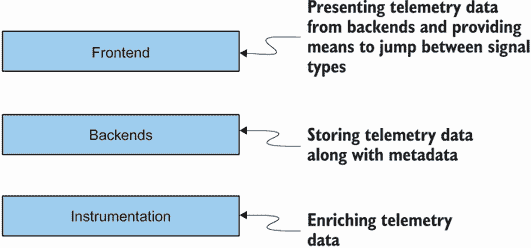
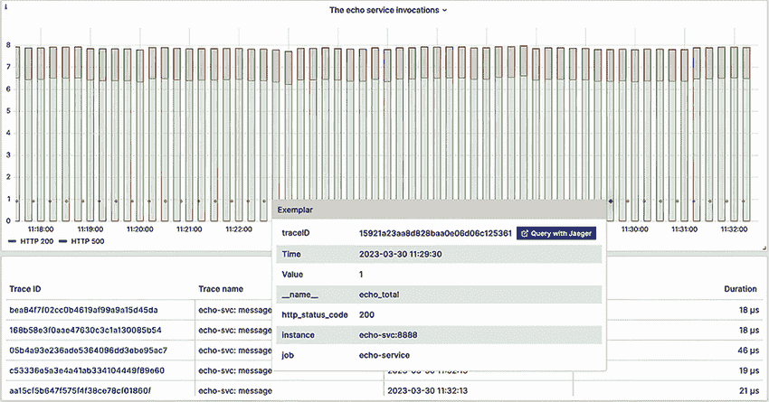
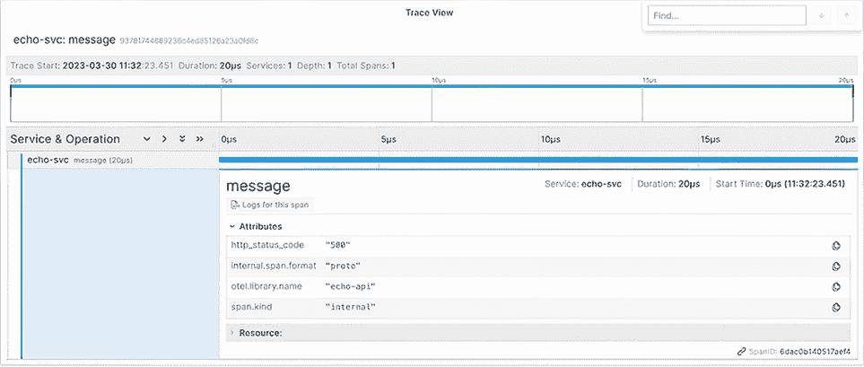
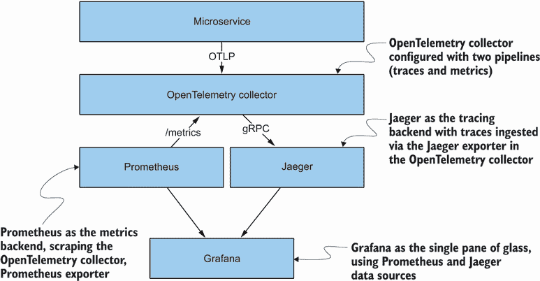
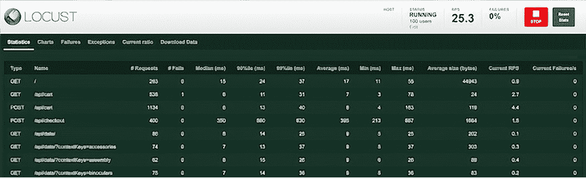
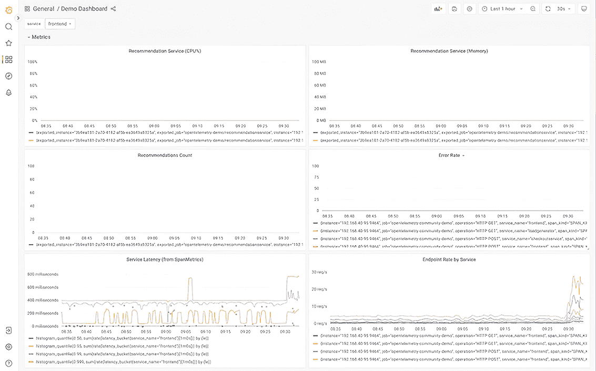
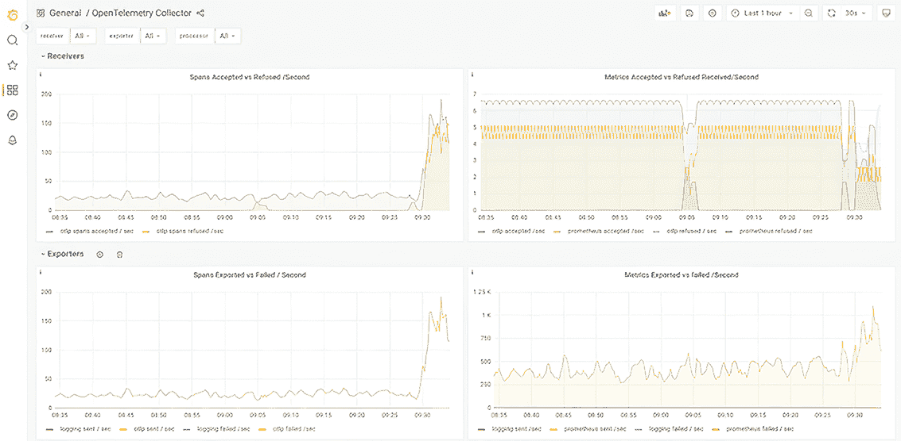
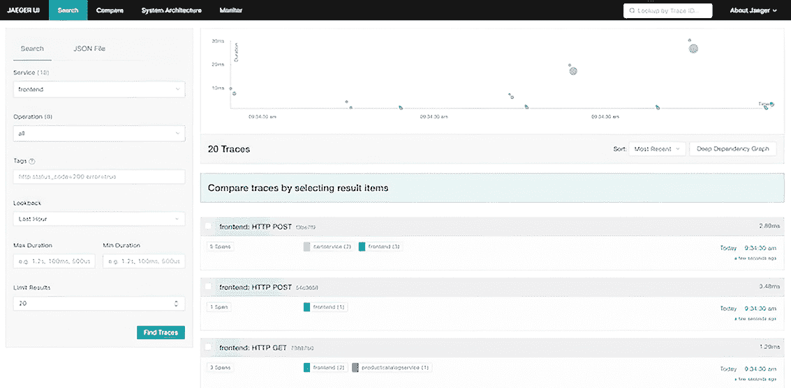
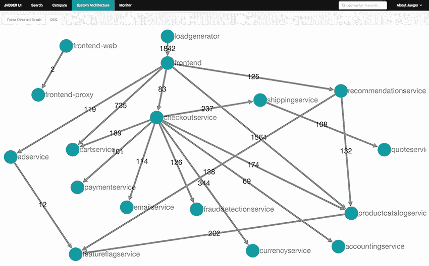

# 11 信号关联

本章涵盖
*   我们所说的信号关联含义
*   为什么需要关联
*   如何实现关联
*   实现关联的挑战

云原生系统是 *分布式系统*，指的是许多服务协同工作以处理请求。当许多服务协同工作时，往往并不总是清楚哪项服务导致了故障或造成了延迟问题。

四种基础的可观测性信号类型（日志、指标、追踪和剖析）各自都能提供洞察；然而，它们通常无法回答所有问题。请记住，可观测性的目标是从信号中得出可操作的洞察。所以如果单一信号类型没有产生你期望的洞察，你该怎么办？使用多种信号类型——将它们结合起来。

关联在何处会派上用场？很高兴你问了：
*   *事件响应*——想象一下你正在值班维护一个基于微服务的应用程序。你被呼叫，告警中包含一个指向 Grafana 仪表板的链接。从仪表板中，你看到应用程序的错误率增加，为了找出导致错误的服务，你使用指标–追踪关联来查找导致错误的服务的追踪。
*   *根因分析*——假设最近发生了事件，你想弄清楚原因。指标遥测为你提供计算环境（例如区域）的信息，而你也可以从日志中收集版本信息（例如使用的库、服务本身等）。为了弄清楚停机原因，你可以使用指标–日志关联来确定问题是否与某些机器类型、服务版本、区域相关。
*   *服务性能改进*——假设你是一名开发者，正在处理一个工单，其中指出有一定数量的客户报告某个端点的执行变慢。分布式追踪提供的服务图允许你精确定位共同处理该端点请求路径的服务。为了确定要改进哪些服务，你使用追踪–剖析关联并比较可以优化的服务版本的剖析。

虽然可以根据手动关联一起使用多种信号类型，但这并不是有效利用时间的方式。通过 *手动信号关联*，我的意思是从一种信号类型（如追踪）开始，并根据覆盖的时间范围，尝试查找例如构成追踪的服务的日志行，并希望它们多少相关。希望不是策略。我们将在本最后一章中首先在概念层面讨论信号关联。然后，我们将使用你已熟悉的工具，实际演示关联。最后，我们将总结一些实施信号关联的注意事项。

## 11.1 关联基础

我们首先定义 *信号关联* 的含义，然后从概念上看看它是如何工作的。我基于 Bartek Płotka 在“Correlating Signals Efficiently in Modern Observability” ([`www.bwplotka.dev/2021/correlations-exemplars/`](https://www.bwplotka.dev/2021/correlations-exemplars/)) 中的观点定义了信号关联。我不仅引用 Płotka 的工作是因为我认识并信任他，而且因为他曾担任 CNCF TAG Observability 的技术负责人。

定义 *信号关联* 是连接不同信号类型的元数据驱动过程，目标是更快和/或更准确地获得可操作的洞察。元数据使多信号可观测性的自动化成为可能。关联路径是从一种信号类型转换到相关联的另一种信号类型。

如图 11.1 所示的关联栈，展示了实现信号关联的概念层。请记住，我们希望尽可能自动化，因此层与层之间集成得越好，我们就越接近完全自动化。



图 11.1 关联栈

关联栈从下到上由以下部分组成：
*   *仪器化层*——该层包括你的代码和遥测代理，丰富遥测数据并将其摄入后端。我们已在第 3 章和第 4 章详细讨论过。注意，没有该层的支持，更高层难以实现。许多与来源相关的元数据（例如，哪个 Lambda 函数或哪个 Kubernetes 集群中哪个命名空间中的 Pod 发出了某个 span）仅在收集时可用，没有这些信息很难提供全面的关联。
*   *后端层*——遥测数据连同元数据一起存储在此层中。这可能由每个信号类型的独立后端组成，也可能是具有多种信号类型的后端，例如 OpenSearch。另见第 5 章，我们在那里更详细地讨论了此主题。该层主要负责驱动下一层，提供原始数据供用户选择具体的关联路径。
*   *前端层*——有时也称为 *展示层*（见第 6 章，我们在那里讨论了该主题，包括工具），该层用于呈现信号并可用于消费关联的遥测数据。各种可视化和渲染可以帮助你快速选择、过滤并在信号类型之间跳转。

驱动关联所需的元数据可以事后标准化（例如，使用第 4 章讨论的 Prometheus relabeling 功能时）或提前标准化。后一种方法，即建立定义好的语义，正是 OpenTelemetry 通过其语义约定所做的。现在让我们更详细地了解一下。

### 11.1.1 使用 OpenTelemetry 进行关联

使用语义约定（[`opentelemetry.io/docs/concepts/semantic-conventions/`](https://opentelemetry.io/docs/concepts/semantic-conventions/)），OpenTelemetry 定义了元数据方案，包括不同类型遥测数据的通用名称，有时还包括通用值。更具体地说，OpenTelemetry 支持以下元数据以在后端启用信号关联：
*   *资源属性 (*[`mng.bz/a1nY`](http://mng.bz/a1nY)*)*——捕获记录遥测数据的实体信息。它们可能捕获整个实体标识层次结构。你可以用它们来描述，例如，特定云区域中特定集群中的 Kubernetes 节点，或运行你关心的应用程序的 Pod 中的特定容器。
*   信号属性特定于信号类型，包括
    *   *追踪 (*[`mng.bz/gBMn`](http://mng.bz/gBMn)*)*——语义约定，包括 HTTP 客户端和服务器 span、远程过程调用（如 gRPC ([`grpc.io/`](https://grpc.io/)) span）、消息系统（Apache Kafka、RabbitMQ 等）span、与 span 关联的异常等。


- *指标* ([`mng.bz/e1XZ`](http://mng.bz/e1XZ)) — HTTP 客户端和服务器指标的语义约定；RPC 客户端和服务器指标；标准系统指标，如 CPU 使用率或磁盘 I/O；硬件；以及大量其他指标。

- *日志* ([`mng.bz/pP00`](http://mng.bz/pP00)) — 属性语义约定在出版时仍具有实验性质。仅定义了两个：一个用于日志媒体（描述日志的来源，例如文件名或 I/O 流）和一个事件属性，可例如描述业务上下文（如浏览器或设备）。

一个资源和信号属性的具体示例会是什么样的？假设我们运行一个由某些服务组成的应用程序。假设其中一个是 `svc-wow`，位于名为 `boom` 的命名空间中，在名为 `prod-42` 的 EKS 集群中，位于 `eu-west-1` 区域，并且该服务公开 HTTP 指标。

该场景在 OpenTelemetry 中将以 Pod 作为信号源表示，因此我们将使用以下资源属性：

- 对于服务所在的 EKS 集群，我们将使用 `cloud.region` ([`mng.bz/OxDO`](http://mng.bz/OxDO)) 属性，其值为 `eu-west-1`，以及 AWS 特定的 `aws.eks.cluster.arn` ([`mng.bz/Y12Q`](http://mng.bz/Y12Q)) 属性，其值例如为 `arn:aws:ecs:eu-west-1:123456789123:cluster/prod-42`。

- 对于服务所在的 Kubernetes 命名空间，我们将使用通用资源属性 ([`mng.bz/GyQ8`](http://mng.bz/GyQ8)) `service.namespace`，其值为 `boom`，以及 `service.name`，其值为 `svc-wow`。

- 我们这里关注的信号类型是指标，这意味着我们使用信号属性为发出的指标提供元数据。假设 `svc-wow` 服务公开了一个 HTTP API，我们想报告入站请求持续时间。我们将使用 `http.server.duration` ([`mng.bz/zXYg`](http://mng.bz/zXYg)) 指标，并使用诸如 `http.method`、`http.status_code` 和 `net.host.name` 之类的属性。巧合的是，`http_status_code` 属性是一个名称和值都标准化的属性的示例——即 RFC 7231 中定义的 HTTP 响应状态码的官方列表 ([`www.rfc-editor.org/rfc/rfc7231#section-6`](https://www.rfc-editor.org/rfc/rfc7231#section-6))。

表 11.1 提供了信号类型之间可能组合和转换的概述，其中 traces 表示跨服务的执行，metrics 表示数值聚合（例如错误百分比），logs 作为信号类型表示请求路径上单个服务。请注意，这些转换并非特定于某种格式，例如 OpenTelemetry。

表 11.1 信号关联概述

| 来自/至 | 跟踪 | 指标 | 日志 |
| --- | --- | --- | --- |
| **跟踪** | 相关 spans | 跟踪到代表性指标 | 跟踪到服务的日志行 |
| **指标** | 指标到代表性 spans | 相关指标 | 指标到服务的日志 |
| **日志** | 日志到服务的 spans | 日志到相关指标 | 相关日志 |

以下小节中的 *关联路径* 一词指的是从一种信号类型转换到另一种相关信号类型。这可能包括一个以上的转换。现在让我们剖析表 11.1，讨论按信号类型的具体关联。

### 11.1.2 关联 traces

在这种第一种情况下，关联路径的起点是 traces，表示跨服务执行，涵盖请求路径上的同步服务，以及潜在的异步服务，例如消息代理。从这里，我们将过渡到具体的关联。

To traces

*Traces–traces 关联* 指的是按环境或服务查找相关 spans。例如，您可以在 OpenTelemetry 中使用 Span Links 功能 ([`mng.bz/0KNW`](http://mng.bz/0KNW))，它允许您将一个 span 与一个或多个其他 span 关联，为异步的 fire-and-forget 工作负载定义因果关系，其中父 span 在其子 span 关闭之前不会等待其关闭。这对于诸如消息总线和消息队列之类的异步服务特别有用，包括 Apache Kafka ([`kafka.apache.org/`](https://kafka.apache.org/)) 和 Amazon EventBridge ([`aws.amazon.com/eventbridge/`](https://aws.amazon.com/eventbridge/))。

To metrics

*Traces–metrics 关联* 意味着输入是一个表示跨服务执行的 trace，输出由对输入 trace 的 spans 有贡献的服务的相关指标组成。

To logs

*Traces–logs 关联* 意味着输入是一个表示跨服务执行的 trace，输出由对输入 trace 的 spans 有贡献的服务的日志行组成。AWS X-Ray SDK for Java ([`mng.bz/KeaE`](http://mng.bz/KeaE)) 中的关联支持是一个示例。

### 11.1.3 关联 metrics

在这种情况下，关联路径的起点是指标的时间序列——数值聚合值。从这里我们可以过渡到具体的关联。

To traces

*Metrics–traces 关联* 意味着您有一个指标作为输入（例如在仪表板上绘制的图形或来自警报），预期的输出由对该时间序列有贡献的服务的代表性 spans 组成。我们将在下一小节中对这种关联案例进行具体研究，在那里我们将使用 Prometheus、Jaeger 和 Grafana 来实现指标与 spans 之间基于 exemplars 的关联。

To metrics

*Metrics–metrics 关联* 意味着相关指标（按类型或服务）（例如客户端和服务器端错误）。

To logs

*Metrics–logs 关联* 意味着输入是一个指标（例如来自仪表板），输出由对聚合值有贡献的服务的日志行组成。

### 11.1.4 关联 logs

在这种情况下，关联路径的起点是来自一个或多个服务的日志。从这里我们可以过渡到具体的关联。

To traces

*Logs–traces 关联* 意味着我们将服务的日志行作为输入，并寻求从写入这些日志行的服务发出的相应 spans。

To metrics

*Logs–metrics 关联* 使用服务的日志行作为输入，并输出来自该服务和相关服务（例如沿请求路径）的相关指标。

To logs

*Logs–logs 关联* 尝试按服务、环境或严重性查找相关日志。例如，您可以请求请求路径上所有服务的 `ERROR` 日志。

### 11.1.5 关联 profiles

我们在第 9 章讨论了 profiles 的性质和用例；它们与日志行有些可比，因为其范围是一个服务。Profiles 可以自动（通过 eBPF 或特定语言的方式）或手动发出。与日志相比，profiles 是数值性的。因此，虽然前述的 to–from 关联观察中的许多内容适用，但请注意 profiles 最终是数值值（因此从关联的角度来看，它们在某种意义上表现得像指标）。

## 11.2 使用 Prometheus、Jaeger 和 Grafana 进行关联

现在您在概念层面上了解了关联是什么，让我们研究如何实现它。为此，我们将使用一个具体示例，展示如何基于 exemplars 进行 metrics–traces 关联。在 metrics–traces 关联的情况下，这意味着从指标表示嵌入到 trace 的链接。这是通过插入 trace ID 来完成的，这样当指标在时间序列图中呈现时，您可以点击 exemplars 并直接跳转到代表性 trace 并浏览其 spans。从概念上讲，这种“将 trace ID 嵌入到指标中”看起来会像以下这样（使用 Prometheus 暴露格式，或更准确地说 OpenMetrics，因为该功能仅存在于那里）：


```
a_counter 42.0 # {traceID="a6427ef2021cce03"}
```

现在，我们将继续介绍我们的示例关联设置。

### 11.2.1 指标–追踪关联示例设置

我们将使用 Prometheus 和 Jaeger 作为后端，Grafana 作为前端。本示例中的示例服务基于我们在第 2 章中使用的 `echo` 服务。它会发出跨度，这些跨度由 OpenTelemetry collector 路由到 Jaeger，同时，collector 会抓取服务的 `/metrics` 端点以获取带有嵌入式 trace ID 的指标，并使其可供 Prometheus 后端抓取。你应该已经了解所有这些工具以及如何配置它们，因此我在这里会简要说明。

所有展示的源代码都在第 11 章，请切换到该目录。首先，用 Go 编写的 `echo` 服务会发出跨度并暴露指标。此外，它现在还支持 OpenMetrics exemplars（[`mng.bz/9DZ0`](http://mng.bz/9DZ0)）。源代码位于 `echo/main.go` 文件中；我们只会关注与如何发出 exemplars 相关的新增内容，并且只涵盖 happy path（错误情况大致相同，但它在 40% 的情况下返回 `500` 代码，而不是 `200`）：

```
invoke, _ := invokes.GetMetricWith(prometheus.Labels{
        "http_status_code": strconv.Itoa(http.StatusOK),
    })
    invoke.(prometheus.ExemplarAdder).AddWithExemplar(    ❶
        1,
        prometheus.Labels{"traceID": traceID},
    )
    invokes.WithLabelValues(                              ❷
        strconv.Itoa(http.StatusOK),
    ).Inc()
    span.SetAttributes(                                   ❸
```

❶ 将 `traceID` 作为 exemplar 嵌入到 `invoke` 计数器中
❷ 使用 `http_status_code=200` 标签增加 `invoke` 计数器
❸ 发出跨度，其元数据与指标中使用的相同（HTTP 状态码）

除了发出带有嵌入式 exemplars 的跨度和指标外，在 `main.go` 中还有一件需要注意的事情：Prometheus 指标暴露的配置。我们需要确保使用 OpenMetrics 格式，做法如下：

```
http.Handle("/metrics", promhttp.HandlerFor(
        registry,
        promhttp.HandlerOpts{
            EnableOpenMetrics: true,
        },
    ))
```

现在，我们需要引入所有依赖项，因此（假设你已安装 Go 1.20 或更高版本）执行以下操作：

```
go mod vendor
```

你现在应该会看到一个子目录 `vendor/`，其中包含所有必要的本地可用包。

接下来，让我们回到主目录 `ch11/metrics-traces`，并启动在 `docker-compose.yaml` 中定义的 Docker Compose 栈：

```
docker-compose -f docker-compose.yaml up
```

以下列表显示了我们用于指标–追踪示例的 Docker Compose 文件的相关片段。

列表 11.1 用于关联设置的 Docker Compose 文件的相关片段

```
prometheus:
    image: prom/prometheus:v2.33.4
    ports:
    - "9090:9090"
    volumes:
    - ./prometheus.yml:/etc/prometheus/prometheus.yml
    command:
    - "--config.file=/etc/prometheus/prometheus.yml"
    - "--storage.tsdb.path=/prometheus"
    - "--enable-feature=exemplar-storage"   ❶
  grafana:
    image: grafana/grafana:latest
    ports:
    - "3000:3000"
    volumes:                                ❷
    - ./grafana-storage:/var/lib/grafana
    - ./grafana:/etc/grafana/provisioning
    - ./grafana/dashboards:/var/lib/grafana/dashboards
```

❶ 需要配置 Prometheus 以支持 exemplars（内存中）
❷ 用于自动配置 Prometheus 和 Jaeger 数据源以及仪表板

让我们继续查看以下列表中显示的 OpenTelemetry collector 配置——`otel-config.yaml` 文件。

列表 11.2 用于关联设置的 OpenTelemetry collector 配置

```
exporters:
  prometheus:
    endpoint: "0.0.0.0:1234"
    metric_expiration: 180m
    enable_open_metrics: true     ❶
  jaeger:
    endpoint: jaeger:14250
    tls:
      insecure: true
service:
  pipelines:                      ❷
    metrics:
      receivers: [ prometheus ]
      processors: [ batch ]
      exporters: [ logging, prometheus ]
    traces:
      receivers: [ otlp ]
      processors: [ batch ]
      exporters: [ logging, jaeger ]
```

❶ 在 Prometheus exporter 中启用 exemplar 支持
❷ 指标和追踪管道

如果你想查看原始 exemplars，可以在你的机器上执行以下操作（假设 Docker 正在运行；http://127.0.0.1:8888/ 是 `echo-svc` 提供服务的地址）：

```
curl -H "Accept: application/openmetrics-text" \   ❶
        "http://127.0.0.1:8888/metrics"            ❷
```

❶ 发送此 HTTP 头是获取 exemplar 的关键（请求 OpenMetrics）。
❷ echo 服务端点，以 OpenMetrics 格式提供指标

当你执行上述 `curl` 命令时，你应该会看到类似以下输出的内容：

```
### HELP echo Total invocations of the echo service endpoint.
### TYPE echo counter
echo_total 930.0 # {http_status_code="200",                      ❶
                   traceID="f2a9e19d5c34427cf2f50a430de9fa3c"}   ❷
                   1.0 1.6801173123788908e+09
### EOF
```

❶ 一个简单的维度，通过 HTTP 状态码的标签表示
❷ 通过 Prometheus 标签 `traceID` 表示的 exemplar

有了这些设置，我们就可以使用信号关联了。现在就开始吧。

### 11.2.2 使用指标–追踪关联

是时候进行关联了！打开你的浏览器并输入 `localhost:3000`，即可打开 Grafana（无需凭据）。现在，打开名为 Echo Service Dashboard With Exemplars 的仪表板，并等待几分钟以收集足够的数据。然后你应该会看到类似图 11.2 的内容。第一行包含 `echo_total` 指标，具有 `200` 和 `500` 状态码，仔细观察，你会在图表底部看到一些小点。这些点允许 Grafana 时间序列可视化渲染 exemplars。将鼠标悬停在其上，你会看到跨度信息；如果点击它们，你将进入图 11.3 所示的 Jaeger 追踪视图。



图 11.2 `echo` 服务的 Grafana 仪表板截图，其中包含 exemplars（底部的微小点）

图 11.2 的下半部分显示了错误追踪，你也可以使用它们导航到 Jaeger 追踪视图。



图 11.3 `echo` 服务的 Jaeger 视图截图，聚焦于表示 500 响应的错误跨度

花点时间探索视图以及如何使用 exemplars 从指标到追踪的路径。内容很多，可能需要一些时间。接下来，我们将快速回顾信号关联领域的商业产品。

## 11.3 商业产品中的信号关联支持

虽然目前还处于早期阶段，并非所有关联路径都得到每个提供商的支持，但商业领域中已经有对多种关联的核心支持。通常，这些与追踪–日志和指标–追踪支持相关。

让我们先看看云提供商及其原生的监控和可观测性解决方案：

*   AWS 具有基于 OpenTelemetry 的全面关联策略（[`mng.bz/jPqV`](http://mng.bz/jPqV)），通过 AWS X-Ray 和 Amazon CloudWatch（[`mng.bz/WzWd`](http://mng.bz/WzWd)）支持追踪–日志关联。
*   与 AWS 类似，Azure 正在标准化 OpenTelemetry。例如，参见基于 Application Insights 的关联支持（[`mng.bz/8rAW`](http://mng.bz/8rAW)）。
*   Google Cloud 在其运营套件中提供关联日志条目的支持（[`cloud.google.com/logging/docs/view/correlate-logs`](https://cloud.google.com/logging/docs/view/correlate-logs)）。

现在，我们将转向可观测性 ISV 的商业产品。在可观测性领域，几乎所有厂商都在其解决方案中提供一种或另一种形式的关联支持：


- AppDynamics 在 Java 等语言（[`mng.bz/EQvD`](http://mng.bz/EQvD)）和 .NET（[`mng.bz/N2px`](http://mng.bz/N2px)）中支持指标到事件的自定义关联。
- 在 Datadog 中，你可以关联指标（[`docs.datadoghq.com/dashboards/correlations/`](https://docs.datadoghq.com/dashboards/correlations/)），并且他们提供 traces–logs 关联（[`www.datadoghq.com/blog/request-log-correlation/`](https://www.datadoghq.com/blog/request-log-correlation/)）。
- 使用 Dynatrace，你可以获得丰富的 traces 关联（[`mng.bz/D4ng`](http://mng.bz/D4ng)）。
- Honeycomb 提供了对其关联方法与其它 APM 的一个不错的比较（[`www.honeycomb.io/comparisons`](https://www.honeycomb.io/comparisons)），指出诸如其查询速度和对高基数数据分析的支持等事项。
- Lightstep 提供 tracing 相关（[`mng.bz/lWmR`](http://mng.bz/lWmR)）的关联支持。
- Logz.io 基于 `OpenSearch` 提供 traces–logs（[`mng.bz/Bm6l`](http://mng.bz/Bm6l)）关联。
- 在 New Relic 的方案中，支持使用决策配置关联逻辑（[`mng.bz/d1R1`](http://mng.bz/d1R1)），提供一种关联路径的混合。
- Splunk 有一种有趣的方法，支持 `correlate` 命令（[`mng.bz/rWXj`](http://mng.bz/rWXj)），让你可以查看遥测数据中字段之间共现情况的概览。
- Sumo Logic 允许你通过其 Cloud SIEM（[`www.sumologic.com/blog/siem-investigation-correlation/`](https://www.sumologic.com/blog/siem-investigation-correlation/)）方案在安全调查的上下文中关联信号。

现在你对关联领域的商业方案和开源工具都有了一些了解，让我们继续讨论有关关联的一些总体考虑，以及在引入关联时需要注意什么。

## 11.4 考虑因素

到目前为止，在高效获得可操作洞察的背景下，信号关联发挥着关键作用应该已经很清楚了。我不会假装即使在最佳情况下，即你拥有多信号后端和单一操作视图，完全和完全自动化的关联也是容易实现的。截至出版时，与实施关联相关的挑战仍然很多，是可观测性领域风险最大的单一类别。因此一方面，你不应将其视为事后考虑，另一方面，你应意识到其局限性并适当设定期望。例如，如果你在一个平台团队中（内部开发者平台用于简化基础设施和应用配置，从而避免 TicketOps），你可能希望相应地优先考虑关联。

注意 这里，*TicketOps* 并不是指公司，而是指一个略带贬义的术语，用来描述开发者在例如 Jira 中创建工单，而平台团队中的运维角色异步解决这些工单的过程。这可能需要一些时间（例如几天或几周），与 DevOps 提出的自动化信条相悖。

现在，不再赘述，让我们来看看在你的组织中实施信号关联的具体挑战。我将它们分为三个类别，对于其中一些挑战，我建议一种或多种补救措施来降低风险。

### 11.4.1 初期阶段

首先，让我们回顾一下与可观测性整体状态以及具体实现相关的主要挑战。

#### 缺乏标准

APM 和监控工具，无论是开源还是商业，都使用不同的遥测信号格式以及各种术语。这使得跨系统关联信号变得具有挑战性。

以下是一种适当的补救措施：如果想要真正的互操作性并避免厂商锁定，请使用 `OpenTelemetry`。

#### 缺乏元数据

要驱动关联，你需要由元数据表示的连接组织，包括但不限于 EC2 元数据、Prometheus 标签、Kubernetes 标签以及 `OpenTelemetry` 资源和信号属性。迄今为止，很少有平台和系统是“可观测性优先”（设计时考虑可观测性支持）的，因此获取这些元数据可能很困难或需要人工操作。

以下都是适当的补救措施：
- 根据元数据丰富程度和自动化程度评估（计算）平台。
- 使用基于 `OpenTelemetry` 的系统。

### 11.4.2 信号

接下来，我们将查看与信号本身相关的挑战。

#### 遥测信号量

来自不同来源生成的数据总体量使得高效关联信号变得困难。这不仅仅是成本问题，还可能对性能和流程产生严重影响。例如，如果你在索引日志并且你的工具在处理用户查询请求时不堪重负，操作人员可能会变慢、沮丧并实际上被阻塞。

以下都是适当的补救措施：
- 采用选择性摄取，即在前端限制量。这相当棘手，因为你事先不知道哪些“有价值”的信号有助于获得可操作的洞察。对于日志，确保你的事件附带 `priority` 或 `loglevel` 属性。这让你可以做诸如 *摄取所有错误、50% 的所有警告和 1% 的信息日志行* 之类的事情。
- 事后方法是指采用机器学习（ML）来检测模式。这可以帮助你处理量的问题，因为它使你能够隔离和优先处理可能导致所需洞察的相关事件。但请注意，使用基于 ML 的异常检测，成本在于计算而非存储，因此摄取成本远高于信号保留。

#### 高基数

高基数数据，如第 5 章所述（尤其是基数爆炸挑战），可能使关联信号变得困难。这是因为值可能只出现几次或在最极端情况下只出现一次。

以下都是适当的补救措施：
- 限制基数。这意味着强制执行硬性限制，其缺点是一般情况下你不知道正确的截止点在哪里，而且你再次可能失去有价值的信号。
- 确保你选择的观测方案支持高基数，这对于 Honeycomb 和 Lightstep 尤其重要。

#### 采样

在分布式追踪的情况下，采样（参见第 8 章，我们在那里详细讨论了这个问题）可能对关联构成挑战。缺失的 spans 会导致关联路径出现空洞，从而整体可用性下降。有一些厂商可以帮助你解决这个问题；例如，Honeycomb 有一个智能采样器，它对错误和正常路径使用不同的采样率。这是对有价值信号预标记的一种变体。

#### 数据隐私和安全

许多行业以及地区，例如欧洲的通用数据保护条例（GDPR；[`commission.europa.eu/law/law-topic/data-protection_en`](https://commission.europa.eu/law/law-topic/data-protection_en)），都有要求对数据进行去识别化的政策，例如删除个人身份信息（PII）。因此，可能出现与采样类似的情况，即驱动关联的部分信息被故意省略。此外，隐私立法或行业合规标准可能要求信号必须严格在内部处理，不得发送到 SaaS 提供商或位于特定区域之外的云提供商。

### 11.4.3 用户体验

最后但绝非最不重要，我们将讨论与用户体验（UX）相关的挑战。

#### 缺乏可操作的洞察


Systems may implement some support for correlation, but I’ve found that it can be cumbersome or unintuitive to use. In that case, folks tend to not bother and, as a result, not use the feature.

The following is an appropriate remediation: besides (as a vendor) paying attention to UX, as an end user, you could evaluate offerings according to the value of insights they generate. `Dynatrace` and `New Relic` both provide (ML-generated) recommendations and insights, which may serve as a starting point for your evaluation.

### End-to-end support

Sometimes, the UX challenges come from a lack of end-to-end support. This challenge may affect instrumentation, agents, backends, frontends, and so on.

The following are appropriate remediations:

* Use fully vertical integrated offerings, such as `Datadog`, `New Relic`, and `Splunk`, that own the entire stack.
* Bet on open standards, specifically, `OpenTelemetry`. At the time of writing, there is one area not yet covered by standards: querying backends. The community has identified this issue and is working on query standardization ([`mng.bz/V1jx`](http://mng.bz/V1jx)) in the context of the `CNCF` Technical Advisory Group (`TAG`) on Observability.

## 11.5 Conclusion

With these considerations on implementing signal correlation in mind, we now conclude not only this chapter but the book itself. Stick around for the appendix, where we will get our hands dirty implementing observability in the context of an multisignal, multiprogramming languages app, using `OpenTelemetry`.

I would love to hear from you about your challenges and success stories regarding observability and anything else you’d like to share. Please reach out at mh9@o11y .engineering. May the insights be with you!

## Summary

* One signal type is usually not enough to gain actionable insights.
* Signal correlation is the metadata-driven process of connecting different signal types to gain actionable insights faster and more accurately.
* A correlation path can include more than one transition—for example, starting with a time series representing a metric to related spans to logs lines or profiles of a particular service.
* The metadata necessary to drive correlation can either be standardized after the fact (e.g., `Prometheus` relabeling) or up front (e.g., `OpenTelemetry`’s semantic conventions).
* Not all correlation paths are equal. Some, like metrics–traces or traces–logs are widely used and supported, while others are not.
* Exemplars (in `OpenMetrics` and `OpenTelemetry`) allow you to do metrics–traces correlation by embedding a pointer to a trace in a metric.
* We’re still in the early days of signal correlation; be aware of the limitations and set expectations accordingly.
* There are several challenges associated with implementing correlation, especially concerning UX and signals volume, cardinality, and sampling.
* Using `OpenTelemetry` is likely the most efficient and effective way to hedge against challenges in the correlation space.

# Appendix. A Kubernetes end-to-end example

In this appendix, we will work through an end-to-end observability sample application in `Kubernetes`. Throughout the book, we’ve been using `Docker Compose` as our tool of choice. It has a number of advantages as an educational device; however, in reality, you will more likely use `Kubernetes`, `Amazon ECS`, or `HashiCorp Nomad` as an orchestrator. So this appendix will offer you a more native and consistent approach that covers all the tracing, metrics, and logging topics we discussed and allow you to play around with the setup.

Tip You *could* use `kompose` ([`kompose.io/user-guide/`](https://kompose.io/user-guide/)) to turn any of the `Docker Compose` example files we’ve covered into `Kubernetes` resources (e.g., deployments and services) to get a feeling for how to work with the OSS tooling discussed in the book.

Luckily for us, there is already something available that fits the bill: the `OpenTelemetry` community demo ([`opentelemetry.io/docs/demo/`](https://opentelemetry.io/docs/demo/)). The demo covers several services written in different programming languages and features the tooling we’ve discussed. We will first discuss the demo and how it works, then cover the prerequisites to run it, and then walk through the demo together.

## A.1 Overview

The `OpenTelemetry` demo is a microservices-based shopping app that uses 12 different programming languages, including Java, JavaScript, Python, and .NET, to implement services ([`opentelemetry.io/docs/demo/services/`](https://opentelemetry.io/docs/demo/services/)). The demo has all its services instrumented, emitting spans, metrics, and log lines. We won’t be covering the details of the demo services and their interactions here, but if you’re interested in diving deeper, check out the `OpenTelemetry` docs that discuss the demo architecture ([`opentelemetry.io/docs/demo/architecture/`](https://opentelemetry.io/docs/demo/architecture/)).

Figure A.1 shows the telemetry flow in the `OpenTelemetry` demo.



Figure A.1 `OpenTelemetry` demo telemetry flow

The relevant bits in the telemetry flow are

* `Microservices`—Instrumented to send telemetry data to the `OpenTelemetry` collector, using `OTLP`
* `The OpenTelemetry collector`—Has two pipelines configured (see listing A.1)
* `Prometheus`—The metrics backend
* `Jaeger`—The tracing backend
* `Grafana`—The single pane of glass, using `Prometheus` and `Jaeger` data sources

The `OpenTelemetry` collector configuration ([`mng.bz/x4p6`](http://mng.bz/x4p6)) is shown in greater detail in the following listing.

Listing A.1 `OpenTelemetry` collector configuration

```
receivers:
  otlp:                      ❶
    protocols:
      grpc:
      http:
        cors:
          allowed_origins:
            - "http://*"
            - "https://*"
 
exporters:                   ❷
  otlp:
    endpoint: "jaeger:4317"
    tls:
      insecure: true
  logging:
  prometheus:
    endpoint: "otelcol:9464"
    resource_to_telemetry_conversion:
      enabled: true
    enable_open_metrics: true
 
processors:
  batch:
  transform:
    metric_statements:
    - context: metric
      statements:
      - set(description, "Measures the duration of inbound HTTP requests")
        where name == "http.server.duration"
  filter:
    metrics:
      exclude:
        match_type: strict
        metric_names:
          - queueSize
 
connectors:
  spanmetrics:               ❸
 
service:
  pipelines:                 ❹
    traces:
      receivers: [otlp]
      processors: [batch]
      exporters: [otlp, logging, spanmetrics]
    metrics:
      receivers: [otlp, spanmetrics]
      processors: [filter, transform, batch]
      exporters: [prometheus, logging]
    logs:
      receivers: [otlp]
      processors: [batch]
      exporters: [logging]
```

❶ We receive signals via `OTLP`.

❷ We have three exporters: `Prometheus`, `Jaeger`, and logging (to stdout).

❸ We’re using the `spanmetrics` connector to derive `RED` metrics from spans.

❹ The pipelines are configured, with one for traces (connecting to metrics), one for metrics, and one for logs (to stdout only).

You can run the `OpenTelemetry` demo in several environments; we will be using the `Kubernetes` ([`mng.bz/Ao5Q`](http://mng.bz/Ao5Q)) deployment in the following walk-through. But first, we need to make sure we have everything in place so that we can run the demo.

## A.2 Prerequisites

To install the `OpenTelemetry` demo in `Kubernetes`, you will need a `Kubernetes` cluster:

* If you want to execute locally, some popular choices are
  * `Docker Desktop` ([`docs.docker.com/desktop/kubernetes/`](https://docs.docker.com/desktop/kubernetes/))
  * `kind` ([`kind.sigs.k8s.io/`](https://kind.sigs.k8s.io/))
  * `K3s` ([`k3s.io/`](https://k3s.io/))
  * `minikube` ([`minikube.sigs.k8s.io/docs/`](https://minikube.sigs.k8s.io/docs/))
  * `Microk8s` ([`microk8s.io/`](https://microk8s.io/))


## 先决条件

云服务提供商提供托管的 Kubernetes 服务，具体取决于您通常使用的环境。请查看以下内容：

- Amazon Elastic Kubernetes Service (EKS; [`aws.amazon.com/eks/`](https://aws.amazon.com/eks/))
- Azure Kubernetes Service (AKS; [`learn.microsoft.com/en-us/azure/aks/`](https://learn.microsoft.com/en-us/azure/aks/))
- Google Kubernetes Engine (GKE; [`cloud.google.com/kubernetes-engine`](https://cloud.google.com/kubernetes-engine))

您还需要以下 CLI 工具：

- `kubectl`—通过 Kubernetes 文档中的说明进行安装（[`kubernetes.io/docs/tasks/tools/`](https://kubernetes.io/docs/tasks/tools/)）。
- `eksctl`—按文档中所述进行安装（[`github.com/eksctl-io/eksctl#installation`](https://github.com/eksctl-io/eksctl#installation)）。
- `Helm`—根据文档进行安装（[`v3-1-0.helm.sh/docs/intro/install/`](https://v3-1-0.helm.sh/docs/intro/install/)）。
- `jq`—通过文档进行安装（[`jqlang.github.io/jq/download/`](https://jqlang.github.io/jq/download/)）。
- `curl` and `watch`—应可在您的系统上使用；否则，请参阅您的 Linux 发行版或 Windows 文档。

我建议在数据平面中至少准备两个中等大小的节点。例如，我使用的是 EKS，拥有一个三节点集群，使用 `t2.large` ([`instances.vantage.sh/aws/ec2/t2.large`](https://instances.vantage.sh/aws/ec2/t2.large)) EC2 实例（每个节点具有两个 vCPU 和 8 GB RAM）。

要配置 EKS 集群，我使用 `eksctl` ([`eksctl.io/`](https://eksctl.io/)) 并使用配置文件 `otel-demo-cluster.yaml`，如下所示。

### 列表 A.2 EKS 集群配置

```
apiVersion: eksctl.io/v1alpha5
kind: ClusterConfig
metadata:
  name: otel-demo
  region: eu-west-1      ❶
  version: "1.24"
iam:
  withOIDC: true         ❷
nodeGroups:              ❸
- name: default-mng
  instanceType: t2.large
  desiredCapacity: 3
cloudWatch:              ❹
  clusterLogging:
    enableTypes: ["*"]
```

❶ 请确保将其设置为您的区域（此处为爱尔兰都柏林，`eu-west-1`）。

❷ 这将配置 OIDC 提供程序，以便您可以附加 IAM 策略，例如，如果您想更改 OpenTelemetry collector 配置，将指标发送到 Amazon Managed Service for Prometheus 或将跟踪发送到 AWS X-Ray。

❸ 数据平面——三个 `t2.large` EC2 实例

❹ 在 CloudWatch 中启用控制平面日志记录

然后，按如下方式配置并启动 EKS 集群：

```
$ eksctl create cluster -f otel-demo-cluster.yaml
```

等待 10 到 15 分钟，然后验证（根据您的设置，您可能会看到更少的节点）：

```
$ kubectl get nodes
NAME               STATUS   ROLES    AGE     VERSION
ip-1..7.eu-west-1  Ready    <none>   2d23h   v1.24.10-eks-48e63af
ip-1..4.eu-west-1  Ready    <none>   3d14h   v1.24.10-eks-48e63af
ip-1..1.eu-west-1  Ready    <none>   2d23h   v1.24.10-eks-48e63af
```

现在，我们准备进行演示演练。

## A.3 演示演练

首先，我们将安装 OpenTelemetry 演示。安装后，我们就可以使用它了！

### A.3.1 安装演示

使用以下命令安装演示。首先，我们需要添加演示的 Helm 仓库，如下所示：

```
$ helm repo add open-telemetry \
       https:/ /open-telemetry.github.io/opentelemetry-helm-charts
```

现在，我们可以安装演示：

```
$ helm install my-otel-demo \
       open-telemetry/opentelemetry-demo
```

验证一切是否已启动；这可能需要几分钟时间。您应该会看到类似以下内容（实际上，您需要确保所有 Pod 都处于 `Running` 状态；请注意，我已编辑输出以适应格式）：

```
$ kubectl -n default get pods
NAME                         READY STATUS    RESTARTS        AGE
my-otel-demo-accountingse... 1/1   Running   4 (13d ago)     13d
my-otel-demo-adservice-86... 1/1   Running   0               13d
my-otel-demo-cartservice7... 1/1   Running   0               13d
my-otel-demo-checkoutserv... 1/1   Running   4 (13d ago)     13d
my-otel-demo-currencyserv... 1/1   Running   0               13d
my-otel-demo-emailservice... 1/1   Running   58 (83m ago)    13d
my-otel-demo-featureflags... 1/1   Running   1 (13d ago)     13d
my-otel-demo-ffspostgres-... 1/1   Running   0               13d
my-otel-demo-frauddetecti... 1/1   Running   0               13d
my-otel-demo-frontend-65d... 1/1   Running   0               13d
my-otel-demo-frontendprox... 1/1   Running   0               13d
my-otel-demo-grafana-8445... 1/1   Running   0               13d
my-otel-demo-jaeger-85484... 1/1   Running   2 (11d ago)     13d
my-otel-demo-kafka-77bfdc... 1/1   Running   0               13d
my-otel-demo-loadgenerato... 1/1   Running   7 (31h ago)     13d
my-otel-demo-otelcol-b75c... 1/1   Running   0               13d
my-otel-demo-paymentservi... 1/1   Running   0               13d
my-otel-demo-productcatal... 1/1   Running   0               13d
my-otel-demo-prometheus-s... 1/1   Running   0               11d
my-otel-demo-quoteservice... 1/1   Running   0               13d
my-otel-demo-recommendati... 1/1   Running   0               13d
my-otel-demo-redis-cf9dd8... 1/1   Running   8 (7h27m ago)   13d
my-otel-demo-shippingserv... 1/1   Running   0               13d
```

现在，我们准备使用演示了。恭喜！

### A.3.2 使用演示

要从本地机器使用演示（例如访问 Grafana UI），您首先需要将 Kubernetes 集群的网络流量转发到您的机器。

首先，我们将公开 `frontendproxy` 服务。使用以下命令实现此操作：

```
kubectl port-forward \
        svc/my-otel-demo-frontendproxy 8080:8080
```

为了从本地浏览器正确收集 spans，您还需要公开 OpenTelemetry collector（`4318` 是 OTLP 端口）：

```
kubectl port-forward \
        svc/my-otel-demo-otelcol 4318:4318
```

如果您现在访问 `localhost:8080` (http://localhost:8080/)，您应该会看到类似图 A.2 的内容（OpenTelemetry 演示商店首页）。


图 A.2 OpenTelemetry 演示首页（商店）的屏幕截图

点击 Go Shopping，开始将商品添加到购物车，然后结账（不用担心——它是模拟的，所以不会使用真实资金）。虽然随意点击是入门的好方法，但我们不想等待太长时间来生成遥测信号，对吧？这就是我们使用负载生成器的原因（见图 A.3），您可以在 http://localhost:8080/loadgen/ 找到它。



图 A.3 OpenTelemetry 演示负载生成器的屏幕截图

图 A.4 显示了 Grafana 作为单一操作面板。准确地说，这是演示应用仪表板，显示 `frontend` 服务指标。访问 http://localhost:8080/grafana/ 即可到达。



图 A.4 OpenTelemetry 演示 Grafana（前端服务仪表板）的屏幕截图

图 A.5 显示了 Grafana 中的 OpenTelemetry collector 仪表板。



图 A.5 OpenTelemetry 演示 Grafana（collector 仪表板）的屏幕截图

现在，让我们关注跟踪。图 A.6 显示了 Jaeger UI，可通过 http://localhost:8080/jaeger/ui/ 访问。这里显示的是 span 或 trace 视图。



图 A.6 OpenTelemetry 演示 Jaeger（trace 视图）的屏幕截图

图 A.7 显示了 Jaeger UI，展示了系统架构视图中 OpenTelemetry 演示应用的动态渲染。



图 A.7 OpenTelemetry 演示 Jaeger（服务映射视图）的屏幕截图

如果您不想自己设置，还可以通过演示站点（[`opentelemetry.io/docs/demo/screenshots/`](https://opentelemetry.io/docs/demo/screenshots/)）查看更多屏幕截图。

为了给您一些探索的思路，请考虑使用演示执行以下全部或部分操作：


* 在 Jaeger 中，搜索 checkout 服务的跟踪，并检查一个跟踪。问问自己，哪个调用占用了大部分时间？
* 现在，搜索 payment 服务并做同样的操作。你是否注意到与 checkout 服务相似之处？
* 搜索操作 `oteldemo.ShippingService/GetQuote`。这些跟踪有什么共同点？
* 搜索 `frontendproxy`。为什么你看到的跟踪相对较短？
* 在 load-generator 选项卡中，将用户数量增加到更大的数字（10 倍、50 倍等）。现在，仪表板整体如何变化？跟踪持续时间如何变化？

在 OpenTelemetry 项目的背景下，社区也在开发各种演示场景；例如，查看“使用指标和跟踪诊断内存泄漏”场景（`http://mng.bz/ZqN9`），该场景已在线提供。
