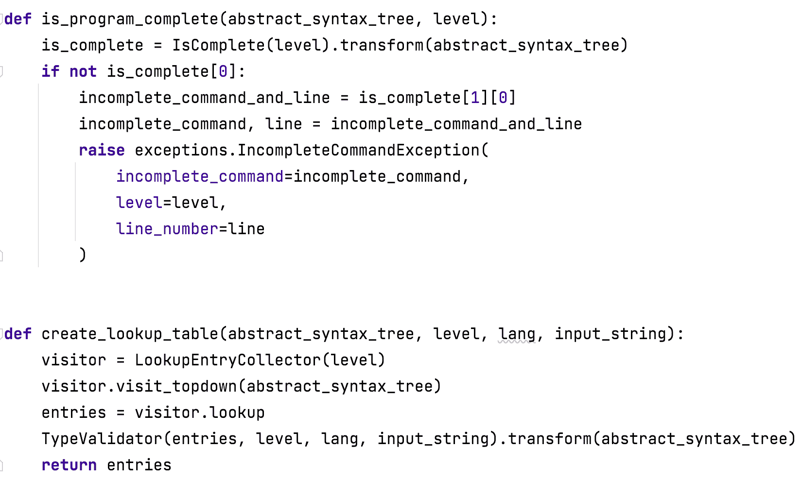
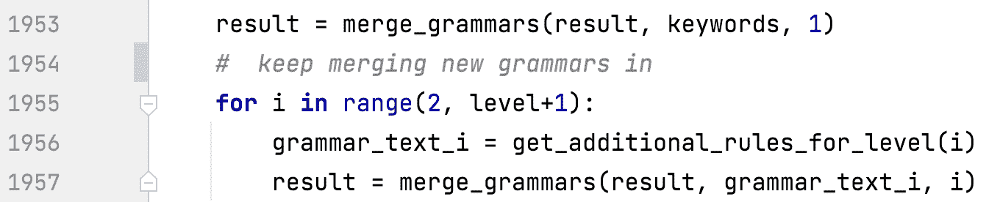
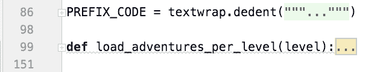
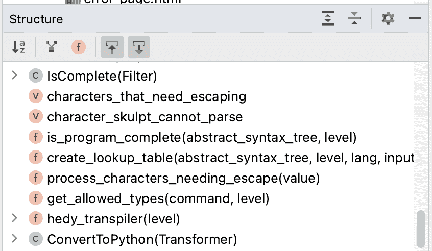
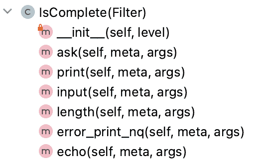
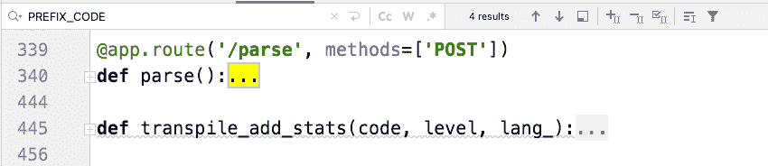
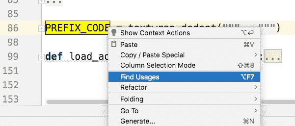
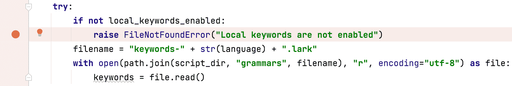
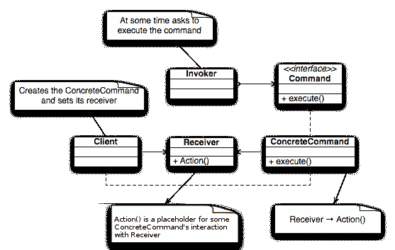

## 第 1 章 结构审查

以下章节将深入探讨代码阅读的五个不同维度：结构、领域、概念、上下文和协作。

我经常遇到陌生代码，在看到几行对我毫无意义的代码后就不想继续读下去，即使是我相当熟悉的编程语言也是如此。代码难以阅读的原因有很多。例如，代码可能包含*代码异味*，如过长的方法，或名称令人困惑或自相矛盾的方法。在其他情况下，代码组织得很好，但因为你自己缺乏知识而难以阅读。一个充满了你不熟悉的领域概念，或你不了解的算法和数据结构的代码库，即使编写和文档都很完美，也难以彻底理解。

但有时困惑在于代码以你尚未知晓的方式相互关联。当你初识一个代码库时，你仍在学习哪些方法调用哪些其他方法，哪些参数在代码库的相似部分中发挥作用，以及重要的业务领域概念如何在代码中表示。本章聚焦于代码困惑的这一方面：对各代码元素如何相互关联缺乏了解。别再指望在代码库中四处滚动浏览来寻找理解，或阅读尚无意义的文档，而是通过专注的练习来扩展你的结构性知识。

本章的练习和技巧有助于回答诸如以下问题：代码是否按方法和类组织？哪些方法和类相互依赖？代码的“流程”是什么？是否存在清晰的*入口点*（如 main 方法）作为代码执行的起点？

读完本章，你将掌握 X 种技巧，可用于更深入地理解新代码库的代码结构。

本章技巧列表（待补充）

### 背景与贯穿示例

让我们研究一下来自 Hedy 代码库的这个小代码片段。给自己几分钟时间阅读代码，但如果此时你还不能完全理解，也不必担心。



当你阅读陌生代码时，很容易想深入所有细节。什么是语法树？它“完整”意味着什么？什么是查找表，它的条目是什么？

然而，这些细节极有可能淹没你的*工作记忆*。你的*工作记忆*有点像大脑的处理器，它在你阅读时处理信息。研究表明，你的*工作记忆*非常小，只有大约 2 到 6 个“槽位”来存储信息！当你只有少量先验知识时，每一行代码，甚至每个单独的元素可能都会占用一个槽位；但如果你对代码库知之甚深，每个方法可能只占一个槽位，从而让你能处理更多内容。这个过程称为*组块化*。

作为*组块化*概念的一个例证，想象你必须记住数字 1934 5023 7544 1846 和 1918 1945 1990 2003。第二组数字极有可能容易理解得多，因为你可以利用先验知识来记忆：第一次世界大战、第二次世界大战、第一次海湾战争、第二次海湾战争。这四个组块让第二个例子易于处理，但缺乏这样的组块，第一串数字将极难记忆或推理。

这个例子强调了为什么首先获得对概念及其关系的深入理解如此重要：如果没有扎实的代码结构先验知识，阅读陌生代码将比必要时更难。

对于上面的例子，这意味着我们需要理解代码基本构建块的含义：`parse tree`。

### 结构组件

现在你已经理解了为什么理解代码结构很重要，可以开始探索一些获取这种理解的技巧。阅读陌生代码时要应用的首要技巧之一，是理解其组件划分；这包括面向对象项目中的类和方法，或函数式风格程序中的函数组件。初次审视陌生代码时，很容易想直接读单个代码行，但如上所述，专注于小细节会让人困惑，也会让人感到不知所措。相反，从结构组件开始分析能提供高层视角，有助于你稍后进行更详细的逐行阅读。

#### 对象与函数

当我们审视本章代码片段中的代码时，立刻会看到存在不同类型的代码。我们看到了一个名为 `IsComplete` 的类，一个名为 `is_program_complete()` 的函数，以及不包含在类中的变量，如 `command_make_color`。在新代码库中寻找立足点时，如果我们显式地理解组件及其角色，将有助于我们的*工作记忆*。此外，每种类型的组件阅读方式不同：例如，你阅读类的方式不同于阅读方法，因为你可以单步执行方法。因此，我们首先将代码划分为三类结构组件：


#### 代码组件的三种类型

1.  首先是 `object components`（**对象组件**），用于创建有意义的抽象。代码中的对象组件示例包括用户创建的数据类型、结构体或类。在贯穿示例中，`IsComplete` 是一个对象。在本书的其余部分，我们将使用 Python 命名约定，因此对象（如类）将采用 `PascalCase` 写法。

2.  还有 `functional components`（**函数组件**），执行逻辑在其中被分组，例如方法或函数。在我们的示例中，`is_program_complete()` 是一个方法。本书其余部分的约定是，在函数和方法名称末尾加上 `()` 以示区分。

3.  最后，代码可以包含 `singular components`（**独立组件**），即不包含在对象或函数组件中的变量或常量，例如 `command_make_color`。我们将在本书其余部分使用 Python 命名约定，因此变量等将采用 `snake_case` 写法。

#### 不同范式中的组件

这三种组件在不同编程语言中以不同形式出现，并非所有语言都支持这三种对象。例如，对象当然常见于面向对象语言，但这些语言传统上不允许在类外部定义变量，因此没有位于对象或函数组件之外的变量或常量。

函数组件当然是函数式语言中使用的核心组件。在面向对象语言中，函数组件以类内部方法的形式出现。

在大多数纯面向对象语言（如 Java 或 C#）中，独立组件是不可能存在的，非对象的组件必须存在于类中，因此类外部没有独立变量。在类内部，它们以字段的形式出现。在函数式语言中，变量可以随时声明，无论是在函数内部还是外部。

如今，许多语言允许多种范式共存，包括函数式和面向对象，例如 Python 或 JavaScript。在这些语言中，所有三种组件都可以（且通常会）同时存在。

### IDE 对结构化阅读的支持

虽然集成开发环境（IDE）主要是为编写代码设计的，但它们也包含许多有助于阅读代码的功能。许多 IDE 支持代码折叠功能，通过仅显示函数、方法或循环的摘要视图而非其实现细节，帮助管理阅读时的复杂度。对于方法/函数或类，最小化视图将显示其定义，包括方法/函数的参数，以及类的继承信息。对于循环，通常完整显示包含循环代码（`for`、`while`、`forEach`）的那一行，而隐藏循环体。

#### 代码折叠

在大多数情况下，代码折叠通过 `gutter`（**边栏**，通常位于代码旁并包含行号的侧边栏）中的一个小减号来完成，如图 2-1 所示。许多 IDE 也有折叠代码的快捷键。在 JetBrains IDE（如 PyCharm 或 CLion）中，`ctrl`（Windows）或 `command`（Mac）配合 `-` 或 `+` 可折叠或展开当前代码块，而 `ctrl`（Windows）或 `command`（Mac）配合 `shift` 和 `-/+` 可折叠或展开文件中的所有内容。

`Ctrl+NumPad - / Ctrl+NumPad +` 。PyCharm 折叠或展开当前代码片段，例如单个方法。要折叠或展开所有代码片段，请按 `Ctrl+Shift+NumPad - / Ctrl+Shift+NumPad +`。



这是一种在不被细节淹没的情况下查看组件的绝佳方式。然而，这种视图使得难以看出单个组件的大小，这可能会限制你对代码库的洞察，因为大小可以作为优先级的有用指标。较大的函数在代码库中往往比较小的函数扮演更重要的角色。你可以通过查看行号来绕过这一限制。例如，图 2-2 显示了一个从第 86 行开始、共 12 行的常量赋值，以及一个位于第 99 行、包含 52 行的方法定义。



虽然这可能看起来令人惊讶，但以这种折叠方式阅读代码已经能帮助你获得初步理解。例如，折叠视图会向你展示有哪些组件、它们的类型是什么、不同类型的组件各有多少，以及它们的大小如何相互比较。

#### 结构视图

查看代码中所有组件的另一种方法是使用许多 IDE 都包含的结构视图。该视图如图 2.1 所示，展示了三种类型组件的概览：用蓝色标记并带 C 字母的对象、用黄色标记并带 v 字母的独立变量，以及用粉色标记并带 f 字母的函数。



类可以展开，显示内部的方法，如图 2.2 所示。方法也用粉色标记，但字母为 m 而非 f。



#### 练习 2.1：列出所有组件

打开 Hedy 仓库，导航到 `hedy.py` 文件。上述代码片段位于：`https://github.com/hedyorg/hedy/blob/ba6834b4a46edf1aac67c9d9e017bc279535062a/hedy.py#L2861`。给自己一点时间熟悉环境，然后仅查看组件。该代码片段包含哪些对象组件（类或结构体）？代码中有哪些函数组件（方法或函数）？组件有多大？它们的大小看起来平衡吗？有没有特别大或特别小的组件引起你的注意？代码中包含哪些独立组件（变量、常量）？

填写下表以指导你的阅读。在本练习及本书后续所有练习中，部分字段已用*斜体*填写，以帮助你入门。

##### 对象组件

| 组件名称 | 代码行数 | 大小（小/中/大） |
| --- | --- | --- |
| `ParseTree` | 267 | 大 |
| `Variable` | 53 | 小 |
|   |   |   |
|   |   |   |

##### 函数组件

| 方法/函数名称 | 代码行数 | 大小（小/中/大） |
| --- | --- | --- |
| `parse()` | 121 | 大 |
| `execute()` | 53 | 中 |
| `checht_parse_tree()` |   |   |

##### 独立组件

| 变量名 |   |   |
| --- | --- | --- |
| `characters_that_need_escaping` |   |   |
| `character_skuplt_cant_parse` |   |   |
|   |   |   |

### 组件间的关系

现在已经确定了代码的核心三大组件，理解它们之间的关系就变得很重要。同样，可能会很想直接开始阅读代码以详细调查其功能，但在不看代码功能的情况下，从组件如何关联中仍能学到很多。第 X 章概述了许多检查代码细节的技术。

代码结构维度的一个重要部分不仅是组件本身，还有它们相互连接的方式。要理解代码中关系的重要性，你需要更多地了解人们通常如何处理新信息。在理解新信息时，你的大脑总是试图将新信息与你已知或已理解的事物联系起来。因此，你的大脑会形成一个信息的心智模型，供你用来推理新信息。显式地使信息间的联系可见，将帮助你的大脑更轻松地理解。


#### 理解代码关系

当你阅读非常陌生的代码时，你的长期记忆中没有该代码的模型。仅仅浏览代码会给你的大脑提供一些新信息的碎片，但这不会直接帮助形成心智模型。使关系显性化并将它们存储在表格或图表中，能辅助你的记忆快速处理关于代码的新洞察。

阅读陌生代码时，有时甚至阅读熟悉代码时，很难全面掌握代码库中的所有依赖关系。通常，当代码中出现 Bug 时，被忽视的依赖关系是原因所在，例如本应被调用的方法未被调用。因此，为了更深层次地理解代码，理解代码内部的连接是重要的第一步。它将帮助你形成代码的心智模型，从而强化你的先验知识，进而使推理代码变得更加容易。

##### 代码中的关系类型

让我们深入探讨代码可能包含的关系类型，因为三种不同类型的组件可以通过不同的方式相互关联。表 2-1 概述了不同的关系。

首先，当对象组件是类时，在面向对象语言中，两个组件可以通过继承与其他类相关联。例如，因为一个类继承自另一个类，但也包括两个类都继承自相似的基类的情况。类也可以包含作为方法和类的功能组件。

在某些语言中，功能组件可以使用对象作为参数，函数可以调用类上定义的静态方法。此外，功能组件可以相互调用，在面向对象和函数式语言中都会在两个功能组件之间创建依赖关系。在面向对象语言中，方法也可以因为一个方法重写了另一个方法而相关联。单元组件可以在功能组件的主体内被使用。

单元组件不依赖于另外两种对象类型。

##### 表 2-1：组件相互关联的不同方式

| | 对象组件 | 功能组件 | 单元组件 |
|---|---|---|---|
| 对象组件 | 继承自 (OO) | 包含作为方法 (OO) | 包含作为字段 (OO) |
| 功能组件 | 用作参数 (OO, FP)<br>调用静态方法 (OO) | 调用 (OO, FP)<br>重写 (OO) | 在主体中使用 |
| 单元组件 | - | - | - |

#### 用于依赖分析的 IDE 支持

IDE 可以通过不同方式帮助你确定组件之间的关系。

##### 搜索

理解代码库中依赖关系的一种简单快捷的方法是使用**搜索功能**。虽然你在编写和调试代码时可能一直在使用搜索功能，但当专门寻找关系时，你可以通过在代码**折叠**时搜索，以稍微不同的方式使用 IDE。

当代码折叠时搜索常量、变量或方法的名称，结果将在折叠的代码块中高亮显示。这能快速概览常量和变量的使用情况，或方法的调用情况。例如，假设你想知道哪些方法使用了上述代码片段中定义的 `PREFIX_CODE` 常量。请参见图 2-3，了解在搜索栏中搜索字符串 `PREFIX_CODE` 时出现的结果。



此视图能立即帮助你找到对象或功能组件对单元对象的特定依赖关系（在图 2-3 中为单元对象 `PREFIX_CODE`）。

当然，字符串匹配是有限的。事实上，图 2-3 中的完整代码库还有一个名为 `TURTLE_PREFIX_CODE` 的第二个常量，在代码的其他地方（图中未显示）搜索 `PREFIX_CODE` 时也会被找到。

##### 依赖功能

检查结构的第二种、更强大的方法是使用 IDE 中的**依赖功能**来显式列出依赖关系。在许多 IDE 中，右键单击常量、变量或方法将显示列出所有用法的选项，如图 1-7 所示。



IDE 现在显示的用法列表也将是 `PREFIX_CODE` 在函数和对象中的用法。

在大多数 IDE 中，查找用法功能不仅能找到对变量的依赖，还能检测包括类继承和函数调用在内的其他关系。然而，IDE 通常无法清晰地区分不同类型的关系，这在你试图形成代码的心智模型时可能会造成困惑。

例如，图 2-5 显示了为名为 `ConvertToPython` 的类查找依赖关系的结果。你可以在第 1186 行看到继承关系，以及该类中对静态方法的调用（第 1359 行和第 1479 行）。


##### 练习 2.2：关系

[待补充]

#### 代码中的非正式关系

到目前为止，我们已经研究了正式关系，但代码组件通常也存在非正式关系，这些关系默认无法通过工具发现。因此，我们将通过一些手动分析来扩展理解，寻找这些连接。你可以通过浏览代码来做到这一点，只需让事物自然而然地跳入眼帘。如果遗漏了什么，不必担心。

##### 基于名称和注释的连接

代码组件之间非正式关系的第一个例子是注释，例如一个类中的注释写着“此类与类 X 相似，我们应考虑合并它们”。这不是类之间像继承那样的正式关系，但确实让我们对代码有了更深入的理解。另一个例子是相似的命名。在我们的持续示例中，`IsComplete()` 和 `IsValid()` 既拥有正式关系（因为它们拥有相同的超类），在名称上也很相似，并在调用点扮演相似的角色。

##### 基于参数的连接

另一种可能存在于组件之间、需要一些手动检查的更非正式的关系类型是参数层面的关系。当功能组件频繁使用相同的参数时，它们就可以被连接起来，Fowler 称之为数据泥团。即使函数没有通过在类中分组而正式连接，它们仍然可能因为操作同一类型的对象而相似。例如，当你的代码库包含一个你写入信息的 `Canvas` 对象时，多个类可以拥有使用该 `Canvas` 作为参数的方法，而这些方法之间并不相互调用。虽然这些方法缺乏正式连接，但它们确实存在关系，如果不手动检查方法声明，这种关系很难确定。

##### 练习 2.3：检查参数

检查练习 2-1 中你的代码库里函数或方法的参数。如果你已经完成了练习 2.2，可以直接复制所有函数行。现在将这些函数中出现的参数作为列标题列出，并在函数使用某个参数时在单元格中标记 X。

| 组件 | program_text | skulpt | URL | … |
|---|---|---|---|---|
| `parse` (F) | X | | | |
| `execute` (F) | X | X | X | |

此分析可能帮助你找到因为操作相同参数而相关联的方法模式，因此它们将在一列中共享许多 X。

你可能想在练习 2.2 的表格中记录一些这些参数连接，特别是当参数有强烈重叠且功能相似时。


最后，当你手动进行任何类型的分析时，可能会想要深入研究代码，但在这个阶段，最好试着将自己限制在寻找依赖关系上。后续章节将介绍其他练习，涉及名称、代码质量以及代码的其他方面。

### 自顶向下阅读

现在我们已经对代码库及其组件有了初步的基本了解，是时候进行一次自顶向下的阅读了，且不依赖 IDE 功能。虽然 IDE 可以帮助阐明依赖关系，但从头到尾阅读整个代码片段也非常有用，因为这样你可以建立一个更完整的代码模型。但给这个活动设定时间限制很重要，否则你会陷入“兔子洞”，因缺乏理解而感到沮丧。例如，用 10 分钟时间，在这段时间内阅读代码。随身携带你的图表，并记下任何新信息。

#### 入口点

现在你已经对不同组件及其相互关系有了一些初步了解，是时候制定一个阅读代码的计划了。你将首先通过定位一个 `entry point`（入口点）来做到这一点。入口点是你开始阅读的地方。

阅读代码有多种不同的方式，我将在本书后面的第 Z 部分进行讨论。现在，让我们专注于通过跟随代码的执行流来阅读。

##### 寻找入口点

虽然不总是清楚陌生代码从哪里开始，但通常你可以猜测代码中有几个地方是执行开始的地方，比如类 C 语言中的 `main()` 方法、Python 中受 `if __name__ == "__main__":` 保护的代码，或 Web 应用程序中与 `/index` 路由相关的方法。如果你对启动方法的名称有很好的猜测，可以通过文本搜索找到通用的入口点。例如，在许多 C 程序中可能是 `main`，在 MVC 应用中可能是 `controller`，或 Web 应用的默认路由如 `/index.html`。单元测试也可以作为极好的入口点，但我们将在本书后面深入探讨专门阅读测试代码的内容。

然而，有时你缺乏关于执行从何处开始的良好猜测。在这种情况下，你可以使用像 `Exercise 2.2` 中构建的表格来帮助寻找另一个入口点。首先，忽略对象和单例组件，只关注功能组件的行和列。现在看看那些列为空或几乎为空，但行却很满的功能组件。这些是不被调用或几乎不被调用，但会调用许多其他函数的功能组件，因此可以作为开始探索的有趣切入点。

##### 从入口点开始阅读

现在你已经确定了一个入口点，可以开始构建代码其余部分的心智模型。你可以再次利用 IDE 来帮助理解代码依赖关系，方法是在入口点设置断点，并逐步进入每个依赖的代码块，检查你感兴趣的代码 `slice`（切片）。切片是与特定函数或变量相关的代码部分，正是该变量被使用的部分或该函数所引导的部分。

如果你想逐步执行代码的一个 `slice`，在大多数 IDE 中，你可以设置一个断点，使代码在执行到达断点时停止。你可以通过点击代码旁边的边栏来实现，这将创建一个由红点指示的断点，如 `Figure 2-6` 所示。



一旦设置了断点，你就可以使用 IDE 逐步进入每个被调用的函数，以跟随执行路径。同样，你的本能可能是深入研究每个方法的细节并阅读所有内部工作原理。但在这个阅读层面，具体目标是浅尝辄止地了解代码，不要走得太深，以免过度占用你的工作记忆。别担心，那个阶段稍后会到来！

此时一个好的策略是尝试将你拥有的关系情境化，用一两句话总结依赖关系的“为什么”。

##### 练习 2.4

跟随你选择的入口点的调用栈并从那里开始阅读。用函数之间的关系类型填充表格。用一两句话描述依赖关系的作用。

| Component | `parse (F)` | `execute (F)` | `validate_tree(F)` |
| --- | --- | --- | --- |
| `parse (F)` | | | `调用 validate_tree() 函数以确定解析树是否可被处理` |
| `execute (F)` | `调用 parse() 函数以获取转译后的代码，随后可执行` | | |
| `validate_tree(F)` | | | |

你可以手动查找依赖关系，也可以使用 IDE。虽然使用 IDE 可能感觉更容易，但逐步执行代码可能有用，也很容易让人不知所措。如果 IDE 会步入远离当前行的代码片段，你将不得不在代码库中重新定位自己，并且很容易迷失方向。当多条执行路径汇聚在一起的代码片段中，这种情况尤其明显，比如当一个函数从其他几个方法收集信息并将它们组合时。例如，下面的函数 `print_ask_args` 首先检查所有参数中的变量（如果不可能则抛出异常），然后在下一行转换每个参数。

```python
def print_ask_args(self, args):
   args = self.check_var_usage(args)
   transformed_args = [self.process_variable_for_fstring(a) for a in args]
   return ''.join(transformed_args)
```

在这样复杂的情况下，辅以搜索的手动阅读可能比使用断点在 IDE 中“跳跃”式地阅读代码要求更低，因此更有效。

除了在依赖表中做笔记（见 `Exercise 2.3`），统一建模语言（UML）类图等可视化图表（如 `Figure 2-X` 所示）也可以帮助支持这种类型的代码阅读。在类图中，我们将系统中的类描述为包含其字段和方法的框。例如在 `Figure 2-X` 中，`Client`、`Receiver`、`Invoker`、`Command` 和 `ConcreteCommand` 是类，`execute()` 是 `Command` 和 `ConcreteCommand` 的方法。



如果你在寻找特定信息，特别重要的是要留意你的历史记录，并判断你正在阅读的内容是否有助于回答关于代码的具体问题。

##### 不同种类的入口点

你对代码库的先验知识将影响使用哪种入口点，以及你正在执行的活动。例如，当你查看一个对你来说相当陌生的代码库时，从像 `main` 方法这样的通用入口点开始可能会有帮助，因为它能帮助你按照运行时发生的顺序，建立代码中发生什么的心智模型。

但在一个更熟悉的代码库中，你更有可能从一个上下文相关的入口点开始，具体类型取决于活动。例如，在调试时，一个失败的测试将是开始阅读过程的自然入口点。本书后面的 `Chapter X` 我们将深入探讨调试时的代码阅读过程。在优化时，性能分析器标记的行是一个好的起点。本书后面的章节，特别是 `Part 2`，将深入探讨具有不同入口点类型的不同阅读场景。

### 阅读之后


在本章所述的结构检查过程中，你已经收集了大量关于代码结构的相关信息。如果你不仅将这些练习应用于本章的示例代码片段，还应用于你正在阅读的实际代码库，那么凭借你新获得的对代码库的理解，你可以做很多事情。

在许多情况下，你可以将收集到的部分信息提交回代码库。如果你决定更深入地探索代码（例如使用本书后面的练习），这些信息可能会对你有帮助，但它也可能帮助你之后的新人熟悉代码库。在本节中，我们将概述收集到的信息可能发挥作用的一些方式。

#### 扩展文档

虽然编写文档可能不是你的首要任务，但研究表明，主动处理刚学到的信息是将其存储在长期记忆中的好方法。因此，尝试写一小篇关于你发现的总结对你来说很有价值，添加到项目中可能也很有价值。

此时一个有用的练习是刻意简化前几个练习的结果。`Exercise 2.1` 和 `Exercise 2.2` 的结果可以作为书面文档的良好起点。不要只是提交每一个包含所有条目的表格，而要主动思考如何对其进行总结。这对你和项目都很有价值；提交所有结果可能会让未来的读者感到不知所措。简化/总结的过程将进一步巩固你的理解。

#### 改进注释

阅读过程中发现的一些信息也可以提交到源代码本身。如果代码中尚无此信息，`Exercise 2.3` 产生的简短文本片段可以直接放在方法调用之前。

#### 讨论代码质量

有时在从结构角度检查代码时，你会发现代码中存在代码异味，具体来说是结构性代码异味。以下是一些需要留意的类型。

##### 注意

代码异味通常分为两类：结构性和语言性。

结构性代码异味源自 Fowler 的原著，指的是代码组织方式。例如 `Message chains`（消息链），即方法调用其他方法，后者又调用其他方法等，`long parameter lists`（长参数列表）或 `large classes`（大类）。

另一类代码异味是 Venera Arnaoudova 定义的语言性代码异味。语言性代码异味指变量或类的名称不能恰当地描述其功能。这可能是模糊的名称，如 `fetch`，或者遗漏了部分功能的名称，例如一个转换方法既执行转换，又将转换信息存储在数据库中。

##### 规模

仅查看对象的规模就能揭示膨胀的类、数据类或非常小的类。你在 `Exercise 2.1` 中执行的规模分析可以指向这一特定的代码异味。

这些发现可以作为与团队讨论代码历史和代码质量的绝佳切入点。以下是基于此分析需要考虑的一些问题：

*   这些类规模大、小或仅包含数据是否有原因？
*   这是历史原因，还是类的规模有合理的理由？

##### 关系中的异味

涉及对象组件的其他代码异味是 `inappropriate intimacy`（不合理的亲密性）和 `feature envy`（特性依恋），两者都指向两个或多个类之间存在过多的交互而不利于解耦。你可以通过查看在 `Exercise 2.2` 中创建的表格来检测这些代码异味，检查是否存在多个类经常操作彼此的字段（`inappropriate intimacy`），或者一个类非常频繁地访问另一个类的字段或方法（`feature envy`）。同样，这种设计可能有合理的理由，但这值得讨论，例如：

*   我们是否理解这些类为何如此紧密相关？
*   是否有其他组织这些类的替代方式？

##### 功能组件中的异味

上述异味涉及对象组件，但也存在可以通过结构分析发现的功能组件代码异味。例如，`Exercise 2.2` 的结果是一个 `message chain`。从表格中的一个入口点开始，跟随它调用的功能组件，然后是该组件调用的功能组件，以此类推。如果你必须在表格中进行大量 `hops`（跳转），则表明存在 `message chain`。现在，`message chains` 不一定是坏事，但是，如果你发现了一个，可以讨论是否：

*   路径上的某些方法是否小到可以合并？
*   代码中是否存在调用长链的特定场景，可以用不同方式解决，例如使用缓存或提前返回？

另一个可以通过结构分析发现的异味是 `dead code`（死代码）。是否有完全未被调用的方法？这些可能代表 `dead code`。请务必检查 `dead code` 可能被使用的其他方式，例如来自测试套件的调用，或来自代码库其他部分的调用。这在多语言代码库中尤为重要，因为静态源代码分析可能并不总能找到依赖关系。

#### 重构

当你使用结构分析发现存在代码异味的代码时，有时你会想要改进代码。如果你决定进行重构，迄今为止你执行的分析也可以指导重构工作。

##### 大类

如果在规模分析中发现大类，这些类可以被拆分。像 `Exercise 2.2` 中创建的关系表可以帮助你找到相互调用的方法组。如果这些方法中存在两三个子组，则可以将大类拆分为这些子组，而不会导致新类之间产生过多依赖。

##### 小类

另一方面，如果在分析中发现小类，你可能想将它们合并到另一个类中。像 `Exercise 2.2` 中创建的关系表可以帮助你决定哪个类适合作为小类中少量字段和方法的归宿。理想情况下，这应该是一个与该小类共享最多字段和方法的类。

##### 数据类

对于 `data class`（拥有大量字段但没有或几乎没有方法的类），可以进行类似的分析；该类可以与经常访问 `data class` 字段的类合并。如果不存在这样的类，也许代码

##### 长参数列表

在某些情况下，你会发现带有长参数列表的方法或函数。这些可以在 `Exercise 2.3` 中作为包含大量 `Xs` 的行找到。对于类上的方法，可以通过将某些参数移至类的字段来缩短这些长参数列表。对于函数或方法，你可以将某些参数分组为更大的对象。例如，一个以 `x`、`y` 和 `z` 为参数的函数可以重构为仅使用 `point` 数据类型的函数，后者包含 `x`、`y` 和 `z` 字段。

##### 单调用函数

在 `Exercise 2.3` 中，你可能识别出了仅在一处被调用的方法。这不一定是 Fowler 定义的异味，然而这种组织可能指向过早泛化，即引入了一个尚未被使用的抽象。虽然在某些情况下这可能值得，但它也会导致编辑器在阅读和调试时 `hop`（跳转），因为大脑必须重新定向，从而增加认知负荷。这些方法可以内联以减少认知负荷，代价是使内联该方法或函数的方法变长。

##### 死代码


如果在检查代码关系时发现了死代码，在验证其确实不再需要后，你可能想要移除这些死代码。

### 总结

代码可以从不同维度阅读：结构、领域、概念、上下文和协作。本章探讨了结构维度，分析了代码中的变量、函数和对象如何相互关联，以及如何在阅读代码时利用这些信息。下一章将探讨领域。

^(1) 参见 Teresa Busjahn 等人（2015）的《Eye Movements in Code Reading: Relaxing the Linear Order》（代码阅读中的眼动：放宽线性顺序），https://ieeexplore.ieee.org/document/7181454。

^(2) 例如参见：https://medium.com/nerd-for-tech/how-to-generate-uml-diagrams-from-your-existing-code-814d27bd1537

^(3) https://www.sciencedirect.com/science/article/pii/S1045926X02902375&sa=D&source=docs&ust=1658912480042497&usg=AOvVaw3mvAJmKBMgrgVt4HM9Ez13
