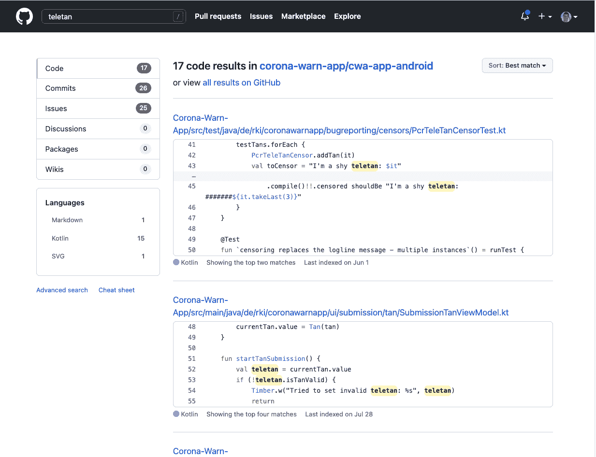
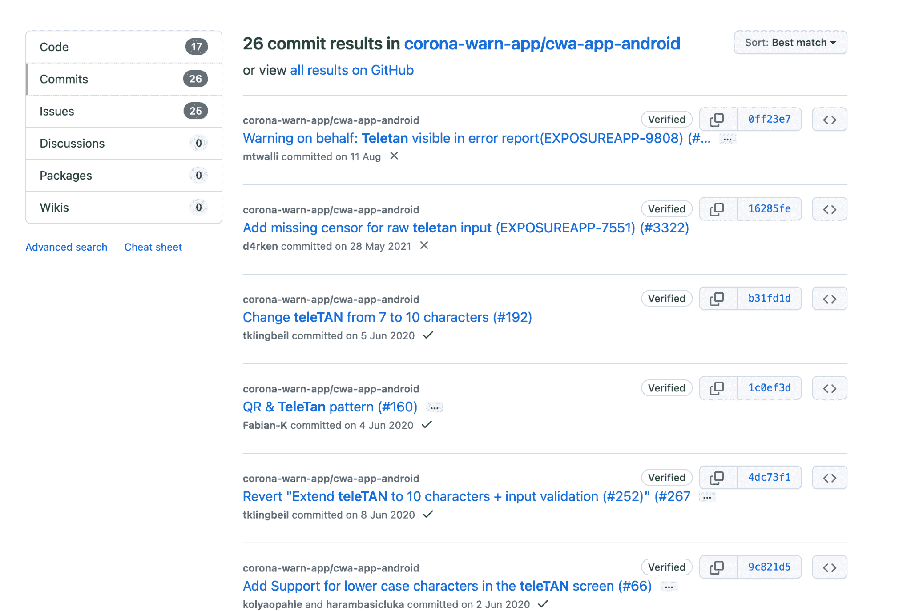
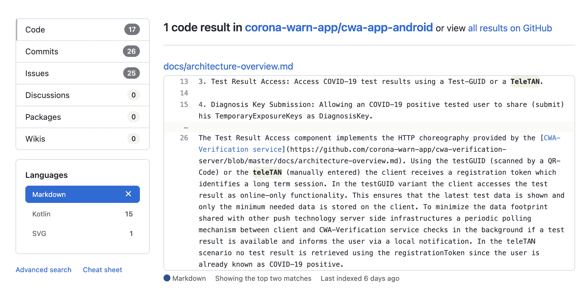
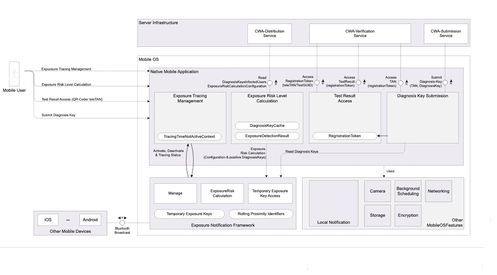

## 第 4 章：上下文检查

第 5 章至第 X 章深入探讨代码阅读的五个不同维度：结构、领域、概念、上下文和协作。

在前几章中，你从三个不同角度审视代码：结构、领域和编程概念。希望到现在你在阅读陌生代码时会更有信心。然而，在实践中，你可能不会只阅读小代码片段。代码片段是代码库的一部分，因此拥有大量*上下文*，这将是本章深入探讨的内容。

### 运行示例

与前几章一样，我们将在本章中使用一个示例代码片段。在本章中，你将学习如何阅读围绕实际代码本身的文档。


### 阅读示例代码

同样，如果代码看起来令人不知所措，请不要担心。我们将慢慢讲解，即使深入阅读，某些部分对你来说可能仍然不清楚——这没关系，因为这代表了你在日常实践中阅读代码的方式。即使在你每天都在使用的代码库中，也会有部分让你感到不那么熟悉，因为是别人写的，或者是你很久以前写的。因此，阅读你不完全理解的代码部分是完全可以的，而在本书中练习这一点是体验“并非全懂”这种感觉的好方法。

所以，如果它看起来完全令人不知所措，请不要担心！读完本章后，你将能够理解它……

本章将包含针对示例片段的具体练习，但当然，你可能希望在继续阅读之前先对代码有个大致了解。一个很好的方法是现在使用前几章的练习来理解代码中存在的结构、领域和编程概念。

#### 示例代码：CoronaWarnApp 中的警告

```
class TraceLocationWarnTanViewModel @AssistedInject constructor(
   @Assisted private val traceLocationWarnDuration: TraceLocationWarnDuration,
   private val organizerSubmissionRepository: OrganizerSubmissionRepository,
   dispatcherProvider: DispatcherProvider,
) : CWAViewModel() {
   private val currentTan = MutableStateFlow(Tan(""))
   val registrationError = SingleLiveEvent<OrganizerSubmissionException>()
   val registrationState = MutableLiveData(ApiRequestState.IDLE)

   val state = currentTan.map { currentTan ->
       UIState(
           isTanValid = currentTan.isTanValid,
           isTanValidFormat = currentTan.isTanValidFormat,
           areCharactersCorrect = currentTan.areCharactersValid,
           isCorrectLength = currentTan.isCorrectLength
       )
   }.asLiveData(context = dispatcherProvider.Default)

   fun onTanChanged(tan: String) {
       currentTan.value = Tan(tan)
   }

   fun startTanSubmission() {
       val teletan = currentTan.value
       if (!teletan.isTanValid) {
           Timber.w("Tried to set invalid teletan: %s", teletan)
           return
       }

       Timber.d("traceLocationWarnDuration=%s", traceLocationWarnDuration)
       val payload = OrganizerSubmissionPayload(
           traceLocation = traceLocationWarnDuration.traceLocation,
           startDate = traceLocationWarnDuration.startDate,
           endDate = traceLocationWarnDuration.endDate,
           tan = teletan.value
       )

       launch {
           try {
               registrationState.postValue(ApiRequestState.STARTED)
               organizerSubmissionRepository.submit(payload)
               registrationState.postValue(ApiRequestState.SUCCESS)
           } catch (err: OrganizerSubmissionException) {
               Timber.d(err, "Organizer submission failed")
               registrationState.postValue(ApiRequestState.FAILED)
               registrationError.postValue(err)
           } catch (err: Exception) {
               Timber.d(err, "Unknown organizer submission Exception")
               registrationState.postValue(ApiRequestState.FAILED)
               err.report(ExceptionCategory.INTERNAL)
           }
       }
   }

   data class UIState(
       val isTanValid: Boolean = false,
       val areCharactersCorrect: Boolean = false,
       val isTanValidFormat: Boolean = false,
       val isCorrectLength: Boolean = false
   )

   @AssistedFactory
   interface Factory : CWAViewModelFactory<TraceLocationWarnTanViewModel> {
       fun create(
           traceLocationWarnDuration: TraceLocationWarnDuration
       ): TraceLocationWarnTanViewModel
   }
}
```

#### 背景

上面的代码片段源自德国政府创建的一个用于检测潜在新冠感染的应用程序。如果你想在浏览器或 IDE 中查看代码，可以在这里找到：`https://github.com/corona-warn-app/cwa-app-android/blob/127889b390ef00228a619afb7573c5da724a1a6e/Corona-Warn-App/src/main/java/de/rki/coronawarnapp/ui/presencetracing/organizer/warn/tan/TraceLocationWarnTanViewModel.kt`

### 从代码中收集信息

在前几章中，我向你展示的代码片段在给予足够时间和精力的情况下，仅凭片段本身就能理解。然而在本例中，假设你不是该主题的领域专家，要理解这个代码库极其困难。并非因为代码如此复杂，而是因为其中存在一些你不知道的领域概念：`tan` 和 `teletan`。

对于此类代码片段，你不可避免地必须将搜索范围导向代码库之外，查阅文档或咨询专家。然而，仅仅浏览文档，或问专家“你能告诉我更多关于这段代码的信息吗？”，不太可能快速得到结果。因此，你首先想从代码库中收集信息，以便能带着明确的问题开始搜索。

#### 阅读纯文本字符串

代码库中的纯文本字符串有时能揭示你已见来源（如代码结构、变量、函数和类名）尚未涵盖的信息。无论涉及应用程序 UI 中使用的字符串还是调试信息，字符串都能加深你的理解，但本书迄今为止尚未在单独的策略中探讨这一点。是时候改变这一点了！

##### 练习 5.1：检查与 tan 相关的字符串文本

针对本练习，请写下在 CovidWarnApp 代码片段中找到的字符串文本列表，并附上关于这些文本涉及的陌生概念的备注。

| 文本 | 收集到的信息 |
| --- | --- |
| `Organizer submission failed` | 一个 `tan` 有一个可能失败的组织者 |
| `Tried to set invalid teletan: %s` | |
| `traceLocationWarnDuration=%s` | |
| `Unknown organizer submission Exception` | |

#### 阅读代码注释

遗憾的是，这段代码片段完全没有注释，但在其他情况下，代码注释也有助于收集更多关于领域概念的问题。

例如，考虑来自同一代码库的这段代码片段：

```
syntax = "proto3";
package de.rki.coronawarnapp.server.protocols;
// ExposureKeyPackage v0.1
message SignedPayload {
   bytes payload = 1; // serialized Payload message
   bytes certificateChain = 2; // X509 certificate chain
   bytes signature = 3; // signature of payload
}
```

虽然“serialized Payload message”（序列化的 Payload 消息）和“signature of payload”（payload 的签名）不一定提供代码中不存在的额外信息，但 X509 注释给出了如何在代码库外继续搜索的提示。如果你还不熟悉 X509，现在可能会想知道它是什么。

### 检查代码片段周围环境

现在你已经对所检查的内容找到了一些着力点，可以尝试在代码库外部寻找信息。但在这样做之前，为你想要回答的问题制定一个搜索计划是明智的。我曾花费许多个下午随意浏览页面，并没有真正跟踪自己是否取得了进展。虽然如果你想在一个更大的新领域或编程语言中建立一些基础，这可能有用，但如果你只是想出于明确目的（使用应用、修复 Bug）来理解某些代码，你可能不会对所有东西都感兴趣。

#### 制定清晰的搜索计划


首先，你需要做的是制定一个清晰的搜索计划，其中包含一个你在搜索更多信息时想要了解的事项列表。如果你已经浏览了上面的代码片段，无论是否使用了前几章的练习，这些可能是你仍然会困惑的地方：

*   什么是 `tan`？
*   什么是 `teletan`？
*   `organizer` 的角色是什么？
*   如何判断一个 `tan` 是否有效？
*   `tan` 何时会变化？

我经常在没有明确搜索计划的情况下浏览代码库，很容易浪费大量时间去想“嗯，这很有趣”或“噢，那是什么意思？”，但最终却没有多少进展可言。试着记录你的计划，并在每次搜索后评估你是否取得了有意义的进展，即使这很难判断！本章剩余部分的示例侧重于 `tan` 和 `teletan` 的含义作为搜索计划的问题，但如果你愿意，可以随意扩大范围。

#### 使用通用搜索引擎

当然，Google 可以作为查找信息的一个很好的第一步，但遗憾的是，取决于你的搜索历史，`tan` 和 `teletan` 并不能真正给出很多结果：


`organizer` 也是如此，这是一个非常通用的词，有多种含义（从办公用品到策划婚礼的人）。根据领域不同，通用搜索可能不会产生太多有用的线索。

此外，甚至很难识别出嵌入在你不熟悉的语言中的领域概念。如果我没有告诉你 `tan` 是一个领域概念，很难从像 `TraceLocationWarnTanViewModel` 这样的名称中提炼出哪些部分是领域概念！是在追踪位置吗？“warn `tan`” 是一种 `tan` 的形式，相对于可能的 error `tan`？是 `tan` 在警告，还是它被警告了？仅凭代码，这几乎不可能弄清楚，所以你需要将范围扩大到代码之外。

#### 使用代码搜索引擎

除了通用搜索引擎，许多编码平台还允许在仓库内搜索，如图 5.2 所示，或通过以下链接在线查找：[`github.com/corona-warn-app/cwa-app-android/search?q=teletan`](https://github.com/corona-warn-app/cwa-app-android/search?q=teletan)



搜索一个术语时，你可以在搜索结果的左侧看到找到了多种类型的结果。让我们逐步了解一下结果的类型以及你可以从中学到什么。我强烈建议你如果可能的话自行浏览这些结果！

**代码**

: 第一类结果是代码。在某些情况下，你可以深入代码本身，并利用前几章的技术从中了解更多关于概念的信息。然而，本章的目标是将你的搜索范围扩大到代码库之外。GitHub 代码搜索的好处在于，如果你点击左侧的“Code”，将只显示代码结果，你可以快速浏览所有 `teletan` 的实例，以帮助了解与其搭配使用的操作。这将允许你像练习 3.6 那样，检查应用于 `teletan` 的不同操作有哪些。例如，你可以看到 `teletan` 可以是有效或无效的，可以被屏蔽，并且从一个测试中，你可以了解到 `teletan` 允许你“获取注册令牌”。

**提交**

: GitHub 搜索提供了除代码之外的稳健来源，你也可以在 IDE 中搜索这些来源。点击左侧的“Commits”将显示所有与搜索词匹配的提交。

这再次让你能够扩展关于该概念内涵的知识；你可以看到 `teletans` 不应在错误报告中可见 (`0ff23e7`)，存在“原始” `teletan` 这种东西 (`1628fe`)，它从 7 个字符扩展到了 10 个字符 (`b31fd1d`)，并且输入可以被验证 (`4dc73f1`)。通过这种方式，甚至无需克隆或复刻项目，你就能轻松获得关于代码库中发生什么的一些见解。



**议题**

: 同样，点击“Issues”会显示所有议题，它们通常与提交相关，但并非总是如此。例如，议题 77 ([`github.com/corona-warn-app/cwa-app-android/issues/77`](https://github.com/corona-warn-app/cwa-app-android/issues/77)) 提到了 `teletan` 并给出了清晰的定义：*“提交阳性 COVID-19 结果是一项安全/隐私敏感任务，涉及扫描二维码或输入 `teleTAN`。此过程中涉及的数据应受到保护。”* 当我自己阅读代码库时，该议题中的描述对理解 `teletan` 最有帮助，且包含了我在代码、注释或文档中找不到的信息！

#### 记录你的发现！

这是重新审视你的搜索计划的好时机，你回答了相关问题吗？把你在哪里找到了什么信息记录下来也非常有价值，特别是当你不是一次性完成所有搜索，而是计划稍后继续工作时。记录下什么信息帮助回答了什么问题，可以极大地减轻后续搜索的难度。

#### 检查项目文档

除了代码，图 5.2 中的搜索还显示了一个 markdown 文件和一个 svg 文件。虽然你可能不会在“代码”搜索下寻找这些信息，但这里经常也会显示文档文件。查看代码搜索中显示的 Markdown 文件可能很有趣，因为这些文件通常包含项目文档，本例即是如此。



还有一个 svg 文件（一张图片），显示了一个包含更多信息的架构图。



虽然该图表不一定有助于理解 `teletan` 的确切含义，但它确实从整体上更深入地展示了项目。

现在你已经找到了大量围绕代码的相关信息，是时候整合这些信息了。研究表明，主动尝试回忆信息是将该信息保留在长期记忆中的最佳方式（见下文注释）

#### 精细化加工

在第 4 章中，我提到了存储强度和提取强度的区别。虽然很难提高存储强度，但可以通过尝试回忆信息来轻松增加提取强度。单纯复制信息远不如在查阅之前尝试回忆它那么有效！

##### 练习 5.2 总结概念

写下你在开始检查代码片段时不熟悉的概念。根据在字符串中收集的信息以及对仓库中非代码文档的搜索，你将如何定义该代码库中的相关概念？

| 概念 | 用你自己的话 |
| --- | --- |
| `tan` |   |
| `teletan` |   |
| `organizer` |   |
| `registration` |   |
| `…` |   |

#### 丰富理解

在前几章中，你从代码中收集了领域概念和编程概念的列表，在本章中，你探索了来自代码、文档、议题和拉取请求的词汇表或定义列表。特别是当从代码、文档、注释和议题等各种来源收集信息时，要跟踪你在哪里读到了什么可能很难。如果你想以后深入研究某个特定来源，这将很重要。所以如果你还没有这样做，请记下一些笔记，注明哪些文档帮助你学习了哪些概念。

#### 创建概念图


## 第 5 章：理解代码上下文

在第 3 章中，你根据从代码中收集到的信息创建了一个概念图。正如我当时解释的那样，你的大脑存储概念的方式更像是一张地图，而不是一个列表。因此，再次创建一个概念及其关系的概念图会非常有用。用信息来源丰富该图，以便在需要时帮助你重新审视或完善信息。

### 阅读后

在本章中，你学习了更深入理解代码库上下文的技术。如果你已将本章的练习和技术应用到你正在处理的代码库中，你可以再次将学到的信息分享到代码库本身。你可能会惊讶地发现，在许多项目中，文档与代码之间的联系是多么微弱。我可以告诉你，在写这本书的过程中，遵循我自己的建议后，我自己的开源仓库中的文档有了显著改善！

#### 以初学者的视角改进词汇表

在研究 SWA Corona Warn App（一个我完全不熟悉的领域）时，我花了相当长的时间才深入理解概念并建立与代码的相关联系。如果你以类似的方式、使用类似的技术阅读另一个代码库，我可以保证，将你学到的东西分享到文档中，对项目维护者来说将非常有用。当你成为专家时，你会遭受我们所谓的**专家诅咒**。当你知晓或理解某事时，你几乎无法想象竟然有人不知道你知道的事情！因此，以全新的视角改进项目文档非常有价值。

#### 讨论文档质量

一个更容易的贡献方式可能是帮助维护者了解当前文档的质量。例如，分享阅读代码和初始文档后遗留的问题列表，能为文档可以改进的地方提供相关线索。此外，分享相关信息的来源对维护者也非常有帮助。在我们的示例仓库中，我确信维护者会想知道我从记录 `teletan` 含义的 `PR` 中学到了多少，并将其中一些内容移至文档中。

#### 扩展代码注释

在其他章节中，你从代码中收集信息，然后将其添加到文档中，但在本章中，你阅读代码外部的文档，并可以将其提交回代码库。例如，你可以从现有的词汇表或定义列表中获取信息并添加到代码中。

在我们的示例片段中，增加一行注释会让理解发生了什么容易得多。

原始代码如下：

```kotlin
val teletan = currentTan.value
       if (!teletan.isTanValid) {
           Timber.w("Tried to set invalid teletan: %s", teletan)
           return
       }
```

但你可以像这样扩展它：

```kotlin
val teletan = currentTan.value
// The server returns a `TeleTan` based on the received `TAN` value 
       if (!teletan.isTanValid) {
           Timber.w("Tried to set invalid teletan: %s", teletan)
           return
       }
```

### 总结

代码可以从不同维度阅读，包括查看结构、领域和编程概念。本章探讨了代码片段的上下文。
