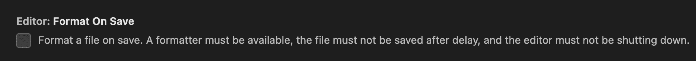
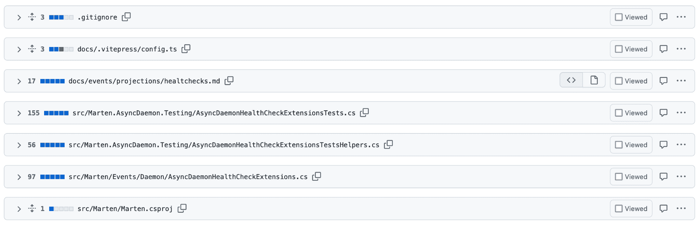
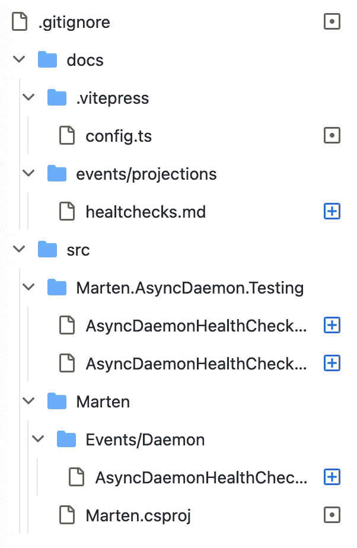
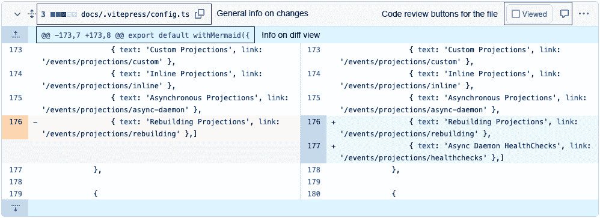
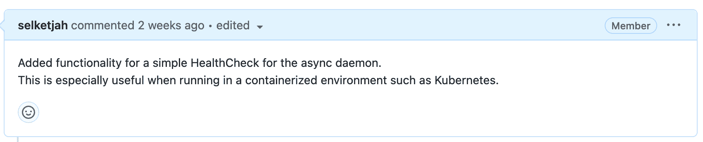
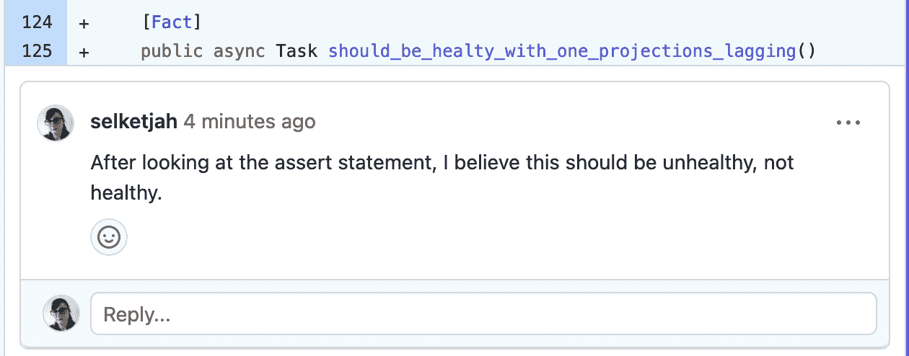

## 第 6 章：为代码审查而阅读

如今，代码审查是软件行业一项成熟的实践。`代码审查` 是软件开发生命周期中的质量保证步骤。许多公司将其置于将代码变更合并回 `trunk`（主干）之前，使用 `git` 等版本控制时，也称为 `main` 或 `master` 分支。以这种方式实施时，它通常具有阻塞性，意味着如果不进行 `代码审查`，代码变更就无法合并回去。

审查者在 `代码审查` 期间的主要活动是阅读。就像代码阅读一样，没人教过如何做一个正确的 `代码审查`。你是在实践中学会的。在本章中，我将带你了解我进行 `代码审查` 的方法，并重点介绍一些发现可能破坏代码未来可读性问题的技巧和窍门。

### 如何进行代码审查？

尽管这是一项成熟的实践，但 `代码审查` 在我们行业中并不是一个定义明确的实践。它可以是一项个人活动，审查者异步给出反馈。它也可以是一项结对活动，代码作者带领审查者浏览实现，同时即时讨论和修改反馈。

我（Gien）工作过的每一家公司，做 `代码审查` 的方式都不同。当团队有测试人员时，手动测试不是软件开发人员审查的部分。当没有测试人员时，测试是 `代码审查` 存在的主要原因。有些公司有标准化的 `代码审查` 方式，但并非所有公司都有。当 `代码审查` 没有正式结构时，我请求的每次 `代码审查` 都不一样，取决于接手请求的人。

这也取决于公司的 `持续集成 (CI)` 实践。有些公司将自动化质量保证作为 `CI` 流水线的一部分，有些则没有。我曾在自动化测试有限或缺失的公司工作，在这些公司中，`代码审查` 的主要原因也是测试。

对我来说，`代码审查` 的目的有二：发现代码中的改进点，并在团队中分发知识。其他一切都不在范围内。以下是构建 `代码审查` 时需要牢记的一些事项：

*   `代码审查` 不是一种确保开发人员遵循代码规范的控制机制。
*   它不是一种培训团队中“初级”开发人员的技术。
*   `代码审查` 是向开发生命周期添加测试的糟糕方式。
*   重构代码以实现这些改进不必是 `代码审查` 的一部分。

如果你想要质量保证，不应将复杂的 `代码审查` 作为 `CI` 流水线中的阻塞步骤实施。`代码审查` 本身应该是一个持续的过程，可以在任何时候进行：在你进行代码变更之前、期间或之后。你应该自动化代码规范、缺陷检测和测试。这有时被称为持续代码质量。

无论你是修复缺陷、添加新功能还是重构代码，你都应该在开始让团队成员能够进行 `代码审查` 的那一刻创建 `合并请求 (MR)`。你应该在 `MR` 中添加足够的信息，以便团队成员了解你将更改什么以及如何更改。

### 自动化代码审查的部分环节

刚开始学习一门语言，或弄清楚如何在其新版本中使用新特性，可能是个挑战。这就是为什么大多数编程语言都提供代码规范建议。这些指南基本上是创作者关于如何最好地使用该语言的声明。例如，Microsoft 提供了命名规范、代码布局、注释、安全性和通用语言指南的最佳实践。

例如，我们在第 2 章已经提到，Python 类使用 `snake_case` 命名。这是一个命名规范的例子。C# 的类有不同的命名约定，即 `PascalCase`，你为类中的每个单词使用大写字母。“在两个方法之间留一个空行”是代码布局规范的一个例子。你可以在这里查看所有内容：`https://learn.microsoft.com/en-us/dotnet/csharp/fundamentals/coding-style/coding-conventions`


### 代码规范与代码审查

您可能会好奇，为什么要在关于代码审查的章节中谈论代码规范。因为在代码审查期间您必须阅读他人编写的代码，所以如果能事先就命名和文件布局等事项达成一致，会容易得多。打开文件却发现完全不同的命名方式或布局会让人非常困惑。您想专注于阅读代码，却不得不花时间去适应文件的布局。您希望尽可能消除障碍，以提高可读性。

但是！团队应该遵循哪些规范呢？这在我的一些过往团队中曾引发过多次激烈的讨论。每个程序员都有自己的偏好。每个程序员都认为自己的偏好是正确的，而其他的都是错误的。我自己也这样想了很长时间，我必须承认，我有时仍会陷入这种讨论的陷阱。一般来说，我的建议是使用您所用语言提供的指南，并将争论自动化解决掉。

#### 代码格式化工具

`代码格式化工具` 是一种将代码格式化为特定布局的工具。大多数 `IDE` 都内置了代码格式化工具和快捷键，可根据您设置中的一组规范来格式化代码。在更通用的代码编辑器（如 `Visual Studio Code`）中，您需要为您的语言安装插件。

有几种方法可以自动化代码格式化。您可以启用保存时格式化，如 图 5-6 所示。



遗憾的是，并非每个 `IDE` 都提供保存时自动格式化功能。此时您可以在将更改提交到版本控制时进行格式化。`Git` 提供了 `Hooks`（钩子），这是一种在执行特定 `git` 命令前或后自动执行脚本的方式。其中一种 `Hook` 是“`pre-commit hook`”（预提交钩子）。您可以向此钩子添加任何内容，但常见的做法是在此处添加代码格式化工具。

如果您使用自动代码格式化工具，代码审查就不再是检查代码布局规范的控制机制。审查者也能专注于重要的事情：寻找改进点和理解代码。

#### 代码检查工具

`代码检查工具` 比代码格式化工具更进一步。它们根据一组规则分析您的代码，以查找 Bug、检测代码异味和漏洞。它们还能为您找出风格违规，但与代码格式化工具不同，它们不会自动修复这些违规。不过，当您开始寻找检查工具时，会发现情况有点模糊。有些检查工具可以自动修正风格违规和代码异味，而有些则不能。它们能分析的内容也各不相同。例如，`SonarQube` 可以分析多种编程语言、`Docker` 的配置文件，甚至您的 `SQL` 语句。而 `Pylint` 则是专门为分析 `Python` 而开发的。

与代码格式化工具一样，您可以在 `IDE` 中安装（部分）检查工具，或使用 `pre-commit hook` 来运行它们。

### 分析维度

在代码审查期间，您会分析为了理解代码而进行的代码阅读的四个维度：结构、业务领域、编程概念和上下文。它们共同需要形成一个清晰、连贯的整体图景。

根据我对变更代码库部分的熟悉程度，我喜欢以不同的方式开始代码审查。让我们看一个我为本书创建的示例。我选择了 `Marten`，这是一个 `.NET` 库，允许 `PostgreSQL` 作为文档数据库或事件存储运行。该开源项目可在此处找到：[`github.com/JasperFx/marten`](https://github.com/JasperFx/marten)。我复制了其中一个我将要评估的合并请求：[`github.com/codereadinginpractice/marten/pull/1`](https://github.com/codereadinginpractice/marten/pull/1)

如果您想开始为开源项目做贡献，但不确定如何着手，进行代码审查是一个很好的切入点。

#### 对合并请求的整体把握

首先，我对 `MR`（合并请求）有一个大致的了解。我会查看对话、提交，并快速检查文件变更的折叠视图，如 图 5-6.2 所示。在这里我可以看到这是一个较小的 `MR`，主要是新增代码行，因为蓝色在这个概览中占主导地位。



如果我看侧边栏，可以获得更多信息。每个文件名旁边都有一个符号，指示该文件发生了什么情况（图 5-6.3）。我可以轻松地看到新增了 4 个文件，修改了 3 个文件。此 `MR` 中没有删除文件。



您还可以通过查看 `MR` 中显示的信息获得大量信息。如 图 5-6 所示，您可以了解两个文件之间变更的程度。在本例中，文件 `docs/.vitepress/config.ts` 有 3 处变更。此文件的新增行数多于删除行数。您可以通过查看变更数旁边的颜色指示来判断：蓝色表示代码行被添加到了右侧文件中（左侧文件中没有这些行）。红色表示代码行从左侧文件中被移除。有两个蓝色方块和一个红色方块，所以添加到 `config.ts` 的代码行比移除的多。



让我们更深入地了解一下。查看文件名下方两个 `@@` 之间的数字。这会给您提供关于每个文件显示内容的信息。我们可以按如下方式解读 `-173,7 +173, 8`：

```
-173,7 +173, 8
```

*   减号表示出现在左侧文件中的代码行从右侧文件中被移除了。
*   数字 173 是差异视图中显示的第一行代码的行号。
*   数字 7 表示左侧文件显示了 7 行代码。
*   加号表示代码行被添加到了右侧文件中，这些行在左侧文件中不存在。
*   右侧文件也从第 173 行开始显示，但显示了 8 行代码。

审查完差异后，您可以将文件标记为“已查看”。我喜欢这个功能，因为审查变更可能非常耗费精力，并不总能一次完成。这个 `MR` 很小，只修改了 7 个文件，其中一个是 `gitignore` 文件，所以我可以一次性审查完。然而，我曾遇到过修改超过 15 个文件的审查请求，那一次做完太多了。我将较大的合并请求分成小块进行审查，并使用“已审查”标记来跟踪我已经完成的部分。

我还会尝试理解代码变更的目的。这个合并请求是：

*   修复 Bug？
*   新增功能？
*   修改或扩展现有功能？
*   重构现有代码？
*   ……？

这对您来说可能很正常，但我遇到过一些合并请求，需要花费一些力气才能弄清到底发生了什么。通常，人们应该将这些类型的代码变更分开，并为每种变更创建一个合并请求，但情况并非总是如此。示例中的 `MR` 向代码库添加了一个新功能，如 图 5-6 所示。



仅从描述中，您就已经可以找到进行代码审查所需理解的领域概念。我已经提到了 `async daemon`（异步守护进程）。作为练习，请找出其他领域概念，并将它们添加到 `练习 11.1` 的“名称”列中。您目前还没有关于类型、概念或组件的信息，所以我们暂时将这些列留空。

##### 练习 11.1：概念


| 名称 | 类型 | 概念 | 组件 |
| --- | --- | --- | --- |
| *异步守护进程* |   |   |   |

#### 检查结构

在对 MR 进行彻底检查后，是时候深入研究文件了。你可以利用第 2 章所学的知识来理解代码新版本的结构。

##### 练习 11.2：列出所有组件

**对象组件**

| 组件名称 | 代码行数 | 大小（小/中/大） |
| --- | --- | --- |
| `AsyncDaemonHealthCheckExtensions` | 97 | small |

**函数组件**

| 方法/函数名称 | 代码行数 | 大小（小/中/大） |
| --- | --- | --- |
|   |   |   |

**单一组件**

| 变量名称 |   |   |
| --- | --- | --- |
|   |   |   |

#### 理解领域概念

现在你已经清楚地理解了 MR 和文件的结构，是时候回到领域概念了。

让我们回到 MR 的对话选项卡，在那里你找到了称为 *异步守护进程* 和 *健康检查* 的领域概念。从文本中你可以推断出 *异步守护进程* 是一个现有概念，而 *健康检查* 的功能是为它实现的。你记下了这些概念但没有做任何处理。现在让我们利用现有的文档来查找这些词的含义，并将它们记录在练习 11.3 中。这包括在此 MR 中添加的新文档。你还应该阅读注释（如果有），看看还有哪些其他领域概念。

##### 练习 11.3：将所有领域概念添加到列表中并在文档中搜索其含义。

| 名称 | 含义 |
| --- | --- |
| *异步守护进程* | *异步投影处理引擎* |
| *健康检查* |   |

一旦你理解了新旧领域语言的含义，就可以查看测试，了解这些概念是如何工作的。首先检查测试的名称，并给出你自己的表述，说明你认为测试在做什么。以 `` `should_add_settings_to_services` `` 为例。即使你知道大多数领域概念的含义，也很难推断出这到底在测试什么。意思是：使用异步守护进程扩展的健康检查应该向服务添加设置？哪些服务现在应该具有这些设置？

你还必须分析测试是否做了名称所暗示的事情。如果你查看 `` `should_be_healthy_with_one_projections_lagging` `` 的测试实现，你会发现断言语句与测试名称不匹配。根据代码，健康检查应该返回不健康状态：`` `result.Status.ShouldBe(HealthStatus.Unhealthy)` ``；这是要在 MR 中添加为注释的内容，如 图 5-6 所示。



让我们看看另一个领域概念。`` `HealthCheckResult` `` 是所用库中的一个领域概念，在代码中被使用。我倾向于通过引入自己的领域概念并将其转换为我的概念来保护我的代码免受此类泄漏的影响。这也是一个非常通用的名称，我可以将其改为更具体的名称，如 `` `AsyncDaemonHealthStatus` ``，这比原名称能告诉我更多关于该方法返回值的信息。

我还注意到这里过度使用了 `Unhealthy`。可能发生三种情况：异步守护进程是健康的、不健康的，或者在尝试确定时发生某种错误。在最后一种情况下，我不知道异步守护进程的健康状态如何，但他们却声称它是不健康的。我会尝试找到更好的方法来处理这种情况。

##### 练习 11.4：调查领域概念 `AsyncDaemonHealthCheckSettings`。

对 Async… 进行分析，类似于我对 `HealthCheckResult` 所做的分析。思考以下问题：

*   由于存在这个领域概念，代码是否更具可读性？
*   这是否隐藏了另一个领域概念？
*   是否有更好的名称可用？

#### 将改进转化为任务

如果我想进行非阻塞代码审查，正如我在 11.1 节中提到的，我不能只是留下评论，然后等待代码作者是否同意。因为是非阻塞的，所以也不一定要由作者来实现这些改进。根据实现我的改进需要多长时间，我要么创建定义明确的任务稍后处理，要么立即实现。一旦完成，我的审查就结束了！

### 总结

在进行代码审查时，你需要使用代码阅读的所有四个维度。代码审查的主要目的是寻找改进并分享团队知识。代码审查结束时，你将获得一个改进列表。根据实现改进所需的时间，你可以在合并分支后实现它们，或者生成任务稍后处理。

## 关于作者

**Felienne Hermans** 是莱顿大学莱顿高等计算机科学研究所的副教授，领导着专注于编程教育的 PERL 研究小组。她还在阿姆斯特丹自由大学工作，教授未来的计算机科学教师。

Felienne 是 Hedy 编程语言的创建者，也是 Joy of Coding 大会的创始人之一。自 2016 年以来，她一直是 SE radio 的主持人，这是网络上最受欢迎的软件工程播客之一。Felienne 是《程序员的大脑》（Manning 2021）的作者，该书帮助程序员了解大脑如何工作以及如何更有效地利用它。2021 年，Felienne 荷兰 ICT 研究奖。

Felienne 是 I&I（荷兰中学计算机科学教师协会）和 TC39（设计 JavaScript 的委员会）的董事会成员。

**Gien Verschatse** 是一位经验丰富的顾问和软件工程师，专注于领域建模和软件架构。她精通面向对象和函数式编程，主要使用 .NET。作为领域驱动设计实践者，她总是致力于弥合专家、用户和工程师之间的差距。作为副业，她正在研究决策策略科学，以帮助团队改进技术和组织决策的制定方式。她通过在国际会议上演讲和教学来分享知识。

当她不做这些事情时，你会发现她躺在沙发上，读着书，喝着咖啡。
