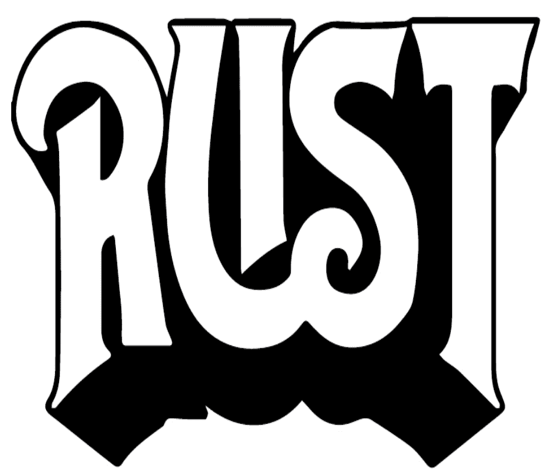

# 命令行 Rust（第二次早期发布）


## 前言

### 致早期发布读者的说明

借助 Early Release 电子书，你可以在作者撰写过程中获得书籍的最早版本——作者的原始且未经编辑的内容——从而在这些标题正式发布之前就能利用这些技术。

这将是最终书籍的前言。请注意，GitHub 仓库将在稍后激活。

如果您对本书的内容和/或示例有改进意见，或注意到本章中缺少材料，请联系作者 kyclark@gmail.com。

> *我已经知道结局了，它就是让你脸部崩溃的那部分*
> 
> —They Might Be Giants

我记得多年前这个名为“JavaScript”的新语言出现时。我觉得很有趣，于是买了一本关于该语言的大厚参考书并从头到尾读完。当我读完后，我根本写不出 JavaScript 来救命。我的问题是我没有用该语言编写任何程序。从那以后我学会了更好的学习语言的方法，这或许是你作为程序员可以培养的最有价值的技能。现在当我想学习一门语言时，我会从重写我已经知道的东西开始，比如 Tic-Tac-Toe。

Rust 据说学习曲线相当陡峭，但我坚信你可以通过编写许多你已经熟悉的小程序更快地学习它。本书涉及两件事：系统编程和 Rust。编写像 `head` 和 `cal` 这样的基本系统工具的 Rust 版本将揭示你在编写自己的程序时可以使用的模式——例如验证参数、读写文件句柄、解析文本和使用正则表达式。

## Rust 是什么（为什么人人都谈论它）？

Rust 是一种编程语言，由 Graydon Hoare 在 Mozilla Research 工作期间创建。他大约在 2006 年将其作为个人项目开始开发，到 2010 年 Mozilla 已赞助并宣布了该项目。虽然该语言相对较新，但它迅速赢得了程序员的热情追随，他们甚至声称 *love* 使用它。



图 P-1。我根据旧的 Rush 标志制作了这个标志。1980 年代作为一个打鼓的孩子，你最好相信我听了大量 Rush。无论如何，Rust 很酷，这个标志证明了这一点。

通常 Rust 被描述为一种为性能和安全而设计的系统编程语言。它的语法类似于 C 语言，因此你会看到诸如 `for` 循环、分号结尾的语句以及表示块结构的 curly braces 之类的东西。

Rust 也是一个 *statically typed* 语言，这意味着变量永远不能改变其类型，例如从数字变为字符串。如果你来自 C/C++ 或 Java 等语言，这会很熟悉，因为这些语言也是静态类型的。在 Rust 中你并不总是必须声明变量的类型，因为编译器通常可以从上下文中推断出来，但变量仍然永远不允许改变其类型。

如果你像我一样，来自 Perl、JavaScript 或 Python 等 *dynamically typed* 语言，这可能会感觉相当新。在这些语言中，变量可以在程序的任何时刻改变类型，例如从字符串变为文件句柄。语言也可能静默地将一种类型的变量当作另一种类型处理；例如，Perl 和 Python 都将在布尔上下文中评估字符串、数字、列表、字典等，这可能导致一些令人惊讶的结果。有趣的是，包括 Python、Perl 6/Raku 和 Julia 在内的几种动态类型语言引入了类型提示或 *gradual typing* 系统，其中变量可以基本未类型化（`Any`）或某种特定类型，如整数或字符串。

尽管 Rust 与命令式、C 风格语言非常相似，但它借鉴了许多其他语言和编程范式中的令人兴奋的概念。Rust 不是像 Java 那样的面向对象（OO）语言，因为 Rust 中没有类或继承。相反，Rust 使用 `struct`（结构）来表示复杂数据类型，并使用 traits 来描述类型可以如何行为。这些结构可以有方法，可以改变数据的内部状态，甚至在文档中可能被称为 *objects*，但它们在正式意义上并不是对象。

Rust 借鉴了许多来自纯函数式语言如 Haskell 的令人兴奋的想法。例如，变量默认是 *immutable*，意味着它们不能被更改。像许多语言一样，函数是 *first-class* 值，这意味着它们可以作为参数传递。对我来说最令人兴奋的是 Rust 对 *enumerated* 和 *sum* 类型的使用，也称为 *algebraic data types*（ADTs），它允许你表示，例如，一个函数可以返回一个 `Result`，它可以是包含某个值的 `Ok` 或包含另一种类型值的 `Err`。处理这些值的任何代码都必须处理所有可能性，因此你永远不会冒着忘记处理可能意外导致程序崩溃的错误的风险。

## 谁应该阅读本书

如果你正在阅读本文，我想你至少已经知道一种编程语言。也许你的背景是 C++ 或 Java 等静态类型语言，也许像我一样，你来自动态类型语言的世界。我职业生涯的大部分时间都在使用 Perl 和 Python 进行 Web 开发和系统任务，但我一直对学习从 Prolog 和 Haskell 到 JavaScript 和 Lisp 的一切都很感兴趣。无论你的背景如何，我希望向你展示 Rust 是一种非常有趣的语言。

Rust 需要学习关于内存和类型的一些相当低级的知识，所以我无法想象它会是一个很好的入门语言。我将把许多细节交给像 *Programming Rust*（Blandy、Orendorff 和 Tindall；O'Reilly，2021）和 *The Rust Programming Language*（Klabnik 和 Nichols；No Starch Press，2019）这样的参考书。我强烈建议你阅读其中一本或两本与本书一起阅读，以更深入地了解语言本身。

本书将重点介绍如何编写实用的程序，从零开始并逐步添加功能、构建程序、处理错误消息并测试你的逻辑。如果你想学习如何编写解决常见系统问题的完整程序，你应该阅读本书。虽然我会展示为什么 Rust 特别适合此用途，但我认为你也应该尝试用你熟悉的其他语言编写这些程序，以便对比 Rust 是更好还是更差、更容易还是更难。

最后，如果你关心测试，你也应该阅读本书。我是 *test-driven development* 的倡导者，我先编写测试，然后尝试编写通过这些测试的代码。我教授的经验让我相信这是一种有效的思考方式

通过解决问题。我认为测试通常能产生更好的代码。如果你目前还没有使用测试，我希望你能在这里看到足够多的例子来认识到它们的实用性，从而采纳这种做法。

## 为什么应该学习 Rust

学习 Rust 的原因有很多。个人而言，Rust 的类型系统对我很有吸引力。我使用静态类型语言越多，就越意识到动态类型语言迫使我——作为程序员——编写正确的程序和测试。我使用 Rust 越多，就越发现编译器是我的舞伴，而不是敌人。当然，它是一个会在你踩到它脚上或错过提示时告诉你的舞伴，但这最终会让你成为更好的舞者，这本来就是目标。

我喜欢 Rust 的一点是，我可以很容易地与非开发人员分享我编写的程序。如果我为同事写一个 Python 程序，我必须给他们 Python 源代码来运行。这意味着我还必须确保用户安装了正确版本的 Python 以及执行我的代码所需的所有模块。相比之下，Rust 程序直接编译成机器可执行文件。我可以在我的机器上编写和调试程序，为其需要运行的架构构建可执行文件，然后将程序的副本交给同事。假设他们拥有正确的架构，他们就不需要安装 Rust 就可以直接运行程序。

Rust 程序的分发便捷性和大小也适用于我创建的容器。例如，包含 Python 运行时的 Docker 容器可能需要数百 MB。相比之下，我可以构建一个只有数十 MB 大小的精简 Linux 虚拟机，其中包含 Rust 二进制文件。除非我真的需要 Python 的某些特定功能，例如机器学习或自然语言处理模块，否则我更愿意用 Rust 编写，以获得更小、更精简的容器。

总体而言，我发现使用 Rust 极其高效。很长一段时间以来，我一直对 Lisp 和 Haskell 等语言有一种“小男孩式的迷恋”，但我从未成功地用这些语言编写出任何有用的程序。说清楚一点，我通常编写的是需要接受一些参数、读写文件或数据库数据、从互联网获取数据等的命令行程序。像 Haskell 这样的语言会让我因文档晦涩难懂且错误信息难以理解的库而不知所措。相反，我可以轻松地在 crates.io 上找到许多有用且文档完善的 Rust crates——这就是 Rust 中对库的称呼——而与编译器一起工作感觉就像与一位极其聪明的同事结对编程，他会发现错误并经常建议如何修复它们。

## 编码挑战

这是一本供你编写的编码挑战书。我不希望你像在上班路上那样被动地阅读这本书然后放下它。对于每一章，我希望你编写一个程序，使其能通过我为你编写的测试套件。你将通过编写自己的解决方案学到最多，但我相信即使只是输入我提供的源代码也会有益。

我选择的题目大多来自 Unix 命令行核心工具，因为我预计读者已经相当熟悉这些工具。例如，我假设你用 head 和 tail 查看过文件的开头或最后几行，但你是否曾经编写过这些程序的自己的版本？在 Rust 中似乎有重写现有程序的愿望，尤其是最初用 C 或 C++ 编写的程序，这也是我的动机之一。你可以在网上找到 Rustaceans 编写的这些程序的许多其他示例，因此你可以将自己的代码与我的解决方案和其他找到的示例进行对比。除此之外，这些都是相当简单的程序，每个程序都适合教授一些技能。我按顺序排列了它们，使其相互构建，因此最好按顺序完成所有章节。

我选择其中许多程序的一个原因是它们提供了一种“地面真相”。虽然 Unix 有许多变种，这些程序也有许多实现，但它们通常都以相同的方式工作并产生相同的结果。我使用 macOS 进行开发，这意味着我主要运行这些程序的 BSD（Berkeley Standard Distribution）或 GNU（GNU’s Not Unix）变种。一般来说，BSD 版本早于 GNU 版本，并且选项较少。对于每个挑战程序，我使用 shell 脚本来将原始程序的输出重定向到输出文件。目标是让 Rust 程序对相同的输入产生相同的输出。我很小心地包含了 Windows 编码的文件以及简单 ASCII 文本与 Unicode 字符混合的文件，以迫使我的程序像原始程序一样处理各种行结束符和字符的想法。

对于大多数挑战，我只会尝试实现原始程序的子集，因为它们可能变得相当复杂。我还选择对一些程序的输出做一些小的更改，以便更容易教学。把这想象成通过跟随录音来学习乐器演奏。你不必演奏原始版本中的每一个音符。重要的是学习处理参数和读取输入等常见模式，以便继续编写自己的材料。

## 获取 Rust 和代码

首先，你需要安装 Rust。我最喜欢 Rust 的部分之一是用于安装、升级和管理 Rust 的 `rustup` 工具。它在 Windows 和类 Unix 操作系统（OS）如 Linux 和 macOS 上同样适用。你需要按照操作系统的安装说明进行操作。如果你已经安装了 `rustup`，你可能想运行 `rustup update` 以获取语言和工具的最新版本，因为 Rust 大约每六周更新一次。执行 `rustup doc` 以阅读大量的文档。你可以用以下命令检查 `rustc` 编译器的版本：

```
$ rustc --version
rustc 1.54.0 (a178d0322 2021-07-26)
```

所有程序的代码、数据和测试都可以在我的 GitHub 仓库中找到。你可以使用 Git 源代码管理工具（可能需要安装）来获取代码副本。以下命令将在你的计算机上创建一个名为 *rust-sysprog* 的新目录，其中包含仓库的内容：

```
$ git clone https://github.com/kyclark/rust-sysprog.git
```

## NOTE

你将 *不* 在此目录中编写代码。你应该在其他地方为你的项目创建一个单独的目录，最好是在为此目的创建的你自己的 GitHub 仓库中。你将把每一章的 *tests* 目录复制到你的项目目录中以测试你的代码。

你会遇到的第一个工具之一是 Cargo，Rust 的构建工具、包管理器和测试运行器。你可以用它来编译和测试第 1 章的代码。进入目录并使用 `cargo test` 运行测试：

```
$ cd 01_hello
$ cargo test
```

如果一切顺利，你应该会看到一些通过的测试（顺序不固定）：

```
running 3 tests
test false_not_ok ... ok
test true_ok ... ok
test runs ... ok
```

> NOTE
> 
> 我在 macOS、Linux、Windows/Powershell 以及 Ubuntu Linux/Windows 子系统 for Linux（WSL）上测试了所有程序。虽然我喜欢 Rust 在 Windows 和 Unix 操作系统上都能很好地工作，但由于操作系统与类 Unix 系统存在一些根本差异，两个程序（findr 和 lsr）在 Windows 上无法通过整个测试套件。我建议 Windows/Powershell 用户考虑也安装 WSL 并在该环境中完成程序。

本书中的所有代码都使用 `rustfmt` 格式化，这是一个非常方便的工具，可以让你的代码看起来漂亮且易读。你可以使用 `cargo fmt` 在项目的全部源代码上运行它，或将其集成到代码编辑器中按需运行。例如，我更喜欢使用文本编辑器 `vim`，我已将其配置为每次保存工作时自动运行 `rustfmt`。我发现这使阅读代码和查找错误变得容易得多。

我建议你使用 Clippy，这是一个用于 Rust 代码的 linter。*代码检查* 是自动检查代码中常见错误，而大多数语言似乎都提供一个或多个 linter。`rustfmt` 和 `clippy` 应该默认已安装，但如果你需要安装 Clippy，可以使用 `rustup component add clippy`。然后你可以运行 `cargo clippy` 让它检查源代码并提出建议。Clippy 没有输出意味着它没有建议。

现在你准备好编写一些 Rust 了！


## 本书使用的约定

以下排版约定用于本书：

*斜体*

表示新术语、URL、电子邮件地址、文件名和文件扩展名。

*等宽*

用于程序列表，以及在段落中引用程序元素，如变量或函数名、数据库、数据类型、环境变量、语句和关键字。

*等宽粗体*

显示用户应逐字输入的命令或其他文本。

*等宽斜体*

显示应由用户提供的值或由上下文确定的值替换的文本。

提示

此元素表示提示或建议。

注意

此元素表示一般说明。

警告

此元素表示警告或注意。

## 使用代码示例

补充材料（代码示例、练习等）可在 https://github.com/oreillymedia/title_title 下载。

如果您在使用代码示例时有技术问题或遇到问题，请发送电子邮件至 bookquestions@oreilly.com。

本书旨在帮助您完成工作。一般而言，如果本书提供了示例代码，您可以在程序和文档中使用它。除非您复制了代码的很大一部分，否则无需联系我们征得许可。例如，编写使用本书中若干代码片段的程序不需要许可。出售或分发 O’Reilly 书籍中的示例需要许可。引用本书并引用示例代码来回答问题不需要许可。将本书中的大量示例代码纳入产品文档中需要许可。

我们感谢，但通常不需要署名。署名通常包括标题、作者、出版商和 ISBN。例如：“Systems Programming with Rust by Ken Youens-Clark (O’Reilly). Copyright 2021 Charles Kenneth Youens-Clark, 978-0-596-xxxx-x.”

如果您认为代码示例的使用超出了合理使用范围或上述许可，请随时联系我们 permissions@oreilly.com。

## O’Reilly 在线学习

注意

四十多年以来，*O'Reilly Media* 一直提供技术和商业培训、知识和见解，帮助企业取得成功。

我们独特的专家和创新者网络通过书籍、文章和我们的在线学习平台分享他们的知识和专业知识。O'Reilly 的在线学习平台为您提供按需访问实时培训课程、深入学习路径、交互式编码环境，以及来自 O'Reilly 和 200 多家其他出版商的庞大文本和视频集合。欲了解更多信息，请访问 http://oreilly.com。

## 如何联系我们

请将有关本书的评论和问题发送给出版商：

O'Reilly Media, Inc.

1005 Gravenstein Highway North

Sebastopol, CA 95472

800-998-9938 (in the United States or Canada)

707-829-0515 (international or local)

707-829-0104 (fax)

我们为本书设有网页，列出勘误、示例和任何其他信息。您可以在 http://www.oreilly.com/catalog/9781098109424 访问该页面。

发送电子邮件至 *bookquestions@oreilly.com* 对本书发表评论或询问技术问题。

如需了解我们书籍和课程的新闻和信息，请访问 *http://oreilly.com*。

在 Facebook 上找到我们：*http://facebook.com/oreilly*

在 Twitter 上关注我们：*http://twitter.com/oreillymedia*

在 YouTube 上观看我们：*http://www.youtube.com/oreillymedia*

## 致谢

我要感谢我的开发编辑 Corbin Collins，我的生产编辑 <name here>。我深深感谢技术审阅者 Carol Nichols、Brad Fulton、Erik Nordin 和 Jeremy Gailor，以及其他花费时间提供评论的人，包括 Joshua Lynch、Andrew Olson 和 Jasper Zanjani。
