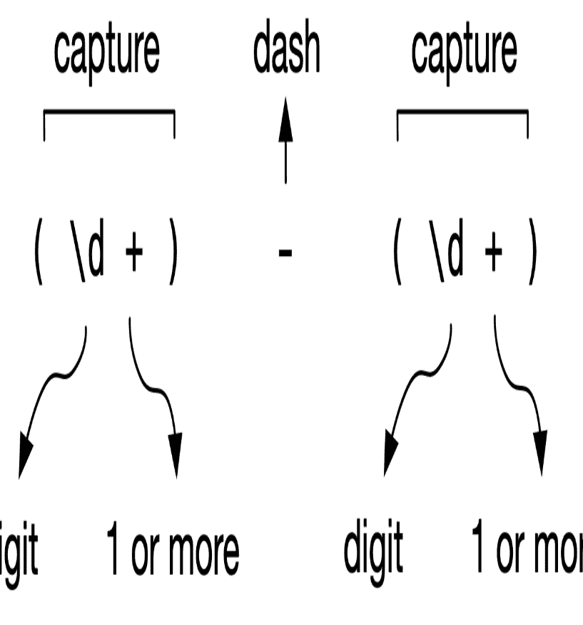

# 第 6 章。唯一性的巢穴

## 致早期发布读者的说明

With Early Release ebooks, you get books in their earliest form—the author’s raw and unedited content as they write—so you can take advantage of these technologies long before the official release of these titles.
抢先发布电子书让你获得书籍的最早形态——作者在写作时的原始未编辑内容——这样你就可以在这些标题正式发布前很久就利用这些技术。

This will be the 6th Chapter of the final book. Please note that the GitHub repo will be made active later on.
这将是最终书籍的第 6 章。请注意 GitHub 仓库将在稍后激活。

If you have comments about how we might improve the content and/or examples in this book, or if you notice missing material within this chapter, please reach out to the author at kyle.clark@gmail.com.
如果你对如何改进本书的内容和/或示例有任何建议，或者在本章中发现缺失的材料，请联系作者 kyle.clark@gmail.com。

> *There’s only one everything*
> 
> —The Might Be Giants
> *只有一样东西*
> 
> —The Might Be Giants

The `uniq` program (pronounced *unique*) will find the distinct strings in lines of text either from a file or `STDIN`. Among its many uses, it is often employed to count how many times each unique string is found. I think you will find it challenging to create a program that mimics the output from the original tool. Here are some of the skills you will learn:
`uniq` 程序（发音为 *唯一*）会从文件或 `STDIN` 中查找文本行中的不同字符串。在其众多用途中，它经常被用来统计每个唯一字符串出现的次数。我认为你会发现创建模仿原始工具输出的程序具有挑战性。你将学习以下一些技能：

-   How to write to a file or `STDOUT` (pronounced *standard out*)
如何写入文件或 `STDOUT`（发音为 *标准输出*）
-   How and why to write a closure to capture a variable
如何以及为何编写闭包来捕获变量
-   About the don’t repeat yourself (DRY) concept
关于不要重复自己（DRY）概念
-   About the `Write` trait and the `write!` and `writeln!` macros
关于 `Write` trait 以及 `write!` 和 `writeln!` 宏
-   How and why to use temporary files
如何以及为何使用临时文件
-   How to indicate the lifetime of a variable
如何指示变量的生命周期
-   How to write tests that pass arguments on the command line or through STDIN
如何编写通过命令行参数或通过 STDIN 传递参数的测试

## uniq 的工作原理

Following is part of the manual page for the BSD version of uniq. The challenge program in this chapter will only implement the reading of a file or STDIN, writing to a file or STDOUT, and counting the lines for the -c flag:
以下是 BSD 版本 uniq 手册页的一部分。本章中的挑战程序将仅实现从文件或 STDIN 读取、写入文件或 STDOUT，以及为 -c 标志计数行：

```
UNIQ(1)                                      BSD General Commands Manual
UNIQ(1)

NAME
    uniq -- report or filter out repeated lines in a file

SYNOPSIS
    uniq [-c | -d | -u] [-i] [-f num] [-s chars]
    [input_file [output_file]]

DESCRIPTION
    The uniq utility reads the specified input_file
    comparing adjacent lines,
        and writes a copy of each unique input line to the
    output_file.  If
        input_file is a single dash ('-') or absent, the
    standard input is read.
        If output_file is absent, standard output is used for
    output.  The second
        and succeeding copies of identical adjacent input
    lines are not written.
        Repeated lines in the input will not be detected if
    they are not adja-
        cent, so it may be necessary to sort the files first.

    The following options are available:
```

-c      Precede each output line with the count of the number of times
the line occurred in the input, followed by a single space.
-c      在每一行输出前加上该行在输入中出现的次数，后跟一个空格。

-d      Only output lines that are repeated in the input.
-d      仅输出在输入中重复的行。

-f num  Ignore the first num fields in each input line when doing compar-
isons.  A field is a string of non-blank characters separated
from adjacent fields by blanks.  Field numbers are one based,
i.e., the first field is field one.
-f num  在比较时忽略每行输入中的前 num 个字段。字段是由非空白字符组成的字符串，由空白与相邻字段分隔。字段编号从 1 开始，即第一个字段是字段一。

-s chars
        Ignore the first chars characters in each input line when doing
comparisons.  If specified in conjunction with the -f option, the
first chars characters after the first num fields will be
ignored.  Character numbers are one based, i.e., the first char-
acter is character one.
-s chars
        在比较时忽略每行输入中的前 chars 个字符。如果与 -f 选项一起指定，则在前 num 个字段之后的前 chars 个字符将被忽略。字符编号从 1 开始，即第一个字符是字符一。

-u      Only output lines that are not repeated in the input.
-u      仅输出在输入中未重复的行。

-i      Case insensitive comparison of lines.
-i      不区分大小写地比较行。

In the *06_uniq* directory of the Git repository, you will find various input files I'll use for testing. To start, note that `uniq` will print nothing when given an empty file:
在 Git 仓库的 *06_uniq* 目录中，你会找到我用于测试的各种输入文件。首先请注意，给 `uniq` 一个空文件时它不会打印任何内容：

```
$ uniq tests/inputs/empty.txt
```

Given a file with just one line, the one line will be printed:
给定仅包含一行的文件，该行将被打印：

```
$ uniq tests/inputs/one.txt
a
```

It will also print the number of times a line occurs before the line when run with the -c option. The count is right-justified in a field 4 characters wide and is followed by a single space and then the line:
使用 -c 选项运行时，它还会在行前打印该行出现的次数。计数在宽 4 个字符的字段中右对齐，其后跟一个空格然后是该行：

```
$ uniq -c tests/inputs/one.txt
    1 a
```

Given input that contains two duplicate lines, only one line will be emitted:
如果输入包含两行重复的行，则只会输出一行：

```
$ cat tests/inputs/two.txt
a
a
$ uniq tests/inputs/two.txt
a
```

The line is shown to have a count of 2:
该行显示计数为 2：

```
$ uniq -c tests/inputs/two.txt
    2 a
```

A longer input file shows that uniq only considers the lines in order and not globally as the line one shows several times in this input file:
较长的输入文件显示 uniq 仅按顺序考虑行，而非全局，因为此输入文件中第一行出现了多次：

```
$ cat tests/inputs/three.txt
a
a
b
b
a
c
c
c
a
d
d
d
d
```

When counting, `uniq` starts over at 1 each time it sees a new string:
计数时，每当 `uniq` 看到一个新字符串时计数会从 1 重新开始：

```
$ uniq -c tests/inputs/three.txt
  2 a
  2 b
  1 a
  3 c
  1 a
  4 d
```

If you wanted *actually* unique values, you must first `sort` the input.
Note in the following command that `uniq` will read `STDIN` by default:
如果你想要 *真正* 唯一的值，你必须先 `sort` 输入。
请注意，在以下命令中 `uniq` 默认会读取 `STDIN`：

```
$ sort tests/inputs/three.txt | uniq -c
  4 a
  2 b
  3 c
  4 d
```

The file *tests/inputs/skip.txt* contains a blank line in the input acts just like any other value and so it will reset the counter:
文件 *tests/inputs/skip.txt* 包含的空白行在输入中就像任何其他值一样，因此会重置计数器：

```
$ uniq -c tests/inputs/skip.txt
  1 a
  1
  1 a
  1 b
```

If you study the usage closely, you’ll see a very subtle indication of how to write the output to a file. Notice how `input` and `output` in the following are grouped inside square brackets to indicate that they are optional as a pair. That is, if you provide `input`, then you may also optionally provide `output`:
如果你仔细研究用法，你会看到一个非常微妙的提示，说明如何将输出写入文件。请注意，下面的 `input` 和 `output` 如何被方括号分组，以表示它们作为一对是可选的。也就是说，如果你提供 `input`，那么你也可以选择性地提供 `output`：

```
usage: uniq [-c | -d | -u] [-i] [-f fields] [-s chars]
[input [output]]
```

For example, I can count *tests/inputs/two.txt* and place the output into *out*:
例如，我可以统计 *tests/inputs/two.txt* 并将输出放入 *out*：

```
$ uniq -c tests/inputs/two.txt out
$ cat out
    2 a
```

With no positional arguments, *uniq* will read from STDIN by default:
没有位置参数时，*uniq* 默认会从 STDIN 读取：

```
$ cat tests/inputs/two.txt | uniq -c
    2 a
```

If you want to read from STDIN *and* indicate the output filename, you must use a dash "-" for the input filename:
如果你想从 STDIN 读取 *并且* 指定输出文件名，你必须对输入文件名使用连字符 "-"：

```
$ cat tests/inputs/two.txt | uniq -c - out
$ cat out
    2 a
```

The GNU version works basically the same while also providing many more options:
GNU 版本基本相同，同时还提供更多选项：

```
$ uniq --help
Usage: uniq [OPTION]... [INPUT [OUTPUT]]
Filter adjacent matching lines from INPUT (or standard input),
writing to OUTPUT (or standard output).

With no options, matching lines are merged to the first occurrence.

Mandatory arguments to long options are mandatory for short options too.
    -c, --count            prefix lines by the number of
occurrences
    -d, --repeated         only print duplicate lines, one for
each group
    -D, --all-repeated[=METHOD]  print all duplicate lines
                            groups can be delimited with an
empty line
```


```
METHOD=
{none(default),prepend,separate}
  -f, --skip-fields=N    avoid comparing the first N fields
    --group[=METHOD]    show all items, separating groups
with an empty line
        METHOD=
{separate(default),prepend,append,both}
  -i, --ignore-case      ignore differences in case when
comparing
  -s, --skip-chars=N     avoid comparing the first N
characters
  -u, --unique           only print unique lines
  -z, --zero-terminated  end lines with 0 byte, not newline
  -w, --check-chars=N    compare no more than N characters
in lines
    --help              display this help and exit
    --version           output version information and exit
```

一个字段是一串空白（通常是空格和/或制表符），然后是非空白字符。字段在字符之前被跳过。

注意：'uniq' 仅在重复的行相邻时才检测到重复行。
你可能希望先对输入进行排序，或在不使用 'uniq' 的情况下使用 'sort -u'。
此外，比较会遵循 'LC_COLLATE' 指定的规则。

如你所见，BSD 和 GNU 版本都有更多选项，但这就是挑战程序预期实现的内容。

## Getting Started

为了避免任何意外，此程序将命名为 uniqr，用于 Rust 版本的 uniq。首先运行 cargo new uniqr 创建一个新的二进制包，然后修改你的 Cargo.toml 以添加以下依赖项：

```
[dependencies]
clap = "2.33"

[dev-dependencies]
assert_cmd = "1"
predicates = "1"
tempfile = "3"
rand = "0.8"
```

将我的 06_uniq_r/tests 目录复制到你的项目中，然后运行 cargo test 以确保程序编译并且测试运行并失败。

## Defining the Arguments

如果你想复制我的常规模块结构，请将你的 src/main.rs 修改为以下内容：

```
fn main() {
    if let Err(e) = uniqr::get_args().and_then(uniqr::run)
{
        eprintln!("{}", e);
        std::process::exit(1);
    }
}
```

你可以像前几章那样开始你的 src/lib.rs：

```
use clap::{App, Arg};
use std::error::Error;

type MyResult<T> = Result<T, Box<dyn Error>>;

#[derive(Debug)]
pub struct Config {
    in_file: String, ①
    out_file: Option<String>, ②
    count: bool, ③
}
```

- 1. 程序将从给定的 `in_file` 或 STDIN 读取。
- 2. 输出将写入给定的 `out_file` 或 STDOUT。
- 3. `count` 是一个布尔值，用于指示是否打印每一行的计数。

以下是 get_args 的大纲：

```
pub fn get_args() -> MyResult<Config> {
    let matches = App::new("uniq")
        .version("0.1.0")
        .author("Ken Youens-Clark <kyclark@gmail.com>")
        .about("Rust uniq")
        // What goes here?
        .get_matches();

    Ok(Config {
        in_file: ...
        out_file: ...
        count: ...
    })
}
```

我建议你先通过打印配置来开始运行：

```
pub fn run(config: Config) -> MyResult<()> {
    println!("{:?}", config);
    Ok(())
}
```

你的程序应该能够产生以下用法：

```
$ cargo run -- -h
uniq 0.1.0
Ken Youens-Clark <kyclark@gmail.com>
Rust uniq

USAGE:
    uniq [FLAGS] [ARGS]
```

## FLAGS:

- `-c, --count`    显示计数 ①
- `-h, --help`    打印帮助信息
- `-V, --version`    打印版本信息

## ARGS:

- `<FILE>`    输入文件 [默认值: -] ②
- `<FILE>`    输出文件 ③

① `-c|--count` 标志是可选的。

② 输入文件是第一个位置参数，默认为破折号。

③ 输出文件是第二个位置参数，是可选的。

默认情况下程序将从 STDIN 读取，可以使用破折号表示：

```
$ cargo run
Config { in_file: "-", out_file: None, count: false }
```

第一个位置参数应解释为 `in_file`，第二个位置参数解释为 `out_file`。请注意，`clap` 可以处理位于位置参数之前或之后的选项：

```
$ cargo run -- tests/inputs/one.txt out --count
Config { in_file: "tests/inputs/one.txt", out_file:
Some("out"), count: true }
```

## TIP

我尽可能模仿原始版本，但我不喜欢可选的位置参数。在我看来，最好有一个默认为 STDOUT 的 `-o|--output` 选项，并且只有一个可选的位置参数用于输入文件，该参数默认为 STDIN。

我假设你是一个正直且有道德的人，自己已经想出了如何编写它，所以我现在将分享我的解决方案：

```
pub fn get_args() -> MyResult<Config> {
    let matches = App::new("uniq")
        .version("0.1.0")
        .author("Ken Youens-Clark <kyclark@gmail.com>")
        .about("Rust uniq")
        .arg(
            Arg::with_name("in_file")
                .value_name("FILE")
                .help("Input file")
                .default_value("-"),
        )
        .arg(
            Arg::with_name("out_file")
                .value_name("FILE")
                .help("Output file"),
        )
        .arg(
            Arg::with_name("count")
                .value_name("COUNT")
                .help("Show counts")
                .short("c")
                .long("count")
                .takes_value(false),
        )
        .get_matches();

    Ok(Config {
        in_file:
        matches.value_of("in_file").map(str::to_string).unwrap(), ①
        out_file:
        matches.value_of("out_file").map(String::from), ②
        count: matches.is_present("count"), ③
    })
}
```

- ① 将 in_file 参数转换为 String。
- ② 将 out_file 参数转换为 Option<String>。

③ `count` 要么存在要么不存在，因此转换为 `bool`。

在前面的代码中，`ArgMatches::value_of` 方法返回 `Option<&str>`。要将 `in_file` 转换为 `String`，我调用了 `Option::map`，它通常接受一个闭包，我在第 5 章首次提到过它。相反，我使用了两个现有的函数将 `&str` 转换为 `String`：`str::to_string` 和 `String::from`，也可以写成 `From::from`，因为 Rust 推断出 `String` 类型。记住，函数是一等对象，可以作为参数传递给其他函数。

因为我已将 `in_file` 参数定义为具有默认值，所以它永远不应该是 `None`；因此，我可以使用 `Option::map` 将 `Some(&str)` 转换为 `Some(String)`，而对 `None` 不做任何处理。我对 `out_file` 也做类似处理，但将其保留为 `Option`，因为它不是必需的。

## VARIABLE LIFETIMES

你可能会想为什么我不将 in_file 留为 &str 值，我鼓励你尝试像这样更改你的程序：

```
#[derive(Debug)]
pub struct Config {
    in_file: &str,
    out_file: Option<&str>,
    count: bool,
}

pub fn get_args() -> MyResult<Config> {
    let matches = App::new("uniq")
    ...

    Ok(Config {
        in_file: matches.value_of("in_file").unwrap(),
        out_file: matches.value_of("out_file"),
        count: matches.is_present("count"),
    })
}
```

然后享受你为编译器指定这些值的生命周期的时光：

```
error[E0106]: missing lifetime specifier
  --> src/lib.rs:11:14
   |
11 |     in_file: &str,
   |              ^ expected named lifetime parameter
   |
help: consider introducing a named lifetime parameter
   |
10 | pub struct Config<'a> {
11 |     in_file: &'a str,
```

*lifetime* 指的是一个值在整个程序中被借用时有效的时间。我更愿意将关于

lifetimes 的讨论留给其他文本，例如 *Programming Rust*（O'Reilly），并且在下一节我会有使用生命周期的理由。现在请知道，从函数返回一个动态且堆分配的 `String` 比返回一个 `&str` 要容易得多。

## Testing the Program

*tests/cli.rs* 中的测试套件相当庞大，包含 78 个测试。我打算在以下条件下测试程序：

- 1. 输入文件作为唯一的位置参数，检查 `STDOUT`
- 2. 输入文件作为位置参数并带 `--count` 选项，检查 `STDOUT`
- 3. 从 `STDIN` 输入且没有位置参数，检查 `STDOUT`
- 4. 从 `STDIN` 输入并带 `--count` 且没有位置参数，检查 `STDOUT`
- 5. 输入和输出文件作为位置参数，检查输出文件
- 6. 输入和输出文件作为位置参数并带 `--count`，检查输出文件
- 7. 从 `STDIN` 输入并将输出文件作为位置参数并带 `--count`，检查输出文件

鉴于测试变得如此庞大和复杂，我在代码中加入了一些结构。我鼓励你阅读测试，其开头如下：

```
use assert_cmd::Command;
use predicates::prelude::*;
use rand::{distributions::Alphanumeric, Rng};
use std::fs;
```


```
use tempfile::NamedTempFile; ①

type TestResult = Result<(), Box<dyn std::error::Error>>;

struct Test<'a> { ②
    input: &'a str,
    out: &'a str,
    out_count: &'a str,
}
```

① 用于创建临时输出文件。

② 用于定义输入文件以及有无计数时的预期输出值的结构体。

注意使用 'a 来表示值的生命周期。我想定义带有 &str 值的结构体，而 Rust 编译器希望确切地知道相对于彼此的值预计会保留多长时间。所有值都具有相同的生命周期 'a 这一事实意味着它们都预计会一样长久地存在。如果你删除生命周期注解并运行测试，你会看到与上一节中所示类似的编译器警告，以及关于如何修复它的确切建议：

```
error[E0106]: missing lifetime specifier
  --> tests/cli.rs:8:12
   |
8 |     input: &str,
   |            ^ expected named lifetime parameter
   |
help: consider introducing a named lifetime parameter
   |
7 | struct Test<'a> {
8 |     input: &'a str,
```

接下来，我定义测试所需的常量值：

```
const PRG: &str = "uniq r"; ①
```

```
const EMPTY: Test = Test {
    input: "tests/inputs/empty.txt", ②
    out: "tests/inputs/empty.txt.out", ③
    out_count: "tests/inputs/empty.txt.c.out", ④
};
```

- 1. 被测试程序的名称
- 2. 此测试的输入文件位置
- 3. 不带计数的输出文件位置
- 4. 带计数的输出文件位置

在 EMPTY 的声明之后，还有许多更多 Test 结构，后面跟着几个辅助函数。run 函数将使用 Test.input 作为输入文件，并将 STDOUT 与 Test.out 文件的内容进行比较：

```
fn run(test: &Test) -> TestResult { ①
    let expected = fs::read_to_string(test.out)?; ②
    Command::cargo_bin(PRG)? ③
        .arg(test.input)
        .assert()
        .success()
        .stdout(expected);
    Ok(())
}
```

- 1. 该函数接受一个 Test 并返回一个 TestResult。
- 2. 尝试读取预期输出文件。
- 3. 尝试使用输入文件作为参数运行程序，验证其成功运行，并将 STDOUT 与预期值进行比较。

下一个辅助函数的工作方式非常相似，但这次测试计数功能：

```
fn run_count(test: &Test) -> TestResult {
    let expected = fs::read_to_string(test.out_count)?; ①
    Command::cargo_bin(PRG)?
        .args(&[test.input, "-c"]) ②
        .assert()
        .success()
        .stdout(expected);
    Ok(())
}
```

- ① 读取 `Test.out_count` 文件以获取预期输出。
- ② 将 `Test.input` 值和标志 `-c` 一起传递以统计行数。

下一个函数将通过 STDIN 传递输入：

```
fn run_stdin(test: &Test) -> TestResult {
    let input = fs::read_to_string(test.input)?; ①
    let expected = fs::read_to_string(test.out)?; ②
    Command::cargo_bin(PRG)? ③
        .write_stdin(input)
        .assert()
        .success()
        .stdout(expected);
    Ok(())
}
```

- ① 尝试读取 `Test.input` 文件。
- ② 尝试读取 `Test.out` 文件。
- ③ 通过 STDIN 传递输入并验证 STDOUT 是否为预期值。

下一个函数同时测试从 STDIN 读取和统计行数：

```rust
fn run_stdin_count(test: &Test) -> TestResult {
    let input = fs::read_to_string(test.input)?;
    let expected = fs::read_to_string(test.out_count)?;
    Command::cargo_bin(PRG)? ①
        .arg("--count")
        .write_stdin(input)
        .assert()
        .success()
        .stdout(expected);
    Ok(())
}
```

① 使用长选项 --count 运行程序并将输入馈送到 STDIN，验证 STDOUT 是否正确。

下一个函数检查程序是否接受输入和输出文件作为位置参数。这有点更有趣，因为我在测试中需要使用临时文件，因为正如你反复看到的那样，Rust 会并行运行测试。如果我使用同一个虚拟文件名比如 blargh 来写入所有输出文件，测试会覆盖彼此的输出。为了解决这个问题，我使用 tempfile::NamedTempFile 来获取一个动态生成的临时文件名，该文件在我完成时会自动删除：

```rust
fn run_outfile(test: &Test) -> TestResult {
    let expected = fs::read_to_string(test.out)?;
    let outfile = NamedTempFile::new()?; ①
    let outpath = &outfile.path().to_str().unwrap(); ②

    Command::cargo_bin(PRG)? ③
        .args(&[test.input, outpath])
        .assert()
        .success()
        .stdout("");
    let contents = fs::read_to_string(&outpath)?; ④
```

```
    assert_eq!(&expected, &contents); ⑤
    Ok(())
}
```

- 1. 尝试获取一个命名临时文件。
- 2. 获取文件的 `path`。
- 3. 使用输入和输出文件名作为参数运行程序，验证 `STDOUT` 中没有内容。
- 4. 尝试读取输出文件。
- 5. 检查输出文件的内容是否与预期值匹配。

接下来的两个函数是对我已经展示过的变体，添加了 `--count` 标志，最后要求程序在输入文件名是连字符时从 `STDIN` 读取。模块的其余部分使用各种结构体调用这些辅助函数来运行所有测试。写这一切很乏味，但非常重要的是用所有可能的命令行参数组合测试程序的每一个方面。你也许现在可以看到我为什么不想为挑战程序添加更多功能。

实现像 `uniq` 这样的开源程序的一个有趣方面是，你有时可以找到这些程序的源代码。在寻找原始测试套件时，我发现了一个用于测试 GNU 版本的 Perl 程序。我在 `tests/inputs/t[1-6].txt` 输入文件中使用了其中几个示例，如 *06_uniq r/mk-outs.sh* 中所示：

```
$ cat mk-outs.sh
#!/usr/bin/env bash

ROOT="tests/inputs"
```

```
OUT_DIR="tests/expected"

[[ ! -d "$OUT_DIR" ]] && mkdir -p "$OUT_DIR"

## 总结
https://github.com/coreutils/coreutils/blob/master/tests/misc/uniq.pl
echo -ne "a\na\n"      > $ROOT/t1.txt ①
echo -ne "a\na"        > $ROOT/t2.txt ②
echo -ne "a\nb"        > $ROOT/t3.txt ③
echo -ne "a\na\nb"     > $ROOT/t4.txt ④
echo -ne "b\na\na\n" > $ROOT/t5.txt ⑤
echo -ne "a\nb\nc\n" > $ROOT/t6.txt ⑥

for FILE in $ROOT/*.txt; do
  BASENAME=$(basename "$FILE")
  uniq          $FILE > ${OUT_DIR}/${BASENAME}.out
  uniq -c       $FILE > ${OUT_DIR}/${BASENAME}.c.out
  uniq          < $FILE > ${OUT_DIR}/${BASENAME}.stdin.out
  uniq -c < $FILE > ${OUT_DIR}/${BASENAME}.stdin.c.out
done
```

- ① 每行各以换行符结尾的两行
- ② 最后一行没有尾随换行符
- ③ 两个不同的行，没有尾随换行符
- ④ 两个相同的行，最后一个不同且没有尾随换行符
- ⑤ 每个都有换行符的两个不同值
- ⑥ 每个都有换行符的三个不同值

我发现精确匹配 `uniq` 的输出非常具有挑战性，但我想我现在因为这项努力而变得更好了。我建议从 `src/lib.rs` 开始读取输入文件，再次使用前几章中的 `open` 函数是有意义的：

```
fn open(filename: &str) -> MyResult<Box<dyn BufRead>> {
    match filename {
        "-" => Ok(Box::new(BufReader::new(io::stdin()))),
        _ =>
Ok(Box::new(BufReader::new(File::open(filename)?))),
    }
}
```

请确保扩展你的导入以包含以下内容：

```
use clap::{App, Arg};
use std::{
    error::Error,
    fs::File,
    io::{self, BufRead, BufReader},
};
```

① 这种语法让我按通用前缀分组导入，因此以下所有内容都来自 std。

你可以借用第三章中相当多的代码，该代码从输入文件或 STDIN 读取文本行，同时保留行尾：

```
pub fn run(config: Config) -> MyResult<()> {
    let mut file = open(&config.in_file)
        .map_err(|e| format!("{}: {}", config.in_file,
e))?; ①
    let mut line = String::new(); ②
    loop { ③
        let bytes = file.read_line(&mut line)?; ④
        if bytes == 0 { ⑤
            break;
        }
        print!("{}", line); ⑥
        line.clear(); ⑦
    }
    Ok(())
}
```

①

如果输入文件是破折号则读取 `STDIN`，否则打开给定的文件名。在失败时创建一条信息性的错误消息。

- 2. 创建一个新的、空的可变 `String` 缓冲区来保存每一行。
- 3. 创建一个无限循环。
- 4. 读取一行文本，同时保留行结束符。
- 5. 如果未读取到字节，则跳出循环。
- 6. 打印行缓冲区。
- 7. 清空行缓冲区。

运行你的程序并使用输入文件以确保它正常工作：

```
$ cargo run -- tests/inputs/one.txt
a
```

它也应该适用于读取 `STDIN`：

```
$ cargo run -- - < tests/inputs/one.txt
a
```

尝试让你的程序遍历输入行并统计每个唯一的行序列，然后尝试让你的程序在有计数和没有计数的情況下打印行。查看 `open` 的工作原理，并尝试复制这些思路来使用 `File::create` 将输出写入文件或 `STDOUT`。记住你可以使用类似 `cargo test empty` 的命令来仅运行名称中包含字符串 *空* 的所有测试。我知道你可以做到这一点。

## 解决方案

我将逐步讲解我是如何得出解决方案的。你的版本可能不同，只要它通过测试套件即可。在我上次展示的版本的基础上，我决定创建两个额外的可变变量来保存最后一行文本和运行计数。现在，我将始终打印计数以确保它正常工作：

```
pub fn run(config: Config) -> MyResult<()> {
    let mut file = open(&config.in_file)
        .map_err(|e| format!("{}: {}", config.in_file,
 e))?;
    let mut line = String::new();
    let mut last = String::new(); ①
    let mut count: u64 = 0; ②

    loop {
        let bytes = file.read_line(&mut line)?;
        if bytes == 0 {
            break;
        }

        if line.trim_end() != last.trim_end() { ③
            if count > 0 { ④
                print!(" {:>4} {}", count, last); ⑤
            }
            last = line.clone(); ⑥
            count = 0; ⑦
        }

        count += 1; ⑧
        line.clear();
    }

    if count > 0 { ⑨
        print!(" {:>4} {}", count, last);
    }

    Ok(())
}
```

- ① 创建一个可变变量来保存最后一行文本。
- ② 创建一个可变变量来保存计数。

- 3. 将当前行与上一次的行进行比较，两者都已去掉可能的尾随空白。
- 4. 仅当 `count` 大于 0 时才打印输出。
- 5. 以宽度为 4 个字符的列右对齐打印 `count`，后跟一个空格和 `line` 值。
- 6. 将 `last` 变量设置为当前 `line` 的副本。
- 7. 将计数器重置为 0。
- 8. 将计数器递增 1。
- 9. 处理文件的最后一行。

如果我运行 `cargo test`，它将通过相当多的测试。不过这段代码很笨拙。我不喜欢两次检查 `if count > 0`，因为这违反了 *不要重复自己*（DRY）原则，所以我认为需要把它放到一个函数中。我也一直打印计数，但我应该只在 `config.count` 为 `true` 时才打印计数——另一个可以放入此函数的条件。我决定将它写成 `run` 函数内部的闭包，以 *捕获* `config.count` 值：

```
```rust
let print = |count: &u64, line: &String| {
    if count > &0 {
        if config.count {
            print!("{:>4} {}", &count, &line);
        } else {
            print!("{}", &line);
        }
    };
};
```
```

- 1. `print` 闭包将接受 `count` 和 `line` 值。

- 2. 仅当 `count` 大于 0 时才打印。
- 3. 检查 `config.count` 值是否为 `true`。
- 4. 使用 `print!` 宏将 `count` 和 `line` 打印到 `STDOUT`。
- 5. 否则，将 `line` 打印到 `STDOUT`。

## 闭包与函数

闭包是一个函数，所以你可能会想在 `run` 函数内部将 print 写成一个函数：

```
pub fn run(config: Config) -> MyResult<()> {
    ...
    fn print(count: &u64, line: &String) {
        if count > &0 {
            if config.count {
                print!("{:>4} {}", &count, &line);
            } else {
                print!("{}", &line);
            }
        }
    };
};
...
```

这是在其他语言中编写闭包的常见方式，并且 Rust 确实允许你在另一个函数内部声明一个函数；然而，Rust 编译器明确禁止在 fn 项中捕获来自环境的动态值¹：

```
error[E0434]: can't capture dynamic environment in a fn item
  --> src/lib.rs:67:16
   |
67 |             if config.count {
   |                    ^^^^^^
   |
   = help: use the `|| { ... }` closure form instead
```

我可以更新函数的其余部分以使用此闭包：

```
loop {
    let bytes = file.read_line(&mut line)?;
    if bytes == 0 {
        break;
    }
}
```

```
```rust
if line.trim_end() != last.trim_end() {
    print(&count, &last);
    last = line.clone();
    count = 0;
}

count += 1;
line.clear();
}

print(&count, &last);
```
```

通过这些更改，我的程序将通过更多测试。如果我查看失败的测试，它们都包含 outfile，因为我未能写入命名输出文件。我可以用两个更改添加此最后功能。首先，我想以与打开输入文件相同的方式打开输出文件，要么创建命名输出文件，要么使用 STDOUT。你需要为以下代码添加 use std::io::Write，你可以将其放在 file 变量之后：

```
```rust
let mut out_file: Box<dyn Write> = match &config.out_file {
    Some(out_name) => Box::new(File::create(&out_name)?),
    _ => Box::new(io::stdout()),
};
```
```

① 可变 out_file 将是一个实现 std::io::Write trait 的装箱值。

② 当 config.out_file 是 Some 文件名时，使用 File::create 尝试创建文件。

③ 否则，使用 std::io::stdout。

如果你查阅 File::create 和 io::stdout 的文档，你会看到两者都有一个 Traits 部分，显示它们实现的各种 trait。两者都显示它们实现了 Write，因此它们满足类型要求 Box<dyn Write>，该要求说明 Box 内部的值必须实现此 trait。

我需要做的第二个更改是使用 out_file 进行输出。我将用 write! 替换 print! 宏，以将输出写入类似文件句柄或 STDOUT 的流。write! 的第一个参数必须是实现 Write trait 的可变值。

文档显示 write! 将返回一个 std::io::Result，因为它可能会失败。因此，我将我的 print 闭包更改为返回 MyResult。以下是通过所有测试的 run 函数的最终版本：

```
pub fn run(config: Config) -> MyResult<()> {
    let mut file = open(&config.in_file)
        .map_err(|e| format!("{}: {}", config.in_file,
    e))?; ①
    let mut out_file: Box<dyn Write> = match
    &config.out_file { ②
        Some(out_name) =>
    Box::new(File::create(&out_name)?),
        _ => Box::new(io::stdout()),
    };

    let mut print = |count: &u64, line: &String| ->
    MyResult<()> { ③
        if count > &0 {
            if config.count {
                write!(out_file, "{:>4} {}", &count,
    &line)?;
            } else {
                write!(out_file, "{}", &line)?;
            }
        }
        Ok(())
    };

    let mut line = String::new();
    let mut last = String::new();
    let mut count: u64 = 0;
    loop {
```

```
let bytes = file.read_line(&mut line)?;
if bytes == 0 {
    break;
}

if line.trim_end() != last.trim_end() {
    print(&count, &last)?; ④
    last = line.clone();
    count = 0;
}

count += 1;
line.clear();
}

print(&count, &last)?; ⑤

Ok(())
}
```

- 1. 打开 STDIN 或给定的输入文件名。
- 2. 打开 STDOUT 或给定的输出文件名。
- 3. 创建一个可变的 print 闭包来格式化输出。
- 4. 使用 print 闭包可能打印输出。使用 ? 来传播潜在错误。
- 5. 处理文件的最后一行。

我认为你独立写出与我的解决方案完全相同的东西的可能性极小。只要你的解决方案通过测试，就是完全可以接受的。我喜欢使用测试编写代码的一部分原因是，当程序达到一定程度的规范时，有一个客观的判定。Louis Srygley 说，“没有需求或设计，编程就是在空文本文件中添加 bug 的艺术。” 我会说测试就是具象化的需求。没有测试，你就根本无法知道何时

如果你的程序偏离需求或破坏了设计。

最后，我想分享一下，我探索了几种编写此算法的其他方法，其中一种是将输入文件的所有行读入一个向量，并使用 `Vec::windows` 查看行对。这很有趣，但在输入文件大小超过我机器可用内存时可能会失败。此处提供的解决方案只会为当前行和上一行分配内存，因此应可扩展到任何大小的文件。

## 更进一步

如往常一样，BSD 和 GNU 版本的 `uniq` 都具有比我在挑战中选择包含的功能更多的功能。我鼓励你在你的版本中添加所有你想要的功能。考虑阅读原始源代码和测试，看看可以借鉴什么。务必为每个功能添加测试，并始终运行整个测试套件以验证所有先前功能仍然正常工作。

在我看来，`uniq` 与 `sort` 紧密相关，因为我经常一起使用它们。考虑实现你自己的 `sort` 版本，至少能够按字典顺序（词典顺序）或数值对值进行排序。

## 总结

我希望你写这个挑战的体验和我一样有趣。让我们回顾一下你学到的一些内容：

- 你现在可以打开一个新文件进行写入或使用 `STDOUT`。
- DRY 的思想是将任何重复的代码移动到一个单一的抽象中，如函数或闭包。
- 你已经看到闭包可用于捕获封闭作用域中的值。
- 你了解了 `Write` trait 以及实现此 trait 的值如何与 `write!` 和 `writeln!` 宏一起使用。
- 有时你会发现需要写入一个临时文件。你现在使用了一个 Rust crate，它可以帮助找到唯一的文件名并为你打开文件句柄。
- Rust 编译器有时可能要求你指明变量的生命周期，即它相对于其他变量存在的时间。

1 名称 *closure* 指的是这种捕获或 *包围* 词法作用域绑定的行为。

# 第7章 寻宝者

## 早期发布读者的说明

在早期发布电子书中，你可以获得书籍的最早形式——作者在写作时的原始未编辑内容——因此你可以在这些标题正式发布之前很久就利用这些技术。

这将是最终书籍的第7章。请注意，GitHub 仓库将在稍后激活。

如果你对如何改进本书的内容和/或示例有任何意见，或者在本章中发现缺失的材料，请联系作者 kyle.clark@gmail.com。

> *然后我也许应该把它写下来，但当我环顾四周找笔时，我又试图回想你说的话*
> 
> —They Might Be Giants

`find` 实用程序不出所料会查找事物。如果没有选项，它将递归搜索当前工作目录中的所有条目，包括文件、符号链接、套接字、目录等。你可以限制它搜索一个或多个路径，并包含限制以查找匹配各种限制的条目，例如名称、文件大小、文件类型、修改时间、权限等。你编写的挑战程序将定位一个或多个目录中名称匹配一个或多个正则表达式的文件、目录或链接。

你将学习：

- 如何使用 `clap` 来限制命令行参数的可能值
- 如何将正则表达式锚定到字符串的末尾
- 如何创建枚举类型（`enum`）
- 如何使用 `walkdir` crate 递归搜索文件路径
- 如何使用 `Iterator::any`
- 如何链接多个 `filter` 和 `map` 操作

## find 的工作原理

`find` 的手册页真是令人惊叹。它长达约500行，详细说明了查找文件和目录的所有选项。下面只是开头，展示了 BSD `find` 的大致风格：

```
FIND(1)                                 BSD General Commands Manual
FIND(1)

NAME
        find -- walk a file hierarchy

SYNOPSIS
        find [-H | -L | -P] [-EXdsx] [-f path] path ...
[expression]
        find [-H | -L | -P] [-EXdsx] -f path [path ...]
[expression]

DESCRIPTION
        The find utility recursively descends the directory
tree for each path
        listed, evaluating an expression (composed of the
''primaries'' and
        ''operands'' listed below) in terms of each file in
the tree.
```

## GNU find 类似：

```
$ find --help
Usage: find [-H] [-L] [-P] [-Olevel]
[-D help|tree|search|stat|rates|opt|exec] [path...]
[expression]
```

默认路径是当前目录；默认表达式是 -print
表达式可能由以下组成：运算符、选项、测试和操作：

运算符（优先级递减；-and 在没有其他运算符时隐含）：
    ( EXPR )  ! EXPR  -not EXPR  EXPR1 -a EXPR2
EXPR1 -and EXPR2
    EXPR1 -o EXPR2  EXPR1 -or EXPR2  EXPR1 ,  EXPR2

位置选项（始终为真）：-daystart -follow -regexptype

普通选项（始终为真，指定在其他表达式之前）：
    -depth --help -maxdepth LEVELS -mindepth LEVELS -mount -noleaf
    --version -xautofs -xdev -ignore_readir_race -noignore_readir_race

测试（N 可以是 +N 或 -N 或 N）：-amin N -anewer FILE -atime N -cmin N
    -cnewer FILE -ctime N -empty -false -fstype TYPE -gid N -group NAME
    -ilname PATTERN -iname PATTERN -inum N -iwholename PATTERN
    -iregex PATTERN -links N -lname PATTERN -mmin N -mtime N
    -name PATTERN -newer FILE -nouser -nogroup -path PATTERN
    -perm [-/]MODE -regex PATTERN -readable -writable -executable
    -wholename PATTERN -size N[bcwkMG] -true -type [bcdp flsD] -uid N
    -used N -user NAME -xtype [bcdp fls] -context CONTEXT

```
actions: -delete -print0 -printf FORMAT -fprintf FILE
FORMAT -print
    -fprint0 FILE -fprint FILE -ls -fls FILE -prune -quit
    -exec COMMAND ; -exec COMMAND {} + -ok COMMAND ;
    -execdir COMMAND ; -execdir COMMAND {} + -okdir
COMMAND ;
```

如往常一样，挑战程序只会尝试实现这些选项的一个子集，我将使用 07_findr/tests/inputs 中的文件立即演示。以下 tree 的输出显示了目录和文件结构。请注意 -> 表示 d/b.csv 是指向文件 a/b/b.csv 的链接。链接是指向另一个文件或目录的指针或快捷方式：

```
$ cd 07_findr/tests/inputs
$ tree
.
├── a
│   ├── a.txt
│   └── b
│       ├── b.csv
│       └── c
│           └── c.mp3
├── d
│   ├── b.csv -> ../a/b/b.csv
│   ├── d.tsv
│   ├── d.txt
│   └── e
│       └── e.mp3
├── f
│   └── f.txt
└── g.csv

6 directories, 9 files
```

## 注意

Windows 不像 Unix 那样具有符号链接（AKA symlink），因此有四个测试会失败，因为路径 tests\inputs\d\b.csv 存在为普通文件而不是链接。我建议 Windows 用户探索在 Windows Subsystem for Linux 中编写和测试此程序。

首先，find 会接受一个或多个位置参数作为起始路径。对于每个路径，find 将递归搜索其中找到的所有文件和目录。如果我在 tests/inputs 目录中并指示 . 表示当前工作目录，find 将列出所有内容。请注意，我将展示在 macOS 上运行 find 的输出，其条目顺序与 Linux 上显示的顺序不同：

```
$ find .
.
./g.csv
./a
./a/a.txt
./a/b
./a/b/b.csv
./a/b/c
./a/b/c/c.mp3
./f
./f/f.txt
./d
./d/b.csv
./d/d.txt
./d/d.tsv
./d/e
./d/e/e.mp3
```

使用 -type 选项¹，我可以指定“f”仅查找文件：

```
$ find . -type f
./g.csv
./a/a.txt
./a/b/b.csv
./a/b/c/c.mp3
./f/f.txt
./d/d.txt
./d/d.tsv
./d/e/e.mp3
```

我可以使用“l”仅查找 *链接*：

```
$ find . -type l
./d/b.csv
```

我也可以使用“d”仅查找 *目录*：

```
$ find . -type d
.
./a
./a/b
./a/b/c
./f
./d
./d/e
```

虽然挑战程序只会尝试查找这些类型，但根据手册页，`find` 会接受更多 `-type` 值：

```
-type t
    True if the file is of the specified type.  Possible
file types
    are as follows:

    b    block special
    c    character special
    d    directory
    f    regular file
    l    symbolic link
    p    FIFO
    s    socket
```

如果你给出此列表中找不到的 `-type` 值，`find` 将会报错：

```
$ find . -type x
find: -type: x: unknown type
```

The -name option can locate items matching a file glob pattern such as *.csv for any entry ending with .csv. The * on the command line must be escaped with a backslash so that it is passed as a literal character and not interpreted by the shell:

```
$ find . -name \*.csv
./g.csv
./a/b/b.csv
./d/b.csv
```

You can also put the pattern in quotes:

```
$ find . -name "*.csv"
./g.csv
./a/b/b.csv
./d/b.csv
```

I can search for multiple -name patterns by chaining them with -o for or:

```
$ find . -name "*.txt" -o -name "*.csv"
./g.csv
./a/a.txt
./a/b/b.csv
./f/f.txt
./d/b.csv
./d/d.txt
```

I can combine -type and -name options. For instance, I can search for files or links matching *.csv:

```
$ find . -name "*.csv" -type f -o -type l
./g.csv
./a/b/b.csv
./d/b.csv
```

I must use parentheses to group the -type arguments when the -name condition follows an or expression:

```
$ find . \( -type f -o -type l \) -name "*.csv"
./g.csv
./a/b/b.csv
./d/b.csv
```

I can also list multiple search paths as positional arguments:

```
$ find a/b d -name "*.mp3"
a/b/c/c.mp3
d/e/e.mp3
```

If the given search path is an invalid directory, find will print an error:

```
$ find blargh
find: blargh: No such file or directory
```

I find it odd that find accepts files as a path argument, simply printing the filename:

```
$ find a/a.txt
a/a.txt
```

The challenge program, however, will only accept readable directory names as valid arguments. While find can do much more, this is as much as you will implement in this chapter.

## 开始

你编写的程序将命名为 findr（发音为 find-er），我建议你运行 cargo new findr 开始。以下内容更新 Cargo.toml：

```
[dependencies]
clap = "2.33"
walkdir = "2"
regex = "1"

[dev-dependencies]
assert_cmd = "1"
predicates = "1"
rand = "0.8"
sys-info = "0.9" ①
```

① 该模块用于检测测试是否在 Windows 上运行并对预期输出进行更改。

通常我会建议你将 07_findr/tests 目录复制到你的项目中，但这行不通，因为 tests/inputs 目录中的符号链接不会被保留，导致测试失败。相反，我在 07_findr 目录中提供了一个 bash 脚本，它会将测试复制到目标目录。不带参数运行以查看用法：

```
$ ./cp-tests.sh
Usage: cp-tests.sh DEST_DIR
```

假设我在 $HOME/rust/findr 中创建了新项目，我可以这样使用该程序：

```
$ ./cp-tests.sh ~/work/rust/findr
Copying "tests" to "/Users/kyclark/work/rust/findr"
Fixing symlink
Done.
```

运行 cargo test 构建程序并运行测试，所有测试都应该失败。

## 定义参数

我将对 src/main.rs 使用以下内容：

```
fn main() {
    if let Err(e) = findr::get_args().and_then(findr::run)
{
        eprintln!("{}", e);
        std::process::exit(1);
    }
}
```

在我展示我如何开始 src/lib.rs 之前，我想展示预期的命令行界面：

```
$ cargo run -- --help
findr 0.1.0
Ken Youens-Clark <kyclark@gmail.com>
Rust find

USAGE:
    findr [OPTIONS] [--] [DIR]... ①

FLAGS:
    -h, --help      Prints help information
    -V, --version   Prints version information

OPTIONS:
    -n, --name <NAME>...    Name ②
    -t, --type <TYPE>...    Entry type [possible values: f, d, l] ③

ARGS:
    <DIR>...    Search directory [default: .] ④
```

① -- 将多个可选值与多个位置值分隔开。或者，你可以像 find 程序那样将位置参数放在选项之前。

② -n|--name 选项可以指定一个或多个模式。

③

-t | --type 选项可以指定一个或多个 f 表示文件、d 表示目录或 l 表示链接。

④ TK

你可以按自己喜欢的方式建模，但这是我决定开始的方式：

```rust
use crate::EntryType::*; ①
use clap::{App, Arg};
use regex::Regex;
use std::error::Error;

type MyResult<T> = Result<T, Box<dyn Error>>;

#[derive(Debug, PartialEq)] ②
enum EntryType {
    Dir,
    File,
    Link,
}

#[derive(Debug)]
pub struct Config {
    dirs: Vec<String>, ③
    names: Option<Vec<Regex>>, ④
    entry_types: Option<Vec<EntryType>>, ⑤
}
```

① 这将允许我使用，例如 Dir 而不是 EntryType::Dir。

② EntryType 是一个可能值的枚举列表。

③ dirs 将是一个字符串向量。

④ names 将是一个编译后正则表达式的可选向量。

⑤ entry_types 将是一个 EntryType 变体的可选向量。

在前面的代码中，我引入了 enum，它是一个“可以是多个变体中的任意一个的类型”。你已经在使用诸如 Option 这样的枚举，它具有 Some<T> 或 None 变体，以及 Result，它具有 Ok<T> 和 Err<E> 变体。在没有这种类型的语言中，你可能必须在代码中使用字面字符串，如“dir”、“file”和“link”。在 Rust 中，我可以创建一个名为 EntryType 的新枚举，只有三个可能性：Dir、File 或 Link。我可以用这些值进行模式匹配，其精度远高于匹配可能拼写错误的字符串。此外，Rust 不允许我在不考虑所有变体的情况下对 EntryType 值进行匹配，这在使用它们时又增加了一层安全性。

> TIP
> 
> 按照 Rust 的命名约定，类型、结构体、特征和枚举变体使用 UpperCamelCase。

以下是你可能开始 get_args 函数的方式：

```
pub fn get_args() -> MyResult<Config> {
    let matches = App::new("findr")
        .version("0.1.0")
        .author("Ken Youens-Clark <kyclark@gmail.com>")
        .about("Rust find")
        // What goes here?
        .matches()

    Ok(Config {
        dirs: ...
        names: ...
        entry_types: ...
```

```
    })
}
```

也许通过打印 config 开始 run 函数：

```
pub fn run(config: Config) -> MyResult<()> {
    println!("{:?}", config);
    Ok(())
}
```

不带参数运行时，默认 Config 值应如下所示：

```
$ cargo run
Config { dirs: ["."], names: None, entry_types: None }
```

当给出 --type 参数为“f”时，entry_types 应包含 File 变体：

```
$ cargo run -- --type f
Config { dirs: ["."], names: None, entry_types:
Some([File]) }
```

或当值为“d”时为 Dir：

```
$ cargo run -- --type d
Config { dirs: ["."], names: None, entry_types: Some([Dir])
}
```

或当值为“l”时为 Link：

```
$ cargo run -- --type l
Config { dirs: ["."], names: None, entry_types:
Some([Link]) }
```

任何其他值都应被拒绝。你可以让 clap::Arg 处理此事，因此请仔细阅读文档：

```
$ cargo run -- --type x
error: 'x' isn't a valid value for '--type <TYPE>...'
    [possible values: d, f, l]

USAGE:
    findr --type <TYPE>

For more information try --help
```

我将使用 `Regex` 模块来匹配文件和目录名称，这意味着 `--name` 值必须是有效的正则表达式。正则表达式语法与文件 glob 模式略有不同，如图 6-1 所示。例如，文件 glob `*.txt` 中的星号 (`*`) 表示 *零个或多个任意字符* 且点没有特殊含义²，因此它将匹配以 `.txt` 结尾的文件。在正则表达式语法中，星号表示 *前一个字符的零个或多个*，因此我需要写 `.*`，其中点 (`.`) 是元字符，表示 *任意一个字符*。

| File Glob | Regular Expression |
|---|---|
| `*` — 零个或多个任意字符 | `.*` — 零个或多个 |
| `.` — 字面点 | `\.` — 字面点 |
| `*.csv` — 字面字符串 | `.*\.csv` — 字面文本 |

图 7-1。星号 * 和点 . 在文件 glob 与正则表达式中的含义不同

这意味着等效的正则表达式应使用反斜杠转义字面点，例如 .*\.txt，这必须在命令行上双重转义：

```
$ cargo run -- --name .*\\.txt
Config { dirs: ["."], names: Some([.*\.txt]), entry_types: None }
```

或者，你可以将点放在字符类中，如 [.]，此时它不再是元字符：

```
$ cargo run -- --name .* [.]txt
Config { dirs: ["."], names: Some([.*[.]txt]), entry_types: None }
```

从技术上讲，正则表达式将在字符串的任何位置匹配，甚至在开头，因为 .* 表示零个或多个任意内容：

```
let re = Regex::new(".*[.]csv").unwrap();
assert!(re.is_match("foo.csv"));
assert!(re.is_match(".csv.foo"));
```

如果我想坚持正则表达式匹配字符串的末尾，我可以在模式末尾添加 $ 来表示字符串的结尾：

```
let re = Regex::new(".*[.]csv$").unwrap();
assert!(re.is_match("foo.csv"));
assert!(!re.is_match(".csv.foo"));
```

> TIP
> 
> 使用 $ 将模式锚定到字符串末尾的相反做法是使用 ^ 来表示字符串的开头。


如果我尝试使用 find 期望的相同文件 glob 模式，它将被拒绝：

```
$ cargo run -- --name \*.txt
Invalid --name "*.txt"
```

所有 Config 字段都应接受多个值。为此输出，我将 run 改为 pretty-print 配置：

```
$ cargo run -- -t f l -n txt mp3 -- tests/inputs/a
tests/inputs/d
Config {
  dirs: [
    "tests/inputs/a",
    "tests/inputs/d",
  ],
  names: Some(
    [
      txt,
      mp3,
    ],
  ),
  entry_types: Some(
    [
      File,
      Link,
    ],
  ),
}
```

在尝试解决程序其余部分之前，很重要的一点是先让这部分工作正常。不要继续，直到你的程序能够复制前面的输出并至少通过 cargo test dies：

```
running 2 tests
test dies_bad_type ... ok
test dies_bad_name ... ok
```

## 验证参数

以下是我的 get_args 函数，以便我们可以重新集中任务：

```
pub fn get_args() -> MyResult<Config> {
    let matches = App::new("findr")
        .version("0.1.0")
        .author("Ken Youens-Clark <kyclark@gmail.com>")
        .about("Rust find")
        .arg(
            Arg::with_name("dirs") ①
                .value_name("DIR")
                .help("Search directory")
                .default_value(".")
                .min_values(1),
        )
        .arg(
            Arg::with_name("names") ②
                .value_name("NAME")
                .help("Name")
                .short("n")
                .long("name")
                .takes_value(true)
                .multiple(true),
        )
        .arg(
            Arg::with_name("types") ③
                .value_name("TYPE")
                .help("Entry type")
                .short("t")
                .long("type")
                .possible_values(&["f", "d", "l"])
                .takes_value(true)
                .multiple(true),
        )
        .get_matches();
}
```

① dirs 参数至少需要一个值，默认为点 (.)。

② names 选项接受零个或多个值。

③ types 选项接受 f、d 或 l 的零个或多个值。

接下来，我处理可能的文件名，将其转换为正则表达式或拒绝无效模式：

```
let mut names = vec![]; ①
if let Some(vals) = matches.values_of_lossy("names") { ②
    for name in vals { ③
        match Regex::new(&name) { ④
            Ok(re) => names.push(re), ⑤
            _ => {
                return Err(From::from(format!( ⑥
                    "Invalid --name \"{}\"",
                    name
                )))
            }
        }
    }
}
```

- ① 创建一个可变向量来保存正则表达式。
- ② 查看用户是否已为该选项提供了 Some(vals)。
- ③ 遍历值。
- ④ 尝试使用名称创建一个新的 Regex。
- ⑤ 将有效的正则表达式添加到 names 列表中。
- ⑥ 返回一个错误，指出模式无效。

接下来，我解释条目类型。即使我使用了 Arg::possible_values 来确保用户只能提供“f”、“d”或“l”，Rust 仍然要求为任何其他可能的字符串提供 match 分支：

```
let entry_types =
matches.values_of_lossy("types").map(|vals| { ①
    vals.iter() ②
```

```
.filter_map(|val| match val.as_str() { ③
    "d" => Some(Dir), ④
    "f" => Some(File),
    "l" => Some(Link),
    _ => None, ⑤
})
.collect() ⑥
});
```

① ArgMatches.values_of_lossy 将返回一个 Option<Vec<String>>。使用 Option::map 来处理 Some(vals)。

② 遍历每个值。

③ 使用 Iterator::filter_map，它“只产生闭包返回 Some(value) 的值。”

④ 如果值为“d”、“f”或“l”，则返回适当的 EntryType。

⑤ 这个分支永远不应该被选中，但仍然返回 None。

⑥ 使用 Iterator::collect 将值收集到 EntryType 值的向量中。

我通过返回 Config 来结束函数：

```
Ok(Config {
    dirs: matches.values_of_lossy("dirs").unwrap(),
    names: if names.is_empty() { None } else {
Some(names) }, ①
    entry_types,
})
}
```

① names 在存在时应为 Some 值，不存在时为 None。

## 查找所有内容

现在你已经验证了用户的参数，是时候查找符合条件的项目了。你可以先遍历 `config.dirs` 并尝试找到每个目录中包含的所有文件。我将为此使用 `walkdir` crate。以下是如何使用文档中的示例代码来打印所有条目。请确保为以下内容添加 `use walkdir::WalkDir`：

```
```rust
pub fn run(config: Config) -> MyResult<()> {
    for dirname in config.dirs {
        for entry in WalkDir::new(dirname) {
            println!("{}", entry?.path().display());
        }
    }
    Ok(())
}
```
```

① 注意使用 `entry?` 解包 `Result` 并传播错误。

为了看看它是否有效，我将列出 *tests/inputs/a/b* 的内容。请注意，这是我在 macOS 上看到的顺序：

```
```
$ cargo run -- tests/inputs/a/b
tests/inputs/a/b
tests/inputs/a/b/b.csv
tests/inputs/a/b/c
tests/inputs/a/b/c/c.mp3
```
```

在 Linux 上，我看到以下输出：

```
```
$ cargo run -- tests/inputs/a/b
tests/inputs/a/b/c
tests/inputs/a/b/c/c.mp3
tests/inputs/a/b/b.csv
```
```

在 Windows/Powershell 上，我看到此输出：

```
> cargo run -- tests/inputs/a/b
tests/inputs/a/b
tests/inputs/a/b\b.csv
tests/inputs/a/b\c
tests/inputs/a/b\c\c.mp3
```

我编写的测试套件会忽略顺序检查输出行，并且还包含了 Windows 的特定输出文件以确保反斜杠正确。使用 cargo test 快速检查显示，这个简单的程序版本已经通过了多个测试。一个问题是，当使用不存在的目录名时，此程序会相当不优雅地失败，导致程序在尝试读取错误目录时立即停止：

```
$ cargo run -- blargh tests/inputs/a/b
IO error for operation on blargh: No such file or directory (os error 2)
```

我建议你从此构建。首先，判断给定的参数是否命名了一个可读取的目录。如果不是，则向 STDERR 打印错误并转到下一个参数。然后遍历目录的内容，并在 config.entry_types 包含适当的 EntryType 时显示文件、目录或链接。接下来，过滤掉在存在时与任何给定正则表达式不匹配的条目名称。我鼓励你查看我用来为原始 find 命令的各种执行生成预期输出文件的 mk-outs.sh 程序，然后阅读 tests/cli.rs 以了解这些命令如何被转换以与 findr 配合使用。

你可以做到。我知道你能行。

## 解决方案

如建议的那样，我的第一步是剔除任何不是目录或无法读取的东西，也许是由于权限问题。使用以下代码，程序通过 cargo test skips_bad_dir：

```
pub fn run(config: Config) -> MyResult<()> {
    for dirname in config.dirs {
        match fs::read_dir(&dirname) { ①
            Err(e) => eprintln!("{}: {}", dirname, e), ②
            _ => {
                for entry in WalkDir::new(dirname) { ③
                    println!("{{}}",
entry?.path().display());
                }
            }
        }
    }
    Ok(())
}
```

- ① 使用 fs::read_dir 尝试读取给定的目录。
- ② 当失败时，打印错误消息并继续。
- ③ 遍历目录条目并打印其名称。

接下来，如果用户只指示了某些条目类型，我应该跳过那些不匹配的条目：

```
pub fn run(config: Config) -> MyResult<()> {
    for dirname in config.dirs {
        match fs::read_dir(&dirname) {
            Err(e) => eprintln!("{}: {}", dirname, e),
            _ => {
                for entry in WalkDir::new(dirname) {
                    let entry = entry?; ①
                    if let Some(types) =
&config.entry_types { ②
                        if !types.iter().any(|type_| match
type_ { ③

```
Link =>
entry.path_is_symlink(),
    Dir =>
entry.file_type().is_dir(),
    File =>
entry.file_type().is_file(),
    }) {
        continue; ④
    }
}
    println!("{} ", entry.path().display());
}
}
}
}
Ok(())
}
```

- 1. 解包 `Result`。
- 2. 查看是否存在 `Some(types)` 以过滤条目。
- 3. 使用 `Iterator::any` 查看是否有任何期望的类型与条目的类型匹配。
- 4. 当条件不满足时跳到下一个条目。

请回想一下，我在第 5 章中使用 `Iterator::all` 来在向量中的 *所有* 元素都通过某个谓词时返回 `true`。在前面的代码中，我使用 `Iterator::any` 来在 *至少一个* 元素对谓词返回 `true` 时返回 `true`，在本例中即条目的类型是否匹配其中一个期望的类型。当我检查输出时，似乎正在找到，例如所有目录：

```
$ cargo run -- tests/inputs/ -t d
tests/inputs/
tests/inputs/a
tests/inputs/a/b
```

tests/inputs/a/b/c
tests/inputs/f
tests/inputs/d
tests/inputs/d/e

我可以在 Linux 和 macOS 上运行 **cargo test type** 来验证我现在通过了所有仅检查类型的测试。（由于前面提到的符号链接缺失，Windows 会失败。）失败的原因是类型和名称的组合，所以接下来，我需要跳过不匹配给定正则表达式之一的文件名：

```
pub fn run(config: Config) -> MyResult<()> {
    for dirname in config.dirs {
        match fs::read_dir(&dirname) {
            Err(e) => eprintln!("{}: {}", dirname, e),
            _ => {
                for entry in WalkDir::new(dirname) {
                    let entry = entry?;

                    // Same as before
                    if let Some(types) =
&config.entry_types {}

                        if let Some(names) = &config.names {
                            if !names.iter().any(|re| {
                                re.is_match(&entry.file_name().to_string_lossy())
                            }) {
                                continue;
                            }
                        }

                        println!("{} ", entry.path().display());
                    }
                }
            }
        }
    }
    Ok(())
}
```

我可以用它来查找，例如匹配 mp3 的任何常规文件，看起来是可行的：

```
$ cargo run -- tests/inputs/ -t f -n mp3
tests/inputs/a/b/c/c.mp3
tests/inputs/d/e/e.mp3
```

如果我在类 Unix 平台上使用此版本的程序运行 cargo test，所有测试都会通过。万岁！我可以在此停止，但我觉得我的代码可以更优雅。我想重构这段代码，这意味着我想在不改变其工作方式的情况下重新结构化它。具体来说，我不喜欢我检查类型和名称并使用 continue 跳过条目的方式。这些是过滤操作，所以我想使用 Iterator::filter。以下是仍然通过所有测试的最终运行。请确保为此在代码中添加 use walkdir::DirEntry：

```
pub fn run(config: Config) -> MyResult<()> {
    let type_filter = |entry: &DirEntry| match
&config.entry_types { ①
    Some(types) => types.iter().any(|t| match t {
        Link => entry.path_is_symlink(),
        Dir => entry.file_type().is_dir(),
        File => entry.file_type().is_file(),
    }),
    _ => true,
};

    let name_filter = |entry: &DirEntry| match
&config.names { ②
    Some(names) => names
        .iter()
        .any(|re|
re.is_match(&entry.file_name().to_string_lossy())),
    _ => true,
};

    for dirname in &config.dirs {
        match fs::read_dir(&dirname) {
            Err(e) => eprintln!("{}: {}", dirname, e),
```

```
_ => {
    let entries = WalkDir::new(dirname)
        .into_iter()
        .filter_map(|e| e.ok()) ③
        .filter(type_filter) ④
        .filter(name_filter) ⑤
        .map(|entry|
    entry.path().display().to_string()) ⑥
        .collect::<Vec<String>>(); ⑦
    println!("{}", entries.join("\n"));
    }
}
}
    Ok(())
}
```

- 1. 创建一个闭包以 `any` 的方式按正则表达式过滤条目。
- 2. 创建一个类似的闭包以 `any` 的方式按类型过滤条目。
- 3. 将 `WalkDir` 转换为迭代器并使用 `Iterator::filter_map` 选择 `Ok` 值。
- 4. 过滤掉不需要的类型。
- 5. 过滤掉不需要的名称。
- 6. 将每个 `DirEntry` 转换为要显示的字符串。
- 7. 使用 `Iterator::collect` 创建一个 `Vec<String>`。

在前面的代码中，我创建了两个闭包用于 `filter` 操作。我选择使用闭包，因为我想捕获 `config` 中的值，就像我在第 6 章中首次展示的那样。第一个闭包检查 `config.entry_types` 中的任何一个是否与 `DirEntry::file_type` 匹配：

```
let type_filter = |entry: &DirEntry| match
&config.entry_types {
    Some(types) => types.iter().any(|type_| match type_ {
        Link => entry.path_is_symlink(), ②
        Dir => entry.file_type().is_dir(), ③
        File => entry.file_type().is_file(), ④
    }),
    _ => true, ④
};
```

① 遍历 config.entry_types 以与给定的条目进行比较。请注意 type 是 Rust 中的保留字，所以我使用 type_。

② 当类型为 Link 时，返回条目是否为符号链接。

③ 当类型为 Dir 时，返回条目是否为目录。

④ 当类型为 File 时，返回条目是否为文件。

前面的 match 利用了 Rust 编译器确保已覆盖 EntryType 的所有变体的能力。例如，像这样注释掉一个分支：

```
let type_filter = |entry: &DirEntry| match
&config.entry_types {
    Some(types) => types.iter().any(|t| match t {
        Link => entry.path_is_symlink(),
        Dir => entry.file_type().is_dir(),
        //File => entry.file_type().is_file(),
    }),
    _ => true,
};
```

程序将无法编译，并且编译器会警告我遗漏了一个情况。如果你使用字符串来建模这一点，你将得不到这种安全性。枚举类型使你的代码更安全，更易于验证和修改：

```
error[E0004]: non-exhaustive patterns: `&File` not covered
  --> src/lib.rs:95:51
    |
10 | / enum EntryType {
11 | |     Dir,
12 | |     File,
13 | |     --- not covered
14 | |     Link,
15 | | }
    | |_ `EntryType` defined here
...
95 |             Some(types) => types.iter().any(|t| match t
{
    |
    |                                   ^
pattern `&File`
    |
not covered
    |
  = help: ensure that all possible cases are being
handled, possibly by
    adding wildcards or more match arms
  = note: the matched value is of type `&EntryType`
```

第二个闭包用于删除不匹配给定正则表达式之一的文件名：

```
let name_filter = |entry: &DirEntry| match &config.names {
    Some(names) => names ①
        .iter()
        .any(|re|
re.is_match(&entry.file_name().to_string_lossy())),
    _ => true, ②
};
```

① 当存在 Some(names) 时，使用 Iterator::any 检查 DirEntry::file_name 是否匹配其中一个正则表达式。

② 当没有正则表达式时，返回 true。

我想要强调的最后一部分是我可以在以下代码中与迭代器一起链接的多个操作。与从文件读取行或从目录读取条目一样，迭代器中的每个值都是一个 Result，可能产生一个 DirEntry 值。我使用 Iterator::filter_map 将每个 Result 映射到一个闭包，该闭包仅允许产生 Ok(DirEntry) 值的条目。然后 DirEntry 值被传递给类型和名称的两个过滤器，然后被送到 map 操作以将其转换为 String 值。

```
```
let entries = WalkDir::new(dirname)
.into_iter()
.filter_map(|e| e.ok())
.filter(type_filter)
.filter(name_filter)
.map(|entry| entry.path().display().to_string())
.collect::<Vec<String>>();
```
```

虽然这段代码相当紧凑，但我觉得它简洁而富有表现力。我欣赏这些函数为我做了多少工作以及它们如何很好地契合在一起。只要通过测试，你可以随意编写代码，但我发现这是我偏好的解决方案。

## Going Further

与之前所有的程序一样，我挑战你实现 find 中的所有其他功能。例如，find 的两个非常有用的选项是 -max_depth 和 -min_depth，用于控制应搜索到目录结构多深。我注意到你可能会使用 WalkDir::min_depth 和 WalkDir::max_depth 选项。

接下来，也许尝试按大小查找文件。find 程序有一种特定的语法来表示小于、大于或等于特定大小的文件：

```
```
-size n[ckMGTP]
    True if the file's size, rounded up, in 512-byte
```
```


块数为 n。如果
    n 后跟一个 c，则 primary 为真当
文件的大小
    为 n 字节（字符）。类似地，如果 n 后跟
一个比例
    指示符，则文件大小与按比例缩放的 n 进行比较
如下：

k    千字节（1024 字节）
M    兆字节（1024 千字节）
G    千兆字节（1024 兆字节）
T    太字节（1024 千兆字节）
P    拍字节（1024 太字节）

find 程序也可以对结果采取行动。例如，有一个 -delete 选项可用于删除条目。这对于查找并删除空文件很有用：

```
$ find . -size 0 -delete
```

我经常想如果有一个 -count 选项来告诉我找到多少项，就像上一章中 uniq -c 所做的那样，那就太好了。当然，我可以将它管道到 wc -l（或者，更好地说，wc -l），但请考虑将此类选项添加到你的程序中。最后，我建议你查看 fd 的源代码，它是 find 的另一个 Rust 替代品。

## Summary

我希望你现在能体会到现实世界程序可能变得多么复杂。find 程序可以组合多个比较来帮助你找到，例如占用磁盘空间的大文件或很久未修改可以删除的文件。回顾一下本章中你学到的技能：

- 你现在可以使用 `Arg::possible_values` 将参数值限制为一组有限的字符串，从而节省你在验证用户输入上的时间。
- 你可以使用正则表达式开头处的 `^` 将模式锚定到字符串的开头，并在结尾处使用 `$` 将其锚定到字符串的结尾。
- 你可以创建一个 `enum` 类型来表示类型的不同可能性。这比使用字符串提供了更强的安全性。
- 你可以使用 `WalkDir` 递归搜索目录结构并评估 `DirEntry` 值以查找文件、目录和链接。
- 你学习了如何使用迭代器链式调用多个操作，如 `any`、`filter`、`map` 和 `filter_map`。

1 这是那些奇怪的程序之一，它没有短标志，长标志以单个破折号开头。

2 正如弗洛伊德所说，“有时候一个点只是一个点。”

# Chapter 8. Shave and a Haircut

### A NOTE FOR EARLY RELEASE READERS

使用 Early Release 电子书，你可以在这些标题的正式发布之前很久就利用这些技术——作者在写作时提供的原始未编辑内容。

这将是最终书籍的第 8 章。请注意 GitHub 仓库稍后才会激活。

如果你对如何改进本书的内容和/或示例有任何评论，或者如果你注意到本章中缺少材料，请联系作者 kyClark@gmail.com。

> *我被剪掉后一团糟，但 Chucky 的手臂陪伴着我*
> 
> —They Might Be Giants

`cut` 工具会从文件或 `STDIN` 中剪除文本。所选文本可能是字节或字符的某个范围，或由分隔符表示的字段。在第 4 章（`head`）中，你学习了如何选择连续的字符或字节范围，但此挑战更进一步，因为选择可以是非连续的。此外，程序的输出可以重新排列选择，如字符串“3,1,5-7”所示，它应选择第三、第一、以及第五到第七个字节、字符或字段。这也将是你第一次处理 *分隔* 文本，其中某个特殊字符如逗号或制表符创建字段边界。挑战程序将体现原始工具的精神，但不会追求完全的保真度，因为我会建议一些我认为改进的更改。

你将学习的内容：

- 如何使用 `csv` 模块读写分隔文本文件
- 如何使用 `*` 解引用值
- 有关使用 `Iterator::filter_map` 结合 `filter` 和 `map` 操作的更多内容

## How cut Works

首先让我们回顾一下 BSD 版本的 `cut` 的一部分：

```
CUT(1)                                      BSD General Commands Manual
CUT(1)

NAME
    cut -- cut out selected portions of each line of a
file

SYNOPSIS
    cut -b list [-n] [file ...]
    cut -c list [file ...]
    cut -f list [-d delim] [-s] [file ...]

DESCRIPTION
    The cut utility cuts out selected portions of each
line (as specified by
    list) from each file and writes them to the standard
output.  If no file
    arguments are specified, or a file argument is a
single dash ('-'), cut
    reads from the standard input.  The items specified by
list can be in
    terms of column position or in terms of fields
delimited by a special
    character.  Column numbering starts from 1.

    The list option argument is a comma or whitespace
separated set of numbers and/or number ranges.  Number ranges consist of a
number, a dash
(' - '), and a second number and select the fields or
columns from the
first number to the second, inclusive. Numbers or
number ranges may be
preceded by a dash, which selects all fields or
columns from 1 to the
last number. Numbers or number ranges may be followed
by a dash, which
selects all fields or columns from the last number to
the end of the
line. Numbers and number ranges may be repeated,
overlapping, and in any
order. If a field or column is specified multiple
times, it will appear
only once in the output. It is not an error to select
fields or columns
not present in the input line.

The options are as follows:

-b list
    The list specifies byte positions.

-c list
    The list specifies character positions.

-d delim
    Use delim as the field delimiter character
instead of the tab
    character.

-f list
    The list specifies fields, separated in the
input by the field
    delimiter character (see the -d option.)
Output fields are separated
    by a single occurrence of the field
delimiter character.

-n      Do not split multi-byte characters.
Characters will only be output
    if at least one byte is selected, and,
after a prefix of zero
    or more unselected bytes, the rest of the
bytes that form the
        character are selected.

-s      Suppress lines with no field delimiter
characters.  Unless specified,
lines with no delimiters are passed
through unmodified.
```

通常，GNU 版本提供短标志和长标志以及其他一些功能：

### NAME

cut - 从文件的每一行中删除各部分

### SYNOPSIS

cut OPTION... [FILE]...

### DESCRIPTION

将每个 FILE 的行中选定的部分打印到标准输出。

长选项的强制参数对短选项
        也是强制的。

- `-b, --bytes=LIST`
  仅选择这些字节
- `-c, --characters=LIST`
  仅选择这些字符
- `-d, --delimiter=DELIM`
  使用 DELIM 代替 TAB 作为字段分隔符
- `-f, --fields=LIST`
  仅选择这些字段；除非指定了 -s 选项，否则也会打印不包含分隔符字符的任何行
- `-n`  与 -b 一起使用：不要拆分多字节字符
- `--complement`
  取所选字节、字符或字段的补集

    -s, --only-delimited
        不打印不包含分隔符的行

    --output-delimiter=STRING
        使用 STRING 作为输出分隔符，默认使用
        输入分隔符

    --help 显示此帮助并退出

    --version
        输出版本信息并退出

    仅使用 -b、-c 或 -f 中的一个，且只能使用一个。每个 LIST 由一个
    范围或多个由逗号分隔的范围组成。
    所选输入按读取的顺序写入，并仅写入一次。每个
    范围是以下之一：

    N      从 1 开始计数的第 N 个字节、字符或字段

    N-     从第 N 个字节、字符或字段到行尾

    N-M    从第 N 个到第 M 个（含）字节、字符或字段

    -M     从第一个到第 M 个（含）字节、字符或字段

    如果没有 FILE，或 FILE 为 -，则读取标准输入。

两个工具都以类似的方式实现选择范围，其中数字可以单独选择，也可以在闭合范围如“1-3”中选择，或在半开范围如“-3”中选择以表示 1 到 3，或“5-”表示 5 到末尾。此外，原始工具不会允许字段在输出中重复，并会按升序重新排列它们。挑战程序将改为仅允许以逗号-

分离的列表可以是单个数字或有界范围，如“2-4”，并且将按给定顺序使用这些选择来创建输出。

我将向你展示原始工具的工作方式示例，程度应由挑战程序实现。我将使用在 *08_cut_r/tests/inputs* 目录中找到的文件。首先，考虑一个包含信息列的文件，每列占用固定数量的字符，或称为 *定宽文本*：

```
$ cd 08_cut_r/tests/inputs
$ cat books.txt
Author          Year Title
Émile Zola      1865 La Confession de Claude
Samuel Beckett  1952 Waiting for Godot
Jules Verne     1870 20,000 Leagues Under the Sea
```

*作者* 列占用前 20 个字符：

```
$ cut -c 1-20 books.txt
Author
Émile Zola
Samuel Beckett
Jules Verne
```

出版 *年份* 列占用接下来的 5 个字符：

```
$ cut -c 21-25 books.txt
Year
1865
1952
1870
```

*标题* 列占用最后 30 个字符。在这里请注意，我故意请求一个比实际存在的更大的范围，以表明这不被视为错误：

```
$ cut -c 26-70 books.txt
Title
La Confession de Claude
Waiting for Godot
20,000 Leagues Under the Sea
```

我发现令人烦恼的是，我无法使用此工具重新排列输出，例如请求 *标题* 的范围后跟 *作者* 的范围：

```
$ cut -c 26-55,1-20 books.txt
Author              Title
Émile Zola          La Confession de Claude
Samuel Beckett      Waiting for Godot
Jules Verne         20,000 Leagues Under the Sea
```

我可以像这样仅获取第一个字符：

```
$ cut -c 1 books.txt
A
É
S
J
```

正如你在前几章中看到的，字节和字符并不总是可以互换。例如，“Émile Zola”中的“É”是一个 Unicode 字符，由两个字节组成，因此只请求一个字节会导致无效字符，该字符用 Unicode 替换字符表示：

```
$ cut -b 1 books.txt
A
�
S
J
```

根据我的经验，定宽数据文件不如列数据使用逗号或制表符等字符进行 *分隔* 来显示数据边界的情况常见。考虑文件 *books.tsv* 中的相同数据，其中文件扩展名 *.tsv* 代表 *制表符分隔值*：

```
$ cat books.tsv
Author  Year  Title
Émile Zola  1865  La Confession de Claude
Samuel Beckett  1952  Waiting for Godot
Jules Verne  1870  20,000 Leagues Under the Sea
```

默认情况下，cut 会假设制表符是字段分隔符，因此我可以使用 -f 选项选择，例如第二列的出版年份和第三列的标题，如下所示：

```
$ cut -f 2,3 books.tsv
Year  Title
1865  La Confession de Claude
1952  Waiting for Godot
1870  20,000 Leagues Under the Sea
```

逗号是另一个常见的分隔符，这类文件通常具有 .csv 扩展名，表示 *逗号分隔值*（CSV）。以下是作为 CSV 文件的相同数据：

```
$ cat books.csv
Author,Year,Title
Émile Zola,1865,La Confession de Claude
Samuel Beckett,1952,Waiting for Godot
Jules Verne,1870,"20,000 Leagues Under the Sea"
```

要解析 CSV 文件，我必须使用 -d 选项指定分隔符。请注意，我仍然无法按指示重新排序输出字段，例如“2,1”表示第二列后跟第一列，但我得到的列仍按原始顺序返回：

```
$ cut -d , -f 2,1 books.csv
Author,Year
Émile Zola,1865
Samuel Beckett,1952
Jules Verne,1870
```

你可能已经注意到，第三个标题中包含 *20,000* 中的逗号，因此标题被用引号括起来以表示逗号不是字段分隔符。这是一种 *转义* 分隔符或告诉解析器忽略它的方法。不幸的是，BSD 和 GNU 版本都不识别这一点，并且会过早地截断标题：

```
$ cut -d , -f 1,3 books.csv
Author,Title
Émile Zola,La Confession de Claude
Samuel Beckett,Waiting for Godot
Jules Verne,"20
```

接受列表的任何 *列表* 选项值的非整数值都会被拒绝：

```
$ cut -f foo,bar books.tsv
cut: [-cf] list: illegal list value
```

在处理过程中会处理不存在的文件，并向 STDERR 打印一条文件不存在的消息：

```
$ cut -c 1 books.txt blargh movies1.csv
A
É
S
J
cut: blargh: No such file or directory
t
T
L
```

最后，程序默认会读取 STDIN，或者如果给定的输入文件名是连字符 (-) 时也会读取：

```
$ cat books.tsv | cut -f 2
Year
1865
1952
1870
```

挑战程序预计仅实现原始功能的这么多部分，并进行以下更改：

- 1. 范围必须同时指明开始和停止值（包含）
- 2. 输出列应按用户指定的顺序排列
- 3. 范围可以包含重复值
- 4. 分隔文本文件的解析应尊重转义的分隔符

## 开始

挑战程序的名称应为 `cutr`（发音为 *切割器*，我认为）作为 `cut` 的 Rust 版本。我建议你先使用 `cargo new cutr` 开始，然后将 `08_cut_r/tests` 目录复制到你的项目中。我的解决方案将涉及以下 crate，你应将其添加到你的 *Cargo.toml* 中：

```
[dependencies]
clap = "2.33"
csv = "1"
regex = "1"

[dev-dependencies]
assert_cmd = "1"
predicates = "1"
rand = "0.8"
```

运行 `cargo test` 以下载依赖项并运行测试，所有测试都应失败。

## 定义参数

我建议你的 *src/main.rs* 采用以下结构：

```
fn main() {
    if let Err(e) = cutr::get_args().and_then(cutr::run) {
        eprintln!("{}", e);
        std::process::exit(1);
    }
}
```

以下是我的 src/lib.rs 的开始方式。我想强调，我正在创建另一个枚举，如第 7 章所述，但这次变体可以保存一个值。在这种情况下，该值将是另一个我创建的类型别名，称为 PositionList，它是一个 Vec<usize>：

```
use crate::Extract::*; ①
use clap::{App, Arg};
use std::error::Error;

type MyResult<T> = Result<T, Box<dyn Error>>;
type PositionList = Vec<usize>;  ②

#[derive(Debug)] ③
pub enum Extract {
    Fields(PositionList),
    Bytes(PositionList),
    Chars(PositionList),
}

#[derive(Debug)]
pub struct Config {
    files: Vec<String>,  ④
    delimiter: u8,  ⑤
    extract: Extract,  ⑥
}
```

① 这允许我使用 Fields(...) 而不是 Extract::Fields(...)。
② PositionList 是一个正整数值的向量。
③ 定义一个枚举来保存用于提取字段、字节或字符的变体。
- 4. `files` 将是一个字符串向量。
- 5. `delimiter` 应为单个字节。
- 6. `extract` 字段将保存 `Extract` 的其中一个变体。

我决定将类似“3,1,5-7”的范围选择表示为 [3, 1, 5, 6, 7]。好吧，我实际上从每个值中减去 1，因为我将处理 0 起始偏移，但重点是我认为最简单的方法是显式列出所有位置，按它们将被选择顺序排列。你可能更喜欢以不同的方式处理。

你可以从以下内容开始你的 get_args：

```
pub fn get_args() -> MyResult<Config> {
    let matches = App::new("cutr")
        .version("0.1.0")
        .author("Ken Youens-Clark <kyclark@gmail.com>")
        .about("Rust cut")
        // What goes here?
        .get_matches();

    Ok(Config {
        files: ...
        delimiter: ...
        fields: ...
        bytes: ...
        chars: ...
    })
}
```

开始你的 run 时先打印配置：

```
pub fn run(config: Config) -> MyResult<()> {
    println!("{:#?}", &config);
    Ok(())
}
```

看看你是否能让你的程序打印以下用法：

```
$ cargo run -- --help
cutr 0.1.0
Ken Youens-Clark <kyclark@gmail.com>
Rust cut

USAGE:
    cutr [OPTIONS] <FILE>...

FLAGS:
    -h, --help          Prints help information
    -V, --version       Prints version information

OPTIONS:
    -b, --bytes <BYTES>         Selected bytes
    -c, --chars <CHARS>         Selected characters
    -d, --delim <DELIMITER>     Field delimiter [default:
]
    -f, --fields <FIELDS>       Selected fields

ARGS:
    <FILE>...    Input file(s) [default: -]
```

我写了一个名为 parse_pos 的函数，它的工作方式类似于第 4 章中的 parse_positive_int 函数。你可以这样开始它：

```
fn parse_pos(range: &str) -> MyResult<PositionList> { ①
    unimplemented!();
}
```

① 该函数接受一个 &str 并且可能返回一个 PositionList。

当然，我已经为你编写了一个单元测试。将以下内容添加到你的 src/lib.rs 中：

```
#[cfg(test)]
mod tests {
    use super::parse_pos;

    #[test]
    fn test_parse_pos() {
```

```
assert!(parse_pos("").is_err());

let res = parse_pos("0");
assert!(res.is_err());
assert_eq!(res.unwrap_err().to_string(), "illegal list value: \"0\"");

let res = parse_pos("a");
assert!(res.is_err());
assert_eq!(res.unwrap_err().to_string(), "illegal list value: \"a\"");

let res = parse_pos("1,a");
assert!(res.is_err());
assert_eq!(res.unwrap_err().to_string(), "illegal list value: \"a\"");

let res = parse_pos("2-1");
assert!(res.is_err());
assert_eq!(
    res.unwrap_err().to_string(),
    "First number in range (2) must be lower than second number (1)"
);

let res = parse_pos("1");
assert!(res.is_ok());
assert_eq!(res.unwrap(), vec![0]);

let res = parse_pos("1,3");
assert!(res.is_ok());
assert_eq!(res.unwrap(), vec![0, 2]);

let res = parse_pos("1-3");
assert!(res.is_ok());
assert_eq!(res.unwrap(), vec![0, 1, 2]);

let res = parse_pos("1,7,3-5");
assert!(res.is_ok());
assert_eq!(res.unwrap(), vec![0, 6, 2, 3, 4]);
}
}
```

此时，我希望你能读懂上面的代码，足以理解该函数的工作方式。我建议你在此时停止阅读并编写能通过此测试的代码。

After cargo test test_parse_pos passes, your program should reject an invalid range and print an error message:

在 cargo test test_parse_pos 通过后，你的程序应拒绝无效范围并打印错误信息：

```
$ cargo run -- -f foo,bar tests/inputs/books.tsv
illegal list value: "foo"
```

It should also reject invalid ranges:

它还应拒绝无效范围：

```
$ cargo run -- -f 3-2 tests/inputs/books.tsv
First number in range (3) must be lower than second number (2)
```

When given valid arguments, your program should be able to display a structure like so:

当给出有效参数时，你的程序应能显示如下结构：

```
$ cargo run -- -f 1 -d , tests/inputs/movies1.csv
Config {
    files: [
        "tests/inputs/movies1.csv", ①
    ],
    delimiter: 44, ②
    extract: Fields( ③
        [
            0,
        ],
    ),
}
```

- ① The positional argument goes into files.
- ① 位置参数进入 files。
- ② The -d value of a comma has a byte value of 44.
- ② -d 值为逗号，其字节值为 44。
- ③ The -f value of 1 creates the Extract::Fields([0]) variant.
- ③ -f 值为 1 创建 Extract::Fields([0]) 变体。

When parsing a TSV file, use the tab as the default delimiter, which has a byte value of 9:

解析 TSV 文件时，使用制表符作为默认分隔符，其字节值为 9：

```
$ cargo run -- -f 2-3 tests/inputs/movies1.tsv
Config {
    files: [
        "tests/inputs/movies1.tsv",
    ],
    delimiter: 9,
    extract: Fields(
        [
            1,
            2,
        ],
    ),
}
```

Note that the options for -f|--fields, -b|--bytes, and -c|--chars are all mutually exclusive and should be rejected:

请注意，-f|--fields、-b|--bytes 和 -c|--chars 选项互斥，应被拒绝：

```
$ cargo run -- -f 1 -b 8-9 tests/inputs/movies1.tsv
error: The argument '--fields <FIELDS>' cannot be used with '--bytes <BYTES>'

USAGE:
    cutr <FILE>... --bytes <BYTES> --delim <DELIMITER> --
fields <FIELDS>
```

Try to get just this much of your program working before you proceed. You should be able to pass cargo test dies:

在继续之前，先尝试让程序实现到此程度。你应该能够通过 cargo test dies：

```
running 8 tests
test dies_chars_bytes ... ok
test dies_chars_bytes_fields ... ok
test dies_chars_fields ... ok
test dies_bytes_fields ... ok
test dies_not_enough_args ... ok
test dies_bad_digit_field ... ok
test dies_bad_digit_bytes ... ok
test dies_bad_digit_chars ... ok
```

## Parsing the Position List

## 解析位置列表

I assume you wrote a passing parse_pos function, so compare your version to mine:

我假设你已编写了一个通过的 parse_pos 函数，现在将其与我的版本进行比较：

```
fn parse_pos(range: &str) -> MyResult<PositionList> {
    let mut fields: Vec<usize> = vec![]; ①
    let range_re = Regex::new(r"(\d+)?-(\d+)?").unwrap();
    ②
    for val in range.split(',') { ③
        if let Some(cap) = range_re.captures(val) { ④
            let n1: &usize = &cap[1].parse()?; ⑤
            let n2: &usize = &cap[2].parse()?;

            if n1 < n2 { ⑥
                for n in *n1..=*n2 { ⑦
                    fields.push(n);
                }
            } else {
                return Err(From::from(format!( ⑧
                    "First number in range ({}) \
                    must be lower than second number ({})",
                    n1, n2
                )));
            }
        } else {
            match val.parse() { ⑨
                Ok(n) if n > 0 => fields.push(n),
                _ => {
                    return Err(From::from(format!(
                        "illegal list value: \"{}\"",
                        val
                    )))
                }
            }
        }
    }

    // Subtract one for field indexes
    Ok(fields.into_iter().map(|i| i - 1).collect()) ⑩
}
```

① Create a mutable vector to hold all the positions.
① 创建一个可变向量来保存所有位置。
- 2. Create a regular expression to capture two numbers separated by a dash.
- 2. 创建一个正则表达式来捕获用连字符分隔的两个数字。
- 3. Split the range values on a comma.
- 3. 按逗号分割范围值。
- 4. See if this part of the list matches the regex.
- 4. 查看列表的这一部分是否匹配正则表达式。
- 5. Convert the two captured numbers to `usize` integer values.
- 5. 将捕获的两个数字转换为 `usize` 整数值。
- 6. If the first number is less than the second, iterate through the range and add the values to `fields`.
- 6. 如果第一个数字小于第二个数字，则遍历范围并将值添加到 `fields`。
- 7. Use the * operator to dereference the two number values.
- 7. 使用 * 运算符解引用这两个数字值。
- 8. Return an error about an invalid range.
- 8. 返回关于无效范围的错误。
- 9. If it’s possible to convert the value to a `usize` integer, add it to the list or else throw an error.
- 9. 如果可以将值转换为 `usize` 整数，则将其添加到列表，否则抛出错误。
- 10. Return the given list with all the values adjusted down by 1.
- 10. 返回给定列表，并将所有值下调 1。

## NOTE

## 注意

In the regular expression, I use r"" to denote a raw string so that Rust won’t try to interpret the string. For instance, you’ve seen that Rust will interpret \n as a newline. Without this, the compiler would complain that \d is an unknown character escape:

在正则表达式中，我使用 r"" 表示原始字符串，这样 Rust 就不会尝试解释该字符串。例如，你已经看到 Rust 会将 \n 解释为换行符。如果没有它，编译器会抱怨 \d 是未知的字符转义：

```
error: unknown character escape: `d`
  --> src/lib.rs:155:34
  |
155 |     let range_re = Regex::new("(\d+)?-
(\d+)?").unwrap();
  |                     ^ unknown character
escape
  |
  = help: for more information, visit
```

https://static.rust-lang.org/doc/master/reference.html#literals

I would like to highlight two new pieces of syntax in the preceding code. First, I used parentheses in the regular expression `(\d+)-(\d+)` to indicate one or more digits followed by a dash followed by one or more digits as shown in Figure 8-1. If the regular expression matches the given string, then I can use the `Regex::captures` to extract the digits from the string. Note that they are available in 1-based counting, so the contents of the first capturing parentheses are available in position `1` of the captures. Because the captured values matched digit characters, they should be parsable as `usize` values.

我希望强调前述代码中的两个新语法。首先，我在正则表达式 `(\d+)-(\d+)` 中使用了括号，表示一个或多个数字，后跟连字符，再跟一个或多个数字，如图 8-1 所示。如果正则表达式匹配给定字符串，则我可以使用 `Regex::captures` 从字符串中提取数字。请注意它们采用 1 起始计数，因此第一个捕获括号的内容可在 captures 的位置 `1` 中获取。因为捕获的值匹配数字字符，所以它们应可解析为 `usize` 值。



Figure 8-1. The parentheses in the regular expression will capture the values they surround

Figure 8-1. 正则表达式中的括号将捕获它们所包围的值

The second piece of syntax is the * operator in for n in *n1..=*n2. If you remove these and try to compile the code, you will see the following error:

第二个语法是 for n in *n1..=*n2 中的 * 运算符。如果你移除它们并尝试编译代码，你会看到以下错误：

```
error[E0277]: the trait bound `&usize: Step` is not
satisfied
  --> src/lib.rs:165:34
165 |                     for n in n1..=n2 {
  |                               ^^^^^^ the trait
```

`Step` is not
|
for `&usize`                     implemented

This is one case where the compiler’s message is a bit cryptic and does not include the solution. The problem is that n1 and n2 are &usize references. A reference is a pointer to a piece of memory, not a copy of the value, and so the pointer must be dereferenced to use the underlying value. There are many times when Rust silently dereferences values, but this is one time when the * operator is required.

这是一个编译器消息有点晦涩且不包含解决方案的情况。问题在于 n1 和 n2 是 &usize 引用。引用是指向内存块的指针，而不是值的副本，因此必须解引用指针才能使用底层值。Rust 在很多情况下会静默解引用值，但这是一个需要 * 运算符的情况。

Here is how I incorporate these ideas into my get_args. First, I define all the arguments:

以下是我在 get_args 中如何结合这些思想。首先，我定义所有参数：

```
pub fn get_args() -> MyResult<Config> {
    let matches = App::new("cutr")
        .version("0.1.0")
        .author("Ken Youens-Clark <kyclark@gmail.com>")
        .about("Rust cut")
        .arg(
            Arg::with_name("files") ①
                .value_name("FILE")
                .help("Input file(s)")
                .required(true)
                .default_value("-")
                .min_values(1),
        )
        .arg(
            Arg::with_name("delimiter") ②
                .value_name("DELIMITER")
                .help("Field delimiter")
                .short("d")
                .long("delim")
                .default_value("\\t"),
        )
        .arg(
            Arg::with_name("fields") ③
                .value_name("FIELDS")
                .help("Selected fields")
                .short("f")
                .long("fields")
```


```
.conflicts_with_all(&["chars", "bytes"]),
)
.arg(
    Arg::with_name("bytes") ④
        .value_name("BYTES")
        .help("Selected bytes")
        .short("b")
        .long("bytes")
        .conflicts_with_all(&["fields", "chars"]),
)
.arg(
    Arg::with_name("chars") ⑤
        .value_name("CHARS")
        .help("Selected characters")
        .short("c")
        .long("chars")
        .conflicts_with_all(&["fields", "bytes"]),
)
.get_matches();
```

- ① 必需的文件接受多个值且默认为破折号。
- ② 分隔符使用制表符作为默认值。
- ③ fields 选项与 chars 和 bytes 冲突。
- ④ bytes 选项与 fields 和 chars 冲突。
- ⑤ chars 选项与 fields 和 bytes 冲突。

接下来，我将分隔符转换为字节并验证只有一个：

```
let delimiter =
    matches.value_of("delimiter").unwrap_or("\t");
    let delim_bytes = delimiter.as_bytes();
    if delim_bytes.len() > 1 {
        return Err(From::from(format!(
            "--delim \"{}\" must be a single byte",
            delimiter
        )));
}
```

我使用 parse_pos 函数来处理所有可选的列表值：

```
let fields =
    matches.value_of("fields").map(parse_pos).transpose()?;
    let bytes =
    matches.value_of("bytes").map(parse_pos).transpose()?;
    let chars =
    matches.value_of("chars").map(parse_pos).transpose()?;
```

> NOTE
> 
> 我在这里引入 Option::transpose，它“将 Result 的 Option 转置为 Option 的 Result。”

然后我确定要创建哪个 Extract 变体。我不应该触发此代码中的 else 分支，但保留它也很好：

```
let extract = if let Some(field_pos) = fields {
        Fields(field_pos)
    } else if let Some(byte_pos) = bytes {
        Bytes(byte_pos)
    } else if let Some(char_pos) = chars {
        Chars(char_pos)
    } else {
        return Err(From::from("Must have --fields, --bytes, or --chars"));
    };
```

如果代码执行到此点，那么我似乎拥有可以返回的有效参数：

```
Ok(Config {
    files: matches.values_of_lossy("files").unwrap(),
    delimiter: delim_bytes[0],
    extract,
```
```
})
}
```

接下来，你需要弄清楚如何使用这些信息从输入中提取所需的部分。

## 提取字符或字节

在第 4 章 (headr) 和第 5 章 (wcr) 中，你学习了如何在文件中处理行、字节和字符。你应该借鉴这些程序来帮助你在本次挑战中选择字符和字节。一个区别是无需保留行尾，因此你可以使用 BufRead::lines 来读取输入文本的行。

开始时，你可以考虑引入之前使用过的 open 函数来帮助打开每个文件：

```
fn open(filename: &str) -> MyResult<Box<dyn BufRead>> {
    match filename {
        "-" => Ok(Box::new(BufReader::new(io::stdin()))),
        _ =>
Ok(Box::new(BufReader::new(File::open(filename)?))),
    }
}
```

你可以扩展 run 以处理正常和异常的文件：

```
pub fn run(config: Config) -> MyResult<()> {
    for filename in &config.files {
        match open(filename) {
            Err(err) => eprintln!("{}: {}", filename, err),
            Ok(_file) => println!("Opened {}", filename),
        }
    }
    Ok(())
}
```

这将需要一些额外的导入：

```rust
use crate::Extract::*;
use clap::{App, Arg};
use regex::Regex;
use std::{
    error::Error,
    fs::File,
    io::{self, BufRead, BufReader},
};
```

现在考虑如何从文件句柄的每一行中提取字符。我编写了一个名为 `extract_chars` 的函数，它将返回由给定索引位置的字符组成的新字符串：

```rust
fn extract_chars(line: &str, char_pos: &[usize]) -> String
{
    unimplemented!();
}
```

> **TIP**
> 
> 我使用 `&[usize]` 而不是 `&PositionList` 是因为 cargo clippy 的建议：

```
warning: writing `&Vec<_>` instead of `&[_]` involves one more reference
and cannot be used with non-Vec-based slices
  --> src/lib.rs:214:40
   |
214 | fn extract_chars(line: &str, char_pos: &PositionList)
   -> String {
   |
   |                     ^^^^^^^^^^^^^
   |
   = note: `# [warn(clippy::ptr_arg)]` on by default
   = help: for further information visit
https://rust-lang.github.io/rust-clippy/master/index.html#ptr_arg
```

下面是一个你可以添加到 tests 模块的测试，以帮助你了解该函数的工作方式：

```
#[test]
fn test_extract_chars() {
    assert_eq!(extract_chars("", &[0]), "".to_string());
    assert_eq!(extract_chars("áb c", &[0]),
"á".to_string());
    assert_eq!(extract_chars("áb c", &[0, 2]),
"ác".to_string());
    assert_eq!(extract_chars("áb c", &[0, 1, 2]),
"áb c".to_string());
    assert_eq!(extract_chars("áb c", &[2, 1]),
"cb".to_string());
    assert_eq!(extract_chars("áb c", &[0, 1, 4]),
"áb".to_string());
}
```

我还编写了一个类似的 extract_bytes 函数来解析字节：

```
fn extract_bytes(line: &str, byte_pos: &[usize]) -> String
{
    unimplemented!();
}
```

下面是测试：

```
#[test]
fn test_extract_bytes() {
    assert_eq!(extract_bytes("áb c", &[0]),
"�".to_string());
    assert_eq!(extract_bytes("áb c", &[0, 1]),
"á".to_string());
    assert_eq!(extract_bytes("áb c", &[0, 1, 2]),
"áb".to_string());
    assert_eq!(extract_bytes("áb c", &[0, 1, 2, 3]),
"áb c".to_string());
    assert_eq!(extract_bytes("áb c", &[3, 2]),
"cb".to_string());
    assert_eq!(extract_bytes("áb c", &[0, 1, 5]),
"á".to_string());
}
```

一旦你编写了这两个函数使其通过给定的测试，就迭代输入文本的行并使用前面的函数提取并打印每一行所需的字符或字节。当你运行 `cargo test` 时，你应该能够通过除以下之外的所有测试：

```
failures:
    csv_f1
    csv_f1_2
    csv_f1_3
    csv_f2
    csv_f2_3
    csv_f3
    tsv_f1
    tsv_f1_2
    tsv_f1_3
    tsv_f2
    tsv_f2_3
    tsv_f3
```

## 解析分隔文本文件

要通过最终测试，你需要学习如何解析分隔文本文件。如前所述，此文件格式使用逗号或制表符之类的分隔符来指示字段的边界。有时分隔字符也可能是数据的一部分，在这种情况下，字段应用引号括起来以转义分隔符。正确解析分隔文本的最简单方法是使用类似 `csv` 模块的东西。我强烈建议你先阅读教程。

接下来，考虑以下示例，展示如何使用此模块解析分隔数据。如果你想编译并运行此代码，请新建一个项目并使用以下内容作为 *src/main.rs*。请确保在 *Cargo.toml* 中添加 `csv` 依赖项并将 *books.csv* 文件复制到项目中。

```
use csv::StringRecord;
use std::fs::File;
```

```
fn main() -> std::io::Result<()> {
    let mut reader = csv::ReaderBuilder::new() ①
        .delimiter(b',') ②
        .from_reader(File::open("books.csv")?); ③

    fmt(reader.headers()?); ④
    for record in reader.records() { ⑤
        fmt(&record?);
    }

    Ok(())
}

fn fmt(rec: &StringRecord) {
    println!(
        "{}",
        rec.into_iter() ⑥
            .map(|v| format!("{:20}", v)) ⑦
            .collect::<Vec<String>>() ⑧
            .join("")
    )
}
```

- ① 使用 `csv::ReaderBuilder` 解析文件。
- ② `delimiter` 必须是一个单个 `u8` 字节。
- ③ `from_reader` 方法接受一个实现 `Read` trait 的值。
- ④ `Reader::headers` 将以 `StringRecord` 的形式返回第一行中的列名。
- ⑤ `Reader::records` 方法提供对 `StringRecord` 值迭代器的访问。
- ⑥ `StringRecord` 中的字段值可以被迭代。
- ⑦ 使用 `Iterator::map` 将值格式化为宽 20 个字符的字段。
- ⑧ 将字符串收集到向量中并连接成新的字符串以便打印。

如果我运行此程序，我将看到以下输出：

```
$ cargo run
Author      Year    Title
Émile Zola  1865    La Confession de
Claude
Samuel Beckett  1952    Waiting for Godot
Jules Verne 1870    20,000 Leagues
Under the Sea
```

回到挑战程序，思考如何使用这些想法编写类似 `extract_fields` 的函数，该函数接受一个 `StringRecord` 并提取 PositionList 中找到的字段：

```
fn extract_fields(record: &StringRecord, field_pos: & [usize]) -> Vec<String> {
    unimplemented!();
}
```

下面是一个你可以使用 的测试：

```
#[test]
fn test_extract_fields() {
    let rec = StringRecord::from(vec!["Captain", "Sham", "12345"]);
    assert_eq!(extract_fields(&rec, &[0]), &["Captain"]);
    assert_eq!(extract_fields(&rec, &[1]), &["Sham"]);
    assert_eq!(extract_fields(&rec, &[0, 2]), &["Captain", "12345"]);
    assert_eq!(extract_fields(&rec, &[0, 3]), &["Captain"]);
    assert_eq!(extract_fields(&rec, &[1, 0]), &["Sham", "Captain"]);
}
```


我想这可能足以帮助你找到解决方案。这是一个具有挑战性的程序，所以不要太快放弃。恐惧是思想的杀手。

## Solution

我将展示我的解决方案，从如何选择字符开始：

```rust
fn extract_chars(line: &str, char_pos: &[usize]) -> String
{
    let chars: Vec<_> = line.chars().collect(); ①
    char_pos.iter().filter_map(|i| chars.get(*i)).collect()
②
}
```

① 将行拆分为字符向量。Vec 类型注解是 Rust 所必需的，因为 Iterator::collect 可以返回多种不同类型的集合。

② 使用 Iterator::filter_map 和 Vec::get 来选择有效的字符位置并将它们收集到新的字符串中。

filter_map 函数如你所想，将 filter 和 map 操作结合起来。闭包使用 chars.get(*i) 尝试选择给定索引处的字符。如果用户请求的位置超出字符串末尾，这可能会失败，但选择字符失败不应产生错误。Vec::get 将返回一个 Option<char>，而 filter_map 将跳过所有 None 值并解包 Some<char> 值。下面是另一种更长的写法：

```rust
fn extract_chars(line: &str, char_pos: &[usize]) -> String
{
    let chars: Vec<char> = line.chars().collect();
    char_pos
        .iter()
        .map(|i| chars.get(*i)) ①
        .filter(|v| v.is_some()) ②
        .map(|v| v.unwrap()) ③
        .collect::<String>() ④
}
```

- ① 尝试按给定的索引位置获取字符。
- ② 过滤掉 None 值。
- ③ 解包 Some 值。
- ④ 将过滤后的字符收集到一个 String 中。

在前面的代码中，我使用 *i 来解引用值，类似于本章早些时候的做法。如果我去掉 *，编译器会这样抱怨：

```
error[E0277]: the type `[char]` cannot be indexed by
`&usize`
    --> src/lib.rs:227:35
      |
227 |           .filter_map(|i| chars.get(i))
      |                                    ^ slice indices are
of type
      |                                    `usize` or ranges
of `usize`
      | = help: the trait `SliceIndex<[char]>` is not
implemented for `&usize`
```

错误信息对于如何修复这个问题很模糊，但问题是 i 是一个 &usize，但我需要类型 usize。解引用 * 去掉了 & 引用，因此得名。

字节的选择非常相似，但我必须处理字节必须显式克隆的事实。如同 extract_chars 一样，目标是返回一个新的字符串，但如果字节选择破坏了 Unicode 字符从而产生无效的 UTF-8 字符串，则存在潜在问题：

```rust
fn extract_bytes(line: &str, byte_pos: &[usize]) -> String
{
    let bytes = line.as_bytes(); ①
    let selected: Vec<u8> = byte_pos
        .iter()
        .filter_map(|i| bytes.get(*i)) ②
        .cloned() ③
        .collect();
    String::from_utf8_lossy(&selected).into_owned() ④
}
```

- ① 将行拆分为字节向量。
- ② 使用 `filter_map` 在想要的位置选择字节。
- ③ 将生成的 `Vec<&u8>` 克隆为 `Vec<u8>` 以移除引用。
- ④ 使用 `String::from_utf8_lossy` 从可能无效的字节生成字符串。

你可能想知道为什么我在前面的代码中使用了 `Iterator::clone`。让我展示一下如果我去掉它会出现的错误信息：

```
error[E0277]: a value of type `Vec<u8>` cannot be built from
an iterator over elements of type `&u8`
    --> src/lib.rs:215:10

215 |             .collect();
      |             ^^^^^^^^ value of type `Vec<u8>` cannot be built from
      |                     `std::iter::Iterator<Item=&u8>`
      |
      = help: the trait `FromIterator<&u8>` is not implemented for `Vec<u8>`
```

`filter_map` 将生成一个 `Vec<&u8>`，它是一个指向 u8 值的引用的向量，但 `String::from_utf8_lossy` 期望 `&[u8]`，即字节切片。如 `Iterator::clone` 文档所述，此方法“创建了一个克隆其所有元素的迭代器。这在你有一个 `&T` 的迭代器，但需要 `T` 的迭代器时很有用。”

最后，这里有一个从 `csv::StringRecord` 中提取字段的方法：

```rust
fn extract_fields(record: &StringRecord, field_pos: &[usize]) -> Vec<String> {
    field_pos
        .iter()
        .filter_map(|i| record.get(*i)) ①
        .map(|v| v.to_string()) ②
        .collect() ③
}
```

① 使用 `csv::StringRecord::get` 尝试获取索引位置的字段。

② 使用 `Iterator::map` 将 `&str` 值转换为 `String` 值。

③ 将结果收集到一个 `Vec<String>` 中。

我还想向你展示另一种写法，使其返回一个 `Vec<&str>`，这在内存效率上会稍好一些，因为它不必复制字符串。代价是我必须指明生命周期。首先，让我天真地这样写：

```rust
// This will not compile
fn extract_fields(record: &StringRecord, field_pos: &[usize]) -> Vec<&str> {
    field_pos.iter().filter_map(|i| record.get(*i)).collect()
}
```

如果我尝试编译，Rust 编译器会抱怨生命周期并建议以下更改：

```
help: consider introducing a named lifetime parameter
|
162 | fn extract_fields<'a>(record: &'a StringRecord,
field_pos: &'a [usize])
-> Vec<&'a str> {
```

我将函数定义更改为建议的版本：

```rust
fn extract_fields<'a>(
    record: &'a StringRecord,
    field_pos: &'a PositionList,
) -> Vec<&'a str> {
    field_pos.iter().filter_map(|i| record.get(*i)).collect() ②
}
```

① 表示所有值使用相同的生命周期 'a。

② 我已删除将每个值转换为 String 的步骤。

两个版本都会通过单元测试。后一个版本稍高效且更短，但对阅读者来说认知负担也更大。选择你认为六周后仍能理解的版本。

下面是我最终的 run 函数，它整合了所有这些想法并能通过所有测试：

```rust
pub fn run(config: Config) -> MyResult<()> {
    for filename in &config.files {
        match open(filename) {
            Err(err) => eprintln!("{}: {}", filename, err),
            Ok(file) => match &config.extract {
                Fields(field_pos) => {
                    let mut reader = ReaderBuilder::new()
                        .delimiter(config.delimiter)
                        .has_headers(false)
                        .from_reader(file);

                    let mut wtr = WriterBuilder::new() ②
                        .delimiter(config.delimiter)
                        .from_writer(io::stdout());

                    for record in reader.records() { ③
                        let record = record?;
                        wtr.write_record(extract_fields( ④
                            &record, field_pos,
                        ))?;
                    }
                }
                Bytes(byte_pos) => {
                    for line in file.lines() { ⑤
                        println!("{}", extract_bytes(line?, &byte_pos));
                    }
                }
                Chars(char_pos) => {
                    for line in file.lines() { ⑥
                        println!("{}", extract_chars(line?, &char_pos));
                    }
                }
            },
        }
    }
    Ok(())
}
```

① 如果用户请求从分隔文件中获取字段，则使用 csv::ReaderBuilder 创建一个可变的读取器，使用给定的分隔符。不要尝试解析标题行。

② 使用 csv::WriterBuilder 使用输入分隔符将输出写入 STDOUT。

③ 遍历记录。

- ④ 将提取的字段写入输出。
- ⑤ 遍历文本行并打印提取的字节。
- ⑥ 遍历文本行并打印提取的字符。

## NOTE

我使用 `csv::WriterBuilder` 来正确转义字段中的封闭分隔符。没有任何测试需要此功能，因此你可能找到了更简单且能通过测试的输出写法。你很快就会明白我为什么要这样做。

在前面的代码中，你可能好奇为什么我忽略分隔文件中可能的标题。默认情况下，`csv::Reader` 会尝试解析第一行作为列名，但我在这个程序中不需要对这些值做任何特殊处理。如果我使用这种默认行为，我就必须将标题与其它记录分开处理。在这种情况下，将第一行视为其它记录更容易。

此程序通过了所有测试，并且对于所有测试输入文件似乎工作得很好。因为我使用 `csv` 模块来解析分隔文本文件并写入输出，所以此程序将正确处理分隔文本文件，不像原始的 `cut` 程序。我将再次使用 *tests/inputs/books.csv* 来演示 `cutr` 将正确选择包含分隔符的字段并创建正确转义分隔符的输出：

```
$ cargo run -- -d , -f 1,3 tests/inputs/books.csv
Author,Title
Émile Zola,La Confession de Claude
Samuel Beckett,Waiting for Godot
Jules Verne,"20,000 Leagues Under the Sea"
```


这些选择使得 `cutr` 不适合作为 `cut` 的直接替代品，因为许多用法可能依赖于原始工具的行为。正如拉尔夫·沃尔多·爱默生所说，“愚蠢的固执是小人精神的妖怪。”我不相信所有这些工具都需要模仿原始工具，尤其是当这似乎是一个如此大的改进时。

## 更进一步

- 让 `cutr` 解析分隔文件的方式与原始工具完全相同，并将“正确”的分隔文件解析作为一个选项。
- 实现部分范围，如 -3 表示 1-3 或 5- 表示 5 到末尾。请注意，尝试运行 `cargo run -- -f -3 tests/inputs/books.tsv` 会导致 `clap` 将 -3 解释为选项。请改用 -f=-3。
- 目前用于解析输入分隔文件的 `--delimiter` 也用于输出分隔符。添加一个选项来更改此设置，但使其默认为输入分隔符。
- 添加一个输出文件名选项，默认为 `STDOUT`。
- 查看 `xsv`，一个“用 Rust 编写的快速 CSV 命令行工具包。”

## 总结

请将目光投向你在本次练习中获得的知识：

- 你已学会如何使用 * 来解引用一个值。有时编译器消息会指出这是解决方案，但有时你必须在例如拥有 `&usize` 但需要 `usize` 时推断此语法。请记住 * 本质上移除了 &。
- `Iterator::filter_map` 将 `filter` 和 `map` 结合起来以实现更简洁的代码。你将其与一个 `get` 想法一起使用，该想法既适用于从向量中选择位置，也适用于从 `StringRecord` 中获取字段，这些操作可能会失败，因此会被从结果中移除。
- 你比较了如何从函数返回 `String` 与 `&str`，后者需要指明生命周期。
- 你现在可以使用 `csv` 模块解析和创建分隔文本。虽然我们只查看了由逗号和制表符分隔的文件，但野外还有许多其他分隔符。CSV 文件是最常见的数据格式之一，因此这些模式很可能会非常有用。

# 第 9 章. Jack the Grepper

### 早期发布读者的说明

使用 Early Release 电子书，你可以在这些标题的正式发布之前很久就利用这些技术——作者在写作时提供的原始未编辑内容。

这将是最终书籍的第 9 章。请注意 GitHub 仓库稍后才会激活。

如果你对如何改进本书的内容和/或示例有任何评论，或者如果你注意到本章中缺少材料，请联系作者 kyclark@gmail.com。

> *请解释你脸上的表情*
> —They Might Be Giants

`grep` 程序¹ 将查找与给定正则表达式匹配的输入行。默认情况下，输入可以来自 `STDIN`，但你也可以提供一个或多个文件或目录的名称，如果你还使用递归选项来查找这些目录中的所有文件。正常的输出将是与给定模式匹配的行，但你可以反转匹配以查找不匹配的行。你还可以指示 `grep` 打印匹配行的数量而不是行本身。模式匹配通常区分大小写，但你可以使用选项执行不区分大小写的匹配。虽然原始程序会做更多，但挑战程序只做到这一步。

你将学习：
- 如何使用区分大小写的正则表达式
- 关于正则表达式语法的变体
- 指示 trait bound 的另一种语法
- 如何使用 Rust 的逻辑 AND (&&) 和 OR (||) 运算符

### grep 如何工作

BSD grep 的手册页显示了该命令将接受的众多不同选项：

```
GREP(1)                                      BSD General Commands Manual
GREP(1)

NAME
        grep, egrep, fgrep, zgrep, zegrep, zfgrep -- file
pattern searcher

SYNOPSIS
        grep [-abcdDEFGHhIiJLlmnOopqRSsUVvwxZ] [-A num] [-B
num] [-C[num]]
                [-e pattern] [-f file] [--binary-files=value] [--
color[=when]]
                [--colour[=when]] [--context[=num]] [--label] [--
line-buffered]
                [--null] [pattern] [file ...]

DESCRIPTION
        The grep utility searches any given input files,
selecting lines that
                match one or more patterns.  By default, a pattern
matches an input line
                if the regular expression (RE) in the pattern matches
the input line
                without its trailing newline.  An empty expression
matches every line.
                Each input line that matches at least one of the
patterns is written to
                the standard output.

        grep is used for simple patterns and basic regular
expressions (BREs);
```

egrep 可以处理扩展正则表达式 (EREs)。有关正则表达式的更多信息，请参阅 re_format(7)。fgrep 比 grep 和 egrep 更快，但只能处理固定模式（即它不解释正则表达式）。模式可以由一个或多行组成，允许模式中的任意一行匹配输入的一部分。

### GNU 版本非常相似：

```
GREP(1)                                 General Commands Manual
GREP(1)

NAME
        grep, egrep, fgrep - print lines matching a pattern

SYNOPSIS
        grep [OPTIONS] PATTERN [FILE...]
        grep [OPTIONS] [-e PATTERN | -f FILE] [FILE...]

DESCRIPTION
        grep searches the named input FILES (or standard
input if no files are
        named, or if a single hyphen-minus (-) is given as
file name) for lines
        containing a match to the given PATTERN.  By
default, grep prints the
        matching lines.
```

为了演示 grep 的工作原理，我将使用 09_grepr/tests/inputs 目录：

```
$ cd 09_grepr/tests/inputs
$ wc -l *
        9 bustle.txt
        0 empty.txt
        1 fox.txt
        9 nobody.txt
       19 total
```

首先自行验证 `grep fox empty.txt` 在使用 *empty.txt* 文件时将不会打印任何内容。如用法所示，`grep` 接受第一个位置参数作为正则表达式，可能还有其余的输入文件。请注意，空正则表达式将匹配输入的所有行，这里我将使用输入文件 *fox.txt*，其中包含一行文本：

```
$ grep "" fox.txt
The quick brown fox jumps over the lazy dog.
```

看一下这首 lovely Emily Dickinson 诗，并注意“Nobody”始终是大写的：

```
$ cat nobody.txt
I'm Nobody! Who are you?
Are you–Nobody–too?
Then there's a pair of us!
Don't tell! they'd advertise–you know!

How dreary–to be–Somebody!
How public–like a Frog–
To tell one's name–the livelong June–
To an admiring Bog!
```

如果我搜索 *Nobody*，包含该字符串的两行将被打印：

```
$ grep Nobody nobody.txt
I'm Nobody! Who are you?
Are you–Nobody–too?
```

如果我使用 `grep nobody nobody.txt` 搜索小写的“nobody”，则不会打印任何内容。但是，我可以使用 `-i|--ignore-case` 找到这些行：

```
$ grep -i nobody nobody.txt
I'm Nobody! Who are you?
Are you–Nobody–too?
```

我可以使用 -v|--invert-match 选项查找不匹配模式的行：

```
$ grep -v Nobody nobody.txt
Then there's a pair of us!
Don't tell! they'd advertise–you know!

How dreary–to be–Somebody!
How public–like a Frog–
To tell one's name–the livelong June–
To an admiring Bog!
```

-c|--count 选项将使输出成为匹配次数的摘要：

```
$ grep -c Nobody nobody.txt
2
```

我可以组合 -v 和 -c 来计算不匹配的行数：

```
$ grep -vc Nobody nobody.txt
7
```

在搜索多个输入文件时，输出包含文件名：

```
$ grep The *.txt
bustle.txt:The bustle in a house
bustle.txt:The morning after death
bustle.txt:The sweeping up the heart,
fox.txt:The quick brown fox jumps over the lazy dog.
nobody.txt:Then there's a pair of us!
```

计数时也包含文件名：

```
$ grep -c The *.txt
bustle.txt:3
empty.txt:0
fox.txt:1
nobody.txt:1
```

通常，位置参数是文件，并且包含像我的 $HOME 目录这样的目录会导致 grep 打印警告：

```
$ grep The bustle.txt $HOME fox.txt
bustle.txt:The bustle in a house
bustle.txt:The morning after death
bustle.txt:The sweeping up the heart,
grep: /Users/kyclark: Is a directory
fox.txt:The quick brown fox jumps over the lazy dog.
```

目录名只有在使用 -r|--recursive 选项查找包含匹配文本的目录中的所有文件时才可接受：

```
$ grep -r The .
./nobody.txt:Then there's a pair of us!
./bustle.txt:The bustle in a house
./bustle.txt:The morning after death
./bustle.txt:The sweeping up the heart,
./fox.txt:The quick brown fox jumps over the lazy dog.
```

-r 和 -i 短标志可以组合起来对一个或多个目录执行递归、不区分大小写的搜索：

```
$ grep -ri the .
./nobody.txt:Then there's a pair of us!
./nobody.txt:Don't tell! they'd advertise-you know!
./nobody.txt:To tell one's name-the livelong June-
./bustle.txt:The bustle in a house
./bustle.txt:The morning after death
./bustle.txt:The sweeping up the heart,
./fox.txt:The quick brown fox jumps over the lazy dog.
```

如果没有用于输入的位置参数，grep 将读取 STDIN：

```
$ cat * | grep -i the
The bustle in a house
The morning after death
The sweeping up the heart,
The quick brown fox jumps over the lazy dog.
Then there's a pair of us!
Don't tell! they'd advertise-you know!
To tell one's name-the livelong June-
```

这就是挑战程序预期要达到的范围。

## 开始

挑战程序的名称应为 `grepr`，用于 `grep` 的 Rust 版本。从 `cargo new grepr` 开始，然后将 *09_grepr/tests* 目录复制到你的新项目中。除了使用 `clap` 解析命令行参数外，我的解决方案将使用 `regex` 进行正则表达式，使用 `walkdir` 查找输入文件。以下是我的 *Cargo.toml* 的开始方式：

```
[dependencies]
clap = "2.33"
regex = "1"
walkdir = "2"
sys-info = "0.9"

[dev-dependencies]
assert_cmd = "1"
predicates = "1"
rand = "0.8"
```

你可以运行 `cargo test` 执行初始构建并运行测试，所有测试都应该失败。

## 定义参数

我将为 *src/main.rs* 从以下内容开始：

```
fn main() {
    if let Err(e) = grepr::get_args().and_then(grepr::run)
{
        eprintln!("{}", e);
        std::process::exit(1);
    }
}
```

以下是我的 src/lib.rs 的开始方式。请注意，所有布尔选项默认为 false：

```
use clap::{App, Arg};
use regex::{Regex, RegexBuilder};
use std::error::Error;

type MyResult<T> = Result<T, Box<dyn Error>>;

#[derive(Debug)]
pub struct Config {
    pattern: Regex, ①
    files: Vec<String>, ②
    recursive: bool, ③
    count: bool, ④
    invert_match: bool, ⑤
}
```

① 模式是一个编译后的正则表达式。

② files 是一个字符串向量。

③ recursive 选项是一个布尔值，用于递归搜索目录。

④ count 选项是一个布尔值，用于显示匹配次数。

⑤ invert_match 是一个布尔值，用于查找不匹配模式的行。

以下是我的 get_args 和 run 函数的开始方式。你应该填入缺失的部分：

```
pub fn get_args() -> MyResult<Config> {
    let matches = App::new("grepr")
        .version("0.1.0")
        .author("Ken Youens-Clark <kyclark@gmail.com>")
        .about("Rust grep")
        // What goes here?
        .get_matches();

    Ok(Config {
        pattern: ...
        files: ...
        recursive: ...
        count: ...
        invert_match: ...
    })
}

pub fn run(config: Config) -> MyResult<()> {
    println!("{:#?}", config);
    Ok(())
}
```

你的程序应该能够产生以下用法：

```
grepr 0.1.0
Ken Youens-Clark <kyclark@gmail.com>
Rust grep

USAGE:
    grepr [FLAGS] <PATTERN> <FILE>...

FLAGS:
    -c, --count          Count occurrences
    -h, --help           Prints help information
    -i, --insensitive    Case-insensitive
    -v, --invert-match   Invert match
    -r, --recursive      Recursive search
    -V, --version        Prints version information

ARGS:
    <PATTERN>    Search pattern ①
    <FILE>...    Input file(s) [default: -] ②
```

① 搜索模式是必需的参数。

② 输入文件是可选的，默认为 “-” 表示 STDIN。

当提供模式且没有输入文件时，你的程序应该能够打印如下的 Config：

```
$ cargo run -- dog
Config {
    pattern: dog,
    files: [
        "-",
    ],
    recursive: false,
    count: false,
    invert_match: false,
}
```

它应该能够处理一个或多个输入文件并处理标志：

```
$ cargo run -- dog -ricv tests/inputs/*.txt
Config {
    pattern: dog,
    files: [
        "tests/inputs/bustle.txt",
        "tests/inputs/empty.txt",
        "tests/inputs/fox.txt",
        "tests/inputs/nobody.txt",
    ],
    recursive: true,
    count: true,
    invert_match: true,
}
```

它应该拒绝无效的正则表达式。例如，* 表示前一个模式的零次或多次单独出现是不完整的：

```
$ cargo run -- \*
Invalid pattern "*"
```

我假设你已经弄明白了。以下是我的参数声明方式：

```
pub fn get_args() -> MyResult<Config> {
    let matches = App::new("grepr")
        .version("0.1.0")
        .author("Ken Youens-Clark <kyclark@gmail.com>")
        .about("Rust grep")
        .arg(
            Arg::with_name("pattern") ①
                .value_name("PATTERN")
                .help("Search pattern")
                .required(true),
        )
        .arg(
            Arg::with_name("files") ②
                .value_name("FILE")
                .help("Input file(s)")
                .required(true)
                .default_value("-")
                .min_values(1),
        )
        .arg(
            Arg::with_name("insensitive") ③
                .value_name("INSENSITIVE")
                .help("Case-insensitive")
                .short("i")
                .long("insensitive")
                .takes_value(false),
        )
        .arg(
            Arg::with_name("recursive") ④
                .value_name("RECURSIVE")
                .help("Recursive search")
                .short("r")
                .long("recursive")
                .takes_value(false),
        )
        .arg(
            Arg::with_name("count") ⑤
                .value_name("COUNT")
                .help("Count occurrences")
                .short("c")
                .long("count")
                .takes_value(false),
        )
        .arg(
            Arg::with_name("invert") ⑥
                .value_name("INVERT")
                .help("Invert match")
                .short("v")
                .long("invert-match")
                .takes_value(false),
        )
        .get_matches();
```

- 1. 第一个位置参数用于 `pattern`。
- 2. 其余的位置参数用于输入。默认值为 "-"。
- 3. `insensitive` 标志将处理不区分大小写的选项。
- 4. `recursive` 标志将处理在目录中搜索文件。
- 5. `count` 标志将导致程序打印计数。
- 6. `invert` 标志将搜索不匹配模式的行。

**注意**

这里声明位置参数的顺序很重要，因为第一个定义的参数将用于第一个位置参数。你仍然可以在位置参数之前或之后定义选项。

接下来，我使用参数创建了一个正则表达式，该表达式将包含 `insensitive` 选项：

```
let pattern = matches.value_of("pattern").unwrap(); ①
let pattern = RegexBuilder::new(pattern) ②
    .case_insensitive(matches.is_present("insensitive")) ③
    .build() ④
    .map_err(|_| format!("Invalid pattern \"{}\"", pattern))?; ⑤

    Ok(Config { ⑥
        pattern,
        files: matches.values_of_lossy("files").unwrap(),
        recursive: matches.is_present("recursive"),
        count: matches.is_present("count"),
        invert_match: matches.is_present("invert"),
    })
}
```

- 1. `pattern` 是必需的，因此安全地解包值。
- 2. `RegexBuilder::new` 方法将创建一个新的正则表达式。
- 3. `Regex::case_insensitive` 方法将在存在 `insensitive` 标志时使正则表达式在比较时忽略大小写。
- 4. `Regex::build` 方法将编译正则表达式。
- 5. 如果 `build` 返回错误，使用 `Result::map_err` 创建一个错误消息，指出给定的模式无效。
- 6. 返回 `Config`。

RegexBuilder::build 将拒绝任何不是有效正则表达式的模式，这引出了一个有趣的点。编写正则表达式有许多语法。如果你仔细查看 grep 的手册页，你会注意到这些选项：

```
-E, --extended-regexp
    Interpret pattern as an extended regular expression
```

(i.e. force
    grep to behave as egrep).

-e pattern, --regexp=pattern
    指定在搜索输入时使用的模式：输入
    行如果匹配任何指定的
模式则会被选中。
    当使用多个 -e 选项来
    指定多个模式，或当模式以连字符
    （`-`）开头时，此选项最有用。

这些选项的相反是：

-G, --basic-regexp
    将模式解释为基本正则表达式
（即强制 grep
    表现得像传统 grep）。

正则表达式自 1950 年代以来就已存在，当时由美国数学家 Stephen Cole Kleene² 发明。自那时起，语法已被各个团体修改和扩展，其中最值得注意的是 Perl 社区创建了 Perl 兼容正则表达式（PCRE）。默认情况下，grep 只会解析基本正则表达式，但前面的标志可以让它使用其他变体。例如，我可以使用模式 ee 来搜索包含两个相邻 e 的任何行：

```
$ grep 'ee' tests/inputs/*
tests/inputs/bustle.txt:The sweeping up the heart,
```

如果我想查找任何重复两次的字符，模式是 (.)\1，其中点号 (.) 代表任意字符，而捕获括号允许我使用反向引用 \1 来引用
第一个捕获组。这是扩展表达式的一个例子，因此需要 -E 标志：

```
$ grep -E '(.)\1' tests/inputs/*
tests/inputs/bustle.txt:The sweeping up the heart,
tests/inputs/bustle.txt:And putting love away
tests/inputs/bustle.txt:We shall not want to use again
tests/inputs/nobody.txt:Are you–Nobody–too?
tests/inputs/nobody.txt:Don't tell! they'd advertise–you know!
tests/inputs/nobody.txt:To tell one's name–the livelong June–
```

Rust `regex` crate 文档指出其“语法类似于 Perl 风格的正则表达式，但缺少一些功能，如环视和反向引用。”（*Look-around assertions* 允许表达式断言模式必须跟随或先于另一个模式，而 *backreferences* 允许模式引用先前捕获的值。）这意味着挑战程序在处理扩展正则表达式时默认会更像 `egrep`。遗憾的是，这也意味着程序将无法处理前面的模式，因为它需要反向引用。它仍然是一个很酷的程序可以编写，所以让我们开始吧。

## 查找要搜索的文件

为了使用编译好的正则表达式，我接下来需要找到所有要搜索的文件。请记住，用户可能会使用 -- `recursive` 选项提供目录名称以搜索每个目录中包含的所有文件；否则，目录名称应导致警告打印到 `STDERR`。我决定编写一个名为 `find_files` 的函数，它将接受一个字符串向量，这些字符串可能是文件或目录名称，以及一个布尔值，表示是否递归进入目录。它返回一个 `MyResult` 值的向量，其中要么保存有效文件的名称字符串，要么保存错误消息：

```
fn find_files(files: &[String], recursive: bool) ->
Vec<MyResult<String>> {
    unimplemented!();
}
```

为了测试这一点，我可以在 `src/lib.rs` 中添加一个 `tests` 模块。请注意，这将使用 `rand` 模块，该模块应列在 *Cargo.toml* 的 `[dev-dependencies]` 部分中，如本章前面所述：

```
#[cfg(test)]
mod tests {
    use super::find_files;
    use rand::{distributions::Alphanumeric, Rng};

    #[test]
    fn test_find_files() {
        // Verify that the function finds a file known to exist
        let files =
            find_files(&
["./tests/inputs/fox.txt".to_string()], false);
        assert_eq!(files.len(), 1);
        assert_eq!(files[0].as_ref().unwrap(),
"./tests/inputs/fox.txt");

        // The function should reject a directory without
the recursive option
        let files = find_files(&
["./tests/inputs".to_string()], false);
        assert_eq!(files.len(), 1);
        if let Err(e) = &files[0] {
            assert_eq!(
                e.to_string(),
                "./tests/inputs is a directory".to_string()
            );
        }

        // Verify the function recurses to find four files
in the directory
        let res = find_files(&
["./tests/inputs".to_string()], true);
        let mut files: Vec<String> = res
```

```
.iter()
.map(|r| r.as_ref().unwrap().replace("\\", "/"))
.collect();
files.sort();
assert_eq!(files.len(), 4);
assert_eq!(
    files,
    vec![
        "./tests/inputs/bustle.txt",
        "./tests/inputs/empty.txt",
        "./tests/inputs/fox.txt",
        "./tests/inputs/nobody.txt",
    ]
);

// Generate a random string to represent a
nonexistent file
    let bad: String = rand::thread_rng()
        .sample_iter(&Alphanumeric)
        .take(7)
        .map(char::from)
        .collect();

// Verify that the function returns the bad file as
an error
    let files = find_files(&[bad], false);
    assert_eq!(files.len(), 1);
    assert!(files[0].is_err());
}
}
```

你应该能够运行 cargo test test_find_files 来验证你的函数是否能找到现有文件、正确递归，并将不存在的文件报告为错误。以下是我在代码中如何使用它：

```
pub fn run(config: Config) -> MyResult<()> {
    println!("pattern \"{}\"", config.pattern);

    for entry in find_files(&config.files,
config.recursive) {
        match entry {
```

```
Err(e) => eprintln!("{}", e),
Ok(filename) => println!("file \"{}\"",
filename),
}
}

Ok(())
}
```

我的解决方案使用 WalkDir，我在第 7 章 (findr) 中介绍过它。
看看你是否能让你的程序重现以下输出。
首先，默认输入应为 "-" 以表示从 STDIN 读取：

```
$ cargo run -- fox
pattern "fox"
file "-"
```

## 注意

打印正则表达式意味着调用 Regex::as_str 方法。
Regex::build 指出这“将逐字生成传递给 new 的模式。
值得注意的是，它不会合并在此构建器上设置的任何标志。”

显式列出 "-" 作为输入应产生相同的输出：

```
$ cargo run -- fox -
pattern "fox"
file "-"
```

程序应处理多个输入文件：

```
$ cargo run -- fox tests/inputs/*
pattern "fox"
file "tests/inputs/bustle.txt"
file "tests/inputs/empty.txt"
file "tests/inputs/fox.txt"
file "tests/inputs/nobody.txt"
```

没有 --recursive 选项的目录名称应被拒绝：

```
$ cargo run -- fox tests/inputs
pattern "fox"
tests/inputs is a directory
```

使用 --recursive 标志时，它应找到目录的文件：

```
$ cargo run -- -r fox tests/inputs
pattern "fox"
file "tests/inputs/empty.txt"
file "tests/inputs/nobody.txt"
file "tests/inputs/bustle.txt"
file "tests/inputs/fox.txt"
```

不存在的参数应在处理每个条目时打印到 STDERR：

```
$ cargo run -- -r fox blargh tests/inputs/fox.txt
pattern "fox"
blargh: No such file or directory (os error 2)
file "tests/inputs/fox.txt"
```

## 查找匹配的输入行

一旦你正确处理输入，就该打开文件并搜索匹配的行了。我建议你再次使用前面章节中的 open 函数，该函数将打开并读取现有文件或文件名 "-" 的 STDIN。你需要为此添加 use std::fs::File 和 use std::io::{self, BufRead, BufReader}：

```
fn open(filename: &str) -> MyResult<Box<dyn BufRead>> {
    match filename {
        "-" => Ok(Box::new(BufReader::new(io::stdin()))),
        _ =>
Ok(Box::new(BufReader::new(File::open(filename)?))),
    }
}
```

读取行时，请确保保留行结束符，因为其中一个输入文件包含 Windows 风格的 CRLF 行结束符。我的解决方案使用一个名为 `find_lines` 的函数，你可以从以下内容开始：

```
fn find_lines<T: BufRead>(
    mut file: T, ①
    pattern: &Regex, ②
    invert_match: bool, ③
) -> MyResult<Vec<String>> {
    unimplemented!();
}
```

- ① `file` 必须实现 `std::io::BufRead` trait。
- ② `pattern` 是对编译后正则表达式的引用。
- ③ `invert_match` 是一个布尔值，用于是否反转匹配操作。

注意

在第 5 章中，我使用 `impl BufRead` 来表示必须实现 `BufRead` 的值。在前面的代码中，我使用 `<T: BufRead>` 来为类型 T 编写 trait 边界。

为了测试此函数，我通过添加以下 `test_find_lines` 函数扩展了我的 `tests` 模块，该函数再次使用 `std::io::Cursor` 创建一个实现 `BufRead` 的假文件句柄用于测试：

```
#[cfg(test)]
mod test {
    use super::{find_files, find_lines};
    use rand::{distributions::Alphanumeric, Rng};
    use regex::{Regex, RegexBuilder};
```

use std::io::Cursor;

#[test]
fn test_find_lines() {
    let text = b"Lorem\nIpsum\r\nDOLOR";

    // The pattern _or_ should match the one line, "Lorem"
    let rel = Regex::new("or").unwrap();
    let matches = find_lines(Cursor::new(&text), &rel, false);
    assert!(matches.is_ok());
    assert_eq!(matches.unwrap().len(), 1);

    // When inverted, the function should match the other two lines
    let matches = find_lines(Cursor::new(&text), &rel, true);
    assert!(matches.is_ok());
    assert_eq!(matches.unwrap().len(), 2);

    // This regex will be case-insensitive
    let re2 = RegexBuilder::new("or") ③
        .case_insensitive(true)
        .build()
        .unwrap();

    // The two lines "Lorem" and "DOLOR" should match
    let matches = find_lines(Cursor::new(&text), &re2, false); ④
    assert!(matches.is_ok());
    assert_eq!(matches.unwrap().len(), 2);

    // When inverted, the one remaining line should match
    let matches = find_lines(Cursor::new(&text), &re2, true);
    assert!(matches.is_ok());
    assert_eq!(matches.unwrap().len(), 1);
}

#[test]
fn test_find_files() {} // Same as before
}

尝试编写此函数，然后运行 cargo test test_find_lines 直到通过。接下来，我建议你将这些想法融入你的 run 中：

```
pub fn run(config: Config) -> MyResult<()> {
    let entries = find_files(&config.files, config.recursive); ①
    for entry in entries {
        match entry {
            Err(e) => eprintln!("{}", e), ②
            Ok(filename) => match open(&filename) { ③
                Err(e) => eprintln!("{}: {}", filename, e),
                Ok(_file) => println!("Opened {}", filename), ⑤
            },
        }
    }
    Ok(())
}
```

- ① 查找输入文件。
- ② 处理查找输入文件时产生的错误。
- ③ 尝试打开一个有效的文件名。
- ④ 处理打开文件时的错误。
- ⑤ 这里你有一个打开的文件句柄。

尽可能简单地开始，也许可以通过使用一个空的正则表达式，该表达式应匹配输入中的所有行：

```
$ cargo run -- "" tests/inputs/fox.txt
The quick brown fox jumps over the lazy dog.
```

确保你默认读取 STDIN：

```
$ cargo run -- "" < tests/inputs/fox.txt
The quick brown fox jumps over the lazy dog.
```

使用多个输入文件并使用区分大小写的模式运行：

```
$ cargo run -- The tests/inputs/*
tests/inputs/bustle.txt:The bustle in a house
tests/inputs/bustle.txt:The morning after death
tests/inputs/bustle.txt:The sweeping up the heart,
tests/inputs/fox.txt:The quick brown fox jumps over the lazy dog.
tests/inputs/nobody.txt:Then there's a pair of us!
```

然后尝试打印匹配项的数量而不是行：

```
$ cargo run -- --count The tests/inputs/*
tests/inputs/bustle.txt:3
tests/inputs/empty.txt:0
tests/inputs/fox.txt:1
tests/inputs/nobody.txt:1
```

加入 --insensitive 选项：

```
$ cargo run -- --count --insensitive The tests/inputs/*
tests/inputs/bustle.txt:3
tests/inputs/empty.txt:0
tests/inputs/fox.txt:1
tests/inputs/nobody.txt:3
```

接下来，尝试反转匹配：

```
$ cargo run -- --count --invert-match The tests/inputs/*
tests/inputs/bustle.txt:6
tests/inputs/empty.txt:0
tests/inputs/fox.txt:0
tests/inputs/nobody.txt:8
```

确保你的 --recursive 选项正常工作：

```
$ cargo run -- -icr the tests/inputs
tests/inputs/empty.txt:0
tests/inputs/nobody.txt:3
tests/inputs/bustle.txt:3
tests/inputs/fox.txt:1
```

在按顺序处理文件时处理诸如不存在的文件之类的错误：

```
$ cargo run -- fox blargh tests/inputs/fox.txt
blargh: No such file or directory (os error 2)
tests/inputs/fox.txt:The quick brown fox jumps over the lazy dog.
```

另一个你应该优雅处理的潜在问题是打开文件失败，也许是由于权限不足：

```
$ touch hammer && chmod 000 hammer
$ cargo run -- fox hammer tests/inputs/fox.txt
hammer: Permission denied (os error 13)
tests/inputs/fox.txt:The quick brown fox jumps over the lazy dog.
```

这些挑战越来越难，所以感到有点不知所措是可以的。尝试按顺序处理每个任务，并继续运行 cargo test 来查看你能通过多少。当你卡住时，使用参数运行 grep 并仔细检查输出。然后使用相同的参数运行你的程序并尝试找出差异。

## Solution

开始时，我将分享我的 find_files 函数：

```
fn find_files(files: &[String], recursive: bool) -> Vec<MyResult<String>> {
    let mut results = vec![]; ①
```

```
```rust
for path in files { ②
    match path.as_str() {
        "-" => results.push(Ok(path.to_string())), ③
        _ => match fs::metadata(&path) { ④
            Ok(metadata) => {
                if metadata.is_dir() { ⑤
                    if recursive { ⑥
                        for entry in WalkDir::new(path)
                            .into_iter()
                            .filter_map(|e| e.ok())
                            .filter(|e| e.file_type().is_file())
                            {
                                results.push(Ok(entry
                                    .path()
                                    .display()
                                    .to_string()));
                            }
                    } else {
                        results.push(Err(From::from(format!( ⑧
                            "{} is a directory",
                            path
                        ))));
                    }
                } else if metadata.is_file() { ⑨
                    results.push(Ok(path.to_string()));
                }
            }
            Err(e) => {
                results.push(Err(From::from(format!("{}: {}", path, e))))
            }
        },
    }
}
results
```
```

① 初始化一个空向量来保存结果。

- 2. 遍历每个给定的文件名。
- 3. 首先，接受文件名 "-" 代表 `STDIN`。
- 4. 尝试获取文件的元数据。
- 5. 检查条目是否为目录。
- 6. 检查用户是否希望递归搜索目录。
- 7. 将给定目录中的所有文件添加到 `results`。
- 8. 记录给定条目是目录的错误。
- 9. 如果条目是文件，则将其添加到 `results`。
- 10. 此分支将在不存在的文件时触发。

接下来，我将分享我的 find_lines 函数。它大量借鉴了之前逐行读取文件的函数，因此我不会对已使用过的代码进行注释：

```
```rust
fn find_lines<T: BufRead>(
    mut file: T,
    pattern: &Regex,
    invert_match: bool,
) -> MyResult<Vec<String>> {
    let mut matches = vec![]; ①
    let mut line = String::new();

    loop {
        let bytes = file.read_line(&mut line)?;
        if bytes == 0 {
            break;
        }
        if (pattern.is_match(&line) && !invert_match) ②
           || (!pattern.is_match(&line) && invert_match)
        {
```

```
    matches.push(line.clone()); ④
    }
    line.clear();
}

    Ok(matches) ③
}
```

- 1. 初始化一个可变向量来保存匹配的行。
- 2. 验证行是否匹配并且我不应该反转匹配。
- 3. 或者如果行不匹配并且我应该反转匹配。
- 4. 我必须 `clone` 字符串才能将其添加到 `matches`。

**NOTE**

在前面的函数中，`&&` 是一个短路逻辑 *AND*，只有当 *两个* 操作数都为 `true` 时才求值为 `true`。`||` 是短路逻辑 *OR*，如果 *任一* 操作数为 `true` 就会求值为 `true`。

在我的 `run` 函数开始时，我决定创建一个闭包来处理输出的打印，是否包含文件名取决于输入文件的数量：

```
pub fn run(config: Config) -> MyResult<()> {
    let entries = find_files(&config.files, config.recursive); ①
    let num_files = &entries.len(); ②
    let print = |fname: &str, val: &str| { ③
        if num_files > &1 {
            println!("{}:{}", fname, val);
        } else {
            println!("{}", val);

}
};

- ① 查找所有输入。
- ② 查找输入的数量。
- ③ 创建一个打印闭包，使用输入数量来决定是否在输出中打印文件名。

从那里继续，我的代码尝试从条目中找到匹配的行：

```
for entry in entries {
    match entry {
        Err(e) => eprintln!(" {}", e), ①
        Ok(filename) => match open(&filename) { ②
            Err(e) => eprintln!("{}: {}", filename, e),
            Ok(file) => {
                match find_lines( ④
                    file,
                    &config.pattern,
                    config.invert_match,
                ) {
                    Err(e) => eprintln!(" {}", e), ⑤
                    Ok(matches) => {
                        if config.count { ⑥
                            print(
                                &filename,
                                &format!("{{}}\\n",
                                &matches.len()),
                            );
                        } else {
                            for line in &matches {
                                print(&filename, line);
                            }
                        }
                    }
                }
            }
        }
    }
}
    },
        }
    }
    Ok(())
}
```

- 1. 将诸如不存在文件之类的错误打印到 `STDERR`。
- 2. 尝试打开可能因权限而失败的现有文件。
- 3. 将错误打印到 `STDERR`。
- 4. 尝试查找匹配的文本行。
- 5. 将错误打印到 `STDERR`。
- 6. 决定是打印匹配项的数量还是匹配项本身。

## 更进一步

`ripgrep` 是 `grep` 的一个非常完整的 Rust 实现，值得你深入研究。你可以使用提供的说明安装该程序，然后执行 `rg`。如图 9-1 所示，匹配的文本在输出中被突出显示。尝试使用 `Regex::find` 在你的程序中添加该功能，以查找匹配模式的开始和停止位置，并使用类似 `colorize` 的工具来突出显示匹配项。

```
$ rg The tests/inputs/*
tests/inputs/fox.txt
1:The quick brown fox jumps over the lazy dog.

tests/inputs/nobody.txt
3:Then there's a pair of us?

tests/inputs/bustle.txt
1:The bustle in a house
2:The morning after death
6:The sweeping up the heart,
```

Figure 9-1. rg 工具将突出显示匹配的文本

## 总结

本章主要挑战你扩展之前章节中学到的技能。例如，在第 7 章（findr）中，你学习了如何在目录中递归查找文件，并且之前几章使用了正则表达式。在本章中，你将这些技能结合起来，以查找与给定正则表达式匹配（或不匹配）的文件内容。

此外，你还学习了以下内容：

- 如何使用 RegexBuilder 创建更复杂的正则表达式，例如使用不区分大小写的选项来匹配字符串而不考虑大小写。
- 有多种编写正则表达式的语法，不同的工具会识别它们，例如 PCRE。Rust 的正则表达式引擎未实现 PCRE 的某些功能，例如环视断言或反向引用。
- 你可以在函数签名中指示 `BufRead` trait 边界，要么使用 `impl BufRead`，要么使用 `<T: BufRead>`。
- Rust 的逻辑 *与* 运算符 (`&&`) 如果 *两者* 操作数都为 `true` 则求值为 `true`。*或* (`||`) 运算符如果 *任一* 操作数为 `true` 则求值为 `true`。

1. 名称 `grep` 来自 `sed` 命令 `g/re/p`，其含义为 *全局正则表达式打印*。
2. 如果你想了解更多关于正则表达式的信息，我推荐 Jeffrey Friedl 所著的 *Mastering Regular Expressions*（O'Reilly，2006）。
