# 第 1 章：网络基础与术语

### 认证目标

- 1.01 了解网络设备和布线
- 1.02 了解 TCP/IP
- 1.03 网络安全最佳实践
- ✓ Two-Minute Drill
- Q&A Self Test

在为你的 Security+ 认证考试做准备时，你需要掌握大量关于网络、网络设备和协议的知识。本章回顾了网络的基础知识，并确保你不仅熟悉交换机和路由器等设备的功能，而且还了解 TCP/IP 协议套件中存在的协议的基础知识。

本章并非旨在进行完整的网络讨论，这需要一整本书。虽然不是必需的，但建议你在参加 Security+ 认证考试前具备 Network+ 认证背景。

集线器的缺点是它会占用带宽，因为它会将数据发送到集线器的每个端口。为什么要这样做，如果数据只需要发送给计算机 C 呢？网络集线器的另一个缺点是它是一个安全问题，因为网络上的所有系统都会收到数据——尽管它们会忽略数据，因为数据不是发给它们的。计算机 B 和 D 将能够查看网络上的所有流量，因为这些站点也会收到流量的副本。这是一个巨大的安全问题，也是行业已远离集线器而改用交换机的原因之一。

### 交换机

网络交换机与网络集线器相似，因为它用于在网络环境中连接所有系统，但区别在于交换机是第 2 层设备，它按第 2 层地址过滤流量。还记得 Network+ 考试中第 2 层地址被称为媒体访问控制地址，即 MAC 地址。MAC 地址是制造商分配给网卡的硬件地址，看起来像 3C-97-0E-E3-52-5C。

如果你查看前面计算机 A 向计算机 C 发送数据的示例，但使用的是交换机而不是集线器，你会注意到交换机接收来自计算机 A 的数据，但随后通过过滤流量仅将数据发送到目的系统所在的端口——在本例中为端口 4（见图 1-2）。

交换机能够过滤流量，因为它存储了连接到交换机的每个系统的 MAC 地址以及该系统连接到的端口，存储在 MAC 地址表中。MAC 地址表是存储在交换机内存中的表，负责跟踪每个系统连接到的端口（见图 1-3）。

**图 1-2** 查看交换机如何过滤流量

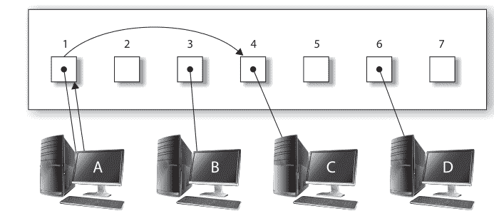

**图 1-3** 查看交换机上的 MAC 地址表

MAC 地址表

| MAC | Port |
| --- | ---: |
| 00-1A-2C... | 1 |
| 00-AB-B1... | 3 |
| 00-2C-1B... | 4 |
| 00-3B-4D... | 6 |

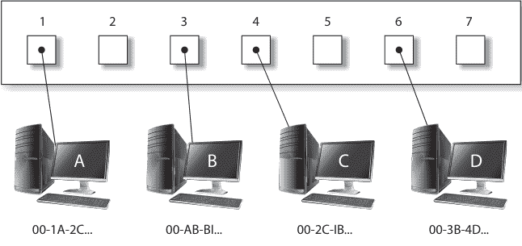

除了通过仅将数据发送到目的系统所在的端口来过滤流量外，大多数网络交换机还提供以下好处：

- **过滤** 如前所述，交换机会过滤流量，这可以防止他人捕获和查看可能机密的信息。
- **端口镜像** 端口镜像，也称为端口监控，是某些交换机的一个功能，允许管理员将其他端口的流量复制到单个目标端口（称为监控端口）。由于交换机默认会过滤流量，管理员无法监控网络流量。交换机厂商必须想出一种方法将所有流量复制到单个端口，以便管理员可以将他们的监控系统连接到该端口。

以下命令用于配置交换机上的端口 12（称为 *接口*）以监控端口 1 到 5 发送或接收的流量：

```
HAL-SW1(config)#interface fastethernet 0/12
HAL-SW1(config-if)#port monitor fastethernet 0/1
HAL-SW1(config-if)#port monitor fastethernet 0/2
HAL-SW1(config-if)#port monitor fastethernet 0/3
HAL-SW1(config-if)#port monitor fastethernet 0/4
HAL-SW1(config-if)#port monitor fastethernet 0/5
```


### 端口安全

端口安全是网络交换机的一项功能，允许你为某个端口配置特定的 MAC 地址。这样可以控制哪些系统能够连接到交换机上的该端口。当未经授权的系统连接到交换机的该端口时，交换机可以暂时禁用该端口，直到正确的系统接入，或者保持禁用状态，直到管理员重新启用该端口。以下命令用于将 Halifax 交换机上的端口 6 配置为仅接受来自特定 MAC 地址的连接。在此示例中，MAC 地址为 *aaaa.bbbb.cccc*，你需要将其替换为实际的 MAC 地址：

```text
HAL-SW1(config)#interface f0/6
HAL-SW1(config-if)#switchport mode access
HAL-SW1(config-if)#switchport port-security
HAL-SW1(config-if)#switchport port-security mac-address aaaa.bbbb.cccc
HAL-SW1(config-if)#switchport port-security maximum 1
HAL-SW1(config-if)#switchport port-security violation shutdown
```

### 禁用端口的能力

如果交换机上有未使用的端口，出于安全最佳实践，应将其禁用，以防被利用。以下命令通过 **shutdown** 命令禁用 Cisco 交换机上的端口 7 至 12：

```text
HAL-SW1(config)#interface range f0/7–12
HAL-SW1(config-if-range)#shutdown
```

> **考试重点**
>
> Security+ 认证考试不会要求你掌握配置端口安全或禁用 Cisco 交换机端口的命令，但要求你理解交换机提供的安全相关功能。

### 冲突域

交换机的另一个重要特性是*冲突域*，它是一组共享同一网段的系统，因此它们的数据可能相互冲突。集线器上的所有端口构成一个冲突域，而交换机上的每个端口则各自构成独立的冲突域。例如，使用网络集线器时，如果两个系统同时发送数据，就会导致数据冲突。这是因为集线器创建了一个所有系统都能访问的“共享”网段。而使用交换机时，交换机的每个端口都创建了独立的冲突域，即各自的网段。当系统连接到交换机的某个端口时，由于该网段上没有其他系统，因此不会发生数据冲突。

> **考试重点**
>
> 考试中请记住，交换机之所以能提供良好的安全性，是因为它通过将流量仅发送到目标系统所在的端口来过滤流量。你还应当能够描述端口安全、端口镜像以及禁用未使用端口等功能。

## VLAN

如今大多数交换机都支持虚拟局域网（VLAN）功能。VLAN 的目的是在一台网络交换机内创建多个网络。实现方式之一是将交换机上的端口划分到不同的 VLAN 组中。当系统连接到交换机的某个端口时，它就成为该端口所属 VLAN 的成员。关键在于，当一个系统属于某个 VLAN 时，它无法与另一个 VLAN 中的系统通信。就好像每个 VLAN 都有自己的交换机，并且与其他交换机没有连接。图 1-4 显示了一台配置了两个 VLAN 的交换机。在此示例中，计算机 A 只能与计算机 B 通信，因为它们是 VLAN1 中仅有的系统。计算机 A 和计算机 B 无法与计算机 C 和计算机 D 通信，因为在没有路由器的情况下，不允许跨 VLAN 通信。

以下代码展示了如何在 Cisco Catalyst 交换机上配置 VLAN。此示例创建了两个 VLAN：PrivateLAN 和 WebServers：

```
HAL-SW1>enable
HAL-SW1#config term
HAL-SW1(config)#vlan 2
HAL-SW1(config-vlan)#name PrivateLAN
HAL-SW1(config-vlan)#exit
HAL-SW1(config)#vlan 3
HAL-SW1(config-vlan)#name WebServers
HAL-SW1(config-vlan)#exit
```

**图 1-4** *查看交换机上的 VLAN*

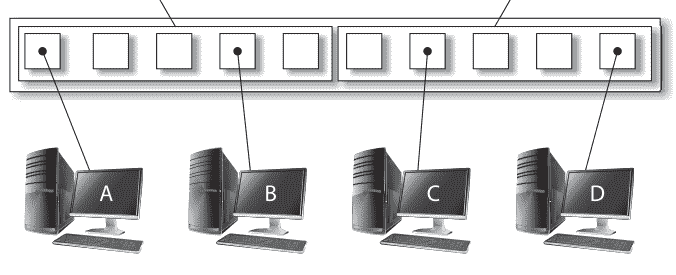

创建好 VLAN 后，接下来需要将不同端口划分到特定 VLAN 中。例如，以下命令将端口 18 至 24 划分到 WebServers VLAN：

```
HAL-SW1(config)#interface range f0/18 - 24
HAL-SW1(config-if-range)#switchport access vlan 3
```

需要注意的是，你可以将多台交换机连接起来，并在所有交换机之间创建 VLAN。例如，你可以在交换机 1、交换机 2 和交换机 3 上各设置几个端口，使其属于 WebServers VLAN。连接交换机的上行链路端口会将 VLAN 流量传送到每台交换机。

> **考试重点**
>
> 考试中请记住，VLAN 是在网络上创建通信边界的一种方式。默认情况下，一个 VLAN 中的系统无法与另一个 VLAN 中的系统通信。

## 路由器

路由器是一种三层设备，负责将数据从一台网络路由（即发送）到另一台网络。路由器使用存储在其内存中的路由表来确定它知道如何将数据发送到哪些网络。图 1-5 显示了一个网络拓扑及路由器上的路由表。注意图中所示，路由器 R1 要将数据发送到 25.0.0.0 网络，必须将数据发送到 24.0.0.2 地址，如路由表所示。

以下代码清单通过 show ip route 命令显示了 Cisco 路由器上的路由表。请注意清单中有三条路由；到达 23.0.0.0 和 24.0.0.0 网络的路由是已知的，因为路由器直接连接到了这些网络（注意左侧的 C）。此外，管理员还配置了一条静态路由（左侧代码为 S），用于将数据传递到 24.0.0.2 系统，以到达 25.0.0.0 网络。

```
HAL-R1#show ip route
Codes: C-connected, S-static, I-IGRP, R-RIP, ...
(Additional codes omitted for briefness)
Gateway of last resort is not set
S   25.0.0.0 [1/0] via 24.0.0.2
C   24.0.0.0/8 is directly connected, Serial0/0/0
C   23.0.0.0/8 is directly connected, FastEthernet0/1
```

路由器是非常优秀的网络设备，因为它们通过创建所谓的广播域来定义网络的边界。广播域是指一组能够接收彼此广播消息的系统。广播消息是发送给所有系统的消息——路由器被策略性地放置在网络中，以将这些广播消息限制在你的网络内，因为广播流量不会通过路由器。

**图 1-5** *路由器使用路由表来传输数据。*

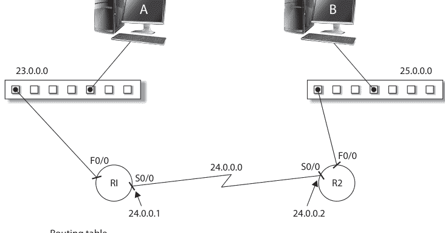

**路由表**

| 网络 | 路径 |
|---|---|
| 23.0.0.0 | F0/0 |
| 24.0.0.0 | S0/0 |
| 25.0.0.0 | 24.0.0.2 |

## 负载均衡器

负载均衡器是一种旨在将负载分摊到多个组件（如服务器或路由器）之间的设备。负载均衡的理念是努力提高性能。与其让一台服务器或设备处理所有工作，不如使用多台服务器或设备来分担工作负载。这样可以提高整体性能，因为有更多系统同时工作来处理所有传入的请求。

负载均衡器有许多设置，允许你配置其工作方式：

- **轮询（Round-robin）**：按顺序将客户端的请求发送到每台后端服务器。负载均衡器维护一个服务器列表，并依次轮询列表中的服务器。

- **关联（Affinity）**：控制来自客户端的的所有请求是全部发送到负载均衡器中的同一台服务器，还是每个请求都可能被路由到不同服务器。关联本质上是将客户端绑定到特定服务器。

- **持久性（Persistence）**：这是另一种将客户端与负载均衡器中的特定服务器关联起来的方法。持久性利用用户的会话 Cookie 来确保同一台服务器处理来自客户端的的所有请求（这也称为粘性会话）。该会话 Cookie 可能来自应用程序本身，也可能来自负载均衡器。


**调度** 指定用哪种算法将请求发送到其中一个节点。调度使用许多配置值（如轮询、亲和性和CPU负载）来确定将请求发送到哪台服务器。

**主动/被动 vs. 主动/主动** 负载均衡有两种常见配置。采用*主动/被动*配置时，一个称为节点的系统处理所有工作（主动节点），而另一个节点（被动节点）处于待命状态，随时准备在主动节点故障时接管。如果主动节点发生故障，被动节点将成为主动节点并处理所有工作负载。采用*主动/主动*配置时，两个节点都在线并能够处理请求，实质上分担工作负载。如果一个节点发生故障，另一个节点将处理所有工作负载，直到故障节点恢复。两种配置都可以包含两个以上的节点，以提供额外的冗余。

在这两种设置中，负载均衡器都分配有一个IP地址（称为*虚拟IP*），你配置所有客户端将请求发送到分配给负载均衡器的虚拟IP。当负载均衡器接收到发送到虚拟IP的请求时，它会将请求转发给负载均衡器中的一个主动节点。

**DNS轮询** 另一种负载均衡技术称为DNS轮询。采用轮询方式时，负载均衡解决方案只是将请求发送到其列表中的下一台服务器。轮询的问题在于，该解决方案不会验证该服务器是否确实正常运行且没有故障。轮询负载均衡的一个示例是使用域名系统（DNS）。你可以创建多个名称相同但IP地址不同的DNS记录，DNS服务器将在每次响应客户端时发送不同的IP地址。问题在于，DNS服务器不会验证这些IP地址是否由正常运行的系统使用。

## 防火墙和代理服务器

你将在第8章中了解更多关于防火墙和代理服务器的内容，但本节将快速描述防火墙和代理服务器的用途，将其作为网络设备进行介绍。

> 对于Security+考试，请记住：代理服务器代表用户请求互联网资源，并且公司通常会过滤并记录用户访问了哪些网站。

*防火墙*是一种网络设备，用于控制允许哪些流量进入或离开网络。防火墙根据你在防火墙上设置的规则过滤流量，这些规则指示允许或不允许哪些流量进入或离开网络。你通常从“全部拒绝”规则开始，即除非你通过为特定类型的流量构建规则另有指定，否则所有流量都被拒绝。

*代理服务器*是所有客户端将其互联网流量发送到的设备，然后代理服务器代表用户将请求发送到互联网。代理服务器通常还实现网络地址转换（NAT），帮助内部网络结构对外界保持私密。有些透明代理不需要用户进行身份验证，但也有一些代理服务器产品要求客户端在能够上网之前进行身份验证。这有助于控制每个用户可以访问的站点，并允许代理管理员记录每个用户正在访问哪些站点。关于代理服务器的最后一点说明是，还有反向代理，它允许你接收所有入站流量（例如发往Web服务器的流量），分析请求，并且只允许安全、有效的请求到达Web服务器。

## 了解网络布线

布线是局域网（LAN）上主机之间发送数据的传输介质。局域网上的系统可以使用多种电缆类型连接在一起，例如非屏蔽双绞线和光纤。每种电缆类型都有其自身的优点和缺点，你将在本节中了解。

可用于将系统连接到网络的两种主要电缆介质是双绞线电缆和光纤电缆。这些物理介质各自支持的传输速率以每秒百万比特，即兆比特每秒（Mbps）来衡量。

### 双绞线

如今，双绞线最受欢迎。双绞线因其有四对相互缠绕的线对而得名，这种缠绕有助于减少串扰或来自外部电气设备的干扰。串扰是来自相邻导线的干扰。图1-6显示了双绞线电缆。就像同轴电缆有两种形式一样，双绞线也有两种形式：非屏蔽双绞线（UTP）和屏蔽双绞线（STP）。

#### 非屏蔽双绞线

如果你使用过电话线，那么你对UTP电缆会很熟悉。用于网络的典型双绞线电缆包含四对导线。电缆中每对导线彼此缠绕。导线中的绞合有助于屏蔽电磁干扰。UTP的最大距离为100米。

UTP电缆使用小型塑料连接器，称为注册插孔45（registered jack 45），通常简称为RJ-45。RJ-45与电话连接器类似，只不过家庭系统中的电话连接器有四根导线，而网络RJ-45连接器包含八个触点，UTP电缆中的每根导线对应一个触点。

很容易将RJ-45连接器与RJ-11连接器混淆。RJ-11连接器是一种电话连接器，有四个触点；因此，电话线中有四根导线。对于RJ-45和RJ-11，在制作电缆时，你需要使用特殊的压接工具，使连接器中的引脚与电缆内部的导线接触。

**图1-6** 非屏蔽双绞线（UTP）电缆

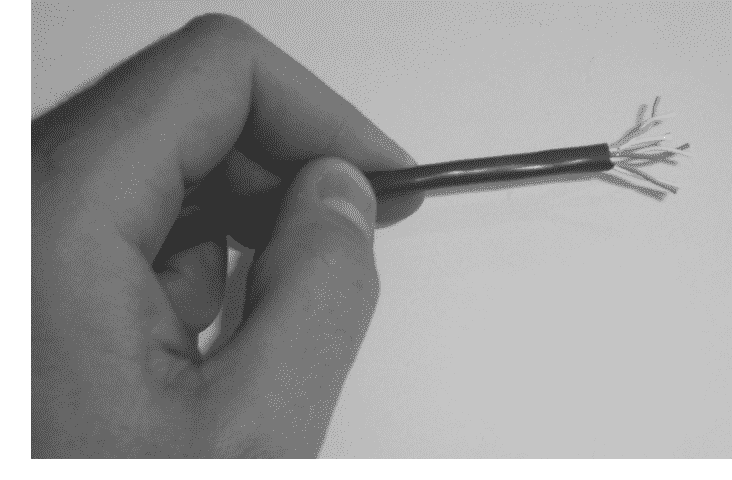

UTP电缆比同轴电缆更容易安装，因为UTP电缆柔韧且体积小，更容易绕过拐角。然而，双绞线比同轴电缆更容易受到干扰，因此不应在包含大型电气设备的环境中使用。

UTP布线有不同的规格，称为等级或类别。每种UTP布线类别都是为特定类型的通信或传输速率而设计的。表1-1总结了不同的UTP类别——目前最流行的是CAT 5e，其传输速率可超过1,000 Mbps，即1吉比特每秒（Gbps）。

**表1-1** 不同的UTP类别布线

| UTP类别 | 用途 | 传输速率 |
|---|---|---|
| 类别1 | 仅语音 | |
| 类别2 | 数据 | 4 Mbps |
| 类别3 | 数据 | 10 Mbps |
| 类别4 | 数据 | 16 Mbps |
| 类别5 | 数据 | 100 Mbps |
| 类别5e | 数据 | 1 Gbps (1,000 Mbps) |
| 类别6 | 数据 | 10 Gbps |

在使用UTP布线的网络中工作时，你会遇到用于不同用途的不同类型的电缆。例如，有时你会使用直通线或交叉线。

#### 直通线

CAT 5 UTP布线在网络上发送和接收信息时通常只使用四根导线。在八根导线中，使用的四根是导线1、2、3和6。图1-7显示了计算机上的发送和接收引脚以及交换机上的引脚，交换机通常是你将计算机连接到的设备。当你将电缆两端的导线配置到相同的引脚时，这称为直通线。

你会在图中注意到，导线1和2用于从计算机发送数据（TX），而导线3和6用于在计算机上接收信息（RX）。你还会注意到，计算机上的发送引脚（TX）通过导线1和2连接到交换机上的接收引脚（RX）。这一点很重要，因为你需要确保计算机发送的数据被交换机接收。你还需要确保交换机发送的数据在计算机处被接收，因此你会注意到交换机上的发送引脚（TX）通过导线3和6连接到计算机上的接收引脚（RX）。这将使计算机能够从交换机接收信息。

关于图1-7要注意的最后一点是，计算机上的引脚1通过同一根导线连接到交换机上的引脚1，因此称为*直通*。你会注意到，在图1-7中，所有引脚都直通到另一侧。

#### 交叉线

在某些时候，你可能需要将两台计算机系统直接连接在一起，无需使用交换机，从网卡到网卡。或者你可能发现需要将一台交换机连接到另一台交换机。在将类似设备连接在一起的任何场景中，你都无法使用直通线，因为一端的发送引脚会连接到另一端的发送引脚，如图1-8所示。计算机如何接收未发送到接收引脚的数据？既然这不起作用，你需要将电缆的布线改为所谓的交叉线。

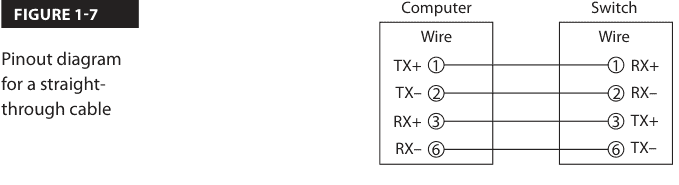


## 图 1-8

使用直通电缆连接两台计算机将无法工作。

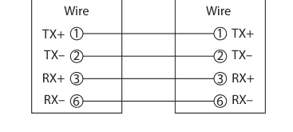

## 图 1-9

交叉电缆的针脚图

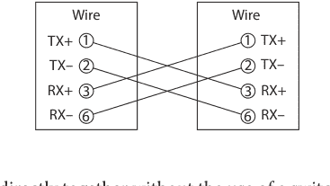

要不使用交换机直接将两个系统连接在一起，您需要在电缆的一端将 1 号和 2 号线与 3 号和 6 号线互换，以制作交叉电缆，如图 1-9 所示。您会注意到计算机 A 上的发送针脚连接到计算机 B 上的接收针脚，从而使计算机 A 能够向计算机 B 发送数据。同样适用于计算机 B 向计算机 A 发送数据——计算机 B 上的针脚 1 和 2 接线到计算机 A 上的针脚 3 和 6，以便计算机 A 可以从计算机 B 接收数据。

工作现场
大多数网络管理员会使用某种电缆颜色（例如黄色）来表示交叉电缆，并使用不同颜色的电缆来表示直通电缆，以防止混淆这两种类型的布线。

## 屏蔽双绞线电缆

STP 电缆与 UTP 布线非常相似，但它与 UTP 不同之处在于它在保护外套内使用一层绝缘层，这有助于保持信号质量。

## 光纤电缆

要讨论的第二种布线类型是光纤电缆。光纤电缆与双绞线不同，因为双绞线使用铜线传输电信号。光纤电缆使用光纤，以调制光脉冲的形式传输数字数据信号。光纤由一根极细的玻璃圆柱体组成，称为纤芯，被一层同心玻璃层包围，称为包层。每根电缆有两根光纤——一根用于传输，一根用于接收。纤芯也可以是光学质量的透明塑料，包层可以由反射信号回光纤以减少信号损失的凝胶组成。

有两种类型的光纤电缆：

- **单模光纤 (SMF)** 使用单束光，称为模式，在长距离上传输
- **多模光纤 (MMF)** 同时使用多束光（模式），每束光以不同的反射角度运行，在短距离上传输

> 考试提示
> 记住考试时，光纤是一种更安全的电缆类型，因为它不传输电信号，而是以光脉冲的形式传输数据。

光纤电缆支持多达 1,000 个站点，并且可以将信号传输到 2 公里及更远。光纤电缆也高度防止来自无线电发射器、电弧焊机、荧光灯和其他电气噪声源等外部干扰。另一方面，光纤电缆是这些布线方法中最昂贵的，小型网络不太可能需要这些功能。

光纤电缆可以使用多种类型的连接器，例如直头 (ST) 连接器、朗讯连接器 (LC) 和用户 (SC) 连接器。ST 连接器基于 BNC 风格的连接器，但使用光纤电缆而不是铜缆。SC 连接器呈方形，与 RJ-45 连接器有些相似，而 LC 连接器是 SC 连接器的一半大小，专为大量使用布线的区域设计，例如配线架。

无论连接器类型如何，光纤电缆的功能速度相同，通常为 1,000 Mbps 及更快。您唯一需要担心的是连接器是否与要连接的设备匹配，因为两种连接器类型不可互换。

在准备 Security+ 考试时，有时列出电缆类型差异的表格会有所帮助。表 1-2 总结了不同的电缆类型——请务必在 Security+ 考试前复习它。

| Cable | Max Distance | Transfer Rate | Connector Used |
|---|---|---|---|
| CAT 3 (UTP) | 100 m | 10 Mbps | RJ-45 |
| CAT 5 (UTP) | 100 m | 100 Mbps | RJ-45 |
| CAT 5e | 100 m | 1 Gbps | RJ-45 |
| CAT 6 | 100 m | 10 Gbps | RJ-45 |
| Fiber-optic | 2 km | 1+ Gbps | SC, ST, or LC |

表 1-2
电缆类型摘要

## 练习 1-1

## 复习网络组件

在本练习中，您将通过将术语与适当的场景匹配来运用您对网络电缆和设备的知识。

| Device | Scenario |
|---|---|
| ____ Switch | A. 一组系统，其数据可能相互冲突 |
| ____ Load balancer | B. 一个通信边界 |
| ____ UTP | C. 一个第 3 层设备，可将数据从一个网络发送到另一个网络 |
| ____ Port security | D. 一个第 2 层设备，根据 MAC 地址过滤流量 |
| ____ VLAN | E. 用于在多个服务器之间分配工作负载的设备 |
| ____ Router | F. 一种传输光脉冲的电缆类型 |
| ____ Collision domain | G. 一种具有分成对的铜线的电缆类型 |
| ____ Fiber-optic | H. 控制哪些 MAC 地址可以连接到交换机 |

## 认证目标 1.02

## 了解 TCP/IP

现在您了解了网络上使用的不同类型的网络设备和电缆类型，让我们转换方向，谈谈 TCP/IP 协议。作为一名安全专业人员，您不仅需要熟悉 TCP/IP 协议，还需要了解 TCP/IP 网络上的通信如何发生。让我们从协议基础的快速回顾开始。

## 复习 IP 地址

TCP/IP 需要一些知识来正确配置系统。当您配置 TCP/IP 时，您需要知道 IP 地址、子网掩码和默认网关的设置。让我们从 IP 地址开始。

## IP 地址

IP 地址是一个 32 位值，用于唯一标识网络（或互联网）上的系统。IP 地址看起来类似于 192.168.1.15。四个十进制值

|  | Octet 1 | Octet 2 | Octet 3 | Octet 4 |
|---|---|---|---|---|
| IP address #1 | 192 | 168 | 1 | 15 |
| Subnet mask | 255 | 255 | 255 | 0 |
| IP address #2 | 192 | 198 | 45 | 10 |

使用子网掩码识别两个不同网络上的系统

您的系统如何知道使用哪个路由器？答案是“默认网关”。默认网关是路由器的 IP 地址，该路由器可以将数据从您的网络发送出去。

要在互联网上通信，您的系统需要配置 IP 地址、子网掩码和默认网关。如果您只需要与网络上的其他系统通信，则只需要 IP 地址和子网掩码。

## 地址类别

每个 IP 地址都属于一个不同的地址类别。互联网社区定义了这些类别以适应各种规模的网络。IP 地址所属的类别最初决定了地址的网络 ID 和主机 ID 部分，以及该网络上支持的主机数量。不同的类别地址命名为 A 类、B 类、C 类、D 类和 E 类。本节详细介绍每类地址。

## A 类地址

A 类地址的默认子网掩码为 255.0.0.0，这意味着第一个八位字节是网络 ID，最后三个八位字节属于地址的主机 ID 部分。每个八位字节可以包含 256 个可能的值（0–255），因此 A 类地址在网络上支持 16,777,216 个主机（256 × 256 × 256）。实际上，每个 IP 网络上只有 16,777,214 个有效地址可用于系统，因为每个 IP 网络上保留了两个地址：所有主机位都设置为 0 的地址（网络 ID）和所有主机位都设置为 1 的地址（广播地址）。因此，使用 A 类地址，您将无法将 n.0.0.0 或 n.255.255.255（其中 n 是您的网络 ID）分配给网络上的任何主机。

您始终可以通过第一个八位字节的值在 1 到 126 之间来识别 A 类地址。起始值为 127 的地址也是 A 类地址，但您不允许使用任何以 127 开头的地址，因为它保留用于环回地址（本章后面会详细介绍环回地址）。例如，IP 地址 12.56.87.34 是 A 类地址，因为第一个八位字节为 12，落在 1 到 126 的范围内。

## B 类地址

B 类地址的默认子网掩码为 255.255.0.0，这意味着前两个八位字节是网络 ID，最后两个八位字节是地址的主机 ID 部分。这意味着我们可以在网络上拥有 65,536 个主机（256 × 256）。哦，但等等！不要忘记减去两个保留地址，这样我们就可以将 65,534 个地址分配给网络上的主机。

由于 B 类地址支持的主机数量，您通常会发现中型公司使用 B 类地址。您可以通过第一个八位字节的数字在 128 到 191 之间来识别 B 类地址。


## C 类地址

C 类地址的子网掩码为 255.255.255.0，这意味着前三个八位组是网络 ID，最后一个八位组是主机 ID。由于只有一个八位组作为主机 ID，C 类地址在每个网络上只能支持 254 台主机（256 − 2）。

你可以通过第一个八位组的值来识别 C 类地址，其范围在 192 到 223 之间。例如，IP 地址 202.45.8.6 是一个 C 类地址，因为 202 介于 192 和 223 之间。我们也可以知道该系统的子网掩码是 255.255.255.0，因为它是一个 C 类地址。

## D 类地址

D 类地址用于网络中称为组播应用程序的特殊类型的应用程序。这些应用程序通过向组播地址发送数据，同时向许多系统发送数据，任何注册了该地址的系统都会收到数据。组播地址正是 D 类地址的用途，因此你不会将它们专门分配给网络上的主机用于正常的网络通信。

D 类地址的第一个八位组的值在 224 到 239 之间。有了如此大的范围，D 类最多可以有 268,435,456 个唯一组播组，用户可以从组播应用程序中订阅这些组播组。

## E 类地址

有意思的是，E 类地址仅是为实验目的而设计的，所以你永远不会在网络上看到 E 类地址。E 类地址的第一个八位组的值在 240 到 247 之间。

## 考试要点

## 记住地址类别？

虽然 Network+ 认证考试考查 IP 寻址和配置概念，但你仍然需要了解地址类别的概念，才能回答 Security+ 认证考试中的相关问题。以下段落回顾了有关地址类别的关键信息。

A 类地址的 IP 地址中，第一个八位组的值在 1 到 126 之间。A 类地址的默认子网掩码为 255.0.0.0。还要注意，该子网掩码可以显示为地址末尾的 /8——例如，12.0.0.10/8 表示前 8 位构成子网掩码。

B 类地址的 IP 地址中，第一个八位组的值在 128 到 191 之间。B 类地址的默认子网掩码为 255.255.0.0，也可以显示为地址末尾的 /16。

C 类地址的 IP 地址中，第一个八位组的值在 192 到 223 之间。此外，C 类地址的默认子网掩码为 255.255.255.0，可以显示为地址末尾的 /24。

## 表 1-5

回顾地址类别

|  | 第一个八位组的值 | 子网掩码 | 每个网络的主机数 |
|---|---|---|---|
| A 类 | 1–127 | 255.0.0.0 | 16,777,214 |
| B 类 | 128–191 | 255.255.0.0 | 65,534 |
| C 类 | 192–223 | 255.255.255.0 | 254 |

既然你已经熟悉了不同的地址类别，请看一下表 1-5，其中总结了这些地址类别。一定要记住它们以应对考试。

## 特殊地址

你已经知道，不允许为主机分配第一个八位组值为 127 的 IP 地址。这是因为 127 这个 A 类地址范围已被保留用于环回地址。

环回地址用于指代本地系统，也称为本地主机（localhost）。如果你想验证 TCP/IP 软件是否已在本地系统上初始化，即使你可能没有 IP 地址，也可以 ping 通常被称为 127.0.0.1 的环回地址。

私有地址是可以分配给系统但不能用于任何 Internet 连接的地址。私有地址是不可路由的地址，因此使用这些地址的任何系统都无法在网络之外进行通信。以下三个地址范围就是私有地址范围：

- 10.0.0.0 到 10.255.255.255
- 172.16.0.0 到 172.31.255.255
- 192.168.0.0 到 192.168.255.255

使用这些地址时无法在 Internet 上路由数据并不会造成问题，因为在实际情况中，这些私有地址会位于网络地址转换（NAT）服务器后面，NAT 服务器会将私有地址转换为可在 Internet 上路由的公共地址。

Windows 客户端支持一项称为自动专用 IP 寻址（APIPA）的功能。该功能的作用是，当客户端无法联系动态主机配置协议（DHCP）服务器时，Windows 客户端会自动配置一个 169.254.x.y 地址。如果 DHCP 服务器出现问题，网络上的所有系统都无法从 DHCP 服务器获取地址，那么客户端都会自动分配一个 169.254 地址范围内的地址，然后彼此之间就能进行通信。

APIPA 不会分配默认网关，因此你将无法访问远程网络和 Internet 上的资源——但你仍然可以与本地网络中的系统通信。在排查机器无法在网络中通信的原因时，要注意查找地址在 169.254.x.y 范围内的系统，因为这意味着它们找不到 DHCP 服务器。

## 无效地址

你不仅应熟悉 TCP/IP 中的私有地址范围，还应能够识别无效地址。无效地址是不允许分配给网络上的主机（如系统或路由器）的地址。从认证考试的角度来看，你需要能够识别这些无效地址。以下地址被视为无效地址：

- **任何以 127 开头的地址** 以 127 开头的 IP 地址保留给环回地址，不能分配给系统。此类无效地址的一个示例是 127.50.10.23。
- **主机位全部设为 0** 不允许将主机 ID 部分的所有位都设置为 0 的 IP 地址分配给系统，因为这是网络 ID。此类无效地址的一个示例是 131.107.0.0。
- **主机位全部设为 1** 不允许将主机 ID 部分的所有位都设置为 1 的 IP 地址分配给系统，因为这对应于网络的广播地址。此类无效地址的一个示例是 131.107.255.255。
- **重复的地址** 不允许将另一系统正在使用的地址分配给某个系统，因为这会导致“重复 IP 地址”错误。

## 练习 1-2

## 理解有效地址

在本练习中，你将通过记录以下每个地址是否有效来练习识别有效地址。有效地址是可以分配给网络上系统的地址。如果某个地址无效，你必须说明原因。

| 地址 | 有效？ |
|---|---|
| 10.0.40.10 | |
| 127.54.67.89 | |
| 131.107.34.0 | |
| 45.12.0.0 | |
| 216.83.11.255 | |
| 63.256.4.78 | |
| 200.67.34.0 | |
| 131.107.23.255 | |

## 理解 TCP/IP 协议

既然你已经了解了 IP 寻址的基础知识，下面我们来讨论 TCP/IP 协议族中存在的各种协议。作为负责在路由器上配置防火墙和访问列表的安全专业人员，理解每一种 TCP/IP 协议至关重要。

## 传输控制协议

传输控制协议（TCP）负责提供面向连接的通信，并确保数据交付（即所谓的可靠交付）。面向连接的通信需要先在两个系统之间建立连接，然后确保通过该连接发送的数据到达目的地。TCP 通过重传丢失或损坏的数据来确保数据到达目的地。TCP 被需要可靠传输的应用程序所使用，但这种传输方式比无连接协议的开销更大，因为需要建立会话，并监控和重传该会话中的任何数据。

关于 TCP，另一个需要记住的要素是，该协议要求接收方确认成功收到数据。当然，所有被称为 ACK 的确认都会在网络中产生额外的流量，这会减少在给定时间内可以传输的数据量。创建、监控和结束 TCP 会话所涉及的额外开销，与 TCP 确保数据到达目的地的确定性相比，是值得的。

TCP 通过使用序列号和确认号来确保数据交付。序列号是分配给所发送的每一段数据的编号。系统收到一段数据后，会向发送方发送一条确认消息来确认已收到该数据，回复消息的确认号即为原始序列号。

## TCP 三次握手

在系统通过 TCP 进行通信之前，它必须首先与远程系统建立连接。为了与远程系统建立连接，TCP 使用所谓的 TCP 三次握手。TCP 三次握手包含以下三个阶段（如图 1-10 所示）：

-   SYN 在第一阶段，发送系统向接收系统发送一条 SYN 消息。发送的每个数据包都会被分配一个唯一的序列号。SYN 消息包含初始序列号（ISN），这是要使用的第一个序列号。在本例中，计算机 A 正在连接计算机 B 上的网站，因此一条 SYN 消息被发送到计算机 B 的 80 端口。

-   SYN/ACK 第二阶段称为 SYN/ACK 阶段，因为该消息在确认第一条消息的同时，也在指示其初始序列号。在本例中，计算机 B 发回 SYN/ACK 消息，确认已收到数据包 123（通过确认下一个序列号为 124），同时将其 ISN 指定为 326。


**表 1-6**  
**常用 TCP 端口**

| 端口 | 服务 | 描述 |
|---|---|---|
| 20 | FTP 数据 | FTP 用于向客户端发送数据的端口。 |
| 21 | FTP 控制 | FTP 命令发送至服务器所用的端口。 |
| 22 | SSH | 安全外壳（SSH）用于加密远程访问通信的端口。它通常用作 Telnet 的安全替代方案。 |
| 23 | Telnet | Telnet 用于远程连接服务器或路由器等系统的端口。 |
| 25 | SMTP | 用于发送互联网电子邮件的端口。 |
| 53 | DNS | 用于 DNS 区域传输的端口。 |
| 80 | HTTP | 用于将网页内容传送到浏览器的互联网协议。 |
| 110 | POP3 | POP3 使用的端口，这是一种用于读取电子邮件的互联网协议。 |
| 139 | NetBIOS | NetBIOS 会话服务使用的端口。它用于在两个系统之间建立连接以进行 NetBIOS 通信。 |
| 143 | IMAP | IMAP 使用的端口，这是一种较新的用于读取电子邮件的互联网协议。 |
| 443 | HTTPS | 用于安全网络流量的端口。 |
| 3389 | RDP | 远程桌面协议（RDP）用于远程管理 Windows 系统的端口。 |

分配给应用程序的地址。当客户端想要与其中一个应用程序（也称为服务）通信时，客户端必须将请求发送到系统上相应的端口号。

作为安全专业人员，了解一些常用服务使用的端口号至关重要。表 1-6 列出了你在 Security+ 认证考试中应掌握的常见 TCP 端口号。

## TCP 标志

TCP 协议使用 TCP 标志来识别重要的数据包类型。以下是你在 Security+ 认证考试中应熟悉的常见 TCP 标志：

- **SYN** — SYN 标志分配给三次握手 SYN 阶段中的任何数据包。
- **ACK** — 确认标志用于确认先前已收到某个数据包。
- **PSH** — 推送标志旨在将数据强制推送给应用程序。
- **URG** — 紧急标志指定某个数据包为紧急数据包。

FIN 结束标志指定你想要完成或终止连接。这会有礼貌地结束 TCP 连接，就像说再见来结束电话通话一样。

RST 重置标志用于不礼貌地结束 TCP 会话。这就像不打招呼就挂断电话。

> 作为安全专业人员以及参加 Security+ 考试的人员，你应该熟悉不同的 TCP 标志，因为它们将帮助你理解第 4 章中介绍的各种端口扫描类型。

图 1-12 显示了数据包捕获中的标志。请注意，网络监视器并非显示实际的标志位，而是解释其值并显示描述。例如，你不是看到 URG 标志设置为零，而是看到第一个标志设置为零并带有“无紧急数据”(No urgent data) 的描述。

## 图 1-12 TCP 头中的 TCP 标志

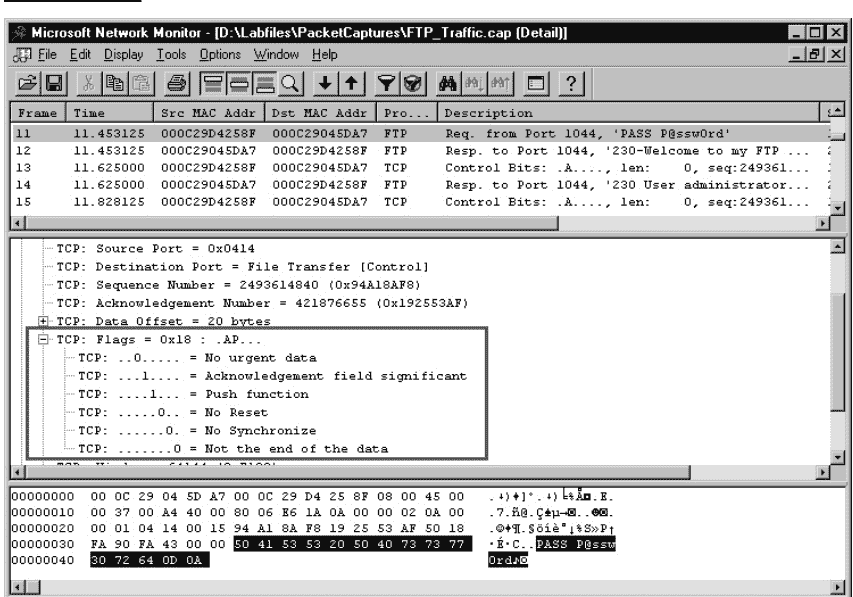

## TCP 头

每个使用 TCP 协议发送的数据包都有一个分配给它的 TCP 头，其中包含与 TCP 相关的信息，如源端口、目标端口和 TCP 标志。图 1-13 显示了 TCP 头中的不同字段。每个字段的简要说明如下：

- **源端口** — 此 16 位字段标识发送系统的端口号。
- **目标端口** — 此 16 位字段标识数据包在目标系统上要发送到的端口号。
- **序列号** — 此 32 位字段标识数据包的序列号。
- **确认号** — 此 32 位字段标识此数据包所确认的数据包。
- **偏移量** — 此 4 位字段指示数据开始的位置。
- **保留** — 此 6 位字段始终设置为 0，为将来使用而设计。
- **标志** — 此 6 位字段用于存储 TCP 标志。本节前面提到的每个标志都有一个 1 位字段。
- **窗口大小** — 此 16 位字段确定在预期收到确认之前可以发送的信息量。
- **校验和** — 此 16 位字段用于验证 TCP 头的完整性。
- **紧急指针** — 此 16 位字段仅在设置了 URG 标志时使用，是对最后一条紧急信息的引用。
- **选项** — 这是一个可变长度字段，用于指定 TCP 头中可能需要的任何附加设置。

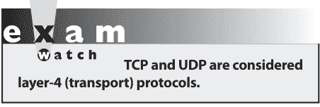

| 字段 | 字段 |
|---|---|
| 源端口 | 目标端口 |
| 序列号 | |
| 确认号 | |
| 偏移量 | 保留 | 标志 | 窗口大小 |
| ACK | SYN | FIN | RST | PSH | URG |
| 校验和 | 紧急指针 |
| 选项 | |

图 1-13

TCP 头

## 用户数据报协议

用户数据报协议（UDP）供不希望关注确保数据到达目标系统的应用程序使用。UDP 用于无连接通信（不可靠），这意味着数据被发送到目的地，但不努力跟踪数据包的进度以及它是否已到达目的地。

## UDP 端口

与 TCP 一样，UDP 使用端口号来标识不同类型的流量。表 1-7 列出了一些 UDP 流量及其使用端口的示例。

## UDP 头

由于用户数据报协议不必确认数据包的接收，因此 UDP 头的结构比 TCP 头简单得多。例如，UDP 头不需要序列号或确认号；它也不需要标志来指示诸如 SYN 消息之类的特殊数据包，因为没有三次握手（因为 UDP 是无连接的）。图 1-14 显示了 UDP 头以及以下字段的列表：

- 源端口 一个 16 位字段，指示发送系统上发送应用程序使用的端口。
- 目标端口 一个 16 位字段，指示目标系统上应用程序使用的端口。
- 长度 一个 16 位字段，指定 UDP 头的字节大小。
- 校验和 一个 16 位字段，用于验证 UDP 头的完整性。

| 端口 | 服务 | 描述 |
|---|---|---|
| 53 | DNS | UDP 端口 53 用于 DNS 查询。 |
| 67 和 68 | DHCP | DHCP 服务使用 UDP 端口 67，客户端请求使用 UDP 端口 68。 |
| 69 | TFTP | 普通文件传输协议用于在无需认证的情况下下载文件。 |
| 137 和 138 | NetBIOS | NetBIOS 名称服务和数据报服务使用 UDP 137 和 138。 |
| 161 | SNMP | 简单网络管理协议使用 UDP 端口 161。 |

观看本书附带在线资源中提供的视频，该视频回顾了 TCP 头的内容。

## IP 头

数据包中的 IP 头包含有助于数据包从源地址到达目的地的信息。以下是字段及其含义的列表，图 1-15 显示了 IP 头的结构：

- **版本**  一个 4 位字段，标识所使用的 IP 版本（例如，4 或 6）。
- **头长度**  一个 4 位字段，指示 IP 头的大小。
- **服务类型**  一个 8 位字段，指示系统应如何处理数据包。例如，如果此处指定了低延迟选项，则表示系统应立即处理该数据包。
- **总长度**  一个 16 位字段，指示 IP 头的大小。
- **标识**  一个 16 位字段。网络只能处理特定最大大小的数据包——称为*最大传输单元（MTU）*——因此系统可能会将发送的数据分解为多个片段。此字段唯一标识该片段。
- **IP 标志**  一个 3 位字段，指定如何处理片段。例如，更多片段（MF）标志表示还有更多片段。此外，一个称为不分片（DF）的位指定不对数据包进行分片。
- **片段偏移**  一个 13 位字段，指定在组装数据包时片段重新组合的顺序。
- **生存时间（TTL）**  一个 8 位字段，指定数据包何时过期。TTL 是一个值，数据包每经过一个路由器，该值减一。当 TTL 达到 0 时，数据包被丢弃。
- **协议**  一个 8 位字段，指定数据包应使用的第 4 层协议（TCP 或 UDP）。
- **头校验和**  一个 16 位字段，验证 IP 头的完整性。

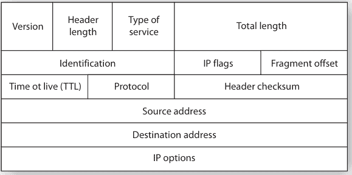


- **源地址** 一个 32 位字段，表示发送系统的 IP 地址。接收系统通过它知道将回复消息发送到哪里。
- **目的地址** 一个 32 位字段，表示数据包的目的系统的 IP 地址。
- **IP 选项** 一个可变长度字段，用于指定 IP 头中的其他设置。

观看随本书提供的在线资源中包含的视频，以了解 IP 头中常见 IP 字段的演示。


## Internet 控制消息协议

Internet 控制消息协议（ICMP）使 TCP/IP 网络上的系统能够共享状态和错误信息。您可以使用状态信息来检测网络故障。

> **考试提示**
> 
> ICMP 是 TCP/IP 协议套件中负责错误和状态报告的协议。ping 和 tracert 等程序使用 ICMP。

ICMP 消息封装在 IP 数据报中，以便它们可以在网络中路由。使用 ICMP 消息的两个程序是 ping 和 traceroute（Linux）或 tracert（Windows）。

您可以使用 ping 向 IP 地址发送 ICMP 回显请求并等待 ICMP 回显响应。Ping 报告发送请求和接收响应之间的时间间隔。使用 ping，您可以确定网络上特定 IP 系统是否正常运行。您可以使用 ping 实用程序的许多不同选项。

Tracert 追踪到特定主机的路径。此实用程序在排除互联网网络故障时非常有用。Tracert 在从 1 开始将 IP 头中的 TTL 字段按计数 1 递增的同时向 IP 地址发送 ICMP 回显请求，然后分析返回的 ICMP 错误。每个后续的回显请求应该在 TTL 字段达到 0 之前进入网络更深一步，然后由尝试转发它的路由器返回“ICMP 时间超过”错误消息。

**ICMP 类型和代码** ICMP 不使用端口号，而是使用 ICMP 类型和代码来标识不同类型的消息。例如，ping 请求使用的回显请求消息使用 ICMP 类型 8，而 ping 回复则返回 ICMP 类型 0 消息。

一些 ICMP 类型通过类型中的不同代码进一步细分。例如，ICMP 类型 3 是目标不可达消息，但由于目标不可达可能有许多原因，因此该类型被细分为不同的代码。每个代码对应类型中的不同消息（见表 1-8）。

| Type | Code | Description |
|---|---|---|
| 0—Echo Reply | 0 | Echo reply message |
| 3—Destination Unreachable | 0 | Destination network |
|  | 1 | Destination host unreachable |
|  | 2 | Destination protocol unreachable |
|  | 3 | Destination port unreachable |
| 8—Echo Request | 0 | Echo request message |

要善于监控网络并识别可疑流量，您需要了解本章讨论的每个协议头。对于考试，请记住 ICMP 类型 8 由回显请求消息使用，ICMP 类型 0 由回显回复使用。

## ICMP 头

与 IP 头和 TCP 头相比，ICMP 头非常小。图 1-16 显示了 ICMP 头，其后是字段列表：

- **Type** — 一个 8 位字段，表示正在使用的 ICMP 类型。
- **Code** — 一个 8 位字段，表示正在使用的 ICMP 代码。
- **Checksum** — 一个 16 位字段，用于验证 ICMP 头的完整性。
- **Other** — 一个存储 ICMP 头中任何数据的字段。例如，Microsoft 操作系统在回显请求消息的此字段中放置字母表的一部分。

观看随本书提供的在线资源中包含的视频，以了解 ICMP 类型和代码的演示。

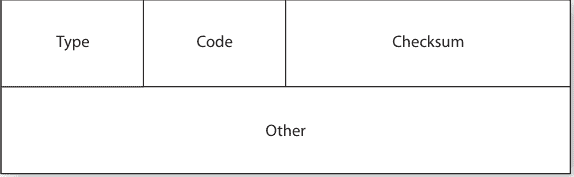

## 地址解析协议

地址解析协议（ARP）在 TCP/IP 网络上提供逻辑地址到物理地址的解析，即将 IP 地址转换为 MAC 地址。为了实现这一功能，ARP 发送广播消息，其中包含 ARP 请求数据包，其中包含它试图查找的系统的 IP 地址。本地网络上的所有系统都会看到该消息，而拥有 ARP 正在查找的 IP 地址的系统会通过发送其物理地址给源系统来回复 ARP 回复数据包。然后物理/IP 地址组合存储在源系统的 ARP 缓存中以供将来使用。

> exam Watch
> ARP 负责将 IP 地址（第 3 层地址）转换为物理 MAC 地址（第 2 层地址）。

所有系统都维护包含 IP 地址到物理地址映射的 ARP 缓存。在发起广播之前，始终会检查 ARP 缓存是否存在 IP 地址到物理地址的映射。

## EXERCISE 1-3

## 使用 Wireshark 查看协议信息

在此练习中，您将从 www.wireshark.org 下载并安装 Wireshark。在此场景中，您使用 Wireshark 监控 FTP 流量以确定登录流量是否已加密（事实并非如此）。

## 安装 Wireshark

- 1. 从 www.wireshark.org 下载并安装最新版本的 Wireshark。执行安装时接受所有默认选项。

## 使用 Wireshark 查看数据包数据

- 2. 在您的系统上启动 Wireshark。
- 3. 启动 Wireshark 后，通过选择 文件 | 打开 打开捕获文件。
- 4. 在打开对话框中，打开位于 Labfiles\PacketCaptures 文件夹中的 FTP_Traffic.cap 文件。
- 5. 显示数据包捕获的内容。屏幕分为三个部分：数据包列表（顶部）、数据包详细信息（中间）和数据包字节（底部）。请注意，捕获了 52 个数据包（在顶部屏幕的 Packet List 部分左侧列出的编号），您也可以在状态栏中看到“Packets: 52”。在屏幕顶部部分，选择数据包 4，注意它是第一个 FTP 数据包（查看协议列）。
- 6. 请注意，在信息列中，前三个数据包是 TCP 三次握手（SYN、SYN/ACK、ACK）。您可以通过先查看协议列看到 TCP，然后在信息列中看到 SYN、SYN/ACK 和最后 ACK 的描述来看到这一点。
- 7. 选择数据包 8。请注意，在信息列中，您可以看到用于登录 FTP 服务器的用户名。用户名是什么？ ______________
- 8. 确保数据包 8 仍在数据包列表窗口中选中。
- 9. 请注意，在数据包列表窗口下方，您有数据包详细信息窗口显示所选数据包的详细信息。另请注意，在数据包详细信息窗口下方还有一个窗口称为字节详细信息窗口，显示所选数据包的十六进制数据。
- 10. 在数据包详细信息窗口中展开 Internet Protocol Version 4 部分以查看数据包的 IP 头并记录以下信息：
  - 源 IP 地址： ______________
  - 目的 IP 地址： ______________

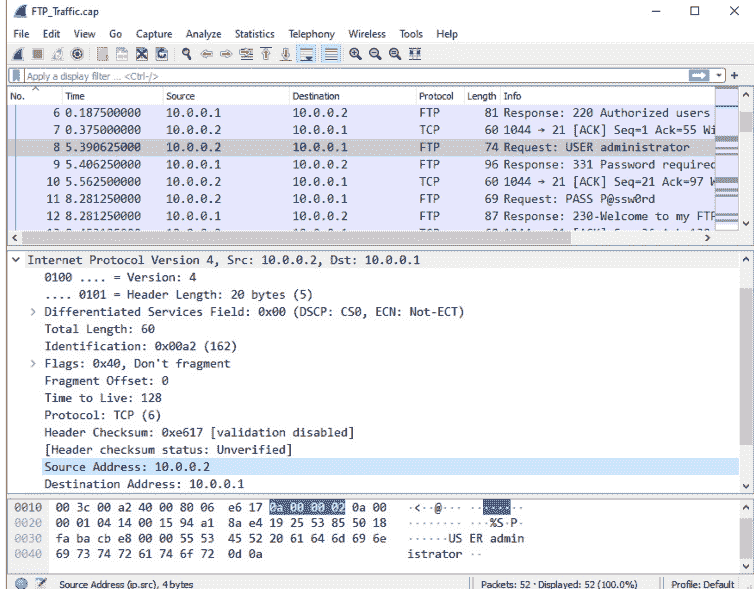

- 11. 在数据包详细信息中展开 TCP 头并找到以下信息：
  - 源端口： _____________
  - 目的端口： _____________
  - 序列号： _____________
  - 设置的标志： _____________

12. 选择数据包 11 并在数据包捕获中查找 FTP 密码。正在使用的密码是什么？（查看数据包列表窗口的信息列或数据包详细信息窗口中的 FTP 部分。） _____________

13. 关闭 Wireshark。

## 理解应用层协议

在为 Security+ 认证考试做准备时，您需要了解应用程序用于通信的各种协议。在本节中，您将了解 Internet 应用程序和网络应用程序常用的协议。

## HTTP 和 HTTPS

超文本传输协议（HTTP）用于在 Internet 上允许客户端从 Web 服务器请求网页并允许客户端与这些 Web 服务器交互。HTTP 是一种无状态协议，这意味着 Web 服务器不知道客户端请求了什么或没有请求什么，并且无法跟踪请求特定内容的用户。此系统不允许与 Web 服务器进行良好的交互，但确实允许检索存储在网站上的 HTML 页面。为了帮助跟踪客户端请求，我们使用 cookie——存储在客户端计算机上的小文件，允许 Web 服务器在客户端上存储数据，客户端将在每次向服务器发送请求时将其发送回。

超文本传输协议安全（HTTPS）允许您连接到网站并以加密格式使用安全套接层（SSL）或其继任者传输层安全（TLS）接收和发送内容。HTTPS 最常用于电子商务网站，允许您发送个人信息，尤其是信用卡号码和其他机密数据，而不必担心 Internet 黑客正在查看此信息。您可以通过网站地址以 https:// 而不是 http:// 开头来确定是否使用 HTTPS，这标志着常规 HTTP 协议。HTTPS 正在使用的另一个迹象是浏览器地址栏中出现锁——锁是关闭的或锁定的（如图 1-17 所示）。

> exam Watch
> 对于考试，请记住 HTTP 使用 TCP 端口 80，而 HTTPS 使用 TCP 端口 443。


## 图 1-17 通过浏览器中的锁图标识别安全流量的使用

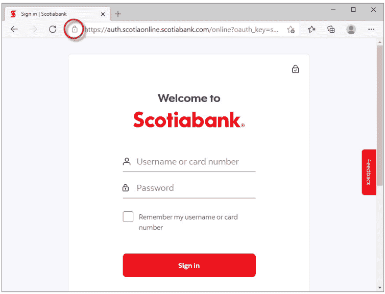

通常，整个电子商务网站不会使用 HTTPS，因为加密和解密过程会减慢连接时间，因此只有请求个人信息的网站部分才使用 HTTPS。

## DNS

域名系统（DNS）服务用于将完全限定域名（FQDN）转换为 IP 地址。在访问 Internet 上的网站或服务器时，你使用诸如 www.gleneclarke.com 之类的名称来连接到系统。在尝试连接之前，你的系统会通过 UDP 端口 53 查询 DNS 服务器，并要求 DNS 服务器提供该系统的 IP 地址。一旦你的系统获得目标系统的 IP 地址，它就会使用该 IP 地址与该系统建立连接。

## SMTP

简单邮件传输协议（SMTP）用于通过 TCP/IP 网络（如 Internet）发送或路由邮件。大多数电子邮件服务器产品都支持 SMTP（TCP 端口 25），以便将电子邮件从公司发送到 Internet。

## POP3

> **考试提示：** POP3 和 IMAP4 是用于读取电子邮件的 Internet 协议，而 SMTP 是用于发送电子邮件的 Internet 协议。

邮局协议版本 3（POP3）是用于通过 TCP 端口 110 将电子邮件从邮件服务器检索到 POP3 客户端的 Internet 协议。电子邮件在客户端通过身份验证访问其邮箱后会被“弹出”或下载到客户端。POP3 在文件夹支持方面功能有限。POP3 客户端仅支持收件箱、发件箱、已发送邮件和已删除邮件。如果需要额外的文件夹支持，则需要使用 IMAP4 客户端。

## IMAP4

Internet 消息访问协议版本 4（IMAP4）是另一种类似于 POP3 的协议，允许客户端通过 TCP 端口 143 从邮件服务器检索消息。IMAP4 允许使用除 POP3 提供的四个基本文件夹之外的其他文件夹。例如，你可以使用 IMAP4 客户端连接到存储在 Microsoft Exchange Server 上的公共文件夹。

## SNMP

简单网络管理协议（SNMP）是一种 Internet 标准，提供了一种简单的方法来远程管理几乎任何支持 SNMP 的网络设备，端口为 UDP 161。网络设备可以是服务器中的网络卡；服务器上运行的程序或服务；或诸如集线器、交换机或路由器之类的网络设备。

SNMP 标准定义了网络设备管理的两层方法：中央管理系统和位于受管设备上的管理信息库（MIB）。管理系统可以监视一个或多个 MIB，从而实现网络的集中管理。从管理系统，你可以看到有价值的性能和网络设备运行统计数据，使你能够在不离开办公室的情况下诊断网络健康状况。

管理系统的目标是提供集中式网络管理。任何运行 SNMP 管理软件的计算机都称为管理系统。为了使管理系统能够执行集中式网络管理，它必须能够收集和分析许多类型的数据，包括以下内容：

- 网络协议识别和统计
- 动态识别连接到网络的计算机（称为 *发现*）
- 硬件和软件配置数据
- 计算机性能和使用统计
- 计算机事件和错误消息
- 程序和应用程序使用统计

## FTP

文件传输协议（FTP）是一种 TCP/IP 协议，用于在 FTP 服务器和客户端之间上传和下载文件。与 Telnet 和 ping 类似，FTP 可以使用主机名或 IP 地址建立到远程计算机的连接，并且必须将主机名解析为 IP 地址才能与远程计算机建立通信。

> **考试提示：** 对于考试，请记住 FTP 是一种使用两个端口的协议。TCP 端口 21 承载从一个系统到另一个系统的 FTP 命令，而 TCP 端口 20 负责在 FTP 会话中在两个主机之间传输数据。

当 TCP/IP 安装在系统上时，可以使用 FTP 实用程序，但所有操作系统也都提供许多第三方图形用户界面（GUI）FTP 客户端。如果你大量使用 FTP，GUI FTP 客户端可以为你节省大量时间和处理 FTP 命令的挫败感。

## TFTP

简单文件传输协议（TFTP）与 FTP 相比是一种简单的协议，仅支持对文件的读写。TFTP 不支持列出目录内容或身份验证等功能。TFTP 使用 UDP 作为传输协议，而 FTP 使用 TCP。TFTP 通常用于通过 UDP 端口 69 将路由器和交换机配置从设备复制到 TFTP 服务器。TFTP 还可用于通过加载存储在 TFTP 服务器上的配置来启动设备。

## SFTP

安全文件传输协议（SFTP）是一种交互式文件传输协议，类似于 FTP，但它加密了 SFTP 客户端和 SFTP 服务器之间的所有流量。SFTP 支持诸如公钥身份验证和压缩之类的附加功能。与 TFTP 不同，SFTP 在其交互式 shell 中支持许多命令，例如列出目录内容、创建目录、下载文件和上传文件。

## Telnet

Telnet 是一种在 TCP 端口 23 上运行的终端仿真协议，允许客户端运行或仿真服务器上运行的程序。许多设备允许你“telnet”到设备并使用 Telnet 会话可用的命令集对网络设备进行远程管理。

## SSH

安全 Shell（SSH）是一种用于通过 TCP 端口 22 使用安全连接与远程系统创建 shell 或会话的程序。一旦建立远程会话，客户端就可以在此 shell 中执行命令并将文件复制到本地系统。SSH 的主要目的是支持具有安全身份验证和加密通信的远程 shell；因此，应使用 SSH 而不是 Telnet，因为 Telnet 使用未加密的通信。

## SCP

安全复制协议（SCP）负责通过安全连接将文件从远程服务器复制到本地系统，确保传输中的数据保持保密。许多 SCP 产品使用 SSH 连接以确保安全复制操作的安全性。

## NTP

网络时间协议（NTP）用于同步网络或 Internet 上 PC 的时钟。这是通过配置服务器作为时间服务器来实现的，然后所有其他网络上的 PC 都从该服务器同步其时间。

在早期的 Windows 网络中，你可以通过在登录脚本中放置命令来管理时间同步，以将客户端的时间与时间服务器同步。使用以下命令：

```
NET TIME \\computername /SET
```

较新的 Microsoft 网络（如 Active Directory 网络）具有 PDC（主域控制器）模拟器可自动为所有服务器和客户端提供时间，因此无需为客户端创建登录脚本以与时间服务器同步时间。PDC 模拟器也可以从 Internet NTP 服务器检索其时间。

Internet 上的时间服务器允许你将 PC 的时钟与原子钟保持的准确时间同步。时间同步会考虑操作系统的时区设置，即使时间服务器未设置为你的本地时区，也允许你与时间服务器同步。

## LDAP

轻型目录访问协议（LDAP）是用于目录服务访问的 TCP/IP 协议，由 Microsoft Active Directory 等常见目录服务支持。LDAP 是一种允许 LDAP 客户端连接到网络数据库或目录并查询数据库中有关其对象的信息的协议，例如用户帐户和打印机。例如，网络上的用户可以通过使用 LDAP 找到另一用户的电话号码。


> **考试提示** LDAP 是访问目录服务的行业标准协议，并且由 Microsoft 的 Active Directory 等目录服务支持。LDAP 默认使用 TCP 端口 389。

## NetBIOS

网络基本输入/输出系统（NetBIOS）是一种应用程序编程接口（API），用于向远程系统发出网络调用并实现会话管理功能。NetBIOS 是一种会话层协议，与其他可路由协议（如 TCP/IP）一起安装，以便 NetBIOS 流量能够在网络中传输。NetBIOS 有两种通信模式：

- 会话模式 用于面向连接的通信，其中 NetBIOS 负责与目标系统建立会话，监控会话以检测传输中的任何错误，然后通过重新传输丢失或损坏的数据来从这些错误中恢复。
- 数据报模式 用于无连接通信，其中不需要会话。数据报模式也用于 NetBIOS 的任何广播。数据报模式不支持错误检测和纠正服务，因此这些服务由使用 NetBIOS 的应用程序负责。

Microsoft 使用 NetBIOS 名称，也称为计算机名称，作为在网络上标识系统的方法。NetBIOS 名称最长可达 16 字节——15 字节用于名称，1 字节用于 NetBIOS 名称后缀（名称末尾的代码，表示正在运行的服务）。NetBIOS 计算机名称在 LAN 上必须是唯一的。

## 网络存储协议

多个协议允许系统与位于网络上的磁盘存储设备进行通信：

- Fibre Channel 一种传输速度高达 128 Gbps 的技术，使用专用光纤电缆将共享存储设备连接到服务器。
- iSCSI Internet Small Computer Systems Interface 是一种基于 IP 的协议，用于与存储设备通信。iSCSI 流量承载从主机到网络上存储设备的 SCSI 磁盘命令。与 Fibre Channel 相比，iSCSI 的好处是您不需要特殊硬件来连接共享磁盘解决方案；您可以使用现有的网络基础设施，结合 iSCSI，与网络上的共享磁盘进行通信。最佳实践是在专用网络基础设施上运行 iSCSI，以在使用常规网络硬件时获得最佳性能。
- FCoE Fibre Channel over Ethernet 是一种用于在以太网帧中通过以太网网络承载 Fibre Channel 命令的协议。需要注意的是，Fibre Channel 运行在第 2 层，因此无法在 IP 网络上路由（而 iSCSI 基于 IP，因此可路由）。

## 了解 IPv6

Security+ 考试侧重于 TCP/IP 版本 4（IPv4）作为任何 TCP/IP 相关内容，但您需要了解 IPv6 带来的变化。第一个主要区别在于寻址方案——IPv4 基于 32 位地址方案，而 IPv6 基于 128 位地址方案。

互联网的某些部分已经在使用 IPv6，并且新区域每天都在升级。IPv6 基于 128 位地址方案，因为 IPv4 的 32 位地址方案证明无法创建足够的地址。IPv6 协议的重点之一是解决 IPv4 存在的地址短缺问题，因此该协议使用 128 位地址方案。

> **考试提示** IPv4 使用 32 位寻址方案，而 IPv6 是 128 位寻址方案，使用十六进制地址格式。对于 Security+ 考试，您需要了解 IPv6 地址方案的基础知识。

## IPv6 地址

IPv6 地址是一个 128 位地址，以十六进制格式显示，而不是 IPv4 使用的点分十进制表示法。IPv6 地址分为八个 16 位组，每个组由冒号（:）分隔。以下是 IPv6 地址的示例：

```
65b3:b834:45a3:0000:0000:762e:0270:5224
```

IPv6 地址不区分大小写，并且在引用以前导零开头的系统时，您不需要在地址开头放置前导零。您还可以用双冒号（::）替换连续的零，在引用地址中存在一组零时使用。例如，IPv6 中的环回地址为 0:0:0:0:0:0:0:1，可以缩短为 ::1，其中 :: 替换了地址开头的所有连续零。此过程称为压缩零。请记住，您只能压缩一次地址，因此如果地址中有多个连续零的部分，您只能压缩其中一个部分。

> **考试提示** 对于 Security+ 考试，您需要知道 IPv6 使用 128 位地址空间。您还可能被要求识别 IPv6 环回地址，0:0:0:0:0:0:0:1。

IPv6 使用三种类型的地址：

- **单播** 用于一对一通信。
- **多播** 用于向一组系统发送数据。
- **任播** 应用于提供服务的系统组。向任播地址发送数据的客户端可能会将数据发送到任播地址的系统中的任何一个。

为了让事情更复杂，您应该熟悉 Security+ 考试中单播地址的不同类型：全局单播、站点本地单播和链路本地单播地址处理不同类型的单播流量。以下是每种单播地址类型的快速分解：

- **全局单播** 可在互联网上路由的公共 IPv6 地址。分配给主机的地址必须在互联网上唯一。此地址类型相当于 IPv4 中的公共 IP 地址。
- **站点本地单播** IPv6 协议的私有地址；地址始终以 *FEC0* 开头。将站点本地地址分配给系统相当于在 IPv4 中使用私有地址，例如 10.0.0.0。站点本地地址不能用于在本地站点或网络之外通信，也无法被其他站点或互联网上的系统访问。
- **链路本地单播** 自分配的地址，仅用于与其他链路上的节点通信。链路本地地址始终以 *FE80* 开头。此地址类型相当于 IPv4 中的 APIPA 地址。

**您应该熟悉 IPv6 中的两个保留地址：环回地址，为 0:0:0:0:0:0:0:1（或 ::1），以及系统未指定地址的地址，0:0:0:0:0:0:0:0（或 ::）。**

## IPv6 协议

IPv6 不仅改变了寻址方案，而且 IPv6 协议套件中存在的协议也发生了变化。以下是 IPv6 协议套件中使用的一些协议的快速分解。

**IPv6** IP 的新版本负责逻辑寻址和路由功能，就像 IPv4 一样。它是一种无连接协议，依赖于 TCP 等上层协议来保证交付。

**ICMPv6** ICMP 协议负责错误和状态信息，就像 IPv4 一样，但它已被更改。ICMPv6 使用代码，而 ICMPv4 使用类型和代码。对于 ICMPv6，每个代码表示消息的类型。0 到 127 的代码用于错误消息，而 128 到 255 的代码用于信息消息。例如，回显请求消息在 ICMPv6 中为代码 128，回显应答消息为代码 129。

ICMPv6 在 IPv4 可用的功能之上进行了扩展。您应该熟悉 ICMPv6 协议的以下两个功能：

- **多播监听器发现（MLD）** 替换 IPv4 中称为 Internet 组管理协议（IGMP）的多播协议，并用于多播通信
- **邻居发现（ND）** 替换 IPv4 中的 ARP 执行相同功能，但它还负责邻居路由器发现、自动地址分配和重复地址检测等功能

IPv6 已完全重新设计并提供了许多额外的新功能，但对于 Security+ 考试，您只需要关注基础知识。有关 IPv6 的更多信息可在 http://technet.microsoft.com/library/dd379473.aspx 找到。

## IPv6 的影响

Security+ 考试确实要求您了解使用 IPv6 的安全影响。以下是 IPv6 的一些安全问题的概述：

- **缺乏专业知识** 由于 IPv6 对大多数网络来说仍然相对较新，因此缺乏专业知识和对协议实现中可能存在的各种安全漏洞的充分理解。这意味着了解如何防范 IPv6 攻击也是对不熟悉该协议的 IT 人员的担忧。
- **协议复杂性** 与 IPv4 相比，IPv6 协议套件的复杂性增加了黑客的潜在攻击途径。例如，IPv6 不仅有 DHCPv6 用于 IP 地址分配，还具有无状态地址自动配置（SLAAC），这是一种可能为黑客提供不同攻击途径的技术。
- **IPv6 安全设备支持** 另一个需要考虑的问题是保护公司资产的安全设备。这些安全设备是否已更新到 IPv6 的功能，并且您能否在 IPv4 和 IPv6 上同等使用安全设备的功能集？您可能会发现设备上的安全功能对 IPv6 的支持不足。
- **双栈漏洞** 由于公司正在缓慢转向 IPv6，因此它们也需要运行 IPv4。这意味着您同时运行两种不同的协议，每种协议都有自己需要注意的安全问题。运行两种协议的常见风险是，您的企业可能会专注于锁定 IPv4，但没有意识到 IPv6 已默认加载到您的系统和网络设备上。如果您没有同样锁定 IPv6，您将面临通过 IPv6 协议遭受攻击的风险。


## 练习 1-4：识别 TCP/IP 中的协议

在本练习中，你将通过将协议与相应的场景关联起来，练习识别不同的 TCP/IP 协议。

| 协议 | 场景 |
|---|---|
| ____ TCP | A. 将 FQDN 转换为 IP 地址 |
| ____ IP | B. 负责错误报告和状态信息 |
| ____ DNS | C. 用于下载文件的协议 |
| ____ HTTPS | D. 负责网络监控和管理 |
| ____ UDP | E. 将逻辑地址转换为物理地址 |
| ____ FTP | F. 用于安全 Web 流量的协议 |
| ____ ICMP | G. 负责不可靠传输 |
| ____ ARP | H. 负责逻辑寻址和路由 |
| ____ SNMP | I. 负责可靠传输 |

## 认证目标 1.03：网络安全最佳实践

本章向你介绍了许多网络概念、协议和设备，作为 Network+ 的复习，但更重要的是确保你理解与后面章节中安全主题相关的关键网络概念。在进入下一章之前，我想总结一下关于网络设备和协议的安全最佳实践的一些关键要点。

### 设备使用

本章前面你学习了路由器、交换机和代理服务器等设备的用途。以下是在网络设备使用方面需要记住的一些关键点，以帮助创建安全的网络环境。

### 物理安全

确保所有服务器和网络设备（如路由器和交换机）都存放在安全的位置，例如上锁的服务器机房。你还希望确保控制和监控谁可以访问这些网络的物理组件。

### 不要使用集线器

大多数环境今天使用交换机而不是集线器，但如果你发现旧的集线器连接到网络，请确保将其替换为交换机，以便流量仅发送到目的地系统所在的端口。

### 配置密码

大多数网络设备（如路由器和交换机）允许你在设备上配置密码，这让你可以控制谁有权管理该设备。Cisco 路由器和交换机有多种不同的密码，例如控制台端口密码、辅助端口密码和 Telnet 密码。确保这些密码都是复杂的。以下代码显示了配置控制台密码的命令：

```
HAL-R1>enable
HAL-R1#config term
HAL-R1(config)#line con 0
HAL-R1(config-line)#password C0nP@$$
HAL-R1(config-line)#login
```

### 使用端口安全

你还应确保交换机上未使用的任何端口都被禁用，以防止未经授权的个人连接到可用端口。在高度安全的环境中，你应该在端口上配置端口安全，这是一种指定哪些 MAC 地址允许连接到特定端口的方法。

端口安全也是针对 *MAC flooding* 的一种很好的对策，*MAC flooding* 涉及黑客向交换机发送包含不同源 MAC 地址的帧。这可能导致两种情况发生：

- 交换机看到 MAC 地址表中的所有虚假条目，不再信任该表，这会导致交换机将所有帧泛洪到所有端口（称为 fail-open 状态）。
- MAC 地址表中的条目被覆盖，因此交换机不知道有效 MAC 地址位于哪个端口。当交换机不知道特定 MAC 地址的位置时，它会将帧 *flood* 到交换机上的所有端口，这给了黑客捕获流量的机会，因为交换机不再过滤流量。

**exam watch**

对于 Security+ 考试，请记住 MAC flooding 是黑客让交换机将所有帧泛洪到所有端口的情况。这允许黑客连接到交换机上的任何端口并能够接收网络上的所有流量。

黑客可以用来绕过交换机过滤功能的另一种方法是 ARP poisoning，它会污染所有系统上的 ARP 缓存，迫使它们将数据发送到黑客的系统以便访问互联网。黑客捕获流量然后将其路由到互联网供用户使用！你将在第 4 章中了解更多关于 ARP poisoning 的信息。

### 使用 VLAN

交换机的另一个重要功能应该使用的是 VLAN，因为它们提供了一种通过将端口放入其中来创建不同通信边界的方法。请记住，默认情况下，位于一个 VLAN 中的系统无法与另一个 VLAN 中的系统通信。

### 电缆和协议使用

在高度安全的环境中进行网络布线时，你应该使用光纤电缆，因为传输是通过光脉冲而不是电信号进行的。这具有很大的安全优势，因为通过铜缆作为电信号传输的数据容易受到其他电气组件的干扰，而通过光纤传输的数据则不受电气干扰的影响。另请注意，UTP 电缆会泄漏信号，因此理论上传输可以被窃听。由于光纤电缆不使用电信号，传输不会泄漏，因此无法被窃听。

光纤电缆也不像同轴或双绞线通信那样容易被窃听。黑客可以通过反射部分光线然后将该光线转换为电信息来窃听光纤线路，让黑客的计算机查看。虽然这种攻击是可能的，但使用电缆上的适当入侵检测系统很容易检测到这种攻击造成的光损失。

**exam watch**

对于 Security+ 考试，请记住最安全的电缆类型是光纤电缆。

在涉及安全和不安全系统的大型网络中，或一些组织所称的受保护系统和未受保护系统的情况下，另一个最佳实践是为受保护系统与未受保护系统使用不同颜色的电缆。然后，在评估安全时，你可以快速确保受保护系统连接到受保护网络而不是未受保护网络。*受保护网络* 是受控网络且未连接到互联网，而 *未受保护网络* 是连接到互联网的网络。在高安全环境中，至关重要的是受保护系统永远不会连接到未受保护网络，因为它可能暴露于来自互联网的恶意软件。

就协议而言，请确保在需要安全性的环境中始终使用最安全的协议。例如，与其使用 Telnet 远程连接到路由器和交换机，你应该使用 SSH。以下安全协议应替代其不安全等效协议使用：

- SSH 应替代 Telnet 使用。
- **scp**（安全复制）命令应替代 **copy** 命令使用，以安全地在系统之间复制信息。
- 安全 FTP（SFTP 或 FTPS）应替代 FTP 使用，以下载和上传文件。
- HTTPS 应替代 HTTP 使用，以加密客户端和服务器之间的 Web 内容。

## 认证总结

在本章中，你通过阅读关于当今大多数网络环境中存在的设备和协议类型的文章，回顾了网络的基础知识。从安全角度来看，至关重要的是你了解有助于创建安全环境的设备、电缆和协议类型。以下是关于 Security+ 考试网络基础知识的一些关键要点：

- 如今使用网络交换机而不是集线器，以便流量仅发送到具有目标系统的端口。这有助于保护传输的数据不被截获。
- 路由器创建广播域并负责路由（发送）数据从一个网络到另一个网络。
- VLAN 是交换机的重要功能，创建通信边界。交换机上的每个 VLAN 都是一个单独的广播域，必须使用路由器才能允许一个 VLAN 上的系统与另一个 VLAN 通信。


- TCP/IP 是一个协议族；其中最重要的协议包括 TCP、UDP、IP 和 ARP。（Security+ 考试中肯定会有几道题涉及 TCP/IP 协议族中的某些成员。）
- TCP/IP 寻址涉及 IP 地址、子网掩码、网络类别和特殊保留地址。（考试时请牢记每个网络类别。）

只要充分理解本章内容，你在 Security+ 考试中就不会遇到任何与 TCP/IP 相关的难题。本章内容不仅对考试很重要，而且在你顺利通过考试并继续从事网络专业工作后同样重要。

## 两分钟速览

### 理解网络设备和布线

- 应使用交换机而不是集线器，因为交换机会过滤流量，只将数据发送到目标系统所在的交换机端口；而集线器会将数据发送到所有端口，使所有连接的系统都能看到所有网络流量。
- 交换机具有强大的安全功能，例如可以禁用未使用的端口，并配置端口安全，从而根据 MAC 地址控制哪些系统可以连接到某个端口。
- 路由器是三层设备，用于将数据从一个网络路由到另一个网络。路由器也用于将网络划分为多个广播域。
- 负载均衡器用于将客户端的请求分配到不同服务器上，以提高性能。可以采用多种技术进行负载均衡：例如，可以使用轮询（round-robin），将请求均匀地轮流发送到多台服务器；也可以使用某种算法来决定负载均衡器中的哪台服务器应处理该请求。
- 代理服务器用于代表客户端发送出站 Internet 请求，通常用于过滤用户可以访问的网站以及用户可用于出站通信的应用程序类型。
- 同轴电缆和双绞线使用铜质线芯传输电信号，而光纤电缆用于传输光脉冲。在高安全性环境中，光纤电缆是首选。

### 理解 TCP/IP

- IP 协议负责逻辑寻址和路由。
- TCP 协议用于可靠传输。TCP 通信以三次握手开始。TCP 通过使用序列号和确认号来保证交付。
- TCP 使用标志来标识重要的数据包类型。TCP 标志包括 SYN、ACK、FIN、RST、URG 和 PSH。
- UDP 用于无连接通信。
- TCP 和 UDP 使用端口号来标识数据的发送和接收应用程序。对于 Security+ 考试，请记住本章讨论的常见端口。
- ICMP 用于状态和错误报告。ICMP 使用类型和代码来标识不同类型的消息。类型 8 用于回显请求，类型 0 用于回显应答。
- ARP 负责将逻辑地址（IP 地址）转换为物理地址（MAC 地址）。
- 许多应用层协议用于为 TCP/IP 系统提供功能。例如，FTP 用于文件下载，SMTP 用于发送电子邮件，POP3 和 IMAP 用于读取电子邮件。
- IPv6 是 IP 协议的最新版本，与 IPv4 相比有所变化。IPv6 的一些变化包括：地址方案增加到 128 位，广播消息被移除，IP 安全内置于协议中。

### 网络安全最佳实践

- 确保使用光纤电缆而不是双绞线，因为光纤电缆更难被搭线窃听，并且不受电气干扰的影响。
- 使用安全版本的协议来加密通信。安全协议的示例包括 SSH、SCP、HTTPS 和 FTPS。
- 确保使用交换机功能（如端口安全）来控制哪些系统可以连接到交换机。
- 禁用交换机上所有未使用的端口。

## 自测

以下问题将帮助你衡量对本章内容的理解。如指示所示，有些问题可能不止一个正确答案，因此请务必仔细阅读所有选项。

### 理解网络设备和布线

1. 网络交换机的哪项功能允许网络管理员在监控或排查网络时捕获网络流量？
   A. 端口安全
   B. VLAN
   C. 冲突域
   D. 端口镜像

2. 贵公司有一个 Web 应用程序，运行速度似乎很慢。如何改进该应用程序的性能？
   A. 安装代理服务器。
   B. 安装负载均衡器。
   C. 将网站配置在 VLAN 中。
   D. 配置端口安全。

3. 下列哪种设备可用于限制网络中用户可以访问的网站？
   A. 路由器
   B. 负载均衡器
   C. 代理服务器
   D. CAT 5e

### 理解 TCP/IP

4. 哪个 TCP/IP 协议用于将 IP 地址转换为 MAC 地址？
   A. ARP
   B. TCP
   C. ICMP
   D. UDP

5. 哪种 ICMP 类型用于标识回显请求消息？
   A. 0
   B. 4
   C. 8
   D. 9

6. 下列哪项正确描述了三次握手的阶段？
   A. ACK/SYN、ACK、SYN
   B. SYN、SYN/ACK、ACK
   C. ACK、SYN、ACK/SYN
   D. SYN、ACK、ACK/SYN

7. 下列哪些是安全 TCP 应用程序使用的端口？（选择两项。）
   A. 23
   B. 22
   C. 80
   D. 143
   E. 443

### 网络安全最佳实践

8. 你是一家小型公司的网络管理员，希望遵循与交换机相关的安全最佳实践。为降低涉及网络交换机的安全事故风险，你应该执行以下哪些操作？（选择所有适用项。）
   A. 禁用未使用的端口。
   B. 启用所有未使用的端口。
   C. 配置端口安全。
   D. 禁用端口安全。
   E. 启用控制台密码。
   F. 禁用控制台密码。

9. 哪种流行的交换机功能允许你在连接到交换机的系统之间创建通信边界？
   A. ARP 欺骗
   B. 端口镜像
   C. 端口安全
   D. MAC 泛洪
   E. VLAN

10. 你的经理读到过有关黑客在交换网络环境中捕获网络流量的文章，并要求你解释黑客如何做到这一点。你将在解释中描述哪些技术？（选择两项。）
    A. ARP 欺骗
    B. 端口镜像
    C. 端口安全
    D. MAC 泛洪
    E. VLAN

### 实操题

11. 你有一台服务器，安装了许多网络服务。使用下图，将右侧的端口号与左侧的服务匹配。

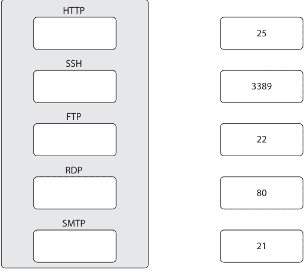

6. ☑ B. 三次握手的数据包顺序是 SYN、SYN/ACK，然后是 ACK。☒ A、C 和 D 不正确。这些选项都不能反映三次握手的顺序。

7. ☑ B 和 E. SSH 是一种替代 Telnet 的安全协议，使用端口 22；HTTPS 是 HTTP 流量的安全替代方案，使用端口 443。☒ A、C 和 D 不正确。这些是未安全协议使用的端口。端口 23 用于 Telnet，端口 80 用于 HTTP，端口 143 用于 IMAP——这些协议都不会对发送方和接收方之间的流量进行加密。

### 网络安全最佳实践

8. ☑ A、C 和 E. 在保护交换机等设备时，请确保管理端口（如控制台端口）已配置密码。此外，禁用任何未使用的端口，并在端口上配置端口安全。☒ B、D 和 F 不正确。未使用的端口应禁用，端口安全应配置，控制台端口密码应启用。

9. ☑ E. 当系统放置在 VLAN 中时，默认情况下它们无法与 VLAN 之外的系统通信。你可以使用路由器将信息从一个 VLAN 路由到另一个 VLAN。☒ A、B、C 和 D 不正确。ARP 欺骗是黑客执行的一种攻击类型，允许他们嗅探网络上的流量。端口镜像是交换机上的一项功能，允许管理员将所有流量的副本发送到交换机上的一个端口，管理员将监控系统连接到该端口。端口安全是一项功能，通过 MAC 地址控制哪些系统可以连接到端口。MAC 泛洪是黑客执行的一种攻击类型，目的是使交换机混乱，从而将所有流量发送到所有端口。

10. ☑ A 和 D. 黑客可以使用几种不同的技术来绕过交换机的过滤功能。黑客可以使用 ARP 欺骗，毒化所有系统上的 ARP 缓存，强制它们将数据发送到黑客的系统。另一种技术是 MAC 泛洪，黑客向交换机发送伪造的 MAC 地址，导致交换机不再信任 MAC 地址表。结果，交换机开始将所有帧泛洪到每个端口，包括黑客连接并运行嗅探软件的端口。☒ B、C 和 E 不正确。端口镜像是管理员（而非黑客）用来捕获网络流量的方法。端口安全允许管理员根据 MAC 地址控制哪些系统可以连接到端口，而 VLAN 允许你创建通信边界。


## 基于性能的题目

11. 下图展示了端口号与对应网络服务的匹配。Security+ 考试会出类似的题目，要求你将一侧的方框拖到另一侧以识别匹配项。

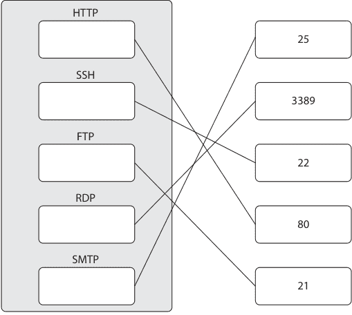
