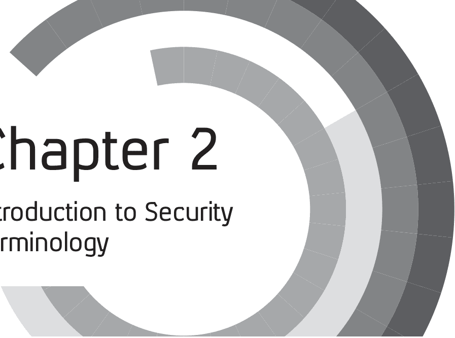
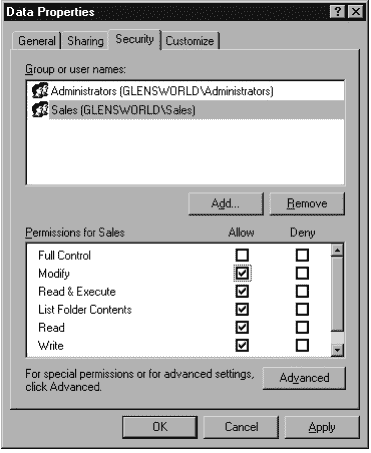
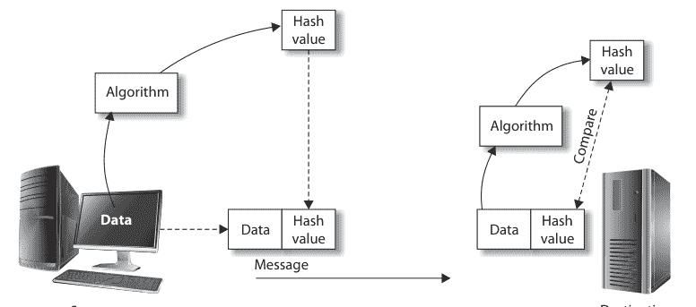
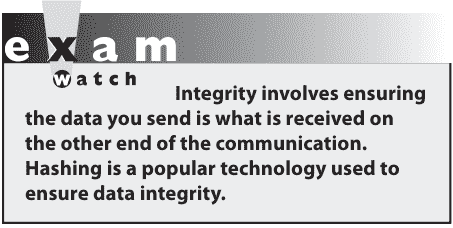
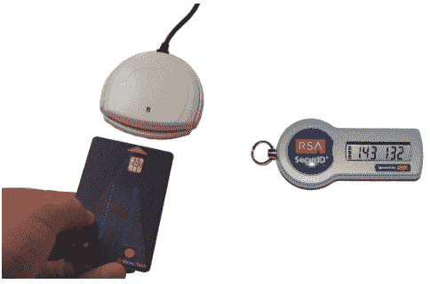
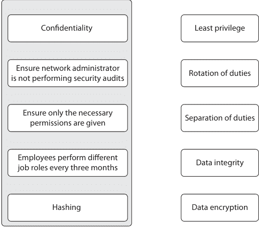
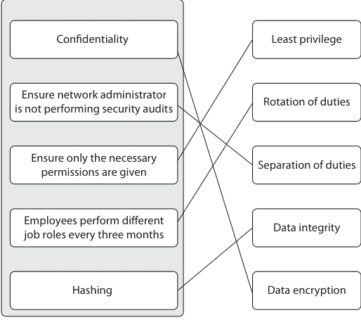

# 第2章：安全介绍

### 术语

### 认证目标

| Objective | Topic |
|---|---|
| 2.01 | Goals of Information Security |
| 2.02 | Understanding Authentication and Authorization |
| 2.03 | Understanding Security Principles and Terminology |
| 2.04 | Looking at Security Roles and Responsibilities |
| ✓ | Two-Minute Drill |
| Q&A | Self Test |

现在你已经回顾了 Security+ 认证考试和作为一名安全专业人员所需了解的核心网络概念，是时候深入了解一些基本的安全概念和原则了。本章的目标是让你接触到考试中需要了解的重要安全术语和概念，同时也是本书后续主题的基础。其中一些主题——例如身份验证和授权——将在后面的章节中更详细地介绍；这里的目标是确保你对基本安全术语感到熟悉。

### 信息安全的目标

作为一名安全专业人员，你的工作是实现信息安全的根本目标。这些根本目标是保密性、完整性（数据完整性）和可用性——也称为 CIA。本节旨在向你解释 CIA 是什么，并给出用于帮助维护 CIA 的流行技术示例。

#### 保密性

信息安全的一个目标是确保保密性，即只有授权人员才能访问信息并能够阅读信息。许多技术，例如权限和加密，可以用来保持信息的保密。

##### 访问控制/权限

大多数网络管理员通过在文件和文件夹上实施权限来保护组织网络上的信息。这被称为在文件上构建 *访问控制列表 (ACL)*，因为网络管理员正在控制谁可以访问文件。通过在文件上设置权限并仅允许特定用户组访问文件（见图 2-1），你有助于维护保密性。

*Figure 2-1: Controlling access to resources by setting permissions*

请注意，在图 2-1 中，文件权限设置为仅允许 Sales 组和 Administrators 组访问该文件。如果只有这些组被允许访问文件，你就帮助维护了数据的保密性。

##### 加密

仅在数据上设置文件权限不足以维护保密性，因为大多数公司将信息存储在服务器上，用户必须通过网络从其客户端计算机访问数据。权限确保只有适当的 user 账户可以访问文件，但当用户通过网络将这些文件下载到其计算机时，文件权限并不能保护文件内容在传输过程中不被读取。这就是加密发挥作用的地方——加密信息会将其置于不可读的格式，直到授权人员解密信息，将其恢复为可读格式。

你可以在两个层面上加密文件——在存储时和在从一个位置传输到另一个位置时。对存储中的文件进行加密的好处是，如果黑客能够获得对系统的物理访问权限，他们通常可以绕过系统设置的权限。如果你对存储中的数据进行加密，并且黑客以某种方式绕过了权限，你将确保数据不可读。

当你对传输中的信息进行加密时，通常会加密两个系统之间的通信通道；也就是说，所有通过通信通道传输的数据都被加密。通过对传输中的信息进行加密，你可以确保有人窃听通信时无法读取其窃取的信息。

> **Exam Watch**  
> 信息安全的主要目标之一是保持信息的保密。你可以通过实施数据和通信的加密以及实施访问控制概念（如权限）来实现这一点。

##### 隐写术

另一种通过隐写术来隐藏信息以试图保持其保密的方法。隐写术是将信息隐藏在另一个文件的不可见区域中的方法。例如，你可以将文本文件嵌入到图形文件中。信息使用程序放置在图形文件中，并在文件上设置密码。发送图形给预期接收者后，预期接收者将使用隐写术应用程序从文件中读取文本信息。隐写术的其他示例包括在 MP3 文件和视频文件中隐藏数据。

隐写术也常被怀有恶意动机的人用来传输秘密信息。例如，一群国际黑客可以使用一个看起来正常的包含网页图片的网站来相互通信。成员可以在图形中隐藏详细其下一次阴谋的文本文件，知道其他黑客可以访问该网站，下载图形，然后使用隐写术程序从图形中提取文本文件。

#### 完整性

数据完整性的概念是确保数据从源发送到目的地时，目的地接收到的信息在传输过程中未被更改。数据完整性还意味着如果你将文件存储在驱动器上并稍后打开它，你可以确定数据在存储期间未被更改。

##### 哈希

为了确保通过网络通信时的数据完整性，发送系统会将数据通过一种数学算法，即哈希算法，然后生成一个答案（称为哈希值）。该哈希值随后与数据一起发送。在传输的接收端，目标系统会将数据通过相同的数学算法以生成一个答案（哈希值）。一旦目标系统拥有自己的计算哈希值，它就会将其与消息中发送的哈希值进行比较——如果它们相同，则假定数据未被更改。此过程如图 2-2 所示。

*Figure 2-2: Ensuring integrity by hashing the data*

数据完整性不仅关乎传输中的数据完整性，还关乎存储中的数据。在高度安全的环境中，你可能希望确保用户存储文件后，文件在用户再次打开文件之前无法被更改。为了验证文件的完整性，你可以使用文件完整性程序，该程序在文件保存时计算文件的哈希值，然后在文件再次打开时将存储的哈希值与计算的哈希值进行比较。如果文件自上次用户使用以来已更改，哈希值将不同，用户将被通知文件已被更改。

数据完整性在当今的许多场景中使用；其中一些场景如下：

- **下载文件：** 当你从互联网下载程序时，大多数供应商会告诉你正在下载的文件的哈希值，以便你下载后自行对文件进行完整性检查。对下载的文件进行完整性检查将确保文件在下载过程中未被更改。
- **执法：** 当执法机构对嫌疑人的计算机进行调查时，他们需要在查看数据之前生成数据的哈希值，以便他们以后在法庭上证明他们没有更改或植入信息。如果证据受到质疑，则在调查前后数据的哈希值将被比较——如果它们相同，则数据未被更改。

关于数据完整性的另一点是，实施权限等解决方案可以帮助保护信息的完整性，因为如果你控制谁被允许修改数据，你就可以保护它免受未经授权的更改。

##### 其他完整性概念

哈希并不是你在 Security+ 认证考试中应熟悉的唯一完整性概念；你还应熟悉以下安全术语和概念：

- **数字签名：** 数字签名是在消息上创建的，以证明消息发送者的完整性。因为签名是使用个人的私钥创建的，而只有该人有权访问其私钥，所以它证明了发送者就是他们所说的那个人。你将在第 12 章和第 13 章中了解更多关于数字签名和密码学的知识。
- **数字证书：** 数字证书是用于传输用于加密或数字签名消息的密钥的电子文件。你将在第 12 章和第 13 章中了解更多关于证书和密码学的知识。

## 问责制

近年来出现的一个趋势是将 CIA 中的 A 指定为同时代表可用性和问责制（或添加一个 A 来代表问责制，CIAA）。问责制是指确保用户对其行为负责——例如，如果有人不当地删除了一个文件，则会存在该行为的记录以追究其责任。

你可以通过在系统、路由器、防火墙以及应用程序上实施审计和日志功能来在组织中实施问责制。这里的概念是，如果你记录活动并且能够识别出导致某事件发生的人，你就可以追究该人员对其行为的责任。以下是组织内实施问责制的一些流行方法：

- **日志文件** 大多数网络服务要么默认实现日志记录，要么可以配置为将活动记录到日志文件中。务必为网络上的所有核心服务启用日志记录，以便在发生事件时，你可以审查已记录的数据。

- **审计文件** 大多数操作系统都具有安全审计功能，允许你审查系统上发生的安全相关事件。在 Windows 中，这是事件查看器中的安全日志。务必定期审查安全审计日志。

- **防火墙和代理服务器** 大多数防火墙和代理服务器可以记录用户的出站活动，例如访问的网站和用于出站通信的应用程序。务必定期审查防火墙和代理服务器日志，以追究用户对其行为的责任。

- **应用程序日志记录** 日志记录应用程序内的活动变得越来越重要。例如，如果有人从采购系统中删除了客户记录或采购订单，你希望知道此事。了解所有关键应用程序中可用的日志级别，并让用户知道你正在记录活动。这将有助于让他们对其在业务软件中的行为负责。例如，Microsoft SQL Server 具有允许数据库开发人员在数据库应用程序中实施日志记录和审计的功能。

> exam watch
> Security+ 考试要求你理解 CIA 以及实施保密性、完整性和可用性的不同方法。

## EXERCISE 2-1: CIA 场景

在此练习中，你将阅读以下场景并识别正在满足的信息安全目标是什么（保密性、完整性、可用性或问责制）。

| 术语 | 场景 |
|---|---|
| ______ | A. 你已在 SQL 服务器上配置了审计，以便如果用户删除了客户记录，则该信息会被记录在审计日志中。 |
| ______ | B. 你已在 Bob 的 USB 驱动器上配置了 BitLocker To Go，以便他能够以加密格式将文件存储在 USB 驱动器上。 |
| ______ | C. Sue 已将电子邮件服务器配置为与另一台服务器组成服务器集群，以便如果其中一台服务器发生故障，另一台服务器可以处理工作负载。 |
| ______ | D. 你将当前预算电子表格放在公司内联网服务器上，以便员工可以下载该文件。你还在网站上发布了该文件的哈希值。 |
| ______ | E. 关键任务被划分为不同的工作，每个人员执行其中一项不同的工作。 |

## CERTIFICATION OBJECTIVE 2.02: 理解身份验证和授权

确保你的环境安全的一个重要部分是确保你实施某种形式来识别和验证组织内的个人，然后控制他们可以访问的资源、网站和设施区域。

本节旨在向你介绍身份验证和授权的概念。请注意，这些主题中的每一个都有专门的章节，但我想确保你在本章中对概念和术语有基本的了解。

### 身份识别和身份验证

身份识别发生在身份验证之前，是用户向系统表明自己的过程。公司用于识别单个用户的最流行方法是为每个用户提供唯一的用户名。用户在系统中输入用户名以表明自己的身份。

在用户输入身份识别信息（用户名）后，用户会为身份验证目的输入该账户的密码。然后信息会被发送到负责验证用户名和密码是否有效的身份验证系统。如果用户名和密码正确，用户将被授予系统访问权限，但如果信息不正确，则会显示错误并拒绝访问。

用户可以通过多种方式向系统表明身份并进行身份验证。以下是用于身份识别和身份验证目的的几种流行方法：

- **用户名** 在网络上识别用户的最流行方法是为他们每个人提供唯一的用户名。为了表明身份，用户在登录屏幕中输入用户名。为了进行身份验证，他们输入与该用户名关联的密码。

- **智能卡** 智能卡的大小与信用卡相同，并具有可包含由系统或应用程序使用的数据的微芯片（见图 2-3 左侧）。智能卡可用于识别该特定智能卡的唯一所有者。一旦智能卡插入系统，用户就会输入与智能卡关联的 PIN 以便对系统进行身份验证。

- **令牌** 安全令牌是一种通常用于识别个人并在身份验证过程中使用的设备。在不同类型的令牌中，最流行的是在 30 到 60 秒内显示随机数字的设备（见图 2-3 右侧）。随机数字、用户名和密码用于登录。

**FIGURE 2-3** 智能卡（左）和 SecurID 令牌（右）可在身份验证期间使用。

- **生物识别** 生物识别是指使用你身体的一部分来对系统进行身份验证的概念。例如，你可以扫描指纹或视网膜来对系统进行身份验证。高安全环境通常使用生物识别系统，因为身体特征无法复制。

> exam watch
> 对于考试，要知道在你被授予资源访问权限（授权）之前，你必须首先向系统表明自己的身份。然后你的身份识别信息会与身份验证数据库进行核对，以验证你是否可以获得系统或设施的访问权限（这称为身份验证）。

### 授权

一旦用户通过身份验证，他们将被授予对不同资源的访问权限；这称为授权。你有多种方式为不同资源授权个人。以下是一些授权示例：

- **权限** 你可以通过向个人授予对文件的权限或向个人所属的组授予对文件的权限来授权个人访问文件。这是授权最流行的方法之一。

- **路由器 ACL** 实施授权的另一个示例是通过在路由器上配置访问控制列表（ACL）。这些 ACL 决定路由器是否允许接受某些流量并将其路由到不同网络。

- **代理服务器** 授权的另一个流行示例是在代理服务器上允许或拒绝访问不同的网络内容。代理服务器是网络上所有流向互联网的流量都必须经过的服务器。代理服务器可以控制可以访问哪些网站，甚至内部用户可以使用哪些类型的互联网应用程序。

- **设施** 授权的最后一个示例是控制对建筑物不同区域的访问。例如，Bob 的智能卡可能允许他进入他工作的建筑区域，但该卡无法打开建筑物其他区域的门——他无权访问这些区域。

物理安全还涉及通过在场区周围设置围栏以及在入口处安排警卫来控制谁能够进入组织场所。你将在第14章中了解更多关于物理安全的内容。

## 通信安全

通信安全是一个经常被忽视的安全方面，因为公司似乎把大量精力放在物理安全以及文件和文件夹的权限设置上。设置文件和文件夹的权限只能保护存储在服务器上的资产——但当有人从网络中访问该文件时呢？如果拥有文件权限的用户从网络中访问该文件，该文件会被下载到客户端计算机。在文件下载到客户端计算机的过程中，不受信任的方有可能窃听该通信并查看信息。通信安全通过加密通信来保护在源和目的地之间传输的信息。

## 计算机安全

计算机安全是最常见的安全类型之一——它通过实施一系列最佳实践来保护计算机系统，例如身份验证、访问控制、数据冗余、恶意软件防护和系统加固技术。需要理解的关键点是，计算机安全保护的是系统本身，而不是系统之间的通信。

## 网络安全

网络安全是另一种常见的安全类型，它涉及保护网络本身，而不是某个特定的系统。网络安全包括控制谁能接入网络（交换机安全）以及哪种类型的流量可以进入网络（防火墙）。此外，还需要监控网络流量以发现可疑活动（入侵检测系统）。

既然你已经了解了不同类型的网络安全，下面让我们看看在Security+认证考试中需要熟悉的一些重要安全原则。

## 最小权限、职责分离和职责轮换

在向用户和网络管理员授予对系统或文件等资源的访问权限时，你应该始终遵循的第一条安全原则是最小权限的概念。最小权限意味着只授予用户执行其任务或职责所需的最低权限。你不想授予超出需要的权限，因为那样用户或管理员就可以对资源做超出预期的事情。

例如，如果Bob负责备份Windows服务器，你不想将他放入管理员组，因为他将具备超出备份范围的能力——他可以随心所欲地对系统进行任何更改。在这个例子中，你希望将他放入备份操作员组，这样他的权限范围仅限于执行备份。

另一个例子涉及文件权限。如果用户只需要能够读取文件内容，请务必只授予读取权限，不要授予更多权限，否则他们可能会意外删除文件中的内容。如果发生这种情况，你认为谁有过错——是删除内容的人，还是授予删除内容权限的人？

> 考试
> 注意
> 在考试中，要知道“串通”一词指的是参与同一任务的多人聚在一起从事欺诈活动。

### 职责分离

组织内另一个重要的实践原则是职责分离。职责分离是指确保所有关键任务被分解为不同的流程，并且每个流程由不同的员工执行。例如，在大多数公司，负责为采购付款开支票的人与

签署支票的人不是同一个人。通常，开支票的人是会计部门的某个人，但支票通常由公司的首席财务官（CFO）签署。

一个与技术相关的实施职责分离概念的例子是，当公司决定进行网络安全评估时，评估应由独立的安全专业人员执行，而不是由公司的网络管理员执行。

职责分离的概念用于保持所有人的诚信，并防止组织内的欺诈活动。请注意，职责分离并不能防范串通，串通一词用于描述各方共同密谋实施欺诈行为——例如，开支票的人和签支票的人决定开始为他们的共同业务开支票。

### 职责轮换

另一个与人员和日常业务运营相关的重要安全原则是职责轮换的概念。职责轮换是指让多名员工在不同的工作角色之间轮换的原则。例如，你有一个网络管理员团队，这个月Bob负责账户管理，但下个月Sue将接替该职责，而Bob将接管Sue之前的工作角色。

考试提示
为了考试，一定要知道职责分离和职责轮换之间的区别。

职责轮换有多种好处。首先，它是确保员工行为问责制的一种方式。如果Bob有意或无意地滥用了他的权限，Sue会在下个月注意到并报告。职责轮换的另一个好处是，组织不会依赖于某一个人作为唯一能够执行某项工作角色的人。通过让多名员工在不同的角色之间轮换，组织在技能上拥有一定的冗余，以防员工生病、请假或辞职。

## 知悉所需的概念

在本书后面，你将了解更多关于身份验证和访问控制的内容，但在你进入这些章节之前，我想在本术语章节中介绍的一个安全原则是知悉所需的概念，即只让员工访问他们需要知道的信息。例如，不要给所有经理访问会计数据的权限，而应确保只有会计经理才能访问会计数据。不要给市场经理访问会计数据的权限，因为市场经理不需要这种访问权限。

在军事环境中可以找到另一个实施知悉所需概念的例子。仅仅因为指挥官获得了绝密级安全许可，并不意味着他们就能查看组织中的所有绝密数据。例如，如果指挥官不参与某项行动，他们就不需要知道向参与该行动的人员提供的信息。

## 分层安全与防御多样性

为了帮助创建更安全的环境，还应遵循两个非常重要的安全原则：分层安全方法和防御多样性的概念。分层安全是指不要将所有鸡蛋放在一个篮子里，依靠单一类型的安全解决方案来创建安全环境。例如，尽管防火墙是任何组织安全的关键部分，但如果有人将带有病毒的U盘带进办公室，防火墙并不能帮助保护系统。采用分层方法进行安全意味着要依赖多种不同类型的安全控制措施，例如身份验证、病毒防护、系统补丁和防火墙。采用分层安全方法也称为“纵深防御”。

*防御多样性*是指应该使用不同的产品来提高环境安全级别的概念。例如，在设计防火墙策略时，你很可能会有多层防火墙，重要的是不要在每一层都使用相同的防火墙产品。如果黑客找到了入侵第一层防火墙的方法，而你在网络其他地方使用了相同的防火墙产品，黑客将使用同样的技术绕过这些防火墙。如果你使用来自不同制造商的不同产品，入侵第一层防火墙的方法不一定在第二层防火墙上奏效。这里的概念是，虽然所有产品都有漏洞，但每种不同产品的漏洞各不相同，黑客将不得不加倍努力才能突破每一个不同的产品。

防御多样性的另一个例子是：当为你的反垃圾邮件服务器、电子邮件服务器和桌面系统购买防病毒软件时，务必使用来自不同供应商的防病毒软件。这样做的目的是，如果病毒绕过其中一种防病毒产品，希望能被其他防病毒产品之一捕获。我听说曾有这种情况：出现了一个零日漏洞利用，它被电子邮件服务器上运行的外部防病毒扫描器漏掉，但当附件到达电子邮件客户端时，却被客户端上运行的防病毒软件捕获。像这样的实例有助于证明在网络不同层运行防病毒软件的成本是合理的。

## 应有关注与应有勤勉

其他重要的安全原则是应有关注和应有勤勉的概念，它们旨在确保组织正在采取行动做正确的事来保护其员工和资产。*应有关注*是做正确事情的概念。在安全方面，应有关注是指实施正确的安全控制措施，以确保组织资产受到保护。示例包括制定安全策略、定期执行备份以及定期进行病毒扫描。关于应有关注，需要关键注意的是你正在实施一项行动。另一方面，*应有勤勉*则是为了识别风险，以便你知道要实施哪些安全控制措施（即应有关注）。应有勤勉包括定期进行评估并分析评估结果，以发现环境中的安全问题。

## 漏洞与利用

安全专业人士经常挂在嘴边的两个非常重要的术语是漏洞和利用。*漏洞*是软件或硬件中由制造商意外产生的弱点。黑客会花费大量时间评估新的软件和硬件，试图找到漏洞。一旦黑客发现弱点，他们就会设法*利用*该弱点并破坏系统安全。

## 漏洞存在的原因

Security+ 考试将考察你对漏洞及其存在原因的了解。如今漏洞如此之多，原因有很多：

- **生命周期结束系统** 生命周期结束（EOL）系统是指从供应商的角度来看，已到达其使用寿命（或盈利能力）终点的系统。EOL 系统通常被称为遗留系统，公司内部可能需要它们，因为它们运行的旧软件尚未被替换。EOL 系统会给公司带来安全风险，因为当系统到达 EOL 日期时，供应商会停止对其支持。例如，供应商不会为已达到 EOL 的软件中发现的新漏洞创建补丁——这使得该系统对使用它的公司构成巨大的安全风险。

- **嵌入式系统** 嵌入式系统是一种小型计算机系统，包含最少的硬件，如处理器、电路板和内存，通常还配有精简版操作系统，并嵌入到更大的设备或系统中以执行特定功能。由于硬件设备运行着带有软件的嵌入式系统，如果所运行的软件存在漏洞，它们就像普通计算机系统一样容易受到攻击。嵌入式系统在安全方面常常被忽视，因此应付出额外的努力来定位嵌入式系统并评估可能存在的漏洞。

- **缺乏供应商支持** 漏洞存在的最主要原因之一是缺乏供应商支持。所有软件都有漏洞，一旦发现漏洞，供应商通常会为其创建修复程序。如果你使用的产品不再受供应商支持，那就意味着供应商不再为出现的漏洞创建修复程序。

## 漏洞类型

当今的软件和硬件设备中存在无数不同的漏洞。许多漏洞是由于编程错误或系统和设备的错误配置而存在的。Security+ 认证考试期望你熟悉以下类型的漏洞：

- **使用开源情报** 开源情报（OSINT）是指可从公共来源（如报纸、杂志、电视和互联网）获取的信息。凭借当今互联网上信息量之大，了解某个产品中的漏洞非常容易。

- **输入处理不当** 输入处理是软件程序员的另一项工作。每当数据传入应用程序时，程序员都应该验证该数据并确保其适合当前任务。如果数据无效，应向用户显示错误信息，而不是处理该信息。如果程序员没有验证输入，黑客就可以将恶意数据注入应用程序，以非预期的方式控制软件。

- **错误配置/弱配置** 大多数漏洞之所以存在，是因为软件或操作系统被错误配置，从而处于不安全的状态。

- **默认配置** 在安装软件或系统时，始终确保更改默认配置。黑客熟知产品的默认配置，并学会如何利用基于默认配置的系统。你应该更改默认设置，让黑客更可能放弃并寻找更容易攻击的目标。

系统存在漏洞的原因还有其他一些，随着你继续阅读本书其余章节，你将会了解到。

## 威胁行为者

威胁行为者是指可能对资产安全构成风险的个人。这些行为者可能是黑客，但也有其他形式的威胁行为者需要了解。我认为*黑客*是指具备入侵系统、网络或设施知识的人。黑客的类型取决于黑客的意图：

- **授权黑客** 又称白帽黑客，授权黑客学习如何入侵系统安全是出于防御目的，也就是说，他们这样做是为了更好地学习如何保护系统或网络。白帽黑客已获得授权，可以入侵系统以帮助改善这些系统的安全性。

- **未授权黑客** 又称黑帽黑客，未授权黑客出于恶意原因入侵系统或网络——无论是出于经济原因、政治原因、炫耀资本，还是单纯为了制造混乱。黑帽黑客未获得入侵系统的授权。

- **半授权黑客** 又称灰帽黑客，半授权黑客是指出于非恶意原因（通常是帮助保护系统安全）入侵系统，但并未获得这样做的授权的人。

## 行为者类型

你需要防范的不仅仅是黑客。有许多类型的人员（称为行为者）需要你了解并保护组织资产免受其侵害。以下是常见的行为者类型：

- **脚本小子** 脚本小子对攻击的工作原理了解不多，但能够通过从互联网下载程序或脚本并利用它来执行攻击。同样，脚本小子并不了解攻击的细节；他们只知道运行脚本或程序后，就能获得对系统的访问权限。

## 行为者的属性

在评估各种行为者的威胁可能性时，你需要考虑许多不同的属性。以下是评估威胁行为者时需要考虑的一些常见属性：

- **内部/外部** 行为者通常被分为内部行为者或外部行为者。内部行为者可能是心怀不满的员工，因未获得加薪或晋升而想报复。外部行为者是指组织外部意图入侵组织网络的人。

- **复杂程度/能力水平** 许多威胁行为者具有很高的技术知识或社交技能；然而，复杂程度取决于行为者本身。例如，脚本小子通常技术知识极少，而高度复杂的犯罪攻击者通常具备组织并执行复杂攻击的技术知识。

- **资源/资金** 成为黑客的行为者拥有不同水平的资源和资金。例如，脚本小子可能是一个十几岁的青少年，在父母的地下室里使用学校提供的笔记本电脑，资源相当有限；而国家资助的黑客可能拥有无限资源，包括最先进的计算机硬件和复杂的软件工具。

- **意图/动机** 许多实施黑客行为或恶意行为的人都有某种理由。动机可能是经济原因、政治原因、报复，甚至是为了炫耀。

## 威胁向量

*威胁向量* 是用来描述攻击者入侵系统所用手段的术语。有许多不同的威胁向量，例如被入侵的凭证、错误配置和糟糕的加密。以下是 Security+ 认证考试期望你熟悉的威胁向量：

- **直接访问** 攻击者可能拥有对系统的直接访问权限，从而能够通过系统上的漏洞直接利用它。

- **无线** 攻击者可能通过存在漏洞的无线网络或无线设备利用系统。这可能包括 802.11 无线网络或蓝牙等无线技术。

- **电子邮件** 攻击者可能通过电子邮件消息中的社会工程学攻击系统，例如钓鱼电子邮件诱骗用户点击一个链接，从而让黑客获得对系统的访问权限。

- **供应链** 供应链是黑客可以用来危害组织安全的另一种方法，即通过入侵为你提供商品的供应商来获取你的数据。在某些情况下，你的公司可能与供应商存在企业对企业网络连接，如果黑客攻击了供应商，这种连接就可能成为进入你网络的大门。或者，如果供应商为你提供设备组件，那么入侵该供应商以将漏洞利用植入你的产品或网络可能更容易。

- **社交媒体** 社交媒体攻击向量可能包括在社交媒体上添加受害者为好友，以便攻击者获取有关目标受害者的有用信息，然后向受害者发送带有链接的消息，从而危害安全。

- **可移动介质** 闪存驱动器等可移动介质可能成为攻击向量，攻击者将病毒放置在 U 盘上，一旦连接到系统的 USB 接口，病毒就会复制到受害者的系统中。

- **云** 云环境可能是黑客用来危害你环境的方法。你对本地网络的安全关注可能比对所购买的云解决方案的安全关注更严格。某些云解决方案会在云网络与你的本地网络之间建立直接的 VPN 式连接。在这种情况下，你的云服务器需要像本地系统一样受到同等保护，以防云环境的安全入侵导致本地网络被访问。

## 威胁情报来源

有许多资源可用于确定可能针对公司及其资产存在的威胁。例如，你可以使用漏洞扫描器，它利用漏洞数据库来获取网络上发现的不同软件可能存在的漏洞列表。或者，攻击者可以使用开源情报（OSINT）工具来获取有关公司的信息，例如可用于钓鱼攻击的联系人姓名和电子邮件地址。威胁情报来源可以帮助公司确定其是否容易受到网络攻击。

以下是黑客或安全测试人员可能用来帮助发现组织所面临威胁的威胁情报来源：

**开源情报（OSINT）** 开源情报（OSINT）工具是免费使用的，用于自动收集有关公司的在线信息。这些工具可用于发现网络上的系统、员工联系信息，甚至连接到互联网的物联网设备。theHarvester 和 Recon-ng 等工具可用于发现公司的联系人姓名、电子邮件地址和 IP 地址信息。Shodan 是一个搜索引擎，用于发现特定公司连接到互联网的服务器或物联网设备。

- **封闭/专有：** 封闭或专有工具是商业工具，你必须购买后才能将其用作威胁情报来源。这些工具通常收集并显示与 OSINT 工具相同的信息，但公司使用它们需要付费。

- **漏洞数据库：** 漏洞数据库是一个可以访问的网站，允许你搜索特定产品的漏洞。漏洞数据库会报告每个漏洞并给出低、中或高风险的评级。使用漏洞扫描器可以自动化对环境中存在漏洞的研究。

- **公共/私有信息共享中心：** 信息共享中心通常是用于共享组织常见威胁信息的网站。信息共享中心可能是公开的，这意味着任何人都可以访问信息，也可能仅限于你的组织内部。

- **暗网：** 暗网是互联网的一部分，允许个人匿名开展业务。暗网参与者通常使用 Tor 等技术来保持匿名并隐藏其位置。

- **入侵指标 (IoCs)：** 入侵指标 (IoCs) 是系统中发现的元素，表明发生了安全漏洞。公司可以使用日志文件、系统上的文件，甚至实时指标等信息来收集有关发生的安全威胁的信息。

- **自动化指标共享 (AIS)：** 网络安全和基础设施安全局 (CISA) 创建了自动化指标共享 (AIS)，该机制允许 CISA 社区之间共享实时威胁信息，以帮助防止网络攻击。网络威胁信息以结构化威胁信息表达 (STIX) 格式共享，然后可以传达给运行可信自动化情报信息交换 (TAXII) 客户端软件的系统。

- **预测分析：** 预测分析是许多威胁管理工具的功能，允许软件预测威胁所涉及的未来步骤并提前激活保护措施。

- **威胁地图：** 威胁地图，也称为攻击地图，以实时方式显示指示攻击来源和攻击目标的线条。要查看威胁地图示例，请访问 https://threatmap.checkpoint.com。

- **文件/代码仓库：** 文件或代码仓库是包含针对产品的常见漏洞利用（威胁）列表的网站，通常会发布可用于测试漏洞利用的代码或编译文件。

> **考试提示：** 考试时，要了解不同的威胁情报来源，重点是威胁地图、OSINT 和漏洞数据库。

## 研究来源

安全面临的挑战是跟上组织拥有的不同类型系统和资产所存在的威胁和漏洞类型。持续研究是关键！你可以使用多种资源来了解可能影响公司的威胁和漏洞：

- **厂商网站：** 监控创建你公司使用的产品的公司的网站。例如，如果你使用思科路由器和交换机，请务必密切关注思科网站上的更新和安全公告信息。

- **漏洞推送：** 漏洞推送是一种持续提供的新闻推送，提供不同产品中发现的当前漏洞的更新信息。

- **会议：** 你可以参加讨论威胁和漏洞当前趋势的安全会议。

- **学术期刊：** 你可以订阅每月或每年的期刊，这些期刊提供你所使用产品的详细信息。

- **征求意见稿 (RFCs)：** RFC 是互联网技术和协议的已发布标准和拟议标准。你可以阅读 RFC 文档以更好地了解软件和硬件使用的底层协议或技术。

- **本地行业团体：** 你可以查看所在地区是否有讨论产品常见威胁的本地讨论组。

- **社交媒体：** 查看是否有可以加入的社交媒体群组来分享有关常见威胁的信息。

- **威胁推送：** 威胁推送与漏洞推送类似，但提供有关行业中正在流行的不同威胁的信息。

- **对手战术、技术和流程 (TTP)：** 战术、技术和流程 (TTP) 是对威胁行为者行为的描述。战术是对威胁行为者采取的行动的高层次描述，技术是对该战术的更详细描述，而流程则提供威胁行为者如何完成该行为的逐步细节。

## 认证目标 2.04：查看安全角色和职责

安全是组织中每个人的关注点，每个人在安全故事中都会扮演不同的角色。识别个人在组织中将承担的不同角色非常重要，例如数据所有者、保管人、用户和安全官。

### 系统所有者和数据所有者

在处理信息安全时，一个重要的术语是所有者。所有者——无论是系统所有者还是数据所有者——是决定资产价值有多大以及应采取何种类型的<|message|>

## 练习 2-2

### 安全术语

在本练习中，你将把术语与相应的定义进行匹配，方法是将定义的字母填写到术语旁。

| 术语 | 定义 |
|---|---|
| _____ 保管者 | A. 高层管理人员 |
| _____ 机密性 | B. 一种威胁情报来源，可自动为你的公司收集互联网上的联系信息和物联网设备 |
| _____ 所有者 | C. 提高可用性的解决方案 |
| _____ 职责分离 | D. 在 IT 部门不知情且未经许可的情况下部署 IT 系统或解决方案的人员 |
| _____ 职责轮换 | E. 将关键任务划分为不同的工作，由每个人分别执行其中一项工作 |
| _____ RAID | F. 实施一次高度全面且精心策划的攻击，使攻击者能够长期访问目标系统 |
| _____ 完整性 | G. 通过在一定时间内由其他人接管工作，限制员工的欺诈活动 |
| _____ 影子 IT | H. 确保数据有效 |
| _____ APT | I. IT 员工 |
| _____ OSINT | J. 保守信息秘密 |

## 认证摘要

在本章中，你学习了有助于回答 Security+ 认证考试中相关问题的术语和安全原则，同时也为本书后续章节奠定了基础。以下总结了你所学到的关于安全概念和原则的一些要点：

- 安全的基本目标是机密性、完整性和可用性（CIA）。
- 在用户通过系统身份验证之前，必须先向系统表明自己的身份。一种典型的用户标识方法是为用户分配唯一用户名。
- 授权发生在身份验证之后，通常涉及授予用户访问适当资源的权限。分配权限是授权用户的一个示例。
- 安全有许多类型，例如物理安全、通信安全、计算机安全和网络安全。
- 最小权限原则意味着只授予执行任务所需的最低级别的权限或权利。
- 职责分离的目的是确保关键任务被分解为单独的工作，并且每项工作由不同的人员执行。这有助于确保任务的完整性。
- 职责轮换确保你定期让员工轮流担任不同职位。这有助于防止和发现该职位前任员工的欺诈活动。

只要充分理解本章所介绍的内容，你在考试中遇到任何相关问题都不会有困难。这里的内容不仅对考试很重要，而且为你在本书后续章节中熟悉重要术语奠定了基础。

## 两分钟速览

### 信息安全的目标

- 信息安全的目标是机密性、完整性和可用性（CIA）。
- 机密性涉及将数据和通信对相关方保密。实现机密性最常用的方法是加密，但你也可以通过使用权限来帮助维护机密性。
- 完整性是指确保数据保持原始状态且未被修改。通常，数据完整性通过哈希算法来维护，哈希算法是对数据执行的一种数学运算，用于生成答案（哈希值）。在验证数据完整性时，会将此哈希值进行比较。
- 可用性涉及确保数据在需要时可用。有助于提高可用性的常见技术示例包括备份、RAID 和集群技术。
- 责任追究已成为信息安全的重要目标，它涉及能够要求用户对自己的行为负责。你可以通过在环境中使用日志记录和审计来实施责任追究。

### 理解身份验证与授权

- 在任何环境中获取资源访问权的流程是：标识、身份验证，然后授权。
- 标识涉及网络上的用户首先表明自己的身份——通常通过用户名完成，但也可以使用 ID 徽章。
- 用户向系统或网络表明身份后，通过提供与用户名配对的密码来完成身份验证。系统会将用户名和密码与身份验证服务器进行比较，以验证所提供的凭据是否正确。
- 用户通过身份验证后，授权开始生效。通过授权，用户将根据与资源关联的访问控制列表（ACL）被允许或拒绝访问资源。ACL 的一个示例是文件夹上的权限列表。

### 理解安全原则与术语

- 不同类型的安全包括物理安全、通信安全、计算机安全和网络安全。
- 物理安全涉及控制谁能物理访问系统或设施。通信安全涉及保护传输中的数据——通常通过加密通信来实现。计算机安全涉及实施控制以保护系统，而网络安全涉及实施控制以保护网络。
- 考试时应熟悉最小权限、职责分离和职责轮换的概念。最小权限的概念是确保只授予执行任务所需的最低权限。职责分离的原则是确保所有关键任务被划分为多个工作，并且每项工作由不同的人员执行。职责轮换是一种通过定期在不同员工之间轮换工作角色来保持员工活动诚实性的方法。
- 需要知道的概念是确保信息只提供给需要了解该信息的人员。
- 信息安全的一个重要方面是确保采用分层方法，通过实施不同的安全控制来保护你的环境。例如，不要仅仅使用防火墙——你需要使用防火墙、防病毒解决方案、身份验证、权限和入侵检测系统等，仅举几个层面。
- 软件存在漏洞的原因有很多，例如输入处理不当、错误处理不当以及软件配置错误。如果编码不当，你的软件还可能容易遭受内存泄漏或缓冲区溢出，这可能导致对系统的未授权访问。
- 有多种不同的威胁行为者（可能造成威胁的人）需要了解。请注意不同类型的黑客，同时要知道你需要保护公司资产免受内部威胁（如心怀不满的员工）和外部威胁（如脚本小子、黑帽黑客，甚至怀有恶意的商业竞争对手）的侵害。

### 了解安全角色与职责

- 要知道组织中使用不同术语来标识员工的安全角色。
- 系统或数据的所有者最终负责该资产的安全，通常是高层管理人员。所有者确定资产的价值，并确定资产所需的保护级别。
- 保管者是负责实施所有者确定的安全控制的 IT 员工。保管者执行配置权限、防火墙以及执行备份等任务。
- 用户是组织中作为其日常工作职责的一部分而每天访问资产的任何个人。
- 安全官被指派的任务是确保所有者确定的安全级别确实由保管者实施。安全官将在所有者与保管者之间充当联络人。

## 自测题

以下问题将帮助你衡量对本章内容的掌握程度。如所示，某些问题可能有一个以上正确答案，因此请务必仔细阅读所有答案选项。

## 信息安全目标

1. 按照经理的要求，你购买了两台服务器参与服务器集群，以便当一台服务器故障时，另一台服务器可以接管工作负载。以下哪一项信息安全目标已经得到满足？
A. 保密性
B. 问责制
C. 完整性
D. 可用性

2. 你已通过加密数据来保护高度敏感文件的内容。以下哪一项信息安全目标已得到满足？
A. 保密性
B. 问责制
C. 完整性
D. 可用性

3. 你已管理文件权限，使未经授权的人员无法修改文件。已满足哪项安全目标？
A. 保密性
B. 问责制
C. 完整性
D. 可用性

## 理解身份验证和授权

4. 你已配置网络，使网络上的每个人都必须提供用户名和密码才能获得访问权限。提供用户名是一个 ____________ 的例子。
A. authentication
B. identification
C. authorization
D. confidentiality

5. 你已配置会计文件夹的权限，使会计组可以创建、修改和删除文件夹中的内容；经理组可以读取文件夹内容；所有其他用户均被拒绝访问。这是以下哪一项的例子？
A. Authentication
B. Identification
C. Authorization
D. Confidentiality

6. 以下哪些属于生物识别技术？（选择两项。）
A. 用户名和密码
B. 智能卡
C. PIN 号码
D. 指纹
E. 视网膜扫描

7. 在个人被授权访问网络资源之前，他们首先 ________ 与网络。
A. authenticated
B. identified
C. integrated
D. encrypted

## 理解安全原则和术语

8. 你花时间在组织内部创建并实施安全策略。这是以下哪一项的例子？
A. Due diligence
B. Separation of duties
C. Least privilege
D. Due care

9. 所有会计人员都需要能够修改会计数据，除了 Bob。由于 Bob 的工作要求，你已确保他仅获得对会计数据的读取权限。这是以下哪一项的例子？
A. Rotation of duties
B. Separation of duties
C. Least privilege
D. Due care

10. 以下哪一项代表了在环境中实施职责轮换的理由？
A. 限制组织内的欺诈活动
B. 使数据仅对适当个人保密
C. 使信息可用
D. 确保信息的保密性

11. 在大多数组织中，开支票的人不是签署支票的人。这是以下哪一项的例子？
A. Rotation of duties
B. Separation of duties
C. Least privilege
D. Due care

12. 在创建并实施公司安全策略后，你通过定期审计来验证策略是否被定期遵循。这是以下哪一项的例子？
A. Due diligence
B. Separation of duties
C. Least privilege
D. Due care

13. 以下哪种类型的威胁行为者使用黑客的技术在公司授权下入侵公司系统？
A. Black hat
B. Gray hat
C. White hat
D. Yellow hat

14. 以下哪些漏洞类型直接与软件程序员相关？（选择所有适用项。）
A. Improper input handling
B. Misconfiguration/weak configuration
C. Improper error handling
D. Race condition
E. Improperly configured account

15. 会计部门的成员在未得到 IT 部门同意的情况下将无线路由器连接到网络。这里涉及的是哪种类型的威胁行为者？
A. APT
B. Shadow IT
C. Gray-hat hacker
D. Script kiddie

16. 以下哪种类型的威胁行为者执行简洁、有目的的计划攻击，通常涉及黑客在很长一段时间内访问系统？
A. Shadow IT
B. Script kiddie
C. Criminal syndicates
D. APT

## 查看安全角色和职责

17. 负责决定对数据保护级别并最终对该数据安全负责的实体是以下哪一项？
A. Custodian
B. Owner
C. User
D. Administrator

18. 负责实施适当的安全控制来保护资产的实体是以下哪一项？
A. Custodian
B. Owner
C. User
D. Administrator

## 基于绩效的问题

19. 使用以下图表，将右侧的项目与左侧对应的术语或描述进行匹配。

## 自测答案

### Goals of Information Security

1. ☑ **D.** Availability is ensuring that a company asset, such as a server and its data, is available at all times. You can help support availability by using RAID, using server clusters, and performing regular backups.

☒ **A, B, and C** are incorrect. Confidentiality involves ensuring untrusted parties cannot view sensitive information. Accountability deals with logging and auditing user activity so that you can hold users accountable for their actions. Integrity deals with ensuring that the data has not been altered after being sent to the recipient or stored on the server.

2. ☑ **A.** Confidentiality involves ensuring untrusted parties cannot view sensitive information. You typically implement confidentiality by encrypting data and communications or by setting permissions on the resource.

☒ **B, C, and D** are incorrect. Accountability deals with logging and auditing user activity so that you can hold users accountable for their actions. Integrity deals with ensuring that the data has not been altered after being sent to the recipient or stored on the server. Availability is ensuring that a company asset, such as a server and its data, is available at all times by using technologies such as RAID, clustering, and backups.

3. ☑ **C.** Integrity deals with ensuring that the data has not been altered after being sent to the recipient or stored on the server. In this example, you have modified the permissions so that unauthorized changes to the file cannot be made, which is ensuring the integrity of the file.

☒ **A, B, and D** are incorrect. Confidentiality involves ensuring untrusted parties cannot view sensitive information and is normally implemented by encryption or by setting permissions on the resource. Accountability deals with logging and auditing user activity so that you can hold users accountable for their actions. Availability is ensuring that a company asset, such as a server and its data, is available at all times by using technologies such as RAID, clustering, and backups.

### Understanding Authentication and Authorization

4. ☑ **B.** Presenting a username to the system is an example of identification (how users identify themselves to the system).

☒ **A, C, and D** are incorrect. Authentication is the validation of the identifying information, typically via a user-provided password. Authorization is configuring what assets users can access after they have identified themselves to the system and have been authenticated. Confidentiality does not even fit into the identification and authentication scenario—it is one of the fundamental goals of security.

5. ☑ **C.** Authorization typically involves configuring an access control list, such as a permission list, and specifying what level of access to a resource a user may have.

☒ **A, B, and D** are incorrect. Authentication is proving yourself to a system, typically by providing a password (authentication) to go with your username (identification). Confidentiality is a goal of security and deals with keeping information private, typically by encrypting the information.

6. ☑ **D and E.** Biometrics is using a physical characteristic of yourself to authenticate to a system. Popular examples of biometrics are fingerprint reading, retina scanning, and voice recognition.

☒ **A, B, and C** are incorrect. They are not forms of biometrics.

7. ☑ **A.** Before authorization can occur, each individual must first be authenticated to the system or network. Authentication is the proving of your identity, typically by providing a password (authentication) to go with your username (identification). Note that authorization occurs after you have been authenticated and determines what you are allowed to do on the system.

☒ **B, C, and D** are incorrect. Although identification is part of authentication, by itself it’s not enough to prove your identity in order to access resources. Encryption wouldn’t work in this scenario because it is something you do with a resource, not an individual.

### Understanding Security Principles and Terminology

8. ☑ **D.** Due care is the act of doing the right thing. In this example, the action is the creation of the security policy, which should exist in all organizations.

☒ **A, B, and C** are incorrect. Due diligence is the process of determining risks and verifying or evaluating the security within an organization. Separation of duties involves ensuring critical tasks are divided into multiple jobs and that each job has a different person performing it. Least privilege is the principle that you should always give the minimum level of permissions or rights needed to an individual.

9. ☑ **C.** A very important principle of security is the concept of least privilege, which states that you should always give only the minimum level of permissions or rights needed to an individual.

☒ **A, B, and D** are incorrect. Rotation of duties is ensuring that employees only perform a specific duty for a period of time before someone else is moved into that duty. Separation of duties involves ensuring critical tasks are divided into multiple jobs and that a different person performs each job. Due care is ensuring you are performing appropriate actions to help ensure the security of the organization.

10. ☑ A. 职责轮换旨在通过让他人在稍后接替该职位，使人们对其行为负责。如果一个人知道一旦有人接替该职位就会发现该活动，那么他就不太可能从事欺诈活动。☒ B、C 和 D 是错误的。保持数据私密和保密是对保密性的描述，而使数据可用则涉及 RAID、集群或定期备份等解决方案。

11. ☑ B. 由一个人开具支票，另一个人签署支票是职责分离的例子。☒ A、C 和 D 是错误的。职责轮换确保员工只在一段时间内执行特定职责，然后由其他人接替该职责。最小权限原则确保只向个人授予必要的权限或权利。应尽注意涉及执行适当措施以帮助确保组织的安全。

12. ☑ A. 尽职调查是对公司行动和风险的评估和验证。在此示例中，您正在验证是否遵循了该政策。☒ B、C 和 D 是错误的。职责分离涉及确保关键任务被划分为多个工作，并且每个工作由不同的人执行。最小权限原则涉及确保只向个人授予必要的权限或权利。应尽注意接近正确答案；它涉及确保您执行适当措施以帮助确保组织的安全。制定政策是应尽注意的例子，而验证其是否被遵循则是尽职调查。

13. ☑ C. 白帽黑客在获得公司授权后使用黑客技术尝试入侵系统。这是公司测试其为保护资产而实施的安全控制是否有效的一种常见方式。请注意，Security+ 目标现在将白帽黑客称为授权黑客。☒ A、B 和 D 是错误的。黑帽黑客是为了经济利益或恶意目的而进行黑客攻击且未获授权的人。黑帽黑客现在在 CompTIA 目标中被称为未经授权的黑客。灰帽黑客也是没有权限入侵系统的人，但他们出于善意这样做，通常是为了向系统所有者报告并提高安全性。灰帽黑客现在由 CompTIA 称为半授权黑客。黄帽黑客不是网络安全中使用的官方术语。

14. ☑ A、C 和 D。不当的输入处理是指程序员未能验证从软件用户发送到软件的信息。不当的错误处理是指程序员未能捕获软件中发生的错误，然后以友好的错误消息处理它们。竞争条件是指两个线程同时访问共享数据时，导致应用程序执行时结果不可预测。应在共享资源上放置锁，以便一次只有一个线程可以访问该资源。☒ B 和 E 是错误的。错误配置/弱配置是指系统管理员以使设备容易受到攻击的方式配置软件、系统或设备。配置不当的帐户是管理员配置使帐户成为安全问题的设置的结果，例如在帐户上设置密码永不过期选项。

## 基于绩效的问题

**19.** 下图显示了正确的匹配。Security+ 考试将提出类似的问题，要求您将每个术语拖到相应的描述中。

