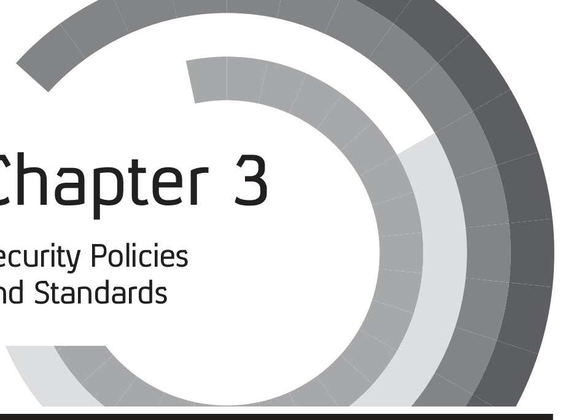
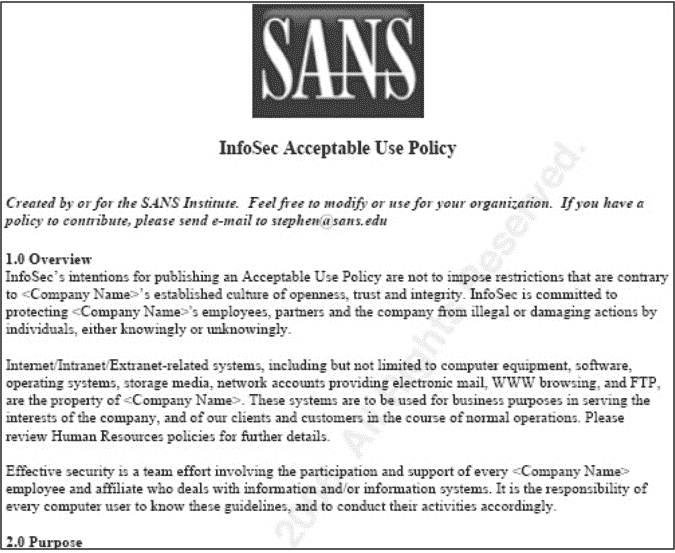
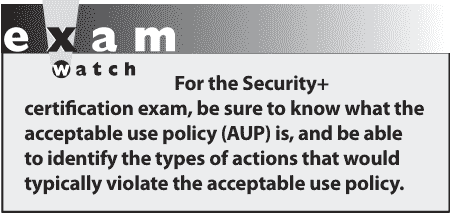
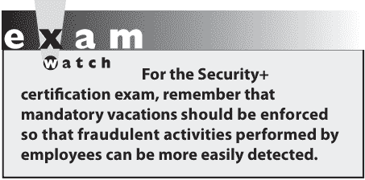
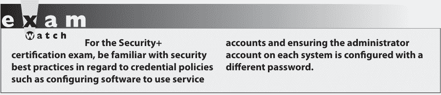
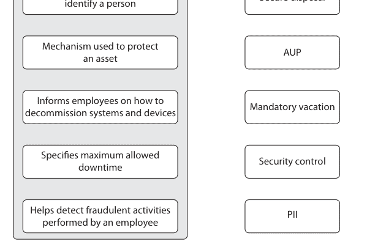

# 第 3 章

## 安全策略
和标准

## 认证目标

- 3.01 安全策略简介
- 3.02 通用安全策略
- 3.03 人力资源政策
- 3.04 用户教育和意识
- 3.05 法规和标准
- ✓ 两分钟练习
- Q&A 自测

对于所有公司来说，建立一个包含所有要素的安全计划以帮助提高组织的安全性非常重要。安全计划由许多要素组成，例如安全策略、培训以及组织内所有员工的意识。

## 认证目标 3.01

## 安全策略简介

安全策略是一个由许多子文档组成的大型文档，定义了公司的安全战略。它是一份定义组织中所有人员必须遵循的所有规则的文档——包括用户、网络管理员、安全专业人员和管理团队。需要注意的是，即使是组织内的安全团队也必须遵循组织定义的安全策略。

应强调的是，安全策略旨在保护组织的资产并确保组织内的行为合法且符合规范组织的任何法规。员工应理解，法律和合规要求是每个人的责任，以便公司的安全态势保持强劲。

如前所述，安全策略由许多子文档组成，每个子文档涵盖一个特定的关注领域，称为策略。这些策略指定组织内所有人员必须遵循的 dos 和 don'ts。策略由安全专业人员创建，但由高层管理层赞助。创建安全策略的第一步是获得高层管理层的支持和批准，以确保策略可执行。

> exam watch
> 在组织内实施安全策略之前，您需要确保获得管理层的认可；否则，策略将得不到执行，导致无人遵循。

### 策略结构

虽然您可以自行决定如何格式化安全策略以及每个策略包含哪些部分，但以下是应存在于安全策略中每个文档中的部分的快速概述。以下部分应成为任何安全策略的一部分：

- **概述**  此第一部分应确定策略的目的以及它如何帮助保护环境。例如，密码策略的概述应说明需要强密码以及安全使用密码。
- **范围**  策略的范围部分定义了策略适用于谁。例如，您应明确指定策略是否适用于所有员工、承包商和/或临时员工。您还应指定策略是否适用于组织内的所有设备。
- **策略**  策略部分是文档中最大的部分，是 dos 和 don'ts 的列表。策略部分可分为不同的部分以帮助组织所有指定的规则。
- **执行**  策略的一个非常重要部分是指定如果员工不遵循它会发生什么。执行部分通常是一个简短的部分，规定如果员工不遵守策略，可能会导致纪律处分甚至解雇。
- **定义**  定义部分是您可以添加策略中使用的术语的定义的地方，这些术语策略的读者可能不知道。
- **修订历史**  策略的修订历史部分列出策略更改的日期、谁进行了更改以及可能谁授权了更改。不要忘记添加条目显示策略的创建日期。

重要的是确保每个策略都有一致的格式。为了帮助您创建策略，请访问 www.sans.org 并下载其一些策略模板（位于 Resources | Security Policy Project 下）。这些模板供您用作创建自己的策略时的指导。图 3-1 显示了 www.sans.org 网站上 *可接受使用策略 (AUP)* 的一部分。我建议使用示例作为起点，但然后务必根据您公司的需求定制策略。

在我们深入探讨典型安全策略中常见的一些流行策略之前，让我们讨论不同类型的策略并快速概述法规和标准。

> 您可以访问 www.sans.org/security-resources/policies 下载并查看应包含在您的安全策略中的许多示例策略。一定要查看一下。

### 识别策略类型

关于策略，首先要了解的是每种类型服务于不同的目的。三种流行的策略类型是标准、指南和程序。让我们看一下每种类型的策略。

## 标准

组织内的大多数政策都是必须遵守的标准。*标准政策*是一种需要遵守的政策，通常涵盖特定的安全领域。未能遵守标准政策通常会导致纪律处分，例如解除雇佣关系。

## 指导方针

有些政策是*指导方针*，即关于如何遵循安全最佳实践的建议。过去，美国国家安全局（NSA）曾在其网站上发布过许多针对不同类型服务器和操作系统的安全最佳实践指南。不遵循建议性政策不会导致纪律处分，因为它仅仅是一个建议。

> 对于 Security+ 认证考试，需要了解不同类型的政策。例如，要熟悉标准、指导方针和程序性政策之间的区别。

## 程序

最后一种政策类型是*程序政策*，也称为*标准操作程序（SOP）*。SOP 记录了配置系统或设备的分步操作程序，或实施特定安全解决方案的分步操作说明。

## 认证目标 3.02

## 通用安全政策

尽管一些组织制定安全政策只是为了遵守法规和标准，但所有组织都需要以安全政策作为实施安全的起点，因为安全政策定义了业务中的规则以及所有的注意事项。如果没有安全政策，安全团队将不知道应实施何种安全控制措施。例如，安全政策中会包含防火墙政策，该政策确定组织使用哪些防火墙产品以及应用何种类型的防火墙规则。没有这一政策，防火墙管理员将不知道需要在防火墙上配置什么。

> 考试提示
> 对于 Security+ 认证考试，以及在现实世界中，要知道术语*安全控制*用于指代保护组织内任何资产的机制。安全控制的示例包括防火墙、防病毒软件和访问控制列表。

本节旨在让你了解一些组织内部应存在的不同安全政策。为了便于阅读，我将这些政策分为几个部分：影响用户的政策、影响高层用户的政策、影响管理员的政策，以及影响管理层的政策。

需要注意的是，完善的安全政策有助于组织遵守行业法规和法律。安全政策还将帮助组织遵循安全最佳实践并坚持执行各项标准。

## 影响用户的政策

有许多不同的政策会影响用户，这里指的是这些政策可能影响用户每天与业务资产互动的方式。影响用户的两项常见政策是“可接受使用政策”和“密码政策”。

## 可接受使用政策

可接受使用政策（也称为 AUP）是一项重要政策，因为它使用户了解公司对使用其资产（如互联网服务、电子邮件、笔记本电脑和移动设备）的哪些行为视为可接受。

> 务必让所有员工阅读并签署可接受使用政策，以确保他们理解哪些行为被视为对公司资产（如计算机、互联网服务和电子邮件）的合理使用。

所有员工都应在入职培训期间审阅可接受使用政策，并签署以证明他们已经阅读了该政策并同意其条款。以下是可接受使用政策通常涵盖的主题：

- **互联网的合理使用** 通常涵盖禁止不当内容等规则。你可能还需要明确互联网是否仅供商务用途，以及公司在工作时间对使用社交网站所允许的容忍程度。
- **电子邮件的合理使用** 该政策应明确电子邮件仅供商务使用，允许少量个人电子邮件。还应在该政策中明确规定公司关于转发连锁信件的规则，并明确指出不得使用公司电子邮件账户发送骚扰邮件。
- **笔记本电脑的合理使用** 该政策规定使用笔记本电脑的任何相关规则。你可能需要涵盖诸如将笔记本电脑留在车内时应锁在行李箱中（笔记本电脑不应放在显眼处）等主题。还应在政策中明确笔记本电脑上的内容是否应加密，以及用户是否可以将笔记本电脑连接到非工作网络。
- **移动设备的合理使用** 该政策应涵盖任何有关移动设备的规则，例如哪些类型的移动设备可用于公司电子邮件和电话。还应明确允许对移动设备进行多少个人使用，以及如果移动设备被盗应如何处理。最后，你可能需要规定移动设备的哪些功能应启用或禁用。
- **社交媒体的合理使用** 该政策应涵盖有关社交媒体使用的规则，以及员工可以或不可以分享或评论的内容类型。例如，公司可以规定员工不得代表公司发表评论，也不得给人留下其观点代表公司的印象。公司可能采取另一种方法：如果员工对与其行业相关的产品发表评论，则必须说明他们为该公司的员工。

## 密码政策

密码政策对用户和管理员来说都是一项重要政策。我将密码政策放在影响用户的章节中，但请注意它也影响管理员，因为它规定了管理员应在服务器上将哪些密码限制配置为密码限制，以及在服务器上配置密码限制时所需遵循的要求。

以下概述了密码政策应考虑的一些事项：

- **最小密码长度** 最小密码长度规定了员工在创建密码时必须使用的字符数。企业通常使用的最小长度为八个字符。
- **密码历史记录** 密码历史记录设置指定了系统应跟踪多少个过去的密码。其理念是员工不允许重复使用密码历史记录中已经使用过的密码。公司通常将历史记录设置为 12 或 24 个密码。
- **最大密码期限** 最大密码期限规定了员工可以使用特定密码多长时间。该值通常设置在 30 到 60 天之间，到期后用户必须更改其密码。
- **最小密码期限** 最小密码期限是用户使用其密码的最少天数。此设置可防止员工多次更改密码，以便将所需密码移出历史记录，从而试图重复使用旧密码。
- **密码复杂性** 密码复杂性设置规定了你是否要求使用复杂密码。复杂密码是混合使用字母、数字和符号，并同时包含大写和小写字符的密码。强烈建议在你的环境中启用密码复杂性。

## 影响人事管理的政策

有许多政策直接适用于组织内的高管团队成员或高层管理人员。应明确定义以下政策，以确保公司在招聘新员工或员工离职时知道应采取哪些行动：

- **保密协议（NDA）** 员工、承包商和管理人员应阅读并签署保密协议，以确认他们理解并同意不得分享在公司工作期间接触到的公司敏感信息。保密协议不仅适用于在公司工作期间，也适用于工作关系结束后。
- **入职流程** 公司应制定入职政策，规定每个职位角色应接受哪些具体培训以帮助其履行职责。这包括员工、管理层和高管的入职培训。入职培训还包括授予访问资源的权限，例如分配移动设备等。

**离职流程** 离职政策应指明员工离开部门或公司时应遵循的程序。例如，其中一项程序是收回PKI卡和公司设备等资源。

**继续教育** 培训是真正有助于提高员工士气的公司福利之一。公司应制定一项继续教育政策，根据员工的岗位角色明确其每年的培训预算。

**可接受使用政策/行为规则** 如前所述，可接受使用政策定义了员工、管理层和高管如何使用移动设备、电子邮件、互联网和社交媒体等技术的规则。

**处罚措施** 在高管团队的支持下，每项政策都应规定对不遵守安全政策的人员的处罚措施。例如，应明确告知员工，不遵守政策可能会导致失业。此外，高管团队应明白，公司整体未能遵守政策和法规可能导致被拒绝信贷，更重要的是，被拒绝保险。

## 影响管理员的政策

许多组织安全政策会影响用户，但似乎更多的政策会影响网络管理员以及他们如何跟踪和管理网络上的资产。本节概述了一些应制定的常见政策，以指导管理员遵循最佳实践。

### 资产管理

组织应制定资产管理政策，包括围绕公司资产的采购、日常管理和退出的政策。例如，当需要采购新的服务器硬件时，公司应有可联系的既定供应商。还应有相关政策规定服务器资产的维护方式，以及资产超过使用年限后的退役方式。

### 变更控制/管理政策

最关键的政策之一是变更控制或变更管理政策，它规定了在对网络实施变更时应遵循的流程。如果未建立变更管理流程且未遵循该政策，则可能因实施变更时出错而导致网络访问被拒绝。制定指明应遵循程序的变更管理政策应能减少配置错误，因为流程可以确保变更得到适当测试。变更管理政策还应规定在实施变更之前应通知谁，以便该人员可以批准变更。

### 设备安全处置政策

当今要考虑的最关键政策之一涉及设备的安全处置。对于企业中已退役的计算机，你会怎么做？你会将其捐赠给当地学校系统吗？该计算机硬盘驱动器中的公司数据怎么办？制定一项政策，明确规定系统和设备在停止生产后如何处理，这一点很重要。

在高度安全的环境中，物理销毁任何包含敏感数据的硬盘驱动器至关重要。在安全级别较低的环境中，您可能需要安全地擦除驱动器，使数据无法恢复。简单地重新格式化驱动器并不能删除信息，信息仍然可以被恢复。

还应在设备安全处置政策中明确规定如何处理其他停用的旧设备。这包括服务器、磁带、交换机、路由器和移动设备。我见过许多案例，网络管理员在互联网上出售公司的旧服务器或路由器，而未确保现有数据和配置已被擦除。这应被视为违反安全政策，并且需要对管理员进行教育，让他们了解不进行设备安全处置所带来的风险。

## 练习 3-1

### 审查安全政策

在本练习中，你将审查来自SANS网站的示例可接受使用政策，并回答有关该政策的问题。审查该政策后，回答以下问题：

1. 导航至 https://www.sans.org/information-security-policy/ ，然后点击“可接受使用政策”右侧的 + 号。

2. 点击PDF按钮以PDF格式打开该政策并审查。回答以下关于该政策的问题：
   - 该政策的目的是什么？
   - 该政策适用于哪些人员？
   - 员工是否允许将公司资产用于个人用途？
   - 员工是否允许使用复印机复印杂志文章供他人阅读？
   - 如果有人不遵守此政策，会有什么后果？

## 影响管理层的政策

尽管大多数政策直接影响管理员团队，告知他们如何进行更改或需要进行哪些类型的更改，但有些政策直接影响管理层。本节概述了管理层应考虑的一些政策，以帮助保护其业务和资产。

### 隐私政策

当今任何组织的一个重要方面是制定隐私政策，用于教育员工和客户了解从客户那里收集信息的方式和原因，以及这些信息将如何使用。大多数企业在其网站上放置隐私声明，告知公众他们打算如何使用和管理这些信息。

### 信息分类

另一个处理管理层关注点的政策示例是*信息分类政策*。信息分类政策有助于定义信息的不同分类（例如，机密和绝密），以及访问该信息所需的许可级别。

为信息分配分类级别（称为*数据标签*）决定了使用哪些安全控制措施来保护信息，以及投入多少资金来保护该信息。例如，被归类为绝密的信息将比归类为机密甚至非机密等较低级别的信息拥有更多的安全控制措施来保护。

以下是军方使用的一些常见信息分类：

- **绝密** —— 这是最高分类级别。绝密信息的公开披露将对国家安全造成严重损害。
- **机密** —— 低于绝密的分类级别。归类为机密的信息的公开披露可能对国家安全造成严重损害。
- **秘密** —— 低于机密的分类级别，也是最低的分类级别。归类为秘密的信息的公开披露可能对国家安全造成损害。
- **非机密** —— 任何未分类的信息都属于此类别。公开披露非机密信息被认为是安全的，不会损害国家安全。

安全政策应明确哪些类型的信息属于绝密、机密、秘密和非机密。政策不仅应规定信息如何分类，还应规定在什么情况下信息可以解密（移除或更改分类），以及更改信息分类的过程是什么。

组织中的信息被分类后，下一步是为组织内的个人分配许可级别。例如，要访问绝密信息，员工需要绝密许可及“需要知道”的身份。

## 考试要点

### 安全许可与数据标签

许多人混淆了数据分类标签和安全许可级别的概念；你需要理解它们的区别，以应对Security+认证考试。

分类标签（如机密、绝密甚至非机密）分配给信息或资产。一旦所有资产都被分配了分类标签，你就可以为员工分配安全许可级别，这些级别决定了他们可以访问哪些资产。例如，具有绝密安全许可的员工可以访问被标记为绝密的信息。

其他分类级别也可以分配给信息。前面的例子在政府和军事领域很常见，但公司可以使用自己的内部分类系统。以下是分类标签的其他示例：

- **高/中/低** —— 你的公司可能使用低、中、高的内部分类系统来评估信息向公众公开时的安全风险。
- **私有/公开** —— 一种简单的信息分类方法是将信息标记为私有或公开。私有意味着信息供内部使用，而公开意味着信息在向公众公开时不会带来安全风险。
- **敏感** —— 敏感数据是应受保护的数据，以使外部方无法访问该信息。敏感数据被视为私有数据。
- **保密** —— 如果数据被未经授权的人员访问可能对企业造成重大风险，则该数据应被视为保密数据。保密数据和敏感数据这两个术语经常互换使用。
- **关键** —— 关键数据是对业务运营至关重要的数据。例如，企业的关键数据可能是其客户列表或产品列表。
- **专有** —— 另一个可用于标识信息为公司私有或内部的标签是“专有”。专有信息是公司拥有的信息，未经授权不应在公司外部共享。

- **VPN 政策** 虚拟专用网络（VPN）政策规定了远程用户如何使用互联网连接到网络。VPN 会对客户端与 VPN 服务器之间的通信进行加密。在 VPN 政策中，你需要指定通过 VPN 进行远程访问时应使用哪种 VPN 协议和解决方案。你还可以指定客户端系统必须及时更新补丁和防病毒库。
- **事件响应政策** 事件响应政策是为负责处理安全事件的安全团队设计的。事件响应政策规定事件响应团队中每个人的职责，以及如何处理安全事件。
- **防火墙政策** 防火墙政策规定了公司的防火墙解决方案，以及允许和不允许通过防火墙的流量类型。
- **病毒防护政策** 病毒防护政策规定了哪些设备和系统需要安装防病毒软件。它还规定了应在防病毒软件中配置哪些设置，例如是否启用病毒定义的自动更新以及病毒扫描的计划安排。
- **审计政策** 审计政策是一项重要政策，规定了公司需要在哪些地方实施审计。审计政策应规定网络中哪些类型的服务器需要启用审计，以及应审计哪些类型的活动。审计政策还应规定由谁审查日志以及审查频率。
- **物理安全政策** 物理安全政策旨在规定应实施的所有物理安全控制措施，例如上锁的门、围栏和安保人员。确保通过将服务器放置在锁定的服务器机房中来控制对服务器的访问非常重要。
- **软件政策** 软件政策规定了经批准用于业务的软件，并指出了哪些软件可以安装到系统上，哪些不能安装。软件政策还应规定如何将某个软件添加到批准列表中。你还应确保在软件政策中明确禁止员工进行软件盗版。
- **备份政策** 备份政策规定了需要备份的数据类型以及备份频率。管理员将根据备份政策确定如何在业务中备份数据。

## 认证目标 3.03

## 人力资源政策

企业中一个经常被忽视的领域是人力资源（HR）职能如何影响企业安全，以及人力资源部门可以采取哪些措施来帮助改善组织安全。人力资源部门负责*人事管理*，并且可以实施许多安全政策来帮助创建更安全的环境。以下是人力资源部门应在企业内部协助执行的一些政策。

## 招聘政策

应制定招聘政策以帮助人力资源部门了解在招聘过程中需要做哪些工作来维护安全。招聘政策可规定人力资源部门执行以下任何事项：

- **面试流程** 招聘政策可规定应进行的面试类型顺序。例如，招聘政策可规定先进行电话面试作为第一轮筛选，然后再进行面对面面试。
- **联系推荐人** 在面对面面试期间，招聘政策可规定要求提供推荐人，以便在下一次面试之前联系他们。此外，招聘政策还可规定何时以及如何联系候选人提供的推荐人，以及询问哪些问题。
- **背景调查** 招聘政策可规定对候选人进行的背景调查类型。在招聘过程的这一阶段，应核实申请人简历上的信息。任何表明候选人在简历上撒谎的迹象都是不录用该候选人的充分理由。背景调查的目的是确保候选人确实具有简历上声称的教育背景和工作经验。该政策还可能要求对候选人进行犯罪背景调查和谷歌搜索。
- **签署竞业禁止协议和保密协议** 招聘政策可规定，在最后一次面试时应询问候选人，如果被录用，是否愿意签署竞业禁止协议和保密协议（NDA）。如果候选人不愿意签署此类协议，这可能成为不录用该候选人的理由。
- **药物筛查** 招聘政策还可规定，在最后一次面试时应询问候选人是否愿意进行药物筛查测试。同样，如果候选人拒绝药物筛查，这可能会成为不录用该候选人的理由，具体取决于工作类型。

制定招聘政策的目的是通过只雇用诚实且品行良好的人来帮助组织创建更安全的环境。

## 终止雇佣政策

制定终止雇佣政策至关重要，它可帮助人力资源部门确定按照法律终止员工雇佣关系所需采取的步骤。终止雇佣过程中采取的步骤取决于这是友好离职还是不友好解雇。

*友好离职*通常是指员工在良好关系下离开公司，通常出于非竞争性原因。对于友好离职，终止雇佣政策应规定人力资源部门安排*离职面谈*，并记录员工离开公司的原因。更重要的是，人力资源部门需要提醒员工其入职时签署的保密协议，并告知他们即使不再为公司工作，仍需要遵守该协议。人力资源部门应确保从员工处收回所有门禁卡和钥匙，并在员工离开公司后指示网络团队禁用其账户。

*不友好解雇*通常是指员工被公司解雇或不欢而散。通常，不友好解雇源于员工因被公司竞争对手聘用而离开公司，或因违反公司政策而被解雇。无论哪种情况，终止雇佣政策都应指导人力资源部门将解雇员工的意图告知网络团队，以便在人力资源部门向员工发出通知时，网络团队能够禁用员工对网络资源和办公楼敏感区域的访问权限。在不友好解雇中，政策通常应规定安保部门的一名成员必须护送该员工离开大楼，以确保该员工离开设施。

## 强制休假

从安全角度来看，确保安全政策实施强制休假（必须使用的休假时间）非常重要。休假的重要性在于，它有助于发现组织内部的欺诈或可疑活动，因为有人在休假时，另一名员工需要接替其工作职责。这将有助于保持员工在工作中的诚实，因为他们知道，如果在自己缺席期间发现异常活动，将需要承担责任。

## 与安全相关的人力资源政策

还应当实施并遵守许多其他与安全相关的人力资源和员工政策及程序。你已在第 2 章中了解了其中大部分概念，但我将在第 3 章中对其进行强化。以下安全原则应纳入政策并尽可能遵守，以帮助提高公司内部的安全水平：

- **岗位轮换** 正如实施强制休假很重要一样，公司还应采用岗位轮换制度。岗位轮换可确保不同员工定期担任不同的工作岗位。这有助于发现和阻止企业内部的欺诈活动。

**职责分离** 职责分离是指关键工作职能应被划分为多个任务，且不同的任务由不同的员工执行。例如，写支票的人不能同时签署支票——这确保了有多人在流程中参与，以帮助避免员工的欺诈行为。

**最小权限** 最小权限背后的概念是确保员工始终只被分配执行其工作职能所需的最小权限或特权，且没有多余权限。如果分配的权限超过所需，员工可能会获得其不需要访问的敏感数据的访问权限，或对该数据执行其不应执行的操作，例如修改或删除它。

> exam watch
> 请注意，安全策略旨在通过定义适合您组织的最佳安全实践来降低安全事件的风险。定义控制强制休假、岗位轮换和职责分离的策略可降低公司发生安全事件的风险。

## EXERCISE 3-2: Creating a Security Policy

在本练习中，您将创建自己的可接受使用政策，并包含有关计算机设备、互联网、电子邮件和移动设备可接受使用的条款。确保在您的政策中包含以下部分：

- Overview
- Scope
- Policy
- Enforcement
- Definitions
- Revision History

## CERTIFICATION OBJECTIVE 3.04: User Education and Awareness

创建和实施安全策略是为公司创建安全环境的重要一步，但如果公司不对员工进行安全和业务内相关安全策略的教育，就没有安全可言。

花费一些时间制定安全培训和意识计划非常重要，该计划涉及对所有层级的所有员工进行教育，使其了解其对安全的责任。本节旨在让您了解应为公司内部人员提供的不同类型的意识培训。

### General Training and Role-Based Training

设计安全培训计划时，您要做出的第一个重要决定是确定哪些内容适合向组织内的不同员工角色或部门展示。由于安全是一个至关重要的概念，也是您希望在培训和意识研讨会期间吸引受众注意的领域，因此您希望确保培训与受众相关并基于工作角色。例如，您不希望用防火墙如何实现的复杂讨论让业务用户昏昏欲睡，因此将技术安全培训保留给技术团队。该工作角色的任何成员都必须接受详细的专业技术培训。以下是应为组织内不同工作角色或员工类型解释的基本大纲：

- **Business users** 典型的业务用户应接受的教育安全领域包括密码最佳实践、社会工程、病毒防护以及物理安全的重要性。
- **Technical team** 技术团队由系统管理员、网络管理员、安全管理员以及可能包括桌面支持团队组成。这些人员需要接受有关提供安全的技术解决方案的培训，例如入侵检测系统、防火墙和恶意软件防护解决方案。
- **Management** 您将对管理团队或高管用户采取完全不同的方法。管理层和执行团队的成员通常更关心事情为什么要做，而不是如何做。在向管理层提高安全意识时，重点应放在他们为何应支持所提出的安全举措上，并通过举例说明企业因安全事件而遭受巨额资金损失和/或声誉受损的过去案例。另请研究是否有任何法律和法规要求

### Diversity of Training Techniques

您可能希望使用多种不同的方法向员工传授意识培训，因为人们以多种不同的方式学习。例如，有些人只能通过讲师授课的学习，而其他人可以通过观看视频或阅读书籍来学习。您可以使用以下任何方法，或多种方法的组合，用于组织内的*继续教育*：

- **Seminars** 教育员工最受欢迎的方法之一是举办研讨会，由安全专家向参与者解释相关问题。这些研讨会通常为半天或全天课程。
- **Lunch and learn** 午餐学习会议与研讨会类似，但时长约为50分钟，旨在涉及一个特定问题。大多数公司会在员工接受安全教育时提供午餐。
- **Computer-based training (CBT)** CBT 是一种方法，员工使用自学工具，例如在线提供的培训视频来学习安全知识。
- **Intranet site** 您可以在内部网站点上提供资源，例如描述安全最佳实践的文件。
- **Videos on demand** 内部培训的一种方法是录制研讨会作为视频，可从内部服务器下载。
- **Gamification** 游戏化是将游戏化应用于组织希望鼓励的活动。例如，您可能会向首先识别并报告内部测试钓鱼邮件的前两名员工发放礼品卡。
- **Capture the flag** 夺旗赛是一种学习工具，向参与者提供一系列挑战，要求他们利用自己的技能在竞赛中解决问题。随着他们解决问题，他们会获得旗帜，并在平台内兑换积分。例如，有许多夺旗赛要求安全专业人员使用其黑客技能获取旗帜。
- **Phishing campaigns** 公司可能会使用钓鱼活动作为一种方法来确定其安全培训的有效性，通过向员工发送电子邮件，试图诱骗他们通过泄露信用卡号码或登录凭据等敏感信息来破坏安全。在这种情况下，公司通过伪造电子邮件（使其看起来来自其他人）冒充某人，要求用户点击链接，然后在虚假网站上输入敏感信息。
- **Phishing simulations** 在员工培训期间，您应通过钓鱼攻击或模拟的示例进行演练，以便员工在发生钓鱼攻击时能够识别出来。这种类型的培训工具旨在确保员工在发生钓鱼攻击时知道应采取的正确行动。
- **Role-based training** 基于角色的培训涉及根据员工的工作角色设计培训计划。例如，业务用户将接受有关密码最佳实践、钓鱼攻击和安全上网习惯的培训，而 IT 团队将接受如何配置公司防火墙的培训。

### User Habits

在向员工传授安全最佳实践时，您应重点关注多个领域。本节确定了一些您希望对用户进行教育的常见要点。

### Password Behavior

就良好的密码最佳实践而言，向用户传授使用强密码的重要性以及简单密码可在几秒钟内被破解的事实。解释强密码是指至少包含八个字符、包含大小写字母混合，并包含数字和/或符号的密码。

确保用户不会使用容易猜测的密码或将密码写下来。此点应在密码策略中明确规定。另请确保用户不会与其他人共享密码，并且他们会定期更改密码，以帮助防止被黑的账户被长期使用。最后，用户不应使用他们用于其他用户账户的相同密码，因为如果有人破解了其中一个账户的密码，黑客就可以进入所有账户。这适用于用于登录网站的账户。例如，用户不应为其银行账户、Outlook.com、Gmail 和 Facebook 账户使用相同的密码，因为一旦密码被破解，黑客就可以进入所有这些账户。

### Data Handling

用户还应接受有关安全处理数据方式的教育。保存在可移动驱动器上的数据应以加密格式存储，以便如果可移动介质落入错误的人手中，数据也能得到保护。应制定政策，规定业务中允许使用哪些类型的可移动介质以及允许在该介质上存储哪些类型的信息。您必须确保用户审查政策并了解此类介质的使用条款。

务必向用户传授数据销毁的正确方法。教育用户，简单地从驱动器上删除文件并不会从磁盘上删除数据，并且员工必须遵循设备安全处置政策来处理任何设备。

教育用户有关数据硬拷贝（纸质打印件）的正确销毁方法，并确保所有用户都可以使用碎纸机来销毁敏感的纸质文件

> exam watch
> 对于 Security+ 认证考试，请熟悉游戏化、夺旗赛和钓鱼活动等培训技术。您肯定会在考试中看到有关这些主题的问题。

## 新威胁与安全趋势

确保您的培训和意识计划讨论新病毒每天都会出现这一事实，并且员工应确保其家庭和工作电脑的病毒定义始终保持最新。确保公司有方法通知员工新的病毒威胁，以便所有员工立即了解威胁。

确保员工了解常见的威胁，例如钓鱼攻击。*钓鱼攻击*是指员工收到一封电子邮件，要求他们点击提供的链接访问网站。这通常是一封伪造的电子邮件，看起来像是来自您的银行，要求您点击提供的链接以验证您的银行账户未被篡改。告知员工此类威胁，并告诉他们删除电子邮件，不要点击提供的链接。

还应教育员工了解*零日漏洞利用*，即针对新发现漏洞的攻击，而软件或硬件供应商尚未知晓。问题在于，如果供应商不知道漏洞利用，就没有修复方法。重要的是要教育用户，黑客总是在想出新的系统利用方法，因此用户需要在日常思维中保持安全意识。

## 社交网络和 P2P 程序的使用

关于员工日常计算机使用的主要安全问题之一是他们在家、办公室或公司笔记本电脑上的互联网使用习惯。两个关注领域是社交网络网站和允许用户下载音乐、电影和软件的点对点（P2P）程序。社交媒体和 P2P 下载都可能是病毒传播到用户系统的途径。

公司可能会进行*社交媒体分析*，以查看员工是否在社交媒体上泄露有关工作的敏感信息。这可能简单到在他们办公桌前拍照，而办公桌上有机密文件打开，如果有人放大照片就可以看到。公司还可能监控社交媒体上的负面帖子。

务必教育员工有关 Twitter、Instagram 和 Facebook 等社交媒体的可接受使用。确保员工知道不要在这些网站上发布与公司相关信息，并禁止他们发布公司聚会和其他活动的照片。此类活动可能会损害公司的安全或声誉。

您还应在可接受使用政策中明确公司在工作时间使用社交网络网站的规则。一些企业允许在休息或午餐时间使用此类网站，但许多人即使在工作时间也会花费过多时间在这些网站上。许多组织会在防火墙上阻止这些网站。务必保持防病毒软件为最新状态，因为大量病毒是在社交网络网站使用的应用程序中编写的。

BitTorrent 等点对点软件用于在互联网上共享音乐、视频和软件应用程序，供世界各地的人下载。有两个方面需要教育员工了解 P2P 软件的使用。首先，这是黑客在网络上传播病毒的流行方式，这也是 P2P 软件不应在公司中允许的原因之一。此外，应提醒员工确保家庭所有系统上的防病毒软件保持最新。第二点应在 AUP 中说明的是，从公司系统和资产下载或共享任何受版权保护的材料（例如音乐、电影、电视节目或软件）是禁止的。明确公司对版权侵权和软件盗版零容忍。

## 培训指标和后续跟进

收集培训指标以衡量安全培训的成功程度非常重要。您应制定培训计划，其中包括每个员工所需的全部培训，并有一种方式跟踪培训是否已完成。

您还应有一种测试培训有效性的方法，无论是通过测试还是模拟。您需要验证培训的有效性、政策合规性以及组织安全态势的强度。

### EXERCISE 3-3

### 设计培训计划

在此练习中，您将花一些时间为您的公司设计一个安全意识计划。记录您的计划策略，然后回答以下问题：

- 1. 您将使用什么方法来教育员工有关安全问题？从以下选项中选择：
  - CBT
  - Seminars
  - Web portal videos
  - Intranet site
- 2. 如果您使用多种方法来教育员工，请记录谁使用哪种方法。
- 3. 您将向业务用户披露哪些类型的信息？
- 4. 您将与管理层进行哪些类型的讨论？
- 5. 您打算与技术团队讨论哪些技术细节？

## 政策对组织安全的重要性

安全政策是任何公司安全计划的关键组成部分，因为它们告知员工和管理层安全风险的潜在风险以及如何降低风险。在本节中，您将了解涉及第三方公司的风险以及影响数据和凭据的政策。

### 第三方风险管理

当企业与其他第三方公司或个人互动时，公司存在应被识别的风险。以下列表概述了贵公司可能互动的一些关键第三方组织：

- **Vendors** 供应商是您互动的公司，可能提供计算机硬件、网络电缆，甚至公司食堂饮料机中的汽水。重要的是要识别与供应商共享的信息，并确保供应商采取措施保护任何敏感信息。
- **Supply chain** 供应链由为贵公司提供材料以向其客户交付产品或服务的各个公司组成。攻击者可能会尝试入侵您的供应链，以便在材料送入贵公司时渗透您的业务。
- **Business partners** 贵公司可能与之合作的业务合作伙伴。存在业务合作伙伴系统被入侵的风险，因此当他们连接到贵公司网络时，攻击者能够获得访问权限。应采取措施确保业务合作伙伴仅有权访问所需信息。

当您处理供应商和业务合作伙伴时，重要的是确保起草适当的法律文件以确定与供应商或业务合作伙伴的关系。以下是在 Security+ 认证考试中您需要熟悉的协议类型：

- **Service level agreement (SLA)** SLA 是贵组织与向组织提供服务的人之间的合同或协议。SLA 设定了互联网服务和电子邮件服务等资产允许的最大停机时间，是安全政策的重要组成部分。重要的是确保您与所有提供商都有 SLA，包括互联网提供商、通信链路提供商，甚至网络服务团队。如果提供商未达到 SLA 要求，这可能意味着需要寻找其他服务。还应注意，SLA 在公司内部在 IT 部门与其他部门之间使用，以便各个部门对服务质量有合理的期望。
- **Memorandum of understanding (MOU)** MOU 是一份文件，建立了双方之间的协议并规定了他们之间的关系。
- **Statement of work (SOW)** SOW 概述了公司被聘用的工作类型、该工作的完成时间表、所执行工作的成本、付款计划以及与工作相关的任何条件。
- **Measurement systems analysis (MSA)** Security+ 目标将 MSA 标识为*测量系统分析*，这是一种用于确定测量过程中的方差的数学运算。我认为 Security+ 目标本意是将 MSA 定义为*主服务协议*，这是一份文件，如果公司被聘用定期执行工作时使用。无需每次都创建详细的 SOW，您可以将工作细节放在 MSA 中，然后为每项工作创建的 SOW 将引用主服务协议（MSA）。
- **Business partnership agreement (BPA)** BPA 是两家或多家公司之间的合同，确定了它们关系的条款。BPA 确定了关键领域，例如资本投入、损失或利润分配以及每个合作伙伴的职责。
- **End of life (EOL)** 产品达到生命周期结束时，供应商停止创建该产品。它通常会被该产品的更新版本取代。
- **End of service life (EOSL)** EOSL 标记通常分配给不再受供应商支持的硬件或软件。达到 EOSL 的产品将不再由供应商为其开发安全更新，这将使该产品对组织构成风险。
- **Nondisclosure agreement (NDA)** NDA 是一份文件，概述了双方关系中的保密性以及哪些信息被视为机密。NDA 还确定了在关系期间以及关系结束后如何处理机密信息。

### 影响数据的政策

许多安全政策影响员工对数据的访问以及公司如何管理其数据。以下是一些常见的影响数据的政策：

- **Classification** 如您在本章前面所学，数据会被分配安全标签，并且只有具有该安全许可级别的人才能访问该信息。在准备 Security+ 考试时，请务必回顾本章前面介绍的数据分类。
- **Governance** 为了最大程度减少数据安全事件，公司应制定数据治理政策，确定谁对数据有控制权，以及数据在组织内部如何处理。
- **Retention** 公司应制定保留政策，确定数据应保留多长时间。不同类型的数据可能有不同的保留要求——例如，财务记录通常保留七年。

## 凭证策略

另一种应存在的是凭证策略。凭证策略决定了企业内不同实体使用的凭证或用户名。以下是关于凭证的一些常见考虑因素：

- **人员** 公司内的每位员工都应拥有自己的凭证来访问网络和计算机系统。员工应接受有关凭证的安全最佳实践培训，例如不要与其他员工共享凭证。
- **第三方** 业务合作伙伴或承包商等第三方实体也应拥有访问所需系统的凭证。遵循这些凭证的最佳实践非常重要，例如确保承包商凭证上设置了账户过期选项。
- **设备** 您可能需要以几种不同的方式管理设备的凭证。首先，您需要在设备上设置密码，以便只有授权人员可以访问这些设备。您还应在每台设备上设置空闲超时，以便设备在短暂空闲后自动锁定。
- **服务账户** 在系统上运行的软件也需要以“某人”的身份运行，因此您应为软件创建所谓的服务账户。创建账户后，您再配置软件使用该账户对系统进行身份验证。这成为软件访问网络资源时的安全身份。
- **管理员/根账户** 您还应管理系统上管理员账户的凭证（也称为根账户）。重要的是要确保每个系统上的管理员账户使用不同的密码，这样如果一个系统的密码被泄露，就不会在其他系统上使用相同的密码。

**对于 Security+ 认证考试，请熟悉有关凭证策略的安全最佳实践，例如配置软件使用服务账户并确保每个系统上的管理员账户配置了不同的密码。**

## 隐私和敏感数据概念

了解公司及其数据面临的安全风险是安全专业人员的重要技能。在本节中，您将了解公司发生安全漏洞的后果、我们希望保护的数据类型以及用于保护该数据的工具。

## 隐私和数据泄露的组织后果

如果公司发现发生隐私和数据泄露，可能面临多项后果。以下是 Security+ 考试需要记住的关键后果：

- 声誉损害 公司面临的最大后果之一是声誉损害。如果客户得知您的企业未妥善保护敏感数据，他们可能会决定不再与您的公司做生意。这会影响公司的财务状况，并可能导致公司关闭。
- 身份盗窃 如果发生对敏感数据的未经授权访问，您或您的客户可能会遭受身份盗窃。
- 罚款 如果未妥善保护敏感数据，您可能会面临罚款。这些罚款可能会给您的公司带来财务压力。
- 知识产权盗窃 如果数据泄露导致对敏感公司数据的未经授权访问，可能会导致攻击者窃取知识产权。

## 泄露通知

如果您的企业发生数据泄露，您需要通知适当的人员。您需要通知的人员取决于您所从事的业务类型和发生的事件类型。两种不同的通知形式如下：

- 升级 在发现发生安全事件后，您可能需要向事件响应团队报告该事件。在调查事件后，事件响应团队可能需要根据事件情况升级给另一方。例如，如果是云事件，他们可能需要升级给云服务提供商。
- 公开通知和披露 根据规范您组织的法规和法律，您可能需要就任何安全事件发表公开声明并披露已泄露的信息类型的详细信息。法律可能要求公司单独通知受影响的用户和客户。

## 数据类型

在创建安全策略时，您的目标是保护组织内的隐私和敏感数据。了解组织内存在的数据类型将帮助您了解所需的类型安全控制。例如，了解本章前面讨论的信息的不同分类，例如私有和公共数据，对于保护该数据很重要。企业中需要保护的其他类型数据如下：

- 个人身份信息（PII） PII 是任何可以唯一识别个人的信息。例如，驾驶执照号码被视为 PII 数据。您将在下一节中了解更多关于 PII 信息的内容。
- **健康信息** 健康信息通常包含有关个人的机密医疗信息，应仅由授权个人访问，例如患者的医生。
- **财务信息** 财务信息如信用卡号码和银行账户信息应保密，并采取措施确保数据不会以明文形式存储在信息系统中。
- **政府数据** 如果泄露可能对政府构成安全风险的信息，应受到严格保护，以便只有授权个人可以访问该信息。
- **客户数据** 敏感客户数据应始终受到保护，例如联系方式、地址信息以及与客户相关的任何财务数据。

## 隐私增强技术

您可以使用多种不同的技术来帮助保护不同类型的敏感信息，例如信用卡号码和健康信息。对于 Security+ 考试，您应记住以下维护隐私的关键技术：

- **数据最小化** 保护敏感数据的第一步是最小化收集的信息量。数据最小化是指仅收集必要信息的流程。
- **数据掩码** 数据掩码是一种用于保护机密或私有数据的技术，其中涉及用不相关字符替换数据中的字符。一个使用数据掩码的例子是，如果您有一位正在处理数据库的顾问，您向其提供数据库的掩码版本，以便顾问无法获取数据中发现的敏感信息。
- **令牌化** 数据的令牌化是指用非相关数据字符串即令牌替换数据中发现的敏感信息。此字符串随后存储在别处的数据映射中，可在需要时查找以将令牌数据转换回敏感数据。这是保护信用卡信息常用的技术，以便信用卡数据不会与客户数据一起存储。
- **匿名化** 匿名化是一种数据隐私技术，涉及从数据中删除个人身份信息，以便数据中描述的人可以保持匿名。
- **假名化** 也称为伪匿名化，假名化是指数据库字段中位于其中的个人身份信息被假名替换。

exam watch 对于 Security+ 认证考试，请熟悉可用于增强数据隐私的不同技术。特别是请记住，数据掩码通常用于数据库，而令牌化用于需要反复使用的私有数据，例如信用卡号码。

## 其他考虑因素

Security+ 认证考试期望您了解与数据隐私概念相关的一些其他术语：

- **信息生命周期** 信息在企业内具有生命周期，从信息创建、分配给员工、使用、维护到最终处置。
- **影响评估** 影响评估用于评估安全妥协对企业的影响。例如，公司电子商务网站被黑客入侵，黑客访问客户记录的影响是什么？
- **协议条款** 协议条款是一份文件，概述了双方同意的关系的规则和条件。
- **隐私声明** 隐私声明，也称为隐私政策，是向个人传达公司如何收集、使用、披露、管理以及处置客户数据的一份声明。

exam watch 对于 Security+ 认证考试，请熟悉影响评估和隐私声明及其对数据隐私的重要性。

## 认证目标 3.05

## 法规和标准

Security+ 认证期望您了解围绕信息安全的一些常见法规、标准和框架，以及这些元素如何用于提高组织的安全态势。

## 法规、标准与立法

组织出于不同原因实施安全策略——组织可能为了遵守其所在行业的法规或遵循特定标准而实施策略。某些法规和标准可能会影响贵组织制定策略的方式和原因，因此请务必查阅适用于您所在行业的具体法规和标准。

以下各节概述了一些当今流行的法规和标准示例。

### ISO/IEC 17799

*国际标准化组织（ISO）*和*国际电工委员会（IEC）*制定了 ISO/IEC 17799 标准，该标准规定了信息安全管理的最佳实践。ISO/IEC 17799 将信息安全管理划分为不同类别（通常称为*域*）。以下是遵循该标准时应重点关注的一些信息安全类别：

- 风险评估
- 安全策略
- 安全组织
- 资产保护
- 人员安全
- 物理和环境安全
- 通信与运营管理
- 访问控制
- 系统维护
- 业务连续性

ISO/IEC 17799 于 2000 年正式采用，2005 年更新，随后于 2007 年重新编号为 ISO/IEC 27002。重新编号的目的是使该标准与 ISO 27000 系列中的其他标准保持一致。

### PHI 和 HIPAA

美国有多项旨在保护健康信息隐私的政策和法案。*受保护健康信息（PHI）*是有关患者、其护理、健康状况和支付历史的健康信息，受《*健康保险携带和责任法案（HIPAA）*》中的规则保护。组织通常会对这些信息进行匿名化处理，以维护患者的隐私。

HIPAA 于 1996 年制定，涉及医疗记录的隐私。HIPAA 是一项美国标准，其关注的核心领域是保护任何可识别个人身份的健康信息，并控制对该信息的访问。

### 个人可识别信息

个人可识别信息（PII）是能够唯一识别某个人的任何信息。它应始终受到保护。以下是被视为 PII 的两个信息示例：

- **国家识别号** 国家识别号例如（美国的）社会安全号或（加拿大的）社会保险号。
- **驾驶执照号码** 驾驶执照号码是需要保护的个体唯一信息的一个典型示例。

考试提示 对于 Security+ 认证考试，请熟悉什么是个人可识别信息（PII），并能够识别 PII 的示例。PII 应始终受到保护并保持机密。

在制定安全策略时，您还应熟悉其他标准和法规，以确保您的企业遵守适用于组织的各项法规。以下是制定安全策略时需要牢记的其他一些标准和法规：

- **通用数据保护条例（GDPR）** GDPR 是一项旨在保护个人私人数据的欧洲法规。处理或接触个人数据的组织必须建立安全控制措施，以确保不会发生对私人数据的未授权访问。GDPR 概述了数据处理者（处理个人数据的实体）和数据控制者（负责保护个人数据的实体）的安全要求和责任。
- **国家、地区或州法律** 请务必遵守适用于组织的国家、地区或州法律，这些法律涉及资产安全，特别是员工和客户数据的安全。
- **支付卡行业数据安全标准（PCI DSS）** PCI DSS 是由信用卡公司强制执行的信息安全标准，旨在确保商户采取必要措施保护信用卡数据。PCI DSS 对收集信用卡数据的公司提出了多项安全要求，例如定期执行安全评估、网络分段和安全性、保护持卡人信息以及对数据实施强大的访问控制方法。

> 考试提示 对于 Security+ 认证，请务必了解不同标准（如 ISO、GDPR 和 PCI DSS）之间的区别。

## 框架与安全指南

有许多行业框架和安全指南规定了安全不同方面的最佳实践，例如物理安全最佳实践、系统安全最佳实践、网络安全最佳实践和安全编码最佳实践。安全框架包含大量文档化的流程、安全过程和安全策略，必须遵循这些内容才能符合该框架。以下是您需要为 Security+ 认证考试能够描述的框架：

### 互联网安全中心（CIS）

CIS 是一个成立于 2000 年的非营利组织，负责创建和推广网络安全防御最佳实践，以帮助保护系统。您可以在 www.cisecurity.org 查看最佳实践文档并下载网络安全工具。

### 美国国家标准与技术研究院（NIST）风险管理框架（RMF）/网络安全框架（CSF）

NIST 风险管理框架（RMF）是一份概述将安全风险管理纳入系统开发生命周期的步骤的文档。该框架分为七个阶段来执行风险管理，可在 https://csrc.nist.gov/projects/risk-management/about-rmf 访问。NIST 网络安全框架是 NIST 提供的一套帮助公司管理网络安全风险的策略资源。它是一份帮助组织了解应落实哪些安全措施和控制来降低资产风险并更好地保护这些资产的文档。您可以在 www.nist.gov/cyberframework 查看 CSF。

### NIST SP 800-171

NIST 特别出版物 800-171 是一项推荐给联邦组织的标准，用于在非联邦系统上处理、存储和使用信息时确保信息安全。该框架定义了许多可用于保护信息的技术控制措施。

### 国际标准化组织（ISO）/IEC 27001/27002/27701/31000

如本章前面所述，ISO 制定了一系列国际标准文档，向读者展示如何在其组织内管理信息安全。以下概述了每个标准的目的：

- ISO 27001 定义了如何在组织内管理安全，包括实施安全策略和安全控制，以帮助进行资产管理、物理安全和运营安全。
- ISO 27002 是对 27000 标准的更新，用于实施安全控制以帮助保护信息系统。
- ISO 27701 定义了实施安全控制和流程以维护个人可识别信息（PII）隐私的标准。
- ISO 31000 定义了一个帮助组织管理其内部风险的框架。

### SSAE SOC 2 Type I/II

服务组织控制（SOC）2 是一项审计标准，服务提供商可以使用它来确保客户数据受到保护。SOC 2 Type I 审计将确认服务提供商已落实适当的安全控制。SOC 2 Type II 审计则更为深入，因为审计师会对组织内的安全控制和安全策略进行更全面的审查。

### 云安全联盟

云安全联盟（CSA）提供了一个安全最佳实践框架，用于创建安全的云计算环境。CSA 通过提供云控制矩阵（CCM）来实现这一目标，该矩阵由 197 个控制目标组成，分为 17 个域，涵盖云计算的所有关键方面。您可以在 cloudsecurityalliance.org 了解 CSA 的相关信息。CSA 还提供了一个名为企业架构的参考架构，这是一种评估内部 IT 或云提供商安全能力的方法。

### 基准/安全配置指南

还有许多安全配置指南提供了保护特定类型产品或系统的最佳实践。NIST 发布有关保护特定平台步骤的文档，但您也可能会发现产品的制造商发布了自己关于如何保护其产品的文档。NIST 安全配置指南的一个示例是特别出版物（SP）800-123，该文档概述了通用服务器安全应采取的步骤（任何服务器都应遵循的安全实践）。

NIST 拥有许多涵盖不同类型产品的安全配置指南。例如，它提供了 Web 服务器（如 Microsoft IIS）、操作系统（如 Windows）、不同类型的应用服务器的安全配置指南

（例如 Microsoft SQL Server 或 Microsoft Exchange Server 的安全配置），以及配置指南，概述了保护网络基础设施设备（例如交换机和路由器）的步骤。

许多厂商创建安全配置指南，针对其操作系统、软件和设备的最佳实践。以下是一些示例：

- **Cisco IOS Security Configuration Guide, Release 12.4**
  www.cisco.com/c/en/us/td/docs/ios/security/configuration/guide/12_4/sec_12_4_book.html
- **VMware vSphere 6.5 Security Configuration Guide**
  https://www.vmware.com/security/hardening-guides.html

在寻找安全配置指南时，您可能会在以下任何类别中找到指南：

- **Platform/vendor-specific guides** 厂商特定指南概述了应针对该厂商特定产品采取的关键安全配置步骤。
  - **Web server** 有安全配置指南概述了配置特定 Web 服务器（如 IIS 或 Apache）的关键步骤。
  - **Operating system** 操作系统配置指南概述了保护 Windows、macOS 和 Linux 等操作系统的关键配置步骤。
  - **Application server** 应用服务器可能是 Microsoft Exchange Server、SQL Server 或 IBM WebSphere 等服务器。存在安全配置指南来概述应用服务器及其实施的最佳实践。
  - **Network infrastructure devices** 对于不同厂商的网络设备（如交换机、路由器和无线接入点）存在许多安全指南。
- **General-purpose guides** 通用指南概述了应遵循的一般安全实践，例如修补系统、使用网络防火墙或使用基于主机的防火墙。这些是遵循一般安全实践的绝佳指南，但您也需要为您的产品找到特定的厂商指南。
- **Vendor diversity and control diversity** 这不是指南，而是应在指南中指出的重要观点。您应在环境中使用来自不同厂商的不同产品，以便如果黑客能够入侵一种产品，他们无法使用相同的方法来破坏另一种产品（不同产品具有不同的漏洞）。

## CERTIFICATION SUMMARY

在本章中，您了解了安全策略的重要性，因为它为公司内的安全计划奠定了基础。重要的是要确保您不时审查和更新安全策略，以跟上当前趋势和安全问题。以下是关于安全策略和培训与意识的一些关键要点：

- 安全策略是由不同策略组成的大型文档。出现在安全策略中的流行策略示例有可接受使用策略、密码策略、无线策略和远程访问策略。
- 每个策略都应以一致的方式创建，所有策略中都出现相同的部分。例如，每个策略中都应有概述、范围、策略、执行、定义和修订历史部分。
- 存在不同类型的策略——标准是必须遵循的策略，指南是不需要遵循的建议，程序是演示如何执行任务的分步文档。
- 在组织内实施安全时，请确保遵循您所在行业的任何标准和法规。例如，美国的医疗行业受 HIPAA 管辖。
- 一个非常流行的策略是可接受使用策略，它指定员工在使用计算机、互联网和电子邮件方面的可接受行为。还应存在其他策略，例如密码策略，指定公司及其员工的密码要求，以及安全处置设备策略，指定应如何将设备从生产中移除以保持公司数据保密。
- 请确保通过为招聘和终止员工创建策略，将人力资源纳入安全策略。确保人力资源部门了解此类策略的重要性以及它们如何影响业务的安全性。
- 请确保创建培训和意识计划，对所有员工进行教育，使其了解其在创建更安全环境方面的角色和责任。请确保举行强制性培训课程，同时提供一些可选课程，可能对主题提供更多细节。

通过对本章所介绍材料的透彻理解，您将毫不费力地回答 Security+ 考试上的任何策略或培训和意识问题。这里介绍的材料不仅对考试很重要，而且当您被要求为组织创建安全策略时也很重要。

## TWO-MINUTE DRILL

### Introduction to Security Policies

- 安全策略是一份大型文档，设定了公司在安全方面的方向。它是公司内部 dos 和 don'ts 的详细文件。
- 在创建安全策略之前，您需要获得高层管理层的支持，以便执行该策略。

### General Security Policies

- 用户应阅读并签署可接受使用策略（AUP），该策略表明公司资产的正确使用方式，包括计算机设备、互联网和电子邮件。
- 密码策略指定组织的密码要求。它包含有关要求（如密码的最小长度、最小和最大密码年龄、密码复杂性）的规则，以及最佳实践，例如密码不得共享。
- 安全处置设备策略旨在确保员工知道他们不能在未正确销毁设备上的任何信息或配置的情况下捐赠旧计算机设备。
- VPN 策略旨在指定员工在何种条件下可以通过 VPN 远程访问网络。

### Human Resources Policies

- 人力资源应遵循招聘政策，以确保他们遵守公司关于对职位候选人进行何种背景调查的规则。
- 在终止员工时，人力资源部门必须遵循终止政策中规定的正确程序。这些程序可能包括在员工访问资产被移除的同时进行正式离职面谈，以及收集钥匙和刷卡器。
- 人力资源部门应帮助跟踪员工休假时间，并确保员工休政策指定的强制性休假，这有助于检测员工进行的任何不当工作活动。

### User Education and Awareness

- 请确保为每种类型的员工提供适当的培训和意识——用户、技术团队和管理层。
- 教育用户有关密码最佳实践、常见威胁（如网络钓鱼和病毒）以及如何保护自己免受此类威胁。还应教育用户有关社交网络网站和 P2P 应用程序相关的风险——两者都容易使用户暴露于病毒。
- 教育用户有关尾随场景，并确保他们感到舒适地挑战任何试图尾随他们进入设施的人或向安全部门报告事件。确保员工熟悉干净桌面政策以及机密文件不应随意放置的事实。

### Regulations and Standards

- 个人身份信息（PII）是关于个人的需要妥善保护和保密的信息。PII 的示例是个人全名、驾驶执照号码和社会安全号码。
- 通用数据保护条例（GDPR）是欧洲法规，旨在通过对数据处理者和数据控制者应用安全要求来保护个人的私人数据。
- 支付卡行业数据安全标准（PCI DSS）是一项信息安全标准，要求存储信用卡号码的公司遵循特定的安全要求以保护持卡人信息。

## SELF TEST

以下问题将帮助您衡量您对本章所介绍材料的理解程度。如有说明，一些问题可能有多个正确答案，因此请务必仔细阅读所有答案选项。

## 安全策略简介

1. 哪种类型的策略不是可选的，必须遵守？
   A. 程序
   B. 标准
   C. 指南
   D. 最小权限

2. 以下哪些被视为必须始终受到保护的个人身份信息（PII）？（选择两项。）
   A. 邮政编码
   B. 驾照号码
   C. 城市名称
   D. 社会安全号码
   E. 街道名称

3. 创建安全策略的第一步是什么？
   A. 获得管理层的批准和支持。
   B. 创建可接受使用策略（AUP）。
   C. 下载示例模板。
   D. 审查工作角色。

## 通用安全策略

4. 办公室的一名网络管理员一直在监控代理服务器日志，注意到鲍勃访问了一些不当网站。这违反了哪项策略？
   A. 防火墙策略
   B. 代理服务器策略
   C. 可接受使用策略（AUP）
   D. 招聘策略

5. 技术团队正在制定防火墙解决方案，需要知道允许什么类型的流量通过防火墙。技术团队可以使用哪项策略来查明允许通过防火墙的流量？
   A. 可接受使用策略（AUP）
   B. 招聘策略
   C. VPN 策略
   D. 防火墙策略

6. 网络管理员正在配置网络，希望对用户密码设置限制，例如密码长度、密码复杂性和密码历史。管理员可以在哪里找到这些设置的值？
   A. VPN 策略
   B. 密码策略

12. 管理层担心员工在公司工作期间可能长期隐藏欺诈活动。你会推荐什么来帮助检测员工实施的不当活动？
    A. 最小权限
    B. 可接受使用策略（AUP）
    C. 禁用该员工的用户账户和门禁卡
    D. 岗位轮换

13. 一位经理刚刚通知你，公司长期员工约翰一直在窃取公司资金，管理层和人力资源代表正要去与约翰开会，告知他被解雇。在他们开会期间，你应该做什么？
    A. 查看日志。
    B. 看看是否有人想要他的办公空间。
    C. 禁用该员工的用户账户和门禁卡。
    D. 格式化他工作站上的驱动器。

## 用户教育与安全意识

14. 苏来找你，问她是否可以用 P2P 程序将电影下载到公司笔记本电脑上，以便出差时观看。以下哪项是最佳回应？
    A. 教育苏，P2P 程序是传播病毒的常见方式，因此公司不允许在其系统上安装 P2P 软件。
    B. 告诉她不行。
    C. 告诉她可以，只要她在工作时间不看电影。
    D. 告诉她可以，只要她把下载的电影放到服务器上，以便你进行病毒扫描。

15. 在你解锁门后，有人从你身后溜进敞开的大门，这种情况的术语是什么？
    A. 骑马
    B. 蠕行
    C. 尾随
    D. 滑行

16. 你正在与管理层讨论限制公司内诸如尾随等安全威胁的方法。管理层表示没有资金用于购买防尾随门等控制措施。你能做些什么来降低尾随风险？
    A. 购买额外的锁。
    B. 开展培训和安全意识教育。
    C. 购买旋转门。
    D. 购买防尾随门。

## 法规与标准

17. 以下哪项是旨在通过规定数据处理者和数据控制者的安全要求来保护个人隐私数据的欧洲法规？
    A. PCI DSS
    B. GDPR
    C. PII
    D. ISO 27001

18. 你的公司已开始接受客户的信用卡支付。你的组织应遵守以下哪项安全标准？
    A. ISO 27002
    B. GDPR
    C. HIPAA
    D. PCI DSS

## 实操题

19. 使用下图，将右侧的术语与左侧对应的描述进行匹配。

## 自测答案

## 安全策略简介

1. ☑ B. 标准是需要遵守的策略类型。
   ☒ A、C 和 D 不正确。程序是分步文档，演示如何完成特定任务。指南是提出建议的策略，不需要遵守。最小权限不是一种策略类型，而是一项安全原则，涉及确保始终只授予实现目标所需的最低权限或权利。

2. ☑ B 和 D。个人身份信息（PII）是关于个人的独特信息，应始终受到保护并保密。PII 的示例包括驾照号码和社会安全号码。
   ☒ A、C 和 E 不正确。邮政编码、城市名称和街道名称不是 PII，因为它们无法唯一识别个人。

3. ☑ A. 创建安全策略的第一步是获得高层管理人员的批准和支持。
   ☒ B、C 和 D 不正确。虽然下载示例模板可能是帮助你创建策略的好主意，但它不是需要做的第一件事。创建 AUP 和审查工作角色也不是正确答案，因为在处理策略时，你总是需要首先获得管理层的支持。

## 通用安全策略

4. ☑ C. 可接受使用策略（AUP）包含公司内正确使用计算机、互联网、电子邮件和设备的规定。
   ☒ A、B 和 D 不正确。防火墙策略包含允许通过防火墙的流量类型的规定。代理服务器策略与防火墙策略类似，旨在控制允许进出网络的流量。招聘策略包含人力资源在招聘新员工时应遵循的流程规定。

5. ☑ D. 防火墙策略包含了解公司批准的防火墙配置所需的详细信息。
   ☒ A、B 和 C 不正确。可接受使用策略（AUP）包含公司内正确使用计算机、互联网、电子邮件和设备的规定。招聘策略包含人力资源在招聘新员工时应遵循的流程规定。VPN 策略包含已批准的 VPN 解决方案的详细信息，以及员工通过 VPN 从远程位置访问网络所需满足的要求。

6. ☑ B. 密码策略包含需要在网络服务器上强制执行的密码要求。
   ☒ A、C 和 D 不正确。VPN 策略包含已批准的 VPN 解决方案的详细信息，以及员工使用 VPN 从远程位置访问网络所需满足的要求。可接受使用策略（AUP）包含公司内正确使用计算机、互联网、电子邮件和设备的规定。设备安全处置策略包含如何处置旧计算机和设备的规定，并要求从设备或计算机中安全删除所有机密数据。

7. ☑ D. 设备安全处置策略包含公司内不再需要的设备如何处理的规定。根据组织的不同，策略可能规定设备需要安全擦除，也可能规定在移交计算机之前必须物理销毁所有硬盘。这样可以确保无法从系统中恢复任何机密数据。
   ☒ A、B 和 C 不正确。可接受使用策略（AUP）包含公司内正确使用计算机、互联网、电子邮件和设备的规定。密码策略包含在公司内强制执行强密码的规定，病毒防护策略包含公司应对病毒的理念，包括应使用哪种杀毒软件。

8. ☑ C. 公司内的信息会被分配一个数据分类标签，而员工会被授予一个许可级别。例如，一份文档可能被分配为最高机密分类标签，因此员工若要访问该信息，必须具备最高机密许可级别。
   ☒ A、B 和 D 不正确。这些并不能正确表示数据标签与许可级别之间的关系。请记住，信息被分配分类标签，而员工被授予许可级别。

9. ☑ D. 私密是一种数据标签，表示信息应保留在组织内部，因为如果泄露可能会对公司造成损害。
   ☒ A、B 和 C 不正确。非机密是军方通常使用的数据标签，用于标识可以公开的信息。公开和低是公司分配给可以公开的信息的数据标签。

## 人力资源策略

10. ☑ A. 最小权限的概念是确保只授予执行任务所需的最低权限或权利。
    ☒ B、C 和 D 不正确。岗位轮换是一项安全原则，要求员工定期轮换岗位，以发现任何不当活动。职责分离是一项安全原则，涉及将一项工作划分为多个任务，每个任务由不同的员工执行。可接受使用策略（AUP）包含公司内正确使用计算机、互联网、电子邮件和设备的规定。

16. ☑ **B.** 在高安全性环境中，控制尾随进入的方法之一是使用“陷阱门”——一种位于两道互锁门之间的区域，人员必须等待第一道门完全关闭后，第二道门才会打开以允许进入建筑物。陷阱门或旋转门等解决方案效果很好，但成本较高。在低安全性环境中，一种廉价的解决方案是教育员工了解尾随进入的风险，并提醒他们在有人徘徊在入口附近时不要开门。

☒ **A、C 和 D** 不正确。这些方案都要求公司为解决方案花钱，而此处目标是零成本。

## 法规与标准

17. ☑ **B.** 《通用数据保护条例》（GDPR）是一项欧洲法规，旨在保护个人的私人数据。处理或接触个人数据的组织必须部署安全控制措施，以确保未经授权访问私人数据的情况不会发生。GDPR 概述了数据处理者（处理个人数据的实体）和数据控制者（负责保护个人数据的实体）的安全要求和责任。

☒ **A、C 和 D** 不正确。PCI DSS 对收集信用卡数据的公司提出了多项安全要求，例如定期进行安全评估、网络分段与安全、保护持卡人信息以及对数据实施强访问控制方法。个人身份信息（PII）是能够唯一识别个人的任何信息，例如社会安全号码或驾驶执照。ISO 27001 定义了如何在组织内部管理安全，包括实施安全策略，以及有助于资产管理、物理安全和操作安全的安全控制。

18. ☑ **D.** 《支付卡行业数据安全标准》（PCI DSS）对收集信用卡数据的公司提出了多项安全要求，例如定期进行安全评估、网络分段与安全、保护持卡人信息以及对数据实施强访问控制方法。

☒ **A、B 和 C** 不正确。ISO 27002 是对 ISO 27001 的修订，定义了如何在组织内部管理安全，包括实施安全策略，以及有助于资产管理、物理安全和操作安全的安全控制。《通用数据保护条例》（GDPR）是一项欧洲法规，旨在保护个人的私人数据。处理或接触个人数据的组织必须部署安全控制措施，以确保未经授权访问私人数据的情况不会发生。GDPR 概述了数据处理者（处理个人数据的实体）和数据控制者（负责保护个人数据的实体）的安全要求和责任。《健康保险可携性和责任法案》（HIPAA）于1996年制定，涉及医疗记录隐私。HIPAA 是美国标准，其关键关注领域是保护任何可识别个人身份的健康信息，并控制对该信息的访问。

## 基于绩效的问题

19. 下图显示了术语与其定义的匹配。Security+ 考试可能有类似的问题，要求你将右侧包含术语的方框拖到相应的描述上。

| 描述 | 术语 |
| --- | --- |
| 告知员工互联网和电子邮件使用规则 | AUP |
| 能够唯一识别个人的信息 | PII |
| 用于保护资产的机制 | 安全控制 |
| 告知员工如何停用系统和设备 | 安全处置 |
| 规定最大允许停机时间 | SLA |
| 有助于检测员工实施的欺诈活动 | 强制休假 |
